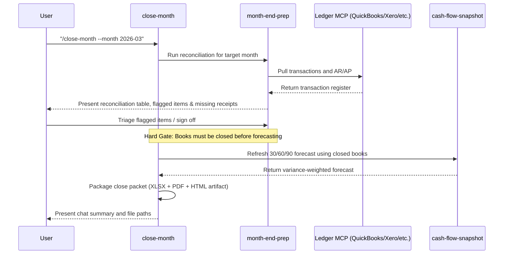

<!-- source: DeepWiki mcp.deepwiki.com · repo anthropics/knowledge-work-plugins · page 6.2 Finance and Operations Skills · fetched 2026-10-26 -->

# Finance and Operations Skills

<details>
<summary>Relevant source files</summary>

The following files were used as context for generating this wiki page:

- [small-business/skills/cash-flow-snapshot/SKILL.md](small-business/skills/cash-flow-snapshot/SKILL.md)
- [small-business/skills/cash-flow-snapshot/reference/examples/worked-example.md](small-business/skills/cash-flow-snapshot/reference/examples/worked-example.md)
- [small-business/skills/cash-flow-snapshot/reference/gotchas.md](small-business/skills/cash-flow-snapshot/reference/gotchas.md)
- [small-business/skills/close-month/SKILL.md](small-business/skills/close-month/SKILL.md)

</details>


The Finance and Operations skills within the Small Business plugin provide a comprehensive suite of tools for managing liquidity, reconciliation, accounts payable, payroll, tax preparation, inventory planning, and operational efficiency. These skills bridge the gap between raw financial data (from QuickBooks, Xero, NetSuite, Stripe, PayPal, Square, etc.) and actionable business intelligence, allowing SMB owners to perform complex financial analysis through natural language.

## Overview of Finance Skills

The finance module is designed around structured workflows such as Read-Analyze-Report, close-then-forecast, and human-in-the-loop approvals. It leverages the Model Context Protocol (MCP) to pull real-time data from accounting, payroll, and payment platforms, applies domain-specific logic (such as variance-weighted forecasting and automated reconciliation matching), and outputs both human-readable chat summaries and machine-readable workbooks (XLSX/PDF).

### Core Financial Commands and Skill Mappings

| Command / Trigger | Skill Mapping | Primary Purpose |
|:---|:---|:---|
| `/plan-payroll` | `cash-flow-snapshot` | Analyzes AR/AP to determine if sufficient cash exists for upcoming payroll cycles [small-business/skills/cash-flow-snapshot/SKILL.md:1-10](). |
| `/month-heads-up` | `month-end-prep` | Proactively identifies reconciliation gaps and missing receipts before the month ends [small-business/skills/close-month/SKILL.md:1-5](). |
| `/close-month` | `close-month` | Reconciles books, generates P&L narratives, refreshes forecasts, and exports a "Close Packet" [small-business/skills/close-month/SKILL.md:1-5](). |
| `/invoice-chase` | `invoice-chase` | Automatically drafts and sends tone-matched overdue invoice reminders. |
| `/ap-processor` | `ap-processor` | Ingests vendor bills, matches against purchase orders, and schedules payments. |
| `/payroll-prep` | `payroll-prep` | Integrates with payroll providers like Gusto to verify and stage payroll runs. |
| `/tax-prep` | `tax-season-organizer` | Categorizes expenses, flags potential deductions, and organizes records for CPA review. |
| `/inventory-plan` | `inventory-planner` | Analyzes stock levels, reorder points, and supplier lead times. |

Sources: [small-business/skills/cash-flow-snapshot/SKILL.md:1-10](), [small-business/skills/close-month/SKILL.md:1-5]()

---

## Cash Flow Snapshot

The `cash-flow-snapshot` skill produces 30/60/90-day forecasts by combining accounting data with historical payment behavior. Unlike static spreadsheets, it calculates **confidence bands** based on the actual payment variance of specific customers.

### Data Flow and Logic

1.  **Source Identification:** The system attempts to connect to available ledgers (MYOB, NetSuite, QuickBooks, Xero, Zoho Books), payment processors (PayPal, Square, Stripe, Shopify), or falls back to CSV uploads [small-business/skills/cash-flow-snapshot/SKILL.md:32-46]().
2.  **Payment Lag Calculation:** For each customer, the skill calculates the `Mean payment lag` (average days from invoice/transaction date to receipt) and `Payment variance` (standard deviation of payment lag) [small-business/skills/cash-flow-snapshot/SKILL.md:82-85]().
3.  **Forecast Generation:** Inflows are adjusted based on mean payment lag. For example, an invoice due on April 10th from a customer with an 18-day mean lag is shifted to April 28th for forecasting purposes [small-business/skills/cash-flow-snapshot/reference/examples/worked-example.md:33-40]().
4.  **Risk Flagging:** The system scans for "Payroll crunch" (where low-band cash on hand is less than upcoming payroll) and "Late-payer risk" [small-business/skills/cash-flow-snapshot/SKILL.md:115-128]().

### Technical Implementation: Confidence Banding

The confidence band uses a weighted average of payment standard deviations to create a "Low" and "High" net cash estimate. The `band_pct` is rounded to one decimal and capped at ±50% [small-business/skills/cash-flow-snapshot/SKILL.md:105-113]().

Title: Cash Flow Snapshot Architecture
```mermaid
graph TD
    subgraph "Natural Language Space"
        UserPrompt[""Will I make payroll next month?""]
    end

    subgraph "Code Entity Space: cash-flow-snapshot"
        Ledger_MCP["Ledger MCP (MYOB, NetSuite, QuickBooks, Xero, Zoho Books)"]
        PP_MCP["PayPal MCP (Transaction History)"]
        Stripe_MCP["Stripe MCP (Charge/Payout History)"]
        Square_MCP["Square MCP (Sales/Payout History)"]
        CSV_Upload["CSV Upload (Income/Expense Tabular Data)"]
        IdentifySources["Step 1: Identify available data sources"]
        PullData["Step 2: Pull the data"]
        ComputeTiming["Step 3: Compute historical payment timing"]
        BuildForecast["Step 4: Build the 30/60/90-day forecast"]
        FlagRisks["Step 5: Flag named risks"]
        DeliverOutputs["Step 6: Deliver outputs"]
        ChatSummary["Chat Summary"]
        XLSXWorkbook["XLSX Workbook"]
    end

    UserPrompt --> IdentifySources
    IdentifySources --> Ledger_MCP
    IdentifySources --> PP_MCP
    IdentifySources --> Stripe_MCP
    IdentifySources --> Square_MCP
    IdentifySources --> CSV_Upload
    Ledger_MCP --> PullData
    PP_MCP --> PullData
    Stripe_MCP --> PullData
    Square_MCP --> PullData
    CSV_Upload --> PullData
    PullData --> ComputeTiming
    ComputeTiming --> BuildForecast
    BuildForecast --> FlagRisks
    FlagRisks --> DeliverOutputs
    DeliverOutputs --> ChatSummary
    DeliverOutputs --> XLSXWorkbook

    subgraph "Confidence Band Calculation"
        BandFormula[""band_pct = weighted_avg_stddev_days / avg_payment_lag_days""]
        LowEstimate[""low = net_cash × (1 − band_pct)""]
        HighEstimate[""high = net_cash × (1 + band_pct)""]
    end
    BuildForecast --> BandFormula
    BandFormula --> LowEstimate
    BandFormula --> HighEstimate
```

Sources: [small-business/skills/cash-flow-snapshot/SKILL.md:32-150](), [small-business/skills/cash-flow-snapshot/reference/examples/worked-example.md:43-55]()

---

## Month-End Close Workflow

The `close-month` skill automates the transition from raw transactions to a finalized financial period. It operates as a three-link chain: reconciliation (`month-end-prep`), forecast refresh (`cash-flow-snapshot`), and packet publication (`report-builder`) [small-business/skills/close-month/SKILL.md:3]().

### Implementation Steps

1.  **Reconciliation (`Step 1`):** Triggers `month-end-prep` to match ledger entries against payment processor settlements (PayPal, Stripe, Square, Ramp) using a date window, flagging uncategorized items, duplicates, and missing receipts [small-business/skills/close-month/SKILL.md:15-23]().
2.  **Hard Gate:** Requires the owner to sign off on triaged items before proceeding to downstream steps [small-business/skills/close-month/SKILL.md:25-30]().
3.  **Forecast Refresh (`Step 2`):** Runs `cash-flow-snapshot` using the closed, reconciled books as its historical base, ensuring collection timing and cost floors reflect true accounting data [small-business/skills/close-month/SKILL.md:33-44]().
4.  **Publish and Distribute (`Step 3`):** Packages the P&L narrative, reconciliation tables, and updated forecast into a multi-tab XLSX workbook and PDF report via `report-builder` [small-business/skills/close-month/SKILL.md:48-58]().

Title: Month-End Close Sequence


Sources: [small-business/skills/close-month/SKILL.md:1-86]()

---

## Invoice Chase

The `invoice-chase` skill automates the process of drafting and sending overdue invoice reminders, matching communication tone to historical customer payment behavior.

### Workflow and Tone Matching

1.  **Pull Overdue Receivables:** Queries ledger AR aging for invoices past due.
2.  **Cross-Reference Payment History:** Checks recent payment processor settlements to prevent chasing customers who have already paid.
3.  **Score Customer:** Classifies customers into payer behavior tiers (`good-payer`, `occasionally-late`, `repeat-late`).
4.  **Draft Reminders & Approval:** Consolidates overdue invoices and drafts tone-matched reminder emails. Requires explicit owner approval before dispatching.

Title: Invoice Chase Process Flow
```mermaid
graph TD
    subgraph "Natural Language Space"
        UserPrompt[""who owes me money" / "follow up on unpaid invoices""]
    end

    subgraph "Code Entity Space: invoice-chase"
        AR_Aging["Ledger AR Aging (Overdue Invoices)"]
        Payment_MCP["Payment Processors (PayPal/Stripe Settlements)"]
        Mail_Connector["Mail Connector (Gmail/Apple Mail)"]

        PullOverdue["1. Pull overdue receivables"]
        CrossReference["2. Cross-reference payment history"]
        ScoreCustomer["3. Score each customer"]
        DraftReminders["4. Draft tone-matched reminder emails"]
        PresentDrafts["5. Present drafts to owner"]
        SendQueue["6. Send or queue upon approval"]

        UserPrompt --> PullOverdue
        PullOverdue --> AR_Aging
        PullOverdue --> Payment_MCP
        CrossReference --> ScoreCustomer
        ScoreCustomer --> DraftReminders
        DraftReminders --> PresentDrafts
        PresentDrafts --> OwnerApproval[("Owner Approval")]
        OwnerApproval --> SendQueue
        SendQueue --> Mail_Connector
    end
```

Sources: [small-business/skills/cash-flow-snapshot/SKILL.md:1-10](), [small-business/skills/close-month/SKILL.md:1-10]()

---

## Additional Finance and Operations Skills

Beyond cash flow, month-end closing, and invoicing, the finance suite includes several specialized domain skills:

- **`ap-processor`**: Ingests vendor bills via email or ledger integrations, checks against purchase orders, flags discrepancies, and stages approval queues for accounts payable.
- **`payroll-prep`**: Integrates with payroll platforms (such as Gusto) to verify upcoming payroll totals, compare against cash balances, and ensure tax withholding compliance.
- **`tax-season-organizer`**: Scans general ledgers for deductible expense categories, compiles Form 1040/1120 schedules, and aggregates missing receipt documentation for CPA review.
- **`inventory-planner`**: Tracks stock levels across sales channels (Shopify, Square), computes velocity and burn rates, and forecasts reorder points based on supplier lead times.

Sources: [small-business/skills/cash-flow-snapshot/SKILL.md:1-12](), [small-business/skills/close-month/SKILL.md:1-10]()

---

## Operational Safeguards and Edge Cases

To ensure financial accuracy and data integrity, finance skills enforce strict safeguards:

- **AR Filtering:** Invoices are filtered by `balance_due > 0` to prevent fully paid transactions from inflating inflow projections [small-business/skills/cash-flow-snapshot/reference/gotchas.md:7-15]().
- **Fuzzy CSV Matching:** Column names in tabular uploads are fuzzy-matched to accommodate varying accounting export formats [small-business/skills/cash-flow-snapshot/reference/gotchas.md:30-40]().
- **Zero-Lag Protection:** Immediate-settlement channels (e.g., POS terminals) assign a default nominal variance band rather than failing on zero-denominator calculations [small-business/skills/cash-flow-snapshot/reference/gotchas.md:55-62]().
- **Human-in-the-Loop Approvals:** Destructive or external actions—such as sending invoice reminders, distributing close packets to accountants, or deleting duplicate records—require explicit owner sign-off [small-business/skills/close-month/SKILL.md:53-65]().

Sources: [small-business/skills/cash-flow-snapshot/reference/gotchas.md:1-62](), [small-business/skills/close-month/SKILL.md:53-65]()

---

