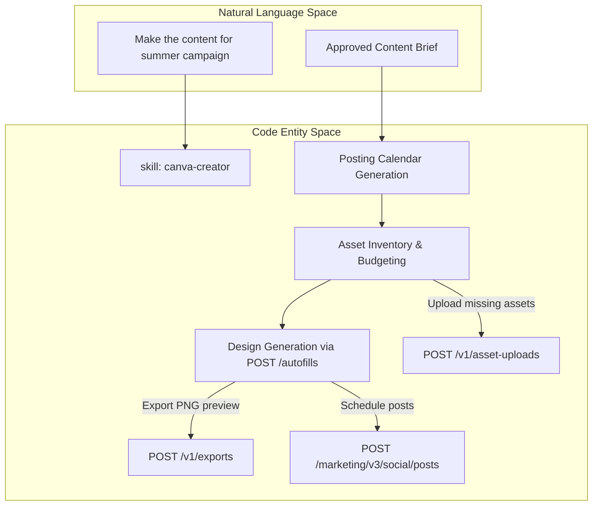
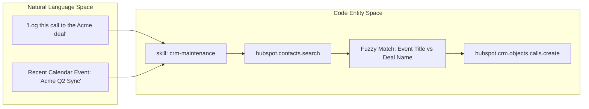

<!-- source: DeepWiki mcp.deepwiki.com · repo anthropics/knowledge-work-plugins · page 6.3 Sales, Marketing, and Customer Skills · fetched 2026-10-26 -->

# Sales, Marketing, and Customer Skills

Relevant source files

The following files were used as context for generating this wiki page:

- [small-business/skills/canva-creator/reference/examples/boutique-brief-campaign.md](small-business/skills/canva-creator/reference/examples/boutique-brief-campaign.md)
- [small-business/skills/canva-creator/reference/gotchas.md](small-business/skills/canva-creator/reference/gotchas.md)
- [small-business/skills/canva-creator/reference/hubspot-staging.md](small-business/skills/canva-creator/reference/hubspot-staging.md)
- [small-business/skills/content-strategy/SKILL.md](small-business/skills/content-strategy/SKILL.md)
- [small-business/skills/content-strategy/reference/examples/retail-boutique-example.md](small-business/skills/content-strategy/reference/examples/retail-boutique-example.md)
- [small-business/skills/content-strategy/reference/gotchas.md](small-business/skills/content-strategy/reference/gotchas.md)

This page documents the specialized skills and commands within the `small-business` plugin designed to automate growth, customer relationship management, and support workflows. These skills bridge the gap between raw data (CRM, email, payments) and actionable business strategy.

---

## Overview of Skills and Commands

The sales and marketing suite focuses on high-leverage activities like lead prioritization, content execution, and CRM hygiene, while customer skills focus on sentiment analysis and automated support routing.

### Sales and Marketing Skills

| Skill | Purpose | Key Connectors |
|:---|:---|:---|
| `lead-triage` | Scores and ranks HubSpot leads for daily outreach. | HubSpot, Google Calendar |
| `content-strategy` | Generates 30-day content briefs based on sales data. | QuickBooks, PayPal, Square, Shopify, Stripe |
| `canva-creator` | Executes campaigns by generating social assets and staging posts. | Canva, HubSpot |
| `crm-maintenance` | Automates data entry and audits deal health. | HubSpot, Gmail, Google Calendar |

### Customer Skills

| Skill | Purpose | Key Connectors |
|:---|:---|:---|
| `customer-pulse` | Aggregates sentiment across support tickets, email, and reviews. | Intercom, HubSpot, PayPal, Gmail |
| `ticket-deflector` | Routes common queries to Knowledge Base articles. | HubSpot, Intercom |
| `review-reputation` | Drafts empathetic responses to reviews and disputes. | PayPal, Gmail, Google Reviews |

Sources: [small-business/skills/content-strategy/SKILL.md:1-10]()

---

## Marketing Execution: Content to Assets

The marketing workflow is a structured multi-stage process: `content-strategy` analyzes performance data to create a brief [small-business/skills/content-strategy/SKILL.md:16-24](), and `canva-creator` transforms that brief into scheduled social media posts and marketing collateral [small-business/skills/content-strategy/SKILL.md:109-111]().

### Data-Driven Content Strategy
The `content-strategy` skill identifies top performers and slow movers by pulling transaction history from financial connectors [small-business/skills/content-strategy/SKILL.md:16-21](). It calculates metrics based on owner preferences and layers in industry seasonality benchmarks [small-business/skills/content-strategy/SKILL.md:45-56](). For QuickBooks integrations, it performs pre-flight validation of industry context via `company-info` and `quickbooks-profile-info-update` [small-business/skills/content-strategy/SKILL.md:30-39](). The output is a concise 30-day brief with ranked recommendations, which requires owner approval before feeding into downstream tools [small-business/skills/content-strategy/SKILL.md:92-111]().

### Automated Asset Creation (`canva-creator`)
This skill operates across sequential stages, enforcing strict validation checks and approval gates:
1.  **Posting Calendar**: Maps themes to channels, tagging social rows for Canva asset generation and email rows as `Text-only` to prevent invalid Canva email templates [small-business/skills/canva-creator/SKILL.md:1-48]().
2.  **Asset Inventory & Budgeting**: Enumerates image slots in templates and calculates API usage budgets to prevent rate-limiting [small-business/skills/canva-creator/SKILL.md:51-82]().
3.  **Design Generation**: Uses the Canva API to autofill templates, polling export and upload endpoints (`POST /autofills`, `POST /exports`) to verify visual outputs [small-business/skills/canva-creator/SKILL.md:108-168]().
4.  **Copy Drafting**: Generates captions and inline email copy.
5.  **HubSpot Staging**: Stages scheduled posts in HubSpot Marketing Hub Professional via social endpoints (`POST /marketing/v3/social/posts`) or exports a scheduling CSV fallback [small-business/skills/canva-creator/SKILL.md:1-138](), [small-business/skills/canva-creator/SKILL.md:1-125]().

**Implementation Flow: Brief to Social Post**

Title: "Canva Creator Execution Pipeline"

Sources: [small-business/skills/content-strategy/SKILL.md:16-111](), [small-business/skills/canva-creator/SKILL.md:1-138]()

---

## Sales Operations and CRM Maintenance

The sales skills focus on reducing administrative overhead by automating lead scoring, CRM data logging, and deal pipeline audits.

### Lead Triage and Scoring
The `lead-triage` skill pulls contacts from HubSpot where lifecycle stages match early prospects [small-business/skills/lead-triage/SKILL.md:18-20](). It applies a multi-dimensional scoring model:
*   **Engagement**: Email opens, clicks, and site visits in the last 30 days.
*   **Company Fit**: Employee count and industry alignment with the owner's ideal customer profile (ICP).
*   **Urgency**: Lead age, stage duration, and keyword presence indicating immediate need.
*   **Recency Penalty**: Adjustments based on recent activity timestamps.

The skill compiles a ranked list, drafts personalized follow-ups matching historical tone in Gmail, and proposes calendar meeting windows.

### CRM Maintenance Logic
The `crm-maintenance` skill handles three operational paths: **Email**, **Call**, and **Cleanup** [small-business/skills/crm-maintenance/SKILL.md:27-31]().
*   **Email Path**: Identifies primary contacts and logs email communication activities to HubSpot [small-business/skills/crm-maintenance/SKILL.md:34-45]().
*   **Call Path**: Pulls recent calendar events to log call activities with titles and durations [small-business/skills/crm-maintenance/SKILL.md:35-46]().
*   **Cleanup Path**: Audits deal stages, amounts, and close dates against recent activity, presenting side-by-side diffs for approval [small-business/skills/crm-maintenance/SKILL.md:36-59]().

**Data Flow: Activity Logging**

Title: "CRM Maintenance Activity Mapping"

Sources: [small-business/skills/lead-triage/SKILL.md:18-46](), [small-business/skills/crm-maintenance/SKILL.md:13-47]()

---

## Customer Sentiment and Support Skills

The customer-facing suite unifies sentiment data across external communication channels and automates ticket deflection and review management.

### Sentiment Data Aggregation
The `customer-pulse` skill aggregates 30-day window data from multiple platforms:
1.  **PayPal**: Dispute and chargeback logs [small-business/skills/customer-pulse/SKILL.md:26]().
2.  **HubSpot**: Open and recently closed support tickets [small-business/skills/customer-pulse/SKILL.md:28]().
3.  **Gmail**: Threads matching dissatisfaction keywords (`refund`, `cancel`, `disappointed`) [small-business/skills/customer-pulse/SKILL.md:30]().
4.  **Intercom**: Conversation searches extracting user-authored messages [small-business/skills/customer-pulse/SKILL.md:32]().
5.  **Reviews**: Pasted user feedback tagged as `[Review]` [small-business/skills/customer-pulse/SKILL.md:34-35]().

The skill groups evidence into categorized themes backed by verbatim quotes and signal counts, concluding with actionable weekly recommendations [small-business/skills/customer-pulse/SKILL.md:36-44]().

Sources: [small-business/skills/customer-pulse/SKILL.md:24-56]()

---

