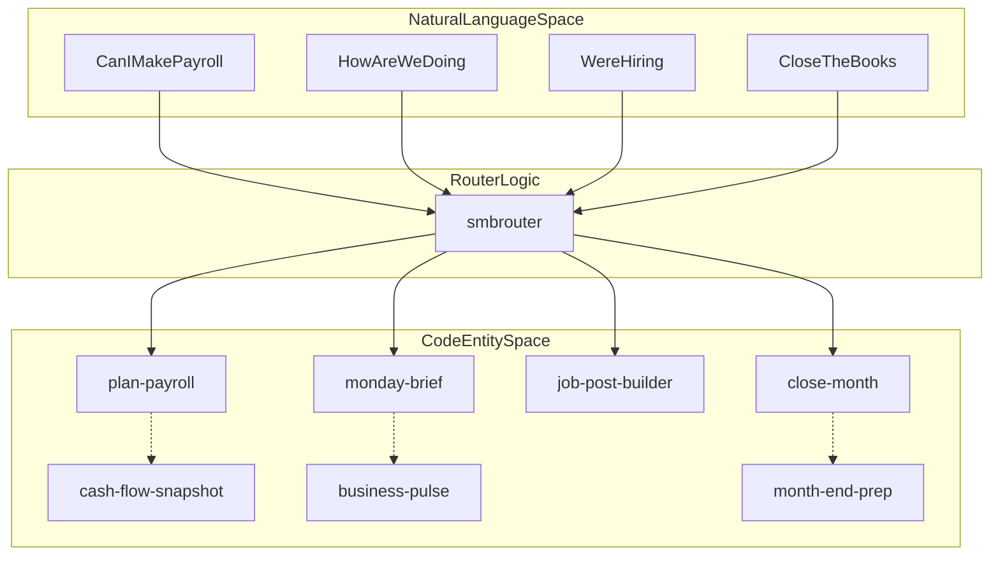
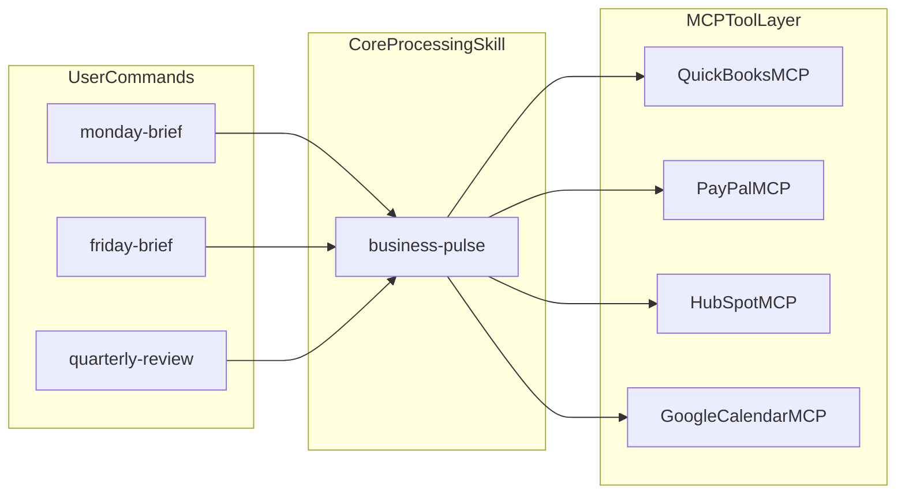

<!-- source: DeepWiki mcp.deepwiki.com · repo anthropics/knowledge-work-plugins · page 6.4 Business Intelligence and Hiring Skills · fetched 2026-10-26 -->

# Business Intelligence and Hiring Skills

Relevant source files

The following files were used as context for generating this wiki page:

- [small-business/README.md](small-business/README.md)
- [small-business/skills/business-pulse/SKILL.md](small-business/skills/business-pulse/SKILL.md)
- [small-business/skills/business-pulse/reference/data_sources.md](small-business/skills/business-pulse/reference/data_sources.md)
- [small-business/skills/business-pulse/reference/gotchas.md](small-business/skills/business-pulse/reference/gotchas.md)
- [small-business/skills/business-pulse/reference/output_template.md](small-business/skills/business-pulse/reference/output_template.md)
- [small-business/skills/business-pulse/reference/thresholds.md](small-business/skills/business-pulse/reference/thresholds.md)
- [small-business/skills/call-list/SKILL.md](small-business/skills/call-list/SKILL.md)
- [small-business/skills/canva-creator/SKILL.md](small-business/skills/canva-creator/SKILL.md)
- [small-business/skills/canva-creator/reference/canva-api.md](small-business/skills/canva-creator/reference/canva-api.md)

## Purpose and Scope

This page documents the business intelligence, growth analytics, intent routing, reporting, proposal creation, and hiring capabilities within the Small Business plugin (`small-business`). These skills provide SMB owners with automated multi-channel reporting, natural language intent mapping, structured recruitment workflows, and grant/RFP generation frameworks.

Sources: [small-business/README.md:1-100](), [small-business/skills/business-pulse/SKILL.md:1-16]()

---

## Business Pulse & Growth Pulse Skills

The `business-pulse` skill produces a one-page, cross-functional snapshot of a business by synthesizing data from all connected tools [small-business/skills/business-pulse/SKILL.md:2-15](). It is designed to degrade gracefully, providing a partial report if only one connector is available, while offering a comprehensive view when the full stack is connected [small-business/skills/business-pulse/SKILL.md:9-11]().

### Data Flow and Parallelization
To minimize latency, the skill dispatches all connector calls in a single parallel batch [small-business/skills/business-pulse/SKILL.md:22-24](). A typical pulse involves multiple parallel MCP tool calls mapped across financial ledgers, payment gateways, CRM objects, calendars, and mail stores [small-business/skills/business-pulse/reference/data_sources.md:1-121]().

| Section | Primary Tool / MCP Function | Metrics Captured |
| :--- | :--- | :--- |
| **Cash & Finance** | `cash_flow_quickbooks_account`, `profit_loss_quickbooks_account`, Xero/Zoho equivalents | Bank balance, MTD revenue, AR aging [small-business/skills/business-pulse/reference/data_sources.md:9-54]() |
| **Revenue & Sales** | PayPal / Square / Stripe Transactions | 7-day settlements, sales trends, failed transactions [small-business/skills/business-pulse/reference/data_sources.md:55-68]() |
| **Pipeline** | `search_crm_objects` (HubSpot) | Pipeline by stage, closed-won deals, cold leads [small-business/skills/business-pulse/reference/data_sources.md:70-78]() |
| **Commitments** | `list_events` (Google Calendar) | Key meetings, customer deadlines [small-business/skills/business-pulse/reference/data_sources.md:79-85]() |
| **Watch List** | `search_threads` (Gmail / M365) | Urgent threads, customer escalations [small-business/skills/business-pulse/reference/data_sources.md:86-95]() |

### Risk Detection Logic
The skill scans for specific "Risk" triggers alongside metric collection [small-business/skills/business-pulse/SKILL.md:72-80]():
*   **Overdue AR**: Ledger invoices > 30 days past due [small-business/skills/business-pulse/reference/thresholds.md:23-28]()
*   **Stalled Deals**: HubSpot deals with no activity for 7+ days or slipped close dates [small-business/skills/business-pulse/reference/thresholds.md:52-53]()
*   **Failed Payments**: Transactions above currency thresholds with failed/pending status [small-business/skills/business-pulse/reference/thresholds.md:39-41]()

Sources: [small-business/skills/business-pulse/SKILL.md:1-100](), [small-business/skills/business-pulse/reference/data_sources.md:1-121](), [small-business/skills/business-pulse/reference/thresholds.md:1-71](), [small-business/skills/business-pulse/reference/output_template.md:1-109]()

---

## Plain-English Intent Routing (`smb-router`)

The **Router** (`smb-router`) serves as the natural language interface for the plugin suite. It maps plain-English user intent to specific workflows and skills, removing the need for users to memorize slash commands [small-business/README.md:5-13]().

### Intent Mapping to Code Entities

The following diagram illustrates how the `smb-router` bridges Natural Language Space to the specific Skill and Command code entities.

**Title: SMB Intent Routing Map**

Sources: [small-business/README.md:45-102](), [small-business/skills/business-pulse/SKILL.md:2-15]()

---

## Report Builder (`report-builder`)

The `report-builder` skill compiles structured financial, operational, and sales reporting packages on demand or on a recurring schedule [small-business/README.md:48](). It aggregates ledger data, CRM metrics, and custom parameters into presentation-ready reports conforming to the business's currency and branding context [small-business/README.md:72]().

Sources: [small-business/README.md:72-80]()

---

## Hiring Skills: Job Post Builder & Hiring Screener (`job-post-builder`, `hiring-screener`)

The hiring capabilities encompass role definition, job posting generation, interview guide creation, and application screening.

### Implementation Phases for Recruitment
1.  **Context Gathering**: Collects role title, responsibilities, and compensation bands through interactive prompting.
2.  **Market Research**: Executes parallel searches across local file stores and web sources for comparable live postings.
3.  **Document Generation**: Produces standardized artifacts including job descriptions, structured interview guides with scoring rubrics, and draft offer letters.
4.  **Signing Integration**: Interfaces with document execution connectors like DocuSign to save draft envelopes securely.

### Safety and Approval Gates
*   **No Auto-Send**: Envelopes and communications are saved as drafts requiring explicit user sign-off [small-business/README.md:105-110]().
*   **No Auto-Publish**: Job listings are never posted directly to external boards without owner confirmation.

Sources: [small-business/README.md:68-94](), [small-business/README.md:105-114]()

---

## Grants, RFPs, and Proposal Builders (`grant-rfp-writer`, `proposal-builder`)

The proposal and grant writing skills (`grant-rfp-writer`, `proposal-builder`) assist SMB owners in responding to complex government RFPs, grant applications, and commercial project bids [small-business/README.md:55,69](). They parse requirements documents, cross-reference company past performance and pricing catalogs, and draft compliant proposal sections while maintaining strict approval boundaries.

Sources: [small-business/README.md:55-90]()

---

## Weekly and Monthly Briefing Commands

The plugin provides structured workflows for recurring business reviews, using the `business-pulse` skill as an underlying engine.

### Briefing Command Architecture

The following diagram illustrates the relationship between user briefing commands and the underlying data connectors.

**Title: Briefing Skill Architecture**

Sources: [small-business/README.md:78-98](), [small-business/skills/business-pulse/SKILL.md:22-46](), [small-business/skills/business-pulse/reference/data_sources.md:1-121]()

---

