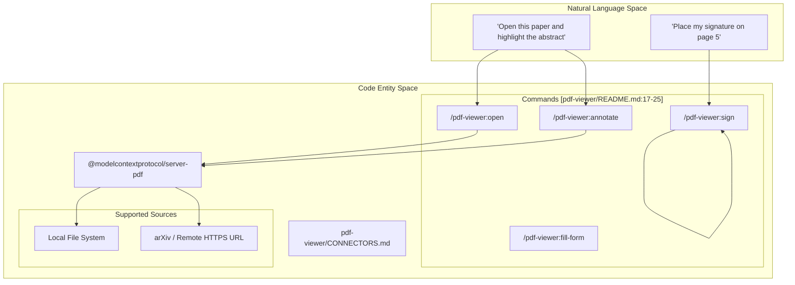
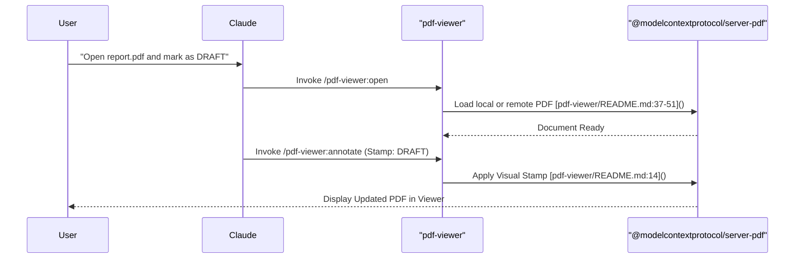

<!-- source: DeepWiki mcp.deepwiki.com · repo anthropics/knowledge-work-plugins · page 7 PDF Plugins · fetched 2026-10-26 -->

# PDF Plugins

Relevant source files

The following files were used as context for generating this wiki page:

- [pdf-viewer/CONNECTORS.md](pdf-viewer/CONNECTORS.md)
- [pdf-viewer/README.md](pdf-viewer/README.md)

The PDF Plugins suite provides Claude with the ability to interact with PDF documents beyond simple text extraction. While Claude can natively read PDF content, the **PDF Viewer Plugin** enables visual workflows, interactive annotation, form filling, and document signing [pdf-viewer/README.md:1-16]().

For detailed information on the viewer architecture and command reference, see the child pages:
- [PDF Viewer Plugin](#7.1) — Document the PDF Viewer plugin: opening PDFs from local/remote sources, interactive annotation, form filling, signing, and the local MCP server architecture
- [PDF Viewer Commands Reference](#7.2) — Reference for the PDF Viewer slash commands: `/open`, `/annotate`, `/fill-form`, `/sign` — arguments, behavior, and licensing of bundled assets

Sources: [pdf-viewer/README.md:1-16]()

## PDF Viewer Overview

The PDF Viewer plugin is designed for interactive, visual workflows where users want to see the document, mark it up, and download an annotated copy [pdf-viewer/README.md:26-29](). It utilizes a local Model Context Protocol (MCP) server (`@modelcontextprotocol/server-pdf`) executed via `npx` [pdf-viewer/CONNECTORS.md:3-10]().

Key capabilities include:
- Opening local files, arXiv URLs (`/abs/` converted to PDF), and direct HTTPS PDF links [pdf-viewer/README.md:46-51]()
- Interactive annotation where Claude proposes highlights, notes, and stamps section by section [pdf-viewer/README.md:9-11]()
- Guided form filling and document signing with visual preview [pdf-viewer/README.md:12-15]()

Sources: [pdf-viewer/README.md:1-57](), [pdf-viewer/CONNECTORS.md:1-15]()

## System Architecture: PDF Viewer

The following diagram illustrates how natural language requests map to code entities and local MCP infrastructure within the PDF Viewer plugin.

### Natural Language to Code Entity Mapping: PDF Viewer

Sources: [pdf-viewer/README.md:1-57](), [pdf-viewer/CONNECTORS.md:1-15]()

### Interaction Flow

The PDF Viewer runs entirely on the local machine via Node.js without requiring external API keys [pdf-viewer/CONNECTORS.md:5-15]().

Sources: [pdf-viewer/README.md:17-39](), [pdf-viewer/CONNECTORS.md:1-15]()

---
**Child Pages:**
- [PDF Viewer Plugin](#7.1) — Document the PDF Viewer plugin: opening PDFs from local/remote sources, interactive annotation, form filling, signing, and the local MCP server architecture
- [PDF Viewer Commands Reference](#7.2) — Reference for the PDF Viewer slash commands: `/open`, `/annotate`, `/fill-form`, `/sign` — arguments, behavior, and licensing of bundled assets

---

