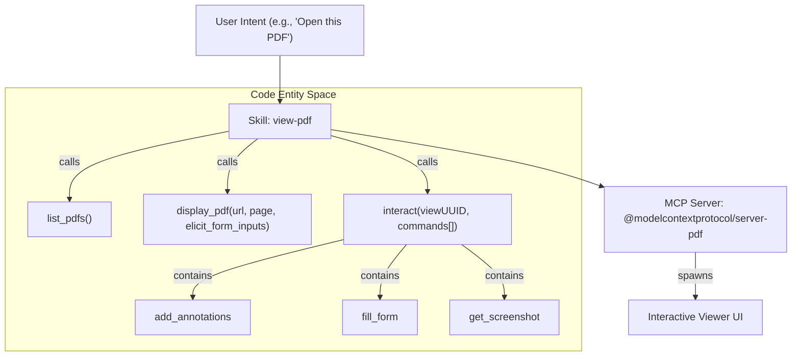
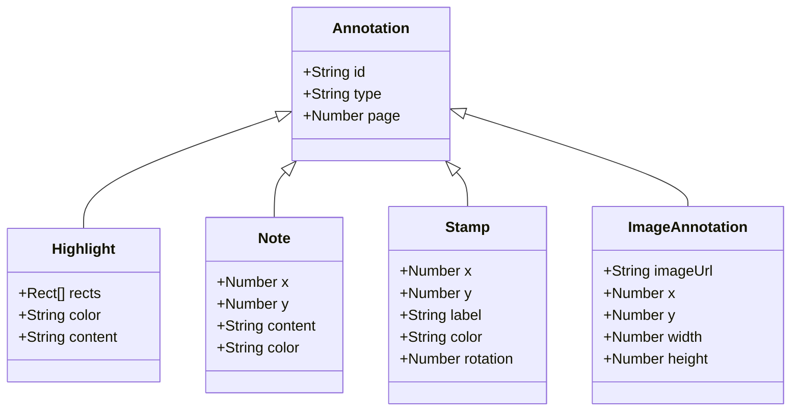

<!-- source: DeepWiki mcp.deepwiki.com · repo anthropics/knowledge-work-plugins · page 7.1 PDF Viewer Plugin · fetched 2026-10-26 -->

# PDF Viewer Plugin

<details>
<summary>Relevant source files</summary>

The following files were used as context for generating this wiki page:

- [pdf-viewer/.mcp.json](pdf-viewer/.mcp.json)
- [pdf-viewer/README.md](pdf-viewer/README.md)
- [pdf-viewer/skills/view-pdf/SKILL.md](pdf-viewer/skills/view-pdf/SKILL.md)

</details>


The PDF Viewer plugin enables interactive, visual workflows for PDF documents within Claude. Unlike standard text extraction, this plugin allows for real-time document viewing, collaborative annotation, form filling, and visual signing through a dedicated local Model Context Protocol (MCP) server (`@modelcontextprotocol/server-pdf`) [pdf-viewer/README.md:3-5](), [pdf-viewer/README.md:35-39]().

## Overview and Scope

The primary purpose of the PDF Viewer plugin is to bridge the gap between static text analysis and interactive document manipulation. It is designed for visual-first tasks where seeing the document layout and applying graphical markup is essential.

### Key Capabilities
*   **Interactive Viewing**: Open PDFs from local paths, arXiv, or direct HTTPS URLs in a live viewer [pdf-viewer/README.md:9-15](), [pdf-viewer/skills/view-pdf/SKILL.md:35-37]().
*   **Collaborative Annotation**: Propose and apply highlights, underlines, strikethroughs, notes, and stamps [pdf-viewer/README.md:10-11](), [pdf-viewer/skills/view-pdf/SKILL.md:56-60]().
*   **Visual Form Filling**: Complete PDF forms with live feedback, handling even cryptic or unnamed fields by matching bounding boxes to visual labels [pdf-viewer/README.md:12](), [pdf-viewer/skills/view-pdf/SKILL.md:108-119]().
*   **Visual Signing**: Place signature or initials images on specific pages and coordinates [pdf-viewer/README.md:13](), [pdf-viewer/skills/view-pdf/SKILL.md:125-131]().
*   **Export**: Download the final annotated PDF directly from the viewer toolbar [pdf-viewer/README.md:15]().

### When to Use vs. Native PDF Reading
| Use PDF Viewer Plugin (`view-pdf`) | Use Native Claude `Read` |
| :--- | :--- |
| Interactive, visual workflows | Pure text ingestion/extraction |
| Marking up contracts/reports | Summarizing a long document |
| Filling out PDF forms visually | Answering questions about content |
| Placing signatures/stamps | Searching for specific keywords |

Sources: [pdf-viewer/README.md:1-57](), [pdf-viewer/skills/view-pdf/SKILL.md:1-147]()

## Local MCP Server Architecture

The plugin relies on a local Model Context Protocol (MCP) server defined in `pdf-viewer/.mcp.json` [pdf-viewer/.mcp.json:1-8](), [pdf-viewer/README.md:35-39](). 

```json
{
  "mcpServers": {
    "pdf": {
      "command": "npx",
      "args": ["-y", "@modelcontextprotocol/server-pdf", "--stdio"]
    }
  }
}
```

This configuration executes `@modelcontextprotocol/server-pdf` via `npx` over standard input/output (`--stdio`), requiring Node.js >= 18 and no remote API keys [pdf-viewer/.mcp.json:1-8](), [pdf-viewer/README.md:35-44]().

### System Component Mapping

The following diagram maps natural language intents to the underlying code entities and MCP tool calls exposed by the `view-pdf` skill.


Sources: [pdf-viewer/.mcp.json:1-8](), [pdf-viewer/skills/view-pdf/SKILL.md:30-73]()

## Commands and the `view-pdf` Skill

The plugin exposes four primary slash commands mapped to interactive workflows:
*   `/pdf-viewer:open` — Open a PDF in the interactive viewer [pdf-viewer/README.md:21]()
*   `/pdf-viewer:annotate` — Walk through the document, propose and apply markup, review together [pdf-viewer/README.md:22]()
*   `/pdf-viewer:fill-form` — Fill PDF form fields interactively with visual feedback [pdf-viewer/README.md:23]()
*   `/pdf-viewer:sign` — Place a signature or initials image on the page [pdf-viewer/README.md:24]()

### Skill Tool Definitions

The core logic resides in the `view-pdf` skill (`pdf-viewer/skills/view-pdf/SKILL.md`), which exposes three core tool abstractions:

1.  `list_pdfs`: Lists available local PDFs and allowed directories with no arguments [pdf-viewer/skills/view-pdf/SKILL.md:32-33]().
2.  `display_pdf`: Opens a PDF in the interactive viewer. Returns a `viewUUID` required for all subsequent `interact` calls, along with `formFields` metadata [pdf-viewer/skills/view-pdf/SKILL.md:35-48]().
3.  `interact`: Executes batched actions (navigation, text extraction, search, annotation modification, form filling, and screenshot capture) against a specific `viewUUID` [pdf-viewer/skills/view-pdf/SKILL.md:49-73]().

Sources: [pdf-viewer/README.md:17-25](), [pdf-viewer/skills/view-pdf/SKILL.md:30-73]()

## Annotation Types and Data Structures

Annotations use PDF points (1/72 inch) with the coordinate origin at the **top-left** where Y increases downward (e.g., US Letter is 612×792pt) [pdf-viewer/skills/view-pdf/SKILL.md:76-78]().


Sources: [pdf-viewer/skills/view-pdf/SKILL.md:74-95]()

## Interactive Workflows

### Collaborative Annotation Workflow
1. Call `display_pdf` to initialize the viewer session [pdf-viewer/skills/view-pdf/SKILL.md:100]()
2. Call `interact` with `get_text` on target page ranges to inspect contents [pdf-viewer/skills/view-pdf/SKILL.md:101]()
3. Propose batches of annotations to the user before applying changes [pdf-viewer/skills/view-pdf/SKILL.md:102]()
4. Execute `interact` with `add_annotations` and terminate the batch with `get_screenshot` to verify visually [pdf-viewer/skills/view-pdf/SKILL.md:103-104]()

### Visual Form Filling and Signing Workflows
*   **Form Filling**: Inspects returned `formFields` (name, type, page, bounding box). If field names are cryptic (e.g., `Text1`), `get_screenshot` is used to match visual labels to field coordinates before invoking `fill_form` [pdf-viewer/skills/view-pdf/SKILL.md:112-119]().
*   **Signing**: Places visual PNG/JPG signature images via `type: "image"` annotations at specified coordinates. As outlined in the plugin disclaimers, this is a visual placement tool and does **not** generate cryptographic or certified digital signatures [pdf-viewer/README.md:53-57](), [pdf-viewer/skills/view-pdf/SKILL.md:125-134]().

Sources: [pdf-viewer/README.md:53-57](), [pdf-viewer/skills/view-pdf/SKILL.md:97-134]()

---

