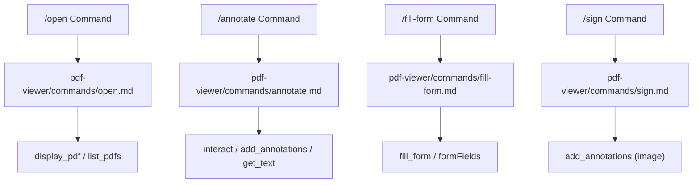
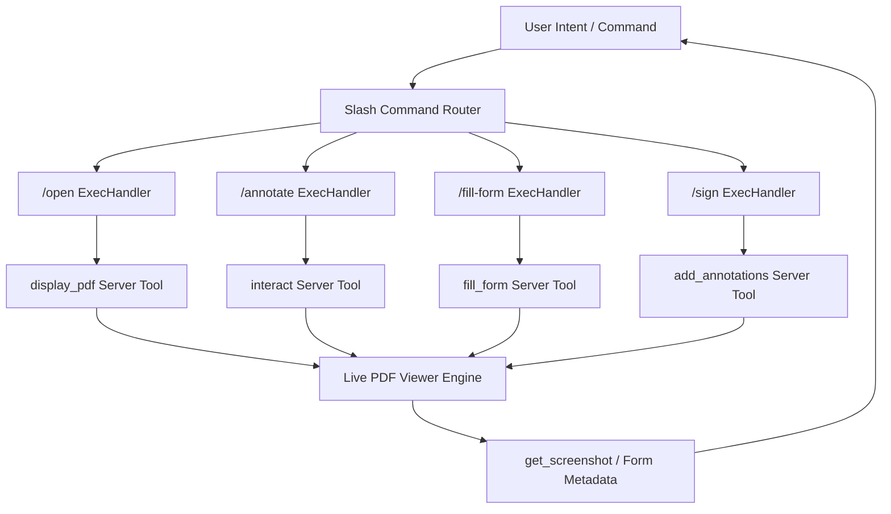

<!-- source: DeepWiki mcp.deepwiki.com · repo anthropics/knowledge-work-plugins · page 7.2 PDF Viewer Commands Reference · fetched 2026-10-26 -->

# PDF Viewer Commands Reference

<details>
<summary>Relevant source files</summary>

The following files were used as context for generating this wiki page:

- [pdf-viewer/LICENSE](pdf-viewer/LICENSE)
- [pdf-viewer/commands/annotate.md](pdf-viewer/commands/annotate.md)
- [pdf-viewer/commands/fill-form.md](pdf-viewer/commands/fill-form.md)
- [pdf-viewer/commands/open.md](pdf-viewer/commands/open.md)
- [pdf-viewer/commands/sign.md](pdf-viewer/commands/sign.md)

</details>


This document provides a technical reference for the PDF Viewer plugin slash commands: `/open`, `/annotate`, `/fill-form`, and `/sign`. It covers command arguments, expected behaviors, interaction workflows, underlying Model Context Protocol (MCP) tool mappings, and the licensing model governing the plugin's bundled assets.

Sources: 
- `pdf-viewer/commands/open.md:1-35`()
- `pdf-viewer/commands/annotate.md:1-52`()
- `pdf-viewer/commands/fill-form.md:1-74`()
- `pdf-viewer/commands/sign.md:1-55`()
- `pdf-viewer/LICENSE:1-126`()

---

## 1. Slash Command Architecture and Tool Mapping

The PDF Viewer plugin maps user-facing slash commands to specific markdown documentation files and underlying MCP tools. The following diagram illustrates the relationship between the natural language command space and the plugin's code entity space.



Sources: 
- `pdf-viewer/commands/open.md:1-35`()
- `pdf-viewer/commands/annotate.md:1-52`()
- `pdf-viewer/commands/fill-form.md:1-74`()
- `pdf-viewer/commands/sign.md:1-55`()

---

## 2. `/open` Command Reference

The `/open` command displays a PDF document in the interactive live viewer, utilized when visual inspection is required rather than programmatic text extraction.

### Arguments and Behavior
- **Argument Hint:** `[path-or-url]`
- **Description:** Open a PDF in the interactive viewer.
- **Supported Sources:**
  - Local files (absolute/relative paths or drag-and-drop into the working directory).
  - arXiv references (`arxiv.org/abs/...`, auto-converted to PDF URLs).
  - Direct HTTPS PDF URLs (direct PDF links, not HTML landing pages).

### Execution Flow
1. If a path or URL is provided, invoke `display_pdf` with the target `[pdf-viewer/commands/open.md:15-15]()`.
2. If no path or URL is provided, invoke `list_pdfs` to display available documents (`[pdf-viewer/commands/open.md:16-16]()`).
3. Offer contextual next steps based on document classification (contracts/reports, forms, academic papers) (`[pdf-viewer/commands/open.md:17-23]()`).

Sources: 
- `pdf-viewer/commands/open.md:1-35`()

---

## 3. `/annotate` Command Reference

The `/annotate` command facilitates collaborative markup and annotation of a PDF document through an interactive review loop.

### Arguments and Behavior
- **Argument Hint:** `[path-or-url]`
- **Description:** Collaboratively annotate a PDF — propose markup, review together, iterate.

### Workflows
- **AI-driven Default:**
  1. Open the document via `display_pdf` (or reuse existing `viewUUID`) (`[pdf-viewer/commands/annotate.md:16-16]()`).
  2. Extract text using `interact` -> `get_text` on the initial page range (≤20 pages) (`[pdf-viewer/commands/annotate.md:17-18]()`).
  3. Propose batches of 3–5 annotations to the user (`[pdf-viewer/commands/annotate.md:19-22]()`, `[pdf-viewer/commands/annotate.md:51-51]()`).
  4. Apply approved annotations using `interact` with `add_annotations` combined with `get_screenshot` (`[pdf-viewer/commands/annotate.md:23-25]()`, `[pdf-viewer/commands/annotate.md:49-50]`).
  5. Iterate through document sections and finalize (`[pdf-viewer/commands/annotate.md:26-28]()`).
- **Manual Mode:** Skips the proposal step when explicit instructions are provided (e.g., `"highlight paragraph 3"`), executing directly while maintaining screenshot verification (`[pdf-viewer/commands/annotate.md:30-34]()`).

### Supported Annotation Types
- **Text Markup:** `highlight_text` (preferred auto-find method), `highlight`, `underline`, `strikethrough` (`[pdf-viewer/commands/annotate.md:38-39]()`).
- **Comments:** Sticky notes (`note`), visible text comments (`freetext`) (`[pdf-viewer/commands/annotate.md:40-40]()`).
- **Shapes:** Rectangle, circle, line (`[pdf-viewer/commands/annotate.md:41-41]()`).
- **Stamps:** Labels including `APPROVED`, `DRAFT`, `CONFIDENTIAL`, `REVIEWED` (`[pdf-viewer/commands/annotate.md:42-42]()`).
- **Images:** Signatures, initials, and logos (`[pdf-viewer/commands/annotate.md:43-43]()`).

Sources: 
- `pdf-viewer/commands/annotate.md:1-52`()

---

## 4. `/fill-form` Command Reference

The `/fill-form` command assists users in completing fillable PDF forms with live visual feedback, addressing issues with unlabelled or machine-named fields (`Text1`, `Field_7`).

### Arguments and Behavior
- **Argument Hint:** `[path-or-url]`
- **Description:** Fill PDF form fields interactively with live visual feedback.

### Interaction Approaches
1. **User-driven Approach (Simple, well-labeled forms):**
   - Invokes `display_pdf` with `elicit_form_inputs: true` (`[pdf-viewer/commands/fill-form.md:30-32]()`). The server prompts the user for values before rendering the viewer.
2. **AI-assisted Approach (Complex forms or cryptic metadata):**
   - Calls `display_pdf` without elicitation to inspect `formFields` metadata (`[pdf-viewer/commands/fill-form.md:36-37]()`).
   - Uses `interact` -> `get_screenshot` to map visual labels next to bounding boxes (`[pdf-viewer/commands/fill-form.md:38-40]()`).
   - Populates fields via `interact` -> `fill_form` with `fields: [{name, value}, ...]` (`[pdf-viewer/commands/fill-form.md:45-45]()`).
   - Verifies via `get_screenshot` (`[pdf-viewer/commands/fill-form.md:46-46]()`).

Sources: 
- `pdf-viewer/commands/fill-form.md:1-74`()

---

## 5. `/sign` Command Reference

The `/sign` command places signature or initial images onto PDF documents.

### Arguments and Behavior
- **Argument Hint:** `[path-or-url] [signature-image-path]`
- **Description:** Place a signature or initials image on a PDF.

### Important Disclaimer
> **Disclaimer:** This places a signature **image** on the page. It is **not** a certified or cryptographic digital signature. For legally binding e-signatures, dedicated signing services must be used (`[pdf-viewer/commands/sign.md:13-15]()`).

### Execution Workflow
1. Request a local PNG/JPG signature or initials image path from the user (`[pdf-viewer/commands/sign.md:19-21]()`).
2. Open the PDF via `display_pdf` (or reuse `viewUUID`), parsing `formFields` for signature-type coordinates (`[pdf-viewer/commands/sign.md:23-25]()`).
3. Locate target coordinates or prompt the user (`[pdf-viewer/commands/sign.md:27-29]()`).
4. Place the image using `interact` -> `add_annotations`:
   ```json
   {"action": "add_annotations", "annotations": [
     {"id": "sig1", "type": "image", "page": 3,
      "imageUrl": "/path/to/signature.png",
      "x": 400, "y": 700, "width": 150}
   ]}
   ```
   (`[pdf-viewer/commands/sign.md:31-38]()`).
5. Verify via `get_screenshot` (`[pdf-viewer/commands/sign.md:41-43]()`).

Sources: 
- `pdf-viewer/commands/sign.md:1-55`()

---

## 6. Command Execution Data Flow

The following diagram bridges natural language command invocations to the underlying MCP server execution handlers, illustrating data flow between the AI assistant, commands, and the viewer service.



Sources: 
- `pdf-viewer/commands/open.md:1-35`()
- `pdf-viewer/commands/annotate.md:1-52`()
- `pdf-viewer/commands/fill-form.md:1-74`()
- `pdf-viewer/commands/sign.md:1-55`()

---

## 7. Licensing of Bundled Assets

The PDF Viewer plugin and its bundled components are licensed under the **Apache License, Version 2.0**. 

### Key Terms and Conditions
- **Grant of Copyright License:** Each contributor grants a perpetual, worldwide, non-exclusive, no-charge, royalty-free, irrevocable copyright license to reproduce, prepare derivative works of, publicly display, sublicense, and distribute the Work (`[pdf-viewer/LICENSE:67-72]()`).
- **Grant of Patent License:** Contributors grant a perpetual, worldwide, non-exclusive, no-charge, royalty-free patent license for claims infringed by their contributions (`[pdf-viewer/LICENSE:74-82]()`).
- **Redistribution Requirements:** 
  - Recipients must receive a copy of the Apache License 2.0 (`[pdf-viewer/LICENSE:95-96]()`).
  - Modified files must carry prominent notices indicating file alterations (`[pdf-viewer/LICENSE:98-99]()`).
  - Copyright, patent, trademark, and attribution notices from the source form must be retained (`[pdf-viewer/LICENSE:101-105]()`).

Sources: 
- `pdf-viewer/LICENSE:1-126`()

---

