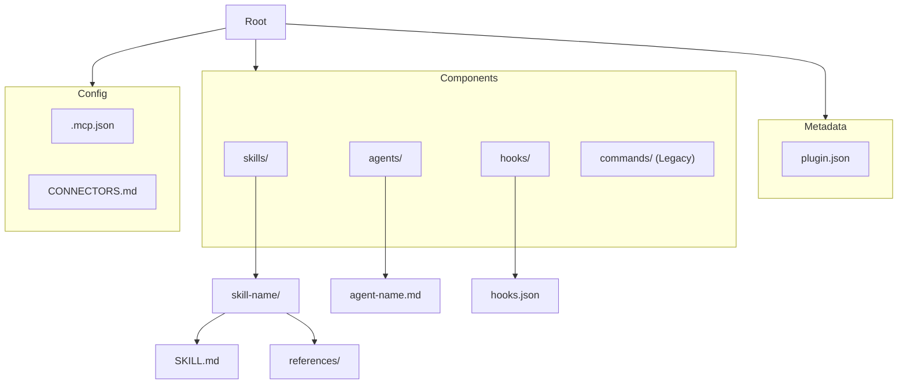
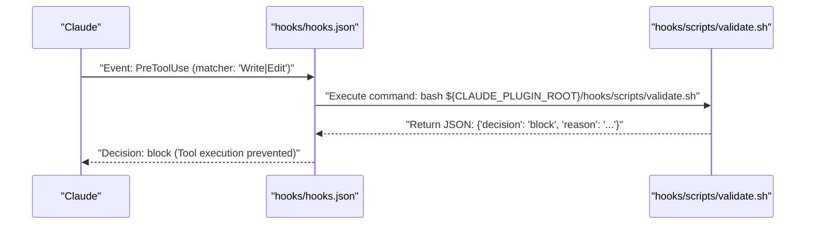

<!-- source: DeepWiki mcp.deepwiki.com · repo anthropics/knowledge-work-plugins · page 8.1 Creating a New Plugin · fetched 2026-10-26 -->

# Creating A New Plugin

<details>
<summary>Relevant source files</summary>

The following files were used as context for generating this wiki page:

- [cowork-plugin-management/.claude-plugin/plugin.json](cowork-plugin-management/.claude-plugin/plugin.json)
- [cowork-plugin-management/skills/cowork-plugin-customizer/SKILL.md](cowork-plugin-management/skills/cowork-plugin-customizer/SKILL.md)
- [cowork-plugin-management/skills/cowork-plugin-customizer/references/mcp-servers.md](cowork-plugin-management/skills/cowork-plugin-customizer/references/mcp-servers.md)
- [cowork-plugin-management/skills/create-cowork-plugin/SKILL.md](cowork-plugin-management/skills/create-cowork-plugin/SKILL.md)
- [cowork-plugin-management/skills/create-cowork-plugin/references/component-schemas.md](cowork-plugin-management/skills/create-cowork-plugin/references/component-schemas.md)
- [cowork-plugin-management/skills/create-cowork-plugin/references/example-plugins.md](cowork-plugin-management/skills/create-cowork-plugin/references/example-plugins.md)

</details>


## Purpose and Scope

This guide provides a step-by-step walkthrough for creating a new plugin from scratch, following the standardized structure and conventions used across the `knowledge-work-plugins` repository. This architecture is shared with Claude Code and Claude Cowork, focusing on extending Claude's capabilities with specialized skills, agents, and Model Context Protocol (MCP) integrations.

For programmatic generation, see [8.2 Using cowork-plugin-management](). This page focuses on manual implementation to explain the underlying data flow and entity relationships.

Sources: [cowork-plugin-management/skills/create-cowork-plugin/SKILL.md:1-16](), [cowork-plugin-management/skills/create-cowork-plugin/SKILL.md:99-101]()

---

## Plugin Directory Structure

Every plugin follows a standardized layout. High-level metadata resides in a hidden directory, while functional components (skills, agents, hooks) are placed at the root.


**Standard Plugin Directory Layout**

Sources: [cowork-plugin-management/skills/create-cowork-plugin/SKILL.md:30-45](), [cowork-plugin-management/skills/create-cowork-plugin/references/component-schemas.md:38-50]()

| Component | Location | Format | Role |
| :--- | :--- | :--- | :--- |
| **Manifest** | `.claude-plugin/plugin.json` | JSON | Required. Defines name, version, and entry points. |
| **Skills** | `skills/*/SKILL.md` | MD + YAML | Core domain knowledge and workflows. |
| **Agents** | `agents/*.md` | MD + YAML | Specialized autonomous sub-personas. |
| **MCP Config** | `.mcp.json` | JSON | External tool and server definitions. |
| **Hooks** | `hooks/hooks.json` | JSON | Event-driven logic (e.g., `PreToolUse`). |

Sources: [cowork-plugin-management/skills/create-cowork-plugin/SKILL.md:89-98]()

---

## Step 1: The Plugin Manifest (`plugin.json`)

The `plugin.json` file is the entry point. It must reside in `.claude-plugin/`.

```json
{
  "name": "data-analyst",
  "version": "0.1.0",
  "description": "Expert SQL generation and visualization for Snowflake.",
  "author": { "name": "Engineering Team" },
  "mcpServers": "./.mcp.json",
  "hooks": "./hooks/hooks.json"
}
```

**Key Rules:**
- **Name**: Must be kebab-case (lowercase, hyphens) [cowork-plugin-management/skills/create-cowork-plugin/SKILL.md:71-71]().
- **Version**: Follows SemVer; start at `0.1.0` [cowork-plugin-management/skills/create-cowork-plugin/SKILL.md:72-72]().
- **Path Overrides**: You can specify custom paths for `commands`, `agents`, or `hooks` to supplement auto-discovery [cowork-plugin-management/skills/create-cowork-plugin/SKILL.md:76-85]().

Sources: [cowork-plugin-management/skills/create-cowork-plugin/SKILL.md:58-85]()

---

## Step 2: Implementing Skills (`SKILL.md`)

Skills are the preferred way to deliver domain knowledge. They support **Progressive Disclosure**: Claude only loads the full body of `SKILL.md` when the description's trigger phrases are matched.

### Skill Anatomy
A skill consists of a directory containing at least a `SKILL.md` file with YAML frontmatter.

```markdown
---
name: api-design
description: >
  This skill should be used when the user asks to "design an API" or "create endpoints".
metadata:
  version: "0.1.0"
---
# API Design Guidelines
Follow REST best practices...
```

**Writing Rules:**
- **Frontmatter Description**: Use third-person ("This skill should be used when...") and include trigger phrases in quotes [cowork-plugin-management/skills/create-cowork-plugin/references/component-schemas.md:34-34]().
- **Body**: Use imperative form ("Parse the file," not "You should parse") [cowork-plugin-management/skills/create-cowork-plugin/references/component-schemas.md:35-35]().
- **Size Limit**: Keep the main `SKILL.md` under 3,000 words. Move deep technical details to `references/` [cowork-plugin-management/skills/create-cowork-plugin/references/component-schemas.md:36-36]().

Sources: [cowork-plugin-management/skills/create-cowork-plugin/references/component-schemas.md:5-37]()

---

## Step 3: Tool Integration (MCP & Connectors)

Plugins interact with the world via Model Context Protocol (MCP) servers.

### Connector Abstraction (`~~` Pattern)
To keep plugins tool-agnostic (e.g., supporting both Jira and Linear), use the `~~` placeholder syntax in your skills. This pattern should only be introduced if the plugin is intended for external distribution [cowork-plugin-management/skills/create-cowork-plugin/SKILL.md:102-105]().


**Natural Language to Code Entity Mapping: Connectors**

- **In `SKILL.md`**: Write "Create an issue in `~~project-tracker`" [cowork-plugin-management/skills/create-cowork-plugin/SKILL.md:109-109]().
- **In `CONNECTORS.md`**: Define the table mapping the category to options [cowork-plugin-management/skills/create-cowork-plugin/SKILL.md:110-127]().

### MCP Configuration (`.mcp.json`)
Define the actual executable or remote endpoint in `.mcp.json`. Use `${CLAUDE_PLUGIN_ROOT}` for all intra-plugin path references to avoid hardcoding absolute paths [cowork-plugin-management/skills/create-cowork-plugin/SKILL.md:129-131]().

```json
{
  "mcpServers": {
    "local-tool": {
      "command": "node",
      "args": ["${CLAUDE_PLUGIN_ROOT}/scripts/server.js"]
    }
  }
}
```

Sources: [cowork-plugin-management/skills/create-cowork-plugin/SKILL.md:102-131](), [cowork-plugin-management/skills/create-cowork-plugin/references/component-schemas.md:229-245]()

---

## Step 4: Advanced Logic (Agents & Hooks)

### Agents
Agents are specialized sub-personas defined in Markdown with YAML frontmatter. They can be restricted to specific tools and have color-coded UI identities.

- **Location**: `agents/agent-name.md` [cowork-plugin-management/skills/create-cowork-plugin/references/component-schemas.md:60-60]().
- **Colors**: Use `blue`/`cyan` for analysis and review, `magenta` for creative generation, `green` for success-oriented tasks, and `yellow`/`red` for validation or security [cowork-plugin-management/skills/create-cowork-plugin/references/component-schemas.md:134-141]().
- **Tools**: Restrict an agent to a subset of tools using the `tools` array in frontmatter (e.g., `["Read", "Grep", "Glob"]`) [cowork-plugin-management/skills/create-cowork-plugin/references/component-schemas.md:71-100]().

### Hooks
Hooks allow the plugin to intercept lifecycle events like `PreToolUse`, `SessionStart`, or `Stop`. They can be prompt-based (LLM evaluation) or command-based (deterministic scripts) [cowork-plugin-management/skills/create-cowork-plugin/references/component-schemas.md:163-184]().


**Code Entity Flow: Hook Interception**

Sources: [cowork-plugin-management/skills/create-cowork-plugin/references/component-schemas.md:142-228]()

---

## Step 5: Packaging and Delivery

Once files are implemented, the plugin must be packaged for the Cowork environment.

1.  **Validation**: Ensure `.claude-plugin/plugin.json` is present and valid [cowork-plugin-management/skills/create-cowork-plugin/SKILL.md:51-51]().
2.  **Pathing**: Verify all intra-plugin references in hooks and MCP configs use the `${CLAUDE_PLUGIN_ROOT}` variable [cowork-plugin-management/skills/create-cowork-plugin/SKILL.md:129-131]().
3.  **Packaging**: The final output is a `.plugin` file delivered to the user's `outputs` directory [cowork-plugin-management/skills/create-cowork-plugin/SKILL.md:6-12]().

Sources: [cowork-plugin-management/skills/create-cowork-plugin/SKILL.md:1-25]()

---

