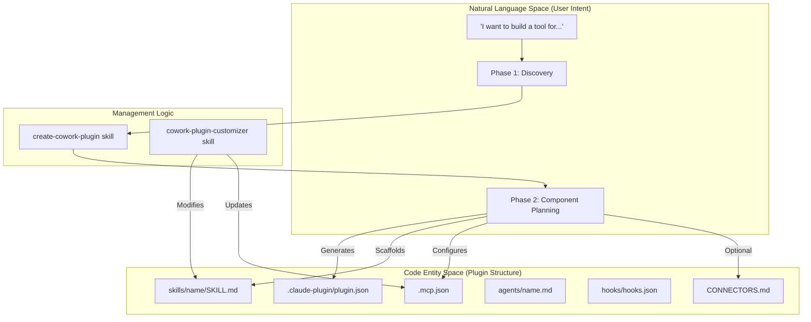
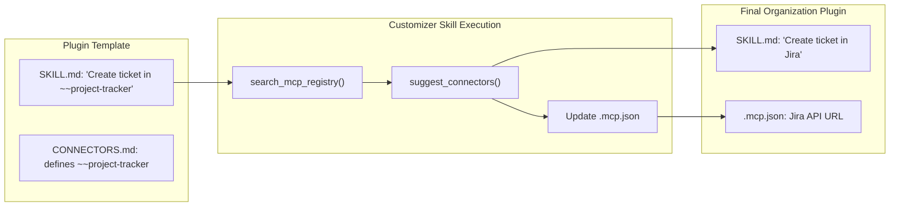

<!-- source: DeepWiki mcp.deepwiki.com · repo anthropics/knowledge-work-plugins · page 8.2 Using cowork-plugin-management · fetched 2026-10-26 -->

# Using cowork-plugin-management

Relevant source files

The following files were used as context for generating this wiki page:

- [cowork-plugin-management/.claude-plugin/plugin.json](cowork-plugin-management/.claude-plugin/plugin.json)
- [cowork-plugin-management/skills/cowork-plugin-customizer/SKILL.md](cowork-plugin-management/skills/cowork-plugin-customizer/SKILL.md)
- [cowork-plugin-management/skills/cowork-plugin-customizer/references/mcp-servers.md](cowork-plugin-management/skills/cowork-plugin-customizer/references/mcp-servers.md)
- [cowork-plugin-management/skills/create-cowork-plugin/SKILL.md](cowork-plugin-management/skills/create-cowork-plugin/SKILL.md)
- [cowork-plugin-management/skills/create-cowork-plugin/references/component-schemas.md](cowork-plugin-management/skills/create-cowork-plugin/references/component-schemas.md)
- [cowork-plugin-management/skills/create-cowork-plugin/references/example-plugins.md](cowork-plugin-management/skills/create-cowork-plugin/references/example-plugins.md)

## Purpose and Scope

This page documents how to use the `cowork-plugin-management` plugin to programmatically create, customize, and manage Claude plugins. The plugin provides automated workflows for generating plugin scaffolding, configuring Model Context Protocol (MCP) server connections, and adapting plugin templates to match organizational needs.

This plugin is specifically designed for the **Claude Cowork** desktop environment, enabling a five-phase guided workflow to move from a concept to a ready-to-install `.plugin` package.

**Sources:** [cowork-plugin-management/.claude-plugin/plugin.json:1-8](), [cowork-plugin-management/skills/create-cowork-plugin/SKILL.md:1-25]()

## Overview

The `cowork-plugin-management` plugin occupies a unique meta-position: it is a plugin that manages other plugins. It abstracts the complexities of the plugin directory structure and component schemas into a conversational interface.

### Component Relationship Diagram
This diagram bridges the "Natural Language Space" (user intent) to the "Code Entity Space" (the actual files and schemas generated by the plugin).

**Diagram: Mapping User Intent to Plugin Code Entities**

**Sources:** [cowork-plugin-management/skills/create-cowork-plugin/SKILL.md:12-25](), [cowork-plugin-management/skills/create-cowork-plugin/SKILL.md:30-45](), [cowork-plugin-management/skills/create-cowork-plugin/SKILL.md:110-127]()

## Key Skills and Workflows

The plugin exposes two primary skills that drive the management lifecycle.

### 1. create-cowork-plugin
This skill guides users through a five-phase workflow to build a plugin from scratch. It is the primary entry point for scaffolding new capabilities.

| Phase | Activity | Primary Code Entity |
|-------|----------|---------------------|
| **1. Discovery** | Understand problem and scope | N/A (Conversation) |
| **2. Planning** | Determine needed components | `plugin.json` |
| **3. Design** | Specify component details | `component-schemas.md` |
| **4. Implementation** | Create all plugin files | `skills/`, `agents/`, `.mcp.json` |
| **5. Review** | Package for delivery | `[name].plugin` |

**Sources:** [cowork-plugin-management/skills/create-cowork-plugin/SKILL.md:18-25](), [cowork-plugin-management/skills/create-cowork-plugin/references/component-schemas.md:1-240]()

### 2. cowork-plugin-customizer
This skill adapts existing plugins to an organization's specific environment. It is primarily used to resolve `~~` placeholders (connectors) and search for relevant MCP servers using `search_mcp_registry`.

**Customization Modes:**
- **Generic Setup**: Replacing `~~`-prefixed placeholders (e.g., `~~Jira` → `Asana`).
- **Scoped Customization**: Modifying specific parts of a plugin (e.g., "update the standup skill").
- **General Customization**: Broad modifications to behavior and instructions.

**Sources:** [cowork-plugin-management/skills/cowork-plugin-customizer/SKILL.md:16-30](), [cowork-plugin-management/skills/cowork-plugin-customizer/references/mcp-servers.md:7-19]()

## Plugin Architecture and Schemas

When using `cowork-plugin-management` to generate or modify plugins, it adheres to strict directory structures and schema definitions.

### Component Locations and Formats

| Component | Location | Format | Role |
|-----------|----------|--------|------|
| **Manifest** | `.claude-plugin/plugin.json` | JSON | Metadata, versioning, and custom path overrides. |
| **Skills** | `skills/*/SKILL.md` | MD + YAML | Domain knowledge, trigger phrases, and progressive disclosure. |
| **MCP Servers** | `.mcp.json` | JSON | Connection details (stdio or http) for external tools. |
| **Agents** | `agents/*.md` | MD + YAML | Autonomous personas for multi-step tasks. |
| **Hooks** | `hooks/hooks.json` | JSON | Event-driven logic (e.g., `PreToolUse`, `SessionStart`). |

**Sources:** [cowork-plugin-management/skills/create-cowork-plugin/SKILL.md:32-45](), [cowork-plugin-management/skills/create-cowork-plugin/SKILL.md:89-98](), [cowork-plugin-management/skills/create-cowork-plugin/references/component-schemas.md:5-230]()

### Connector System (The `~~` Pattern)
The customizer skill specifically looks for `~~` placeholders to enable tool-agnostic plugins. This allows a single plugin template to work across different organizations using different tool stacks.

**Diagram: Connector Resolution via cowork-plugin-customizer**

**Sources:** [cowork-plugin-management/skills/create-cowork-plugin/SKILL.md:102-128](), [cowork-plugin-management/skills/cowork-plugin-customizer/references/mcp-servers.md:1-43](), [cowork-plugin-management/skills/cowork-plugin-customizer/references/mcp-servers.md:57-88]()

## Advanced Implementation Details

### Hook Events and Decisions
For complex management or validation, the plugin can configure `hooks.json`. Hooks can be **Prompt-based** (LLM-driven) or **Command-based** (deterministic scripts).

| Event | Description |
|-------|-------------|
| `PreToolUse` | Fires before a tool call (can block execution). |
| `PostToolUse` | Fires after a tool call completes. |
| `SessionStart` | Used to load initial context (e.g., `cat project-context.md`). |
| `UserPromptSubmit`| Fires when the user sends a message. |

Command hooks must return a JSON object with a `decision`: `approve`, `block`, or `ask_user`.

**Sources:** [cowork-plugin-management/skills/create-cowork-plugin/references/component-schemas.md:147-227]()

### Progressive Disclosure in Skills
The management plugin scaffolds skills using a tiered approach to manage Claude's context window:
1. **Metadata**: Name and description (always in context). [cowork-plugin-management/skills/create-cowork-plugin/references/component-schemas.md:54-54]()
2. **SKILL.md body**: Core knowledge (loaded when the skill triggers). [cowork-plugin-management/skills/create-cowork-plugin/references/component-schemas.md:55-55]()
3. **Bundled resources**: Detailed docs in `references/` or `examples/` (loaded on demand). [cowork-plugin-management/skills/create-cowork-plugin/references/component-schemas.md:56-56]()

**Sources:** [cowork-plugin-management/skills/create-cowork-plugin/references/component-schemas.md:38-56]()

### Variable Resolution and Paths
The plugin enforces the use of `${CLAUDE_PLUGIN_ROOT}` for all intra-plugin path references in hooks and MCP configs to ensure portability. It also handles custom component paths if defined in the manifest.

**Sources:** [cowork-plugin-management/skills/create-cowork-plugin/SKILL.md:76-85](), [cowork-plugin-management/skills/create-cowork-plugin/SKILL.md:129-131]()

---

