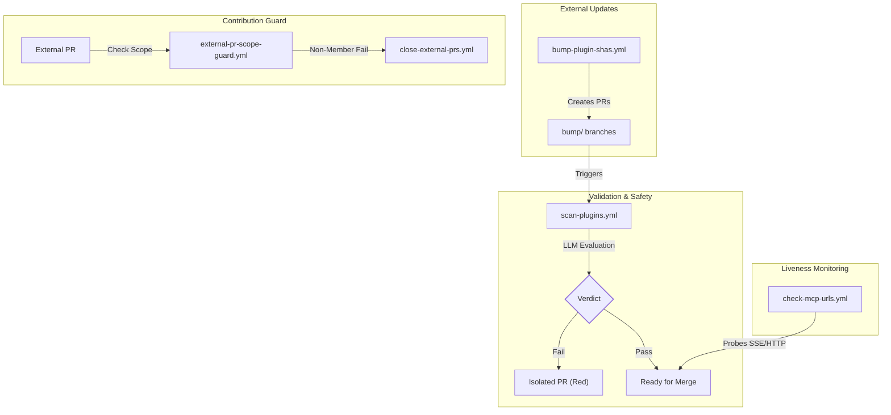
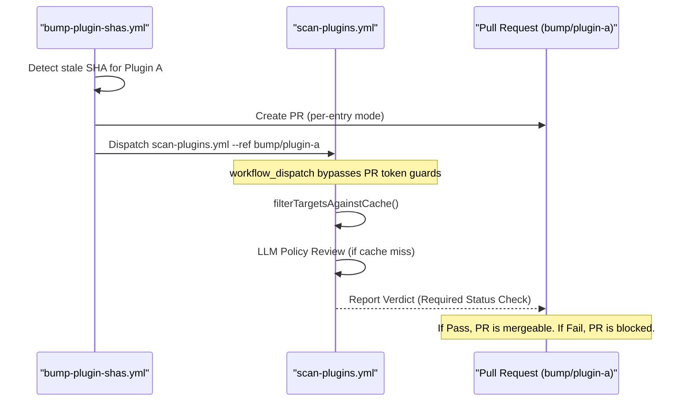

<!-- source: DeepWiki mcp.deepwiki.com · repo anthropics/knowledge-work-plugins · page 9 CI/CD and Governance · fetched 2026-10-26 -->

# CI/CD and Governance

Relevant source files

The following files were used as context for generating this wiki page:

- [.github/policy/prompt.md](.github/policy/prompt.md)
- [.github/policy/schema.json](.github/policy/schema.json)
- [.github/workflows/bump-plugin-shas.yml](.github/workflows/bump-plugin-shas.yml)
- [.github/workflows/check-mcp-urls.yml](.github/workflows/check-mcp-urls.yml)
- [.github/workflows/revert-failed-bumps.yml](.github/workflows/revert-failed-bumps.yml)
- [.github/workflows/scan-plugins.yml](.github/workflows/scan-plugins.yml)

The `knowledge-work-plugins` repository employs an automated governance pipeline to maintain the security, reliability, and currency of the plugin marketplace. This system integrates policy enforcement via LLM-based scanning, automated dependency updates for external plugins, liveness monitoring for Model Context Protocol (MCP) endpoints, and strict contribution gating.

### Governance Pipeline Overview

The governance architecture handles both "vendored" plugins (local to the repo) and "external" plugins (pinned to external git SHAs). The pipeline ensures that every change to the marketplace is vetted against security policies before merging.

#### Marketplace Governance Flow

Sources: [.github/workflows/bump-plugin-shas.yml:3-7](), [.github/workflows/scan-plugins.yml:3-22](), [.github/workflows/external-pr-scope-guard.yml:3-10](), [.github/workflows/close-external-prs.yml:20-47]()

---

## Plugin Policy Scanning

The `scan-plugins` workflow is a required status check that evaluates marketplace entries against Anthropic's safety and privacy policies. It uses a specialized LLM-based reviewer to inspect hook registration, telemetry, and data access patterns.

Key features include:
*   **Verdict Caching**: To optimize performance and cost, `(plugin, sha)` pairs are cached. The cache is keyed on the policy hash, so prompt or schema changes invalidate all verdicts `[.github/workflows/scan-plugins.yml:11-16]()`.
*   **Workload Identity Federation**: The scanner uses Anthropic Workload Identity Federation (WIF) for secure, keyless authentication `[.github/workflows/scan-plugins.yml:35-35]()`.
*   **Strict Evaluation**: The scanner checks for broad-scope hooks, undisclosed telemetry, and deceptive descriptions, as defined in `.github/policy/prompt.md` and validated against `.github/policy/schema.json` `[.github/policy/prompt.md:32-68](), [.github/policy/schema.json:1-52]()`.

For details on the evaluation logic, change detection, verdict caching, and neutralization of model output, see [Plugin Policy Scanning](#9.1).

Sources: [.github/workflows/scan-plugins.yml:1-16](), [.github/policy/prompt.md:1-100](), [.github/policy/schema.json:1-52]()

---

## SHA Bumping and MCP URL Checks

Maintaining a healthy marketplace requires keeping external plugins up-to-date and ensuring that remote services remain reachable.

### Automated SHA Bumping
The `bump-plugin-shas` workflow runs nightly to detect updates in upstream repositories. It validates new SHAs using the `claude plugin validate` command and opens one Pull Request per bumped plugin on a `bump/<slug>` branch `[.github/workflows/bump-plugin-shas.yml:3-7](), [.github/workflows/bump-plugin-shas.yml:81-81]()`. This per-entry PR model ensures that a policy-failing plugin's PR stays isolated and does not block other passing bumps `[.github/workflows/bump-plugin-shas.yml:34-37]()`.

### Self-Healing Reverts
The `revert-failed-bumps` workflow handles failures in the older, single-batch `bump/plugin-shas` PR model. Under the current per-entry PR model, a failing entry's `bump/<slug>` PR remains isolated for human triage, making `revert-failed-bumps.yml` largely inert by design for new bumps `[.github/workflows/bump-plugin-shas.yml:34-37](), [.github/workflows/revert-failed-bumps.yml:3-8]()`.

### Liveness Probing
The `check-mcp-urls` workflow periodically probes HTTP and SSE endpoints defined in `.mcp.json` files for vendored plugins `[.github/workflows/check-mcp-urls.yml:3-15]()`. It distinguishes between auth errors (acceptable) and 404/DNS failures (unacceptable) to ensure users don't install broken connectors. This workflow only checks local-source plugins `[.github/workflows/check-mcp-urls.yml:8-10]()`.

For details on the bump workflow, self-healing mechanisms, and liveness probing strategies, see [SHA Bumping and MCP URL Checks](#9.2).

#### System Interaction: Bumping & Scanning (Per-Entry Model)

Sources: [.github/workflows/bump-plugin-shas.yml:10-17](), [.github/workflows/bump-plugin-shas.yml:85-97](), [.github/workflows/scan-plugins.yml:106-112]()

---

## Contribution Governance

The repository uses strict automated checks to manage external contributions. Non-member Pull Requests are subject to the `External PR Scope Guard` and `Close External PRs` workflows.

*   **Scope Restriction**: External contributors may only ADD new plugins to `marketplace.json` if the source repository already backs a live plugin in the marketplace `[.github/scripts/external-pr-scope.js:5-10]()`.
*   **Automatic Closure**: PRs that modify existing entries, remove entries, or change files outside of `marketplace.json` are automatically closed with a redirection message `[.github/workflows/close-external-prs.yml:43-63](), [.github/scripts/external-pr-scope.js:55-67]()`.
*   **Exemptions**: Org members and the `github-actions[bot]` (used for SHA bumps) are exempt from these restrictions `[.github/scripts/external-pr-scope.js:133-151]()`.

Sources: [.github/workflows/close-external-prs.yml:1-63](), [.github/workflows/external-pr-scope-guard.yml:1-54](), [.github/scripts/external-pr-scope.js:1-153]()

---

