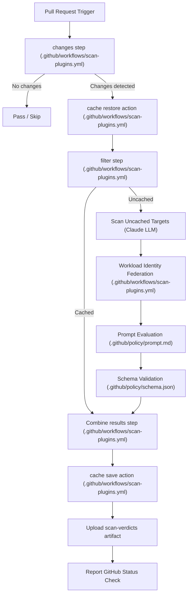
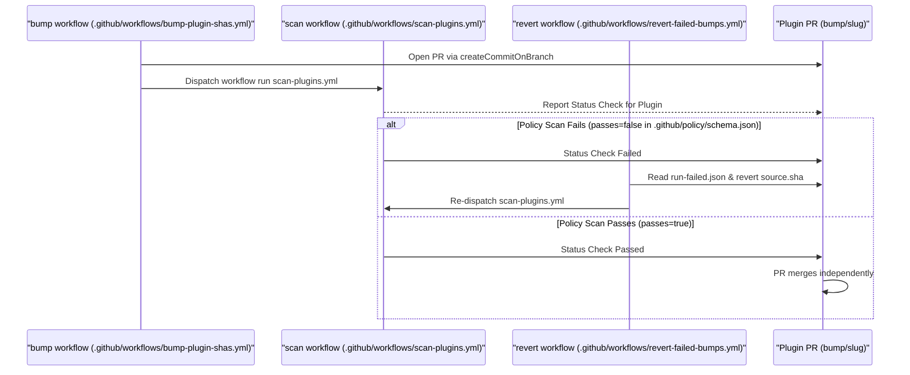

<!-- source: DeepWiki mcp.deepwiki.com · repo anthropics/knowledge-work-plugins · page 9.1 Plugin Policy Scanning · fetched 2026-10-26 -->

# Plugin Policy Scanning

Relevant source files

The following files were used as context for generating this wiki page:

- [.github/policy/prompt.md](.github/policy/prompt.md)
- [.github/policy/schema.json](.github/policy/schema.json)
- [.github/workflows/bump-plugin-shas.yml](.github/workflows/bump-plugin-shas.yml)
- [.github/workflows/check-mcp-urls.yml](.github/workflows/check-mcp-urls.yml)
- [.github/workflows/revert-failed-bumps.yml](.github/workflows/revert-failed-bumps.yml)
- [.github/workflows/scan-plugins.yml](.github/workflows/scan-plugins.yml)

The **Plugin Policy Scanning** system is an automated governance pipeline designed to ensure that all plugins in the marketplace—both local and external—adhere to Anthropic's safety, privacy, and disclosure standards. It utilizes LLM-based evaluation to inspect plugin source code, manifests, and hooks for malicious behavior, undisclosed telemetry, or overly broad permissions.

## Overview and Purpose

The primary goal of the scanning system is to gate Pull Requests (PRs) based on a security verdict. The system is optimized for high-volume updates (such as nightly SHA bumps) by employing a **Verdict Cache** that prevents redundant scans of unchanged plugin versions.

### Core Objectives
*   **Change Detection**: Identifying which marketplace entries have been modified or added in a PR [`.github/workflows/scan-plugins.yml`:60-78]().
*   **Policy Evaluation**: Using Claude to review plugin files against the Anthropic Software Directory and Acceptable Use policies [`.github/policy/prompt.md`:1-15]().
*   **PR Gating**: Blocking merges if a plugin fails the safety check or contains undisclosed telemetry [`.github/workflows/scan-plugins.yml`:5-9]().
*   **Auto-Remediation**: Automatically reverting failing entries from bulk update PRs to allow healthy updates to proceed [`.github/workflows/bump-plugin-shas.yml`:33-37]().

Sources: [`.github/workflows/scan-plugins.yml`:5-78](), [`.github/policy/prompt.md`:1-15](), [`.github/workflows/bump-plugin-shas.yml`:33-37]()

---

## Scan Workflow Architecture

The scanning process is triggered on every Pull Request and via `workflow_dispatch`. It uses a multi-stage approach to minimize latency and token consumption.

### Data Flow Diagram
The following diagram illustrates the flow from a PR trigger to the final status check, bridging natural language concepts to specific code execution entities in `scan-plugins.yml`, `prompt.md`, and `schema.json`.

"Plugin Policy Scanning Data Flow"

Sources: [`.github/workflows/scan-plugins.yml`:1-53](), [`.github/policy/prompt.md`:1-15](), [`.github/policy/schema.json`:1-15]()

---

## Implementation Details

### Change Detection and Filtering
The workflow compares the `MARKETPLACE` file ([`.claude-plugin/marketplace.json`]()) and the policy directory against the PR's base SHA. If only the marketplace changed, it isolates the specific plugins that were added or had their `source` object (repo, sha, or path) modified [`.github/workflows/scan-plugins.yml`:130-147]().

### Verdict Cache
To avoid re-scanning ~130+ plugins every night during the automated SHA bump, the system uses a persistent cache:
*   **Cache Key**: The hash of all files in `.github/policy/**` combined with the GitHub `run_id` [`.github/workflows/scan-plugins.yml`:99-101]().
*   **Entry Key**: Each verdict is stored using the format `name@sha`. A hit requires the *entire* source object to match, ensuring that a repository migration with the same SHA still triggers a re-scan [`.github/workflows/scan-plugins.yml`:151-160]().
*   **Pruning**: Verdicts older than 30 days are pruned to keep the cache size manageable [`.github/workflows/scan-plugins.yml`:118-125]().

### LLM-Based Policy Evaluation
The system uses **Workload Identity Federation (WIF)** to authenticate with Anthropic services without requiring long-lived API keys in repository secrets [`.github/workflows/scan-plugins.yml`:33-35]().

The scan evaluates three specific areas:
1.  **Baseline Safety**: Malicious code, malware, or prompt-injection payloads [`.github/policy/prompt.md`:17-28](). This includes checking for credential/secret extraction where credentials are sent cross-service [`.github/policy/prompt.md`:37-68]().
2.  **Hook Scope**: Checks if hooks (e.g., `UserPromptSubmit`, `PreToolUse`) are "gated" to specific project types or if they observe all user activity unconditionally [`.github/policy/prompt.md`:73-89]().
3.  **Disclosure**: Verifies that any outbound network calls (telemetry, analytics) are explicitly disclosed in the `plugin.json` description or top-level README, and documents an opt-out [`.github/policy/prompt.md`:91-103]().

### Neutralization of Model Output
To ensure programmatic reliability, the model output is constrained by a JSON schema.
*   **Schema Enforcement**: The model must return a JSON object including `passes` (boolean), `summary` (string), `violations` (string), and `hooks` (array) [`.github/policy/schema.json`:1-13]().
*   **Verdict Criteria**: `passes` is set to `false` if the plugin has broad-scope hooks, undisclosed telemetry, or if the `description_matches_behavior` check fails [`.github/policy/schema.json`:16-19](). The `violations` field must cite the specific file/hook and the issue when `passes=false` [`.github/policy/schema.json`:20-23]().

Sources: [`.github/workflows/scan-plugins.yml`:33-160](), [`.github/policy/prompt.md`:17-103](), [`.github/policy/schema.json`:1-23]()

---

## PR Gating and Auto-Remediation

The `Scan Plugins` workflow is a required status check. If any plugin fails the scan, the entire job fails, blocking the PR [`.github/workflows/scan-plugins.yml`:5-9]().

### Revert Failed Bumps
For automated nightly updates (managed by `bump-plugin-shas.yml`), a single failing upstream plugin should not block the updates of 100+ other healthy plugins. 

*   **Per-Entry PRs**: The `bump-plugin-shas` workflow creates individual PRs for each plugin bump using `pr-mode: per-entry` [`.github/workflows/bump-plugin-shas.yml`:81-82]().
*   **Dispatch Scan**: After opening a PR, `bump-plugin-shas.yml` dispatches the `scan-plugins.yml` workflow against the specific `bump/<slug>` branch [`.github/workflows/bump-plugin-shas.yml`:84-88]().
*   **Isolation**: A policy-failing plugin's `bump/<slug>` PR stays isolated and never blocks others. The `revert-failed-bumps.yml` workflow reacts to failures by dropping failing entries [`.github/workflows/bump-plugin-shas.yml`:33-37](). A failing entry is left for human triage of its own PR [`.github/workflows/bump-plugin-shas.yml`:33-37]().

### Governance Logic
"Governance and Remediation Loop for Per-Entry Bumps"

Sources: [`.github/workflows/bump-plugin-shas.yml`:33-88](), [`.github/workflows/scan-plugins.yml`:1-9](), [`.github/workflows/revert-failed-bumps.yml`:57-73]()

---

## Related Checks

### MCP URL Liveness
While the policy scan focuses on code behavior, the `check-mcp-urls.yml` workflow performs a liveness check on all `http` or `sse` MCP servers declared in vendored plugins [`.github/workflows/check-mcp-urls.yml`:3-6]().
*   **Probing Logic**: The `probe()` function first attempts a `curl` `HEAD` request, falling back to an `initialize` JSON-RPC `POST` request to verify the server is a valid MCP endpoint [`.github/workflows/check-mcp-urls.yml`:73-100]().
*   **Success Criteria**: Any response that proves a server exists (including 401/403/500) passes; only 404, 410, or DNS/Connection failures result in a `FAIL` verdict [`.github/workflows/check-mcp-urls.yml`:102-106]().

Sources: [`.github/workflows/check-mcp-urls.yml`:3-106]()

---

