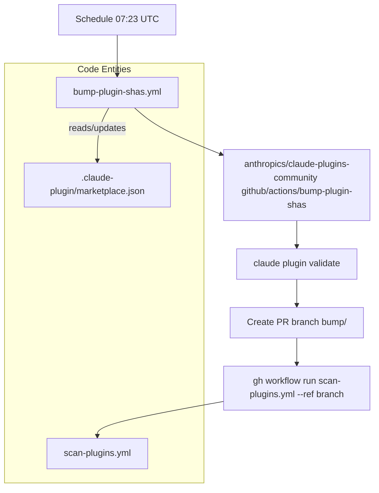
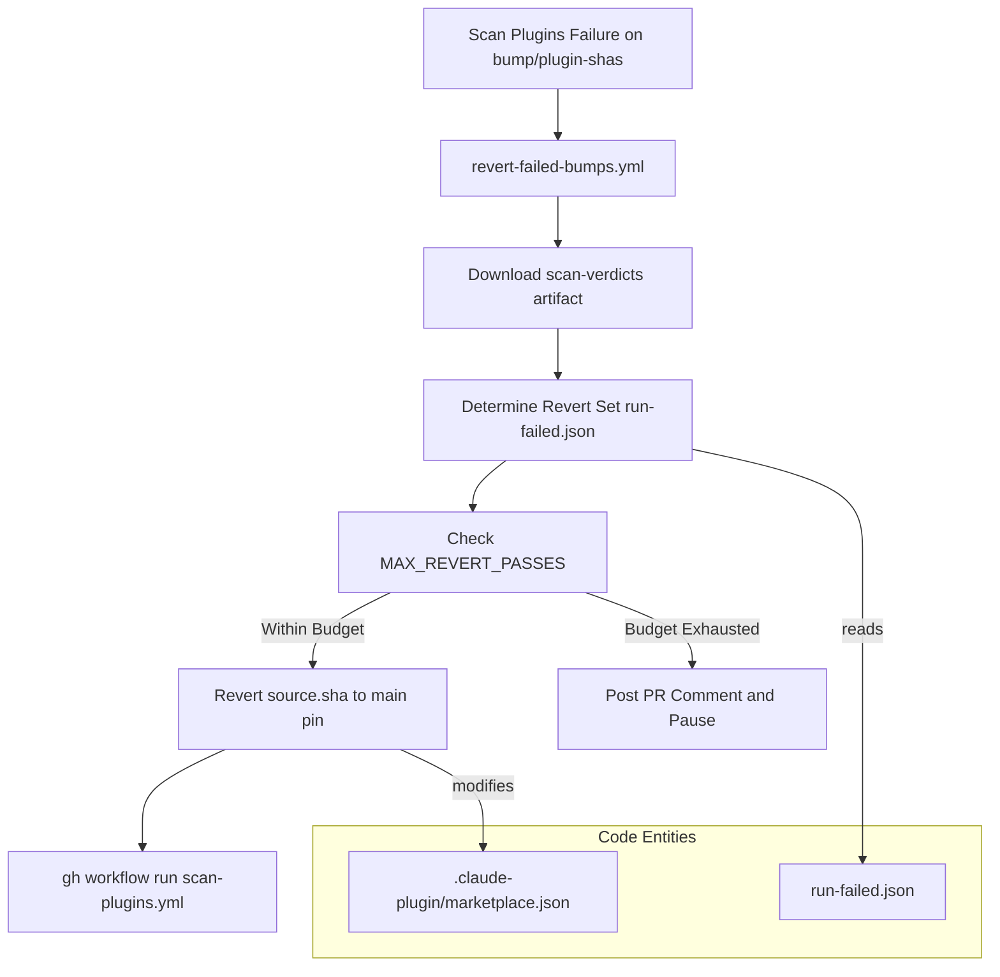
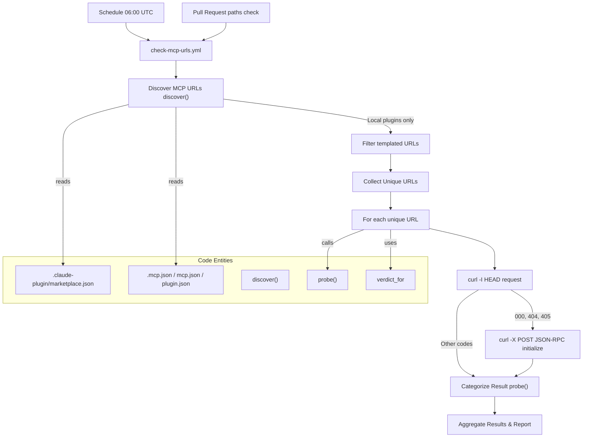

<!-- source: DeepWiki mcp.deepwiki.com · repo anthropics/knowledge-work-plugins · page 9.2 SHA Bumping and MCP URL Checks · fetched 2026-10-26 -->

# SHA Bumping and MCP URL Checks

Relevant source files

The following files were used as context for generating this wiki page:

- [.github/policy/prompt.md](.github/policy/prompt.md)
- [.github/policy/schema.json](.github/policy/schema.json)
- [.github/workflows/bump-plugin-shas.yml](.github/workflows/bump-plugin-shas.yml)
- [.github/workflows/check-mcp-urls.yml](.github/workflows/check-mcp-urls.yml)
- [.github/workflows/revert-failed-bumps.yml](.github/workflows/revert-failed-bumps.yml)
- [.github/workflows/scan-plugins.yml](.github/workflows/scan-plugins.yml)

This page documents the automated governance and maintenance pipelines for the plugin marketplace. These workflows ensure that external plugins are kept up-to-date with their upstream sources, that policy-violating updates are automatically handled, and that local plugin MCP server endpoints remain reachable.

## Automated SHA Bumping

The repository uses a nightly sweep to synchronize external plugin entries with their upstream repositories. Since external plugins are pinned to specific Git SHAs for security and stability, this process ensures the marketplace doesn't fall behind upstream improvements or security fixes.

### The `bump-plugin-shas` Workflow
The `bump-plugin-shas` workflow runs daily at 07:23 UTC [ .github/workflows/bump-plugin-shas.yml:41](). It performs the following steps:
1.  **Upstream Discovery**: For each external entry in `marketplace.json` (where `source` is an object), it checks if the upstream `HEAD` has moved past the pinned SHA [ .github/workflows/bump-plugin-shas.yml:3-5]().
2.  **Validation**: It performs a shallow clone of the upstream at the new SHA and runs `claude plugin validate` [ .github/workflows/bump-plugin-shas.yml:4-5]().
3.  **Per-Entry PR Creation**: Instead of a single batch PR, it opens one PR per bumped plugin on a branch named `bump/<slug>`. This isolates failing entries, allowing passing bumps to merge independently [ .github/workflows/bump-plugin-shas.yml:6-7, 77-82]().
4.  **Scan Dispatch**: Because PRs opened by the default `GITHUB_TOKEN` do not trigger `on:pull_request` workflows, this job explicitly dispatches the `scan-plugins.yml` workflow against each per-entry bump branch to evaluate the new SHAs against safety policies [ .github/workflows/bump-plugin-shas.yml:10-17, 85-118](). It specifically dispatches `scan-plugins` ONLY, as `validate-plugins.yml` is not present in this repository and `check-mcp-urls` is not a required status check for external plugins [ .github/workflows/bump-plugin-shas.yml:19-25]().
5.  **Cost Control**: A `max-bumps` input caps the number of plugins bumped per run for cost control. The composite action skips entries that already have an open bump PR [ .github/workflows/bump-plugin-shas.yml:27-30, 79]().

### Workflow Interaction Diagram
The following diagram shows how the bumping workflow triggers the governance chain, mapping natural language concepts to exact code entities.

**Bumping and Scan Trigger Flow**

Sources: [ .github/workflows/bump-plugin-shas.yml:1-119](), [ .github/workflows/scan-plugins.yml:1-26]()

---

## Self-Healing: Revert Failed Bumps

The `revert-failed-bumps` workflow is designed to drop policy-failing entries from a *single batch* bump PR (`bump/plugin-shas`) so one bad upstream can't block the rest [ .github/workflows/revert-failed-bumps.yml:3-5](). However, with the transition to per-entry bump PRs in `bump-plugin-shas.yml`, this workflow is now largely inert by design for new bumps. A failing entry's `bump/<slug>` PR stays isolated and is left for human triage [ .github/workflows/bump-plugin-shas.yml:34-37]().

### The `revert-failed-bumps` Workflow (Legacy Behavior)
This workflow reacts to a failed `Scan Plugins` run specifically on the `bump/plugin-shas` branch [ .github/workflows/revert-failed-bumps.yml:39-46]().

1.  **Verdict Retrieval**: It downloads the `scan-verdicts` artifact from the failed scan to identify exactly which plugins failed the policy check [ .github/workflows/revert-failed-bumps.yml:65-72]().
2.  **Plan Determination**: It parses `run-failed.json`. If the scan failed due to infrastructure errors (no policy failures found), it aborts to avoid unnecessary reverts [ .github/workflows/revert-failed-bumps.yml:74-102]().
3.  **Budget Guardrail**: To prevent infinite loops, it limits the number of revert attempts per night (default: 3). It counts the number of commits on the PR to determine the current pass count [ .github/workflows/revert-failed-bumps.yml:34, 132-142]().
4.  **Surgical Revert**: It reverts only the `source.sha` field for the failing entries back to the value found on the `main` branch [ .github/workflows/revert-failed-bumps.yml:5-7]().
5.  **Re-dispatch**: After pushing the revert commit, it re-dispatches `scan-plugins.yml`. Because the passing entries are already cached, the new scan typically completes in seconds [ .github/workflows/revert-failed-bumps.yml:7-8]().

**Revert Logic Flow (Legacy)**

Sources: [ .github/workflows/revert-failed-bumps.yml:1-151](), [ .github/workflows/scan-plugins.yml:18-22]()

---

## MCP URL Liveness Probing

The `check-mcp-urls` workflow ensures that the service endpoints (HTTP/SSE) declared by local plugins are actually reachable. This workflow is specifically scoped to plugins whose files live in this repository (vendored plugins) and skips external entries pinned at a SHA to avoid cloning numerous upstream repositories [ .github/workflows/check-mcp-urls.yml:7-11]().

### Probing Strategy
The workflow targets "vendored" plugins (local directories in the repo) and scans their configuration files (`.mcp.json`, `mcp.json`, or `.claude-plugin/plugin.json`) for MCP server definitions [ .github/workflows/check-mcp-urls.yml:7-11, 53-54]().

| Step | Action | Logic |
| :--- | :--- | :--- |
| **Discovery** | `discover()` | Uses `jq` to find local plugins in `marketplace.json` and extract server URLs. It selects plugins where `source` is a string (local path) and then parses `.mcp.json`, `mcp.json`, or `plugin.json` for `http` or `sse` type MCP servers with non-empty URLs [ .github/workflows/check-mcp-urls.yml:48-70](). |
| **Validation** | Filter | Skips URLs containing template placeholders like `${...}` or `{{...}}` as they require user configuration and cannot be probed directly [ .github/workflows/check-mcp-urls.yml:124-127](). |
| **Probe Phase 1** | `curl -I` | Attempts a cheap `HEAD` request first. It follows redirects (`-L`) and has connection/max time limits with retries [ .github/workflows/check-mcp-urls.yml:84-87](). |
| **Probe Phase 2** | `curl -X POST` | If `HEAD` fails (e.g., with `000`, `404`, or `405` status codes), it retries as a real MCP client would, sending a JSON-RPC `initialize` request with appropriate headers and data [ .github/workflows/check-mcp-urls.yml:91-100](). |
| **Verdict** | Categorize | `000` (unreachable), `404` (not found), or `410` (gone) status codes result in a `FAIL`. Other codes like `401`, `403`, `405`, or `5xx` are considered `PASS` because they indicate the server is reachable and responding, even if with an error due to missing credentials or unsupported methods [ .github/workflows/check-mcp-urls.yml:102-106](). |

### Performance Optimization
To bound the cost of the run, the workflow uses a `verdict_for` associative array to ensure that each unique URL is only probed once, even if it is shared across multiple plugins. This prevents redundant probes and keeps the run cost proportional to the number of unique URLs, not the total number of plugin-server pairs [ .github/workflows/check-mcp-urls.yml:115-131]().

**MCP URL Check Flow**

Sources: [ .github/workflows/check-mcp-urls.yml:1-145]()

---

## Verdict Cache and Policy
The policy scan is the final gate for any SHA bump. It evaluates the plugin against the Anthropic Software Directory Policy [ .github/policy/prompt.md:8-9]().

*   **Cache Keying**: Verdicts are cached based on the hash of the `.github/policy/` directory [ .github/workflows/scan-plugins.yml:15-16, 99](). Any change to the prompt or schema invalidates all cached verdicts. The cache also prunes entries older than `CACHE_TTL_DAYS` (30 days) to bound its size [ .github/workflows/scan-plugins.yml:47, 120-126]().
*   **Permanent Verdicts**: A verdict for a specific `(plugin, sha)` pair is considered permanent under a fixed policy [ .github/workflows/scan-plugins.yml:103-105]().
*   **LLM Evaluation**: The scan uses Claude to evaluate hooks and telemetry, specifically looking for `has_broad_scope_hooks` or `has_undisclosed_telemetry` [ .github/policy/prompt.md:50-62]().
*   **Scope Guarding**: For external contributions, `external-pr-scope.js` ensures that non-members can only add plugins from repositories that already host a live plugin in the marketplace [ .github/scripts/external-pr-scope.js:5-10]().

Sources: [ .github/workflows/scan-plugins.yml:11-22, 86-91, 99, 120-126](), [ .github/policy/prompt.md:1-100](), [ .github/policy/schema.json:1-53]()

---

