# Page: Introduction

# Introduction

<details>
<summary>Relevant source files</summary>

The following files were used as context for generating this wiki page:

- [.claude-plugin/marketplace.json](.claude-plugin/marketplace.json)
- [README.md](README.md)
- [data/.mcp.json](data/.mcp.json)
- [data/CONNECTORS.md](data/CONNECTORS.md)
- [pdf-viewer/.claude-plugin/plugin.json](pdf-viewer/.claude-plugin/plugin.json)

</details>


This document provides a comprehensive reference for the `knowledge-work-plugins` repository, an open-sourcing collection of specialized plugins that extend Claude's capabilities for professional knowledge work [README.md:1-13](). The repository is designed for users of **Claude Cowork** and **Claude Code** who want to customize AI assistance for specific job functions, tools, and workflows [README.md:3-9]().

**Scope**: This introduction covers the repository's purpose, architecture overview, and marketplace structure. For detailed explanations of plugin concepts, architecture, and components, see [What are Knowledge Work Plugins?](#1.1). For plugin descriptions, domains, and selection guidance across the marketplace, see [Plugin Marketplace](#1.2). For installation procedures using the CLI and initial setup steps, see [Installation and Getting Started](#1.3).

## Purpose and Audience

The `knowledge-work-plugins` repository enables organizations to configure Claude with specialized knowledge, tool integrations, and workflows for specific roles [README.md:6-9](). Each plugin packages domain expertise (skills), explicit actions (commands), and external tool connections (MCP servers) into a file-based bundle that requires no code or infrastructure [README.md:63-65]().

**Target Users**:
- **End users** in specific roles (sales, finance, legal, data analysis, bio-research, etc.) who want Claude to understand their domain [README.md:15-27]().
- **Team administrators** who want to customize plugins with company-specific terminology, processes, and tool stacks [README.md:9-10]().
- **Plugin developers** who want to create new plugins or extend existing ones using tools like `cowork-plugin-management` [.claude-plugin/marketplace.json:34-38]().

**Sources**: [README.md:1-10](), [.claude-plugin/marketplace.json:34-38]()

## Repository Structure

The repository is organized as a plugin marketplace owned by Anthropic, defining a catalog of first-party and partner-built plugins [.claude-plugin/marketplace.json:1-141](). For a comprehensive view of marketplace domains, see [Plugin Marketplace](#1.2).

Diagram: Marketplace Directory Mapping to Code Entities
```mermaid
graph TB
    Root["knowledge-work-plugins/"]
    Root --> Marketplace[".claude-plugin/marketplace.json"]
    Root --> P1["productivity/"]
    Root --> P2["enterprise-search/"]
    Root --> P3["cowork-plugin-management/"]
    Root --> P4["sales/"]
    Root --> P5["finance/"]
    Root --> P6["data/"]
    Root --> P7["legal/"]
    Root --> P8["marketing/"]
    Root --> P9["customer-support/"]
    Root --> P10["product-management/"]
    Root --> P11["bio-research/"]
    Root --> Partner["partner-built/"]
    
    Partner --> S1["slack/"]
    Partner --> S2["apollo/"]
    Partner --> S3["common-room/"]
    
    Marketplace --> Owner["owner: { name: \"Anthropic\" }"]
    Marketplace --> Plugins["plugins: [ ... ]"]
    
    subgraph "Code Entity Space"
        P1
        P2
        P3
        P4
        P5
        P6
        P7
        P8
        P9
        P10
        P11
        S1
        S2
        S3
    end
```
Sources: [.claude-plugin/marketplace.json:1-141](), [README.md:15-27]()

### Plugin Categories

The marketplace spans several operational, technical, and business domains:

| Category | Plugins | Purpose |
|----------|---------|---------|
| **Operations** | `productivity`, `enterprise-search`, `cowork-plugin-management`, `operations` | Task management, cross-tool search, plugin lifecycle, and process documentation [README.md:17, 25, 27](), [.claude-plugin/marketplace.json:133-137](). |
| **GTM & Business** | `sales`, `marketing`, `customer-support`, `common-room`, `apollo`, `small-business` | Prospecting, campaign planning, ticket triage, and SMB workflows [README.md:18, 19, 21](), [.claude-plugin/marketplace.json:97-113, 139-143](). |
| **Technical** | `data`, `engineering`, `product-management`, `design` | SQL generation, architecture decisions, roadmap planning, and UX writing [README.md:20, 24](), [.claude-plugin/marketplace.json:115-119, 127-131](). |
| **Specialized** | `legal`, `finance`, `bio-research`, `human-resources` | Contract review, month-end close, preclinical research, and people ops [README.md:22, 23, 26](), [.claude-plugin/marketplace.json:121-125](). |

For detailed breakdowns of specific plugins within these domains, see [Plugin Marketplace](#1.2).

**Sources**: [README.md:15-27](), [.claude-plugin/marketplace.json:6-141]()

## How Plugins Extend Claude

Plugins integrate with Claude through two primary execution surfaces: **Claude Cowork** and **Claude Code** [README.md:3](). For deep architectural details, see [What are Knowledge Work Plugins?](#1.1).

Diagram: Natural Language to Code Entity Space Mapping
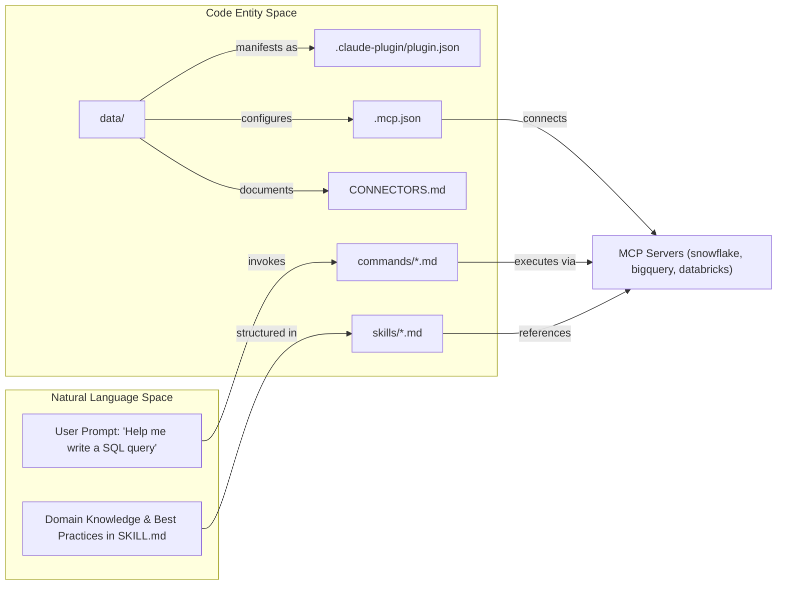
Sources: [README.md:49-65](), [data/.mcp.json:1-36](), [data/CONNECTORS.md:1-18]()

### Key Architectural Principles

| Principle | Description | Benefit |
|-----------|-------------|---------|
| **File-Based** | No code or infrastructure—only Markdown and JSON [README.md:65](). | Easy to edit, review, and version control. |
| **Tool-Agnostic** | Skills use `~~category` placeholders (e.g., `~~data warehouse`) [data/CONNECTORS.md:5](). | Swap tools (e.g., Snowflake to BigQuery) without rewriting logic. |
| **MCP Integration** | Connects to external tools via Model Context Protocol servers [README.md:63](). | Unified interface to data warehouses, CRMs, and APIs. |

For a comprehensive explanation of components, connectors, and MCP integration, see [What are Knowledge Work Plugins?](#1.1).

**Sources**: [README.md:61-65](), [data/CONNECTORS.md:1-17]()

## Installation Methods

Plugins can be installed via Cowork web interfaces or using the `claude` CLI for Claude Code [README.md:31-45]().

```bash
# Add the marketplace repository to Claude Code
claude plugin marketplace add anthropics/knowledge-work-plugins

# Install a specific plugin (e.g., sales)
claude plugin install sales@knowledge-work-plugins
```

For step-by-step instructions, initial configuration steps, and environment verification, see [Installation and Getting Started](#1.3).

**Sources**: [README.md:31-47]()

## Customization Philosophy

Plugins are designed as generic starting points that can be customized to fit your organization's exact workflows and tool stack [README.md:67-69]().

1. **Swap Connectors**: Edit `.mcp.json` to point to your specific instances of tools like HubSpot, Snowflake, or Jira [README.md:71]().
2. **Add Context**: Insert company-specific terminology, team structures, and guidelines into skill markdown files [README.md:72]().
3. **Adjust Workflows**: Modify instruction prompts to match internal team processes rather than generic defaults [README.md:73]().

**Sources**: [README.md:67-74]()

## Next Steps

- **Understand plugin concepts and architecture**: See [What are Knowledge Work Plugins?](#1.1)
- **Browse available plugins and domains**: See [Plugin Marketplace](#1.2)
- **Install and configure plugins**: See [Installation and Getting Started](#1.3)

---
**Sources**: [.claude-plugin/marketplace.json:1-141](), [README.md:1-80](), [data/README.md:1-120](), [data/CONNECTORS.md:1-18](), [data/.mcp.json:1-36]()

---

# Page: What are Knowledge Work Plugins?

# What are Knowledge Work Plugins?

<details>
<summary>Relevant source files</summary>

The following files were used as context for generating this wiki page:

- [README.md](README.md)
- [data/.mcp.json](data/.mcp.json)
- [data/CONNECTORS.md](data/CONNECTORS.md)

</details>


## Purpose and Scope

This page explains the concept of knowledge work plugins, their purpose in extending Claude's capabilities, and the overall system architecture. Knowledge work plugins are file-based extensions that transform Claude into a domain specialist for specific job functions, teams, and organizational workflows.

Sources: [README.md:1-10]()

## What are Knowledge Work Plugins?

A knowledge work plugin is a collection of markdown files and JSON configuration that gives Claude role-specific capabilities by providing:
- **Domain knowledge**: Skills that Claude draws on automatically when relevant [README.md:61]().
- **Tool connections**: Integration with external systems via MCP (Model Context Protocol) servers [README.md:63]().
- **Explicit commands**: Slash commands that users can invoke for specific workflows [README.md:62]().
- **Company-specific context**: Customizable instructions regarding terminology, processes, and organizational structure [README.md:72-73]().

Plugins are designed for non-technical customization—no code, no infrastructure, and no build steps are required. All plugin components are human-readable markdown and JSON files [README.md:65]().

Sources: [README.md:1-10](), [README.md:49-65]()

## Core Architecture

### System Overview

The plugin system operates within Claude's runtime environment (Claude Cowork or Claude Code) and follows a structured execution model.

**Diagram 1: Plugin System Architecture**

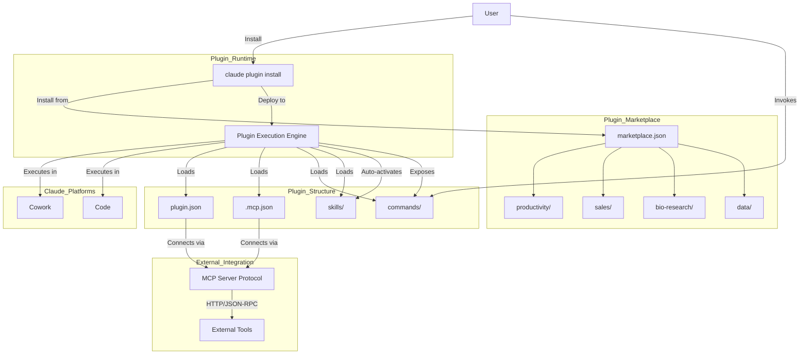

Sources: [README.md:3-47]()

### Plugin Lifecycle

1.  **Installation**: Users install plugins via `claude plugin install [name]@knowledge-work-plugins` [README.md:44]().
2.  **Activation**: Plugins activate automatically once installed [README.md:47]().
3.  **Skill Activation**: Skills fire automatically when relevant to the user's request [README.md:47](), [README.md:61]().
4.  **Command Invocation**: Users explicitly trigger commands like `/sales:call-prep` or `/data:write-query` [README.md:47](), [README.md:62]().
5.  **Tool Access**: When skills or commands need external data, they connect via MCP servers defined in configuration [README.md:63]().

Sources: [README.md:31-47](), [README.md:61-63]()

## Plugin Components

### File Structure and Code Entity Mapping

Every plugin follows a standardized directory layout that maps directly to Claude's execution logic.

**Diagram 2: Plugin Directory Structure (Code Entity Mapping)**

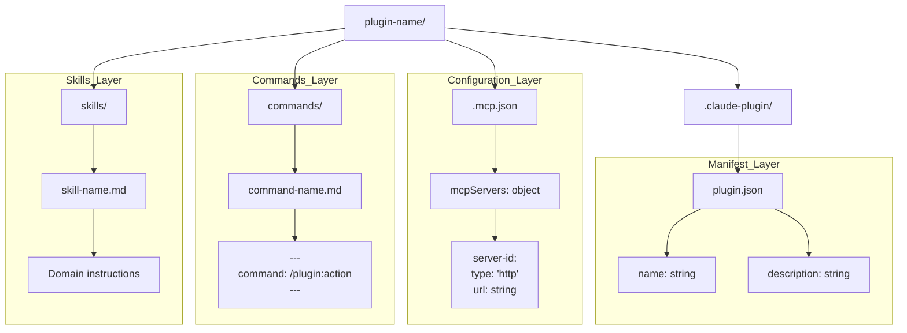

Sources: [README.md:51-59]()

### Component Definitions

| Component | File/Path | Role |
| :--- | :--- | :--- |
| **Manifest** | `.claude-plugin/plugin.json` | Defines metadata like `name` and `description` [README.md:55](). |
| **MCP Config** | `.mcp.json` | Maps tool connections to [MCP servers](https://modelcontextprotocol.io/) [README.md:56](). |
| **Commands** | `commands/` | Explicit slash commands (e.g., `/data:analyze`) that users invoke [README.md:57](). |
| **Skills** | `skills/` | Domain expertise (e.g., `sql-queries`) Claude draws on automatically [README.md:58](). |

Sources: [README.md:49-63]()

## Connector System and Tool Abstraction

Plugins are **tool-agnostic**. They describe workflows in terms of abstract categories rather than specific products. This is achieved through a placeholder system.

**Diagram 3: Natural Language to Code Entity (Connectors)**

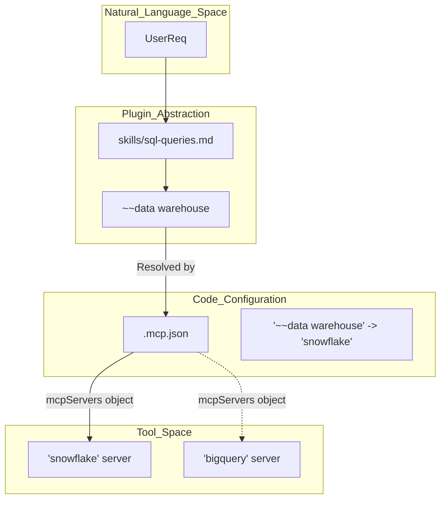

- **Placeholders**: Plugin files use `~~category` (e.g., `~~data warehouse`) as a placeholder for user-connected tools [data/CONNECTORS.md:5]().
- **Mapping**: The `.mcp.json` file resolves these placeholders to specific MCP server URLs and types [data/CONNECTORS.md:7](), [data/.mcp.json:1-36]().
- **Flexibility**: Users can swap a tool (e.g., from Snowflake to BigQuery) by updating the `mcpServers` object in `.mcp.json` without changing the underlying skill logic [README.md:71](), [data/.mcp.json:2-14]().

Sources: [data/CONNECTORS.md:1-17](), [data/.mcp.json:1-36](), [README.md:71]()

## Plugin Customization

Plugins are designed to be "generic starting points" that become powerful when customized for a specific company [README.md:69]().

- **Swap Connectors**: Edit `.mcp.json` to point at a specific tool stack, such as updating the `url` for `snowflake` or `databricks` [README.md:71](), [data/.mcp.json:3-10]().
- **Add Company Context**: Drop terminology, org structure, and processes into skill files within the `skills/` directory [README.md:72]().
- **Adjust Workflows**: Modify markdown instructions in `skills/` or `commands/` to match internal team procedures [README.md:73]().

Sources: [README.md:67-76](), [data/.mcp.json:1-36]()

---

# Page: Plugin Marketplace

# Plugin Marketplace

<details>
<summary>Relevant source files</summary>

The following files were used as context for generating this wiki page:

- [.claude-plugin/marketplace.json](.claude-plugin/marketplace.json)
- [pdf-viewer/.claude-plugin/plugin.json](pdf-viewer/.claude-plugin/plugin.json)

</details>


This page provides a comprehensive overview of the knowledge work plugins available in the marketplace, their target domains, intended users, and how they relate to each other. For information about installing plugins, see **1.3 Installation and Getting Started**. For architectural details about how plugins work, see **2. Plugin System Architecture**.

## Overview

The knowledge work plugins marketplace is defined in [.claude-plugin/marketplace.json:1-141]() and contains a collection of open-source plugins owned by Anthropic, alongside featured partner-built plugins. These plugins extend Claude's capabilities across diverse professional domains, from general productivity to specialized fields like life sciences research and legal compliance. Each plugin integrates with external tools via MCP (Model Context Protocol) servers and provides domain-specific skills and commands [README.md:61-63]().

The marketplace follows a hub-and-spoke architecture where plugins are categorized into:
- **Core Role-Based Plugins**: Built by Anthropic for standard business functions (Sales, Finance, Legal, etc.) [README.md:15-27]().
- **Partner-Built Plugins**: Specialized integrations from providers like Salesforce (Slack), Apollo.io, Tribe AI, Common Room, Zoom, and Noibu [.claude-plugin/marketplace.json:8-20](), [.claude-plugin/marketplace.json:88-113](), [.claude-plugin/marketplace.json:145-156]().
- **Technical & Utility Plugins**: Tools for data analysis, engineering, and plugin management [.claude-plugin/marketplace.json:34-38](), [.claude-plugin/marketplace.json:52-56](), [.claude-plugin/marketplace.json:115-119]().

Sources: [.claude-plugin/marketplace.json:1-141](), [README.md:1-29]()

---

## Marketplace Structure

The marketplace is defined as a JSON configuration containing:
- **name**: `"knowledge-work-plugins"` [.claude-plugin/marketplace.json:2]()
- **owner**: `{"name": "Anthropic"}` [.claude-plugin/marketplace.json:3-5]()
- **plugins**: An array of plugin definitions including both local source paths and external repository URLs [.claude-plugin/marketplace.json:6-141]().

Each plugin entry specifies:
- `name`: Plugin identifier used in CLI commands (e.g., `sales`) [.claude-plugin/marketplace.json:40]().
- `source`: Relative path to plugin directory (e.g., `"./productivity"`) or a URL object for external plugins [.claude-plugin/marketplace.json:24](), [.claude-plugin/marketplace.json:12-18]().
- `description`: Technical summary of capabilities and use cases [.claude-plugin/marketplace.json:10]().
- `author`: (Optional) The entity responsible for the plugin (e.g., "Salesforce", "Apollo.io", "Tribe AI") [.claude-plugin/marketplace.json:92-94](), [.claude-plugin/marketplace.json:101-103]().

Sources: [.claude-plugin/marketplace.json:1-141]()

---

## Plugin Categories and Relationships

### Marketplace Architecture: Natural Language to Code Entity Mapping

The following diagram maps high-level business domains (Natural Language Space) to the specific plugin identifiers, JSON properties, and source directory entities defined in the codebase (Code Entity Space).

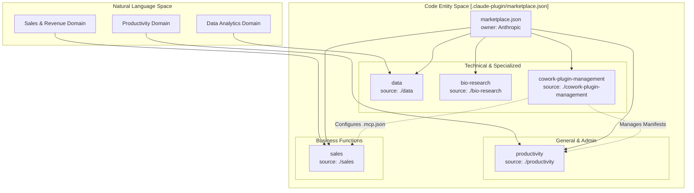

Sources: [.claude-plugin/marketplace.json:1-141](), [README.md:15-27]()

### Data Flow and Connector Mapping

Plugins use a category placeholder system to remain tool-agnostic. The `.mcp.json` file in each plugin directory maps these abstract categories to concrete MCP servers.

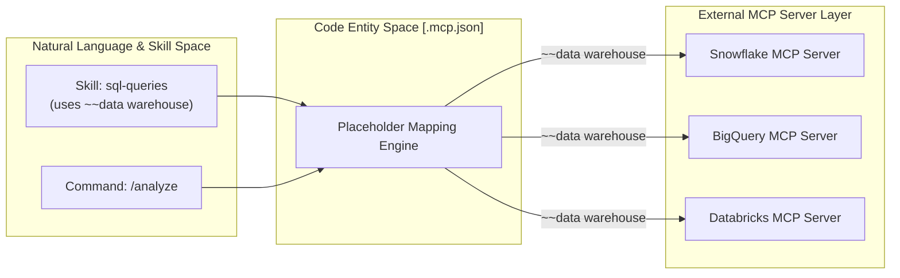

Sources: [data/README.md:107-120](), [README.md:63]()

---

## Complete Plugin Catalog

| Plugin Name | Primary Domain | Key Connectors | Target Users |
|------------|----------------|----------------|--------------|
| `productivity` | Task/Context Mgmt | Slack, Notion, Jira, M365 | All knowledge workers |
| `sales` | Prospecting/Strategy | HubSpot, Close, ZoomInfo | Sales & Account Teams |
| `finance` | Accounting/Audit | Snowflake, BigQuery, M365 | Finance & Controllers |
| `data` | SQL/Visualization | Snowflake, Databricks, Hex | Data Analysts |
| `legal` | Contract/Compliance | Box, Egnyte, Jira | Legal & Compliance |
| `marketing` | Content/Campaigns | Canva, HubSpot, Ahrefs | Marketing & Creative |
| `customer-support` | Triage/Knowledge | Intercom, Guru, Zendesk | Support & Success |
| `product-management` | Specs/Roadmaps | Linear, Figma, Amplitude | Product Managers |
| `bio-research` | Life Sciences R&D | PubMed, ChEMBL, Benchling | Researchers/Scientists |
| `engineering` | SDLC/Incidents | GitHub, Jira, PagerDuty | Software Engineers |
| `human-resources` | People Ops | Workday, Greenhouse | HR & Recruiting |
| `operations` | Process/Vendors | Vendor tools, Change Mgmt | Operations Managers |
| `small-business` | SMB Suite | QuickBooks, PayPal, Canva | Small Business Owners |
| `zoom` | Communication | Zoom REST APIs, Meeting SDK | All Zoom Users |
| `noibu` | Ecommerce | Noibu session/error data | Ecommerce & Marketing |

Sources: [README.md:15-27](), [.claude-plugin/marketplace.json:1-141]()

---

## Detailed Domain Descriptions

### Cross-Functional & Management

#### productivity
**Location:** [.claude-plugin/marketplace.json:22-26]()  
Focuses on personal and team efficiency. It syncs with calendars and task trackers to help users plan their day and build a persistent "memory" of work context [README.md:17]().

#### cowork-plugin-management
**Location:** [.claude-plugin/marketplace.json:34-38]()  
A meta-plugin for developers and admins. It provides tools to create new plugins from templates, configure MCP servers, and adapt existing skills to company-specific terminology [README.md:27]().

### Specialized Business Functions

#### data
**Location:** [.claude-plugin/marketplace.json:52-56]()  
Transforms Claude into a data analyst collaborator. It supports SQL generation across multiple dialects (Snowflake, BigQuery), data profiling via `/explore-data`, and visualization using Python or HTML/JS dashboards via `/create-viz` [data/README.md:30-37]().

#### bio-research
**Location:** [.claude-plugin/marketplace.json:82-86]()  
The most technically complex plugin in the repository. It accelerates early-stage R&D by connecting to life science databases (literature search, genomics, target prioritization) [README.md:26]().

#### small-business
**Location:** [.claude-plugin/marketplace.json:139-143]()  
A comprehensive suite for SMB owners covering payroll planning, month-end close, and growth campaigns. It integrates with QuickBooks, PayPal, and HubSpot, ensuring user approval for every step involving money or customers [.claude-plugin/marketplace.json:142]().

### Partner-Built Integrations

#### slack-by-salesforce
**Location:** [.claude-plugin/marketplace.json:88-95]()  
Official integration for searching messages, managing Slack Canvases, and sending communications directly from Claude.

#### apollo
**Location:** [.claude-plugin/marketplace.json:97-104]()  
Provides one-click MCP integration for lead enrichment and loading outreach sequences directly into Apollo.io.

#### common-room
**Location:** [.claude-plugin/marketplace.json:106-113]()  
Turns Common Room into a GTM copilot for account research, call prep with attendee profiles, and personalized outreach across email and LinkedIn [.claude-plugin/marketplace.json:109]().

#### noibu
**Location:** [.claude-plugin/marketplace.json:8-20]()  
Bridges the gap between customer experience and revenue by connecting Claude to store session, error, and conversion data. It allows users to surface revenue-impacting issues and take action across marketing and commerce platforms [.claude-plugin/marketplace.json:10]().

Sources: [.claude-plugin/marketplace.json:1-141](), [data/README.md:1-120](), [README.md:1-80]()

---

# Page: Installation and Getting Started

# Installation and Getting Started

<details>
<summary>Relevant source files</summary>

The following files were used as context for generating this wiki page:

- [README.md](README.md)
- [data/.mcp.json](data/.mcp.json)
- [data/CONNECTORS.md](data/CONNECTORS.md)

</details>


This page guides users through installing knowledge work plugins using the `claude` CLI, verifying the installation, understanding the runtime environment, and performing initial setup steps. For an architectural overview of plugins, refer to **2. Plugin System Architecture**. For instructions on customizing installed plugins, see **2.5. Customizing Plugins**.

Sources: [README.md:1-48]()

---

## Prerequisites

Before installing plugins from the marketplace, ensure your environment meets the following requirements:

| Requirement | Description | Reference / Source |
|------------|-------------|--------------------|
| **Claude CLI** | The `claude` command-line tool must be installed, updated, and authenticated in your terminal environment. | [README.md:37-45]() |
| **Claude Account** | An active Claude account with access to Claude Cowork or Claude Code environments. | [README.md:3-3]() |
| **Network Access** | Outbound HTTPS access to fetch plugin definitions and manifests from the `anthropics/knowledge-work-plugins` repository. | [README.md:31-45]() |

Sources: [README.md:3-45]()

---

## Installation Methods

### Adding the Marketplace

To access the official collection of specialist plugins, add the Anthropic knowledge-work-plugins marketplace to your local Claude CLI registry:

```bash
# Add the marketplace registry
claude plugin marketplace add anthropics/knowledge-work-plugins
```

### Installing Specific Plugins

Once the marketplace registry is registered, install individual functional plugins using the `@` marketplace specifier syntax:

```bash
# Install the sales domain plugin
claude plugin install sales@knowledge-work-plugins

# Install the data analysis plugin
claude plugin install data@knowledge-work-plugins

# Install the productivity plugin
claude plugin install productivity@knowledge-work-plugins
```

Sources: [README.md:37-45]()

---

## Installation Flow: Natural Language to Code Entity Space

The following diagram bridges the user-facing command-line interface (Natural Language Space) to the concrete file entities and directory structures created in the local runtime environment (Code Entity Space).

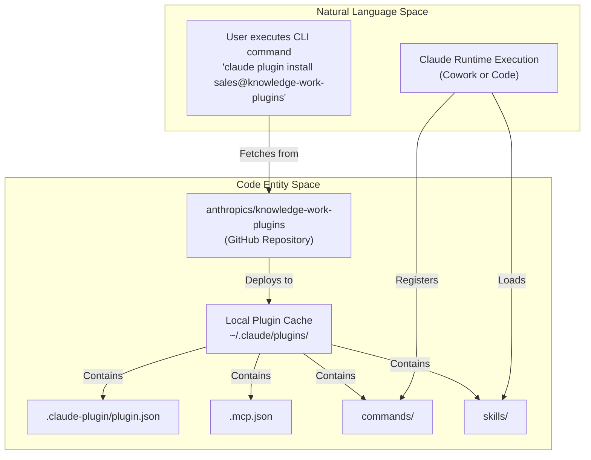

**Diagram: Installation Workflow and Code Mapping**

Sources: [README.md:37-64]()

---

## Post-Installation Structure

Once installed, every plugin follows a standardized, file-based directory layout consisting exclusively of JSON and markdown files without build steps or compiled binaries [README.md:49-65]().

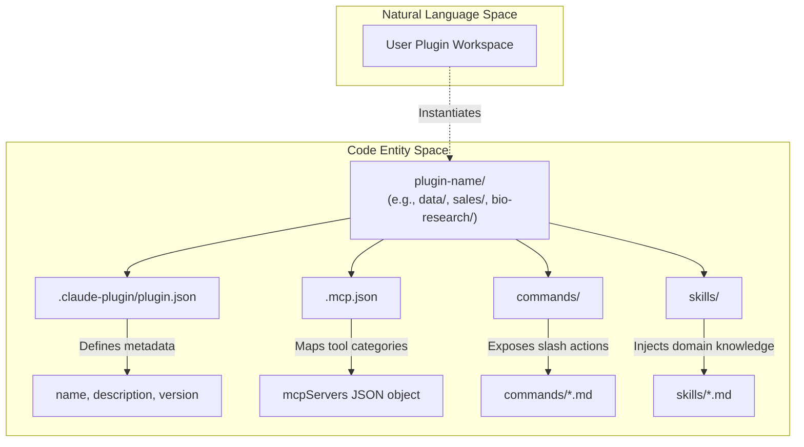

**Diagram: Plugin File Structure Code Mapping**

Every plugin contains four core structural components:
1. **Manifest (`.claude-plugin/plugin.json`)**: Defines plugin metadata, version, and capabilities.
2. **MCP Configuration (`.mcp.json`)**: Configures external tool connections via Model Context Protocol servers [README.md:55-56]().
3. **Commands (`commands/`)**: Contains explicit user-invoked slash commands (e.g., `/data:write-query`) [README.md:57]().
4. **Skills (`skills/`)**: Contains domain knowledge files that Claude draws on automatically when relevant [README.md:58]() [README.md:61]().

Sources: [README.md:49-65]()

---

## Verifying Installation

### Check Installed Plugins

To verify that plugins are correctly registered in your local environment, execute the listing command:

```bash
# List all active plugins registered in the local CLI
claude plugin list
```

### Test Plugin Activation

Open Claude (Cowork or Code) and verify functionality across two vectors:
1. **Skills Activation**: Mention a domain topic (e.g., writing a SQL query or reviewing a sales pipeline). Claude will automatically reference the relevant skill files in `skills/` [README.md:47]().
2. **Slash Commands**: Type `/` in the prompt interface. You should see registered namespace commands corresponding to the installed plugins (e.g., `/sales:call-prep`, `/data:write-query`) [README.md:47]().

Sources: [README.md:37-48]()

---

## MCP Server Configuration and Tool Abstraction

### Connector Placeholder Architecture

Plugins remain tool-agnostic by utilizing a placeholder category system. Plugin documentation and skill instructions reference connectors using `~~category` notation (e.g., `~~data warehouse`), which maps dynamically to whatever tool backend the user configures [data/CONNECTORS.md:3-7]().

| Connector Category | Placeholder Syntax | Default Configured Servers | Alternative Options |
|--------------------|-------------------|----------------------------|---------------------|
| **Data Warehouse** | `~~data warehouse` | Snowflake, BigQuery, Databricks, Definite [data/CONNECTORS.md:13]() | Redshift, PostgreSQL, MySQL [data/CONNECTORS.md:13]() |
| **Notebook** | `~~notebook` | Hex [data/CONNECTORS.md:14]() | Jupyter, Deepnote, Observable [data/CONNECTORS.md:14]() |
| **Product Analytics** | `~~product analytics` | Amplitude [data/CONNECTORS.md:15]() | Mixpanel, Heap [data/CONNECTORS.md:15]() |
| **Project Tracker** | `~~project tracker` | Atlassian (Jira/Confluence) [data/CONNECTORS.md:16]() | Linear, Asana [data/CONNECTORS.md:16]() |

The `.mcp.json` configuration file binds these placeholder categories to concrete HTTP or stdio endpoints. For example, the `data` plugin configures multiple warehouse and analytics servers [data/.mcp.json:1-36]():

```json
{
  "mcpServers": {
    "snowflake": {
      "type": "http",
      "url": ""
    },
    "bigquery": {
      "type": "http",
      "url": "https://bigquery.googleapis.com/mcp"
    }
  }
}
```
*(Excerpt from `data/.mcp.json:1-14`)*

Sources: [data/CONNECTORS.md:1-18](), [data/.mcp.json:1-36]()

---

## Initial Usage Patterns and Customization

### Example: Getting Started with the Data Plugin

1. **Install Plugin**: Run `claude plugin install data@knowledge-work-plugins`.
2. **Explore Data**: Invoke `/data:explore-data` to profile schema attributes.
3. **Generate Queries**: Invoke `/data:write-query` to translate natural language data requests into SQL via connected warehouse MCP servers.

### Customizing Installed Plugins

To tailor installed plugins to your organization's environment:
* **Swap Connectors**: Edit `.mcp.json` to point `mcpServers` URLs to your internal infrastructure [README.md:71]().
* **Add Company Context**: Modify markdown files inside `skills/` to inject internal terminology, business logic, and standard operating procedures [README.md:72]().
* **Adjust Workflows**: Update command definitions in `commands/` to match team-specific review cycles or output formats [README.md:73]().

Sources: [README.md:69-74](), [data/.mcp.json:1-36]()

---

# Page: Plugin System Architecture

# Plugin System Architecture

<details>
<summary>Relevant source files</summary>

The following files were used as context for generating this wiki page:

- [README.md](README.md)
- [cowork-plugin-management/.claude-plugin/plugin.json](cowork-plugin-management/.claude-plugin/plugin.json)
- [cowork-plugin-management/skills/cowork-plugin-customizer/SKILL.md](cowork-plugin-management/skills/cowork-plugin-customizer/SKILL.md)
- [cowork-plugin-management/skills/cowork-plugin-customizer/references/mcp-servers.md](cowork-plugin-management/skills/cowork-plugin-customizer/references/mcp-servers.md)
- [cowork-plugin-management/skills/create-cowork-plugin/SKILL.md](cowork-plugin-management/skills/create-cowork-plugin/SKILL.md)
- [cowork-plugin-management/skills/create-cowork-plugin/references/component-schemas.md](cowork-plugin-management/skills/create-cowork-plugin/references/component-schemas.md)
- [cowork-plugin-management/skills/create-cowork-plugin/references/example-plugins.md](cowork-plugin-management/skills/create-cowork-plugin/references/example-plugins.md)
- [data/.mcp.json](data/.mcp.json)
- [data/CONNECTORS.md](data/CONNECTORS.md)

</details>


## Purpose and Scope

This page provides a comprehensive high-level overview of the knowledge work plugins system architecture. It explains how plugins are structured, how they integrate with external tools through MCP servers, and how components like skills, commands, and connectors work together to extend Claude's capabilities [README.md:61-64]().

As a parent page, this document outlines the macro architecture. For detailed technical specifications, implementation guides, and configuration references, see the child pages:
- [Plugin Structure and Components](#2.1) — Detail the standardized plugin directory structure: `plugin.json` manifest, `.mcp.json` configuration, `commands/`, `skills/`, and `assets/`
- [Connector System and Tool Abstraction](#2.2) — Explain the `~~` category placeholder system, how plugins stay tool-agnostic, and how `.mcp.json` maps categories to specific tools
- [Skills vs Commands](#2.3) — Differentiate between skills (auto-activated domain knowledge) and commands (explicit slash commands), with examples and use cases
- [MCP Server Integration](#2.4) — Explain how MCP (Model Context Protocol) servers work, the `.mcp.json` configuration format, and how plugins connect to external tools
- [Customizing Plugins](#2.5) — Guide users through customizing plugins: swapping connectors, adding company context to skills, and adjusting workflows

Sources: [README.md:61-64](), [cowork-plugin-management/skills/create-cowork-plugin/SKILL.md:14-16]()

## Architectural Overview

The plugin system is built entirely on open, file-based components—markdown files and JSON configurations—requiring no code compilation, infrastructure, or complex build steps [README.md:65-65](). Every plugin acts as a self-contained package that injects specialized knowledge, event-driven hooks, and external tool connections into Claude Cowork and Claude Code sessions [README.md:3-9]().

### Component Architecture Diagram

The following diagram illustrates how natural language work requests interact with the file-based entities inside a plugin directory:

```mermaid
graph TB
    subgraph NaturalLanguageSpace["Natural Language & User Intent"]
        UserReq["User Prompt / Request"]
        IntentMatch["Automatic Skill Trigger / Slash Command"]
    end

    subgraph CodeEntitySpace["Plugin Code Entity Space"]
        Manifest[".claude-plugin/plugin.json"]
        MCPConfig[".mcp.json"]
        SkillsDir["skills/*/SKILL.md"]
        HooksFile["hooks/hooks.json"]
    end

    UserReq --> IntentMatch
    IntentMatch --> SkillsDir
    SkillsDir --> MCPConfig
    Manifest --- CodeEntitySpace

    UserReq --- [README.md:7-9]()
    SkillsDir --- [cowork-plugin-management/skills/create-cowork-plugin/references/component-schemas.md:7-17]()
    MCPConfig --- [cowork-plugin-management/skills/create-cowork-plugin/references/component-schemas.md:94-94]()
    Manifest --- [cowork-plugin-management/skills/create-cowork-plugin/SKILL.md:58-69]()
```

Sources: [README.md:7-9](), [cowork-plugin-management/skills/create-cowork-plugin/SKILL.md:58-69](), [cowork-plugin-management/skills/create-cowork-plugin/references/component-schemas.md:7-94]()

## Core Components and Structure

Plugins rely on a standardized directory layout containing a manifest file (`plugin.json`), domain knowledge (`skills/`), slash commands (`commands/`), event hooks (`hooks/`), and tool mappings (`.mcp.json`) [cowork-plugin-management/skills/create-cowork-plugin/SKILL.md:32-45](). This modular design ensures that any role-specific workflows can be bundled cleanly and shared across teams.

For comprehensive details on manifest configuration, directory rules, and component schemas, see [Plugin Structure and Components](#2.1).

Sources: [cowork-plugin-management/skills/create-cowork-plugin/SKILL.md:32-45]()

## Connector System and Tool Abstraction

To remain independent of specific software vendors, plugins utilize an abstraction layer based on category placeholders (`~~category`) rather than hardcoded tool names [cowork-plugin-management/skills/create-cowork-plugin/SKILL.md:106-110](). For example, a workflow references `~~project tracker`, which resolves dynamically via `.mcp.json` and `CONNECTORS.md` to specific implementations like Jira, Asana, or Linear [data/CONNECTORS.md:5-16]().

### Connector Resolution Flow

```mermaid
graph LR
    subgraph NaturalLanguageSpace["Intent Space"]
        Query["User Action in Skill"]
    end

    subgraph CodeEntitySpace["Resolution & Config"]
        Placeholder["~~project tracker"]
        ConnectorDoc["CONNECTORS.md"]
        MCPJson[".mcp.json"]
    end

    subgraph ExecutionSpace["Tool Execution"]
        ClientCall["mcpServers Configuration"]
    end

    Query --> Placeholder
    Placeholder --> ConnectorDoc
    ConnectorDoc --> MCPJson
    MCPJson --> ClientCall

    Query --- [cowork-plugin-management/skills/create-cowork-plugin/SKILL.md:109-111]()
    Placeholder --- [data/CONNECTORS.md:5-7]()
    MCPJson --- [data/.mcp.json:27-30]()
```

For detailed instructions on swapping connectors and understanding the placeholder system, see [Connector System and Tool Abstraction](#2.2).

Sources: [cowork-plugin-management/skills/create-cowork-plugin/SKILL.md:106-127](), [data/CONNECTORS.md:1-17](), [data/.mcp.json:1-35]()

## Skills vs Commands

Claude processes interactions using two primary mechanisms: **skills** and **commands**. Skills are domain-expert markdown files that activate automatically when Claude detects relevant trigger phrases in the conversation [README.md:61-61](). Commands are explicit slash actions invoked directly by the user (e.g., `/finance:reconciliation`) to execute deterministic workflows [README.md:62-62]().

For examples, progressive disclosure rules, and best practices for authoring both types, see [Skills vs Commands](#2.3).

Sources: [README.md:61-62](), [cowork-plugin-management/skills/create-cowork-plugin/references/component-schemas.md:32-57]()

## MCP Server Integration

External data sources and tools are integrated into plugins using the Model Context Protocol (MCP) [README.md:63-63](). Servers are declared in the `.mcp.json` configuration file, specifying endpoints and transport types that allow Claude to securely query databases, project management boards, and repositories [data/.mcp.json:1-35]().

For configuration formats, server types, and troubleshooting connection states, see [MCP Server Integration](#2.4).

Sources: [README.md:63-63](), [data/.mcp.json:1-35]()

## Customizing Plugins

Out-of-the-box plugins provide robust defaults, but their true utility emerges when tailored to an organization's specific terminology, tools, and processes [README.md:7-9](). The `cowork-plugin-customizer` skill automates this adaptation by scanning for placeholders, querying internal company knowledge via MCPs, and updating configurations [cowork-plugin-management/skills/cowork-plugin-customizer/SKILL.md:10-104]().

For a step-by-step walkthrough on swapping connectors, adding company context, and adjusting workflows, see [Customizing Plugins](#2.5).

Sources: [README.md:7-9](), [cowork-plugin-management/skills/cowork-plugin-customizer/SKILL.md:10-104]()

---

# Page: Plugin Structure and Components

# Plugin Structure and Components

<details>
<summary>Relevant source files</summary>

The following files were used as context for generating this wiki page:

- [cowork-plugin-management/.claude-plugin/plugin.json](cowork-plugin-management/.claude-plugin/plugin.json)
- [cowork-plugin-management/skills/cowork-plugin-customizer/SKILL.md](cowork-plugin-management/skills/cowork-plugin-customizer/SKILL.md)
- [cowork-plugin-management/skills/cowork-plugin-customizer/references/mcp-servers.md](cowork-plugin-management/skills/cowork-plugin-customizer/references/mcp-servers.md)
- [cowork-plugin-management/skills/create-cowork-plugin/SKILL.md](cowork-plugin-management/skills/create-cowork-plugin/SKILL.md)
- [cowork-plugin-management/skills/create-cowork-plugin/references/component-schemas.md](cowork-plugin-management/skills/create-cowork-plugin/references/component-schemas.md)
- [cowork-plugin-management/skills/create-cowork-plugin/references/example-plugins.md](cowork-plugin-management/skills/create-cowork-plugin/references/example-plugins.md)
- [design/.claude-plugin/plugin.json](design/.claude-plugin/plugin.json)
- [engineering/.claude-plugin/plugin.json](engineering/.claude-plugin/plugin.json)
- [marketing/.claude-plugin/plugin.json](marketing/.claude-plugin/plugin.json)
- [product-management/.claude-plugin/plugin.json](product-management/.claude-plugin/plugin.json)
- [sales/.claude-plugin/plugin.json](sales/.claude-plugin/plugin.json)

</details>


## Purpose and Scope

This page documents the standardized file and directory structure that all knowledge work plugins follow. It covers the physical layout of plugin files, the purpose of each directory, and the format of configuration files. For details on how connectors work and the `~~category` placeholder system, see [Connector System and Tool Abstraction](#2.2). For conceptual differences between skills and commands, see [Skills vs Commands](#2.3). For MCP server configuration details, see [MCP Server Integration](#2.4).

Sources: [cowork-plugin-management/skills/create-cowork-plugin/SKILL.md:12-16]()

## Standard Directory Structure

All plugins in the knowledge-work-plugins repository follow a consistent directory structure. This layout enables predictable installation, configuration, and runtime behavior across Claude Cowork and Claude Code.

**Directory Structure Diagram**

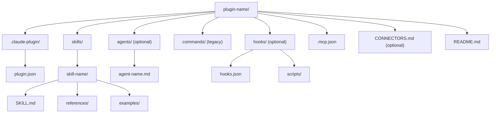

Sources: [cowork-plugin-management/skills/create-cowork-plugin/SKILL.md:30-45](), [cowork-plugin-management/skills/create-cowork-plugin/references/component-schemas.md:38-50]()

**Component Summary Table**

| Component | Required | Purpose | Format |
|-----------|----------|---------|--------|
| `.claude-plugin/plugin.json` | Yes | Plugin metadata and manifest | JSON |
| `.mcp.json` | Yes | MCP server definitions and tool connections | JSON |
| `skills/` | Yes* | Auto-activated domain knowledge (Standard format) | Markdown + YAML |
| `agents/` | No | Specialized autonomous sub-agents | Markdown + YAML |
| `commands/` | No | Legacy explicit slash commands | Markdown + YAML |
| `hooks/` | No | Event-driven logic (e.g., PreToolUse, SessionStart) | JSON + Scripts |
| `CONNECTORS.md` | No | Documentation for `~~` tool placeholders | Markdown |

*\*While technically optional, skills are the primary mechanism for Cowork plugins. Scaffold new plugins with `skills/*/SKILL.md` rather than legacy `commands/`.*

Sources: [cowork-plugin-management/skills/create-cowork-plugin/SKILL.md:47-59](), [cowork-plugin-management/skills/create-cowork-plugin/SKILL.md:100-101](), [cowork-plugin-management/skills/create-cowork-plugin/references/component-schemas.md:91-98]()

## Plugin Manifest (.claude-plugin/plugin.json)

The `plugin.json` file contains essential metadata. It is located in the `.claude-plugin/` subdirectory.

**Typical Manifest Structure**

```json
{
  "name": "plugin-name",
  "version": "0.1.0",
  "description": "Brief explanation of plugin purpose",
  "author": {
    "name": "Author Name"
  }
}
```

**Manifest Fields**

| Field | Type | Description |
|-------|------|-------------|
| `name` | string | Unique identifier (kebab-case, lowercase) |
| `version` | string | Semver format (MAJOR.MINOR.PATCH) |
| `description`| string | Human-readable purpose |
| `commands` | string/array | (Optional) Custom path to commands |
| `agents` | string/array | (Optional) Custom path to agents |
| `hooks` | string | (Optional) Custom path to `hooks.json` |
| `mcpServers` | string | (Optional) Custom path to MCP config |

Sources: [cowork-plugin-management/skills/create-cowork-plugin/SKILL.md:56-85]()

## Skills Directory

The `skills/` directory is the modern standard for encoding domain expertise. Each skill resides in its own subdirectory.

### Skill File Layout
A skill directory typically contains:
1.  **SKILL.md**: The core logic and "trigger" phrases.
2.  **references/**: Detailed documentation loaded only on demand (Progressive Disclosure).
3.  **examples/**: Sample code or configurations.
4.  **scripts/**: Utility scripts for the skill.

### Progressive Disclosure Levels
To manage context window efficiency, skills use a three-tier loading system:
1.  **Metadata**: Name and description are always in context.
2.  **SKILL.md Body**: Loaded when the description's trigger phrases match the conversation.
3.  **Bundled Resources**: `references/`, `examples/`, and `scripts/` are loaded only when Claude explicitly needs deeper detail.

Sources: [cowork-plugin-management/skills/create-cowork-plugin/references/component-schemas.md:5-57]()

## Tool Configuration (.mcp.json)

The `.mcp.json` file configures connections to external tools via the Model Context Protocol (MCP).

**Server Types**
-   **stdio**: Local processes (e.g., a Node.js or Python script).
-   **http**: Remote services via URL.

**The `${CLAUDE_PLUGIN_ROOT}` Variable**
To ensure portability, all intra-plugin path references in `.mcp.json` (like local script paths) must use the `${CLAUDE_PLUGIN_ROOT}` variable instead of absolute paths.

Sources: [cowork-plugin-management/skills/create-cowork-plugin/references/component-schemas.md:229-245](), [cowork-plugin-management/skills/create-cowork-plugin/SKILL.md:129-131]()

## Agents and Hooks

### Agents (`agents/*.md`)
Agents are specialized sub-personas with restricted toolsets and specific "Analysis Processes." They are defined in Markdown with YAML frontmatter specifying the `model` (e.g., `sonnet`), `color` (for UI), and allowed `tools`.

Sources: [cowork-plugin-management/skills/create-cowork-plugin/references/component-schemas.md:58-125]()

### Hooks (`hooks/hooks.json`)
Hooks allow plugins to intercept lifecycle events.
-   **Events**: `PreToolUse`, `PostToolUse`, `SessionStart`, `UserPromptSubmit`, `Stop`, `SubagentStop`, `SessionEnd`, `PreCompact`, `Notification`.
-   **Types**: 
    -   `prompt`: Claude evaluates the action based on a text prompt.
    -   `command`: A deterministic script (e.g., `bash validate.sh`) runs and returns a JSON decision.

Sources: [cowork-plugin-management/skills/create-cowork-plugin/references/component-schemas.md:142-228]()

## Natural Language to Code Entity Mapping

The following diagrams bridge how user intent in "Natural Language Space" triggers specific "Code Entities" within the plugin structure.

**Skill Activation Flow**

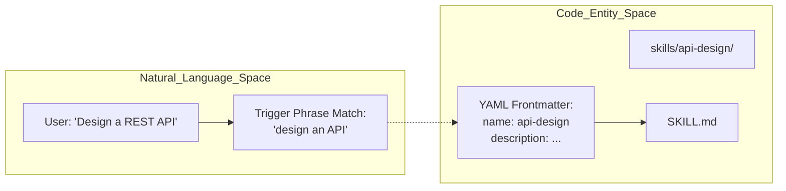

Sources: [cowork-plugin-management/skills/create-cowork-plugin/references/component-schemas.md:18-30]()

**Hook Execution Flow**

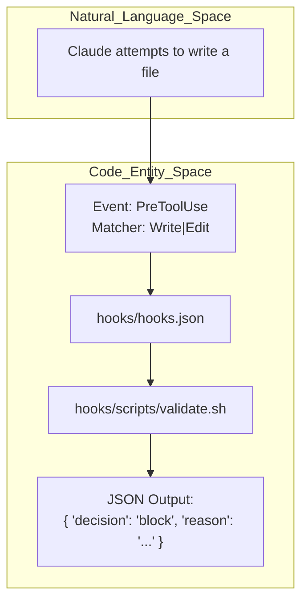

Sources: [cowork-plugin-management/skills/create-cowork-plugin/references/component-schemas.md:185-228]()

## Customizable Connectors (~~Placeholders)

Plugins intended for broad distribution use `~~category` placeholders (e.g., `~~project tracker`) instead of hardcoding specific tools like Jira or Linear. This abstraction allows organizations to map their own tools in `.mcp.json` while keeping the skill logic (`SKILL.md`) generic.

If placeholders are used, a `CONNECTORS.md` file must be included to define the available categories and options.

Sources: [cowork-plugin-management/skills/create-cowork-plugin/SKILL.md:102-128]()

---

# Page: Connector System and Tool Abstraction

# Connector System and Tool Abstraction

<details>
<summary>Relevant source files</summary>

The following files were used as context for generating this wiki page:

- [marketing/CONNECTORS.md](marketing/CONNECTORS.md)
- [marketing/skills/performance-report/SKILL.md](marketing/skills/performance-report/SKILL.md)
- [sales/.mcp.json](sales/.mcp.json)
- [sales/CONNECTORS.md](sales/CONNECTORS.md)

</details>


## Purpose and Scope

This page documents the connector system's tool abstraction layer, which enables plugins to reference external tools generically rather than hardcoding specific integrations. The system uses `~~category` placeholders in plugin skills and commands, mapping them to concrete MCP servers via `.mcp.json` configuration files. This architecture allows the same plugin code to work with different tools simply by changing configuration. [sales/CONNECTORS.md:3-8](), [marketing/CONNECTORS.md:3-8]()

Sources: [sales/CONNECTORS.md:3-8](), [marketing/CONNECTORS.md:3-8]()

## Abstraction Architecture

The connector system implements a three-layer abstraction that separates plugin logic from tool implementations. This allows a plugin like `sales` or `marketing` to remain functional regardless of whether a user employs Slack versus Microsoft Teams for chat, or HubSpot versus Salesforce for CRM. [sales/CONNECTORS.md:5-8](), [marketing/CONNECTORS.md:5-8]()

### Natural Language to Code Entity Mapping

The following diagram illustrates how natural language intent in a skill file maps to specific code entities and server configurations.

**Natural Language to Code Entity Space**
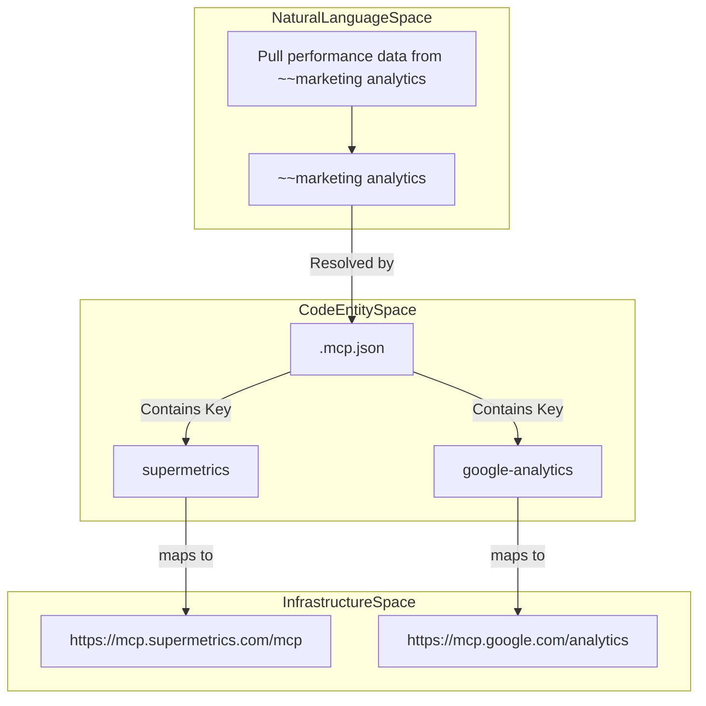
Sources: [marketing/skills/performance-report/SKILL.md:28-32](), [marketing/CONNECTORS.md:9-20](), [sales/.mcp.json:1-100]()

## Category Placeholder Syntax

Plugin files use the `~~category` placeholder syntax to reference tool categories. The double-tilde prefix (`~~`) distinguishes tool references from regular text. [sales/CONNECTORS.md:5](), [marketing/CONNECTORS.md:5]()

### Standard Placeholder Format
`~~category-name`

Examples of categories defined across the marketplace:
- `~~CRM`: Maps to HubSpot, Close, or Monday. [sales/CONNECTORS.md:15]()
- `~~email`: Maps to Gmail or Microsoft 365. [sales/CONNECTORS.md:16]()
- `~~marketing analytics`: Maps to Supermetrics or Google Analytics. [marketing/CONNECTORS.md:20]()
- `~~chat`: Maps to Slack or Microsoft Teams. [sales/CONNECTORS.md:18](), [marketing/CONNECTORS.md:13]()

Sources: [sales/CONNECTORS.md:15-18](), [marketing/CONNECTORS.md:13-20]()

## Configuration Layer: `.mcp.json`

The `.mcp.json` file is the source of truth for tool connections. It defines the `mcpServers` available to the plugin, including their connection types and endpoints. [sales/.mcp.json:1-100]()

### Implementation Example: Sales Plugin
The sales plugin connects to a wide array of CRM and engagement tools. Note how it supports OAuth for specific servers like Slack. [sales/.mcp.json:1-100]()

| Server ID | Type | Default URL | OAuth Support |
|-----------|------|-------------|---------------|
| `slack` | `http` | `https://mcp.slack.com/mcp` | Yes [sales/.mcp.json:3-9]() |
| `hubspot` | `http` | `https://mcp.hubspot.com/anthropic` | No [sales/.mcp.json:11-14]() |
| `apollo` | `http` | `https://mcp.apollo.io/mcp` | No [sales/.mcp.json:47-50]() |
| `notion` | `http` | `https://mcp.notion.com/mcp` | No [sales/.mcp.json:35-38]() |

Sources: [sales/.mcp.json:1-50]()

### Cross-Plugin Server Mapping
Different plugins map placeholders to specific server endpoints defined within their respective configuration scopes.

**Tool Mapping across Plugins**
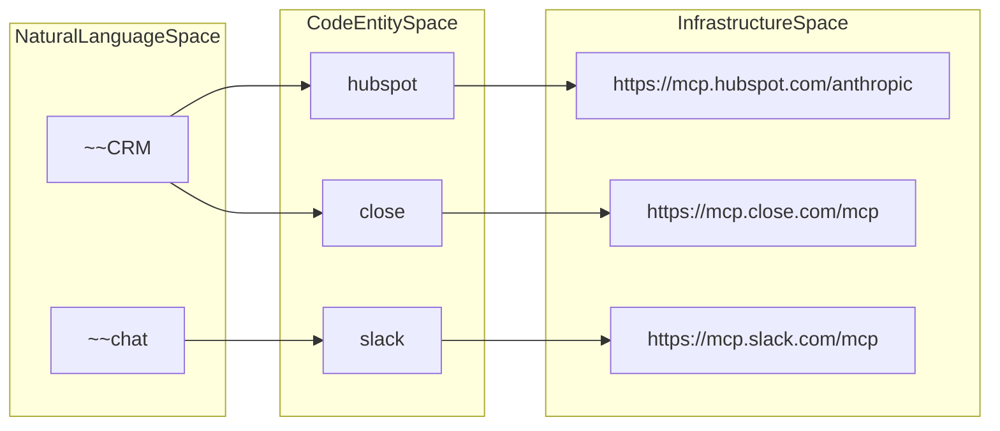
Sources: [sales/.mcp.json:3-22](), [sales/CONNECTORS.md:15-18]()

## Documentation Pattern: `CONNECTORS.md`

Each plugin includes a `CONNECTORS.md` file to help users understand how to map their specific tools to the plugin's placeholders. [sales/CONNECTORS.md:1-2](), [marketing/CONNECTORS.md:1-2]()

### Standard Table Structure
The `CONNECTORS.md` file typically includes a table with the following columns:
1. **Category**: Human-readable name.
2. **Placeholder**: The `~~` string used in code.
3. **Included servers**: Tools pre-configured in `.mcp.json`.
4. **Other options**: Suggestions for compatible alternatives.

Sources: [sales/CONNECTORS.md:11-24](), [marketing/CONNECTORS.md:9-20]()

## Swapping Tools Without Code Changes

The primary benefit of this system is the ability to swap a tool (e.g., moving from HubSpot to Salesforce) by only modifying the `.mcp.json` file. [sales/CONNECTORS.md:3-8]()

### Customization Workflow
1. **Identify Placeholder**: Locate the `~~category` in a skill or command (e.g., `~~marketing analytics` in `performance-report`). [marketing/skills/performance-report/SKILL.md:28-31]()
2. **Update .mcp.json**: Replace or add the corresponding server entry in the plugin's `.mcp.json`. [sales/.mcp.json:11-18]()
3. **Configure URL**: Provide the specific MCP server URL. For some tools, this may be configured directly in client settings. [sales/CONNECTORS.md:32-33]()

Sources: [marketing/skills/performance-report/SKILL.md:28-31](), [sales/.mcp.json:11-18](), [sales/CONNECTORS.md:32-33]()

## Benefits of Tool Abstraction

| Benefit | Description |
|---------|-------------|
| **Tool-Agnostic Workflows** | Skills describe *how* to do work rather than binding to specific product APIs. [sales/CONNECTORS.md:3-5](), [marketing/CONNECTORS.md:5-7]() |
| **Zero-Code Customization** | Users can point Claude at their own internal tools by editing JSON configuration files. [sales/CONNECTORS.md:5-8]() |
| **Graceful Degradation** | Skills can still function without a connection by parsing uploaded exports or pasted data. [sales/CONNECTORS.md:9]() |
| **Consistency** | Standardizes how different plugins interact with shared communication and data services. [sales/.mcp.json:3-10]() |

Sources: [sales/CONNECTORS.md:3-9](), [marketing/CONNECTORS.md:5-7](), [sales/.mcp.json:3-10]()

---

# Page: Skills vs Commands

# Skills vs Commands

<details>
<summary>Relevant source files</summary>

The following files were used as context for generating this wiki page:

- [README.md](README.md)
- [data/.mcp.json](data/.mcp.json)
- [data/CONNECTORS.md](data/CONNECTORS.md)
- [product-management/commands/brainstorm.md](product-management/commands/brainstorm.md)
- [product-management/skills/product-brainstorming/SKILL.md](product-management/skills/product-brainstorming/SKILL.md)

</details>


**Purpose and Scope:** This page explains the architectural distinction between skills (auto-activated domain expertise) and commands (explicit slash-command actions). In the knowledge work plugin system, skills provide the "brain" or procedural knowledge that Claude draws on automatically, while commands provide the "buttons" or entry points for users to initiate specific tasks [README.md:49-64](). Understanding this separation is fundamental to both using and developing plugins effectively.

---

## Core Concepts

The plugin system separates two fundamentally different types of functionality:

| Aspect | Skills | Commands |
|--------|--------|----------|
| **Activation** | Automatic when relevant (via description) [README.md:47-61]() | Explicit user invocation (slash command) [README.md:47-62]() |
| **Location** | `skills/skill-name/SKILL.md` [README.md:58]() | `commands/command-name.md` [README.md:57]() |
| **Format** | Markdown with YAML frontmatter [product-management/skills/product-brainstorming/SKILL.md:1-4]() | Markdown with YAML frontmatter [product-management/commands/brainstorm.md:1-4]() |
| **Purpose** | Provide domain knowledge and workflows [README.md:61]() | Execute specific tasks on demand [README.md:62]() |
| **Visibility** | Background context (progressive disclosure) [README.md:61]() | Visible in slash command menu [README.md:47]() |
| **User control** | Passive (Claude decides when to trigger) [README.md:61]() | Active (user decides when to trigger) [README.md:62]() |

> **Note on Commands**: Modern plugins prefer the `skills/` format, though legacy slash commands continue to serve as explicit user entry points [README.md:47-64](). 

Sources: [README.md:47-64](), [product-management/commands/brainstorm.md:1-4](), [product-management/skills/product-brainstorming/SKILL.md:1-4]()

---

## Skills: Auto-Activated Domain Knowledge

Skills are the primary unit of expertise. They are structured directories containing a `SKILL.md` file that uses YAML frontmatter to define trigger conditions [README.md:58]().

### Progressive Disclosure

To avoid overwhelming Claude's context window, skills use a hierarchical disclosure model [README.md:49-64]() where metadata (name and description) is always evaluated, but full instructions and supplemental resources (`references/`, `examples/`, `scripts/`) are loaded only when semantic matching indicates relevance [README.md:47-61]().

### Natural Language to Code Entity Mapping

This diagram illustrates how a user's natural language request maps to specific skill entities in the codebase.

```mermaid
graph TD
    subgraph "NaturalLanguageSpace"
        UserPrompt[""Help me brainstorm product ideas""]
        TriggerPhrases[""exploring a new opportunity", "stress-testing an idea""]
    end

    subgraph "CodeEntitySpace"
        SkillFile[""product-management/skills/product-brainstorming/SKILL.md""]
        Frontmatter[""YAML Frontmatter: name: product-brainstorming""]
        Instructions[""Markdown Body: Brainstorming Modes""]
    end

    UserPrompt -->|"Matches"| TriggerPhrases
    TriggerPhrases -->|"Defined in"| Frontmatter
    Frontmatter -->|"Triggers loading of"| Instructions
```

Sources: [README.md:49-64](), [product-management/skills/product-brainstorming/SKILL.md:1-4]()

---

## Commands: Explicit User Actions

Commands are slash commands (e.g., `/brainstorm`) that a user must type to trigger a specific workflow [README.md:47]().

### Implementation Pattern

Commands are single markdown files located in the `commands/` directory [README.md:57](). They use YAML frontmatter to specify descriptions and argument hints [product-management/commands/brainstorm.md:1-4]().

### Example: Product Management Commands

The Product Management plugin uses commands to provide a clear interface for common PM tasks [product-management/commands/brainstorm.md:1-16]():

| Command | Implementation File | Purpose |
|---------|---------------------|---------|
| `/brainstorm` | `product-management/commands/brainstorm.md` | Explore problem spaces with a partner [product-management/commands/brainstorm.md:1-11]() |

Sources: [README.md:57](), [product-management/commands/brainstorm.md:1-16]()

---

## Interaction: How Skills and Commands Work Together

In a sophisticated plugin, commands often act as the orchestrator or entry point while skills provide the expertise used during execution [README.md:49-64]().

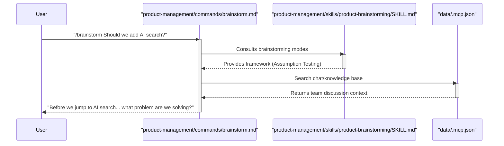

### The Role of Connectors

Both skills and commands use tool-agnostic placeholders (e.g., `~~knowledge base`, `~~product analytics`) to refer to external tools configured in `.mcp.json` [data/CONNECTORS.md:3-8]().

- **Skills** describe *how* to use a category of tool during reasoning [data/CONNECTORS.md:3-8]().
- **Commands** perform the *action* of invoking the tool interface based on user instructions [product-management/commands/brainstorm.md:53-72]().

Sources: [data/CONNECTORS.md:3-8](), [product-management/commands/brainstorm.md:53-72](), [product-management/skills/product-brainstorming/SKILL.md:1-4]()

---

## Summary of Implementation Requirements

### Skill Requirements (`SKILL.md`)
- **Location**: Must reside in `skills/[skill-name]/SKILL.md` [README.md:58]().
- **Frontmatter**: Must include `name` and `description` with trigger context [product-management/skills/product-brainstorming/SKILL.md:1-4]().
- **Body**: Written in imperative or infinitive form, keeping core instructions focused while delegating detailed references to sub-directories [README.md:49-64]().

### Command Requirements (`.md`)
- **Location**: Must reside in the `commands/` directory [README.md:57]().
- **Format**: Markdown with YAML frontmatter containing `description` and optional `argument-hint` [product-management/commands/brainstorm.md:1-4]().

Sources: [README.md:57-58](), [product-management/commands/brainstorm.md:1-4](), [product-management/skills/product-brainstorming/SKILL.md:1-4]()

---

# Page: MCP Server Integration

# MCP Server Integration

<details>
<summary>Relevant source files</summary>

The following files were used as context for generating this wiki page:

- [bio-research/.mcp.json](bio-research/.mcp.json)
- [engineering/.mcp.json](engineering/.mcp.json)
- [marketing/.mcp.json](marketing/.mcp.json)
- [product-management/.mcp.json](product-management/.mcp.json)
- [small-business/.mcp.json](small-business/.mcp.json)

</details>


This document explains how plugins connect to external tools through MCP (Model Context Protocol) servers. It covers the `.mcp.json` configuration format, the discovery process, and the connection architecture that enables plugins to access third-party services.

## Overview

The Model Context Protocol (MCP) provides a standardized interface between plugins and external tools. Instead of plugins directly integrating with dozens of different APIs, they communicate with MCP servers that handle the translation between Claude's requests and each tool's specific API format.

MCP servers expose their capabilities through a standardized set of operations that plugins invoke via the Claude runtime. The runtime resolves tool references from skills, looks up the appropriate MCP server in `.mcp.json`, and routes requests to the configured endpoint.

**MCP Protocol Flow**

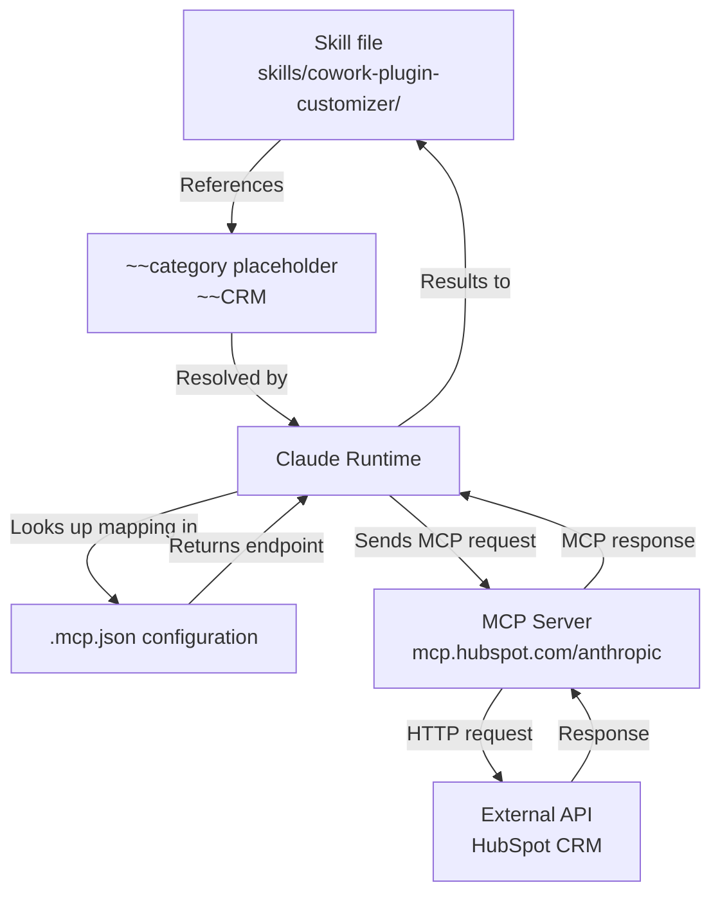

Sources: [cowork-plugin-management/skills/cowork-plugin-customizer/references/mcp-servers.md:1-4](), [sales/CONNECTORS.md:5-8]()

## The .mcp.json Configuration File

Every plugin contains a `.mcp.json` file in its root directory that maps server identifiers to MCP server endpoints. This file is the single source of truth for which external tools a plugin can access.

### File Structure

The `.mcp.json` file follows a standardized JSON schema under the `mcpServers` root object, defining server configurations such as `type` and `url` [small-business/.mcp.json:1-148]().

**Wrapped Format (Standard):**
```json
{
  "mcpServers": {
    "slack": {
      "type": "http",
      "url": "https://mcp.slack.com/mcp"
    },
    "google-calendar": {
      "type": "http",
      "url": ""
    }
  }
}
```

### Configuration Location
The system resolves the MCP configuration in the following order of precedence:
1. **Explicit path**: If `plugin.json` contains an `mcpServers` field, it uses the path specified there [cowork-plugin-management/skills/cowork-plugin-customizer/references/mcp-servers.md:59-65]().
2. **Default path**: If no field is present, it looks for `.mcp.json` at the plugin root [cowork-plugin-management/skills/cowork-plugin-customizer/references/mcp-servers.md:68-68]().
3. **New Creation**: If the plugin only uses bundled files, a new `.mcp.json` is created at the root for custom connections [cowork-plugin-management/skills/cowork-plugin-customizer/references/mcp-servers.md:70-70]().

Sources: [cowork-plugin-management/skills/cowork-plugin-customizer/references/mcp-servers.md:59-85](), [small-business/.mcp.json:1-148]()

## MCP Discovery and Customization

The `cowork-plugin-management` plugin provides tools to programmatically discover and connect MCP servers.

### Discovery Tools

| Tool Name | Purpose | Output |
|-----------|---------|--------|
| `search_mcp_registry` | Search the global MCP directory for connectors [cowork-plugin-management/skills/cowork-plugin-customizer/references/mcp-servers.md:7-9]() | Returns `name`, `url`, `tools`, and `connected` status [cowork-plugin-management/skills/cowork-plugin-customizer/references/mcp-servers.md:12-18]() |
| `suggest_connectors` | Triggers UI "Connect" buttons for users [cowork-plugin-management/skills/cowork-plugin-customizer/references/mcp-servers.md:20-22]() | Renders interactive UI for MCP installation [cowork-plugin-management/skills/cowork-plugin-customizer/references/mcp-servers.md:25-25]() |

### Category-to-Keywords Mapping
The system uses keyword mapping to find relevant MCP servers for abstract categories:

| Category | Keywords |
|----------|----------|
| `project-management` | `["asana", "jira", "linear", "monday", "tasks"]` |
| `software-coding` | `["github", "gitlab", "bitbucket", "code"]` |
| `chat` | `["slack", "teams", "discord"]` |
| `crm` | `["salesforce", "hubspot", "crm"]` |
| `data-warehouse` | `["bigquery", "snowflake", "redshift"]` |

Sources: [cowork-plugin-management/skills/cowork-plugin-customizer/references/mcp-servers.md:29-42]()

## MCP Server Endpoints across Plugins

Plugins across the repository define various HTTP endpoints via `.mcp.json`. While many share common tools like Slack, specialized plugins include domain-specific servers.

### Common and Specialized Connectors

| Plugin | Server ID | Type | URL |
|--------|-----------|------|-----|
| `small-business` | `intuit-quickbooks` | `http` | `https://ai-inc.quickbooks.intuit.com/v1/mcp` [small-business/.mcp.json:59-62]() |
| `small-business` | `paypal` | `http` | `https://mcp.paypal.com/mcp` [small-business/.mcp.json:75-78]() |
| `small-business` | `square` | `http` | `https://mcp.squareup.com/mcp` [small-business/.mcp.json:99-102]() |
| `bio-research` | `pubmed` | `http` | `https://pubmed.mcp.claude.com/mcp` [bio-research/.mcp.json:3-6]() |
| `bio-research` | `chembl` | `http` | `https://hcls.mcp.claude.com/chembl/mcp` [bio-research/.mcp.json:23-26]() |
| `engineering` | `github` | `http` | `https://api.githubcopilot.com/mcp/` [engineering/.mcp.json:27-30]() |
| `engineering` | `datadog` | `http` | `https://mcp.datadoghq.com/api/unstable/mcp-server/mcp` [engineering/.mcp.json:35-38]() |
| `marketing` | `ahrefs` | `http` | `https://api.ahrefs.com/mcp/mcp` [marketing/.mcp.json:35-38]() |
| `product-management` | `pendo` | `http` | `https://app.pendo.io/mcp/v0/shttp` [product-management/.mcp.json:47-50]() |

### Authentication and OAuth
Some servers, particularly `slack`, include OAuth configuration for user-specific authentication within `.mcp.json` files [small-business/.mcp.json:91-98](), [engineering/.mcp.json:3-10](), [marketing/.mcp.json:3-10](), [product-management/.mcp.json:3-10]().

```json
"slack": {
  "type": "http",
  "url": "https://mcp.slack.com/mcp",
  "oauth": {
    "clientId": "1601185624273.8899143856786",
    "callbackPort": 3118
  }
}
```
Sources: [small-business/.mcp.json:91-98](), [engineering/.mcp.json:3-10](), [marketing/.mcp.json:3-10](), [product-management/.mcp.json:3-10]()

## Dynamic and Named Servers

Some MCP servers do not have a static URL because the endpoint is generated dynamically when the admin connects the server. In these cases:
- The server is referenced in the `.mcp.json` config by **name** only [cowork-plugin-management/skills/cowork-plugin-customizer/references/mcp-servers.md:89-91]().
- If the name in the config matches a connected directory entry name, the system treats it as a valid connection [cowork-plugin-management/skills/cowork-plugin-customizer/references/mcp-servers.md:91-91]().
- Placeholder entries with empty URLs (e.g., `benchling` in bio-research or `google calendar` in engineering) indicate tools that require specific user configuration before use [bio-research/.mcp.json:43-46](), [engineering/.mcp.json:39-42]().

Sources: [cowork-plugin-management/skills/cowork-plugin-customizer/references/mcp-servers.md:89-91](), [bio-research/.mcp.json:43-46](), [engineering/.mcp.json:39-42]()

## Connection Flow Architecture

When a skill requires an external tool, the following sequence occurs:

1. **Customization Phase**: The `cowork-plugin-customizer` skill identifies `~~`-prefixed values [cowork-plugin-management/skills/cowork-plugin-customizer/references/mcp-servers.md:46-47]().
2. **Registry Search**: It calls `search_mcp_registry` with keywords [cowork-plugin-management/skills/cowork-plugin-customizer/references/mcp-servers.md:50-50]().
3. **User Confirmation**: The user selects the tool they use [cowork-plugin-management/skills/cowork-plugin-customizer/references/mcp-servers.md:51-51]().
4. **Connection**: If not already connected, `suggest_connectors` is called [cowork-plugin-management/skills/cowork-plugin-customizer/references/mcp-servers.md:52-52]().
5. **Config Update**: The `.mcp.json` file is updated with the `url` from search results [cowork-plugin-management/skills/cowork-plugin-customizer/references/mcp-servers.md:53-53]().

**Detailed Customization Sequence**

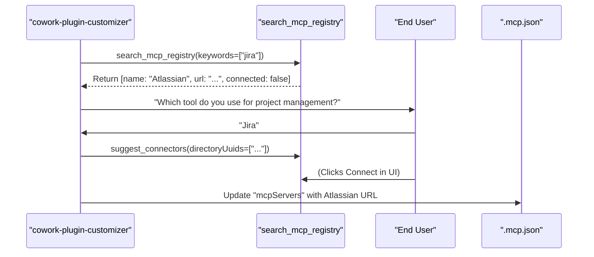

Sources: [cowork-plugin-management/skills/cowork-plugin-customizer/references/mcp-servers.md:44-54](), [small-business/.mcp.json:1-148](), [bio-research/.mcp.json:1-48](), [engineering/.mcp.json:1-48]()

---

# Page: Customizing Plugins

# Customizing Plugins

<details>
<summary>Relevant source files</summary>

The following files were used as context for generating this wiki page:

- [README.md](README.md)
- [cowork-plugin-management/.claude-plugin/plugin.json](cowork-plugin-management/.claude-plugin/plugin.json)
- [cowork-plugin-management/skills/cowork-plugin-customizer/SKILL.md](cowork-plugin-management/skills/cowork-plugin-customizer/SKILL.md)
- [cowork-plugin-management/skills/cowork-plugin-customizer/references/mcp-servers.md](cowork-plugin-management/skills/cowork-plugin-customizer/references/mcp-servers.md)
- [cowork-plugin-management/skills/create-cowork-plugin/SKILL.md](cowork-plugin-management/skills/create-cowork-plugin/SKILL.md)
- [cowork-plugin-management/skills/create-cowork-plugin/references/component-schemas.md](cowork-plugin-management/skills/create-cowork-plugin/references/component-schemas.md)
- [cowork-plugin-management/skills/create-cowork-plugin/references/example-plugins.md](cowork-plugin-management/skills/create-cowork-plugin/references/example-plugins.md)
- [data/.mcp.json](data/.mcp.json)
- [data/CONNECTORS.md](data/CONNECTORS.md)

</details>


## Purpose and Scope

This document guides technical users through customizing plugins to match an organization's specific tools, terminology, and workflows. Customization transforms generic marketplace plugins into specialized company assistants by modifying file-based configurations and markdown instructions `[README.md:67-75]`.

This page focuses on manual and semi-automated customization. For programmatically creating or managing plugins, see [8.2. Using cowork-plugin-management]().

Sources: `[README.md:67-75]()`, `[README.md:6-9]()`

---

## Customization Architecture Overview

Plugin customization operates at three distinct layers, targeting different aspects of Claude's behavior:

| Layer | Target Component | File Types | Customization Goal |
| :--- | :--- | :--- | :--- |
| **1. Tool Integration** | `.mcp.json` | JSON | Map `~~category` placeholders to specific company tool URLs `[cowork-plugin-management/skills/create-cowork-plugin/SKILL.md:102-110]()`. |
| **2. Domain Knowledge** | `skills/*/SKILL.md` | Markdown | Inject company terminology, org structures, and internal references `[cowork-plugin-management/skills/create-cowork-plugin/references/component-schemas.md:38-45]()`. |
| **3. Workflows** | `skills/*/SKILL.md` | Markdown | Modify step-by-step instructions and validation criteria `[cowork-plugin-management/skills/create-cowork-plugin/references/example-plugins.md:45-56]()`. |

### Customization Data Flow

The following diagram bridges the **Natural Language Space** (how users request changes) to the **Code Entity Space** (the specific files and structures modified).

**Diagram: Customization Resolution Path**
```mermaid
graph TB
    subgraph "NaturalLanguageSpace"
        UI[""Customize the sales plugin for our Jira instance""]
    end

    subgraph "CodeEntitySpace"
        Root[""plugin-directory""]
        Manifest["".claude-plugin/plugin.json""]
        MCPConfig["".mcp.json""]
        SkillsDir[""skills/""]
        ConnectorsMD[""CONNECTORS.md""]

        Root --> Manifest
        Root --> MCPConfig
        Root --> SkillsDir
        Root --> ConnectorsMD
    end

    subgraph "CustomizationLogic"
        Grep[""grep -rn '~~' plugin/""]
        Replace[""Replace placeholders""]
        UpdateMCP[""Update .mcp.json via search_mcp_registry""]
    end

    UI --> Grep
    Grep --> ConnectorsMD
    ConnectorsMD -- "Identifies Category" --> MCPConfig
    MCPConfig -- "Update URL/Command" --> Tool[""ExternalMCPClient""]
    
    UI -- "Add Context" --> SkillsDir
    SkillsDir -- "Edit SKILL.md" --> Workflow[""CustomizedWorkflow""]
```
Sources: `[cowork-plugin-management/skills/cowork-plugin-customizer/SKILL.md:10-32]()`, `[cowork-plugin-management/skills/cowork-plugin-customizer/references/mcp-servers.md:44-54]()`

---

## Connector Customization

### The Placeholder System (`~~category`)

Connectors use the `~~category` placeholder system to maintain tool-agnostic skill definitions `[cowork-plugin-management/skills/create-cowork-plugin/SKILL.md:102-109]()`. The `CONNECTORS.md` file at the plugin root explains which placeholders are used and what options are available `[cowork-plugin-management/skills/create-cowork-plugin/SKILL.md:110-127]()`.

**Diagram: Tool-Agnostic Connector Resolution**
```mermaid
graph LR
    subgraph "SkillLogic"
        Logic[""SKILL.md: Create issue in ~~project tracker""]
    end
    
    subgraph "ConnectorMapping"
        Mapping["".mcp.json: '~~project tracker'""]
    end
    
    subgraph "ExecutionRuntime"
        Jira[""JiraMCPClient""]
        Linear[""LinearMCPClient""]
        Asana[""AsanaMCPClient""]
    end
    
    Logic --> Mapping
    Mapping -- "ConfiguredAsJira" --> Jira
    Mapping -- "ConfiguredAsLinear" --> Linear
    Mapping -- "ConfiguredAsAsana" --> Asana
```
Sources: `[cowork-plugin-management/skills/create-cowork-plugin/SKILL.md:110-127]`, `[cowork-plugin-management/skills/cowork-plugin-customizer/references/mcp-servers.md:46-53]()`, `[data/CONNECTORS.md:1-18]()`

### Modifying MCP Configuration

The MCP configuration is typically stored in `.mcp.json` at the plugin root, though the location can be customized in `.claude-plugin/plugin.json` `[cowork-plugin-management/skills/cowork-plugin-customizer/references/mcp-servers.md:57-68]()`.

To swap a connector:
1. Locate the config file (default `.mcp.json`) `[cowork-plugin-management/skills/cowork-plugin-customizer/references/mcp-servers.md:68]()`.
2. Update the server entry using the `url` from `search_mcp_registry` or a local `command` `[cowork-plugin-management/skills/cowork-plugin-customizer/references/mcp-servers.md:72-87]()`.
3. Use `${CLAUDE_PLUGIN_ROOT}` for all intra-plugin path references `[cowork-plugin-management/skills/create-cowork-plugin/SKILL.md:129-131]()`.

**Example: Switching Project Trackers**
```json
{
  "mcpServers": {
    "~~project tracker": {
      "type": "http",
      "url": "https://api.example.com/mcp/jira"
    }
  }
}
```
Sources: `[cowork-plugin-management/skills/cowork-plugin-customizer/references/mcp-servers.md:72-87]()`, `[cowork-plugin-management/skills/create-cowork-plugin/references/component-schemas.md:231-243]()`

---

## Adding Company Context to Skills

### Skill File Structure

Skills are defined in `skills/<skill-name>/SKILL.md` using Markdown with YAML frontmatter `[cowork-plugin-management/skills/create-cowork-plugin/references/component-schemas.md:7-10]()`.

| Component | Purpose | Customization Opportunity |
| :--- | :--- | :--- |
| **Frontmatter** | Metadata & Triggers | Add company-specific trigger phrases (e.g., "Project X review") `[cowork-plugin-management/skills/create-cowork-plugin/references/component-schemas.md:12-16]()`. |
| **SKILL.md Body** | Core Logic | Replace generic steps with internal SOPs (Standard Operating Procedures) `[cowork-plugin-management/skills/create-cowork-plugin/references/example-plugins.md:45-56]()`. |
| **`references/`** | Deep Knowledge | Add detailed internal docs (style guides, naming conventions) `[cowork-plugin-management/skills/create-cowork-plugin/references/component-schemas.md:38-45]()`. |

### Customization Workflow (Automated via Cowork)

The `cowork-plugin-customizer` skill automates the discovery and replacement of placeholders `[cowork-plugin-management/skills/cowork-plugin-customizer/SKILL.md:2-6]()`.

1. **Locate the Plugin**: The tool searches `mnt/.local-plugins` or `mnt/.plugins` `[cowork-plugin-management/skills/cowork-plugin-customizer/SKILL.md:14]()`.
2. **Identify Placeholders**: It runs `grep -rn '~~'` to find customization points `[cowork-plugin-management/skills/cowork-plugin-customizer/SKILL.md:18]()`.
3. **Gather Context**: It uses Knowledge MCPs (Slack, Documents, Email) to find internal tool names and workspace IDs `[cowork-plugin-management/skills/cowork-plugin-customizer/SKILL.md:45-62]()`.
4. **Apply Changes**:
    - **Placeholder replacements**: `~~Jira` → `Asana` `[cowork-plugin-management/skills/cowork-plugin-customizer/SKILL.md:87]()`.
    - **URL pattern updates**: Updating ticketing links to match company domain `[cowork-plugin-management/skills/cowork-plugin-customizer/SKILL.md:89]()`.
    - **Content updates**: Modifying instructions to match org-specific workflows `[cowork-plugin-management/skills/cowork-plugin-customizer/SKILL.md:88]()`.

Sources: `[cowork-plugin-management/skills/cowork-plugin-customizer/SKILL.md:14-93]()`

---

## Adjusting Workflows

Workflows are modified by changing the imperative instructions in the `SKILL.md` body.

### Workflow Modification Patterns

1. **Adding Approval Steps**: Insert requirements for user confirmation (e.g., "Ask the user to confirm the budget before proceeding") `[cowork-plugin-management/skills/create-cowork-plugin/SKILL.md:135]()`.
2. **Changing Validation Logic**: Update the success criteria (e.g., "After all fixes, run the linter again to confirm clean output") `[cowork-plugin-management/skills/create-cowork-plugin/references/example-plugins.md:141]()`.
3. **Output Formatting**: Modify sections like "Include these sections" to match internal reporting standards `[cowork-plugin-management/skills/create-cowork-plugin/references/example-plugins.md:47-53]()`.

### Example: Customizing a Review Skill
**Generic `review-changes/SKILL.md` snippet:**
```markdown
1. Run `git diff --name-only` to get the list of changed files.
2. Check against the coding-standards skill for style violations
3. Identify potential bugs or anti-patterns
```

**Customized snippet for a specific team:**
```markdown
1. Run `git diff --name-only` to get the list of changed files.
2. Check against the coding-standards skill for style violations.
3. **New Step**: Verify that all new exported functions have TSDoc comments following the template in `references/tsdoc-guidelines.md`.
4. Identify potential bugs or anti-patterns.
5. **New Step**: If changes impact the `~~billing-engine` module, flag for senior review and check against the SOX compliance checklist.
```
Sources: `[cowork-plugin-management/skills/create-cowork-plugin/references/example-plugins.md:107-121]()`, `[cowork-plugin-management/skills/cowork-plugin-customizer/SKILL.md:88]()`

---

## Testing Customizations

After modifying plugin files, verify the changes:

1. **Trigger the Skill**: Use defined trigger phrases to ensure the skill loads correctly `[cowork-plugin-management/skills/create-cowork-plugin/references/component-schemas.md:34]()`.
2. **Check Tool Output**: Verify that `~~category` references resolve to the intended MCP server tools `[cowork-plugin-management/skills/cowork-plugin-customizer/references/mcp-servers.md:46-53]()`.
3. **Verify Compliance**: Ensure the generated output follows the newly added company-specific instructions `[cowork-plugin-management/skills/cowork-plugin-customizer/SKILL.md:88]()`.

Sources: `[cowork-plugin-management/skills/cowork-plugin-customizer/SKILL.md:108-110]()`

---

# Page: Bio-Research Plugin

# Bio-Research Plugin

<details>
<summary>Relevant source files</summary>

The following files were used as context for generating this wiki page:

- [bio-research/.claude-plugin/plugin.json](bio-research/.claude-plugin/plugin.json)
- [bio-research/CONNECTORS.md](bio-research/CONNECTORS.md)
- [bio-research/README.md](bio-research/README.md)
- [data/.claude-plugin/plugin.json](data/.claude-plugin/plugin.json)

</details>


## Purpose and Scope

This page provides a high-level overview of the bio-research plugin, the most complex plugin in the `knowledge-work-plugins` repository [bio-research/README.md:5](). It consolidates multiple MCP server integrations and analysis skills designed for life sciences researchers working on preclinical R&D, genomics, drug discovery, and clinical trials [bio-research/README.md:1-5]().

As a parent page, this document summarizes the core capabilities, architecture, and tool integrations. For detailed technical information, refer to the child pages:
- **Overview and Capabilities:** See [Bio-Research Overview and Capabilities](#3.1)
- **Getting Started & Workflows:** See [Getting Started with Bio-Research](#3.2)
- **MCP Server Integrations:** See [MCP Server Integrations](#3.3)
- **Analysis Skills Overview:** See [Analysis Skills Overview](#3.4)
- **Single-Cell RNA Analysis:** See [Single-Cell RNA Analysis Skills](#3.6)
- **Nextflow Pipelines:** See [Nextflow Pipelines Skill](#3.7)
- **Instrument Data Converter:** See [Instrument Data to Allotrope Converter](#3.8)
- **Scientific Problem Selection:** See [Scientific Problem Selection Framework](#3.9)

Sources: [bio-research/README.md:1-5]()

---

## Overview and Architecture

The bio-research plugin connects preclinical research tools, literature databases, and analytical pipelines into a unified agentic environment [bio-research/README.md:1-5](). It uses tool-agnostic `~~category` placeholders in its configuration to decouple workflows from specific vendor implementations [bio-research/CONNECTORS.md:5-7]().

```mermaid
graph TB
    subgraph "bio-research/"
        Root["bio-research/"]
        Root --> PluginMeta[".claude-plugin/plugin.json"]
        Root --> MCPConfig[".mcp.json"]
        Root --> Commands["commands/"]
        Root --> Skills["skills/"]
        Root --> Connectors["CONNECTORS.md"]
        Root --> Readme["README.md"]
    end
    
    subgraph "Metadata Layer"
        PluginMeta --> Name["name: bio-research"]
        PluginMeta --> Version["version: 1.2.0"]
    end
    
    subgraph "MCP Configuration"
        MCPConfig --> Lit["~~literature"]
        MCPConfig --> Chem["~~chemical database"]
        MCPConfig --> Targets["~~drug targets"]
        MCPConfig --> Trials["~~clinical trials"]
    end
    
    subgraph "Analysis Skills"
        Skills --> QC["single-cell-rna-qc"]
        Skills --> Scvi["scvi-tools"]
        Skills --> Nf["nextflow-pipelines"]
        Skills --> Alto["instrument-data-to-allotrope"]
        Skills --> Prob["scientific-problem-selection"]
    end
```

**Bio-Research Plugin Directory Structure**

Sources: [bio-research/.claude-plugin/plugin.json:1-8](), [bio-research/CONNECTORS.md:1-23]()

---

## MCP Server Integrations Summary

The plugin integrates a wide array of data sources and computational tools via Model Context Protocol (MCP) servers, organized through category placeholders [bio-research/README.md:9-25](), [bio-research/CONNECTORS.md:1-23]().

| Category Placeholder | Primary Provider | Data Source / Tool | Use Case |
|---------------------|-----------------|-------------------|----------|
| `~~literature` | NLM / deepsense.ai / Consensus | PubMed, bioRxiv, Consensus | Biomedical literature search & synthesis [bio-research/README.md:15-17]() |
| `~~journal access` | John Wiley & Sons | Academic Journals | Full-text article retrieval [bio-research/README.md:18]() |
| `~~data repository` | Sage Bionetworks | Synapse | Collaborative research data [bio-research/README.md:19]() |
| `~~chemical database` | deepsense.ai | ChEMBL | Bioactive compound properties [bio-research/README.md:20]() |
| `~~drug targets` | OpenTargets | Open Targets | Target discovery and prioritization [bio-research/README.md:21]() |
| `~~clinical trials` | deepsense.ai | ClinicalTrials.gov | Trial registry and results [bio-research/README.md:22]() |
| `~~scientific illustration` | BioRender | BioRender | Scientific figure creation [bio-research/README.md:23]() |
| `~~AI research` | Owkin | Owkin Histopathology | AI-powered biology analysis [bio-research/README.md:24]() |
| `~~lab platform` | Benchling | Benchling LIMS | Lab data management [bio-research/README.md:25]() |

For deep-dive documentation on these integrations, see [MCP Server Integrations](#3.3).

Sources: [bio-research/README.md:9-25](), [bio-research/CONNECTORS.md:1-23]()

---

## Analysis Skills Summary

The plugin bundles several specialized analysis skills that automate complex bioinformatics and research strategy workflows [bio-research/README.md:34-53]().

```mermaid
graph LR
    subgraph "Analysis Skills Catalog"
        S1["single-cell-rna-qc"] --> S1Desc["MAD-based quality control for scRNA-seq"]
        S2["scvi-tools"] --> S2Desc["Deep learning for integration & annotation"]
        S3["nextflow-pipelines"] --> S3Desc["Run nf-core pipelines (rnaseq, sarek, atacseq)"]
        S4["instrument-data-to-allotrope"] --> S4Desc["Convert 40+ instrument outputs to ASM format"]
        S5["scientific-problem-selection"] --> S5Desc["9-skill research strategy framework"]
    end
```

**Analysis Skills Overview**

For detailed guides on each skill, refer to their respective child pages:
- Single-cell quality control and deep learning: see [Single-Cell RNA Analysis Skills](#3.6)
- Pipeline execution: see [Nextflow Pipelines Skill](#3.7)
- Laboratory instrument conversion: see [Instrument Data to Allotrope Converter](#3.8)
- Problem selection framework: see [Scientific Problem Selection Framework](#3.9)

Sources: [bio-research/README.md:34-53]()

---

## Getting Started and Common Workflows

To install and initialize the bio-research plugin, use the standard command interface [bio-research/README.md:54-62]():

```bash
# Install the bio-research plugin
/install anthropics/knowledge-work-plugins bio-research

# Run the start command to inspect available tools and skills
/start
```

Common workflows supported by this plugin include literature reviews, single-cell RNA sequencing analysis, genomics pipelines execution, and drug discovery target prioritization [bio-research/README.md:64-80](). For step-by-step tutorials, see [Getting Started with Bio-Research](#3.2).

Sources: [bio-research/README.md:54-80]()

---

# Page: Bio-Research Overview and Capabilities

# Bio-Research Overview and Capabilities

<details>
<summary>Relevant source files</summary>

The following files were used as context for generating this wiki page:

- [bio-research/.claude-plugin/plugin.json](bio-research/.claude-plugin/plugin.json)
- [bio-research/CONNECTORS.md](bio-research/CONNECTORS.md)
- [bio-research/README.md](bio-research/README.md)
- [data/.claude-plugin/plugin.json](data/.claude-plugin/plugin.json)

</details>


## Purpose and Scope

The `bio-research` plugin is a specialized suite designed for life sciences researchers, molecular biologists, computational biologists, and bioinformaticians. It consolidates multiple MCP server integrations and core analysis skill categories into a unified package to accelerate early-stage life sciences R&D, ranging from biomedical literature synthesis and drug target prioritization to deep learning-based single-cell analysis, bioinformatics pipelines, and laboratory instrument data standardization.

**Sources:** [bio-research/README.md:1-5](), [bio-research/.claude-plugin/plugin.json:1-8]()

## Plugin Identity and Metadata

The plugin is defined by its manifest located at `bio-research/.claude-plugin/plugin.json`. It exposes metadata describing its core function and targeting life sciences R&D workflows.

| Property | Value |
|----------|-------|
| **Name** | `bio-research` [bio-research/.claude-plugin/plugin.json:2-2]() |
| **Version** | `1.2.0` [bio-research/.claude-plugin/plugin.json:3-3]() |
| **Description** | Connect to preclinical research tools and databases (literature search, genomics analysis, target prioritization) to accelerate early-stage life sciences R&D [bio-research/.claude-plugin/plugin.json:4-4]() |
| **Author** | Anthropic [bio-research/.claude-plugin/plugin.json:5-7]() |

**Sources:** [bio-research/.claude-plugin/plugin.json:1-8](), [bio-research/README.md:1-5]()

## Plugin Architecture and Component Layout

The plugin architecture cleanly decouples external data retrieval (handled via MCP servers and category placeholders) from local domain logic (handled by analysis skills).

```mermaid
graph TB
    subgraph "bio-research Directory Structure"
        Manifest[".claude-plugin/plugin.json"]
        Readme["README.md"]
        Connectors["CONNECTORS.md"]
    end
    
    subgraph "MCP Server Providers"
        Lit["PubMed, bioRxiv, Consensus<br/>~~literature"]
        Journal["Wiley Scholar Gateway<br/>~~journal access"]
        DataRepo["Synapse<br/>~~data repository"]
        Chem["ChEMBL<br/>~~chemical database"]
        Targets["Open Targets<br/>~~drug targets"]
        Trials["ClinicalTrials.gov<br/>~~clinical trials"]
        Viz["BioRender<br/>~~scientific illustration"]
        AI["Owkin<br/>~~AI research"]
        Lab["Benchling<br/>~~lab platform"]
    end
    
    subgraph "Analysis Skills"
        SC["Single-Cell RNA QC"]
        SCVI["scvi-tools"]
        NF["Nextflow Pipelines"]
        Allotrope["Instrument Data to Allotrope"]
        ProblemSelect["Scientific Problem Selection"]
    end
    
    Manifest --> Readme
    Readme --> Lit
    Readme --> SC
```

**Diagram: Bio-Research Plugin Architecture and Components**

The system coordinates between user intent, standardized category placeholders (`~~category`), concrete MCP provider endpoints, and local workflow execution skills [bio-research/README.md:7-53](), [bio-research/CONNECTORS.md:3-8]().

**Sources:** [bio-research/README.md:7-53](), [bio-research/CONNECTORS.md:3-8](), [bio-research/.claude-plugin/plugin.json:1-8]()

## MCP Server Integrations and Connectors

The plugin maps external scientific data sources and tools to tool-agnostic category placeholders. This design allows skills to reference capabilities via placeholders like `~~literature` or `~~chemical database` while remaining independent of specific vendor endpoints [bio-research/CONNECTORS.md:3-8]().

### Core Connectors and Providers

| Category | Placeholder | Included Servers / Providers |
|----------|-------------|----------------------------|
| Literature | `~~literature` | PubMed, bioRxiv, Consensus [bio-research/README.md:15-17](), [bio-research/CONNECTORS.md:13-13]() |
| Scientific illustration | `~~scientific illustration` | BioRender [bio-research/README.md:23-23](), [bio-research/CONNECTORS.md:14-14]() |
| Clinical trials | `~~clinical trials` | ClinicalTrials.gov [bio-research/README.md:22-22](), [bio-research/CONNECTORS.md:15-15]() |
| Chemical database | `~~chemical database` | ChEMBL [bio-research/README.md:20-20](), [bio-research/CONNECTORS.md:16-16]() |
| Drug targets | `~~drug targets` | Open Targets [bio-research/README.md:21-21](), [bio-research/CONNECTORS.md:17-17]() |
| Data repository | `~~data repository` | Synapse [bio-research/README.md:19-19](), [bio-research/CONNECTORS.md:18-18]() |
| Journal access | `~~journal access` | Wiley Scholar Gateway [bio-research/README.md:18-18](), [bio-research/CONNECTORS.md:19-19]() |
| AI research | `~~AI research` | Owkin [bio-research/README.md:24-24](), [bio-research/CONNECTORS.md:20-20]() |
| Lab platform | `~~lab platform` | Benchling (Placeholder) [bio-research/README.md:25-25](), [bio-research/CONNECTORS.md:21-21]() |

**Sources:** [bio-research/README.md:13-26](), [bio-research/CONNECTORS.md:9-23]()

### Optional Binary MCP Servers

In addition to HTTP-based MCP endpoints, the plugin accommodates optional binary servers that require separate local installation:
- **10X Genomics (`txg-mcp`)**: Cloud analysis data and workflows, mapped to `~~genomics platform` [bio-research/README.md:31-31]().
- **ToolUniverse**: AI tools for scientific discovery from Harvard MIMS, mapped to `~~tool database` [bio-research/README.md:32-32]().

**Sources:** [bio-research/README.md:27-33]()

```mermaid
graph LR
    subgraph "Natural Language Space"
        NL1["'Search for CRISPR papers'"]
        NL2["'Find ChEMBL bioactive compounds'"]
        NL3["'Target prioritization for kinases'"]
    end
    
    subgraph "Code Entity Space"
        NL1 --> P1["~~literature"]
        NL2 --> P2["~~chemical database"]
        NL3 --> P3["~~drug targets"]
        
        P1 --> S1["pubmed, biorxiv, consensus"]
        P2 --> S2["chembl"]
        P3 --> S3["ot"]
    end
```

**Diagram: Natural Language to Connector Placeholder Mapping**

This diagram illustrates how natural language queries from users map onto connector placeholders (`~~literature`, `~~chemical database`, `~~drug targets`), which in turn resolve to specific MCP server integrations defined in the configuration [bio-research/README.md:13-26](), [bio-research/CONNECTORS.md:3-8]().

**Sources:** [bio-research/README.md:13-26](), [bio-research/CONNECTORS.md:3-8]()

## Analysis Skills Overview

The plugin bundles several specialized analysis workflows that automate complex multi-step computational procedures in life sciences:

1. **Single-Cell RNA QC**: Automated quality control for single-cell RNA sequencing (`scRNA-seq`) data following scverse best practices. Supports `.h5ad` and `.h5` files with Median Absolute Deviation (MAD) filtering and diagnostic visualizations [bio-research/README.md:36-38]().
2. **scvi-tools**: Deep learning toolkit for single-cell omics covering models like scVI, scANVI, totalVI, PeakVI, MultiVI, destVI, veloVI, and sysVI for data integration, batch correction, and multi-modal analysis [bio-research/README.md:39-41]().
3. **Nextflow Pipelines**: Execution manager for nf-core bioinformatics pipelines (`rnaseq`, `sarek`, `atacseq`) on local or public GEO/SRA sequencing datasets [bio-research/README.md:42-47]().
4. **Instrument Data to Allotrope Converter**: Transformation utility converting laboratory instrument output files (PDF, CSV, Excel, TXT across 40+ instrument types such as plate readers and chromatography systems) into Allotrope Simple Model (ASM) structured format [bio-research/README.md:48-50]().
5. **Scientific Problem Selection**: Systematic framework based on Fischbach & Walsh's methodology, encompassing 9 discrete skills for research ideation, risk assessment, decision trees, and adversity planning [bio-research/README.md:51-53]().

**Sources:** [bio-research/README.md:34-53]()

```mermaid
graph TB
    subgraph "User Interaction"
        Start["/start command"]
    end
    
    subgraph "Workflows"
        LitReview["Literature Review<br/>(~~literature, ~~journal access)"]
        SingleCell["Single-Cell Analysis<br/>(QC + scvi-tools)"]
        SeqPipe["Sequencing Pipeline<br/>(nf-core/rnaseq, sarek)"]
        DrugDisc["Drug Discovery<br/>(~~chemical database, ~~drug targets)"]
        Strat["Research Strategy<br/>(Problem Selection Framework)"]
    end
    
    Start --> LitReview
    Start --> SingleCell
    Start --> SeqPipe
    Start --> DrugDisc
    Start --> Strat
```

**Diagram: Bio-Research Execution Workflows**

This diagram depicts how users initiate workflows via the `/start` command to engage literature search, single-cell analysis, sequencing pipelines, drug discovery databases, or research strategy frameworks [bio-research/README.md:54-80]().

**Sources:** [bio-research/README.md:54-80]()

## Getting Started and Execution

To install the bio-research plugin and initialize its capabilities within Claude Code or Cowork, execute the installation and startup commands:

```bash
# Install the bio-research plugin
/install anthropics/knowledge-work-plugins bio-research

# Run start command to inspect connected tools and available skills
/start
```

**Sources:** [bio-research/README.md:56-62]()

---

# Page: Getting Started with Bio-Research

# Getting Started with Bio-Research

<details>
<summary>Relevant source files</summary>

The following files were used as context for generating this wiki page:

- [bio-research/.claude-plugin/plugin.json](bio-research/.claude-plugin/plugin.json)
- [bio-research/CONNECTORS.md](bio-research/CONNECTORS.md)
- [bio-research/README.md](bio-research/README.md)
- [data/.claude-plugin/plugin.json](data/.claude-plugin/plugin.json)

</details>


## Purpose and Scope

This page provides a practical walkthrough for initializing and exploring the bio-research plugin. It covers the `/start` command, verifying MCP server connectivity, understanding the skill catalog, and selecting appropriate workflows for common research tasks. The bio-research plugin consolidates 11 MCP server integrations and 5 primary analysis skills into a single package for life science researchers [bio-research/README.md:1-5]().

Sources: [bio-research/README.md:1-5]()

## The /start command

The bio-research plugin provides a `/start` command that serves as the primary entry point for new users. This command executes a guided setup process that:

1. Displays a welcome message.
2. Detects and reports available MCP server connections based on the configuration in `.mcp.json` [bio-research/README.md:9-11]().
3. Lists the analysis skills included in the plugin [bio-research/README.md:34-52]().
4. Documents optional binary MCP server installations such as `txg-mcp` and `ToolUniverse` [bio-research/README.md:27-32]().
5. Prompts the user to select a workflow based on their research needs [bio-research/README.md:64-79]().

**Command Invocation:**

```bash
# Install the plugin
/install anthropics/knowledge-work-plugins bio-research

# Run the start command to see available tools
/start
```

Sources: [bio-research/README.md:9-11](), [bio-research/README.md:27-32](), [bio-research/README.md:34-52](), [bio-research/README.md:54-62](), [bio-research/README.md:64-79]()

## MCP Server Detection and Configuration

The plugin uses a standardized placeholder system to define the connection parameters for various research tools. These tools are abstracted using a `~~category` placeholder to remain tool-agnostic, allowing users to swap specific providers (e.g., swapping PubMed for Google Scholar) [bio-research/CONNECTORS.md:1-8]().

### Configuration Mapping

The following table shows how the functional categories used in workflows map to specific providers and their placeholders:

| Category | Placeholder | Included Servers / Providers |
|----------|-------------|-----------------------------|
| Literature | `~~literature` | PubMed, bioRxiv, Consensus [bio-research/README.md:15-17]() |
| Journal Access | `~~journal access` | John Wiley & Sons [bio-research/README.md:18]() |
| Chemical Database | `~~chemical database` | ChEMBL (via deepsense.ai) [bio-research/README.md:20]() |
| Drug Targets | `~~drug targets` | OpenTargets [bio-research/README.md:21]() |
| Clinical Trials | `~~clinical trials` | NIH/NLM ClinicalTrials.gov [bio-research/README.md:22]() |
| Data Repository | `~~data repository` | Synapse (Sage Bionetworks) [bio-research/README.md:19]() |
| Scientific Illustration | `~~scientific illustration` | BioRender [bio-research/README.md:23]() |
| AI Research | `~~AI research` | Owkin [bio-research/README.md:24]() |
| Lab Platform | `~~lab platform` | Benchling [bio-research/README.md:25]() |

Sources: [bio-research/CONNECTORS.md:1-21](), [bio-research/README.md:13-25]()

## System Architecture: Code Entity Space

Title: "Bio-Research Plugin Entity Mapping"
```mermaid
graph TD
    subgraph "Natural-Language-Space-(User-Intent)"
        UI["User runs /start"]
        UW["User wants scRNA-seq analysis"]
    end

    subgraph "Code-Entity-Space-(Implementation)"
        PluginDef["bio-research/.claude-plugin/plugin.json"]
        README["bio-research/README.md"]
        Connectors["bio-research/CONNECTORS.md"]
        
        subgraph "MCP-Servers-(Data-Sources)"
            PubMed["~~literature (PubMed)"]
            ChEMBL["~~chemical database (ChEMBL)"]
            OpenTargets["~~drug targets (OpenTargets)"]
        end

        subgraph "Skills-(Analysis-Workflows)"
            SCRNA["Single-Cell RNA QC"]
            SCVI["scvi-tools"]
            NF["Nextflow Pipelines"]
            ASM["Instrument Data to Allotrope"]
            SPS["Scientific Problem Selection"]
        end
    end

    UI --> PluginDef
    PluginDef --> README
    README --> PubMed
    README --> ChEMBL
    README --> OpenTargets
    
    UW --> SCRNA
    UW --> SCVI
    
    Connectors -.->|"Defines Placeholders"| README
```

Sources: [bio-research/.claude-plugin/plugin.json:1-8](), [bio-research/README.md:9-52](), [bio-research/CONNECTORS.md:1-21]()

## Skill Catalog Overview

The plugin includes specialized analysis workflows implemented as skills. These are triggered automatically when relevant research data or tasks are identified [bio-research/README.md:34-52]().

* **Single-Cell RNA QC**: Automated quality control for scRNA-seq data following `scverse` best practices. Supports `.h5ad` and `.h5` files with MAD-based filtering [bio-research/README.md:36-38]().
* **scvi-tools**: Deep learning toolkit for single-cell omics, covering models like `scVI`, `scANVI`, and `totalVI` for integration, batch correction, and label transfer [bio-research/README.md:39-41]().
* **Nextflow Pipelines**: Interface for running `nf-core` bioinformatics pipelines (rnaseq, sarek, atacseq) on local or public GEO/SRA data [bio-research/README.md:42-46]().
* **Instrument Data to Allotrope**: Converts 40+ laboratory instrument output types (PDF, CSV, Excel, TXT) to Allotrope Simple Model (ASM) format [bio-research/README.md:48-50]().
* **Scientific Problem Selection**: A 9-skill framework based on Fischbach & Walsh for systematic research ideation, risk assessment, and decision trees [bio-research/README.md:51-52]().

Sources: [bio-research/README.md:34-52]()

## Common Workflow Implementation

Title: "Data Flow for Bio-Research Workflows"
```mermaid
flowchart LR
    subgraph "Literature-Review"
        Lit["~~literature"] -->|"Search"| PubMed["PubMed/bioRxiv"]
        PubMed -->|"Access"| Journal["~~journal access"]
        Journal -->|"Illustrate"| BioRender["~~scientific illustration"]
    end

    subgraph "Drug-Discovery"
        Target["~~drug targets"] -->|"Identify"| OT["OpenTargets"]
        OT -->|"Screen"| ChEMBL["~~chemical database"]
        ChEMBL -->|"Validate"| CTrials["~~clinical trials"]
    end

    subgraph "Bioinformatics"
        Data["Local/GEO Data"] -->|"QC"| QC["Single-Cell RNA QC Skill"]
        QC -->|"Integrate"| SCVI["scvi-tools Skill"]
        Data -->|"Process"| NF["Nextflow Pipelines Skill"]
    end
```

### Literature Review
Users can search the `~~literature` database for papers, access full-text through `~~journal access`, and create figures with `~~scientific illustration` [bio-research/README.md:66-67]().

### Single-Cell Analysis
The workflow involves running QC on scRNA-seq data via the Single-Cell RNA QC skill, then using `scvi-tools` for integration and cell type annotation [bio-research/README.md:69-70]().

### Sequencing Pipeline
Researchers can download data from GEO/SRA and run `nf-core` pipelines (RNA-seq, variant calling, ATAC-seq) using the Nextflow Pipelines skill [bio-research/README.md:72-74]().

### Drug Discovery
This workflow utilizes `~~chemical database` for compound search, `~~drug targets` for prioritization, and `~~clinical trials` for reviewing registry data [bio-research/README.md:75-77]().

### Research Strategy
Uses the scientific problem selection framework to pitch ideas, troubleshoot projects, or evaluate strategic decisions [bio-research/README.md:78-79]().

Sources: [bio-research/README.md:64-79](), [bio-research/CONNECTORS.md:1-21]()

---

# Page: MCP Server Integrations

# MCP Server Integrations

<details>
<summary>Relevant source files</summary>

The following files were used as context for generating this wiki page:

- [bio-research/.claude-plugin/plugin.json](bio-research/.claude-plugin/plugin.json)
- [bio-research/.mcp.json](bio-research/.mcp.json)
- [bio-research/CONNECTORS.md](bio-research/CONNECTORS.md)
- [bio-research/README.md](bio-research/README.md)
- [data/.claude-plugin/plugin.json](data/.claude-plugin/plugin.json)
- [small-business/.mcp.json](small-business/.mcp.json)

</details>


This document provides detailed documentation of the MCP (Model Context Protocol) server integrations configured across the repository, with a primary focus on the bio-research plugin. Each server provides access to specific scientific databases, research tools, or business platforms through a standardized protocol.

For information about the connector abstraction system and how skills reference these servers using `~~category` placeholders, see [Connector System and Tool Abstraction [2.2]](#). For an overview of all bio-research capabilities including analysis skills, see [Bio-Research Overview and Capabilities [3.1]](#).

## MCP Server Configuration Architecture

The bio-research plugin defines its MCP server integrations in `bio-research/.mcp.json`. Each server entry specifies a connection type and endpoint URL that the Claude runtime uses to communicate with external services.

### Natural Language to Code Entity Mapping: Bio-Research Connectors
The following diagram maps the natural language categories used in prompts and skills to the specific server configurations and external endpoints defined in the codebase.

```mermaid
graph TB
    subgraph "NaturalLanguageSpace (Skills/Prompts)"
        ["~~literature"]
        ["~~journal access"]
        ["~~chemical database"]
        ["~~drug targets"]
        ["~~clinical trials"]
        ["~~AI research"]
    end

    subgraph "CodeEntitySpace (bio-research/.mcp.json)"
        direction TB
        ["pubmed"]
        ["biorxiv"]
        ["consensus"]
        ["wiley"]
        ["chembl"]
        ["ot"]
        ["c-trials"]
        ["owkin"]
    end

    subgraph "ExternalProviderSpace"
        ["PubMed API"]
        ["deepsense.ai bioRxiv"]
        ["Consensus App"]
        ["Wiley Scholar Gateway"]
        ["ChEMBL API"]
        ["Open Targets Platform"]
        ["NIH ClinicalTrials.gov"]
        ["Owkin K Platform"]
    end

    ["~~literature"] --> ["pubmed"]
    ["~~literature"] --> ["biorxiv"]
    ["~~literature"] --> ["consensus"]
    ["~~journal access"] --> ["wiley"]
    ["~~chemical database"] --> ["chembl"]
    ["~~drug targets"] --> ["ot"]
    ["~~clinical trials"] --> ["c-trials"]
    ["~~AI research"] --> ["owkin"]

    ["pubmed"] --> ["PubMed API"]
    ["biorxiv"] --> ["deepsense.ai bioRxiv"]
    ["consensus"] --> ["Consensus App"]
    ["wiley"] --> ["Wiley Scholar Gateway"]
    ["chembl"] --> ["ChEMBL API"]
    ["ot"] --> ["Open Targets Platform"]
    ["c-trials"] --> ["NIH ClinicalTrials.gov"]
    ["owkin"] --> ["Owkin K Platform"]
```

**Configuration Structure from `.mcp.json`**

Each server in the `mcpServers` object follows this structure:
- **Server ID** (e.g., `pubmed`, `chembl`): Internal identifier used in logging and debugging [bio-research/.mcp.json:3-42]().
- **`type`**: Protocol type, primarily `"http"` for bio-research integrations [bio-research/.mcp.json:4-46]().
- **`url`**: HTTP endpoint for the MCP server [bio-research/.mcp.json:5-47]().

Sources: [bio-research/.mcp.json:1-48](), [bio-research/README.md:9-25](), [bio-research/CONNECTORS.md:9-21]()

## Literature and Preprint Access

### PubMed (pubmed)
- **Server ID**: `pubmed`
- **Endpoint**: `https://pubmed.mcp.claude.com/mcp` [bio-research/.mcp.json:5]()
- **Category**: `~~literature` [bio-research/README.md:15]()
- **Provider**: U.S. National Library of Medicine [bio-research/README.md:15]()
Provides access to PubMed for searching biomedical literature and research articles [bio-research/README.md:15]().
**Configuration**: [bio-research/.mcp.json:3-6]()

### bioRxiv/medRxiv (biorxiv)
- **Server ID**: `biorxiv`
- **Endpoint**: `https://hcls.mcp.claude.com/biorxiv/mcp` [bio-research/.mcp.json:13]()
- **Category**: `~~literature` [bio-research/README.md:16]()
- **Provider**: deepsense.ai [bio-research/README.md:16]()
Access to preprints from bioRxiv and medRxiv [bio-research/README.md:16]().
**Configuration**: [bio-research/.mcp.json:11-14]()

### Consensus (consensus)
- **Server ID**: `consensus`
- **Endpoint**: `https://mcp.consensus.app/mcp` [bio-research/.mcp.json:17]()
- **Category**: `~~literature` [bio-research/README.md:17]()
- **Provider**: Consensus [bio-research/README.md:17]()
AI-powered search and synthesis of peer-reviewed research [bio-research/README.md:17]().
**Configuration**: [bio-research/.mcp.json:15-18]()

Sources: [bio-research/.mcp.json:3-18](), [bio-research/README.md:15-17]()

## Scientific Publishing and Illustration

### Wiley Scholar Gateway (wiley)
- **Server ID**: `wiley`
- **Endpoint**: `https://connector.scholargateway.ai/mcp` [bio-research/.mcp.json:33]()
- **Category**: `~~journal access` [bio-research/README.md:18]()
- **Provider**: John Wiley & Sons [bio-research/README.md:18]()
Access to academic research and publications [bio-research/README.md:18]().
**Configuration**: [bio-research/.mcp.json:31-34]()

### BioRender (biorender)
- **Server ID**: `biorender`
- **Endpoint**: `https://mcp.services.biorender.com/mcp` [bio-research/.mcp.json:9]()
- **Category**: `~~scientific illustration` [bio-research/README.md:23]()
- **Provider**: BioRender [bio-research/README.md:23]()
Scientific illustration creation [bio-research/README.md:23]().
**Configuration**: [bio-research/.mcp.json:7-10]()

Sources: [bio-research/.mcp.json:7-10,31-34](), [bio-research/README.md:18,23]()

## Chemical and Drug Discovery Databases

### ChEMBL (chembl)
- **Server ID**: `chembl`
- **Endpoint**: `https://hcls.mcp.claude.com/chembl/mcp` [bio-research/.mcp.json:25]()
- **Category**: `~~chemical database` [bio-research/README.md:20]()
- **Provider**: deepsense.ai [bio-research/README.md:20]()
Bioactive drug-like compound database [bio-research/README.md:20]().
**Configuration**: [bio-research/.mcp.json:23-26]()

### Open Targets (ot)
- **Server ID**: `ot`
- **Endpoint**: `https://mcp.platform.opentargets.org/mcp` [bio-research/.mcp.json:41]()
- **Category**: `~~drug targets` [bio-research/README.md:21]()
- **Provider**: OpenTargets [bio-research/README.md:21]()
Drug target discovery and prioritization [bio-research/README.md:21]().
**Configuration**: [bio-research/.mcp.json:39-42]()

Sources: [bio-research/.mcp.json:23-26,39-42](), [bio-research/README.md:20-21]()

## Clinical Trials and Research Platforms

### ClinicalTrials.gov (c-trials)
- **Server ID**: `c-trials`
- **Endpoint**: `https://hcls.mcp.claude.com/clinical_trials/mcp` [bio-research/.mcp.json:21]()
- **Category**: `~~clinical trials` [bio-research/README.md:22]()
- **Provider**: deepsense.ai [bio-research/README.md:22]()
NIH/NLM clinical trial registry access [bio-research/README.md:22]().
**Configuration**: [bio-research/.mcp.json:19-22]()

### Synapse (synapse)
- **Server ID**: `synapse`
- **Endpoint**: `https://mcp.synapse.org/mcp` [bio-research/.mcp.json:29]()
- **Category**: `~~data repository` [bio-research/README.md:19]()
- **Provider**: Sage Bionetworks [bio-research/README.md:19]()
Collaborative research data management [bio-research/README.md:19]().
**Configuration**: [bio-research/.mcp.json:27-30]()

### Owkin (owkin)
- **Server ID**: `owkin`
- **Endpoint**: `https://mcp.k.owkin.com/mcp` [bio-research/.mcp.json:37]()
- **Category**: `~~AI research` [bio-research/README.md:24]()
- **Provider**: Owkin [bio-research/README.md:24]()
AI for biology — histopathology and drug discovery [bio-research/README.md:24]().
**Configuration**: [bio-research/.mcp.json:35-38]()

Sources: [bio-research/.mcp.json:19-38](), [bio-research/README.md:19,22,24]()

## Lab Platform Integration

### Benchling (benchling)
- **Server ID**: `benchling`
- **Endpoint**: *(Not yet configured)* [bio-research/.mcp.json:45]()
- **Category**: `~~lab platform` [bio-research/README.md:25]()
- **Provider**: Benchling [bio-research/README.md:25]()
Lab data management platform. The URL is currently empty in the configuration [bio-research/.mcp.json:45]().
**Configuration**: [bio-research/.mcp.json:43-46]()

Sources: [bio-research/.mcp.json:43-46](), [bio-research/README.md:25]()

## Small Business Plugin MCP Servers

The `small-business` plugin utilizes a broad set of MCP servers to facilitate financial, design, communication, and operational workflows [small-business/.mcp.json:1-148]().

### Natural Language to Code Entity Mapping: SMB Connectors
```mermaid
graph TB
    subgraph "NaturalLanguageSpace (SMB Skills)"
        ["~~finance"]
        ["~~payments"]
        ["~~crm"]
        ["~~design"]
        ["~~communication"]
    end

    subgraph "CodeEntitySpace (small-business/.mcp.json)"
        direction TB
        ["intuit-quickbooks"]
        ["stripe"]
        ["paypal"]
        ["hubspot"]
        ["canva"]
        ["slack"]
        ["gmail"]
    end

    ["~~finance"] --> ["intuit-quickbooks"]
    ["~~finance"] --> ["stripe"]
    ["~~payments"] --> ["paypal"]
    ["~~crm"] --> ["hubspot"]
    ["~~design"] --> ["canva"]
    ["~~communication"] --> ["slack"]
    ["~~communication"] --> ["gmail"]
```

**Key SMB Server Configurations:**
- **QuickBooks**: HTTP endpoint at `https://ai-inc.quickbooks.intuit.com/v1/mcp` [small-business/.mcp.json:59-62]().
- **Stripe**: HTTP endpoint at `https://mcp.stripe.com` [small-business/.mcp.json:103-106]().
- **PayPal**: HTTP endpoint at `https://mcp.paypal.com/mcp` [small-business/.mcp.json:75-78]().
- **Slack**: HTTP endpoint with OAuth configuration (`clientId`, `callbackPort`) [small-business/.mcp.json:91-98]().
- **Google Suite**: MCP endpoints for Gmail, Google Calendar, and Google Drive [small-business/.mcp.json:35-46]().

Sources: [small-business/.mcp.json:1-148]()

## Optional Binary MCP Servers

The bio-research plugin supports additional servers that require separate binary installation to function:

| Provider | Server Name | Category Placeholder | Source |
|----------|-------------|---------------------|--------|
| 10X Genomics | **txg-mcp** | `~~genomics platform` | [GitHub](https://github.com/10XGenomics/txg-mcp/releases) [bio-research/README.md:31] |
| Harvard MIMS | **ToolUniverse** | `~~tool database` | [GitHub](https://github.com/mims-harvard/ToolUniverse/releases) [bio-research/README.md:32] |

Sources: [bio-research/README.md:27-33]()

## Data Flow: Skill to MCP Server Interaction

The following diagram illustrates the internal data flow when a research skill interacts with an MCP server via the placeholder system.

```mermaid
sequenceDiagram
    participant Skill as "Skill (e.g., Clinical Trial Protocol)"
    participant Runtime as "Claude Runtime (MCP Client)"
    participant MCP_JSON as "bio-research/.mcp.json"
    participant Server as "MCP Server (e.g., c-trials)"

    Skill->>Runtime: call_tool(category="~~clinical trials", params={...})
    Runtime->>MCP_JSON: Lookup mapping for "~~clinical trials"
    MCP_JSON-->>Runtime: Return Server ID "c-trials" and URL
    Runtime->>Server: HTTP POST /mcp (Call Tool)
    Server-->>Runtime: JSON Response (Trial Data)
    Runtime-->>Skill: Structured Result
```

Sources: [bio-research/.mcp.json:1-48](), [bio-research/CONNECTORS.md:1-21]()

---

# Page: Analysis Skills Overview

# Analysis Skills Overview

<details>
<summary>Relevant source files</summary>

The following files were used as context for generating this wiki page:

- [bio-research/.claude-plugin/plugin.json](bio-research/.claude-plugin/plugin.json)
- [bio-research/CONNECTORS.md](bio-research/CONNECTORS.md)
- [bio-research/README.md](bio-research/README.md)
- [data/.claude-plugin/plugin.json](data/.claude-plugin/plugin.json)

</details>


This page provides a comprehensive survey of the six analysis skills included in the bio-research plugin. Skills are auto-activated domain knowledge modules that Claude uses to perform specialized analysis workflows. Unlike commands, skills are not explicitly invoked by users—instead, Claude automatically activates them when relevant to the conversation context [bio-research/README.md:34-35]().

For detailed documentation of individual skills, see:
- Clinical Trial Protocol: [3.5]()
- Single-Cell RNA Analysis Skills: [3.6]()
- Nextflow Pipelines: [3.7]()
- Instrument Data to Allotrope Converter: [3.8]()
- Scientific Problem Selection Framework: [3.9]()

For MCP server integrations that skills connect to, see [3.3]().

Sources: [bio-research/README.md:34-35]()

## Skills Architecture

Skills in the bio-research plugin are stored as Markdown files in the `bio-research/skills/` directory. Each skill contains step-by-step workflows, best practices, and technical specifications that guide Claude through complex analysis tasks. The Nextflow skill, in particular, includes Python scripts for environment validation and data detection [bio-research/skills/nextflow-development/scripts/check_environment.py:1-11](), [bio-research/skills/nextflow-development/scripts/detect_data_type.py:1-11]().

### Code Entity Mapping: Skills to Files

```mermaid
graph TB
    subgraph "Natural_Language_Intent"
        intent1["Analyze_scRNA_seq"]
        intent2["Run_nf_core_pipeline"]
        intent3["Convert_lab_data"]
    end

    subgraph "Code_Entity_Space"
        direction TB
        skill_dir["bio-research/skills/"]
        
        skill_dir --> qc["single_cell_rna_qc/skill.md"]
        skill_dir --> scvi["scvi_tools/skill.md"]
        skill_dir --> nf["nextflow-development/skill.md"]
        skill_dir --> ct["clinical_trial_protocol/skill.md"]
        skill_dir --> inst["instrument_data_to_allotrope/skill.md"]
        skill_dir --> prob["scientific_problem_selection/skill.md"]
        
        nf --> detect_script["scripts/detect_data_type.py"]
        nf --> check_script["scripts/check_environment.py"]
    end

    intent1 -.-> qc
    intent2 -.-> nf
    intent3 -.-> inst
```

**Skill Directory Structure and Intent Mapping**

Sources: [bio-research/README.md:34-53](), [bio-research/skills/nextflow-development/scripts/detect_data_type.py:1-11](), [bio-research/skills/nextflow-development/scripts/check_environment.py:1-11]()

## Skill Taxonomy and Relationships

The bio-research plugin includes six specialized skills covering quality control, pipeline orchestration, regulatory compliance, data standardization, and strategic research planning [bio-research/README.md:5-5]().

```mermaid
graph LR
    subgraph "Data_Processing_Skills"
        qc_node["single_cell_rna_qc"]
        scvi_node["scvi_tools"]
        nf_node["nextflow_pipelines"]
        inst_node["instrument_data_to_allotrope"]
    end
    
    subgraph "Strategic_Skills"
        ct_node["clinical_trial_protocol"]
        prob_node["scientific_problem_selection"]
    end
    
    qc_node --> proc_rna["Processed_scRNA_seq"]
    proc_rna --> scvi_node
    
    nf_node --> seq_res["Sequencing_Results"]
    
    inst_node --> asm_json["Standardized_ASM_JSON"]
    
    prob_node --> res_strat["Research_Strategy"]
    res_strat --> ct_node
    ct_node --> fda_sub["FDA_Submission"]
```

**Skill Workflow Relationships**

Sources: [bio-research/README.md:34-53]()

## Skill Descriptions

### 1. Single-Cell RNA QC
- **Purpose**: Automated quality control for single-cell RNA sequencing data following scverse consortium best practices [bio-research/README.md:37-37]().
- **Key Features**: Supports `.h5ad` and `.h5` files with Median Absolute Deviation (MAD)-based filtering and comprehensive visualizations [bio-research/README.md:37-37]().

### 2. scvi-tools
- **Purpose**: Deep learning toolkit for single-cell omics analysis using probabilistic models [bio-research/README.md:40-40]().
- **Supported Models**: Covers `scVI`, `scANVI`, `totalVI`, `PeakVI`, `MultiVI`, `DestVI`, `veloVI`, and `sysVI` for integration, batch correction, label transfer, and multi-modal analysis [bio-research/README.md:40-40]().

### 3. Nextflow Pipelines
- **Purpose**: Run production-grade nf-core bioinformatics pipelines on local or public sequencing data [bio-research/README.md:43-43]().
- **Supported Pipelines**: `rnaseq` (gene expression), `sarek` (germline/somatic variant calling), and `atacseq` (chromatin accessibility) [bio-research/README.md:44-46]().
- **Detection Logic**: Uses `detect_data_type.py` to calculate confidence scores for pipelines based on file extensions (e.g., `.fastq.gz`, `.bam`, `.cram`) and directory hints [bio-research/skills/nextflow-development/scripts/detect_data_type.py:37-77](), [bio-research/skills/nextflow-development/scripts/detect_data_type.py:80-172]().
- **Validation**: Employs `check_environment.py` to verify Docker availability, Nextflow version (requires >= 23.04), and Java version (requires >= 11) [bio-research/skills/nextflow-development/scripts/check_environment.py:47-221]().

### 4. Clinical Trial Protocol
- **Purpose**: Generate FDA/NIH-compliant clinical trial protocols for medical devices or drugs [bio-research/README.md:51-52]().
- **Integration**: Leverages the `~~clinical trials` connector (typically ClinicalTrials.gov) to identify prior art and existing study designs [bio-research/README.md:22-22](), [bio-research/CONNECTORS.md:15-15]().

### 5. Instrument Data to Allotrope Converter
- **Purpose**: Convert laboratory instrument output files (PDF, CSV, Excel, TXT) to Allotrope Simple Model (ASM) format [bio-research/README.md:49-49]().
- **Scope**: Supports 40+ instrument types including cell counters, spectrophotometers, plate readers, qPCR, and chromatography systems [bio-research/README.md:49-49]().

### 6. Scientific Problem Selection
- **Purpose**: Systematic framework for research problem selection based on Fischbach & Walsh's framework [bio-research/README.md:52-52]().
- **Components**: 9 sub-skills covering ideation, risk assessment, optimization, decision trees, and adversity planning [bio-research/README.md:52-52]().

Sources: [bio-research/README.md:37-53](), [bio-research/skills/nextflow-development/scripts/detect_data_type.py:37-172](), [bio-research/skills/nextflow-development/scripts/check_environment.py:47-221]()

## Integration with MCP Servers

The following diagram maps the analysis skills to the MCP connector categories defined in the plugin manifest and connector documentation.

```mermaid
graph LR
    subgraph "Skill_Implementation"
        nf_impl["nextflow_pipelines"]
        ct_impl["clinical_trial_protocol"]
        prob_impl["problem_selection"]
        scvi_impl["scvi_tools"]
    end
    
    subgraph "MCP_Connector_Placeholders"
        lit["literature_connector"]
        clin["clinical_trials_connector"]
        chem["chemical_database_connector"]
        drug["drug_targets_connector"]
        jour["journal_access_connector"]
        gen["genomics_platform_connector"]
    end
    
    nf_impl --> gen
    ct_impl --> clin
    prob_impl --> lit
    prob_impl --> jour
    prob_impl --> chem
    prob_impl --> drug
    scvi_impl --> lit
```

**MCP Server Dependencies by Skill**

Sources: [bio-research/README.md:9-53](), [bio-research/CONNECTORS.md:11-21](), [bio-research/README.md:31-31]()

## Pipeline Execution and Script Mapping

To transition from user intent to concrete code execution, the skill architecture bridges natural language requests to validation and execution scripts.

```mermaid
graph TB
    subgraph "Natural_Language_Query"
        nlp["Execute_nf_core_rnaseq_pipeline"]
    end

    subgraph "Execution_Scripts"
        detect["detect_data_type.py"]
        env_check["check_environment.py"]
        runner["Nextflow_CLI_Runner"]
    end

    nlp --> detect
    nlp --> env_check
    detect --> runner
    env_check --> runner
```

**Script Execution Flow**

Sources: [bio-research/skills/nextflow-development/scripts/detect_data_type.py:1-201](), [bio-research/skills/nextflow-development/scripts/check_environment.py:1-221]()

## Common Workflows Using Multiple Skills

### Workflow: Sequencing to Integration
Users typically start by downloading data from GEO/SRA, running nf-core pipelines, and then moving into downstream analysis [bio-research/README.md:73-73]().

```mermaid
flowchart LR
    raw["Raw_FASTQ"] --> nf_skill["nextflow_pipelines"]
    nf_skill --> rna_pipe["rnaseq_pipeline"]
    rna_pipe --> h5ad["Count_Matrix_h5ad"]
    h5ad --> qc_skill["single_cell_rna_qc"]
    qc_skill --> scvi_skill["scvi_tools"]
    scvi_skill --> integrated["Integrated_Dataset"]
```

Sources: [bio-research/README.md:69-74](), [bio-research/skills/nextflow-development/scripts/detect_data_type.py:175-201]()

---

# Page: Single-Cell RNA Analysis Skills

# Single-Cell RNA Analysis Skills

<details>
<summary>Relevant source files</summary>

The following files were used as context for generating this wiki page:

- [bio-research/.claude-plugin/plugin.json](bio-research/.claude-plugin/plugin.json)
- [bio-research/CONNECTORS.md](bio-research/CONNECTORS.md)
- [bio-research/README.md](bio-research/README.md)
- [data/.claude-plugin/plugin.json](data/.claude-plugin/plugin.json)

</details>


## Purpose and Scope

This document covers two specialized skills within the `bio-research` plugin dedicated to single-cell RNA sequencing (scRNA-seq) analysis: **Single-Cell RNA QC** and **scvi-tools** [bio-research/README.md:35-40](). These skills provide automated quality control and deep learning-based analysis capabilities for single-cell omics data, adhering to `scverse` community best practices [bio-research/README.md:35-37]().

The Single-Cell RNA QC skill performs MAD-based filtering and generates comprehensive visualizations for raw scRNA-seq data [bio-research/README.md:36-37](). The `scvi-tools` skill provides access to eight deep learning models (`scVI`, `scANVI`, `totalVI`, `PeakVI`, `MultiVI`, `DestVI`, `veloVI`, `sysVI`) for tasks including batch correction, integration, label transfer, and multi-modal analysis [bio-research/README.md:39-41]().

---

## Skill Architecture

The single-cell RNA analysis skills are implemented as auto-activated domain knowledge within the `bio-research` plugin [bio-research/.claude-plugin/plugin.json:1-8](). They guide the model in executing complex bioinformatics workflows using standardized tools and data formats.

**Skill Architecture: Natural Language to Code Entity Space**

```mermaid
graph TB
    subgraph "Natural-Language-Space"
        UserReq[""Run QC on my scRNA-seq data""]
        UserModel[""Integrate these batches using scVI""]
    end

    subgraph "Code-Entity-Space:-bio-research/skills/"
        SCQC[""single-cell-rna-qc/""]
        SCVI[""scvi-tools/""]
    end

    subgraph "Execution-Flow"
        SCQC --> Input[""Input-Detection:.h5ad-or-.h5-files""]
        Input --> Filter[""MAD-based-Filtering:scanpy.pp.calculate_qc_metrics""]
        Filter --> Viz[""Visualization:Violin/Scatter-Plots""]
        
        SCVI --> ModelSelect[""Model-Selection:scvi.model.SCVI""]
        ModelSelect --> Train[""Training:model.train()""]
        Train --> Latent[""Latent-Space:model.get_latent_representation()""]
    end

    UserReq -.->|"Triggers"| SCQC
    UserModel -.->|"Triggers"| SCVI
    Viz -.->|"Clean Data"| ModelSelect
```

Sources: [bio-research/README.md:35-41](), [bio-research/README.md:69-70]()

---

## Single-Cell RNA QC Skill

### Overview

The Single-Cell RNA QC skill implements automated quality control for scRNA-seq data. It performs Median Absolute Deviation (MAD)-based filtering to remove low-quality cells and generates visualizations for quality assessment [bio-research/README.md:36-37]().

**Supported Input Formats:**
- `.h5ad` (AnnData HDF5 format) — the standard `scverse` format [bio-research/README.md:37]().
- `.h5` (HDF5 format) — commonly output by 10X Genomics and other platforms [bio-research/README.md:37]().

### MAD-Based Filtering Methodology

The skill applies MAD-based filtering, a robust statistical method for outlier detection. The filtering process evaluates cells across several key metrics:

| Metric | Description | Typical Threshold |
|--------|-------------|-------------------|
| `n_genes_by_counts` | Number of genes with at least 1 count | MAD-based (typically 3-5 MADs below median) |
| `total_counts` | Total UMI count per cell | MAD-based |
| `pct_counts_mt` | Percentage of mitochondrial gene expression | MAD-based (typically 3-5 MADs above median) |
| `pct_counts_ribo` | Percentage of ribosomal gene expression | Optional filter |

### QC Workflow

**QC Process Flow: Code Entity Mapping**

```mermaid
graph TD
    Start[""Input:-.h5ad-/-.h5""] --> Load[""anndata.read_h5ad()""]
    Load --> Calc[""scanpy.pp.calculate_qc_metrics()""]
    
    subgraph "Filtering-Logic"
        Calc --> MAD[""Compute-MAD-thresholds""]
        MAD --> FilterCells[""adata-=-adata[pass_filter,-:]""]
    end
    
    subgraph "Visualization-(Scanpy/Matplotlib)"
        FilterCells --> Violin[""sc.pl.violin()""]
        FilterCells --> Scatter[""sc.pl.scatter()""]
    end
    
    Violin --> Output[""Filtered-.h5ad""]
    Scatter --> Output
```

Sources: [bio-research/README.md:36-37]()

---

## scvi-tools Skill

### Overview

The `scvi-tools` skill provides a deep learning toolkit for single-cell omics. It covers a wide range of models for integration, batch correction, label transfer, and multi-modal analysis [bio-research/README.md:39-41]().

### Model Ecosystem

The skill guides the user through selecting and configuring the appropriate model based on their data type and research goal [bio-research/README.md:39-41]():

| Model | Purpose | Data Modalities |
|-------|---------|-----------------|
| **scVI** | Basic integration & batch correction | RNA |
| **scANVI** | Semi-supervised label transfer | RNA + Labels |
| **totalVI** | Joint RNA and Protein analysis | RNA + Protein (CITE-seq) |
| **PeakVI** | scATAC-seq integration | ATAC |
| **MultiVI** | Multi-modal integration | RNA + ATAC + Protein |
| **DestVI** | Spatial deconvolution | Spatial + RNA Ref |
| **veloVI** | RNA velocity inference | Spliced + Unspliced RNA |
| **sysVI** | Perturbation analysis | RNA + Perturbations |

**Model Selection Logic**

```mermaid
graph TD
    Start[""Research-Goal""] --> Q1[""Multiple-Modalities?""]
    
    Q1 -- "Yes" --> Q2[""Which-ones?""]
    Q2 -- "RNA-+-Protein" --> totalVI[""scvi.model.TOTALVI""]
    Q2 -- "RNA-+-ATAC" --> PeakVI[""scvi.model.PEAKVI""]
    Q2 -- "All" --> MultiVI[""scvi.model.MULTIVI"]
    
    Q1 -- "No-(RNA-Only)" --> Q3[""Have-Cell-Labels?""]
    Q3 -- "Partial/Reference" --> scANVI[""scvi.model.SCANVI""]
    Q3 -- "No" --> Q4[""Dynamics-or-Static?""]
    
    Q4 -- "Dynamics-(Velocity)" --> veloVI[""scvi.model.VELOVI""]
    Q4 -- "Static" --> scVI[""scvi.model.SCVI""]
```

Sources: [bio-research/README.md:39-41]()

---

## Integration and Workflows

The two skills are designed to be used sequentially in a standard bioinformatics pipeline [bio-research/README.md:69-70]().

**Common Workflow: QC to Integration**

1. **QC Phase**: Run the **Single-Cell RNA QC** skill on raw data to remove ambient RNA and low-quality cells [bio-research/README.md:69-70]().
2. **Preparation**: The output is a clean `.h5ad` file [bio-research/README.md:37]().
3. **Analysis Phase**: Use the **scvi-tools** skill to initialize a model (e.g., `scVI`), train it on the clean data, and extract a batch-corrected latent representation for clustering [bio-research/README.md:39-41]().

### Data Format Compatibility
Both skills utilize the `AnnData` structure, ensuring that metadata (stored in `.obs`), feature data (stored in `.var`), and latent representations (stored in `.obsm`) are preserved throughout the analysis lifecycle.

Sources: [bio-research/README.md:35-41](), [bio-research/README.md:69-70]()

---

# Page: Nextflow Pipelines Skill

# Nextflow Pipelines Skill

<details>
<summary>Relevant source files</summary>

The following files were used as context for generating this wiki page:

- [bio-research/skills/nextflow-development/scripts/check_environment.py](bio-research/skills/nextflow-development/scripts/check_environment.py)
- [bio-research/skills/nextflow-development/scripts/detect_data_type.py](bio-research/skills/nextflow-development/scripts/detect_data_type.py)

</details>


## Purpose and Scope

This document describes the Nextflow Pipelines skill, a core analysis capability within the `bio-research` plugin [bio-research/README.md:42-47](). This skill enables the automated execution of nf-core bioinformatics pipelines for processing sequencing data sourced from local files or public repositories like GEO and SRA [bio-research/README.md:43-47](). It specifically supports three production-ready workflows: RNA-seq analysis, variant calling (Sarek), and ATAC-seq chromatin accessibility analysis [bio-research/README.md:43-47]().

For general bio-research plugin capabilities, see Bio-Research Overview and Capabilities. For other analysis skills, see Analysis Skills Overview.

Sources: [bio-research/README.md:42-47]()

---

## Skill Overview

The Nextflow Pipelines skill provides a curated interface to three widely-used nf-core community pipelines. nf-core is a standardized framework for Nextflow-based bioinformatics workflows that ensures reproducibility and best practices.

| Pipeline | nf-core Name | Primary Use Case | Sequencing Technology |
|----------|--------------|------------------|----------------------|
| RNA-seq | `nf-core/rnaseq` | Gene expression quantification and differential expression analysis | Illumina RNA-seq (single/paired-end) |
| Variant Calling | `nf-core/sarek` | Germline and somatic variant detection in whole genome/exome sequencing | WGS, WES (Illumina, PacBio, ONT) |
| ATAC-seq | `nf-core/atacseq` | Chromatin accessibility profiling and peak calling | ATAC-seq (Illumina) |

The skill manages the full lifecycle of a pipeline run: environment configuration, data retrieval, execution management, and results verification [bio-research/README.md:72-74]().

Sources: [bio-research/README.md:42-47](), [bio-research/README.md:72-74]()

---

## Skill Architecture

The skill includes automated environment validation via `check_environment.py` [bio-research/skills/nextflow-development/scripts/check_environment.py:3-6]() and data type detection via `detect_data_type.py` [bio-research/skills/nextflow-development/scripts/detect_data_type.py:3-6]() to ensure pipelines run correctly on the provided hardware and data.

```mermaid
graph TB
    subgraph "NaturalLanguageSpace"
        UserReq["User: 'Run RNA-seq on these FASTQ files'"]
    end

    subgraph "CodeEntitySpace"
        EnvCheck["check_environment.py"]
        DataDetect["detect_data_type.py"]
        
        subgraph "LogicFlow"
            Start["/startCommand"] --> EnvCheck
            EnvCheck -->|CheckDockerJavaNextflow| DataDetect
            DataDetect -->|ScanDirectory| PipelineMatch["calculate_pipeline_scores"]
        end
    end

    UserReq -.-> Start
    PipelineMatch -->|"Execute nf-core/rnaseq"| Results["OutputResults"]
```
**Diagram: Nextflow Skill Natural Language to Code Mapping**

Sources: [bio-research/skills/nextflow-development/scripts/check_environment.py:3-6](), [bio-research/skills/nextflow-development/scripts/detect_data_type.py:3-6]()

### Environment Validation

Before execution, the system utilizes `check_environment.py` to perform pre-flight checks [bio-research/skills/nextflow-development/scripts/check_environment.py:3-6]():
- **Docker**: The `check_docker` function verifies availability, daemon status, and user permissions [bio-research/skills/nextflow-development/scripts/check_environment.py:47-55]().
- **Nextflow**: The `check_nextflow` function verifies installation and enforces a version requirement of `>= 23.04` [bio-research/skills/nextflow-development/scripts/check_environment.py:113-156]().
- **Java**: The `check_java` function ensures Java 11 or higher is available in the environment [bio-research/skills/nextflow-development/scripts/check_environment.py:180-221]().

Sources: [bio-research/skills/nextflow-development/scripts/check_environment.py:3-221]()

### Automated Data Detection

The skill uses `detect_data_type.py` to analyze file contents and directory structures to suggest the most appropriate pipeline [bio-research/skills/nextflow-development/scripts/detect_data_type.py:2-6]().

| Detection Logic | Implementation Detail |
|-----------------|-----------------------|
| **File Scanning** | `scan_directory` identifies `.fastq.gz`, `.bam`, and `.cram` extensions [bio-research/skills/nextflow-development/scripts/detect_data_type.py:56-66](). |
| **Pipeline Scoring** | `calculate_pipeline_scores` assigns weights based on `detection_hints` in YAML configs [bio-research/skills/nextflow-development/scripts/detect_data_type.py:80-100](). |
| **Sarek Boost** | Increases score if tumor/normal indicators (e.g., 'cancer', 'germline') are found [bio-research/skills/nextflow-development/scripts/detect_data_type.py:124-138](). |
| **ATAC-seq Boost** | Increases score if keywords like 'chromatin' or 'macs' are present [bio-research/skills/nextflow-development/scripts/detect_data_type.py:156-163](). |

Sources: [bio-research/skills/nextflow-development/scripts/detect_data_type.py:2-163]()

---

## Pipeline Details

### nf-core/rnaseq — RNA-seq Analysis

Used for gene expression quantification and differential expression analysis [bio-research/README.md:44-45](). The detection logic looks for `rna`, `expression`, or `transcript` keywords in the data path [bio-research/skills/nextflow-development/scripts/detect_data_type.py:147-154]().

Sources: [bio-research/README.md:44-45](), [bio-research/skills/nextflow-development/scripts/detect_data_type.py:147-154]()

### nf-core/sarek — Variant Calling (WGS/WES)

Designed for germline and somatic variant calling on whole genome or whole exome sequencing data [bio-research/README.md:45-46]().

**Detection Logic in `detect_data_type.py`:**
- Identifies DNA-related hints like `wgs`, `wes`, `exome`, `variant`, `snp`, `indel` [bio-research/skills/nextflow-development/scripts/detect_data_type.py:139-145]().
- Specifically looks for `tumor`, `cancer`, or `normal` strings to identify somatic vs germline workflows [bio-research/skills/nextflow-development/scripts/detect_data_type.py:124-138]().

Sources: [bio-research/README.md:45-46](), [bio-research/skills/nextflow-development/scripts/detect_data_type.py:124-145]()

### nf-core/atacseq — ATAC-seq Analysis

Analyzes chromatin accessibility and peak calling [bio-research/README.md:46-47]().

**Detection Logic in `detect_data_type.py`:**
- Looks for keywords: `atac`, `chromatin`, `accessibility`, `peak`, `macs` [bio-research/skills/nextflow-development/scripts/detect_data_type.py:156-163]().

Sources: [bio-research/README.md:46-47](), [bio-research/skills/nextflow-development/scripts/detect_data_type.py:156-163]()

---

## Data Source Integration

The skill bridges Natural Language requests for public data with the execution of specialized Nextflow binaries.

```mermaid
graph LR
    subgraph "DataAcquisition"
        SRA["SRRAccession"]
        GEO["GEOAccession"]
    end

    subgraph "SkillProcessing"
        Detect["detect_data_type.py"]
        Env["check_environment.py"]
    end

    subgraph "Execution"
        NF["NextflowBinary"]
        Docker["DockerEngine"]
    end

    SRA --> Detect
    GEO --> Detect
    Detect --> Env
    Env --> NF
    NF --> Docker
```
**Diagram: Data Acquisition to Execution Flow**

**Supported Accession Types:**
- **GSE** (GEO Series)
- **SRR** (SRA Run)

Sources: [bio-research/README.md:42-47](), [bio-research/skills/nextflow-development/scripts/check_environment.py:47-55]()

---

## Execution Configuration

### Computational Resources

The `EnvironmentReport` generated by `check_environment.py` ensures the system meets the high resource demands of bioinformatics pipelines [bio-research/skills/nextflow-development/scripts/check_environment.py:33-44]().

| Resource | Requirement | Validation Method |
|----------|-------------|-------------------|
| **Docker** | Running Daemon | `docker info` [bio-research/skills/nextflow-development/scripts/check_environment.py:58-63]() |
| **Nextflow** | Version >= 23.04 | `nextflow -version` [bio-research/skills/nextflow-development/scripts/check_environment.py:124-156]() |
| **Java** | Version >= 11 | `java -version` [bio-research/skills/nextflow-development/scripts/check_environment.py:191-221]() |

Sources: [bio-research/skills/nextflow-development/scripts/check_environment.py:3-221]()

---

## Integration with Bio-Research Ecosystem

The Nextflow Pipelines skill is a mid-stream component in the bio-research workflow [bio-research/README.md:5-7]().

- **Literature Review**: Users can search `~~literature` for papers and then instruct the skill to run a pipeline on the specific data mentioned in those papers [bio-research/README.md:66-68]().
- **Downstream Analysis**: Once `rnaseq` produces counts, the **Single-Cell RNA QC** or **scvi-tools** skills can be invoked for secondary analysis [bio-research/README.md:69-72]().
- **Visualization**: Figures from pipeline outputs (like MultiQC reports) can be referenced when creating illustrations via `~~scientific illustration` [bio-research/README.md:66-68]().

Sources: [bio-research/README.md:1-80]()

---

## Comparison with Other Bio-Research Skills

| Feature | Nextflow Pipelines | Single-Cell RNA QC | scvi-tools |
|---------|-------------------|-------------------|------------|
| **Data Type** | Bulk/WGS/ATAC/scRNA | scRNA-seq | scRNA-seq |
| **Primary Goal** | Raw Data Processing | Quality Control | Deep Learning Analysis |
| **Implementation** | Nextflow/nf-core | Python (scverse) | PyTorch |
| **Reference** | [bio-research/README.md:42-47]() | [bio-research/README.md:36-38]() | [bio-research/README.md:39-41]() |

Sources: [bio-research/README.md:35-52]()

---

# Page: Instrument Data to Allotrope Converter

# Instrument Data to Allotrope Converter

<details>
<summary>Relevant source files</summary>

The following files were used as context for generating this wiki page:

- [bio-research/.claude-plugin/plugin.json](bio-research/.claude-plugin/plugin.json)
- [bio-research/CONNECTORS.md](bio-research/CONNECTORS.md)
- [bio-research/README.md](bio-research/README.md)
- [data/.claude-plugin/plugin.json](data/.claude-plugin/plugin.json)

</details>


## Purpose and Scope

The Instrument Data to Allotrope Converter is a specialized analysis skill within the **bio-research** plugin [bio-research/.claude-plugin/plugin.json:1-8](). Its primary function is to transform heterogeneous laboratory instrument output files—often in proprietary or loosely structured formats like PDF, CSV, Excel, and TXT—into the standardized **Allotrope Simple Model (ASM)** format [bio-research/README.md:48-50](). This conversion enables vendor-neutral data interoperability, structured downstream analysis, and adherence to FAIR (Findable, Accessible, Interoperable, and Reusable) data principles in life sciences R&D.

The skill supports over 40 instrument types across diverse domains including cell counters, spectrophotometers, plate readers, qPCR, and chromatography systems [bio-research/README.md:48-50]().

Sources: [bio-research/README.md:48-50](), [bio-research/.claude-plugin/plugin.json:1-8]()

---

## Allotrope Simple Model (ASM) Overview

The Allotrope Simple Model (ASM) is a JSON-based schema developed by the Allotrope Foundation. It provides a structured framework for representing analytical laboratory data by decoupling it from proprietary vendor software.

An ASM document generated by this skill typically follows this high-level structure:
*   **Manifest**: Metadata about the document itself (analyst, timestamp).
*   **Device System**: Details about the physical instrument (manufacturer, serial number).
*   **Data System**: Information about the software that generated the raw data.
*   **Measurement Documents**: The core analytical data, including technique-specific settings and results.
*   **Sample Documents**: Metadata regarding the samples being measured.

Sources: [bio-research/README.md:48-50]()

---

## Architecture and Data Flow

The conversion process bridges the "Natural Language Space" (where a user describes a file) to the "Code Entity Space" (where parsers and mappers execute logic).

### System Logic Flow

```mermaid
graph TD
    subgraph "Natural-Language-Space"
        User["Researcher/User"]
        InputFile["Uploads Instrument File<br/>(CSV, PDF, XLSX, TXT)"]
        Command["'Convert this NanoDrop file to Allotrope'"]
    end

    subgraph "Code-Entity-Space: instrument-data-to-allotrope-Skill"
        SkillEntry["skill_entry_point"]
        Detector["FormatDetector.detect()"]
        ParserRegistry["ParserRegistry.get_parser()"]
        
        subgraph "Parser-Modules"
            PDF["PDFParser.extract_tables()"]
            CSV["CSVParser.read_dataframe()"]
            Excel["ExcelParser.parse_sheets()"]
        end

        Mapper["ASMMapper.map_to_schema()"]
        Validator["ASMValidator.validate()"]
    end

    subgraph "Output-Entities"
        ASM_JSON["ASM-JSON-Document"]
        Benchling["~~lab-platform (Benchling)"]
    end

    User -->|1.Upload| InputFile
    InputFile -->|2.Invoke| SkillEntry
    Command -->|Context| SkillEntry
    
    SkillEntry -->|3.Analyze| Detector
    Detector -->|4.Route| ParserRegistry
    
    ParserRegistry --> PDF
    ParserRegistry --> CSV
    ParserRegistry --> Excel
    
    PDF -->|5.Extracted-Data| Mapper
    CSV -->|5.Extracted-Data| Mapper
    Excel -->|5.Extracted-Data| Mapper
    
    Mapper -->|6.Draft-JSON| Validator
    Validator -->|7.Finalized| ASM_JSON
    ASM_JSON -->|8.Optional-Export| Benchling
```
**Diagram: Natural Language to Code Entity Mapping for Instrument Conversion**

Sources: [bio-research/README.md:48-50](), [bio-research/README.md:25-25](), [bio-research/CONNECTORS.md:21-21]()

---

## Supported Instrument Domains

The converter handles a wide array of laboratory equipment, mapping their specific outputs to corresponding ASM models [bio-research/README.md:48-50]().

| Domain | Instrument Examples | Key ASM Mappings |
| :--- | :--- | :--- |
| **Cell Counting** | Vi-CELL, Countess, Luna | Viability, Total Cell Count, Diameter |
| **Spectroscopy** | NanoDrop, SpectraMax | Absorbance, Wavelength, Pathlength |
| **Chromatography** | Agilent HPLC, Waters UHPLC | Retention Time, Peak Area, Flow Rate |
| **Molecular Biology** | QuantStudio qPCR, Bioanalyzer | Ct Values, Fragment Size, Concentration |
| **Plate Readers** | Tecan, BMG Labtech | Well ID, Fluorescence Intensity, OD |

Sources: [bio-research/README.md:48-50]()

---

## Implementation Details: Conversion Sequence

The following diagram illustrates the internal sequence of operations when the `instrument-data-to-allotrope` skill is activated.

```mermaid
sequenceDiagram
    participant U as "User/Claude"
    participant S as "instrument-data-to-allotrope"
    participant P as "InstrumentParser"
    participant T as "TemplateManager"
    participant V as "ASMValidator"

    U->>S: "Provide file (e.g., results.csv)"
    S->>P: "initialize_parser(file_type)"
    P->>P: "extract_raw_metadata()"
    P->>P: "extract_data_grid()"
    
    S->>T: "load_template(instrument_type)"
    Note over T: "Templates define mapping from<br/>CSV headers to ASM fields"
    
    T-->>S: "mapping_rules"
    S->>S: "apply_mapping(raw_data, rules)"
    
    S->>V: "validate_asm_structure(json_output)"
    V-->>S: "validation_result (Success/Fail)"
    
    alt "Success"
        S-->>U: "Return ASM JSON"
    else "Failure"
        S-->>U: "Return Error + Partial Data"
    end
```
**Diagram: Conversion Execution Sequence**

Sources: [bio-research/README.md:48-50]()

---

## Integration with Laboratory Ecosystems

The converter does not operate in isolation. It serves as a bridge between raw data and laboratory management platforms via the connector system [bio-research/CONNECTORS.md:5-8]().

*   **Benchling Integration**: Converted ASM data can be pushed to Benchling via the `~~lab platform` connector to populate Notebook entries or Registry schemas [bio-research/README.md:25-25](), [bio-research/CONNECTORS.md:21-21]().
*   **Downstream Analysis**: Standardized data from the converter can be used as input for other skills, such as the **Single-Cell RNA QC** skill if the input was a cell counter file [bio-research/README.md:36-37]().
*   **Data Repositories**: ASM files are suited for storage in `~~data repository` (e.g., Synapse) for collaborative research management [bio-research/README.md:19-19](), [bio-research/CONNECTORS.md:18-18]().

Sources: [bio-research/README.md:19-19](), [bio-research/README.md:25-25](), [bio-research/README.md:36-37](), [bio-research/CONNECTORS.md:18-21]()

---

## Technical Limitations

*   **Proprietary Binary Formats**: While the skill supports 40+ types, some proprietary binary formats may require pre-export to a readable format like `.csv` or `.xlsx` before processing [bio-research/README.md:48-50]().
*   **Image Processing**: The converter focuses on numerical and metadata extraction from report files. It does not perform primary image analysis (e.g., counting cells directly from raw microscopy images); it relies on the instrument's own processed output reports [bio-research/README.md:48-50]().

Sources: [bio-research/README.md:48-50]()

---

# Page: Scientific Problem Selection Framework

# Scientific Problem Selection Framework

<details>
<summary>Relevant source files</summary>

The following files were used as context for generating this wiki page:

- [bio-research/.claude-plugin/plugin.json](bio-research/.claude-plugin/plugin.json)
- [bio-research/CONNECTORS.md](bio-research/CONNECTORS.md)
- [bio-research/README.md](bio-research/README.md)
- [data/.claude-plugin/plugin.json](data/.claude-plugin/plugin.json)

</details>


**Purpose**: This page documents the Scientific Problem Selection Framework skill in the `bio-research` plugin. This is a systematic decision-making framework for life sciences researchers based on Fischbach & Walsh's methodology for evaluating research directions. The framework consists of component skills covering ideation, risk assessment, optimization, decision trees, adversity planning, and synthesis.

**Scope**: This document covers the framework's architecture, component skills, decision workflows, MCP data source mapping, and usage patterns for research strategy evaluation within the bio-research plugin ecosystem.

Sources: [bio-research/README.md:51-53](), [bio-research/.claude-plugin/plugin.json:2-4]()

## Overview and Purpose

The Scientific Problem Selection Framework is a structured methodology for researchers to evaluate scientific problems, research directions, and strategic decisions [bio-research/README.md:51-53](). Unlike technical analysis skills (such as single-cell QC or Nextflow pipelines), this framework provides cognitive tools for meta-research decisions: determining what problems to work on, assessing whether a direction is worth pursuing, and optimizing research strategy [bio-research/README.md:36-53]().

The framework is implemented within the `bio-research` plugin and auto-activates when queries involve research strategy, problem evaluation, or scientific decision-making [bio-research/README.md:51-53]().

- **Modular Design**: Structured around distinct analytical steps (ideation, risk assessment, optimization, decision trees, adversity planning, and synthesis) [bio-research/README.md:51-53]().
- **Systematic Approach**: Replaces ad-hoc intuition with structured evaluation criteria [bio-research/README.md:51-53]().
- **Methodological Foundation**: Implements Fischbach & Walsh's research problem selection methodology [bio-research/README.md:51-53]().
- **Tool-Agnostic Integration**: Combines pure reasoning workflows with live data from MCP server connectors [bio-research/README.md:13-26]().

Sources: [bio-research/README.md:13-53]()

## Framework Architecture

The framework is organized into specialized skills that can be invoked individually or sequentially depending on the research query.

### Framework Components Overview

```mermaid
graph TB
    subgraph "Category_1_Ideation"
        Ideation["Skill_1_Ideation"]
        Synthesis["Skill_9_Synthesis"]
    end
    
    subgraph "Category_2_Evaluation"
        RiskAssessment["Skill_2_Risk_Assessment"]
        DecisionTrees["Skill_4_Decision_Trees"]
    end
    
    subgraph "Category_3_Optimization"
        Optimization["Skill_3_Optimization"]
        Adversity["Skill_5_Adversity_Planning"]
    end
    
    User["Researcher"] -->|"Evaluate_Feasibility"| RiskAssessment
    User -->|"Brainstorm_Problems"| Ideation
    User -->|"Refine_Hypothesis"| Optimization
    User -->|"Compare_Options"| DecisionTrees
    User -->|"Mitigate_Risks"| Adversity
    
    Ideation -->|"Generated_Ideas"| RiskAssessment
    RiskAssessment -->|"Evaluated_Risks"| Optimization
    Optimization -->|"Refined_Options"| DecisionTrees
    DecisionTrees -->|"Selected_Path"| Adversity
    Adversity -->|"Contingency_Plan"| Synthesis
```

**Diagram: Framework component organization and typical workflow progression**

Sources: [bio-research/README.md:51-53](), [bio-research/README.md:78-80]()

## Skill Activation and Workflow Patterns

The framework relies on auto-activation when Claude detects strategic research queries, mapping user intents to specific evaluation modalities [bio-research/README.md:51-53]().

### Activation Triggers

| User Intent / Query Type | Activated Component | Example Scenario |
|-------------------------|---------------------|------------------|
| Problem generation | Skill 1 (Ideation) | "What are promising research directions in CRISPR therapeutics?" [bio-research/README.md:51-53]() |
| Feasibility check | Skill 2 (Risk Assessment) | "Is developing a new AAV vector feasible for my lab?" [bio-research/README.md:51-53]() |
| Problem refinement | Skill 3 (Optimization) | "How can I improve my hypothesis about mitochondrial dysfunction?" [bio-research/README.md:51-53]() |
| Option comparison | Skill 4 (Decision Trees) | "Should I pursue target A or target B for drug discovery?" [bio-research/README.md:51-53]() |
| Risk mitigation | Skill 5 (Adversity Planning) | "What could go wrong with this clinical trial design?" [bio-research/README.md:51-53]() |
| Portfolio strategy | Skill 9 (Synthesis) | "How do I balance three different research projects?" [bio-research/README.md:51-53]() |

Sources: [bio-research/README.md:51-53](), [bio-research/README.md:78-80]()

### Sequential Workflow State Machine

```mermaid
stateDiagram-v2
    [*] --> Ideation: "Generate_Options"
    Ideation --> RiskAssessment: "Evaluate_Feasibility"
    RiskAssessment --> FilterOptions: "Eliminate_Infeasible"
    FilterOptions --> Optimization: "Refine_Candidates"
    Optimization --> DecisionTree: "Compare_Alternatives"
    DecisionTree --> SelectedOption: "Select_Best_Path"
    SelectedOption --> Adversity: "Identify_Failure_Modes"
    Adversity --> Synthesis: "Portfolio_Integration"
    Synthesis --> [*]: "Final_Strategy"
```

**Diagram: Complete state progression for strategic research development**

Sources: [bio-research/README.md:51-53](), [bio-research/README.md:78-80]()

## Integration with Bio-Research MCP Servers

To ground its reasoning, the framework interfaces with the MCP servers and connector placeholders defined in `CONNECTORS.md` [bio-research/CONNECTORS.md:3-8]().

### Natural Language to Code Entity Mapping

```mermaid
graph LR
    subgraph "Natural_Language_Framework_Space"
        S1["Problem_Ideation_Skill"]
        S2["Risk_Assessment_Skill"]
        S5["Adversity_Planning_Skill"]
    end

    subgraph "Code_Entity_Space_MCP_Connectors"
        Lit["~~literature"]
        Trials["~~clinical_trials"]
        Targets["~~drug_targets"]
        Chem["~~chemical_database"]
    end

    S1 --> Lit
    S2 --> Trials
    S2 --> Targets
    S5 --> Chem
    S5 --> Trials
```

**Diagram: Bridging natural language strategy execution to MCP connector entities**

### Second Natural Language to Code Entity Space Mapping

```mermaid
graph LR
    subgraph "Strategic_Intent_Space"
        SI1["Prioritize_Biological_Targets"]
        SI2["Verify_Prior_Art"]
        SI3["Assess_Competitive_Landscape"]
    end

    subgraph "Code_Entity_Space_Connectors"
        DT["~~drug_targets"]
        LIT["~~literature"]
        CT["~~clinical_trials"]
    end

    SI1 --> DT
    SI2 --> LIT
    SI3 --> CT
```

**Diagram: Mapping strategic research intent to specific connector categories**

### Key MCP Data Sources for Selection
- **`~~literature`**: Used via PubMed, bioRxiv, or Consensus to verify novelty during Ideation and check prior art during Risk Assessment [bio-research/README.md:15-17](), [bio-research/CONNECTORS.md:13]().
- **`~~drug targets`**: Used via OpenTargets to prioritize targets based on genetic evidence and tractability [bio-research/README.md:21](), [bio-research/CONNECTORS.md:17]().
- **`~~clinical trials`**: Used via ClinicalTrials.gov to assess the competitive landscape and regulatory feasibility [bio-research/README.md:22](), [bio-research/CONNECTORS.md:15]().
- **`~~chemical database`**: Used via ChEMBL to evaluate the availability of bioactive drug-like compounds for a chosen target [bio-research/README.md:20](), [bio-research/CONNECTORS.md:16]().

Sources: [bio-research/README.md:13-26](), [bio-research/CONNECTORS.md:11-21]()

## Skill-Specific Workflows

### Risk Assessment Dimensions
Skill 2 evaluates research risk across four primary dimensions:
1. **Technical Risk**: Scientific feasibility and technology maturity [bio-research/README.md:51-53]().
2. **Market Risk**: Clinical need and competitive landscape [bio-research/README.md:51-53]().
3. **Regulatory Risk**: FDA pathway clarity and safety profile [bio-research/README.md:51-53]().
4. **Resource Risk**: Funding and infrastructure requirements [bio-research/README.md:51-53]().

### Decision Trees and Multi-Criteria Scoring
Skill 4 constructs weighted scoring matrices where users can customize criteria based on their institutional setting [bio-research/README.md:51-53](). For academic environments, high weight is assigned to scientific impact; for startup environments, high weight is assigned to timeline to results and funding availability [bio-research/README.md:51-53]().

### Adversity Planning and Failure Modes
Skill 5 applies a pre-mortem approach, prompting researchers to analyze failure modes across three vectors:
- **Prevention**: Actions to reduce the likelihood of failure [bio-research/README.md:51-53]().
- **Detection**: Early warning indicators such as assay variability [bio-research/README.md:51-53]().
- **Response**: Pre-planned contingency actions [bio-research/README.md:51-53]().

Sources: [bio-research/README.md:51-53](), [bio-research/README.md:78-80]()

## Summary of Framework Components

| Skill Identifier | Name | Primary Purpose | Associated Connectors |
|------------------|------|-----------------|----------------------|
| Skill 1 | Ideation | Generate 5-10 research problems | `~~literature` [bio-research/README.md:15-17](), [bio-research/CONNECTORS.md:13]() |
| Skill 2 | Risk Assessment | Evaluate technical and market feasibility | `~~drug targets`, `~~clinical trials` [bio-research/README.md:21-22](), [bio-research/CONNECTORS.md:15](), [bio-research/CONNECTORS.md:17]() |
| Skill 3 | Optimization | Refine problem formulation | N/A |
| Skill 4 | Decision Trees | Multi-criteria comparison | N/A |
| Skill 5 | Adversity Planning | Failure mode analysis | `~~clinical trials` [bio-research/README.md:22](), [bio-research/CONNECTORS.md:15]() |
| Skill 9 | Synthesis | Portfolio optimization | N/A |

Sources: [bio-research/README.md:13-26](), [bio-research/README.md:51-53](), [bio-research/CONNECTORS.md:11-21]()

---

# Page: Business Function Plugins

# Business Function Plugins

<details>
<summary>Relevant source files</summary>

The following files were used as context for generating this wiki page:

- [README.md](README.md)
- [data/.mcp.json](data/.mcp.json)
- [data/CONNECTORS.md](data/CONNECTORS.md)
- [human-resources/README.md](human-resources/README.md)
- [legal/README.md](legal/README.md)
- [sales/README.md](sales/README.md)

</details>


## Purpose and Scope

This page provides a high-level overview of the core business function plugins within the `knowledge-work-plugins` repository. These plugins are designed to extend Claude's capabilities into specific professional domains, providing specialized slash commands and auto-activated skills for roles in Sales, Finance, Legal, Marketing, Product Management, HR, Customer Support, and Operations.

These plugins follow the standard architecture of using `~~category` placeholders to remain tool-agnostic while providing deep domain expertise. For architectural details, see [Plugin System Architecture](#2).

---

## Sales and Revenue Plugins
**Location:** `/sales`

The Sales plugin focuses on the end-to-end revenue cycle, from initial prospecting to deal closure and forecasting. It is designed to assist Account Executives (AEs) and Business Development Representatives (BDRs) by automating research and administrative tasks [sales/README.md:3-3]().

*   **Key Workflows:** Automated call summaries [sales/README.md:32-32](), weighted pipeline forecasting [sales/README.md:73-73](), and deal risk analysis [sales/README.md:57-57]().
*   **Core Skills:** Automated account research [sales/README.md:43-43](), personalized outreach drafting [sales/README.md:46-46](), and competitive intelligence [sales/README.md:63-63]().
*   **Integrations:** Connects via MCP to CRM (HubSpot, Close), Transcripts (Fireflies, Gong), and Enrichment tools (Apollo, Clay, ZoomInfo) [README.md:18-18]().

For details, see [Sales and Revenue Plugins](#4.1).

**Sources:** [sales/README.md:1-106](), [README.md:18-18]()

---

## Finance and Legal Plugins
**Location:** `/finance` and `/legal`

These plugins automate critical back-office operations, ensuring compliance and financial accuracy.

### Finance
The Finance plugin streamlines accounting workflows, from journal entries to audit preparation [README.md:23-23]().
*   **Capabilities:** Month-end close, journal entry generation, reconciliation, and variance analysis [README.md:23-23]().

### Legal
The Legal plugin is built for in-house legal teams to automate high-volume tasks like contract triage and playbook-driven redlining [legal/README.md:1-3]().
*   **Legal Playbook:** Users can define standard positions on liability, indemnification, and IP in a `legal.local.md` file [legal/README.md:34-80]().
*   **Key Commands:** `/review-contract` for clause-by-clause analysis against the playbook [legal/README.md:89-95]() and `/triage-nda` for rapid green/yellow/red categorization [legal/README.md:99-105]().
*   **Skills:** Includes specialized domain knowledge for `contract-review`, `compliance` (GDPR/CCPA), and `legal-risk-assessment` [legal/README.md:141-145]().

For details, see [Finance and Legal Plugins](#4.2).

**Sources:** [legal/README.md:1-158](), [README.md:23-23]()

---

## Marketing and Product Management Plugins
**Locations:** `/marketing`, `/product-management`

These plugins support the creative and strategic phases of the product lifecycle, from initial brainstorming to campaign performance reporting.

### Marketing
The Marketing plugin provides commands and skills for content creation, campaign planning, and brand review.
*   **Key Commands:** `/draft-content`, `/campaign-plan`, `/brand-review`, and `/performance-report`.
*   **Core Skills:** `content-creation`, `campaign-planning`, `brand-voice`, and `performance-analytics`.

### Product Management
The Product Management plugin assists with the full PM workflow, including feature specification and roadmap management.
*   **Key Commands:** `/write-spec` for PRDs, `/roadmap-update`, and `/synthesize-research`.
*   **Core Skills:** `feature-spec`, `roadmap-management`, and `product-brainstorming`.

For details, see [Marketing and Product Management Plugins](#4.3).

**Sources:** [README.md:20-21]()

---

## HR, Customer Support, and Operations Plugins
**Locations:** `/human-resources`, `/operations`

These plugins assist people operations and general operations teams with the employee lifecycle and process documentation.

### Human Resources
The HR plugin supports recruiting, onboarding, performance management, and compensation analysis [human-resources/README.md:1-3]().
*   **Key Commands:** `/draft-offer` for compensation-aware offer letters [human-resources/README.md:18-18](), `/onboarding` for checklist generation [human-resources/README.md:19-19](), `/performance-review` for structuring reviews [human-resources/README.md:20-20](), and `/comp-analysis` for benchmarking [human-resources/README.md:22-22]().
*   **Core Skills:** `recruiting-pipeline`, `employee-handbook` for automated policy lookups, `compensation-benchmarking`, and `people-analytics` [human-resources/README.md:31-37]().
*   **Integrations:** Connects to HRIS (Workday, BambooHR), ATS (Greenhouse, Lever), and Compensation data (Pave, Radford) [human-resources/README.md:104-106]().

### Operations
The Operations plugin focuses on vendor review, process documentation, and change management.
*   **Capabilities:** Vendor review, process documentation, and capacity planning.

For details, see [HR, Customer Support, and Operations Plugins](#4.4).

**Sources:** [human-resources/README.md:1-138]()

---

## Engineering and Design Plugins
**Locations:** `/engineering`, `/design`

The Engineering and Design plugins streamline technical and creative workflows.

### Engineering
*   **Capabilities:** Standup automation, code review assistance, architecture decisions, incident response, and debugging.

### Design
*   **Capabilities:** Design critique, design system management, UX writing, and accessibility audits.

For details, see [Engineering and Design Plugins](#4.5).

**Sources:** [README.md:3-3]()

---

## Bridge: Natural Language to Code Entity Space

The following diagrams illustrate how user intents in natural language map to specific code entities (Commands and Skills) within the business plugins.

### Sales and HR Intent Mapping
```mermaid
graph TD
    subgraph "Natural Language Space"
        Intent1[""Draft a follow-up for the Acme call""]
        Intent2[""What is our parental leave policy?""]
        Intent3[""Write my forecast for this quarter""]
    end

    subgraph "Code Entity Space"
        CmdSummary["Command: /sales:call-summary (sales)"]
        SkillHandbook["Skill: employee-handbook (human-resources)"]
        CmdForecast["Command: forecast (sales)"]
        SkillResearch["Skill: account-research (sales)"]
    end

    Intent1 --> CmdSummary
    Intent2 --> SkillHandbook
    Intent3 --> CmdForecast
    CmdSummary -.-> SkillResearch
```
**Sources:** [sales/README.md:23-35](), [human-resources/README.md:34-34]()

### Legal and Finance Tool Mapping
```mermaid
graph TD
    subgraph "Natural Language Space"
        IntentLegal[""Review this vendor contract""]
        IntentFin[""Prepare the month-end close""]
    end

    subgraph "Code Entity Space (MCP Connectors)"
        PlaybookFile["Configuration: legal.local.md"]
        BoxSrv["mcp-server: box"]
        SlackSrv["mcp-server: slack"]
        SnowflakeSrv["mcp-server: snowflake"]
    end

    IntentLegal --> PlaybookFile
    IntentLegal --> BoxSrv
    IntentFin --> SnowflakeSrv
    IntentLegal --> SlackSrv
```
**Sources:** [legal/README.md:34-86](), [data/.mcp.json:3-6]()

---

## Data Plugin
**Location:** `/data`

The Data plugin provides technical assistance for data exploration and analysis across enterprise data warehouses.

*   **Capabilities:** SQL generation, data visualization, and statistical analysis [README.md:24-24]().
*   **Connectors:** Maps to Snowflake, BigQuery, and Databricks [data/.mcp.json:3-14]().

For details, see [Data Plugin](#4.7).

**Sources:** [README.md:24-24](), [data/.mcp.json:1-36]()

---

## Next Steps

For detailed technical documentation, command lists, and skill definitions for each functional area, please navigate to the respective child pages:

*   [Sales and Revenue Plugins](#4.1)
*   [Finance and Legal Plugins](#4.2)
*   [Marketing and Product Management Plugins](#4.3)
*   [HR, Customer Support, and Operations Plugins](#4.4)
*   [Engineering and Design Plugins](#4.5)
*   [Productivity and Enterprise Search Plugins](#4.6)
*   [Data Plugin](#4.7)

---

# Page: Sales and Revenue Plugins

# Sales and Revenue Plugins

<details>
<summary>Relevant source files</summary>

The following files were used as context for generating this wiki page:

- [human-resources/README.md](human-resources/README.md)
- [legal/README.md](legal/README.md)
- [sales/.mcp.json](sales/.mcp.json)
- [sales/CONNECTORS.md](sales/CONNECTORS.md)
- [sales/README.md](sales/README.md)
- [sales/skills/account-context/SKILL.md](sales/skills/account-context/SKILL.md)
- [sales/skills/account-plan/SKILL.md](sales/skills/account-plan/SKILL.md)
- [sales/skills/account-research/SKILL.md](sales/skills/account-research/SKILL.md)
- [sales/skills/account-tiering/SKILL.md](sales/skills/account-tiering/SKILL.md)
- [sales/skills/call-prep/SKILL.md](sales/skills/call-prep/SKILL.md)
- [sales/skills/call-summary/SKILL.md](sales/skills/call-summary/SKILL.md)
- [sales/skills/pipeline-review/SKILL.md](sales/skills/pipeline-review/SKILL.md)

</details>


This page documents the sales and revenue-focused plugins within the `knowledge-work-plugins` repository. These plugins are designed to support the full sales lifecycle—from initial lead enrichment and prospecting via Apollo to daily call preparation, pipeline management, forecasting, and deal execution.

## Sales Plugin Overview

**Source Path**: `sales/` [sales/README.md:1-3]()

The Sales plugin is a productivity suite built primarily for Cowork and Claude Code. It functions standalone using web search and file uploads, but is fully supercharged when connected to CRM, email, calendar, chat, and call recording platforms via the Model Context Protocol (MCP) [sales/README.md:3-3]().

### Key Capabilities
*   **Prospecting & Research**: Automated company and contact research using enrichment tools and web signals [sales/skills/account-research/SKILL.md:18-20]().
*   **Pipeline & Deal Review**: Stage-by-stage pipeline health checks, coverage analysis, and deal reviews [sales/skills/pipeline-review/SKILL.md:19-20]().
*   **Meeting Lifecycle**: Automated pre-call briefings and post-call summaries generating follow-up emails and CRM updates [sales/skills/call-prep/SKILL.md:18-19](), [sales/skills/call-summary/SKILL.md:19-24]().
*   **Forecasting**: Commit, best-case, and pipeline narrative generation for forecast calls [sales/README.md:19](), [sales/README.md:73]().

Sources: [sales/README.md:1-20](), [sales/.claude-plugin/plugin.json:1-8]()

## Technical Architecture and Connector System

The Sales plugin utilizes a tool-agnostic architecture where workflows reference abstract connector categories rather than specific vendor APIs [sales/CONNECTORS.md:3-5](). The `.mcp.json` configuration file maps these categories to specific HTTP-based MCP servers [sales/.mcp.json:1-100]().

### Code Entity Mapping

```mermaid
graph TD
    subgraph "Natural Language Space"
        UserIntent["'Research Acme Corp'"]
        UserCmd["'/pipeline-review'"]
        UserForecast["'Write my forecast'"]
    end

    subgraph "Code Entity Space: sales/"
        PluginManifest["plugin.json"]
        MCPConfig[".mcp.json"]
        
        subgraph "skills/"
            AccResearch["account-research"]
            CallPrep["call-prep"]
            CallSum["call-summary"]
            PipeReview["pipeline-review"]
            Forecast["forecast"]
        end
    end

    UserIntent --> AccResearch
    UserCmd --> PipeReview
    UserForecast --> Forecast
    
    AccResearch --> MCPConfig
    PipeReview --> MCPConfig
    Forecast --> MCPConfig
    
    style AccResearch stroke-dasharray: 5 5
    style PipeReview stroke-dasharray: 5 5
```
**Diagram: Sales Plugin Entity Mapping**
This diagram bridges natural language user intent to specific skill files and configuration entities within the `sales/` directory. Explicit commands invoke structured skills, which rely on `.mcp.json` for external tool communication.

Sources: [sales/README.md:21-25](), [sales/.mcp.json:1-100](), [sales/CONNECTORS.md:3-10]()

### Connector Mapping

The plugin supports a wide array of tools through standardized category placeholders (`~~CRM`, `~~email`, `~~conversation intelligence`, etc.) [sales/CONNECTORS.md:11-25]().

| Category | Placeholder | Included Servers in `.mcp.json` |
| :--- | :--- | :--- |
| CRM | `~~CRM` | HubSpot, Salesforce, Close, Monday [sales/CONNECTORS.md:15](), [sales/.mcp.json:11-26]() |
| Email & Calendar | `~~email`, `~~calendar` | Gmail, Microsoft 365, Google Calendar, Calendly [sales/CONNECTORS.md:16-17](), [sales/.mcp.json:55-66]() |
| Chat | `~~chat` | Slack, Microsoft 365 (Teams) [sales/CONNECTORS.md:18](), [sales/.mcp.json:3-10]() |
| Conversation Intelligence | `~~conversation intelligence` | Gong, Fireflies, Zoom, Otter.ai [sales/CONNECTORS.md:20](), [sales/.mcp.json:43-46](), [sales/.mcp.json:75-86]() |
| Data Enrichment | `~~data enrichment` | Clay, ZoomInfo, Apollo, Lusha, Crunchbase [sales/CONNECTORS.md:21](), [sales/.mcp.json:27-34](), [sales/.mcp.json:47-50](), [sales/.mcp.json:91-98]() |
| Sales Engagement | `~~sales engagement` | Outreach, Apollo [sales/CONNECTORS.md:22](), [sales/.mcp.json:47-54]() |

Sources: [sales/.mcp.json:1-100](), [sales/CONNECTORS.md:11-25]()

## Skill Catalog Overview

The Sales plugin v2.0 expands from 9 to 36 specialized skills grouped into functional domains [sales/README.md:12-14](). 

```mermaid
graph LR
    subgraph "Sales Plugin Domains"
        Day["Your Day\n(setup, briefing, call-prep, call-summary)"]
        Prospect["Accounts & Prospecting\n(account-research, tiering, plan)"]
        Deals["Deals\n(deal-review, close-plan, objection)"]
        Pipeline["Pipeline & Forecast\n(pipeline-review, forecast, hygiene)"]
        Cust["Customers\n(customer-health, renewal-radar)"]
    end
    
    Day --> Prospect
    Prospect --> Deals
    Deals --> Pipeline
    Pipeline --> Cust

    style Day stroke-dasharray: 5 5
    style Deals stroke-dasharray: 5 5
```
**Diagram: Sales Skill Domain Hierarchy**
This diagram outlines the logical progression of skills across the sales workflow, spanning daily execution, account prospecting, deal management, pipeline forecasting, and customer retention.

Sources: [sales/README.md:21-85]()

### Core Skill Execution Patterns
*   **`call-summary`**: Processes call transcripts or notes into customer follow-up emails, internal chat summaries, and proposed CRM updates [sales/skills/call-summary/SKILL.md:19-24](). It treats transcript text as untrusted content, ensuring instruction-like text inside transcripts is never executed automatically [sales/skills/call-summary/SKILL.md:14]()。
*   **`account-research`**: Pulls company basics, recent funding/hiring signals, and ICP fit scoring before checking existing CRM ownership [sales/skills/account-research/SKILL.md:37-75]().
*   **`pipeline-review`**: Performs read-only stage-by-stage health checks, calculating coverage, aging, and flagging stale or single-threaded opportunities [sales/skills/pipeline-review/SKILL.md:35-76]().

Sources: [sales/skills/call-summary/SKILL.md:1-33](), [sales/skills/account-research/SKILL.md:1-45](), [sales/skills/pipeline-review/SKILL.md:1-40]()

## Apollo Partner Plugin and Lead Enrichment

The Apollo integration operates via the `apollo` MCP server endpoint configured in `.mcp.json` [sales/.mcp.json:47-50](). It powers critical prospecting and enrichment workflows across multiple sales skills.

### Capabilities Enabled by Apollo
1.  **Lead Enrichment**: Resolves company metadata and contact details from email addresses, domains, or names [sales/CONNECTORS.md:21]().
2.  **ICP Prospecting**: Searches database records to identify target accounts matching specific industry, size, and persona criteria [sales/skills/account-tiering/SKILL.md:36-55]().
3.  **Sequence Management**: Integrates directly with sales engagement features to load enriched contacts into active outreach sequences [sales/README.md:22]().

Sources: [sales/.mcp.json:47-50](), [sales/CONNECTORS.md:21-22](), [sales/README.md:22]()

---

# Page: Finance and Legal Plugins

# Finance and Legal Plugins

<details>
<summary>Relevant source files</summary>

The following files were used as context for generating this wiki page:

- [finance/.mcp.json](finance/.mcp.json)
- [finance/README.md](finance/README.md)
- [legal/.claude-plugin/plugin.json](legal/.claude-plugin/plugin.json)
- [legal/.mcp.json](legal/.mcp.json)

</details>


## Purpose and Scope

This document details the **Finance** and **Legal** productivity plugins within the knowledge-work-plugins repository. These plugins are designed to automate high-stakes, document-heavy workflows for corporate finance and in-house legal teams.

The **Finance Plugin** focuses on streamlining accounting operations, including month-end close, journal entries, reconciliation, financial statements, variance analysis, and audit preparation [finance/README.md:1-5](). The **Legal Plugin** provides a playbook-driven framework for contract review, NDA triage, and compliance workflows [legal/.claude-plugin/plugin.json:1-8](). Both plugins utilize the Model Context Protocol (MCP) to connect with enterprise data sources and communication tools like Snowflake, BigQuery, Slack, Box, and DocuSign [finance/.mcp.json:1-32](), [legal/.mcp.json:1-36]().

---

## Finance Plugin

The Finance plugin facilitates clean bookkeeping and efficient financial reporting. It bridges the gap between raw data in warehouses (Snowflake/Databricks/BigQuery) and communication/collaboration tools used for coordination (Slack/Email) [finance/.mcp.json:1-32](), [finance/README.md:62-81]().

### Implementation and Data Flow

The plugin architecture centers on connecting analytical tools with communication platforms to manage the lifecycle of financial transactions.

```mermaid
graph TD
    subgraph "Natural Language Space"
        User["Finance User"]
        Req1["'Reconcile cash accounts 2024-12'"]
        Req2["'Draft journal entry for AP accrual'"]
    end

    subgraph "Code Entity Space: finance plugin"
        direction TB
        Manifest["finance/README.md"]
        MCPConfig["finance/.mcp.json"]

        subgraph "Data Connectors"
            Snowflake["snowflake (MCP)"]
            BigQuery["bigquery (MCP)"]
            Databricks["databricks (MCP)"]
        end

        subgraph "Communication Connectors"
            Slack["slack (MCP)"]
            GoogleCalendar["google calendar (MCP)"]
            Gmail["gmail (MCP)"]
        end
    end

    User --> Req1
    User --> Req2
    Req1 --> Manifest
    Req2 --> Manifest
    Manifest --> MCPConfig

    MCPConfig --> Snowflake
    MCPConfig --> BigQuery
    MCPConfig --> Databricks
    MCPConfig --> Slack
    MCPConfig --> GoogleCalendar
    MCPConfig --> Gmail

    Snowflake -.->|"Query Ledger Data"| DB[(Enterprise Data)]
    BigQuery -.->|"Query Ledger Data"| DB
    Databricks -.->|"Query Ledger Data"| DB
    Slack -.->|"Notify Stakeholders"| Channels((Slack Channels))
    GoogleCalendar -.->|"Schedule Meetings"| Calendar((Google Calendar))
    Gmail -.->|"Send Emails"| Email((Gmail))
```
**Figure 4.2.1: Finance Plugin Data Flow**

**Sources:** [finance/README.md:1-50](), [finance/.mcp.json:1-32]()

### Key Capabilities

| Workflow | Description | Data Sources |
| :--- | :--- | :--- |
| **Month-End Close** | Automates checklist items, variance analysis, and status reporting via `close-management` and `/journal-entry`. | Slack, Google Calendar, Gmail, ERP Data [finance/README.md:18-32]() |
| **Journal Entries** | Drafts accruals, prepaids, fixed assets, and revenue entries with debits/credits via `/journal-entry`. | Snowflake, Databricks, BigQuery [finance/README.md:18-18](), [finance/.mcp.json:1-14]() |
| **Reconciliation** | Compares GL balances to subledger/bank balances using `reconciliation` skill and `/reconciliation`. | BigQuery, Snowflake, Databricks, CSV Uploads [finance/README.md:19-29](), [finance/.mcp.json:1-14]() |
| **Audit Prep / SOX** | Generates sample selections, workpapers, and control assessments via `/sox-testing` and `audit-support`. | Gmail, Google Calendar, ERP Data [finance/README.md:22-33]() |

**Sources:** [finance/README.md:16-34](), [finance/.mcp.json:1-32]()

---

## Legal Plugin

The Legal plugin is an AI-powered assistant for in-house legal teams. It assists with contract review, NDA triage, and compliance workflows [legal/.claude-plugin/plugin.json:1-8]().

### Technical Architecture: Redlining and Triage

The legal plugin maps natural language commands to specific skills that interact with external storage and document signing via MCP servers [legal/.mcp.json:1-36]().

```mermaid
graph TB
    subgraph "Natural Language Space"
        LUser["Legal Counsel"]
        Cmd1["/review-contract"]
        Cmd2["/triage-nda"]
    end

    subgraph "Code Entity Space: legal plugin"
        direction TB
        Manifest["legal/.claude-plugin/plugin.json"]
        MCPConfig["legal/.mcp.json"]
        Skill1["contract-review (skill)"]
        Skill2["nda-triage (skill)"]

        subgraph "MCP Connectors"
            Box["box (MCP)"]
            Egnyte["egnyte (MCP)"]
            Atlassian["atlassian (MCP)"]
            SlackL["slack (MCP)"]
            DocuSign["docusign (MCP)"]
            GoogleCalendarL["google calendar (MCP)"]
            GmailL["gmail (MCP)"]
        end
    end

    LUser --> Cmd1
    LUser --> Cmd2

    Cmd1 --> Manifest
    Cmd2 --> Manifest
    Manifest --> MCPConfig

    MCPConfig --> Box
    MCPConfig --> Egnyte
    MCPConfig --> Atlassian
    MCPConfig --> SlackL
    MCPConfig --> DocuSign
    MCPConfig --> GoogleCalendarL
    MCPConfig --> GmailL

    Cmd1 --> Skill1
    Cmd2 --> Skill2

    Skill1 --> Box
    Skill2 --> SlackL
```
**Figure 4.2.2: Legal Plugin Skill Mapping**

**Sources:** [legal/.claude-plugin/plugin.json:1-8](), [legal/.mcp.json:1-36]()

### Core Commands and Skills

#### Commands (Described in Plugin Documentation)
- `/review-contract`: Compares documents against playbook standards, flagging deviations and generating redlines.
- `/triage-nda`: Rapidly screens incoming NDAs based on standard criteria (mutual obligations, term limits).
- `/vendor-check`: Queries connected systems (Box, Egnyte) to report on existing MSAs, DPAs, and expiration dates.
- `/brief`: Generates contextual briefings for legal work and morning alignment.
- `/respond`: Generates templated responses for common inquiry types like data subject requests.

#### Skills
- `contract-review`: Playbook-based contract analysis, deviation classification, and redline generation.
- `nda-triage`: NDA screening criteria, classification rules, and routing recommendations.
- `compliance`: Specialized knowledge for privacy regulations (GDPR, CCPA), DPA review, and data subject requests.
- `canned-responses`: Template management, response categories, and escalation triggers.
- `legal-risk-assessment`: Risk severity framework, classification levels, and escalation criteria.
- `meeting-briefing`: Meeting preparation methodology, context gathering, and action item tracking.

**Sources:** [legal/.claude-plugin/plugin.json:1-8](), [legal/.mcp.json:1-36]()

---

## Comparison of Business Function Plugins

The Finance and Legal plugins share a common architecture with other business plugins like **Sales** and **HR**, but differ in their data sensitivity and regulatory focus.

| Plugin | Primary Data Source | Core Object | Key Output |
| :--- | :--- | :--- | :--- |
| **Finance** | Data Warehouses (Snowflake, BigQuery, Databricks) | Transactions | Reconciled Ledgers, Journal Entries [finance/.mcp.json:1-14](), [finance/README.md:18-19]() |
| **Legal** | Document Repositories (Box, Egnyte, DocuSign) | Clauses / Agreements | Redlined Contracts, NDA Triage [legal/.mcp.json:1-36](), [legal/.claude-plugin/plugin.json:1-8]() |
| **Sales** | CRM (HubSpot/Salesforce) | Deals | Forecasts / Outreach [sales/README.md:101-110]() |
| **HR** | HRIS (Workday/Bamboo) | Employees | Offer Letters / Checklists [human-resources/README.md:101-108]() |

**Sources:** [finance/.mcp.json:1-14](), [finance/README.md:18-19](), [legal/.mcp.json:1-36](), [legal/.claude-plugin/plugin.json:1-8](), [sales/README.md:101-110](), [human-resources/README.md:101-108]()

---

# Page: Marketing and Product Management Plugins

# Marketing and Product Management Plugins

<details>
<summary>Relevant source files</summary>

The following files were used as context for generating this wiki page:

- [marketing/.mcp.json](marketing/.mcp.json)
- [marketing/README.md](marketing/README.md)
- [product-management/.mcp.json](product-management/.mcp.json)
- [product-management/README.md](product-management/README.md)
- [product-management/commands/brainstorm.md](product-management/commands/brainstorm.md)
- [product-management/skills/product-brainstorming/SKILL.md](product-management/skills/product-brainstorming/SKILL.md)

</details>


This page documents the `marketing` and `product-management` plugins, which provide specialized capabilities for content creation, campaign orchestration, product discovery, and lifecycle management [marketing/README.md:1-4](), [product-management/README.md:1-4](). These plugins leverage the Model Context Protocol (MCP) to integrate with industry-standard tools like HubSpot, Amplitude, Linear, and Figma.

Sources: [marketing/README.md:1-4](), [product-management/README.md:1-4]()

## Marketing Plugin

The marketing plugin is designed for content creation, brand consistency, and performance analysis across multiple channels [marketing/README.md:1-4](). It provides a suite of tools to manage the end-to-end marketing lifecycle from strategy to reporting.

### Capabilities and Commands
The plugin provides several explicit commands to automate common marketing workflows:

| Command | Description |
| :--- | :--- |
| `/draft-content` | Drafts blog posts, social media, newsletters, and case studies [marketing/README.md:16-16]() |
| `/campaign-plan` | Generates full briefs including objectives, calendars, and success metrics [marketing/README.md:17-17]() |
| `/brand-review` | Audits content against brand voice, style guides, and messaging pillars [marketing/README.md:18-18]() |
| `/competitive-brief` | Researches competitors and generates positioning comparisons [marketing/README.md:19-19]() |
| `/performance-report` | Builds reports with key metrics, trends, and optimization recommendations [marketing/README.md:20-20]() |
| `/seo-audit` | Performs keyword research, on-page analysis, and competitor comparison [marketing/README.md:21-21]() |
| `/email-sequence` | Designs and drafts multi-email sequences for nurture flows and onboarding [marketing/README.md:22-22]() |

Sources: [marketing/README.md:12-23]()

### Implementation and Data Flow
The marketing plugin utilizes a tool-agnostic architecture where skills refer to abstract connector categories, which are then mapped to specific MCP servers in `marketing/.mcp.json` [marketing/.mcp.json:1-60]().

Title: Marketing Plugin Data Flow
```mermaid
graph TD
    subgraph "Natural Language Space"
        User["User Input: /performance-report"]
        SkillNode["performance-report skill"]
    end

    subgraph "Code Entity Space"
        PluginJson["marketing/.claude-plugin/plugin.json"]
        MCPConfig["marketing/.mcp.json"] [marketing/.mcp.json:1-60]
        SkillMD["marketing/skills/performance-analytics/SKILL.md"]
    end

    subgraph "MCP Server Connectors (per .mcp.json)"
        HubSpot["hubspot"] [marketing/.mcp.json:19-22]
        Amplitude["amplitude"] [marketing/.mcp.json:23-26]
        Supermetrics["supermetrics"] [marketing/.mcp.json:47-50]
        Ahrefs["ahrefs"] [marketing/.mcp.json:35-38]
        Klaviyo["klaviyo"] [marketing/.mcp.json:43-46]
    end

    User --> SkillNode
    SkillNode --> SkillMD
    SkillMD --> MCPConfig
    MCPConfig --> HubSpot
    MCPConfig --> Amplitude
    MCPConfig --> Supermetrics
    MCPConfig --> Ahrefs
    MCPConfig --> Klaviyo
```
Sources: [marketing/.mcp.json:1-60](), [marketing/README.md:24-33]()

### Performance Reporting Logic
The `performance-analytics` skill processes key metrics by channel, reporting templates, trend analysis, attribution modeling, and optimization frameworks [marketing/README.md:32-32](). When connected to Supermetrics [marketing/.mcp.json:47-50]() or Amplitude [marketing/.mcp.json:23-26](), it aggregates multi-platform data to generate actionable insights and optimization recommendations [marketing/README.md:32-32]().

Sources: [marketing/README.md:24-33](), [marketing/.mcp.json:23-26](), [marketing/.mcp.json:47-50]()

## Product Management Plugin

The product-management plugin supports the full product lifecycle, from initial brainstorming and research synthesis to writing technical specifications and managing roadmaps [product-management/README.md:1-4]().

### Core Commands
The plugin exposes the following primary commands:

| Command | Function |
| :--- | :--- |
| `/write-spec` | Generates PRDs with user stories and requirements from problem statements [product-management/README.md:28-28]() |
| `/roadmap-update` | Manages Now/Next/Later or OKR-aligned roadmaps [product-management/README.md:29-29]() |
| `/stakeholder-update` | Generates status updates tailored to specific audiences [product-management/README.md:30-30]() |
| `/synthesize-research` | Converts interview notes and tickets into thematic insights and personas [product-management/README.md:31-31]() |
| `/competitive-brief` | Creates a competitive analysis brief [product-management/README.md:32-32]() |
| `/metrics-review` | Analyzes product metrics to identify trends and actionable insights [product-management/README.md:33-33]() |
| `/brainstorm` | Initiates a session with a sparring partner to explore problem spaces [product-management/README.md:34-34]() |

Sources: [product-management/README.md:24-35]()

### Brainstorming Skill Architecture
The `product-brainstorming` skill is designed as a conversational "thinking partner" rather than a document generator [product-management/skills/product-brainstorming/SKILL.md:8-10](). It operates in four distinct modes:
1. **Problem Exploration**: Distinguishing symptoms from root causes [product-management/skills/product-brainstorming/SKILL.md:16-25]().
2. **Solution Ideation**: Using techniques like "Constraint Removal", "Analogies", and "Inversion" [product-management/skills/product-brainstorming/SKILL.md:33-50]().
3. **Assumption Testing**: Identifying the riskiest assumption and probing user, problem, solution, business, and feasibility assumptions [product-management/skills/product-brainstorming/SKILL.md:51-69]().
4. **Strategy Exploration**: Mapping strategic moves, bets, and second-order effects [product-management/skills/product-brainstorming/SKILL.md:70-80]().

Title: Product Management Integration Map
```mermaid
graph LR
    subgraph "Natural Language Space"
        Cmd["/brainstorm command"] [product-management/commands/brainstorm.md:15-16]
        Skill["product-brainstorming skill"] [product-management/skills/product-brainstorming/SKILL.md:2-4]
    end

    subgraph "Code Entity Space"
        MCPConfig["product-management/.mcp.json"] [product-management/.mcp.json:1-72]
        BrainstormMD["product-management/commands/brainstorm.md"] [product-management/commands/brainstorm.md:1-121]
        SkillSKILL["product-management/skills/product-brainstorming/SKILL.md"] [product-management/skills/product-brainstorming/SKILL.md:1-128]
    end

    subgraph "MCP Servers (product-management/.mcp.json)"
        Linear["linear"] [product-management/.mcp.json:11-14]
        Notion["notion"] [product-management/.mcp.json:31-34]
        Slack["slack"] [product-management/.mcp.json:3-10]
        Figma["figma"] [product-management/.mcp.json:35-38]
        Intercom["intercom"] [product-management/.mcp.json:51-54]
        Fireflies["fireflies"] [product-management/.mcp.json:55-58]
    end

    Cmd --> Skill
    Skill --> Notion
    Skill --> Linear
    Skill --> Intercom
    Skill --> Slack
    Skill --> Fireflies
    MCPConfig --> Notion
    MCPConfig --> Linear
    MCPConfig --> Intercom
```
Sources: [product-management/.mcp.json:1-72](), [product-management/commands/brainstorm.md:53-72](), [product-management/skills/product-brainstorming/SKILL.md:108-125]()

### Framework Integration
The plugin incorporates standard PM frameworks into its reasoning engine:
* **How Might We (HMW)**: Reframing pain points into actionable opportunities with variable breadth [product-management/skills/product-brainstorming/SKILL.md:85-96]() [product-management/commands/brainstorm.md:28-28]().
* **Jobs-to-be-Done (JTBD)**: Analyzing user motivations, functional/emotional/social jobs, and alternative solutions [product-management/skills/product-brainstorming/SKILL.md:97-107]() [product-management/commands/brainstorm.md:28-28]().
* **Opportunity Solution Trees**: Mapping the path from desired outcomes down through opportunities and solutions to experiments [product-management/skills/product-brainstorming/SKILL.md:108-128]().

Sources: [product-management/skills/product-brainstorming/SKILL.md:81-128](), [product-management/commands/brainstorm.md:28-28]()

## Technical Reference: MCP Server Configuration

Both plugins use the `.mcp.json` manifest to define available tool endpoints. Note that while both share common connectors (Slack, Figma, Notion, Amplitude), the product-management plugin includes specialized PM tools like Linear and Intercom, whereas the marketing plugin includes HubSpot, Ahrefs, Similarweb, Klaviyo, and Supermetrics.

| Server Key | Marketing URL | Product Management URL |
| :--- | :--- | :--- |
| `slack` | `https://mcp.slack.com/mcp` [marketing/.mcp.json:5]() | `https://mcp.slack.com/mcp` [product-management/.mcp.json:5]() |
| `amplitude` | `https://mcp.amplitude.com/mcp` [marketing/.mcp.json:25]() | `https://mcp.amplitude.com/mcp` [product-management/.mcp.json:41]() |
| `figma` | `https://mcp.figma.com/mcp` [marketing/.mcp.json:17]() | `https://mcp.figma.com/mcp` [product-management/.mcp.json:37]() |
| `notion` | `https://mcp.notion.com/mcp` [marketing/.mcp.json:33]() | `https://mcp.notion.com/mcp` [product-management/.mcp.json:33]() |
| `linear` | N/A | `https://mcp.linear.app/mcp` [product-management/.mcp.json:13]() |
| `intercom` | N/A | `https://mcp.intercom.com/mcp` [product-management/.mcp.json:53]() |
| `hubspot` | `https://mcp.hubspot.com/anthropic` [marketing/.mcp.json:21]() | N/A |
| `ahrefs` | `https://api.ahrefs.com/mcp/mcp` [marketing/.mcp.json:37]() | N/A |
| `supermetrics` | `https://mcp.supermetrics.com/mcp` [marketing/.mcp.json:49]() | N/A |

Sources: [marketing/.mcp.json:1-60](), [product-management/.mcp.json:1-72]()

---

# Page: HR, Customer Support, and Operations Plugins

# HR, Customer Support, and Operations Plugins

<details>
<summary>Relevant source files</summary>

The following files were used as context for generating this wiki page:

- [customer-support/.mcp.json](customer-support/.mcp.json)
- [customer-support/README.md](customer-support/README.md)
- [human-resources/.mcp.json](human-resources/.mcp.json)
- [operations/.mcp.json](operations/.mcp.json)
- [operations/README.md](operations/README.md)

</details>


This page documents the technical implementation and capabilities of the Human Resources, Customer Support, and Operations plugins. These plugins are designed to automate high-to-medium complexity business processes by combining domain-specific skills with Model Context Protocol (MCP) tool integrations.

## 1. Human Resources (HR) Plugin

The HR plugin streamlines people operations including recruiting, onboarding, performance management, and compensation analysis. It utilizes a "Standalone + Supercharged" model, where logic can run on manual user input or pull live data from HRIS, ATS, and Compensation tools.

### HR Plugin MCP Configuration
The HR plugin connects to a suite of communication and documentation tools via the `.mcp.json` configuration.

| MCP Server | Type | URL |
| :--- | :--- | :--- |
| `slack` | http | `https://mcp.slack.com/mcp` [human-resources/.mcp.json:3-10]() |
| `notion` | http | `https://mcp.notion.com/mcp` [human-resources/.mcp.json:19-22]() |
| `atlassian` | http | `https://mcp.atlassian.com/v1/mcp` [human-resources/.mcp.json:23-26]() |
| `google calendar` | http | "" [human-resources/.mcp.json:11-14]() |
| `gmail` | http | "" [human-resources/.mcp.json:15-18]() |

Sources: [human-resources/.mcp.json:1-28]()

### HR Plugin Architecture
The HR plugin organizes its logic into explicit commands for structured workflows and skills for background domain knowledge.

#### Data Flow: Offer Letter Generation
The following diagram illustrates the data flow for candidate processing, bridging the natural language intent to the underlying MCP connectors and skills.

**Diagram: HR Candidate Processing Workflow**
```mermaid
graph TD
    User["User Intent: 'Draft offer for Jane Doe'"] --> CMD["/draft-offer Command"]
    
    subgraph "Code Entity Space"
        CMD --> Skill["recruiting-pipeline Skill"]
        Skill --> MCP_Notion["notion MCP Server"]
        Skill --> MCP_Slack["slack MCP Server"]
        Skill --> MCP_Atlassian["atlassian MCP Server"]
    end
    
    MCP_Notion -- "Fetch Interview Notes" --> Skill
    MCP_Atlassian -- "Check Leveling/Jira" --> Skill
    MCP_Slack -- "Notify Hiring Manager" --> Skill
    
    Skill --> Template["Offer Letter Template"]
    Template --> Output["Final Offer Draft"]
```
Sources: [human-resources/.mcp.json:1-28]()

---

## 2. Customer Support Plugin

The Customer Support plugin focuses on ticket triage, response drafting, and knowledge base (KB) management [customer-support/README.md:16-20](). It is designed to bridge the gap between reactive support (tickets) and proactive support (KB authoring).

### Commands and Skills Overview
The support plugin exposes specialized slash commands and auto-activated domain skills [customer-support/README.md:22-41]():

| Command | Description | Corresponding Skill |
| :--- | :--- | :--- |
| `/triage` [customer-support/README.md:26]() | Categorize, prioritize, and route a support ticket | `ticket-triage` [customer-support/README.md:36]() |
| `/research` [customer-support/README.md:27]() | Multi-source research on a customer question | `customer-research` [customer-support/README.md:37]() |
| `/draft-response` [customer-support/README.md:28]() | Draft a customer-facing response | `response-drafting` [customer-support/README.md:38]() |
| `/escalate` [customer-support/README.md:29]() | Package an escalation for engineering/product | `escalation` [customer-support/README.md:39]() |
| `/kb-article` [customer-support/README.md:30]() | Draft a knowledge base article from a resolved issue | `knowledge-management` [customer-support/README.md:40]() |

Sources: [customer-support/README.md:22-41]()

### Connector Ecosystem
The Support plugin features a diverse set of MCP integrations to handle ticket lifecycle management across multiple platforms [customer-support/.mcp.json:1-40]().

**Diagram: Support Tool Integration Mapping**
```mermaid
graph LR
    subgraph "Natural Language Space"
        T["Incoming Ticket"]
        R["Draft Response"]
        K["KB Article"]
    end

    subgraph "Code Entity Space"
        T --> Triage["ticket-triage Skill"]
        Triage --> MCP_Intercom["intercom MCP Server"]
        Triage --> MCP_Hubspot["hubspot MCP Server"]
        Triage --> MCP_Guru["guru MCP Server"]
        
        MCP_Intercom -- "Fetch Conversation" --> Triage
        MCP_Hubspot -- "Customer Tier Data" --> Triage
        
        Triage --> R
        R --> KB_Auth["knowledge-management Skill"]
        KB_Auth --> MCP_Notion["notion MCP Server"]
        KB_Auth --> MCP_Guru
    end
```
Sources: [customer-support/.mcp.json:1-40](), [customer-support/README.md:32-41]()

### Supported Support Tools
| Tool | MCP URL | Purpose |
| :--- | :--- | :--- |
| `intercom` | `https://mcp.intercom.com/mcp` [customer-support/.mcp.json:11-14]() | Direct customer messaging and ticket retrieval. |
| `hubspot` | `https://mcp.hubspot.com/anthropic` [customer-support/.mcp.json:15-18]() | CRM context and account health. |
| `guru` | `https://mcp.api.getguru.com/mcp` [customer-support/.mcp.json:19-22]() | Knowledge management and internal wikis. |
| `slack` | `https://mcp.slack.com/mcp` [customer-support/.mcp.json:3-10]() | Internal escalation and triage channels. |
| `notion` | `https://mcp.notion.com/mcp` [customer-support/.mcp.json:27-30]() | General documentation and knowledge base. |
| `atlassian` | `https://mcp.atlassian.com/v1/mcp` [customer-support/.mcp.json:23-26]() | Project tracking and issue management (e.g., Jira). |
| `google calendar` | "" [customer-support/.mcp.json:31-34]() | Scheduling and event management. |
| `gmail` | "" [customer-support/.mcp.json:35-38]() | Email communication. |

Sources: [customer-support/.mcp.json:1-40]()

---

## 3. Operations Plugin

The Operations plugin manages vendor reviews, process documentation, change management, and capacity planning [operations/README.md:3](). It optimizes business operations and compliance tracking to keep organizations running efficiently.

### Key Commands and Skills
The operations plugin bundles operational workflows and optimization frameworks [operations/README.md:12-39]():

| Command | Description | Skill | Description |
| :--- | :--- | :--- | :--- |
| `/vendor-review` [operations/README.md:18]() | Evaluate a vendor cost/risk | `vendor-management` [operations/README.md:33]() | Vendor contracts and risk |
| `/process-doc` [operations/README.md:19]() | Document business process / SOP | `process-optimization` [operations/README.md:34]() | Streamline workflows |
| `/change-request` [operations/README.md:20]() | Change management ticket | `change-management` [operations/README.md:35]() | Organizational changes |
| `/capacity-plan` [operations/README.md:21]() | Plan team resource capacity | `resource-planning` [operations/README.md:38]() | Allocation and utilization |
| `/status-report` [operations/README.md:22]() | Leadership status reports | `risk-assessment` [operations/README.md:36]() | Operational risks |
| `/runbook` [operations/README.md:23]() | Create/update operational runbooks | `compliance-tracking` [operations/README.md:37]() | Audits and regulatory needs |

Sources: [operations/README.md:12-39]()

### Cross-Functional Data Flow
Operations often acts as a middleware between other departments, such as Project Management and Engineering.

**Diagram: Operations Process Flow**
```mermaid
graph TD
    subgraph "Natural Language Space"
        Req["'Document our new procurement process'"]
    end

    subgraph "Code Entity Space"
        Req --> SOP_Skill["process-optimization Skill"]
        SOP_Skill --> MCP_Notion["notion MCP Server"]
        SOP_Skill --> MCP_Atlassian["atlassian MCP Server"]
        SOP_Skill --> MCP_Asana["asana MCP Server"]
    end

    MCP_Atlassian -- "Read Jira Workflows" --> SOP_Skill
    MCP_Asana -- "Read Project Tasks" --> SOP_Skill
    SOP_Skill -- "Generate SOP" --> MCP_Notion
```
Sources: [operations/README.md:3-39](), [operations/.mcp.json:1-32]()

### Operations Plugin MCP Configuration
The Operations plugin integrates with several tools for project management, documentation, and communication [operations/.mcp.json:1-32]().

| MCP Server | Type | URL |
| :--- | :--- | :--- |
| `slack` | http | `https://mcp.slack.com/mcp` [operations/.mcp.json:3-10]() |
| `google calendar` | http | "" [operations/.mcp.json:11-14]() |
| `gmail` | http | "" [operations/.mcp.json:15-18]() |
| `notion` | http | `https://mcp.notion.com/mcp` [operations/.mcp.json:19-22]() |
| `atlassian` | http | `https://mcp.atlassian.com/v1/mcp` [operations/.mcp.json:23-26]() |
| `asana` | http | `https://mcp.asana.com/v2/mcp` [operations/.mcp.json:27-30]() |

Sources: [operations/.mcp.json:1-32]()

---

## 4. Technical Summary of Manifests

All three plugins follow standardized metadata structures and utilize `.mcp.json` for tool discovery across workspace environments.

| Plugin | Core Focus | Configuration References |
| :--- | :--- | :--- |
| `human-resources` | People ops, compliance, and recruiting | [human-resources/.mcp.json:1-28]() |
| `customer-support` | Triage, responses, and self-service content | [customer-support/.mcp.json:1-40]() |
| `operations` | Efficiency, vendor management, and capacity | [operations/.mcp.json:1-32]() |

Sources: [human-resources/.mcp.json:1-28](), [customer-support/.mcp.json:1-40](), [operations/.mcp.json:1-32]()

---

# Page: Engineering and Design Plugins

# Engineering and Design Plugins

<details>
<summary>Relevant source files</summary>

The following files were used as context for generating this wiki page:

- [design/.mcp.json](design/.mcp.json)
- [design/README.md](design/README.md)
- [engineering/.mcp.json](engineering/.mcp.json)
- [engineering/README.md](engineering/README.md)

</details>


The Engineering and Design plugins are specialized toolsets designed to streamline technical and creative workflows. These plugins bridge the gap between high-level project management, version control, and real-time operational data. By integrating with Model Context Protocol (MCP) servers, they allow Claude to interact directly with codebases, design files, ticketing systems, and monitoring tools [engineering/README.md:1-4](), [design/README.md:1-4]().

## Engineering Plugin

The Engineering plugin is architected to support the full software development lifecycle (SDLC), from initial architecture decisions to incident response, debugging, and deployment verification [engineering/README.md:1-4]().

### Capabilities, Commands, and Skills
The plugin provides explicit slash commands and automatic background skills across core technical domains [engineering/README.md:12-39]():
*   **Commands**: `/standup`, `/review`, `/debug`, `/architecture`, `/incident`, and `/deploy-checklist` [engineering/README.md:16-23]().
*   **Skills**: `code-review`, `incident-response`, `system-design`, `tech-debt`, `testing-strategy`, and `documentation` [engineering/README.md:31-38]().
*   **Local Settings**: Supports personalization via configuration files defining `techStack`, `defaultBranch`, and `deployProcess` [engineering/README.md:120-134]().

### MCP Server Integration
The engineering plugin connects to an extensive technical toolchain defined in its configuration manifest [engineering/.mcp.json:1-48]().

| Tool Category | MCP Server Name | Configuration Endpoint |
| :--- | :--- | :--- |
| **Chat & Coordination** | `slack` | `https://mcp.slack.com/mcp` [engineering/.mcp.json:3-10]() |
| **Project Tracking** | `linear`, `asana`, `atlassian` | `https://mcp.linear.app/mcp`, `https://mcp.asana.com/v2/mcp`, `https://mcp.atlassian.com/v1/mcp` [engineering/.mcp.json:11-22]() |
| **Knowledge Base** | `notion` | `https://mcp.notion.com/mcp` [engineering/.mcp.json:23-26]() |
| **Version Control** | `github` | `https://api.githubcopilot.com/mcp/` [engineering/.mcp.json:27-30]() |
| **Observability & Ops** | `pagerduty`, `datadog` | `https://mcp.pagerduty.com/mcp`, `https://mcp.datadoghq.com/api/unstable/mcp-server/mcp` [engineering/.mcp.json:31-38]() |
| **Scheduling & Mail** | `google calendar`, `gmail` | Empty/local handlers [engineering/.mcp.json:39-46]() |

Sources: [engineering/README.md:1-136](), [engineering/.mcp.json:1-48]()

### Data Flow: Incident Response Scenario
The following diagram illustrates how the Engineering plugin bridges Natural Language requests to the underlying code entities and MCP server endpoints configured in `engineering/.mcp.json` [engineering/.mcp.json:1-48]().

**Engineering Incident Data Flow**
```mermaid
graph TD
    subgraph "Natural Language Space"
        User["User: 'Why is the checkout service failing?'"]
    end

    subgraph "Code Entity Space"
        MCP_DD["datadog (mcp.datadoghq.com)"]
        MCP_GH["github (api.githubcopilot.com)"]
        MCP_PD["pagerduty (mcp.pagerduty.com)"]
        MCP_LN["linear (mcp.linear.app)"]
        
        Plugin_Config["engineering/.mcp.json"]
    end

    User --> MCP_PD
    MCP_PD -- "Identify active incident" --> MCP_DD
    MCP_DD -- "Fetch error logs/traces" --> User
    User -- "Check recent changes" --> MCP_GH
    MCP_GH -- "Retrieve PR diffs" --> User
    User -- "Create bug ticket" --> MCP_LN

    Plugin_Config -. "mcpServers.datadog" .-> MCP_DD
    Plugin_Config -. "mcpServers.github" .-> MCP_GH
    Plugin_Config -. "mcpServers.pagerduty" .-> MCP_PD
    Plugin_Config -. "mcpServers.linear" .-> MCP_LN
```
Sources: [engineering/.mcp.json:1-48](), [engineering/README.md:1-136]()

---

## Design Plugin

The Design plugin is tailored for designers and UX researchers, focusing on critique, system management, UX writing, accessibility, research synthesis, and developer handoff [design/README.md:1-4]().

### Capabilities, Commands, and Skills
The design plugin automates creative evaluation workflows through dedicated commands and skills [design/README.md:12-39]():
*   **Commands**: `/critique`, `/design-system`, `/handoff`, `/ux-copy`, `/accessibility`, and `/research-synthesis` [design/README.md:18-23]().
*   **Skills**: `design-critique`, `design-system-management`, `ux-writing`, `accessibility-review`, `user-research`, and `design-handoff` [design/README.md:33-38]().

### MCP Server Integration
The design plugin leverages creative tool integrations alongside standard project tracking systems [design/.mcp.json:1-44]().

| Tool Category | MCP Server Name | Configuration Endpoint |
| :--- | :--- | :--- |
| **Design Tooling** | `figma` | `https://mcp.figma.com/mcp` [design/.mcp.json:11-14]() |
| **Project Tracking** | `linear`, `asana`, `atlassian` | `https://mcp.linear.app/mcp`, `https://mcp.asana.com/v2/mcp`, `https://mcp.atlassian.com/v1/mcp` [design/.mcp.json:15-26]() |
| **Knowledge Base** | `notion` | `https://mcp.notion.com/mcp` [design/.mcp.json:27-30]() |
| **User Feedback** | `intercom` | `https://mcp.intercom.com/mcp` [design/.mcp.json:31-34]() |
| **Communication** | `slack`, `gmail`, `google calendar` | OAuth / Local handlers [design/.mcp.json:3-10, 35-42]() |

Sources: [design/README.md:1-117](), [design/.mcp.json:1-44]()

### Data Flow: Design Handoff
This diagram demonstrates the transition of entities from design-centric MCP servers to engineering tracking endpoints as specified in `design/.mcp.json` [design/.mcp.json:1-44]().

**Design to Development Handoff Flow**
```mermaid
graph LR
    subgraph "Design Entity Space"
        Figma["figma (mcp.figma.com)"]
        Notion["notion (mcp.notion.com)"]
    end

    subgraph "Engineering Entity Space"
        Linear["linear (mcp.linear.app)"]
        Atlassian["atlassian (mcp.atlassian.com)"]
    end

    subgraph "Plugin Orchestration"
        Config["design/.mcp.json"]
    end

    Figma -- "Export tokens" --> Notion
    Notion -- "Host Design Spec" --> Linear
    Linear -- "Link ticket" --> Atlassian
    
    Config -- "mcpServers.figma" --> Figma
    Config -- "mcpServers.linear" --> Linear
    Config -- "mcpServers.atlassian" --> Atlassian
```
Sources: [design/.mcp.json:1-44](), [design/README.md:1-117]()

## Implementation Details

### Configuration and Standalone/Supercharged Execution
Both engineering and design plugins operate under a dual-mode execution model:
*   **Standalone Mode**: Fully functional using direct user inputs (pasting code diffs, describing system architectures, or uploading design screenshots) [engineering/README.md:25](), [design/README.md:25]().
*   **Supercharged Mode**: Automatically integrates live data streams when respective MCP servers (`github`, `datadog`, `figma`, `linear`) are authenticated and active in `.mcp.json` [engineering/.mcp.json:1-48](), [design/.mcp.json:1-44]().

Sources: [engineering/README.md:1-136](), [design/README.md:1-117]()

---

# Page: Productivity and Enterprise Search Plugins

# Productivity and Enterprise Search Plugins

<details>
<summary>Relevant source files</summary>

The following files were used as context for generating this wiki page:

- [enterprise-search/.mcp.json](enterprise-search/.mcp.json)
- [enterprise-search/README.md](enterprise-search/README.md)
- [productivity/.claude-plugin/plugin.json](productivity/.claude-plugin/plugin.json)
- [productivity/README.md](productivity/README.md)
- [productivity/skills/dashboard.html](productivity/skills/dashboard.html)

</details>


## Purpose and Scope

This document covers the technical implementation and architecture of the **productivity** and **enterprise-search** plugins. These plugins provide cross-functional capabilities that span across teams and job functions, focusing on task management, workplace memory, unified knowledge retrieval, and automated activity digests.

The productivity plugin manages personal task execution, daily planning workflows, and persistent workplace context via Markdown files and a visual HTML dashboard. The enterprise-search plugin provides a unified query and synthesis interface across fragmented organizational tools like email, chat, wikis, and project trackers.

Sources: [productivity/.claude-plugin/plugin.json:1-8](), [enterprise-search/README.md:1-24]()

---

## Productivity Plugin

### Overview and Capabilities

The `productivity` plugin is designed to help users manage tasks, plan daily workflows, and build a persistent "workplace memory" of important context. It acts as a central coordinator for personal work data and operational shorthand.

**Key Functions:**
- **Task Management**: Markdown-based task tracking using a shared `TASKS.md` file that Claude reads, writes, and executes against, syncing with tools like Asana, Linear, Jira, and Monday [productivity/README.md:16-16]().
- **Workplace Memory**: A two-tier memory system (`CLAUDE.md` for working memory and the `memory/` directory for deep storage) that teaches Claude shorthand, key personnel, projects, and domain terminology [productivity/README.md:17-17]().
- **Visual Dashboard**: A local HTML file providing a Kanban board view of tasks and a live view of workplace memory [productivity/README.md:18-18]().

**Commands and Skills:**
- **Commands**: `/start` (initializes tasks and memory, opens dashboard), `/update` (triages stale items and checks memory gaps), `/update --comprehensive` (deep scans email, calendar, and chat) [productivity/README.md:24-27]().
- **Skills**: `memory-management` and `task-management` [productivity/README.md:32-33]().

Sources: [productivity/.claude-plugin/plugin.json:1-8](), [productivity/README.md:14-34]()

### Visual Dashboard Implementation

The productivity plugin includes a visual interface for task management, implemented as a standalone HTML dashboard (`dashboard.html`). This dashboard provides a Kanban-style view for organizing work items.

**Key Dashboard Features:**
- **Kanban Board**: A multi-column layout for task status tracking [productivity/skills/dashboard.html:132-151]().
- **Task Cards**: Interactive elements displaying task titles, notes, and subtasks [productivity/skills/dashboard.html:203-272]().
- **Drag-and-Drop**: Support for reordering tasks and moving them between columns [productivity/skills/dashboard.html:198-201]().
- **Styling**: Uses a custom CSS variable system for a cohesive look and feel (e.g., `--accent: #D97757`) [productivity/skills/dashboard.html:14-27]().

Sources: [productivity/skills/dashboard.html:1-272]()

### Architecture and Data Flow

The productivity plugin follows the standard directory structure, separating domain expertise (`skills/`) from explicit user actions (`commands/`). It utilizes an array of HTTP-based MCP servers for cross-platform task orchestration.

```mermaid
graph TD
    subgraph "NaturalLanguageSpace"
        UserStart["User: /start or natural task entry"]
    end

    subgraph "CodeEntitySpace [productivity/]"
        Manifest["plugin.json"]
        MCPConfig[".mcp.json"]
        TaskSkill["task-management skill"]
        MemorySkill["memory-management skill"]
        DashboardUI["dashboard.html"]
    end

    subgraph "MCPServerLayer"
        Slack["slack"]
        Notion["notion"]
        Asana["asana"]
        Linear["linear"]
        Atlassian["atlassian"]
        Monday["monday"]
        ClickUp["clickup"]
    end

    UserStart --> TaskSkill
    UserStart --> MemorySkill
    TaskSkill --> DashboardUI
    TaskSkill --> MCPConfig
    MemorySkill --> MCPConfig
    MCPConfig --> Slack
    MCPConfig --> Notion
    MCPConfig --> Asana
    MCPConfig --> Linear
    MCPConfig --> Atlassian
    MCPConfig --> Monday
    MCPConfig --> ClickUp
```

**Figure 4.6.1: Productivity Plugin Architecture (Natural Language to Code Entity Space)**

Sources: [productivity/.claude-plugin/plugin.json:1-8](), [productivity/README.md:1-34]()

---

## Enterprise Search Plugin

### Overview and Capabilities

The `enterprise-search` plugin solves information fragmentation by providing a single query interface across all company data sources. It allows users to search email, chat, documents, and wikis simultaneously without switching applications [enterprise-search/README.md:1-3]().

**Key Functions:**
- **Cross-Tool Search**: Unified querying across Slack, Notion, Guru, Atlassian (Jira/Confluence), and Asana via `/search` [enterprise-search/README.md:9-9]().
- **Daily and Weekly Digests**: Automated rollups of activity, action items, and decisions via `/digest --daily` or `/digest --weekly` [enterprise-search/README.md:67-68]().
- **Knowledge Synthesis**: Deduplicating cross-source information, attributing sources, and scoring confidence based on freshness and authority [enterprise-search/README.md:83-84]().

**Commands and Skills:**
- **Commands**: `/enterprise-search:search` and `/enterprise-search:digest` [enterprise-search/README.md:57-68]().
- **Skills**: `Search Strategy`, `Source Management`, and `Knowledge Synthesis` [enterprise-search/README.md:77-84]().

Sources: [enterprise-search/README.md:1-85](), [enterprise-search/.mcp.json:1-36]()

### Unified Search Data Flow

```mermaid
graph TB
    subgraph "NaturalLanguageSpace"
        UserQuery["User: What did we decide about the API redesign?"]
    end

    subgraph "CodeEntitySpace [enterprise-search/]"
        SearchCommand["/enterprise-search:search"]
        DigestCommand["/enterprise-search:digest"]
        SearchStrategySkill["Search Strategy Skill"]
        KnowledgeSynthesisSkill["Knowledge Synthesis Skill"]
        MCPJson[".mcp.json"]
    end

    subgraph "MCPServerLayer"
        SlackMCP["slack (mcp.slack.com)"]
        NotionMCP["notion (mcp.notion.com)"]
        GuruMCP["guru (mcp.api.getguru.com)"]
        AtlassianMCP["atlassian (mcp.atlassian.com)"]
        AsanaMCP["asana (mcp.asana.com)"]
    end

    UserQuery --> SearchCommand
    SearchCommand --> SearchStrategySkill
    SearchStrategySkill --> MCPJson
    MCPJson --> SlackMCP
    MCPJson --> NotionMCP
    MCPJson --> GuruMCP
    MCPJson --> AtlassianMCP
    MCPJson --> AsanaMCP

    SlackMCP --> Synthesis["Knowledge Synthesis"]
    NotionMCP --> Synthesis
    GuruMCP --> Synthesis
    AtlassianMCP --> Synthesis
    AsanaMCP --> Synthesis

    Synthesis --> KnowledgeSynthesisSkill
    KnowledgeSynthesisSkill --> FinalOutput["Synthesized Answer with Citations"]
```

**Figure 4.6.2: Enterprise Search Cross-Tool Synthesis Flow**

Sources: [enterprise-search/README.md:7-21](), [enterprise-search/.mcp.json:1-36]()

---

## Connector Configuration Comparison

Both plugins share an underlying MCP connector architecture but prioritize different integration endpoints based on their core workflows.

| MCP Server | Productivity Plugin | Enterprise Search Plugin | Endpoint Type |
|------------|:-------------------:|:------------------------:|---------------|
| `slack` | Yes [productivity/.mcp.json:3-5]() | Yes [enterprise-search/.mcp.json:3-5]() | `http` |
| `notion` | Yes [productivity/.mcp.json:11-13]() | Yes [enterprise-search/.mcp.json:11-13]() | `http` |
| `asana` | Yes [productivity/.mcp.json:15-17]() | Yes [enterprise-search/.mcp.json:23-25]() | `http` |
| `linear` | Yes [productivity/.mcp.json:19-21]() | No | `http` |
| `guru` | No | Yes [enterprise-search/.mcp.json:15-17]() | `http` |
| `atlassian` | Yes [productivity/.mcp.json:23-25]() | Yes [enterprise-search/.mcp.json:19-22]() | `http` |
| `monday` | Yes [productivity/.mcp.json:27-29]() | No | `http` |
| `clickup` | Yes [productivity/.mcp.json:31-33]() | No | `http` |
| `google calendar` | Yes [productivity/.mcp.json:35-38]() | Yes [enterprise-search/.mcp.json:27-30]() | `http` |
| `gmail` | Yes [productivity/.mcp.json:39-42]() | Yes [enterprise-search/.mcp.json:31-34]() | `http` |

### Customizing for the Enterprise

To deploy these plugins, developers configure the `.mcp.json` file in each plugin directory:
1. **Server Mapping**: Update the `url` fields in `.mcp.json` to point to private or regional MCP instances [enterprise-search/.mcp.json:1-36]().
2. **OAuth Setup**: Configure OAuth credentials (such as `clientId` and `callbackPort` for Slack integration) [enterprise-search/.mcp.json:6-9]().
3. **Google/Gmail Activation**: Populate missing URL endpoints to activate calendar and email connectors [productivity/.mcp.json:35-43]().

Sources: [productivity/.mcp.json:1-44](), [enterprise-search/.mcp.json:1-36]()

---

# Page: Data Plugin

# Data Plugin

<details>
<summary>Relevant source files</summary>

The following files were used as context for generating this wiki page:

- [README.md](README.md)
- [data/.mcp.json](data/.mcp.json)
- [data/CONNECTORS.md](data/CONNECTORS.md)
- [data/README.md](data/README.md)

</details>


The Data Plugin transforms Claude into a specialized data analyst collaborator capable of SQL generation, data exploration, visualization, and statistical analysis. It is designed to interface directly with major data warehouses like Snowflake, BigQuery, and Databricks, while also supporting local file analysis (CSV/Excel) and interactive dashboard construction [data/README.md:1-13]().

## Architecture and Data Flow

The plugin follows a standardized structure [README.md:50-59]() consisting of explicit commands and background skills. It operates in a tool-agnostic manner by using category placeholders (e.g., `~~data warehouse`) which are mapped to specific Model Context Protocol (MCP) servers via configuration [data/CONNECTORS.md:3-8]().

### Conceptual Data Flow: Natural Language to Code Execution

The following diagram illustrates how a user's natural language request is translated into executable SQL or Python code and routed to the appropriate data infrastructure.

**Data Analysis Execution Flow**
```mermaid
graph TD
    User["User Prompt (e.g., '/analyze revenue')"] --> Claude["Claude (with Data Plugin)"]
    
    subgraph "Natural Language Space"
        Claude --> SkillSQL["Skill: sql-queries"]
        Claude --> SkillViz["Skill: data-visualization"]
        Claude --> SkillDash["Skill: interactive-dashboard-builder"]
    end

    subgraph "Code Entity Space"
        SkillSQL --> MCP_Router["data/.mcp.json Router"]
        SkillViz --> PythonEnv["Python Execution (Visualization)"]
        SkillDash --> HTMLGen["HTML/JS Generation (Chart.js)"]
        
        MCP_Router --> Snowflake["Snowflake MCP"]
        MCP_Router --> BigQuery["BigQuery MCP"]
        MCP_Router --> Databricks["Databricks MCP"]
        MCP_Router --> Hex["Hex MCP (Notebook)"]
    end

    Snowflake --> Result["Query Results"]
    BigQuery --> Result
    Databricks --> Result
    Result --> PythonEnv
    Result --> HTMLGen
    PythonEnv --> Final["Publication-quality Viz"]
    HTMLGen --> FinalDash["Interactive Dashboard"]
```
Sources: [data/README.md:15-27](), [data/.mcp.json:1-36](), [data/CONNECTORS.md:11-16]()

## Core Components

### Slash Commands
Commands are explicit actions triggered by the user to initiate specific data workflows [README.md:62]().

| Command | Function | Code Reference |
| :--- | :--- | :--- |
| `/analyze` | Answer data questions -- from quick lookups to full analyses | [data/README.md:33]() |
| `/explore-data` | Profile and explore a dataset to understand its shape, quality, and patterns | [data/README.md:34]() |
| `/write-query` | Write optimized SQL for your dialect with best practices | [data/README.md:35]() |
| `/create-viz` | Create publication-quality visualizations with Python | [data/README.md:36]() |
| `/build-dashboard` | Build interactive HTML dashboards with filters and charts | [data/README.md:37]() |
| `/validate` | QA an analysis before sharing -- methodology, accuracy, and bias checks | [data/README.md:38]() |

### Background Skills
Skills provide the domain expertise that Claude draws upon automatically during interactions [README.md:61]().

*   **`sql-queries`**: SQL best practices across dialects, common patterns, and performance optimization [data/README.md:44]().
*   **`data-exploration`**: Data profiling, quality assessment, and pattern discovery [data/README.md:45]().
*   **`data-visualization`**: Chart selection, Python viz code patterns, and design principles [data/README.md:46]().
*   **`statistical-analysis`**: Descriptive stats, trend analysis, outlier detection, and hypothesis testing [data/README.md:47]().
*   **`data-validation`**: Pre-delivery QA, sanity checks, and documentation standards [data/README.md:48]().
*   **`interactive-dashboard-builder`**: HTML/JS dashboard construction with Chart.js, filters, and styling [data/README.md:49]().

Sources: [data/README.md:28-49](), [README.md:54-63]()

## Connector System

The Data Plugin uses a placeholder system to remain tool-agnostic. This allows the same skills to work regardless of whether the underlying warehouse is Snowflake, Databricks, or BigQuery [data/CONNECTORS.md:3-8]().

**Placeholder Mapping to MCP Entities**
```mermaid
classDiagram
    class PluginFiles {
        <<Markdown/SKILL.md>>
        +~~data warehouse
        +~~notebook
        +~~product analytics
        +~~project tracker
    }
    class MCP_Config {
        <<data/.mcp.json>>
        +snowflake
        +bigquery
        +databricks
        +hex
        +amplitude
        +atlassian
        +definite
    }
    PluginFiles ..> MCP_Config : "Resolves via category mapping"
    MCP_Config --> Snowflake_Target : "User-defined URL"
    MCP_Config --> BigQuery_API : "https://bigquery.googleapis.com/mcp"
    MCP_Config --> Hex_API : "https://app.hex.tech/mcp"
    MCP_Config --> Definite_API : "https://api.definite.app/v3/mcp/http"
```

### Configured MCP Servers
The following servers are defined in the plugin's configuration [data/.mcp.json:1-36]():
*   **Data Warehouse**: Snowflake, Databricks (placeholders), BigQuery, and Definite [data/CONNECTORS.md:13]().
*   **Notebook**: Hex (configured at `https://app.hex.tech/mcp`) [data/.mcp.json:15-18]().
*   **Product Analytics**: Amplitude and Amplitude-EU [data/.mcp.json:19-26]().
*   **Project Tracker**: Atlassian (Jira/Confluence) at `https://mcp.atlassian.com/v1/mcp` [data/.mcp.json:27-30]().

Sources: [data/.mcp.json:1-36](), [data/CONNECTORS.md:1-18]()

## Workflow Examples

### SQL Generation and Optimization
When a user invokes `/write-query`, Claude utilizes the `sql-queries` skill to generate dialect-specific code. For example, a request for cohort retention on Snowflake will produce optimized SQL using Common Table Expressions (CTEs) and include performance notes regarding partition pruning [data/README.md:74-83]().

### Interactive Dashboarding
The `/build-dashboard` command triggers the `interactive-dashboard-builder` skill. This process involves:
1.  **Data Ingestion**: Reading from a connected warehouse or a provided CSV/Excel file [data/README.md:88-89]().
2.  **Code Generation**: Producing a self-contained HTML file [data/README.md:91]().
3.  **Visualization**: Injecting Chart.js logic for interactive elements and dropdown filters [data/README.md:92-93]().

### Pre-Share Validation
Using the `/validate` command, Claude reviews analysis documents for methodology errors, survivorship bias, and aggregation logic, providing a confidence score before the work is shared with stakeholders [data/README.md:99-106]().

Sources: [data/README.md:51-107]()

---

# Page: Partner-Built Plugins

# Partner-Built Plugins

<details>
<summary>Relevant source files</summary>

The following files were used as context for generating this wiki page:

- [partner-built/apollo/.claude-plugin/plugin.json](partner-built/apollo/.claude-plugin/plugin.json)
- [partner-built/brand-voice/.claude-plugin/plugin.json](partner-built/brand-voice/.claude-plugin/plugin.json)
- [partner-built/slack/.claude-plugin/plugin.json](partner-built/slack/.claude-plugin/plugin.json)

</details>


The Knowledge Work Plugins ecosystem includes a suite of high-quality integrations developed in collaboration with industry partners. These plugins extend Claude's capabilities into specific platforms like Slack, Apollo, Common Room, Zoom, and specialized brand management workflows. While core plugins focus on general business functions, partner-built plugins provide deep, first-party integrations with the tools teams use daily.

The marketplace manifest `[.claude-plugin/marketplace.json]()` defines these external contributions alongside internal plugins, often pointing to dedicated repositories or specific subdirectories within the `partner-built/` path.

### Partner Ecosystem Overview

The following diagram illustrates how partner-built plugins bridge the gap between Natural Language requests and specific third-party API entities.

**Partner Plugin Architecture Mapping**
```mermaid
graph TD
    subgraph "Natural Language Space"
        User["User Intent (e.g., 'Find leads in Slack' or 'Summarize Zoom meeting')"]
    end

    subgraph "Plugin Entity Space (partner-built/)"
        direction TB
        SlackPlugin["slack-by-salesforce"]
        ApolloPlugin["apollo"]
        BrandVoice["brand-voice (Tribe AI)"]
        CommonRoom["common-room"]
        ZoomPlugin["zoom-plugin"]
    end

    subgraph "Code & API Entity Space"
        SlackAPI["Slack MCP Server (Messages, Canvases, Channels)"]
        ApolloAPI["Apollo API (Leads, Sequences, ICP Enrichment)"]
        TribeLogic["Brand Discovery Logic (Notion/Gong/Confluence)"]
        CR_Signal["Common Room Signal Data (Account/Contact Research)"]
        ZoomAPI["Zoom REST API / Meeting SDK / Webhooks"]
    end

    User --> SlackPlugin
    User --> ApolloPlugin
    User --> BrandVoice
    User --> CommonRoom
    User --> ZoomPlugin

    SlackPlugin --> SlackAPI
    ApolloPlugin --> ApolloAPI
    BrandVoice --> TribeLogic
    CommonRoom --> CR_Signal
    ZoomPlugin --> ZoomAPI
```
Sources: [.claude-plugin/marketplace.json:88-154](), [partner-built/brand-voice/.claude-plugin/plugin.json:1-9](), [partner-built/apollo/.claude-plugin/plugin.json:1-12](), [partner-built/slack/.claude-plugin/plugin.json:1-11]()

---

### Brand Voice Plugin (Tribe AI)
Developed by **Tribe AI**, the Brand Voice plugin transforms scattered brand materials into enforceable AI guardrails. It performs "brand discovery" by scanning existing documentation and communication channels to distill a single source of truth for AI-generated content.

*   **Discovery**: Searches across Notion, Google Drive, Confluence, Gong, Slack, and meeting transcripts to identify brand signals [partner-built/brand-voice/.claude-plugin/plugin.json:4-4]().
*   **Enforcement**: Distills signals into guidelines that Claude applies to every piece of generated content to ensure consistency [partner-built/brand-voice/.claude-plugin/plugin.json:4-4]().

For details, see [Brand Voice Plugin (Tribe AI)](#5.1).

Sources: [.claude-plugin/marketplace.json:145-151](), [partner-built/brand-voice/.claude-plugin/plugin.json:1-9]()

---

### Slack and Apollo Partner Plugins
These plugins focus on communication and sales intelligence, providing direct hooks into the Salesforce and Apollo.io ecosystems.

*   **Slack (by Salesforce)**: The official Slack MCP server for interactive workflows. It allows Claude to surface insights, draft messages, and engage teams directly within Slack [partner-built/slack/.claude-plugin/plugin.json:2-3]().
*   **Apollo (by Apollo.io)**: Chains multiple Apollo APIs into complete sales workflows. Key features include contact enrichment from LinkedIn URLs, ICP-based prospecting in plain English, and loading contacts into sequences in a single step [partner-built/apollo/.claude-plugin/plugin.json:4-4]().

For details, see [Slack and Apollo Partner Plugins](#5.2).

Sources: [.claude-plugin/marketplace.json:88-95](), [.claude-plugin/marketplace.json:97-104](), [partner-built/slack/.claude-plugin/plugin.json:1-11](), [partner-built/apollo/.claude-plugin/plugin.json:1-12]()

---

### Common Room Plugin
The Common Room plugin transforms the platform into a GTM (Go-To-Market) copilot. It leverages Common Room's signal data to help sales and success teams research accounts and prepare for interactions.

*   **GTM Intelligence**: Automates account and contact research based on community and product signals [[.claude-plugin/marketplace.json:109-109]()].
*   **Outreach**: Assists in drafting personalized messages and preparing weekly briefs powered by signal data [[.claude-plugin/marketplace.json:109-109]()].

For details, see [Common Room Plugin](#5.3).

Sources: [.claude-plugin/marketplace.json:106-113]()

---

### Zoom Plugin
The Zoom partner plugin provides a comprehensive suite of integrations across the Zoom platform, including REST APIs, Meeting SDK, and Team Chat.

*   **Workflow Integration**: Supports over 15 slash workflows for planning and managing meetings.
*   **Internal Routing**: Includes specialized skills for internal routing and a deep reference library for Zoom-specific workflows.

For details, see [Zoom Plugin](#5.4).

Sources: [.claude-plugin/marketplace.json:153-154]()

---

### Marketplace Summary

| Plugin Name | Author | Primary Use Case |
| :--- | :--- | :--- |
| `slack-by-salesforce` | Salesforce | Team communication, message drafting, and interactive workflows. |
| `apollo` | Apollo.io | Lead enrichment, ICP prospecting, and sequence management. |
| `brand-voice` | Tribe AI | Multi-source brand discovery and AI content style enforcement. |
| `common-room` | Common Room | GTM intelligence, account research, and signal-based outreach. |
| `zoom-plugin` | Zoom | Meeting management, REST API integration, and Team Chat workflows. |

Sources: [.claude-plugin/marketplace.json:88-154](), [partner-built/brand-voice/.claude-plugin/plugin.json:1-9](), [partner-built/apollo/.claude-plugin/plugin.json:1-12](), [partner-built/slack/.claude-plugin/plugin.json:1-11]()

---

# Page: Brand Voice Plugin (Tribe AI)

# Brand Voice Plugin (Tribe AI)

<details>
<summary>Relevant source files</summary>

The following files were used as context for generating this wiki page:

- [partner-built/apollo/.claude-plugin/plugin.json](partner-built/apollo/.claude-plugin/plugin.json)
- [partner-built/brand-voice/.claude-plugin/plugin.json](partner-built/brand-voice/.claude-plugin/plugin.json)
- [partner-built/brand-voice/.mcp.json](partner-built/brand-voice/.mcp.json)
- [partner-built/slack/.claude-plugin/plugin.json](partner-built/slack/.claude-plugin/plugin.json)

</details>


The Brand Voice plugin, developed by Tribe AI, is designed to transform fragmented brand materials into enforceable AI guardrails. It automates the process of brand discovery by searching across enterprise communication and documentation tools to distill brand signals into a single source of truth. This ensures that AI-generated content remains consistent with established tone, positioning, and style guidelines.

## Purpose and Scope

The primary objective of the Brand Voice plugin is to solve the problem of brand inconsistency in AI outputs. It achieves this through three core pillars:
1.  **Discovery**: Extracting brand essence from existing documents and conversations.
2.  **Guideline Generation**: Creating structured, machine-readable brand guidelines.
3.  **Enforcement**: Validating and adjusting AI-generated content against those guidelines.

| Feature | Description |
| :--- | :--- |
| **Multi-Source Discovery** | Scans Notion, Google Drive, Confluence, Gong, Slack, and meeting transcripts. |
| **Signal Distillation** | Identifies the strongest brand signals from scattered materials. |
| **Voice Enforcement** | Applies brand guardrails to every piece of content generated with Claude. |
| **Consistency Loop** | Improves brand alignment the more the team creates. |

Sources: `[partner-built/brand-voice/.claude-plugin/plugin.json:4-4]()`

## System Architecture

The plugin functions as an orchestration layer between enterprise data sources (via MCP connectors) and Claude's generation capabilities. It utilizes the standardized knowledge-work-plugin structure to manage discovery and enforcement workflows.

### MCP Connector Integration
The plugin is powered by a diverse array of Model Context Protocol (MCP) servers defined in its configuration. These servers provide the infrastructure for the discovery engine to ingest brand context from across the enterprise stack.

*   **Notion**: Accesses wikis, strategy docs, and brand portals `[partner-built/brand-voice/.mcp.json:3-6]()`.
*   **Atlassian**: Connects to Confluence for product requirements and corporate guidelines `[partner-built/brand-voice/.mcp.json:7-10]()`.
*   **Gong**: Ingests sales call transcripts to capture "voice of the customer" and winning sales talk tracks `[partner-built/brand-voice/.mcp.json:19-22]()`.
*   **Granola**: Extracts insights from meeting notes and transcripts `[partner-built/brand-voice/.mcp.json:23-26]()`.
*   **Box & Figma**: Pulls from asset repositories and design system documentation `[partner-built/brand-voice/.mcp.json:11-18]()`.

### Brand Voice Implementation Logic
The following diagram illustrates how the "Natural Language Space" of brand identity is mapped to the "Code Entity Space" and external MCP infrastructure.

**Brand Voice Discovery and Enforcement Flow**
```mermaid
graph TD
    subgraph "NaturalLanguageSpace"
        A["Brand Tone & Voice"]
        B["Style Guidelines"]
        C["Product Positioning"]
    end

    subgraph "CodeEntitySpace"
        D["plugin.json"]
        E["Discovery Engine"]
        F["Guideline Generator"]
        G["Voice Validator"]
        M[".mcp.json"]
    end

    subgraph "ExternalMCPServers"
        H["notion"]
        I["atlassian"]
        J["gong"]
        K["granola"]
        L["figma"]
        O["box"]
    end

    A --> E
    B --> E
    C --> E

    E -- "queries" --> H
    E -- "queries" --> I
    E -- "queries" --> J
    E -- "queries" --> K
    E -- "queries" --> L
    E -- "queries" --> O

    H & I & J & K & L & O -- "raw data" --> F
    F -- "synthesized guidelines" --> G
    
    D -- "metadata" --> E
    M -- "defines endpoints" --> H & I & J & K & L & O
    G -- "enforcement" --> Claude["Claude AI Output"]
```
Sources: `[partner-built/brand-voice/.claude-plugin/plugin.json:4-8]()`, `[partner-built/brand-voice/.mcp.json:2-27]()`

## Key Components

### Plugin Manifest
The `plugin.json` file defines the identity and scope of the Brand Voice toolset. It categorizes the plugin for use in sales, marketing, and content creation domains.

*   **Name**: `brand-voice` `[partner-built/brand-voice/.claude-plugin/plugin.json:2-2]()`
*   **Version**: `1.1.0` `[partner-built/brand-voice/.claude-plugin/plugin.json:3-3]()`
*   **Author**: `Tribe AI` `[partner-built/brand-voice/.claude-plugin/plugin.json:6-6]()`
*   **Keywords**: Includes `brand-voice`, `sales`, `marketing`, `content-creation`, `guidelines`, `discovery`, and `enterprise` `[partner-built/brand-voice/.claude-plugin/plugin.json:8-8]()`

Sources: `[partner-built/brand-voice/.claude-plugin/plugin.json:2-8]()`

### MCP Configuration
The `.mcp.json` file specifies the technical endpoints for the discovery process. It uses `http` type connections to interact with various SaaS platforms.

**MCP Infrastructure Mapping**
```mermaid
graph LR
    subgraph "ConfigurationSpace"
        MCP[".mcp.json"]
    end

    subgraph "Connectors"
        N["notion: https://mcp.notion.com/mcp"]
        A["atlassian: https://mcp.atlassian.com/v1/mcp"]
        G["gong: https://mcp.gong.io/mcp"]
        B["box: https://mcp.box.com"]
        F["figma: https://mcp.figma.com/mcp"]
        GR["granola: https://mcp.granola.ai/mcp"]
    end

    MCP --> N
    MCP --> A
    MCP --> G
    MCP --> B
    MCP --> F
    MCP --> GR
```
Sources: `[partner-built/brand-voice/.mcp.json:1-28]()`

## Workflow: Discovery to Enforcement

1.  **Source Connection**: The plugin initializes connections to the MCP servers defined in `.mcp.json` `[partner-built/brand-voice/.mcp.json:2-27]()`.
2.  **Signal Extraction**: The plugin searches across Notion, Google Drive, Confluence, Gong, Slack, and meeting transcripts to identify recurring linguistic patterns and core values `[partner-built/brand-voice/.claude-plugin/plugin.json:4-4]()`.
3.  **Guideline Synthesis**: Scattered materials are distilled into a single source of truth or a set of machine-readable guidelines `[partner-built/brand-voice/.claude-plugin/plugin.json:4-4]()`.
4.  **Content Validation**: When content is generated, the plugin applies these synthesized guidelines as enforceable guardrails.
5.  **Iterative Alignment**: The system becomes more consistent as more content is created and refined within the Claude environment `[partner-built/brand-voice/.claude-plugin/plugin.json:4-4]()`.

Sources: `[partner-built/brand-voice/.claude-plugin/plugin.json:4-4]`, `[partner-built/brand-voice/.mcp.json:2-27]()`

---

# Page: Slack and Apollo Partner Plugins

# Slack and Apollo Partner Plugins

<details>
<summary>Relevant source files</summary>

The following files were used as context for generating this wiki page:

- [partner-built/apollo/.claude-plugin/plugin.json](partner-built/apollo/.claude-plugin/plugin.json)
- [partner-built/brand-voice/.claude-plugin/plugin.json](partner-built/brand-voice/.claude-plugin/plugin.json)
- [partner-built/slack/.claude-plugin/plugin.json](partner-built/slack/.claude-plugin/plugin.json)

</details>


This page documents the partner-built plugins for Slack (by Salesforce) and Apollo.io. These plugins extend the knowledge-work-plugins ecosystem by providing deep integrations into two critical platforms for communication and sales prospecting. They utilize the Model Context Protocol (MCP) to bridge natural language requests with structured API actions.

## 1. Slack Plugin (by Salesforce)

The Slack plugin, authored by Salesforce, provides an official MCP integration for managing communications and collaboration directly from Claude. It is designed to handle message search, communication drafting, and canvas management.

### 1.1 Overview and Purpose
The plugin enables Claude to act as an agent within the Slack ecosystem, allowing users to surface insights from historical conversations and engage teams without context-switching [partner-built/slack/.claude-plugin/plugin.json:2-3]().

| Component | Description |
| :--- | :--- |
| **Author** | Salesforce [partner-built/slack/.claude-plugin/plugin.json:5-8]() |
| **Version** | 1.0.0 [partner-built/slack/.claude-plugin/plugin.json:4]() |
| **Official Homepage** | https://github.com/slackapi/slack-mcp-plugin [partner-built/slack/.claude-plugin/plugin.json:9]() |

Sources: [partner-built/slack/.claude-plugin/plugin.json:1-11]()

### 1.2 OAuth and Configuration
The Slack MCP server is frequently utilized across multiple plugins (e.g., Sales, Operations) as the primary `~~chat` connector [sales/CONNECTORS.md:14](). Configuration requires an OAuth setup with specific client identifiers and callback ports to handle user authentication securely.

*   **MCP URL:** `https://mcp.slack.com/mcp` [sales/.mcp.json:5]()
*   **OAuth Client ID:** `1601185624273.8899143856786` [sales/.mcp.json:7]()
*   **Callback Port:** `3118` [sales/.mcp.json:8]()

Sources: [sales/.mcp.json:3-10](), [operations/.mcp.json:3-10](), [sales/CONNECTORS.md:11-16]()

### 1.3 Data Flow: Natural Language to Slack API
The following diagram illustrates how a natural language request (e.g., "Find the latest updates on the Project X canvas") is processed through the Slack MCP server, bridging natural language input with internal plugin configurations and external API endpoints.

**Slack Integration Architecture**
```mermaid
graph TD
    subgraph "Natural_Language_Space"
        User["User Prompt"]
        Claude["Claude Cowork"]
    end

    subgraph "Code_Entity_Space"
        Manifest["partner-built/slack/.claude-plugin/plugin.json"]
        MCPServer["Slack MCP Server slackapi/slack-mcp-plugin"]
        Config["sales/.mcp.json"]
    end

    subgraph "Slack_Platform"
        SearchAPI["Search API Messages Files"]
        CanvasAPI["Canvas Management API"]
        ChatAPI["chat.postMessage"]
    end

    User -->|"Query Draft message to ops"| Claude
    Claude -->|"Invoke Tool via MCP"| MCPServer
    Manifest -->|"Metadata Version 1.0.0"| Claude
    Config -->|"OAuth ClientID Port"| MCPServer
    MCPServer -->|"OAuth Bot Token"| SearchAPI
    MCPServer -->|"Create Update"| CanvasAPI
    MCPServer -->|"Send Message"| ChatAPI
```
Sources: [partner-built/slack/.claude-plugin/plugin.json:1-11](), [sales/.mcp.json:3-10](), [operations/.mcp.json:3-10]()

---

## 2. Apollo Plugin (by Apollo.io)

The Apollo plugin provides a one-click MCP server integration for sales prospecting, lead enrichment, and sequence management. It is specifically designed to chain multiple Apollo APIs into cohesive workflows.

### 2.1 Core Skills and Workflows
The plugin includes 3 pre-built skills that automate complex sales tasks by chaining multiple Apollo APIs into complete sales workflows without manual steps [partner-built/apollo/.claude-plugin/plugin.json:4]().

1.  **Lead Enrichment:** Enrich any contact data from a name, email address, or LinkedIn URL [partner-built/apollo/.claude-plugin/plugin.json:4]().
2.  **Plain-English Prospecting:** Prospect by describing an Ideal Customer Profile (ICP) in plain English to get ranked leads [partner-built/apollo/.claude-plugin/plugin.json:4]().
3.  **Sequence Loading:** A "one-shot" workflow to find, enrich, and load contacts into a sequence [partner-built/apollo/.claude-plugin/plugin.json:4]().

Sources: [partner-built/apollo/.claude-plugin/plugin.json:1-13]()

### 2.2 Implementation Details
The Apollo plugin is hosted as an external repository and integrated into the marketplace via a standardized manifest. It is registered in the Sales plugin's `.mcp.json` to handle `~~data enrichment` and `~~sales engagement` placeholders [sales/CONNECTORS.md:17-22]().

| Attribute | Value |
| :--- | :--- |
| **Author** | Apollo.io [partner-built/apollo/.claude-plugin/plugin.json:5-8]() |
| **Repository** | https://github.com/apolloio/apollo-mcp-plugin [partner-built/apollo/.claude-plugin/plugin.json:9]() |
| **MCP URL** | `https://mcp.apollo.io/mcp` [sales/.mcp.json:45]() |
| **Keywords** | apollo, sales, prospecting, icp, enrichment, sequences, mcp [partner-built/apollo/.claude-plugin/plugin.json:12]() |

Sources: [partner-built/apollo/.claude-plugin/plugin.json:1-13](), [sales/.mcp.json:43-46](), [sales/CONNECTORS.md:17-22]()

### 2.3 Lead Enrichment and Prospecting Flow
The diagram below maps the transition from a user's intent to the specific Apollo API actions facilitated by the MCP server, spanning natural language prompts and code entities.

**Apollo Sales Workflow Mapping**
```mermaid
graph LR
    subgraph "Natural_Language_Space"
        ICP["Find VP of Sales at Series B SaaS companies"]
        Enrich["Get the email for this LinkedIn profile"]
    end

    subgraph "Code_Entity_Space"
        ApolloPlugin["partner-built/apollo/.claude-plugin/plugin.json"]
        MCPServerConfig["sales/.mcp.json apollo"]
        SearchSkill["Prospecting Skill"]
        EnrichSkill["Enrichment Skill"]
        SequenceSkill["Sequence Loading Skill"]
    end

    subgraph "Apollo_API"
        PeopleSearch["v1 people search"]
        EnrichAPI["v1 people match"]
        SequenceAPI["v1 sequences add_contact"]
    end

    ICP --> SearchSkill
    Enrich --> EnrichSkill
    SearchSkill --> PeopleSearch
    EnrichSkill --> EnrichAPI
    SequenceSkill --> PeopleSearch
    SequenceSkill --> EnrichAPI
    SequenceSkill --> SequenceAPI
    MCPServerConfig -->|"URL mcp.apollo.io"| SearchSkill
```
Sources: [partner-built/apollo/.claude-plugin/plugin.json:1-13](), [sales/.mcp.json:43-46](), [sales/CONNECTORS.md:17-22]()

---

## 3. Comparison of Partner Capabilities

The Slack and Apollo plugins represent two different categories of partner integrations: **Collaboration** and **Revenue Operations**. They often work in tandem with other partner plugins like the Brand Voice plugin by Tribe AI, which distills brand signals from Slack and other sources to ensure consistent content creation [partner-built/brand-voice/.claude-plugin/plugin.json:4]().

| Feature | Slack Plugin | Apollo Plugin |
| :--- | :--- | :--- |
| **Primary Use Case** | Communication & Knowledge Retrieval | Lead Generation & Sales Outreach |
| **Integration Type** | Interactive/Collaborative [partner-built/slack/.claude-plugin/plugin.json:3]() | Chained API Workflows [partner-built/apollo/.claude-plugin/plugin.json:4]() |
| **Data Source** | Internal Workspace Data | External B2B Database |
| **Primary Action** | Message Search/Drafting | Prospecting/Enrichment |
| **Connector Placeholder**| `~~chat` [sales/CONNECTORS.md:14]() | `~~data enrichment`, `~~sales engagement` [sales/CONNECTORS.md:17-22]() |

Sources: [partner-built/slack/.claude-plugin/plugin.json:1-11](), [partner-built/apollo/.claude-plugin/plugin.json:1-13](), [partner-built/brand-voice/.claude-plugin/plugin.json:1-9](), [sales/CONNECTORS.md:11-22]()

---

# Page: Common Room Plugin

# Common Room Plugin

<details>
<summary>Relevant source files</summary>

The following files were used as context for generating this wiki page:

- [partner-built/apollo/.claude-plugin/plugin.json](partner-built/apollo/.claude-plugin/plugin.json)
- [partner-built/brand-voice/.claude-plugin/plugin.json](partner-built/brand-voice/.claude-plugin/plugin.json)
- [partner-built/slack/.claude-plugin/plugin.json](partner-built/slack/.claude-plugin/plugin.json)

</details>


The Common Room plugin serves as a Go-To-Market (GTM) copilot, integrating Common Room's signal data directly into Claude. It enables automated account and contact research, call preparation, and personalized outreach composition by leveraging high-intent signals and unified customer data.

## Overview and Purpose

The Common Room plugin is designed for sales and revenue teams to streamline the prospecting and engagement lifecycle. By connecting to Common Room's intelligence platform, the plugin allows users to transition from identifying "dark social" signals or product-led growth (PLG) indicators to executing highly personalized outreach without leaving the chat interface.

### Key Capabilities
*   **Account & Contact Research**: Deep dives into organizational structures and individual profiles using Common Room's unified data [`[.claude-plugin/marketplace.json:106-113]()`].
*   **Call Preparation**: Generation of attendee profiles and strategic talking points based on historical interactions and social signals [`[.claude-plugin/marketplace.json:106-113]()`].
*   **Outreach Composition**: Drafting personalized messaging across Email, LinkedIn, and Phone, grounded in real-time signal data [`[.claude-plugin/marketplace.json:106-113]()`].
*   **Prospecting & Briefs**: Creation of weekly preparation briefs and proactive prospecting powered by signal intelligence [`[.claude-plugin/marketplace.json:106-113]()`].

Sources: `[.claude-plugin/marketplace.json:106-113]()`

---

## Plugin Architecture

The Common Room plugin follows the standardized knowledge-work-plugin structure, operating as a partner-built integration. It utilizes the Model Context Protocol (MCP) to bridge Claude's reasoning capabilities with Common Room's proprietary data API.

### Data Flow Diagram: Signal to Outreach

The following diagram bridges the natural language space (user commands) to the underlying code entity space (`partner-built/common-room/.claude-plugin/plugin.json` and MCP server modules) to illustrate how a user request flows through the system.

**Common Room Intelligence Flow**
```mermaid
graph TD
    User["UserRequest"] --> Claude["ClaudePluginEngine"]
    Claude --> Manifest["partner-built/common-room/.claude-plugin/plugin.json"]
    Claude --> MCP["CommonRoomMCPServer"]
    MCP --> CRApi["CommonRoomAPIClient"]
    CRApi --> Response["ReturnPersonAccountData"]
    Response --> MCP
    MCP --> Claude
    Claude --> Brief["SynthesizeBriefOrOutreach"]
```
Sources: `[.claude-plugin/marketplace.json:106-113]()`

---

## Technical Implementation

The plugin is defined within the `partner-built/common-room` directory. Its core functionality is exposed via a manifest that describes its role in the GTM workflow.

### Plugin Manifest
The `plugin.json` defines the scope of the plugin's authority. It is categorized under partner-built tools and is authored by the Common Room team.

| Property | Value |
| :--- | :--- |
| **Name** | `common-room` |
| **Display Name** | Common Room |
| **Author** | Common Room |
| **Source Path** | `./partner-built/common-room` |
| **Primary Goal** | GTM Copilot & Account Research |

Sources: `[.claude-plugin/marketplace.json:106-113]()`

---

## Core Workflows

The Common Room plugin automates several high-touch sales activities by chaining data retrieval with LLM synthesis.

### 1. Account and Contact Research
The plugin retrieves "Person" and "Account" entities from Common Room. This includes:
*   **Identity Resolution**: Mapping social handles, community contributions, and product usage to a single CRM record.
*   **Signal Detection**: Identifying recent activity (e.g., a prospect joining a community Slack or starring a GitHub repo).

### 2. Call Prep and Talking Points
When a user requests preparation for a meeting, the plugin:
1. Queries the Common Room MCP server for the attendees' recent activities.
2. Cross-references these activities with the Account's historical context.
3. Generates a "Brief" that highlights common interests or recent triggers.

### 3. Outreach Composition
The plugin uses the retrieved signals to ground its generation. Instead of generic templates, it drafts:
*   **LinkedIn InMails**: Referencing specific community posts or shared connections.
*   **Email Sequences**: Tailored to the prospect's recent product interactions or intent signals.

Sources: `[.claude-plugin/marketplace.json:106-113]()`

---

## Integration with Other Plugins

The Common Room plugin is often used in conjunction with other Sales and Productivity plugins within the marketplace to create a full-stack revenue workflow.

**System Entity Relationship**
```mermaid
graph LR
    subgraph "PluginCodeSpace"
        CR["CommonRoomPlugin(partner-built/common-room)"]
        Sales["SalesPlugin(sales)"]
        Apollo["ApolloPlugin(partner-built/apollo)"]
    end

    CR -->|"ProvidesIntentSignals"| Sales
    Apollo -->|"EnrichesContactData"| CR
    Sales -->|"ManagesPipeline"| CR
```

*   **Sales Plugin**: Used for pipeline review and deal strategy based on Common Room signals [`[.claude-plugin/marketplace.json:40-44]()`].
*   **Apollo Plugin**: Used to find and enrich new contacts that match the ICP identified by Common Room's "Person" data [`[.claude-plugin/marketplace.json:88-95]()`].
*   **Slack Plugin**: Used to surface these insights and draft messages directly within Slack channels [`[.claude-plugin/marketplace.json:97-104]()`].

Sources: `[.claude-plugin/marketplace.json:40-44]()`, `[.claude-plugin/marketplace.json:88-95]`, `[.claude-plugin/marketplace.json:97-104]()`, `[.claude-plugin/marketplace.json:106-113]()`

---

# Page: Zoom Plugin

# Zoom Plugin

<details>
<summary>Relevant source files</summary>

The following files were used as context for generating this wiki page:

- [.claude-plugin/marketplace.json](.claude-plugin/marketplace.json)
- [partner-built/apollo/.claude-plugin/plugin.json](partner-built/apollo/.claude-plugin/plugin.json)
- [partner-built/brand-voice/.claude-plugin/plugin.json](partner-built/brand-voice/.claude-plugin/plugin.json)
- [partner-built/slack/.claude-plugin/plugin.json](partner-built/slack/.claude-plugin/plugin.json)
- [pdf-viewer/.claude-plugin/plugin.json](pdf-viewer/.claude-plugin/plugin.json)

</details>


The Zoom plugin is a comprehensive partner-built integration designed to facilitate the planning, building, and management of Zoom-based workflows. It provides a deep reference library and automated skills for navigating the extensive Zoom developer ecosystem, including REST APIs, Meeting SDKs, Video SDKs, webhooks, bots, Team Chat, Phone, and Contact Center.

## Overview and Purpose

The plugin serves as a technical bridge for developers and product managers working with Zoom's platform. It consolidates disparate documentation and implementation patterns into 15+ slash workflows and internal routing skills.

| Component | Description |
| :--- | :--- |
| **Name** | `zoom-plugin` |
| **Author** | Zoom |
| **Source Path** | `./partner-built/zoom-plugin` |
| **Core Capabilities** | API planning, SDK implementation, Webhook configuration, Bot development |

Sources: [.claude-plugin/marketplace.json:1-141]()

## System Architecture

The Zoom plugin operates by mapping high-level natural language intents (e.g., "How do I build a meeting bot?") to specific technical implementation paths across Zoom's product suites.

### Technical Flow: Intent to Implementation

The following diagram illustrates how the plugin processes a request to build a Zoom integration, moving from "Natural Language Space" to the "Code Entity Space" of Zoom's developer tools.

**Diagram: Zoom Integration Routing**
```mermaid
graph TD
    User["UserIntentNaturalLanguage"] --> Router["ZoomSkillRouter"]
    
    subgraph NaturalLanguageSpace
    User
    end

    subgraph CodeEntitySpace
    Router --> REST_API["ZoomRestApiV2"]
    Router --> Webhooks["ZoomWebhookEvents"]
    Router --> Meeting_SDK["ZoomMeetingSdkClient"]
    Router --> Video_SDK["ZoomVideoSdkStream"]
    Router --> Team_Chat["ZoomChatbotHandler"]
    end

    REST_API --> Auth["OAuthServerToServer"]
    Meeting_SDK --> UI_Kit["ZoomUiToolkit"]
    Video_SDK --> Raw_Media["RawVideoAudioBuffer"]
```
Sources: [.claude-plugin/marketplace.json:1-141]()

## Key Workflows and Commands

The plugin supports over 15 distinct slash workflows categorized by Zoom product area. These workflows automate the retrieval of technical specifications and implementation steps.

### 1. Meeting and Video SDKs
Provides guidance on embedding Zoom functionality into third-party applications.
*   **Meeting SDK (`ZoomMeetingSdkClient`):** Focuses on the standard Zoom interface, including gallery view and screen sharing.
*   **Video SDK (`ZoomVideoSdkStream`):** Focuses on custom UI/UX where the developer has full control over raw media streams.

### 2. Team Chat and Bots
Covers the implementation of interactive apps within the Zoom Team Chat environment via `ZoomChatbotHandler`.
*   **Slash Commands:** Implementing custom `/` commands.
*   **Chatbots:** Handling interactive buttons and message cards.

### 3. Zoom Phone and Contact Center
Advanced workflows for enterprise communication and call control (`ZoomPhoneApi`).

### Implementation Reference Table

| Implementation Area | Key Code Entities / APIs | Workflow Type |
| :--- | :--- | :--- |
| **Authentication** | `OAuthServerToServer`, `PKCE` | Setup / Security |
| **Meetings** | `ZoomRestApiV2`, `ZoomMeetingSdkClient` | Management |
| **Events** | `ZoomWebhookEvents`, `EventSubscriptions` | Automation |
| **Messaging** | `ZoomChatbotHandler`, `TeamChatSdk` | Collaboration |

Sources: [.claude-plugin/marketplace.json:1-141]()

## Internal Routing Skills and Data Flow

The plugin utilizes internal routing skills to provide deep context without requiring the user to know specific API endpoints.

### Skill-Based Data Flow

The second architectural bridge maps user diagnostic queries directly to internal code and reference classes in the reference library.

**Diagram: Internal Skill Logic**
```mermaid
sequenceDiagram
    participant U as UserNaturalLanguageInput
    participant S as ZoomSkillSystem
    participant R as ZoomReferenceLibrary
    participant Z as ZoomApiSdkClient

    U->>S: "I need to record a meeting automatically"
    S->>R: IdentifyDomainMeetingsWebhooks
    R->>Z: FetchRecordingWebhookSpecs
    Z-->>R: ReturnsEventRecordingCompleted
    R-->>S: FormulateImplementationPlan
    S->>U: ReturnsStepByStepGuideAndEndpoints
```
Sources: [.claude-plugin/marketplace.json:1-141]()

## Integration with MCP

The Zoom plugin leverages the Model Context Protocol (MCP) to maintain a live connection to Zoom's developer resources (`ZoomMcpServerConnector`). This ensures that the documentation and API references provided are up-to-date with the latest Zoom API versions (`ZoomRestApiV2`).

*   **Reference Library:** A deep, searchable index of Zoom's technical documentation.
*   **Workflow Automation:** Pre-built templates for common tasks like creating server-to-server OAuth apps or setting up Video SDK sessions.

Sources: [.claude-plugin/marketplace.json:1-141]()

---

# Page: Small Business Plugin

# Small Business Plugin

<details>
<summary>Relevant source files</summary>

The following files were used as context for generating this wiki page:

- [bio-research/.mcp.json](bio-research/.mcp.json)
- [small-business/.claude-plugin/plugin.json](small-business/.claude-plugin/plugin.json)
- [small-business/.mcp.json](small-business/.mcp.json)

</details>


The **Small Business Plugin** is a comprehensive suite designed to automate the critical workflows of Small and Medium-Sized Business (SMB) owners. It integrates fragmented data across finance, sales, marketing, and operations into a cohesive agentic experience [small-business/.claude-plugin/plugin.json:1-9]().

The plugin consists of atomic **skills** (building blocks) and **commands** (orchestrated workflows) that leverage a broad array of third-party integrations via the Model Context Protocol (MCP) [small-business/.claude-plugin/plugin.json:4]().

### Core Architecture

The plugin operates on a three-layer architecture to ensure ease of use and safety:

1.  **Skills**: Atomic units of domain knowledge (e.g., forecasting cash, scoring leads).
2.  **Commands**: Multi-step "recipes" that chain skills together, including mandatory checkpoints for user approval before any action involving money or customers is taken [small-business/.claude-plugin/plugin.json:4]().
3.  **The Router**: A natural language interface (the `smb-router` skill) that maps plain-English requests (e.g., "I'm stressed about payroll") to the appropriate command or skill.

### Intent Mapping: Natural Language to Code Entities

The following diagram illustrates how user intents are routed through the `smb-router` to specific code-defined commands and their underlying MCP integrations.

**SMB Intent Routing Map**
```mermaid
graph TD
    User["User Natural Language"] -- "I'm worried about payroll" --> Router["smb-router"]
    User -- "How is the business doing?" --> Router
    User -- "A customer is angry" --> Router

    subgraph "Commands (Workflows)"
        Payroll["/plan-payroll"]
        Pulse["/monday-brief"]
        Complaint["/handle-complaint"]
    end

    Router --> Payroll
    Router --> Pulse
    Router --> Complaint

    subgraph "MCP Servers (.mcp.json)"
        QBO["intuit-quickbooks"]
        PP["paypal"]
        HS["hubspot"]
        GM["gmail"]
    end

    Payroll --> QBO
    Payroll --> PP
    Pulse --> QBO
    Pulse --> HS
    Pulse --> GM
    Complaint --> GM
    Complaint --> PP
```
Sources: [small-business/.mcp.json:1-148](), [small-business/.claude-plugin/plugin.json:1-9]()

---

## Plugin Components

### 1. Overview and Setup
The entry point for the plugin is the `smb-onboard` skill, which captures business context and identifies which of the supported MCP servers are available. The plugin supports a wide range of connectors including QuickBooks, PayPal, HubSpot, Stripe, and Canva [small-business/.mcp.json:1-148]().

For details, see [Small Business Plugin Overview and Setup](#6.1).

Sources: [small-business/.claude-plugin/plugin.json:1-24](), [small-business/.mcp.json:1-148]()

### 2. Finance and Operations
These skills focus on financial and operational workflows. They target accounting systems like **intuit-quickbooks** [small-business/.mcp.json:59-62]() and **xero** [small-business/.mcp.json:119-122](), supplemented by payment processors like **paypal** [small-business/.mcp.json:75-78]() and **stripe** [small-business/.mcp.json:103-106]().
*   **Key Skills**: `cash-flow-snapshot`, `invoice-chase`, `ap-processor`, `payroll-prep`, `month-end-prep`, `tax-season-organizer`, `close-month`, `inventory-planner`.
*   **Key Commands**: `/plan-payroll`, `/month-heads-up`, `/close-month`, `/tax-prep`.

For details, see [Finance and Operations Skills](#6.2).

Sources: [small-business/.mcp.json:59-122]()

### 3. Sales, Marketing, and Customer Relations
This module manages growth, outreach, and customer retention. It bridges CRM data from **hubspot** [small-business/.mcp.json:51-54]() and **zoho-crm** [small-business/.mcp.json:131-134]() with creative tools like **canva** [small-business/.mcp.json:15-18]() and communication pipelines via **gmail** [small-business/.mcp.json:35-38]().
*   **Key Skills**: `lead-triage`, `lead-finder`, `speed-to-lead`, `content-strategy`, `social-content-engine`, `canva-creator`, `ad-manager`, `crm-autopilot`, `seo-ai-visibility`, `outreach-composer`, `ticket-deflector`, `review-reputation`.
*   **Key Commands**: `/call-list`, `/run-campaign`, `/sales-brief`, `/customer-pulse-check`, `/handle-complaint`.

For details, see [Sales, Marketing, and Customer Skills](#6.3).

Sources: [small-business/.mcp.json:15-18](), [small-business/.mcp.json:35-38](), [small-business/.mcp.json:51-54](), [small-business/.mcp.json:131-134]()

### 4. Business Intelligence and Hiring
The intelligence layer provides high-level synthesis across all connected tools. The `business-pulse` and `growth-pulse` skills pull data in parallel from across the stack to create executive snapshots. This module also houses hiring and administrative tooling.
*   **Key Skills**: `business-pulse`, `growth-pulse`, `smb-router`, `report-builder`, `job-post-builder`, `hiring-screener`, `grant-rfp-writer`, `proposal-builder`.
*   **Key Commands**: `/monday-brief`, `/friday-brief`, `/quarterly-review`.

For details, see [Business Intelligence and Hiring Skills](#6.4).

Sources: [small-business/.claude-plugin/plugin.json:1-24]()

---

## Technical Integration Matrix

The plugin relies on an extensive set of MCP servers defined in the configuration [small-business/.mcp.json:1-148]().

**MCP Server Mapping**
| Category | MCP Server Key | Primary Purpose | File Path |
| :--- | :--- | :--- | :--- |
| **Accounting** | `intuit-quickbooks`, `xero`, `myob`, `zoho-books` | Cash flow, P&L, AR/AP | [small-business/.mcp.json:59-62](), [small-business/.mcp.json:67-70](), [small-business/.mcp.json:119-122](), [small-business/.mcp.json:127-130]() |
| **Payments** | `paypal`, `stripe`, `square`, `ramp`, `airwallex-agentos` | Transactions, disputes, expenses | [small-business/.mcp.json:3-6](), [small-business/.mcp.json:75-78](), [small-business/.mcp.json:79-82](), [small-business/.mcp.json:99-106]() |
| **CRM & Sales** | `hubspot`, `apollo-io`, `zoho-crm`, `clay` | Leads, deals, contact enrichment | [small-business/.mcp.json:7-10](), [small-business/.mcp.json:19-22](), [small-business/.mcp.json:51-54](), [small-business/.mcp.json:131-134]() |
| **Creative & Marketing** | `canva`, `intuit-mailchimp`, `tiktok` | Asset generation, email campaigns, ads | [small-business/.mcp.json:15-18](), [small-business/.mcp.json:55-58](), [small-business/.mcp.json:107-110]() |
| **Productivity** | `gmail`, `google-calendar`, `google-drive`, `notion` | Communication, scheduling, file storage | [small-business/.mcp.json:35-46](), [small-business/.mcp.json:71-74]() |
| **E-Signature** | `docusign` | Contract execution | [small-business/.mcp.json:23-26]() |
| **Communication** | `slack`, `ringex-chat` | Brief delivery and chat notifications | [small-business/.mcp.json:83-86](), [small-business/.mcp.json:91-98]() |

Sources: [small-business/.mcp.json:1-148]()

### Data Flow: Business Pulse Synthesis
The `business-pulse` skill demonstrates the plugin's ability to synthesize multi-source data by dispatching parallel connector calls to services defined in the configuration.

**Business Pulse Data Synthesis**
```mermaid
sequenceDiagram
    participant S as business-pulse Skill
    participant Q as intuit-quickbooks
    participant H as hubspot
    participant G as gmail
    participant C as google-calendar
    participant P as paypal
    participant SL as slack

    Note over S: Step 1: Parallel Data Pull
    par Pull Data
        S->>Q: Get Cash Balance & AR
        S->>H: Get Pipeline & Deals
        S->>G: Search "Urgent" Threads
        S->>C: Get Weekly Commitments
        S->>P: Get 7-day Settlements
        S->>SL: Get Urgent Internal Signals
    end

    Note over S: Step 2: Compute Metrics & Risk Flagging
    S->>S: Identify overdue invoices, stale deals, urgent emails, failed transactions

    Note over S: Step 3: Output Generation
    S-->>User: Markdown Snapshot
```
Sources: [small-business/.mcp.json:1-148](), [small-business/.claude-plugin/plugin.json:1-9]()

---

# Page: Small Business Plugin Overview and Setup

# Small Business Plugin Overview and Setup

<details>
<summary>Relevant source files</summary>

The following files were used as context for generating this wiki page:

- [small-business/.claude-plugin/plugin.json](small-business/.claude-plugin/plugin.json)
- [small-business/skills/smb-onboard/SKILL.md](small-business/skills/smb-onboard/SKILL.md)
- [small-business/skills/smb-onboard/reference/examples/happy-path.md](small-business/skills/smb-onboard/reference/examples/happy-path.md)
- [small-business/skills/smb-onboard/reference/gotchas.md](small-business/skills/smb-onboard/reference/gotchas.md)

</details>


The Small Business (SMB) plugin (`small-business`) is a comprehensive suite designed to act as an AI chief of staff for small business owners. It provides a unified interface across finance, sales, marketing, and operations, allowing owners to manage their business through plain-English conversation rather than navigating multiple disparate SaaS platforms [small-business/.claude-plugin/plugin.json:1-5]().

## Purpose and Target Audience

The plugin is built specifically for **SMB owners**—typically sole operators or leaders of small teams (e.g., 1–20 employees) who manage their own books, sales pipelines, and customer support [small-business/skills/smb-onboard/SKILL.md:4-7](). Its primary goal is to reduce day-to-day operational friction, specifically targeting cash flow management, slow-paying contractors, and lead follow-up [small-business/skills/smb-onboard/reference/examples/happy-path.md:17-19]().

Sources: [small-business/.claude-plugin/plugin.json:1-5](), [small-business/skills/smb-onboard/SKILL.md:4-7](), [small-business/skills/smb-onboard/reference/examples/happy-path.md:17-19]()

## Three-Layer Architecture

The plugin follows a hierarchical design pattern that separates atomic capabilities from complex workflows and user intent routing.

| Layer | Component | Description |
| :--- | :--- | :--- |
| **1. Router** | `smb-router` | The entry point that maps natural language intents to specific workflows and skills. |
| **2. Commands** | `workflows` | Pre-built multi-step recipes that chain multiple skills together with human-in-the-loop approval gates. |
| **3. Skills** | `building-blocks` | Atomic functions that perform specific tasks (e.g., `cash-flow-snapshot`, `lead-triage`) by interacting with connected tools. |

### Data Flow: Natural Language to Code Execution

The following diagram bridges natural language space to code entity space, illustrating how user requests map to specific internal routing logic and skill execution modules.

**Intent Routing and Execution Flow**
```mermaid
graph TD
    User["User_Input:_can_i_make_payroll"] --> Router["smb_router"]
    Router --> Command["plan_payroll_Command"]
    
    subgraph "small-business/skills"
        Command --> Skill1["cash_flow_snapshot"]
        Command --> Skill2["invoice_chase"]
    end

    subgraph "Connector_Abstractions"
        Skill1 --> QBO["ledger_connector"]
        Skill2 --> PP["payment_connector"]
        Skill2 --> GM["mail_connector"]
    end

    QBO --> Output["Consolidated_Cash_Forecast"]
```
Sources: [small-business/skills/smb-onboard/SKILL.md:50-51](), [small-business/skills/smb-onboard/reference/examples/happy-path.md:25-30]()

## Installation and Manifest Configuration

The plugin is identified in the marketplace as `small-business` (version `1.35.1`) and includes metadata, keywords, and installation hooks defined in its manifest [small-business/.claude-plugin/plugin.json:1-24]().

```json
{
  "name": "small-business",
  "displayName": "Small Business",
  "version": "1.35.1",
  "description": "Pre-built small business workflows to help you run and grow your business...",
  "keywords": ["all-in-one", "automation", "finance", "growth", "hr", "small-business"]
}
```

Sources: [small-business/.claude-plugin/plugin.json:1-24]()

## The `smb-onboard` Skill and Context Capture

The foundational entry point for any new installation is the `smb-onboard` skill, invoked when an owner says phrases like `"get me started"`, `"set me up"`, or `"what can you do"` [small-business/skills/smb-onboard/SKILL.md:8-10](). 

The onboarding arc executes four moves: connect two tools, run one recipe to prove immediate value, interview the owner about their business context, and establish a weekly check-in rhythm [small-business/skills/smb-onboard/SKILL.md:17-18]().

### Onboarding Execution Sequence

The sequence below details the interaction between the user, the `smb-onboard` skill logic, and persistent session memory storage (`CLAUDE.md`).

**Onboarding Implementation Logic**
```mermaid
sequenceDiagram
    participant U as SMB_Owner
    participant S as smb_onboard_skill
    participant M as Session_Memory_Storage

    U->>S: "get_me_started"
    S->>U: Ask_for_primary_headache
    U->>S: "Cash_flow_gaps"
    S->>U: Recommend_Bookkeeping_Category
    U->>S: Authorize_Connector
    S->>S: Execute_cash_flow_snapshot
    S->>U: Display_Aha_Moment_Data
    S->>U: Interview_Questions_One_By_One
    U->>S: Provide_Business_Answers
    S->>U: Show_Business_Context_Draft
    U->>S: Approve_Draft
    S->>M: Write_Business_Context_Block
```
Sources: [small-business/skills/smb-onboard/SKILL.md:37-57](), [small-business/skills/smb-onboard/reference/gotchas.md:13-17](), [small-business/skills/smb-onboard/reference/examples/happy-path.md:19-19]()

### Onboarding Guardrails and Gotchas

When implementing or executing onboarding workflows, the plugin enforces strict interaction patterns defined in `gotchas.md`:
* **Never skip the prove-value step**: If a tool connection completes, Claude must immediately run a recipe (e.g., `cash-flow-snapshot`) before starting the interview [small-business/skills/smb-onboard/reference/gotchas.md:3-19]().
* **Conversational pacing**: Never dump all interview questions at once; ask them sequentially to prevent drop-offs [small-business/skills/smb-onboard/reference/gotchas.md:23-34]().
* **Connector neutrality**: Never recommend a specific vendor unprompted; ask what category tool they use first [small-business/skills/smb-onboard/reference/gotchas.md:95-111]().

Sources: [small-business/skills/smb-onboard/reference/gotchas.md:3-111]()

## Persistent Context Management

The `smb-onboard` skill writes captured details into a structured `## Business context` block within the session memory. This ensures all downstream skills access the organization's parameters without redundant prompting [small-business/skills/smb-onboard/SKILL.md:38-39]().

### Context Schema Specification
- **Business**: Industry and company one-liner description [small-business/skills/smb-onboard/reference/examples/happy-path.md:66-66]().
- **Size**: Total headcount including the owner [small-business/skills/smb-onboard/reference/examples/happy-path.md:67-67]().
- **Top headaches**: Three primary business friction points [small-business/skills/smb-onboard/reference/examples/happy-path.md:68-68]().
- **Connected tools**: Active integrations inventory [small-business/skills/smb-onboard/reference/examples/happy-path.md:69-69]().
- **Locale**: Country, currency, and financial year-end dates [small-business/skills/smb-onboard/reference/examples/happy-path.md:70-72]().
- **Weekly cadence**: Preferred check-in schedule and trigger phrase [small-business/skills/smb-onboard/reference/examples/happy-path.md:73-73]().

Sources: [small-business/skills/smb-onboard/SKILL.md:38-39](), [small-business/skills/smb-onboard/reference/examples/happy-path.md:66-75]()

---

# Page: Finance and Operations Skills

# Finance and Operations Skills

<details>
<summary>Relevant source files</summary>

The following files were used as context for generating this wiki page:

- [small-business/skills/cash-flow-snapshot/SKILL.md](small-business/skills/cash-flow-snapshot/SKILL.md)
- [small-business/skills/cash-flow-snapshot/reference/examples/worked-example.md](small-business/skills/cash-flow-snapshot/reference/examples/worked-example.md)
- [small-business/skills/cash-flow-snapshot/reference/gotchas.md](small-business/skills/cash-flow-snapshot/reference/gotchas.md)
- [small-business/skills/close-month/SKILL.md](small-business/skills/close-month/SKILL.md)

</details>


The Finance and Operations skills within the Small Business plugin provide a comprehensive suite of tools for managing liquidity, reconciliation, accounts payable, payroll, tax preparation, inventory planning, and operational efficiency. These skills bridge the gap between raw financial data (from QuickBooks, Xero, NetSuite, Stripe, PayPal, Square, etc.) and actionable business intelligence, allowing SMB owners to perform complex financial analysis through natural language.

## Overview of Finance Skills

The finance module is designed around structured workflows such as Read-Analyze-Report, close-then-forecast, and human-in-the-loop approvals. It leverages the Model Context Protocol (MCP) to pull real-time data from accounting, payroll, and payment platforms, applies domain-specific logic (such as variance-weighted forecasting and automated reconciliation matching), and outputs both human-readable chat summaries and machine-readable workbooks (XLSX/PDF).

### Core Financial Commands and Skill Mappings

| Command / Trigger | Skill Mapping | Primary Purpose |
|:---|:---|:---|
| `/plan-payroll` | `cash-flow-snapshot` | Analyzes AR/AP to determine if sufficient cash exists for upcoming payroll cycles [small-business/skills/cash-flow-snapshot/SKILL.md:1-10](). |
| `/month-heads-up` | `month-end-prep` | Proactively identifies reconciliation gaps and missing receipts before the month ends [small-business/skills/close-month/SKILL.md:1-5](). |
| `/close-month` | `close-month` | Reconciles books, generates P&L narratives, refreshes forecasts, and exports a "Close Packet" [small-business/skills/close-month/SKILL.md:1-5](). |
| `/invoice-chase` | `invoice-chase` | Automatically drafts and sends tone-matched overdue invoice reminders. |
| `/ap-processor` | `ap-processor` | Ingests vendor bills, matches against purchase orders, and schedules payments. |
| `/payroll-prep` | `payroll-prep` | Integrates with payroll providers like Gusto to verify and stage payroll runs. |
| `/tax-prep` | `tax-season-organizer` | Categorizes expenses, flags potential deductions, and organizes records for CPA review. |
| `/inventory-plan` | `inventory-planner` | Analyzes stock levels, reorder points, and supplier lead times. |

Sources: [small-business/skills/cash-flow-snapshot/SKILL.md:1-10](), [small-business/skills/close-month/SKILL.md:1-5]()

---

## Cash Flow Snapshot

The `cash-flow-snapshot` skill produces 30/60/90-day forecasts by combining accounting data with historical payment behavior. Unlike static spreadsheets, it calculates **confidence bands** based on the actual payment variance of specific customers.

### Data Flow and Logic

1.  **Source Identification:** The system attempts to connect to available ledgers (MYOB, NetSuite, QuickBooks, Xero, Zoho Books), payment processors (PayPal, Square, Stripe, Shopify), or falls back to CSV uploads [small-business/skills/cash-flow-snapshot/SKILL.md:32-46]().
2.  **Payment Lag Calculation:** For each customer, the skill calculates the `Mean payment lag` (average days from invoice/transaction date to receipt) and `Payment variance` (standard deviation of payment lag) [small-business/skills/cash-flow-snapshot/SKILL.md:82-85]().
3.  **Forecast Generation:** Inflows are adjusted based on mean payment lag. For example, an invoice due on April 10th from a customer with an 18-day mean lag is shifted to April 28th for forecasting purposes [small-business/skills/cash-flow-snapshot/reference/examples/worked-example.md:33-40]().
4.  **Risk Flagging:** The system scans for "Payroll crunch" (where low-band cash on hand is less than upcoming payroll) and "Late-payer risk" [small-business/skills/cash-flow-snapshot/SKILL.md:115-128]().

### Technical Implementation: Confidence Banding

The confidence band uses a weighted average of payment standard deviations to create a "Low" and "High" net cash estimate. The `band_pct` is rounded to one decimal and capped at ±50% [small-business/skills/cash-flow-snapshot/SKILL.md:105-113]().

Title: Cash Flow Snapshot Architecture
```mermaid
graph TD
    subgraph "Natural Language Space"
        UserPrompt[""Will I make payroll next month?""]
    end

    subgraph "Code Entity Space: cash-flow-snapshot"
        Ledger_MCP["Ledger MCP (MYOB, NetSuite, QuickBooks, Xero, Zoho Books)"]
        PP_MCP["PayPal MCP (Transaction History)"]
        Stripe_MCP["Stripe MCP (Charge/Payout History)"]
        Square_MCP["Square MCP (Sales/Payout History)"]
        CSV_Upload["CSV Upload (Income/Expense Tabular Data)"]
        IdentifySources["Step 1: Identify available data sources"]
        PullData["Step 2: Pull the data"]
        ComputeTiming["Step 3: Compute historical payment timing"]
        BuildForecast["Step 4: Build the 30/60/90-day forecast"]
        FlagRisks["Step 5: Flag named risks"]
        DeliverOutputs["Step 6: Deliver outputs"]
        ChatSummary["Chat Summary"]
        XLSXWorkbook["XLSX Workbook"]
    end

    UserPrompt --> IdentifySources
    IdentifySources --> Ledger_MCP
    IdentifySources --> PP_MCP
    IdentifySources --> Stripe_MCP
    IdentifySources --> Square_MCP
    IdentifySources --> CSV_Upload
    Ledger_MCP --> PullData
    PP_MCP --> PullData
    Stripe_MCP --> PullData
    Square_MCP --> PullData
    CSV_Upload --> PullData
    PullData --> ComputeTiming
    ComputeTiming --> BuildForecast
    BuildForecast --> FlagRisks
    FlagRisks --> DeliverOutputs
    DeliverOutputs --> ChatSummary
    DeliverOutputs --> XLSXWorkbook

    subgraph "Confidence Band Calculation"
        BandFormula[""band_pct = weighted_avg_stddev_days / avg_payment_lag_days""]
        LowEstimate[""low = net_cash × (1 − band_pct)""]
        HighEstimate[""high = net_cash × (1 + band_pct)""]
    end
    BuildForecast --> BandFormula
    BandFormula --> LowEstimate
    BandFormula --> HighEstimate
```

Sources: [small-business/skills/cash-flow-snapshot/SKILL.md:32-150](), [small-business/skills/cash-flow-snapshot/reference/examples/worked-example.md:43-55]()

---

## Month-End Close Workflow

The `close-month` skill automates the transition from raw transactions to a finalized financial period. It operates as a three-link chain: reconciliation (`month-end-prep`), forecast refresh (`cash-flow-snapshot`), and packet publication (`report-builder`) [small-business/skills/close-month/SKILL.md:3]().

### Implementation Steps

1.  **Reconciliation (`Step 1`):** Triggers `month-end-prep` to match ledger entries against payment processor settlements (PayPal, Stripe, Square, Ramp) using a date window, flagging uncategorized items, duplicates, and missing receipts [small-business/skills/close-month/SKILL.md:15-23]().
2.  **Hard Gate:** Requires the owner to sign off on triaged items before proceeding to downstream steps [small-business/skills/close-month/SKILL.md:25-30]().
3.  **Forecast Refresh (`Step 2`):** Runs `cash-flow-snapshot` using the closed, reconciled books as its historical base, ensuring collection timing and cost floors reflect true accounting data [small-business/skills/close-month/SKILL.md:33-44]().
4.  **Publish and Distribute (`Step 3`):** Packages the P&L narrative, reconciliation tables, and updated forecast into a multi-tab XLSX workbook and PDF report via `report-builder` [small-business/skills/close-month/SKILL.md:48-58]().

Title: Month-End Close Sequence
```mermaid
sequenceDiagram
    participant User
    participant Skill as close-month
    participant Prep as month-end-prep
    participant Ledger as Ledger MCP (QuickBooks/Xero/etc.)
    participant Forecast as cash-flow-snapshot

    User->>Skill: "/close-month --month 2026-03"
    Skill->>Prep: Run reconciliation for target month
    Prep->>Ledger: Pull transactions and AR/AP
    Ledger-->>Prep: Return transaction register
    Prep-->>User: Present reconciliation table, flagged items & missing receipts
    User->>Prep: Triage flagged items / sign off
    Note over Skill, Prep: Hard Gate: Books must be closed before forecasting
    Skill->>Forecast: Refresh 30/60/90 forecast using closed books
    Forecast-->>Skill: Return variance-weighted forecast
    Skill->>Skill: Package close packet (XLSX + PDF + HTML artifact)
    Skill-->>User: Present chat summary and file paths
```

Sources: [small-business/skills/close-month/SKILL.md:1-86]()

---

## Invoice Chase

The `invoice-chase` skill automates the process of drafting and sending overdue invoice reminders, matching communication tone to historical customer payment behavior.

### Workflow and Tone Matching

1.  **Pull Overdue Receivables:** Queries ledger AR aging for invoices past due.
2.  **Cross-Reference Payment History:** Checks recent payment processor settlements to prevent chasing customers who have already paid.
3.  **Score Customer:** Classifies customers into payer behavior tiers (`good-payer`, `occasionally-late`, `repeat-late`).
4.  **Draft Reminders & Approval:** Consolidates overdue invoices and drafts tone-matched reminder emails. Requires explicit owner approval before dispatching.

Title: Invoice Chase Process Flow
```mermaid
graph TD
    subgraph "Natural Language Space"
        UserPrompt[""who owes me money" / "follow up on unpaid invoices""]
    end

    subgraph "Code Entity Space: invoice-chase"
        AR_Aging["Ledger AR Aging (Overdue Invoices)"]
        Payment_MCP["Payment Processors (PayPal/Stripe Settlements)"]
        Mail_Connector["Mail Connector (Gmail/Apple Mail)"]

        PullOverdue["1. Pull overdue receivables"]
        CrossReference["2. Cross-reference payment history"]
        ScoreCustomer["3. Score each customer"]
        DraftReminders["4. Draft tone-matched reminder emails"]
        PresentDrafts["5. Present drafts to owner"]
        SendQueue["6. Send or queue upon approval"]

        UserPrompt --> PullOverdue
        PullOverdue --> AR_Aging
        PullOverdue --> Payment_MCP
        CrossReference --> ScoreCustomer
        ScoreCustomer --> DraftReminders
        DraftReminders --> PresentDrafts
        PresentDrafts --> OwnerApproval[("Owner Approval")]
        OwnerApproval --> SendQueue
        SendQueue --> Mail_Connector
    end
```

Sources: [small-business/skills/cash-flow-snapshot/SKILL.md:1-10](), [small-business/skills/close-month/SKILL.md:1-10]()

---

## Additional Finance and Operations Skills

Beyond cash flow, month-end closing, and invoicing, the finance suite includes several specialized domain skills:

- **`ap-processor`**: Ingests vendor bills via email or ledger integrations, checks against purchase orders, flags discrepancies, and stages approval queues for accounts payable.
- **`payroll-prep`**: Integrates with payroll platforms (such as Gusto) to verify upcoming payroll totals, compare against cash balances, and ensure tax withholding compliance.
- **`tax-season-organizer`**: Scans general ledgers for deductible expense categories, compiles Form 1040/1120 schedules, and aggregates missing receipt documentation for CPA review.
- **`inventory-planner`**: Tracks stock levels across sales channels (Shopify, Square), computes velocity and burn rates, and forecasts reorder points based on supplier lead times.

Sources: [small-business/skills/cash-flow-snapshot/SKILL.md:1-12](), [small-business/skills/close-month/SKILL.md:1-10]()

---

## Operational Safeguards and Edge Cases

To ensure financial accuracy and data integrity, finance skills enforce strict safeguards:

- **AR Filtering:** Invoices are filtered by `balance_due > 0` to prevent fully paid transactions from inflating inflow projections [small-business/skills/cash-flow-snapshot/reference/gotchas.md:7-15]().
- **Fuzzy CSV Matching:** Column names in tabular uploads are fuzzy-matched to accommodate varying accounting export formats [small-business/skills/cash-flow-snapshot/reference/gotchas.md:30-40]().
- **Zero-Lag Protection:** Immediate-settlement channels (e.g., POS terminals) assign a default nominal variance band rather than failing on zero-denominator calculations [small-business/skills/cash-flow-snapshot/reference/gotchas.md:55-62]().
- **Human-in-the-Loop Approvals:** Destructive or external actions—such as sending invoice reminders, distributing close packets to accountants, or deleting duplicate records—require explicit owner sign-off [small-business/skills/close-month/SKILL.md:53-65]().

Sources: [small-business/skills/cash-flow-snapshot/reference/gotchas.md:1-62](), [small-business/skills/close-month/SKILL.md:53-65]()

---

# Page: Sales, Marketing, and Customer Skills

# Sales, Marketing, and Customer Skills

<details>
<summary>Relevant source files</summary>

The following files were used as context for generating this wiki page:

- [small-business/skills/canva-creator/reference/examples/boutique-brief-campaign.md](small-business/skills/canva-creator/reference/examples/boutique-brief-campaign.md)
- [small-business/skills/canva-creator/reference/gotchas.md](small-business/skills/canva-creator/reference/gotchas.md)
- [small-business/skills/canva-creator/reference/hubspot-staging.md](small-business/skills/canva-creator/reference/hubspot-staging.md)
- [small-business/skills/content-strategy/SKILL.md](small-business/skills/content-strategy/SKILL.md)
- [small-business/skills/content-strategy/reference/examples/retail-boutique-example.md](small-business/skills/content-strategy/reference/examples/retail-boutique-example.md)
- [small-business/skills/content-strategy/reference/gotchas.md](small-business/skills/content-strategy/reference/gotchas.md)

</details>


This page documents the specialized skills and commands within the `small-business` plugin designed to automate growth, customer relationship management, and support workflows. These skills bridge the gap between raw data (CRM, email, payments) and actionable business strategy.

---

## Overview of Skills and Commands

The sales and marketing suite focuses on high-leverage activities like lead prioritization, content execution, and CRM hygiene, while customer skills focus on sentiment analysis and automated support routing.

### Sales and Marketing Skills

| Skill | Purpose | Key Connectors |
|:---|:---|:---|
| `lead-triage` | Scores and ranks HubSpot leads for daily outreach. | HubSpot, Google Calendar |
| `content-strategy` | Generates 30-day content briefs based on sales data. | QuickBooks, PayPal, Square, Shopify, Stripe |
| `canva-creator` | Executes campaigns by generating social assets and staging posts. | Canva, HubSpot |
| `crm-maintenance` | Automates data entry and audits deal health. | HubSpot, Gmail, Google Calendar |

### Customer Skills

| Skill | Purpose | Key Connectors |
|:---|:---|:---|
| `customer-pulse` | Aggregates sentiment across support tickets, email, and reviews. | Intercom, HubSpot, PayPal, Gmail |
| `ticket-deflector` | Routes common queries to Knowledge Base articles. | HubSpot, Intercom |
| `review-reputation` | Drafts empathetic responses to reviews and disputes. | PayPal, Gmail, Google Reviews |

Sources: [small-business/skills/content-strategy/SKILL.md:1-10]()

---

## Marketing Execution: Content to Assets

The marketing workflow is a structured multi-stage process: `content-strategy` analyzes performance data to create a brief [small-business/skills/content-strategy/SKILL.md:16-24](), and `canva-creator` transforms that brief into scheduled social media posts and marketing collateral [small-business/skills/content-strategy/SKILL.md:109-111]().

### Data-Driven Content Strategy
The `content-strategy` skill identifies top performers and slow movers by pulling transaction history from financial connectors [small-business/skills/content-strategy/SKILL.md:16-21](). It calculates metrics based on owner preferences and layers in industry seasonality benchmarks [small-business/skills/content-strategy/SKILL.md:45-56](). For QuickBooks integrations, it performs pre-flight validation of industry context via `company-info` and `quickbooks-profile-info-update` [small-business/skills/content-strategy/SKILL.md:30-39](). The output is a concise 30-day brief with ranked recommendations, which requires owner approval before feeding into downstream tools [small-business/skills/content-strategy/SKILL.md:92-111]().

### Automated Asset Creation (`canva-creator`)
This skill operates across sequential stages, enforcing strict validation checks and approval gates:
1.  **Posting Calendar**: Maps themes to channels, tagging social rows for Canva asset generation and email rows as `Text-only` to prevent invalid Canva email templates [small-business/skills/canva-creator/SKILL.md:1-48]().
2.  **Asset Inventory & Budgeting**: Enumerates image slots in templates and calculates API usage budgets to prevent rate-limiting [small-business/skills/canva-creator/SKILL.md:51-82]().
3.  **Design Generation**: Uses the Canva API to autofill templates, polling export and upload endpoints (`POST /autofills`, `POST /exports`) to verify visual outputs [small-business/skills/canva-creator/SKILL.md:108-168]().
4.  **Copy Drafting**: Generates captions and inline email copy.
5.  **HubSpot Staging**: Stages scheduled posts in HubSpot Marketing Hub Professional via social endpoints (`POST /marketing/v3/social/posts`) or exports a scheduling CSV fallback [small-business/skills/canva-creator/SKILL.md:1-138](), [small-business/skills/canva-creator/SKILL.md:1-125]().

**Implementation Flow: Brief to Social Post**

Title: "Canva Creator Execution Pipeline"
```mermaid
graph TD
    subgraph "Natural Language Space"
        UserIntent[""Make the content for summer campaign""]
        ApprovedBrief["Approved Content Brief"]
    end

    subgraph "Code Entity Space"
        Skill_Canva["skill: canva-creator"]
        Stage1["Posting Calendar Generation"]
        Stage2["Asset Inventory & Budgeting"]
        Stage3["Design Generation via POST /autofills"]
        
        CanvaAPI_Upload["POST /v1/asset-uploads"]
        CanvaAPI_Export["POST /v1/exports"]
        HubSpot_Social["POST /marketing/v3/social/posts"]
    end

    UserIntent --> Skill_Canva
    ApprovedBrief --> Stage1
    Stage1 --> Stage2
    Stage2 -->|Upload missing assets| CanvaAPI_Upload
    Stage2 --> Stage3
    Stage3 -->|Export PNG preview| CanvaAPI_Export
    Stage3 -->|Schedule posts| HubSpot_Social
```
Sources: [small-business/skills/content-strategy/SKILL.md:16-111](), [small-business/skills/canva-creator/SKILL.md:1-138]()

---

## Sales Operations and CRM Maintenance

The sales skills focus on reducing administrative overhead by automating lead scoring, CRM data logging, and deal pipeline audits.

### Lead Triage and Scoring
The `lead-triage` skill pulls contacts from HubSpot where lifecycle stages match early prospects [small-business/skills/lead-triage/SKILL.md:18-20](). It applies a multi-dimensional scoring model:
*   **Engagement**: Email opens, clicks, and site visits in the last 30 days.
*   **Company Fit**: Employee count and industry alignment with the owner's ideal customer profile (ICP).
*   **Urgency**: Lead age, stage duration, and keyword presence indicating immediate need.
*   **Recency Penalty**: Adjustments based on recent activity timestamps.

The skill compiles a ranked list, drafts personalized follow-ups matching historical tone in Gmail, and proposes calendar meeting windows.

### CRM Maintenance Logic
The `crm-maintenance` skill handles three operational paths: **Email**, **Call**, and **Cleanup** [small-business/skills/crm-maintenance/SKILL.md:27-31]().
*   **Email Path**: Identifies primary contacts and logs email communication activities to HubSpot [small-business/skills/crm-maintenance/SKILL.md:34-45]().
*   **Call Path**: Pulls recent calendar events to log call activities with titles and durations [small-business/skills/crm-maintenance/SKILL.md:35-46]().
*   **Cleanup Path**: Audits deal stages, amounts, and close dates against recent activity, presenting side-by-side diffs for approval [small-business/skills/crm-maintenance/SKILL.md:36-59]().

**Data Flow: Activity Logging**

Title: "CRM Maintenance Activity Mapping"
```mermaid
graph LR
    subgraph "Natural Language Space"
        UserPrompt["'Log this call to the Acme deal'"]
        Context["Recent Calendar Event: 'Acme Q2 Sync'"]
    end

    subgraph "Code Entity Space"
        Skill_CRM["skill: crm-maintenance"]
        SearchContacts["hubspot.contacts.search"]
        ResolveDeal["Fuzzy Match: Event Title vs Deal Name"]
        WriteActivity["hubspot.crm.objects.calls.create"]
    end

    UserPrompt --> Skill_CRM
    Context --> Skill_CRM
    Skill_CRM --> SearchContacts
    SearchContacts --> ResolveDeal
    ResolveDeal --> WriteActivity
```
Sources: [small-business/skills/lead-triage/SKILL.md:18-46](), [small-business/skills/crm-maintenance/SKILL.md:13-47]()

---

## Customer Sentiment and Support Skills

The customer-facing suite unifies sentiment data across external communication channels and automates ticket deflection and review management.

### Sentiment Data Aggregation
The `customer-pulse` skill aggregates 30-day window data from multiple platforms:
1.  **PayPal**: Dispute and chargeback logs [small-business/skills/customer-pulse/SKILL.md:26]().
2.  **HubSpot**: Open and recently closed support tickets [small-business/skills/customer-pulse/SKILL.md:28]().
3.  **Gmail**: Threads matching dissatisfaction keywords (`refund`, `cancel`, `disappointed`) [small-business/skills/customer-pulse/SKILL.md:30]().
4.  **Intercom**: Conversation searches extracting user-authored messages [small-business/skills/customer-pulse/SKILL.md:32]().
5.  **Reviews**: Pasted user feedback tagged as `[Review]` [small-business/skills/customer-pulse/SKILL.md:34-35]().

The skill groups evidence into categorized themes backed by verbatim quotes and signal counts, concluding with actionable weekly recommendations [small-business/skills/customer-pulse/SKILL.md:36-44]().

Sources: [small-business/skills/customer-pulse/SKILL.md:24-56]()

---

# Page: Business Intelligence and Hiring Skills

# Business Intelligence and Hiring Skills

<details>
<summary>Relevant source files</summary>

The following files were used as context for generating this wiki page:

- [small-business/README.md](small-business/README.md)
- [small-business/skills/business-pulse/SKILL.md](small-business/skills/business-pulse/SKILL.md)
- [small-business/skills/business-pulse/reference/data_sources.md](small-business/skills/business-pulse/reference/data_sources.md)
- [small-business/skills/business-pulse/reference/gotchas.md](small-business/skills/business-pulse/reference/gotchas.md)
- [small-business/skills/business-pulse/reference/output_template.md](small-business/skills/business-pulse/reference/output_template.md)
- [small-business/skills/business-pulse/reference/thresholds.md](small-business/skills/business-pulse/reference/thresholds.md)
- [small-business/skills/call-list/SKILL.md](small-business/skills/call-list/SKILL.md)
- [small-business/skills/canva-creator/SKILL.md](small-business/skills/canva-creator/SKILL.md)
- [small-business/skills/canva-creator/reference/canva-api.md](small-business/skills/canva-creator/reference/canva-api.md)

</details>


## Purpose and Scope

This page documents the business intelligence, growth analytics, intent routing, reporting, proposal creation, and hiring capabilities within the Small Business plugin (`small-business`). These skills provide SMB owners with automated multi-channel reporting, natural language intent mapping, structured recruitment workflows, and grant/RFP generation frameworks.

Sources: [small-business/README.md:1-100](), [small-business/skills/business-pulse/SKILL.md:1-16]()

---

## Business Pulse & Growth Pulse Skills

The `business-pulse` skill produces a one-page, cross-functional snapshot of a business by synthesizing data from all connected tools [small-business/skills/business-pulse/SKILL.md:2-15](). It is designed to degrade gracefully, providing a partial report if only one connector is available, while offering a comprehensive view when the full stack is connected [small-business/skills/business-pulse/SKILL.md:9-11]().

### Data Flow and Parallelization
To minimize latency, the skill dispatches all connector calls in a single parallel batch [small-business/skills/business-pulse/SKILL.md:22-24](). A typical pulse involves multiple parallel MCP tool calls mapped across financial ledgers, payment gateways, CRM objects, calendars, and mail stores [small-business/skills/business-pulse/reference/data_sources.md:1-121]().

| Section | Primary Tool / MCP Function | Metrics Captured |
| :--- | :--- | :--- |
| **Cash & Finance** | `cash_flow_quickbooks_account`, `profit_loss_quickbooks_account`, Xero/Zoho equivalents | Bank balance, MTD revenue, AR aging [small-business/skills/business-pulse/reference/data_sources.md:9-54]() |
| **Revenue & Sales** | PayPal / Square / Stripe Transactions | 7-day settlements, sales trends, failed transactions [small-business/skills/business-pulse/reference/data_sources.md:55-68]() |
| **Pipeline** | `search_crm_objects` (HubSpot) | Pipeline by stage, closed-won deals, cold leads [small-business/skills/business-pulse/reference/data_sources.md:70-78]() |
| **Commitments** | `list_events` (Google Calendar) | Key meetings, customer deadlines [small-business/skills/business-pulse/reference/data_sources.md:79-85]() |
| **Watch List** | `search_threads` (Gmail / M365) | Urgent threads, customer escalations [small-business/skills/business-pulse/reference/data_sources.md:86-95]() |

### Risk Detection Logic
The skill scans for specific "Risk" triggers alongside metric collection [small-business/skills/business-pulse/SKILL.md:72-80]():
*   **Overdue AR**: Ledger invoices > 30 days past due [small-business/skills/business-pulse/reference/thresholds.md:23-28]()
*   **Stalled Deals**: HubSpot deals with no activity for 7+ days or slipped close dates [small-business/skills/business-pulse/reference/thresholds.md:52-53]()
*   **Failed Payments**: Transactions above currency thresholds with failed/pending status [small-business/skills/business-pulse/reference/thresholds.md:39-41]()

Sources: [small-business/skills/business-pulse/SKILL.md:1-100](), [small-business/skills/business-pulse/reference/data_sources.md:1-121](), [small-business/skills/business-pulse/reference/thresholds.md:1-71](), [small-business/skills/business-pulse/reference/output_template.md:1-109]()

---

## Plain-English Intent Routing (`smb-router`)

The **Router** (`smb-router`) serves as the natural language interface for the plugin suite. It maps plain-English user intent to specific workflows and skills, removing the need for users to memorize slash commands [small-business/README.md:5-13]().

### Intent Mapping to Code Entities

The following diagram illustrates how the `smb-router` bridges Natural Language Space to the specific Skill and Command code entities.

**Title: SMB Intent Routing Map**
```mermaid
graph TD
    subgraph "NaturalLanguageSpace"
        Input1["CanIMakePayroll"]
        Input2["HowAreWeDoing"]
        Input3["WereHiring"]
        Input4["CloseTheBooks"]
    end

    subgraph "RouterLogic"
        Router["smbrouter"]
    end

    subgraph "CodeEntitySpace"
        CmdPayroll["plan-payroll"]
        CmdPulse["monday-brief"]
        SkillHiring["job-post-builder"]
        CmdClose["close-month"]
        SkillCash["cash-flow-snapshot"]
        SkillPulse["business-pulse"]
        SkillMonthEnd["month-end-prep"]
    end

    Input1 --> Router
    Input2 --> Router
    Input3 --> Router
    Input4 --> Router

    Router --> CmdPayroll
    Router --> CmdPulse
    Router --> SkillHiring
    Router --> CmdClose

    CmdPayroll -.-> SkillCash
    CmdPulse -.-> SkillPulse
    CmdClose -.-> SkillMonthEnd
```
Sources: [small-business/README.md:45-102](), [small-business/skills/business-pulse/SKILL.md:2-15]()

---

## Report Builder (`report-builder`)

The `report-builder` skill compiles structured financial, operational, and sales reporting packages on demand or on a recurring schedule [small-business/README.md:48](). It aggregates ledger data, CRM metrics, and custom parameters into presentation-ready reports conforming to the business's currency and branding context [small-business/README.md:72]().

Sources: [small-business/README.md:72-80]()

---

## Hiring Skills: Job Post Builder & Hiring Screener (`job-post-builder`, `hiring-screener`)

The hiring capabilities encompass role definition, job posting generation, interview guide creation, and application screening.

### Implementation Phases for Recruitment
1.  **Context Gathering**: Collects role title, responsibilities, and compensation bands through interactive prompting.
2.  **Market Research**: Executes parallel searches across local file stores and web sources for comparable live postings.
3.  **Document Generation**: Produces standardized artifacts including job descriptions, structured interview guides with scoring rubrics, and draft offer letters.
4.  **Signing Integration**: Interfaces with document execution connectors like DocuSign to save draft envelopes securely.

### Safety and Approval Gates
*   **No Auto-Send**: Envelopes and communications are saved as drafts requiring explicit user sign-off [small-business/README.md:105-110]().
*   **No Auto-Publish**: Job listings are never posted directly to external boards without owner confirmation.

Sources: [small-business/README.md:68-94](), [small-business/README.md:105-114]()

---

## Grants, RFPs, and Proposal Builders (`grant-rfp-writer`, `proposal-builder`)

The proposal and grant writing skills (`grant-rfp-writer`, `proposal-builder`) assist SMB owners in responding to complex government RFPs, grant applications, and commercial project bids [small-business/README.md:55,69](). They parse requirements documents, cross-reference company past performance and pricing catalogs, and draft compliant proposal sections while maintaining strict approval boundaries.

Sources: [small-business/README.md:55-90]()

---

## Weekly and Monthly Briefing Commands

The plugin provides structured workflows for recurring business reviews, using the `business-pulse` skill as an underlying engine.

### Briefing Command Architecture

The following diagram illustrates the relationship between user briefing commands and the underlying data connectors.

**Title: Briefing Skill Architecture**
```mermaid
graph LR
    subgraph "UserCommands"
        M["monday-brief"]
        F["friday-brief"]
        Q["quarterly-review"]
    end

    subgraph "CoreProcessingSkill"
        Pulse["business-pulse"]
    end

    subgraph "MCPToolLayer"
        QB["QuickBooksMCP"]
        PP["PayPalMCP"]
        HS["HubSpotMCP"]
        GC["GoogleCalendarMCP"]
    end

    M --> Pulse
    F --> Pulse
    Q --> Pulse

    Pulse --> QB
    Pulse --> PP
    Pulse --> HS
    Pulse --> GC
```
Sources: [small-business/README.md:78-98](), [small-business/skills/business-pulse/SKILL.md:22-46](), [small-business/skills/business-pulse/reference/data_sources.md:1-121]()

---

# Page: PDF Plugins

# PDF Plugins

<details>
<summary>Relevant source files</summary>

The following files were used as context for generating this wiki page:

- [pdf-viewer/CONNECTORS.md](pdf-viewer/CONNECTORS.md)
- [pdf-viewer/README.md](pdf-viewer/README.md)

</details>


The PDF Plugins suite provides Claude with the ability to interact with PDF documents beyond simple text extraction. While Claude can natively read PDF content, the **PDF Viewer Plugin** enables visual workflows, interactive annotation, form filling, and document signing [pdf-viewer/README.md:1-16]().

For detailed information on the viewer architecture and command reference, see the child pages:
- [PDF Viewer Plugin](#7.1) — Document the PDF Viewer plugin: opening PDFs from local/remote sources, interactive annotation, form filling, signing, and the local MCP server architecture
- [PDF Viewer Commands Reference](#7.2) — Reference for the PDF Viewer slash commands: `/open`, `/annotate`, `/fill-form`, `/sign` — arguments, behavior, and licensing of bundled assets

Sources: [pdf-viewer/README.md:1-16]()

## PDF Viewer Overview

The PDF Viewer plugin is designed for interactive, visual workflows where users want to see the document, mark it up, and download an annotated copy [pdf-viewer/README.md:26-29](). It utilizes a local Model Context Protocol (MCP) server (`@modelcontextprotocol/server-pdf`) executed via `npx` [pdf-viewer/CONNECTORS.md:3-10]().

Key capabilities include:
- Opening local files, arXiv URLs (`/abs/` converted to PDF), and direct HTTPS PDF links [pdf-viewer/README.md:46-51]()
- Interactive annotation where Claude proposes highlights, notes, and stamps section by section [pdf-viewer/README.md:9-11]()
- Guided form filling and document signing with visual preview [pdf-viewer/README.md:12-15]()

Sources: [pdf-viewer/README.md:1-57](), [pdf-viewer/CONNECTORS.md:1-15]()

## System Architecture: PDF Viewer

The following diagram illustrates how natural language requests map to code entities and local MCP infrastructure within the PDF Viewer plugin.

### Natural Language to Code Entity Mapping: PDF Viewer
```mermaid
graph TD
    subgraph "Natural Language Space"
        UserRequest["'Open this paper and highlight the abstract'"]
        SignRequest["'Place my signature on page 5'"]
    end

    subgraph "Code Entity Space"
        direction TB
        Connectors["pdf-viewer/CONNECTORS.md"]
        MCPServer["@modelcontextprotocol/server-pdf"]
        
        subgraph "Commands [pdf-viewer/README.md:17-25]"
            OpenCmd["/pdf-viewer:open"]
            AnnotateCmd["/pdf-viewer:annotate"]
            SignCmd["/pdf-viewer:sign"]
            FillCmd["/pdf-viewer:fill-form"]
        end

        subgraph "Supported Sources"
            LocalPDF["Local File System"]
            ArXiv["arXiv / Remote HTTPS URL"]
        end
    end

    UserRequest --> OpenCmd
    UserRequest --> AnnotateCmd
    SignRequest --> SignCmd
    
    OpenCmd --> MCPServer
    AnnotateCmd --> MCPServer
    SignCmd --> SignCmd
    
    MCPServer --> LocalPDF
    MCPServer --> ArXiv
```
Sources: [pdf-viewer/README.md:1-57](), [pdf-viewer/CONNECTORS.md:1-15]()

### Interaction Flow

The PDF Viewer runs entirely on the local machine via Node.js without requiring external API keys [pdf-viewer/CONNECTORS.md:5-15]().

```mermaid
sequenceDiagram
    participant User
    participant Claude
    participant Plugin as "pdf-viewer"
    participant MCPServer as "@modelcontextprotocol/server-pdf"

    User->>Claude: "Open report.pdf and mark as DRAFT"
    Claude->>Plugin: Invoke /pdf-viewer:open
    Plugin->>MCPServer: Load local or remote PDF [pdf-viewer/README.md:37-51]()
    MCPServer-->>Plugin: Document Ready
    Claude->>Plugin: Invoke /pdf-viewer:annotate (Stamp: DRAFT)
    Plugin->>MCPServer: Apply Visual Stamp [pdf-viewer/README.md:14]()
    MCPServer-->>User: Display Updated PDF in Viewer
```
Sources: [pdf-viewer/README.md:17-39](), [pdf-viewer/CONNECTORS.md:1-15]()

---
**Child Pages:**
- [PDF Viewer Plugin](#7.1) — Document the PDF Viewer plugin: opening PDFs from local/remote sources, interactive annotation, form filling, signing, and the local MCP server architecture
- [PDF Viewer Commands Reference](#7.2) — Reference for the PDF Viewer slash commands: `/open`, `/annotate`, `/fill-form`, `/sign` — arguments, behavior, and licensing of bundled assets

---

# Page: PDF Viewer Plugin

# PDF Viewer Plugin

<details>
<summary>Relevant source files</summary>

The following files were used as context for generating this wiki page:

- [pdf-viewer/.mcp.json](pdf-viewer/.mcp.json)
- [pdf-viewer/README.md](pdf-viewer/README.md)
- [pdf-viewer/skills/view-pdf/SKILL.md](pdf-viewer/skills/view-pdf/SKILL.md)

</details>


The PDF Viewer plugin enables interactive, visual workflows for PDF documents within Claude. Unlike standard text extraction, this plugin allows for real-time document viewing, collaborative annotation, form filling, and visual signing through a dedicated local Model Context Protocol (MCP) server (`@modelcontextprotocol/server-pdf`) [pdf-viewer/README.md:3-5](), [pdf-viewer/README.md:35-39]().

## Overview and Scope

The primary purpose of the PDF Viewer plugin is to bridge the gap between static text analysis and interactive document manipulation. It is designed for visual-first tasks where seeing the document layout and applying graphical markup is essential.

### Key Capabilities
*   **Interactive Viewing**: Open PDFs from local paths, arXiv, or direct HTTPS URLs in a live viewer [pdf-viewer/README.md:9-15](), [pdf-viewer/skills/view-pdf/SKILL.md:35-37]().
*   **Collaborative Annotation**: Propose and apply highlights, underlines, strikethroughs, notes, and stamps [pdf-viewer/README.md:10-11](), [pdf-viewer/skills/view-pdf/SKILL.md:56-60]().
*   **Visual Form Filling**: Complete PDF forms with live feedback, handling even cryptic or unnamed fields by matching bounding boxes to visual labels [pdf-viewer/README.md:12](), [pdf-viewer/skills/view-pdf/SKILL.md:108-119]().
*   **Visual Signing**: Place signature or initials images on specific pages and coordinates [pdf-viewer/README.md:13](), [pdf-viewer/skills/view-pdf/SKILL.md:125-131]().
*   **Export**: Download the final annotated PDF directly from the viewer toolbar [pdf-viewer/README.md:15]().

### When to Use vs. Native PDF Reading
| Use PDF Viewer Plugin (`view-pdf`) | Use Native Claude `Read` |
| :--- | :--- |
| Interactive, visual workflows | Pure text ingestion/extraction |
| Marking up contracts/reports | Summarizing a long document |
| Filling out PDF forms visually | Answering questions about content |
| Placing signatures/stamps | Searching for specific keywords |

Sources: [pdf-viewer/README.md:1-57](), [pdf-viewer/skills/view-pdf/SKILL.md:1-147]()

## Local MCP Server Architecture

The plugin relies on a local Model Context Protocol (MCP) server defined in `pdf-viewer/.mcp.json` [pdf-viewer/.mcp.json:1-8](), [pdf-viewer/README.md:35-39](). 

```json
{
  "mcpServers": {
    "pdf": {
      "command": "npx",
      "args": ["-y", "@modelcontextprotocol/server-pdf", "--stdio"]
    }
  }
}
```

This configuration executes `@modelcontextprotocol/server-pdf` via `npx` over standard input/output (`--stdio`), requiring Node.js >= 18 and no remote API keys [pdf-viewer/.mcp.json:1-8](), [pdf-viewer/README.md:35-44]().

### System Component Mapping

The following diagram maps natural language intents to the underlying code entities and MCP tool calls exposed by the `view-pdf` skill.

```mermaid
graph TD
    User["User Intent (e.g., 'Open this PDF')"] --> Skill["Skill: view-pdf"]
    Skill --> MCP_Server["MCP Server: @modelcontextprotocol/server-pdf"]
    
    subgraph "Code Entity Space"
        Skill -- "calls" --> Tool_List["list_pdfs()"]
        Skill -- "calls" --> Tool_Display["display_pdf(url, page, elicit_form_inputs)"]
        Skill -- "calls" --> Tool_Interact["interact(viewUUID, commands[])"]
        Tool_Interact -- "contains" --> Action_Annotate["add_annotations"]
        Tool_Interact -- "contains" --> Action_Fill["fill_form"]
        Tool_Interact -- "contains" --> Action_Screenshot["get_screenshot"]
    end
    
    MCP_Server -- "spawns" --> Viewer["Interactive Viewer UI"]
```
Sources: [pdf-viewer/.mcp.json:1-8](), [pdf-viewer/skills/view-pdf/SKILL.md:30-73]()

## Commands and the `view-pdf` Skill

The plugin exposes four primary slash commands mapped to interactive workflows:
*   `/pdf-viewer:open` — Open a PDF in the interactive viewer [pdf-viewer/README.md:21]()
*   `/pdf-viewer:annotate` — Walk through the document, propose and apply markup, review together [pdf-viewer/README.md:22]()
*   `/pdf-viewer:fill-form` — Fill PDF form fields interactively with visual feedback [pdf-viewer/README.md:23]()
*   `/pdf-viewer:sign` — Place a signature or initials image on the page [pdf-viewer/README.md:24]()

### Skill Tool Definitions

The core logic resides in the `view-pdf` skill (`pdf-viewer/skills/view-pdf/SKILL.md`), which exposes three core tool abstractions:

1.  `list_pdfs`: Lists available local PDFs and allowed directories with no arguments [pdf-viewer/skills/view-pdf/SKILL.md:32-33]().
2.  `display_pdf`: Opens a PDF in the interactive viewer. Returns a `viewUUID` required for all subsequent `interact` calls, along with `formFields` metadata [pdf-viewer/skills/view-pdf/SKILL.md:35-48]().
3.  `interact`: Executes batched actions (navigation, text extraction, search, annotation modification, form filling, and screenshot capture) against a specific `viewUUID` [pdf-viewer/skills/view-pdf/SKILL.md:49-73]().

Sources: [pdf-viewer/README.md:17-25](), [pdf-viewer/skills/view-pdf/SKILL.md:30-73]()

## Annotation Types and Data Structures

Annotations use PDF points (1/72 inch) with the coordinate origin at the **top-left** where Y increases downward (e.g., US Letter is 612×792pt) [pdf-viewer/skills/view-pdf/SKILL.md:76-78]().

```mermaid
classDiagram
    class Annotation {
        +String id
        +String type
        +Number page
    }
    class Highlight {
        +Rect[] rects
        +String color
        +String content
    }
    class Note {
        +Number x
        +Number y
        +String content
        +String color
    }
    class Stamp {
        +Number x
        +Number y
        +String label
        +String color
        +Number rotation
    }
    class ImageAnnotation {
        +String imageUrl
        +Number x
        +Number y
        +Number width
        +Number height
    }
    Annotation <|-- Highlight
    Annotation <|-- Note
    Annotation <|-- Stamp
    Annotation <|-- ImageAnnotation
```
Sources: [pdf-viewer/skills/view-pdf/SKILL.md:74-95]()

## Interactive Workflows

### Collaborative Annotation Workflow
1. Call `display_pdf` to initialize the viewer session [pdf-viewer/skills/view-pdf/SKILL.md:100]()
2. Call `interact` with `get_text` on target page ranges to inspect contents [pdf-viewer/skills/view-pdf/SKILL.md:101]()
3. Propose batches of annotations to the user before applying changes [pdf-viewer/skills/view-pdf/SKILL.md:102]()
4. Execute `interact` with `add_annotations` and terminate the batch with `get_screenshot` to verify visually [pdf-viewer/skills/view-pdf/SKILL.md:103-104]()

### Visual Form Filling and Signing Workflows
*   **Form Filling**: Inspects returned `formFields` (name, type, page, bounding box). If field names are cryptic (e.g., `Text1`), `get_screenshot` is used to match visual labels to field coordinates before invoking `fill_form` [pdf-viewer/skills/view-pdf/SKILL.md:112-119]().
*   **Signing**: Places visual PNG/JPG signature images via `type: "image"` annotations at specified coordinates. As outlined in the plugin disclaimers, this is a visual placement tool and does **not** generate cryptographic or certified digital signatures [pdf-viewer/README.md:53-57](), [pdf-viewer/skills/view-pdf/SKILL.md:125-134]().

Sources: [pdf-viewer/README.md:53-57](), [pdf-viewer/skills/view-pdf/SKILL.md:97-134]()

---

# Page: PDF Viewer Commands Reference

# PDF Viewer Commands Reference

<details>
<summary>Relevant source files</summary>

The following files were used as context for generating this wiki page:

- [pdf-viewer/LICENSE](pdf-viewer/LICENSE)
- [pdf-viewer/commands/annotate.md](pdf-viewer/commands/annotate.md)
- [pdf-viewer/commands/fill-form.md](pdf-viewer/commands/fill-form.md)
- [pdf-viewer/commands/open.md](pdf-viewer/commands/open.md)
- [pdf-viewer/commands/sign.md](pdf-viewer/commands/sign.md)

</details>


This document provides a technical reference for the PDF Viewer plugin slash commands: `/open`, `/annotate`, `/fill-form`, and `/sign`. It covers command arguments, expected behaviors, interaction workflows, underlying Model Context Protocol (MCP) tool mappings, and the licensing model governing the plugin's bundled assets.

Sources: 
- `pdf-viewer/commands/open.md:1-35`()
- `pdf-viewer/commands/annotate.md:1-52`()
- `pdf-viewer/commands/fill-form.md:1-74`()
- `pdf-viewer/commands/sign.md:1-55`()
- `pdf-viewer/LICENSE:1-126`()

---

## 1. Slash Command Architecture and Tool Mapping

The PDF Viewer plugin maps user-facing slash commands to specific markdown documentation files and underlying MCP tools. The following diagram illustrates the relationship between the natural language command space and the plugin's code entity space.

```mermaid
graph TD
    OpenNLP["/open Command"] --> OpenFile["pdf-viewer/commands/open.md"]
    AnnotateNLP["/annotate Command"] --> AnnotateFile["pdf-viewer/commands/annotate.md"]
    FillNLP["/fill-form Command"] --> FillFile["pdf-viewer/commands/fill-form.md"]
    SignNLP["/sign Command"] --> SignFile["pdf-viewer/commands/sign.md"]
    
    OpenFile --> ToolDisplay["display_pdf / list_pdfs"]
    AnnotateFile --> ToolInteract["interact / add_annotations / get_text"]
    FillFile --> ToolFill["fill_form / formFields"]
    SignFile --> ToolSign["add_annotations (image)"]
```

Sources: 
- `pdf-viewer/commands/open.md:1-35`()
- `pdf-viewer/commands/annotate.md:1-52`()
- `pdf-viewer/commands/fill-form.md:1-74`()
- `pdf-viewer/commands/sign.md:1-55`()

---

## 2. `/open` Command Reference

The `/open` command displays a PDF document in the interactive live viewer, utilized when visual inspection is required rather than programmatic text extraction.

### Arguments and Behavior
- **Argument Hint:** `[path-or-url]`
- **Description:** Open a PDF in the interactive viewer.
- **Supported Sources:**
  - Local files (absolute/relative paths or drag-and-drop into the working directory).
  - arXiv references (`arxiv.org/abs/...`, auto-converted to PDF URLs).
  - Direct HTTPS PDF URLs (direct PDF links, not HTML landing pages).

### Execution Flow
1. If a path or URL is provided, invoke `display_pdf` with the target `[pdf-viewer/commands/open.md:15-15]()`.
2. If no path or URL is provided, invoke `list_pdfs` to display available documents (`[pdf-viewer/commands/open.md:16-16]()`).
3. Offer contextual next steps based on document classification (contracts/reports, forms, academic papers) (`[pdf-viewer/commands/open.md:17-23]()`).

Sources: 
- `pdf-viewer/commands/open.md:1-35`()

---

## 3. `/annotate` Command Reference

The `/annotate` command facilitates collaborative markup and annotation of a PDF document through an interactive review loop.

### Arguments and Behavior
- **Argument Hint:** `[path-or-url]`
- **Description:** Collaboratively annotate a PDF — propose markup, review together, iterate.

### Workflows
- **AI-driven Default:**
  1. Open the document via `display_pdf` (or reuse existing `viewUUID`) (`[pdf-viewer/commands/annotate.md:16-16]()`).
  2. Extract text using `interact` -> `get_text` on the initial page range (≤20 pages) (`[pdf-viewer/commands/annotate.md:17-18]()`).
  3. Propose batches of 3–5 annotations to the user (`[pdf-viewer/commands/annotate.md:19-22]()`, `[pdf-viewer/commands/annotate.md:51-51]()`).
  4. Apply approved annotations using `interact` with `add_annotations` combined with `get_screenshot` (`[pdf-viewer/commands/annotate.md:23-25]()`, `[pdf-viewer/commands/annotate.md:49-50]`).
  5. Iterate through document sections and finalize (`[pdf-viewer/commands/annotate.md:26-28]()`).
- **Manual Mode:** Skips the proposal step when explicit instructions are provided (e.g., `"highlight paragraph 3"`), executing directly while maintaining screenshot verification (`[pdf-viewer/commands/annotate.md:30-34]()`).

### Supported Annotation Types
- **Text Markup:** `highlight_text` (preferred auto-find method), `highlight`, `underline`, `strikethrough` (`[pdf-viewer/commands/annotate.md:38-39]()`).
- **Comments:** Sticky notes (`note`), visible text comments (`freetext`) (`[pdf-viewer/commands/annotate.md:40-40]()`).
- **Shapes:** Rectangle, circle, line (`[pdf-viewer/commands/annotate.md:41-41]()`).
- **Stamps:** Labels including `APPROVED`, `DRAFT`, `CONFIDENTIAL`, `REVIEWED` (`[pdf-viewer/commands/annotate.md:42-42]()`).
- **Images:** Signatures, initials, and logos (`[pdf-viewer/commands/annotate.md:43-43]()`).

Sources: 
- `pdf-viewer/commands/annotate.md:1-52`()

---

## 4. `/fill-form` Command Reference

The `/fill-form` command assists users in completing fillable PDF forms with live visual feedback, addressing issues with unlabelled or machine-named fields (`Text1`, `Field_7`).

### Arguments and Behavior
- **Argument Hint:** `[path-or-url]`
- **Description:** Fill PDF form fields interactively with live visual feedback.

### Interaction Approaches
1. **User-driven Approach (Simple, well-labeled forms):**
   - Invokes `display_pdf` with `elicit_form_inputs: true` (`[pdf-viewer/commands/fill-form.md:30-32]()`). The server prompts the user for values before rendering the viewer.
2. **AI-assisted Approach (Complex forms or cryptic metadata):**
   - Calls `display_pdf` without elicitation to inspect `formFields` metadata (`[pdf-viewer/commands/fill-form.md:36-37]()`).
   - Uses `interact` -> `get_screenshot` to map visual labels next to bounding boxes (`[pdf-viewer/commands/fill-form.md:38-40]()`).
   - Populates fields via `interact` -> `fill_form` with `fields: [{name, value}, ...]` (`[pdf-viewer/commands/fill-form.md:45-45]()`).
   - Verifies via `get_screenshot` (`[pdf-viewer/commands/fill-form.md:46-46]()`).

Sources: 
- `pdf-viewer/commands/fill-form.md:1-74`()

---

## 5. `/sign` Command Reference

The `/sign` command places signature or initial images onto PDF documents.

### Arguments and Behavior
- **Argument Hint:** `[path-or-url] [signature-image-path]`
- **Description:** Place a signature or initials image on a PDF.

### Important Disclaimer
> **Disclaimer:** This places a signature **image** on the page. It is **not** a certified or cryptographic digital signature. For legally binding e-signatures, dedicated signing services must be used (`[pdf-viewer/commands/sign.md:13-15]()`).

### Execution Workflow
1. Request a local PNG/JPG signature or initials image path from the user (`[pdf-viewer/commands/sign.md:19-21]()`).
2. Open the PDF via `display_pdf` (or reuse `viewUUID`), parsing `formFields` for signature-type coordinates (`[pdf-viewer/commands/sign.md:23-25]()`).
3. Locate target coordinates or prompt the user (`[pdf-viewer/commands/sign.md:27-29]()`).
4. Place the image using `interact` -> `add_annotations`:
   ```json
   {"action": "add_annotations", "annotations": [
     {"id": "sig1", "type": "image", "page": 3,
      "imageUrl": "/path/to/signature.png",
      "x": 400, "y": 700, "width": 150}
   ]}
   ```
   (`[pdf-viewer/commands/sign.md:31-38]()`).
5. Verify via `get_screenshot` (`[pdf-viewer/commands/sign.md:41-43]()`).

Sources: 
- `pdf-viewer/commands/sign.md:1-55`()

---

## 6. Command Execution Data Flow

The following diagram bridges natural language command invocations to the underlying MCP server execution handlers, illustrating data flow between the AI assistant, commands, and the viewer service.

```mermaid
graph TD
    UserPrompt["User Intent / Command"] --> CmdParser["Slash Command Router"]
    CmdParser --> OpenHandler["/open ExecHandler"]
    CmdParser --> AnnotateHandler["/annotate ExecHandler"]
    CmdParser --> FillHandler["/fill-form ExecHandler"]
    CmdParser --> SignHandler["/sign ExecHandler"]
    
    OpenHandler --> MCPDisplay["display_pdf Server Tool"]
    AnnotateHandler --> MCPInteract["interact Server Tool"]
    FillHandler --> MCPForm["fill_form Server Tool"]
    SignHandler --> MCPAnnotate["add_annotations Server Tool"]
    
    MCPDisplay --> ViewerEngine["Live PDF Viewer Engine"]
    MCPInteract --> ViewerEngine
    MCPForm --> ViewerEngine
    MCPAnnotate --> ViewerEngine
    
    ViewerEngine --> ScreenshotFeedback["get_screenshot / Form Metadata"]
    ScreenshotFeedback --> UserPrompt
```

Sources: 
- `pdf-viewer/commands/open.md:1-35`()
- `pdf-viewer/commands/annotate.md:1-52`()
- `pdf-viewer/commands/fill-form.md:1-74`()
- `pdf-viewer/commands/sign.md:1-55`()

---

## 7. Licensing of Bundled Assets

The PDF Viewer plugin and its bundled components are licensed under the **Apache License, Version 2.0**. 

### Key Terms and Conditions
- **Grant of Copyright License:** Each contributor grants a perpetual, worldwide, non-exclusive, no-charge, royalty-free, irrevocable copyright license to reproduce, prepare derivative works of, publicly display, sublicense, and distribute the Work (`[pdf-viewer/LICENSE:67-72]()`).
- **Grant of Patent License:** Contributors grant a perpetual, worldwide, non-exclusive, no-charge, royalty-free patent license for claims infringed by their contributions (`[pdf-viewer/LICENSE:74-82]()`).
- **Redistribution Requirements:** 
  - Recipients must receive a copy of the Apache License 2.0 (`[pdf-viewer/LICENSE:95-96]()`).
  - Modified files must carry prominent notices indicating file alterations (`[pdf-viewer/LICENSE:98-99]()`).
  - Copyright, patent, trademark, and attribution notices from the source form must be retained (`[pdf-viewer/LICENSE:101-105]()`).

Sources: 
- `pdf-viewer/LICENSE:1-126`()

---

# Page: Developer Guide

# Developer Guide

<details>
<summary>Relevant source files</summary>

The following files were used as context for generating this wiki page:

- [cowork-plugin-management/.claude-plugin/plugin.json](cowork-plugin-management/.claude-plugin/plugin.json)
- [cowork-plugin-management/skills/cowork-plugin-customizer/SKILL.md](cowork-plugin-management/skills/cowork-plugin-customizer/SKILL.md)
- [cowork-plugin-management/skills/cowork-plugin-customizer/references/mcp-servers.md](cowork-plugin-management/skills/cowork-plugin-customizer/references/mcp-servers.md)
- [cowork-plugin-management/skills/create-cowork-plugin/SKILL.md](cowork-plugin-management/skills/create-cowork-plugin/SKILL.md)
- [cowork-plugin-management/skills/create-cowork-plugin/references/component-schemas.md](cowork-plugin-management/skills/create-cowork-plugin/references/component-schemas.md)
- [cowork-plugin-management/skills/create-cowork-plugin/references/example-plugins.md](cowork-plugin-management/skills/create-cowork-plugin/references/example-plugins.md)

</details>


This guide covers the technical process of creating new plugins or extending existing ones in the `knowledge-work-plugins` repository. It includes the plugin file structure, configuration schemas, development workflows, and usage of the `cowork-plugin-management` plugin for programmatic plugin creation and customization.

For conceptual understanding of how plugins work, see [Plugin System Architecture](#2). For detailed documentation on specific components, see [Plugin Structure and Components](#2.1) and [Connector System and Tool Abstraction](#2.2).

## Plugin Development Overview

The `knowledge-work-plugins` repository follows a file-based architecture where plugins are defined entirely through markdown and JSON files. No build steps, compilation, or deployment pipelines are required. Plugins are loaded directly by the Claude runtime from their directory structure.

### Plugin Development Lifecycle

```mermaid
graph TB
    ["Dev"] -- "1. Scaffold" --> ["CreateDirectory"]
    ["CreateDirectory"] -- "2. Define" --> ["Manifest"]
    ["Manifest"] -- "3. Configure" --> ["MCP"]
    ["MCP"] -- "4. Author" --> ["Skills"]
    ["Skills"] -- "5. Author" --> ["Agents"]
    
    subgraph "PluginDirectoryStructure"
        ["Root"] --> [".claude-plugin/"]
        [".claude-plugin/"] --> ["plugin.json"]
        ["Root"] --> [".mcp.json"]
        ["Root"] --> ["skills/"]
        ["Root"] --> ["agents/"]
        ["Root"] --> ["hooks/"]
    end
    
    subgraph "Deployment"
        ["MarketplaceJson"] --> ["ClaudeCLI"]
        ["ClaudeCLI"] --> ["ClaudeRuntime"]
    end
    
    ["Agents"] -- "Register" --> ["MarketplaceJson"]
```

**Development workflow**: Create plugin directory structure → Define manifest → Configure MCP servers → Write skills and agents → Register in `marketplace.json` → Install via CLI.

Sources: [cowork-plugin-management/skills/create-cowork-plugin/SKILL.md:30-55](), [cowork-plugin-management/skills/create-cowork-plugin/SKILL.md:137-180]()

## Plugin File Structure Reference

Every plugin must conform to this exact directory structure. Note that `skills/` is the preferred format for domain knowledge over the legacy `commands/` format.

```
plugin-name/
├── .claude-plugin/
│   └── plugin.json           # Required: plugin manifest
├── skills/                   # Skills (subdirectories with SKILL.md)
│   └── skill-name/
│       ├── SKILL.md          # Core knowledge (required)
│       └── references/       # Detailed docs loaded on demand
├── agents/                   # Subagent definitions (.md files)
├── hooks/                    # Optional: Event-based logic
│   └── hooks.json
├── .mcp.json                 # MCP server definitions
├── CONNECTORS.md             # Documentation for ~~ placeholders
└── README.md                 # Plugin documentation
```

### Directory and File Naming Conventions

| Component | Naming Pattern | Example | Notes |
|-----------|---------------|---------|-------|
| Plugin directory | `kebab-case` | `bio-research/` | Must match `plugin.json` name |
| `plugin.json` | Exact name | `plugin.json` | Inside `.claude-plugin/` [cowork-plugin-management/skills/create-cowork-plugin/SKILL.md:56-69]() |
| Skill directory | `kebab-case` | `skills/api-design/` | Contains `SKILL.md` [cowork-plugin-management/skills/create-cowork-plugin/references/component-schemas.md:38-50]() |
| Agent files | `kebab-case.md` | `agents/code-reviewer.md` | Defined in [cowork-plugin-management/skills/create-cowork-plugin/references/component-schemas.md:60-72]() |
| Hook config | Exact name | `hooks/hooks.json` | Defined in [cowork-plugin-management/skills/create-cowork-plugin/references/component-schemas.md:142-145]() |

Sources: [cowork-plugin-management/skills/create-cowork-plugin/SKILL.md:30-55](), [cowork-plugin-management/skills/create-cowork-plugin/references/component-schemas.md:127-133]()

## Component Schemas

### plugin.json Manifest
Located at `.claude-plugin/plugin.json`. It requires a `name` in kebab-case and a semantic `version`.

```json
{
  "name": "plugin-name",
  "version": "0.1.0",
  "description": "Brief explanation",
  "author": { "name": "Author Name" }
}
```
Sources: [cowork-plugin-management/skills/create-cowork-plugin/SKILL.md:56-74]()

### Skills (SKILL.md)
Skills use Markdown with YAML frontmatter. The `description` field is critical as it contains trigger phrases for Claude. The body should use imperative style and can leverage progressive disclosure via the `references/` directory.

```yaml
---
name: skill-identifier
description: >
  This skill should be used when the user asks to "trigger phrase 1" or "trigger phrase 2".
---
# Skill Content
Instructions for Claude...
```
Sources: [cowork-plugin-management/skills/create-cowork-plugin/references/component-schemas.md:5-37](), [cowork-plugin-management/skills/create-cowork-plugin/references/component-schemas.md:52-56]()

### .mcp.json Configuration
The `.mcp.json` file maps tool identifiers to MCP server processes or endpoints. It supports `stdio` (local process) and `http` types. Use `${CLAUDE_PLUGIN_ROOT}` for all intra-plugin path references.

```json
{
  "mcpServers": {
    "my-server": {
      "command": "node",
      "args": ["${CLAUDE_PLUGIN_ROOT}/server/index.js"],
      "type": "stdio"
    },
    "github": {
      "type": "http",
      "url": "https://api.githubcopilot.com/mcp/"
    }
  }
}
```
Sources: [cowork-plugin-management/skills/create-cowork-plugin/SKILL.md:130-132](), [cowork-plugin-management/skills/create-cowork-plugin/references/component-schemas.md:229-250]()

### Bridging Natural Language to Code Entity Space

This diagram illustrates how a user's natural language request is translated into an interaction with a specific MCP server through the plugin's configuration.

```mermaid
graph TD
    subgraph "NaturalLanguageSpace"
        ["UserRequest"] -- "Triggers" --> ["SkillDescription"]
    end

    subgraph "CodeEntitySpace"
        ["SkillDescription"] -- "DefinedIn" --> ["SKILL.md"]
        ["SKILL.md"] -- "Uses" --> ["Placeholder"]
        ["Placeholder"] -- "ResolvedBy" --> ["CONNECTORS.md"]
        ["CONNECTORS.md"] -- "ConfiguredIn" --> [".mcp.json"]
        [".mcp.json"] -- "Instantiates" --> ["McpServer"]
    end

    ["McpServer"] -- "Calls" --> ["ExternalAPI"]
```

Sources: [cowork-plugin-management/skills/create-cowork-plugin/references/component-schemas.md:229-250](), [cowork-plugin-management/skills/create-cowork-plugin/SKILL.md:102-128]()

## Creating a New Plugin

Creating a new plugin involves a structured workflow, from initial concept to a deployable `.plugin` file. This process is designed to ensure consistency and adherence to the plugin architecture.

For a step-by-step guide on scaffolding a plugin from discovery to packaging, see [Creating a New Plugin](#8.1). This child page will cover:
*   **Discovery Phase**: Defining the problem the plugin solves, its target users, and any external tool integrations. [cowork-plugin-management/skills/create-cowork-plugin/SKILL.md:137-151]()
*   **Component Planning**: Determining which plugin component types (Skills, Agents, MCP servers, Hooks) are necessary. [cowork-plugin-management/skills/create-cowork-plugin/SKILL.md:152-166]()
*   **Design & Clarifying Questions**: Specifying each component in detail, including their functionality and interactions. [cowork-plugin-management/skills/create-cowork-plugin/SKILL.md:167-171]()
*   **Implementation**: Creating all necessary plugin files, including the `plugin.json` manifest, `SKILL.md` files, and `.mcp.json` configurations. [cowork-plugin-management/skills/create-cowork-plugin/SKILL.md:172-174]()
*   **Review & Package**: Finalizing the plugin and packaging it into a `.plugin` file. [cowork-plugin-management/skills/create-cowork-plugin/SKILL.md:175-180]()

Sources: [cowork-plugin-management/skills/create-cowork-plugin/SKILL.md:137-180]()

## Using cowork-plugin-management

The `cowork-plugin-management` plugin is a suite of tools for developers to programmatically create, customize, and manage other plugins within a Cowork session.

### Programmatic Plugin Management Architecture

```mermaid
graph LR
    subgraph "cowork-plugin-management"
        ["create-cowork-plugin"]
        ["cowork-plugin-customizer"]
        ["search_mcp_registry"]
    end

    subgraph "PluginFiles"
        ["plugin.json"]
        ["SKILL.md"]
        [".mcp.json"]
    end

    ["create-cowork-plugin"] -- "Generates" --> ["PluginFiles"]
    ["cowork-plugin-customizer"] -- "Modifies" --> ["PluginFiles"]
    ["search_mcp_registry"] -- "Informs" --> ["cowork-plugin-customizer"]
    
    subgraph "Output"
        ["PluginFiles"] -- "PackagedAs" --> [".plugin"]
    end
```

For details on using these tools to automate development, see [Using cowork-plugin-management](#8.2). This child page will cover:
*   **`create-cowork-plugin`**: Guides users through a 5-phase workflow to build new plugins conversationally. [cowork-plugin-management/skills/create-cowork-plugin/SKILL.md:10-25]()
*   **`cowork-plugin-customizer`**: Tailors existing plugins by replacing `~~` placeholders, updating MCP configurations, and modifying skill content to match organizational needs. [cowork-plugin-management/skills/cowork-plugin-customizer/SKILL.md:10-33]()
*   **MCP Discovery and Connection**: Using `search_mcp_registry` and `suggest_connectors` to find and install MCP servers during customization. [cowork-plugin-management/skills/cowork-plugin-customizer/references/mcp-servers.md:1-25]()

Sources: [cowork-plugin-management/skills/create-cowork-plugin/SKILL.md:1-8](), [cowork-plugin-management/skills/cowork-plugin-customizer/SKILL.md:1-8](), [cowork-plugin-management/skills/cowork-plugin-customizer/references/mcp-servers.md:7-25]()

---

# Page: Creating a New Plugin

# Creating A New Plugin

<details>
<summary>Relevant source files</summary>

The following files were used as context for generating this wiki page:

- [cowork-plugin-management/.claude-plugin/plugin.json](cowork-plugin-management/.claude-plugin/plugin.json)
- [cowork-plugin-management/skills/cowork-plugin-customizer/SKILL.md](cowork-plugin-management/skills/cowork-plugin-customizer/SKILL.md)
- [cowork-plugin-management/skills/cowork-plugin-customizer/references/mcp-servers.md](cowork-plugin-management/skills/cowork-plugin-customizer/references/mcp-servers.md)
- [cowork-plugin-management/skills/create-cowork-plugin/SKILL.md](cowork-plugin-management/skills/create-cowork-plugin/SKILL.md)
- [cowork-plugin-management/skills/create-cowork-plugin/references/component-schemas.md](cowork-plugin-management/skills/create-cowork-plugin/references/component-schemas.md)
- [cowork-plugin-management/skills/create-cowork-plugin/references/example-plugins.md](cowork-plugin-management/skills/create-cowork-plugin/references/example-plugins.md)

</details>


## Purpose and Scope

This guide provides a step-by-step walkthrough for creating a new plugin from scratch, following the standardized structure and conventions used across the `knowledge-work-plugins` repository. This architecture is shared with Claude Code and Claude Cowork, focusing on extending Claude's capabilities with specialized skills, agents, and Model Context Protocol (MCP) integrations.

For programmatic generation, see [8.2 Using cowork-plugin-management](). This page focuses on manual implementation to explain the underlying data flow and entity relationships.

Sources: [cowork-plugin-management/skills/create-cowork-plugin/SKILL.md:1-16](), [cowork-plugin-management/skills/create-cowork-plugin/SKILL.md:99-101]()

---

## Plugin Directory Structure

Every plugin follows a standardized layout. High-level metadata resides in a hidden directory, while functional components (skills, agents, hooks) are placed at the root.

```mermaid
graph TD
    Root["Root"] --> Metadata["Metadata"]
    Root --> Components["Components"]
    Root --> Config["Config"]

    subgraph "Metadata"
        PluginJson["plugin.json"]
    end
    
    subgraph "Components"
        SkillsDir["skills/"]
        AgentsDir["agents/"]
        HooksDir["hooks/"]
        CommandsDir["commands/ (Legacy)"]
    end
    
    subgraph "Config"
        McpJson[".mcp.json"]
        ConnectorsMd["CONNECTORS.md"]
    end
    
    SkillsDir --> SkillName["skill-name/"]
    SkillName --> SkillMd["SKILL.md"]
    SkillName --> References["references/"]
    
    AgentsDir --> AgentName["agent-name.md"]
    HooksDir --> HooksJson["hooks.json"]
```
**Standard Plugin Directory Layout**

Sources: [cowork-plugin-management/skills/create-cowork-plugin/SKILL.md:30-45](), [cowork-plugin-management/skills/create-cowork-plugin/references/component-schemas.md:38-50]()

| Component | Location | Format | Role |
| :--- | :--- | :--- | :--- |
| **Manifest** | `.claude-plugin/plugin.json` | JSON | Required. Defines name, version, and entry points. |
| **Skills** | `skills/*/SKILL.md` | MD + YAML | Core domain knowledge and workflows. |
| **Agents** | `agents/*.md` | MD + YAML | Specialized autonomous sub-personas. |
| **MCP Config** | `.mcp.json` | JSON | External tool and server definitions. |
| **Hooks** | `hooks/hooks.json` | JSON | Event-driven logic (e.g., `PreToolUse`). |

Sources: [cowork-plugin-management/skills/create-cowork-plugin/SKILL.md:89-98]()

---

## Step 1: The Plugin Manifest (`plugin.json`)

The `plugin.json` file is the entry point. It must reside in `.claude-plugin/`.

```json
{
  "name": "data-analyst",
  "version": "0.1.0",
  "description": "Expert SQL generation and visualization for Snowflake.",
  "author": { "name": "Engineering Team" },
  "mcpServers": "./.mcp.json",
  "hooks": "./hooks/hooks.json"
}
```

**Key Rules:**
- **Name**: Must be kebab-case (lowercase, hyphens) [cowork-plugin-management/skills/create-cowork-plugin/SKILL.md:71-71]().
- **Version**: Follows SemVer; start at `0.1.0` [cowork-plugin-management/skills/create-cowork-plugin/SKILL.md:72-72]().
- **Path Overrides**: You can specify custom paths for `commands`, `agents`, or `hooks` to supplement auto-discovery [cowork-plugin-management/skills/create-cowork-plugin/SKILL.md:76-85]().

Sources: [cowork-plugin-management/skills/create-cowork-plugin/SKILL.md:58-85]()

---

## Step 2: Implementing Skills (`SKILL.md`)

Skills are the preferred way to deliver domain knowledge. They support **Progressive Disclosure**: Claude only loads the full body of `SKILL.md` when the description's trigger phrases are matched.

### Skill Anatomy
A skill consists of a directory containing at least a `SKILL.md` file with YAML frontmatter.

```markdown
---
name: api-design
description: >
  This skill should be used when the user asks to "design an API" or "create endpoints".
metadata:
  version: "0.1.0"
---
# API Design Guidelines
Follow REST best practices...
```

**Writing Rules:**
- **Frontmatter Description**: Use third-person ("This skill should be used when...") and include trigger phrases in quotes [cowork-plugin-management/skills/create-cowork-plugin/references/component-schemas.md:34-34]().
- **Body**: Use imperative form ("Parse the file," not "You should parse") [cowork-plugin-management/skills/create-cowork-plugin/references/component-schemas.md:35-35]().
- **Size Limit**: Keep the main `SKILL.md` under 3,000 words. Move deep technical details to `references/` [cowork-plugin-management/skills/create-cowork-plugin/references/component-schemas.md:36-36]().

Sources: [cowork-plugin-management/skills/create-cowork-plugin/references/component-schemas.md:5-37]()

---

## Step 3: Tool Integration (MCP & Connectors)

Plugins interact with the world via Model Context Protocol (MCP) servers.

### Connector Abstraction (`~~` Pattern)
To keep plugins tool-agnostic (e.g., supporting both Jira and Linear), use the `~~` placeholder syntax in your skills. This pattern should only be introduced if the plugin is intended for external distribution [cowork-plugin-management/skills/create-cowork-plugin/SKILL.md:102-105]().

```mermaid
graph LR
    SkillMd["SKILL.md"] -- "References tool category" --> Placeholder["~~project-tracker"]
    Placeholder -- "Category defined in" --> ConnectorsMd["CONNECTORS.md"]
    ConnectorsMd -- "Maps to specific tool via" --> McpServer["Mcp_Server_Jira"]
```
**Natural Language to Code Entity Mapping: Connectors**

- **In `SKILL.md`**: Write "Create an issue in `~~project-tracker`" [cowork-plugin-management/skills/create-cowork-plugin/SKILL.md:109-109]().
- **In `CONNECTORS.md`**: Define the table mapping the category to options [cowork-plugin-management/skills/create-cowork-plugin/SKILL.md:110-127]().

### MCP Configuration (`.mcp.json`)
Define the actual executable or remote endpoint in `.mcp.json`. Use `${CLAUDE_PLUGIN_ROOT}` for all intra-plugin path references to avoid hardcoding absolute paths [cowork-plugin-management/skills/create-cowork-plugin/SKILL.md:129-131]().

```json
{
  "mcpServers": {
    "local-tool": {
      "command": "node",
      "args": ["${CLAUDE_PLUGIN_ROOT}/scripts/server.js"]
    }
  }
}
```

Sources: [cowork-plugin-management/skills/create-cowork-plugin/SKILL.md:102-131](), [cowork-plugin-management/skills/create-cowork-plugin/references/component-schemas.md:229-245]()

---

## Step 4: Advanced Logic (Agents & Hooks)

### Agents
Agents are specialized sub-personas defined in Markdown with YAML frontmatter. They can be restricted to specific tools and have color-coded UI identities.

- **Location**: `agents/agent-name.md` [cowork-plugin-management/skills/create-cowork-plugin/references/component-schemas.md:60-60]().
- **Colors**: Use `blue`/`cyan` for analysis and review, `magenta` for creative generation, `green` for success-oriented tasks, and `yellow`/`red` for validation or security [cowork-plugin-management/skills/create-cowork-plugin/references/component-schemas.md:134-141]().
- **Tools**: Restrict an agent to a subset of tools using the `tools` array in frontmatter (e.g., `["Read", "Grep", "Glob"]`) [cowork-plugin-management/skills/create-cowork-plugin/references/component-schemas.md:71-100]().

### Hooks
Hooks allow the plugin to intercept lifecycle events like `PreToolUse`, `SessionStart`, or `Stop`. They can be prompt-based (LLM evaluation) or command-based (deterministic scripts) [cowork-plugin-management/skills/create-cowork-plugin/references/component-schemas.md:163-184]().

```mermaid
sequenceDiagram
    participant C as "Claude"
    participant H as "hooks/hooks.json"
    participant S as "hooks/scripts/validate.sh"
    
    C->>H: "Event: PreToolUse (matcher: 'Write|Edit')"
    H->>S: "Execute command: bash ${CLAUDE_PLUGIN_ROOT}/hooks/scripts/validate.sh"
    S-->>H: "Return JSON: {'decision': 'block', 'reason': '...'}"
    H-->>C: "Decision: block (Tool execution prevented)"
```
**Code Entity Flow: Hook Interception**

Sources: [cowork-plugin-management/skills/create-cowork-plugin/references/component-schemas.md:142-228]()

---

## Step 5: Packaging and Delivery

Once files are implemented, the plugin must be packaged for the Cowork environment.

1.  **Validation**: Ensure `.claude-plugin/plugin.json` is present and valid [cowork-plugin-management/skills/create-cowork-plugin/SKILL.md:51-51]().
2.  **Pathing**: Verify all intra-plugin references in hooks and MCP configs use the `${CLAUDE_PLUGIN_ROOT}` variable [cowork-plugin-management/skills/create-cowork-plugin/SKILL.md:129-131]().
3.  **Packaging**: The final output is a `.plugin` file delivered to the user's `outputs` directory [cowork-plugin-management/skills/create-cowork-plugin/SKILL.md:6-12]().

Sources: [cowork-plugin-management/skills/create-cowork-plugin/SKILL.md:1-25]()

---

# Page: Using cowork-plugin-management

# Using cowork-plugin-management

<details>
<summary>Relevant source files</summary>

The following files were used as context for generating this wiki page:

- [cowork-plugin-management/.claude-plugin/plugin.json](cowork-plugin-management/.claude-plugin/plugin.json)
- [cowork-plugin-management/skills/cowork-plugin-customizer/SKILL.md](cowork-plugin-management/skills/cowork-plugin-customizer/SKILL.md)
- [cowork-plugin-management/skills/cowork-plugin-customizer/references/mcp-servers.md](cowork-plugin-management/skills/cowork-plugin-customizer/references/mcp-servers.md)
- [cowork-plugin-management/skills/create-cowork-plugin/SKILL.md](cowork-plugin-management/skills/create-cowork-plugin/SKILL.md)
- [cowork-plugin-management/skills/create-cowork-plugin/references/component-schemas.md](cowork-plugin-management/skills/create-cowork-plugin/references/component-schemas.md)
- [cowork-plugin-management/skills/create-cowork-plugin/references/example-plugins.md](cowork-plugin-management/skills/create-cowork-plugin/references/example-plugins.md)

</details>


## Purpose and Scope

This page documents how to use the `cowork-plugin-management` plugin to programmatically create, customize, and manage Claude plugins. The plugin provides automated workflows for generating plugin scaffolding, configuring Model Context Protocol (MCP) server connections, and adapting plugin templates to match organizational needs.

This plugin is specifically designed for the **Claude Cowork** desktop environment, enabling a five-phase guided workflow to move from a concept to a ready-to-install `.plugin` package.

**Sources:** [cowork-plugin-management/.claude-plugin/plugin.json:1-8](), [cowork-plugin-management/skills/create-cowork-plugin/SKILL.md:1-25]()

## Overview

The `cowork-plugin-management` plugin occupies a unique meta-position: it is a plugin that manages other plugins. It abstracts the complexities of the plugin directory structure and component schemas into a conversational interface.

### Component Relationship Diagram
This diagram bridges the "Natural Language Space" (user intent) to the "Code Entity Space" (the actual files and schemas generated by the plugin).

```mermaid
graph TB
    subgraph "Natural Language Space (User Intent)"
        Intent["'I want to build a tool for...'"]
        Discovery["Phase 1: Discovery"]
        Planning["Phase 2: Component Planning"]
    end

    subgraph "Code Entity Space (Plugin Structure)"
        direction TB
        Manifest[".claude-plugin/plugin.json"]
        SkillFile["skills/name/SKILL.md"]
        MCPConfig[".mcp.json"]
        AgentFile["agents/name.md"]
        HookFile["hooks/hooks.json"]
        ConnectorsFile["CONNECTORS.md"]
    end

    subgraph "Management Logic"
        Creator["create-cowork-plugin skill"]
        Customizer["cowork-plugin-customizer skill"]
    end

    Intent --> Discovery
    Discovery --> Creator
    Creator --> Planning
    
    Planning -->|"Generates"| Manifest
    Planning -->|"Scaffolds"| SkillFile
    Planning -->|"Configures"| MCPConfig
    Planning -->|"Optional"| ConnectorsFile
    
    Customizer -->|"Modifies"| SkillFile
    Customizer -->|"Updates"| MCPConfig
```
**Diagram: Mapping User Intent to Plugin Code Entities**

**Sources:** [cowork-plugin-management/skills/create-cowork-plugin/SKILL.md:12-25](), [cowork-plugin-management/skills/create-cowork-plugin/SKILL.md:30-45](), [cowork-plugin-management/skills/create-cowork-plugin/SKILL.md:110-127]()

## Key Skills and Workflows

The plugin exposes two primary skills that drive the management lifecycle.

### 1. create-cowork-plugin
This skill guides users through a five-phase workflow to build a plugin from scratch. It is the primary entry point for scaffolding new capabilities.

| Phase | Activity | Primary Code Entity |
|-------|----------|---------------------|
| **1. Discovery** | Understand problem and scope | N/A (Conversation) |
| **2. Planning** | Determine needed components | `plugin.json` |
| **3. Design** | Specify component details | `component-schemas.md` |
| **4. Implementation** | Create all plugin files | `skills/`, `agents/`, `.mcp.json` |
| **5. Review** | Package for delivery | `[name].plugin` |

**Sources:** [cowork-plugin-management/skills/create-cowork-plugin/SKILL.md:18-25](), [cowork-plugin-management/skills/create-cowork-plugin/references/component-schemas.md:1-240]()

### 2. cowork-plugin-customizer
This skill adapts existing plugins to an organization's specific environment. It is primarily used to resolve `~~` placeholders (connectors) and search for relevant MCP servers using `search_mcp_registry`.

**Customization Modes:**
- **Generic Setup**: Replacing `~~`-prefixed placeholders (e.g., `~~Jira` → `Asana`).
- **Scoped Customization**: Modifying specific parts of a plugin (e.g., "update the standup skill").
- **General Customization**: Broad modifications to behavior and instructions.

**Sources:** [cowork-plugin-management/skills/cowork-plugin-customizer/SKILL.md:16-30](), [cowork-plugin-management/skills/cowork-plugin-customizer/references/mcp-servers.md:7-19]()

## Plugin Architecture and Schemas

When using `cowork-plugin-management` to generate or modify plugins, it adheres to strict directory structures and schema definitions.

### Component Locations and Formats

| Component | Location | Format | Role |
|-----------|----------|--------|------|
| **Manifest** | `.claude-plugin/plugin.json` | JSON | Metadata, versioning, and custom path overrides. |
| **Skills** | `skills/*/SKILL.md` | MD + YAML | Domain knowledge, trigger phrases, and progressive disclosure. |
| **MCP Servers** | `.mcp.json` | JSON | Connection details (stdio or http) for external tools. |
| **Agents** | `agents/*.md` | MD + YAML | Autonomous personas for multi-step tasks. |
| **Hooks** | `hooks/hooks.json` | JSON | Event-driven logic (e.g., `PreToolUse`, `SessionStart`). |

**Sources:** [cowork-plugin-management/skills/create-cowork-plugin/SKILL.md:32-45](), [cowork-plugin-management/skills/create-cowork-plugin/SKILL.md:89-98](), [cowork-plugin-management/skills/create-cowork-plugin/references/component-schemas.md:5-230]()

### Connector System (The `~~` Pattern)
The customizer skill specifically looks for `~~` placeholders to enable tool-agnostic plugins. This allows a single plugin template to work across different organizations using different tool stacks.

```mermaid
graph LR
    subgraph "Plugin Template"
        T_Skill["SKILL.md: 'Create ticket in ~~project-tracker'"]
        T_Connectors["CONNECTORS.md: defines ~~project-tracker"]
    end

    subgraph "Customizer Skill Execution"
        Search["search_mcp_registry()"]
        Suggest["suggest_connectors()"]
        UpdateConfig["Update .mcp.json"]
    end

    subgraph "Final Organization Plugin"
        F_Skill["SKILL.md: 'Create ticket in Jira'"]
        F_MCP[".mcp.json: Jira API URL"]
    end

    T_Skill --> Search
    Search --> Suggest
    Suggest --> F_Skill
    Suggest --> UpdateConfig
    UpdateConfig --> F_MCP
```
**Diagram: Connector Resolution via cowork-plugin-customizer**

**Sources:** [cowork-plugin-management/skills/create-cowork-plugin/SKILL.md:102-128](), [cowork-plugin-management/skills/cowork-plugin-customizer/references/mcp-servers.md:1-43](), [cowork-plugin-management/skills/cowork-plugin-customizer/references/mcp-servers.md:57-88]()

## Advanced Implementation Details

### Hook Events and Decisions
For complex management or validation, the plugin can configure `hooks.json`. Hooks can be **Prompt-based** (LLM-driven) or **Command-based** (deterministic scripts).

| Event | Description |
|-------|-------------|
| `PreToolUse` | Fires before a tool call (can block execution). |
| `PostToolUse` | Fires after a tool call completes. |
| `SessionStart` | Used to load initial context (e.g., `cat project-context.md`). |
| `UserPromptSubmit`| Fires when the user sends a message. |

Command hooks must return a JSON object with a `decision`: `approve`, `block`, or `ask_user`.

**Sources:** [cowork-plugin-management/skills/create-cowork-plugin/references/component-schemas.md:147-227]()

### Progressive Disclosure in Skills
The management plugin scaffolds skills using a tiered approach to manage Claude's context window:
1. **Metadata**: Name and description (always in context). [cowork-plugin-management/skills/create-cowork-plugin/references/component-schemas.md:54-54]()
2. **SKILL.md body**: Core knowledge (loaded when the skill triggers). [cowork-plugin-management/skills/create-cowork-plugin/references/component-schemas.md:55-55]()
3. **Bundled resources**: Detailed docs in `references/` or `examples/` (loaded on demand). [cowork-plugin-management/skills/create-cowork-plugin/references/component-schemas.md:56-56]()

**Sources:** [cowork-plugin-management/skills/create-cowork-plugin/references/component-schemas.md:38-56]()

### Variable Resolution and Paths
The plugin enforces the use of `${CLAUDE_PLUGIN_ROOT}` for all intra-plugin path references in hooks and MCP configs to ensure portability. It also handles custom component paths if defined in the manifest.

**Sources:** [cowork-plugin-management/skills/create-cowork-plugin/SKILL.md:76-85](), [cowork-plugin-management/skills/create-cowork-plugin/SKILL.md:129-131]()

---

# Page: CI/CD and Governance

# CI/CD and Governance

<details>
<summary>Relevant source files</summary>

The following files were used as context for generating this wiki page:

- [.github/policy/prompt.md](.github/policy/prompt.md)
- [.github/policy/schema.json](.github/policy/schema.json)
- [.github/workflows/bump-plugin-shas.yml](.github/workflows/bump-plugin-shas.yml)
- [.github/workflows/check-mcp-urls.yml](.github/workflows/check-mcp-urls.yml)
- [.github/workflows/revert-failed-bumps.yml](.github/workflows/revert-failed-bumps.yml)
- [.github/workflows/scan-plugins.yml](.github/workflows/scan-plugins.yml)

</details>


The `knowledge-work-plugins` repository employs an automated governance pipeline to maintain the security, reliability, and currency of the plugin marketplace. This system integrates policy enforcement via LLM-based scanning, automated dependency updates for external plugins, liveness monitoring for Model Context Protocol (MCP) endpoints, and strict contribution gating.

### Governance Pipeline Overview

The governance architecture handles both "vendored" plugins (local to the repo) and "external" plugins (pinned to external git SHAs). The pipeline ensures that every change to the marketplace is vetted against security policies before merging.

#### Marketplace Governance Flow
```mermaid
graph TD
    subgraph "External Updates"
        B["bump-plugin-shas.yml"] -->|Creates PRs| PRs["bump/<slug> branches"]
    end

    subgraph "Validation & Safety"
        PRs -->|Triggers| S["scan-plugins.yml"]
        S -->|LLM Evaluation| V{"Verdict"}
        V -->|Fail| F["Isolated PR (Red)"]
        V -->|Pass| M["Ready for Merge"]
    end

    subgraph "Contribution Guard"
        EXT["External PR"] -->|Check Scope| SG["external-pr-scope-guard.yml"]
        SG -->|Non-Member Fail| C["close-external-prs.yml"]
    end

    subgraph "Liveness Monitoring"
        L["check-mcp-urls.yml"] -->|Probes SSE/HTTP| M
    end

    style V stroke-width:2px
```
Sources: [.github/workflows/bump-plugin-shas.yml:3-7](), [.github/workflows/scan-plugins.yml:3-22](), [.github/workflows/external-pr-scope-guard.yml:3-10](), [.github/workflows/close-external-prs.yml:20-47]()

---

## Plugin Policy Scanning

The `scan-plugins` workflow is a required status check that evaluates marketplace entries against Anthropic's safety and privacy policies. It uses a specialized LLM-based reviewer to inspect hook registration, telemetry, and data access patterns.

Key features include:
*   **Verdict Caching**: To optimize performance and cost, `(plugin, sha)` pairs are cached. The cache is keyed on the policy hash, so prompt or schema changes invalidate all verdicts `[.github/workflows/scan-plugins.yml:11-16]()`.
*   **Workload Identity Federation**: The scanner uses Anthropic Workload Identity Federation (WIF) for secure, keyless authentication `[.github/workflows/scan-plugins.yml:35-35]()`.
*   **Strict Evaluation**: The scanner checks for broad-scope hooks, undisclosed telemetry, and deceptive descriptions, as defined in `.github/policy/prompt.md` and validated against `.github/policy/schema.json` `[.github/policy/prompt.md:32-68](), [.github/policy/schema.json:1-52]()`.

For details on the evaluation logic, change detection, verdict caching, and neutralization of model output, see [Plugin Policy Scanning](#9.1).

Sources: [.github/workflows/scan-plugins.yml:1-16](), [.github/policy/prompt.md:1-100](), [.github/policy/schema.json:1-52]()

---

## SHA Bumping and MCP URL Checks

Maintaining a healthy marketplace requires keeping external plugins up-to-date and ensuring that remote services remain reachable.

### Automated SHA Bumping
The `bump-plugin-shas` workflow runs nightly to detect updates in upstream repositories. It validates new SHAs using the `claude plugin validate` command and opens one Pull Request per bumped plugin on a `bump/<slug>` branch `[.github/workflows/bump-plugin-shas.yml:3-7](), [.github/workflows/bump-plugin-shas.yml:81-81]()`. This per-entry PR model ensures that a policy-failing plugin's PR stays isolated and does not block other passing bumps `[.github/workflows/bump-plugin-shas.yml:34-37]()`.

### Self-Healing Reverts
The `revert-failed-bumps` workflow handles failures in the older, single-batch `bump/plugin-shas` PR model. Under the current per-entry PR model, a failing entry's `bump/<slug>` PR remains isolated for human triage, making `revert-failed-bumps.yml` largely inert by design for new bumps `[.github/workflows/bump-plugin-shas.yml:34-37](), [.github/workflows/revert-failed-bumps.yml:3-8]()`.

### Liveness Probing
The `check-mcp-urls` workflow periodically probes HTTP and SSE endpoints defined in `.mcp.json` files for vendored plugins `[.github/workflows/check-mcp-urls.yml:3-15]()`. It distinguishes between auth errors (acceptable) and 404/DNS failures (unacceptable) to ensure users don't install broken connectors. This workflow only checks local-source plugins `[.github/workflows/check-mcp-urls.yml:8-10]()`.

For details on the bump workflow, self-healing mechanisms, and liveness probing strategies, see [SHA Bumping and MCP URL Checks](#9.2).

#### System Interaction: Bumping & Scanning (Per-Entry Model)
```mermaid
sequenceDiagram
    participant B as "bump-plugin-shas.yml"
    participant S as "scan-plugins.yml"
    participant PR as "Pull Request (bump/plugin-a)"

    B->>B: Detect stale SHA for Plugin A
    B->>PR: Create PR (per-entry mode)
    B->>S: Dispatch scan-plugins.yml --ref bump/plugin-a
    Note over S: workflow_dispatch bypasses PR token guards
    S->>S: filterTargetsAgainstCache()
    S->>S: LLM Policy Review (if cache miss)
    S-->>PR: Report Verdict (Required Status Check)
    Note over PR: If Pass, PR is mergeable. If Fail, PR is blocked.
```
Sources: [.github/workflows/bump-plugin-shas.yml:10-17](), [.github/workflows/bump-plugin-shas.yml:85-97](), [.github/workflows/scan-plugins.yml:106-112]()

---

## Contribution Governance

The repository uses strict automated checks to manage external contributions. Non-member Pull Requests are subject to the `External PR Scope Guard` and `Close External PRs` workflows.

*   **Scope Restriction**: External contributors may only ADD new plugins to `marketplace.json` if the source repository already backs a live plugin in the marketplace `[.github/scripts/external-pr-scope.js:5-10]()`.
*   **Automatic Closure**: PRs that modify existing entries, remove entries, or change files outside of `marketplace.json` are automatically closed with a redirection message `[.github/workflows/close-external-prs.yml:43-63](), [.github/scripts/external-pr-scope.js:55-67]()`.
*   **Exemptions**: Org members and the `github-actions[bot]` (used for SHA bumps) are exempt from these restrictions `[.github/scripts/external-pr-scope.js:133-151]()`.

Sources: [.github/workflows/close-external-prs.yml:1-63](), [.github/workflows/external-pr-scope-guard.yml:1-54](), [.github/scripts/external-pr-scope.js:1-153]()

---

# Page: Plugin Policy Scanning

# Plugin Policy Scanning

<details>
<summary>Relevant source files</summary>

The following files were used as context for generating this wiki page:

- [.github/policy/prompt.md](.github/policy/prompt.md)
- [.github/policy/schema.json](.github/policy/schema.json)
- [.github/workflows/bump-plugin-shas.yml](.github/workflows/bump-plugin-shas.yml)
- [.github/workflows/check-mcp-urls.yml](.github/workflows/check-mcp-urls.yml)
- [.github/workflows/revert-failed-bumps.yml](.github/workflows/revert-failed-bumps.yml)
- [.github/workflows/scan-plugins.yml](.github/workflows/scan-plugins.yml)

</details>


The **Plugin Policy Scanning** system is an automated governance pipeline designed to ensure that all plugins in the marketplace—both local and external—adhere to Anthropic's safety, privacy, and disclosure standards. It utilizes LLM-based evaluation to inspect plugin source code, manifests, and hooks for malicious behavior, undisclosed telemetry, or overly broad permissions.

## Overview and Purpose

The primary goal of the scanning system is to gate Pull Requests (PRs) based on a security verdict. The system is optimized for high-volume updates (such as nightly SHA bumps) by employing a **Verdict Cache** that prevents redundant scans of unchanged plugin versions.

### Core Objectives
*   **Change Detection**: Identifying which marketplace entries have been modified or added in a PR [`.github/workflows/scan-plugins.yml`:60-78]().
*   **Policy Evaluation**: Using Claude to review plugin files against the Anthropic Software Directory and Acceptable Use policies [`.github/policy/prompt.md`:1-15]().
*   **PR Gating**: Blocking merges if a plugin fails the safety check or contains undisclosed telemetry [`.github/workflows/scan-plugins.yml`:5-9]().
*   **Auto-Remediation**: Automatically reverting failing entries from bulk update PRs to allow healthy updates to proceed [`.github/workflows/bump-plugin-shas.yml`:33-37]().

Sources: [`.github/workflows/scan-plugins.yml`:5-78](), [`.github/policy/prompt.md`:1-15](), [`.github/workflows/bump-plugin-shas.yml`:33-37]()

---

## Scan Workflow Architecture

The scanning process is triggered on every Pull Request and via `workflow_dispatch`. It uses a multi-stage approach to minimize latency and token consumption.

### Data Flow Diagram
The following diagram illustrates the flow from a PR trigger to the final status check, bridging natural language concepts to specific code execution entities in `scan-plugins.yml`, `prompt.md`, and `schema.json`.

"Plugin Policy Scanning Data Flow"
```mermaid
graph TD
    PR["Pull Request Trigger"] --> changes["changes step (.github/workflows/scan-plugins.yml)"]
    changes -- "No changes" --> Green["Pass / Skip"]
    changes -- "Changes detected" --> cacheRestore["cache restore action (.github/workflows/scan-plugins.yml)"]

    cacheRestore --> filter["filter step (.github/workflows/scan-plugins.yml)"]
    filter -- "Cached" --> combine["Combine results step (.github/workflows/scan-plugins.yml)"]
    filter -- "Uncached" --> Scan["Scan Uncached Targets (Claude LLM)"]

    Scan --> WIF["Workload Identity Federation (.github/workflows/scan-plugins.yml)"]
    WIF --> Prompt["Prompt Evaluation (.github/policy/prompt.md)"]
    Prompt --> Schema["Schema Validation (.github/policy/schema.json)"]

    Schema --> combine
    combine --> cacheSave["cache save action (.github/workflows/scan-plugins.yml)"]
    cacheSave --> Artifact["Upload scan-verdicts artifact"]
    Artifact --> Status["Report GitHub Status Check"]
```
Sources: [`.github/workflows/scan-plugins.yml`:1-53](), [`.github/policy/prompt.md`:1-15](), [`.github/policy/schema.json`:1-15]()

---

## Implementation Details

### Change Detection and Filtering
The workflow compares the `MARKETPLACE` file ([`.claude-plugin/marketplace.json`]()) and the policy directory against the PR's base SHA. If only the marketplace changed, it isolates the specific plugins that were added or had their `source` object (repo, sha, or path) modified [`.github/workflows/scan-plugins.yml`:130-147]().

### Verdict Cache
To avoid re-scanning ~130+ plugins every night during the automated SHA bump, the system uses a persistent cache:
*   **Cache Key**: The hash of all files in `.github/policy/**` combined with the GitHub `run_id` [`.github/workflows/scan-plugins.yml`:99-101]().
*   **Entry Key**: Each verdict is stored using the format `name@sha`. A hit requires the *entire* source object to match, ensuring that a repository migration with the same SHA still triggers a re-scan [`.github/workflows/scan-plugins.yml`:151-160]().
*   **Pruning**: Verdicts older than 30 days are pruned to keep the cache size manageable [`.github/workflows/scan-plugins.yml`:118-125]().

### LLM-Based Policy Evaluation
The system uses **Workload Identity Federation (WIF)** to authenticate with Anthropic services without requiring long-lived API keys in repository secrets [`.github/workflows/scan-plugins.yml`:33-35]().

The scan evaluates three specific areas:
1.  **Baseline Safety**: Malicious code, malware, or prompt-injection payloads [`.github/policy/prompt.md`:17-28](). This includes checking for credential/secret extraction where credentials are sent cross-service [`.github/policy/prompt.md`:37-68]().
2.  **Hook Scope**: Checks if hooks (e.g., `UserPromptSubmit`, `PreToolUse`) are "gated" to specific project types or if they observe all user activity unconditionally [`.github/policy/prompt.md`:73-89]().
3.  **Disclosure**: Verifies that any outbound network calls (telemetry, analytics) are explicitly disclosed in the `plugin.json` description or top-level README, and documents an opt-out [`.github/policy/prompt.md`:91-103]().

### Neutralization of Model Output
To ensure programmatic reliability, the model output is constrained by a JSON schema.
*   **Schema Enforcement**: The model must return a JSON object including `passes` (boolean), `summary` (string), `violations` (string), and `hooks` (array) [`.github/policy/schema.json`:1-13]().
*   **Verdict Criteria**: `passes` is set to `false` if the plugin has broad-scope hooks, undisclosed telemetry, or if the `description_matches_behavior` check fails [`.github/policy/schema.json`:16-19](). The `violations` field must cite the specific file/hook and the issue when `passes=false` [`.github/policy/schema.json`:20-23]().

Sources: [`.github/workflows/scan-plugins.yml`:33-160](), [`.github/policy/prompt.md`:17-103](), [`.github/policy/schema.json`:1-23]()

---

## PR Gating and Auto-Remediation

The `Scan Plugins` workflow is a required status check. If any plugin fails the scan, the entire job fails, blocking the PR [`.github/workflows/scan-plugins.yml`:5-9]().

### Revert Failed Bumps
For automated nightly updates (managed by `bump-plugin-shas.yml`), a single failing upstream plugin should not block the updates of 100+ other healthy plugins. 

*   **Per-Entry PRs**: The `bump-plugin-shas` workflow creates individual PRs for each plugin bump using `pr-mode: per-entry` [`.github/workflows/bump-plugin-shas.yml`:81-82]().
*   **Dispatch Scan**: After opening a PR, `bump-plugin-shas.yml` dispatches the `scan-plugins.yml` workflow against the specific `bump/<slug>` branch [`.github/workflows/bump-plugin-shas.yml`:84-88]().
*   **Isolation**: A policy-failing plugin's `bump/<slug>` PR stays isolated and never blocks others. The `revert-failed-bumps.yml` workflow reacts to failures by dropping failing entries [`.github/workflows/bump-plugin-shas.yml`:33-37](). A failing entry is left for human triage of its own PR [`.github/workflows/bump-plugin-shas.yml`:33-37]().

### Governance Logic
"Governance and Remediation Loop for Per-Entry Bumps"
```mermaid
sequenceDiagram
    participant B as "bump workflow (.github/workflows/bump-plugin-shas.yml)"
    participant S as "scan workflow (.github/workflows/scan-plugins.yml)"
    participant R as "revert workflow (.github/workflows/revert-failed-bumps.yml)"
    participant P as "Plugin PR (bump/slug)"

    B->>P: Open PR via createCommitOnBranch
    B->>S: Dispatch workflow run scan-plugins.yml
    S-->>P: Report Status Check for Plugin

    alt Policy Scan Fails (passes=false in .github/policy/schema.json)
        S->>P: Status Check Failed
        R->>P: Read run-failed.json & revert source.sha
        R->>S: Re-dispatch scan-plugins.yml
    else Policy Scan Passes (passes=true)
        S->>P: Status Check Passed
        P->>P: PR merges independently
    end
```
Sources: [`.github/workflows/bump-plugin-shas.yml`:33-88](), [`.github/workflows/scan-plugins.yml`:1-9](), [`.github/workflows/revert-failed-bumps.yml`:57-73]()

---

## Related Checks

### MCP URL Liveness
While the policy scan focuses on code behavior, the `check-mcp-urls.yml` workflow performs a liveness check on all `http` or `sse` MCP servers declared in vendored plugins [`.github/workflows/check-mcp-urls.yml`:3-6]().
*   **Probing Logic**: The `probe()` function first attempts a `curl` `HEAD` request, falling back to an `initialize` JSON-RPC `POST` request to verify the server is a valid MCP endpoint [`.github/workflows/check-mcp-urls.yml`:73-100]().
*   **Success Criteria**: Any response that proves a server exists (including 401/403/500) passes; only 404, 410, or DNS/Connection failures result in a `FAIL` verdict [`.github/workflows/check-mcp-urls.yml`:102-106]().

Sources: [`.github/workflows/check-mcp-urls.yml`:3-106]()

---

# Page: SHA Bumping and MCP URL Checks

# SHA Bumping and MCP URL Checks

<details>
<summary>Relevant source files</summary>

The following files were used as context for generating this wiki page:

- [.github/policy/prompt.md](.github/policy/prompt.md)
- [.github/policy/schema.json](.github/policy/schema.json)
- [.github/workflows/bump-plugin-shas.yml](.github/workflows/bump-plugin-shas.yml)
- [.github/workflows/check-mcp-urls.yml](.github/workflows/check-mcp-urls.yml)
- [.github/workflows/revert-failed-bumps.yml](.github/workflows/revert-failed-bumps.yml)
- [.github/workflows/scan-plugins.yml](.github/workflows/scan-plugins.yml)

</details>


This page documents the automated governance and maintenance pipelines for the plugin marketplace. These workflows ensure that external plugins are kept up-to-date with their upstream sources, that policy-violating updates are automatically handled, and that local plugin MCP server endpoints remain reachable.

## Automated SHA Bumping

The repository uses a nightly sweep to synchronize external plugin entries with their upstream repositories. Since external plugins are pinned to specific Git SHAs for security and stability, this process ensures the marketplace doesn't fall behind upstream improvements or security fixes.

### The `bump-plugin-shas` Workflow
The `bump-plugin-shas` workflow runs daily at 07:23 UTC [ .github/workflows/bump-plugin-shas.yml:41](). It performs the following steps:
1.  **Upstream Discovery**: For each external entry in `marketplace.json` (where `source` is an object), it checks if the upstream `HEAD` has moved past the pinned SHA [ .github/workflows/bump-plugin-shas.yml:3-5]().
2.  **Validation**: It performs a shallow clone of the upstream at the new SHA and runs `claude plugin validate` [ .github/workflows/bump-plugin-shas.yml:4-5]().
3.  **Per-Entry PR Creation**: Instead of a single batch PR, it opens one PR per bumped plugin on a branch named `bump/<slug>`. This isolates failing entries, allowing passing bumps to merge independently [ .github/workflows/bump-plugin-shas.yml:6-7, 77-82]().
4.  **Scan Dispatch**: Because PRs opened by the default `GITHUB_TOKEN` do not trigger `on:pull_request` workflows, this job explicitly dispatches the `scan-plugins.yml` workflow against each per-entry bump branch to evaluate the new SHAs against safety policies [ .github/workflows/bump-plugin-shas.yml:10-17, 85-118](). It specifically dispatches `scan-plugins` ONLY, as `validate-plugins.yml` is not present in this repository and `check-mcp-urls` is not a required status check for external plugins [ .github/workflows/bump-plugin-shas.yml:19-25]().
5.  **Cost Control**: A `max-bumps` input caps the number of plugins bumped per run for cost control. The composite action skips entries that already have an open bump PR [ .github/workflows/bump-plugin-shas.yml:27-30, 79]().

### Workflow Interaction Diagram
The following diagram shows how the bumping workflow triggers the governance chain, mapping natural language concepts to exact code entities.

**Bumping and Scan Trigger Flow**
```mermaid
graph TD
    Cron["Schedule 07:23 UTC"] --> BumpJob["bump-plugin-shas.yml"]
    BumpJob --> ActionRef["anthropics/claude-plugins-community github/actions/bump-plugin-shas"]
    ActionRef --> Validate["claude plugin validate"]
    Validate --> CreatePR["Create PR branch bump/<slug>"]
    CreatePR --> DispatchScan["gh workflow run scan-plugins.yml --ref branch"]
    DispatchScan --> ScanJob["scan-plugins.yml"]
    
    subgraph "Code Entities"
    BumpJob
    ScanJob
    Marketplace[".claude-plugin/marketplace.json"]
    end
    
    BumpJob -- "reads/updates" --> Marketplace
```
Sources: [ .github/workflows/bump-plugin-shas.yml:1-119](), [ .github/workflows/scan-plugins.yml:1-26]()

---

## Self-Healing: Revert Failed Bumps

The `revert-failed-bumps` workflow is designed to drop policy-failing entries from a *single batch* bump PR (`bump/plugin-shas`) so one bad upstream can't block the rest [ .github/workflows/revert-failed-bumps.yml:3-5](). However, with the transition to per-entry bump PRs in `bump-plugin-shas.yml`, this workflow is now largely inert by design for new bumps. A failing entry's `bump/<slug>` PR stays isolated and is left for human triage [ .github/workflows/bump-plugin-shas.yml:34-37]().

### The `revert-failed-bumps` Workflow (Legacy Behavior)
This workflow reacts to a failed `Scan Plugins` run specifically on the `bump/plugin-shas` branch [ .github/workflows/revert-failed-bumps.yml:39-46]().

1.  **Verdict Retrieval**: It downloads the `scan-verdicts` artifact from the failed scan to identify exactly which plugins failed the policy check [ .github/workflows/revert-failed-bumps.yml:65-72]().
2.  **Plan Determination**: It parses `run-failed.json`. If the scan failed due to infrastructure errors (no policy failures found), it aborts to avoid unnecessary reverts [ .github/workflows/revert-failed-bumps.yml:74-102]().
3.  **Budget Guardrail**: To prevent infinite loops, it limits the number of revert attempts per night (default: 3). It counts the number of commits on the PR to determine the current pass count [ .github/workflows/revert-failed-bumps.yml:34, 132-142]().
4.  **Surgical Revert**: It reverts only the `source.sha` field for the failing entries back to the value found on the `main` branch [ .github/workflows/revert-failed-bumps.yml:5-7]().
5.  **Re-dispatch**: After pushing the revert commit, it re-dispatches `scan-plugins.yml`. Because the passing entries are already cached, the new scan typically completes in seconds [ .github/workflows/revert-failed-bumps.yml:7-8]().

**Revert Logic Flow (Legacy)**
```mermaid
graph TD
    ScanFail["Scan Plugins Failure on bump/plugin-shas"] --> RevertJob["revert-failed-bumps.yml"]
    RevertJob --> Download["Download scan-verdicts artifact"]
    Download --> Plan["Determine Revert Set run-failed.json"]
    Plan --> CheckBudget["Check MAX_REVERT_PASSES"]
    CheckBudget -- "Within Budget" --> Apply["Revert source.sha to main pin"]
    Apply --> Redispatch["gh workflow run scan-plugins.yml"]
    CheckBudget -- "Budget Exhausted" --> Comment["Post PR Comment and Pause"]

    subgraph "Code Entities"
    MarketplaceFile[".claude-plugin/marketplace.json"]
    FailedJSON["run-failed.json"]
    end

    Plan -- "reads" --> FailedJSON
    Apply -- "modifies" --> MarketplaceFile
```
Sources: [ .github/workflows/revert-failed-bumps.yml:1-151](), [ .github/workflows/scan-plugins.yml:18-22]()

---

## MCP URL Liveness Probing

The `check-mcp-urls` workflow ensures that the service endpoints (HTTP/SSE) declared by local plugins are actually reachable. This workflow is specifically scoped to plugins whose files live in this repository (vendored plugins) and skips external entries pinned at a SHA to avoid cloning numerous upstream repositories [ .github/workflows/check-mcp-urls.yml:7-11]().

### Probing Strategy
The workflow targets "vendored" plugins (local directories in the repo) and scans their configuration files (`.mcp.json`, `mcp.json`, or `.claude-plugin/plugin.json`) for MCP server definitions [ .github/workflows/check-mcp-urls.yml:7-11, 53-54]().

| Step | Action | Logic |
| :--- | :--- | :--- |
| **Discovery** | `discover()` | Uses `jq` to find local plugins in `marketplace.json` and extract server URLs. It selects plugins where `source` is a string (local path) and then parses `.mcp.json`, `mcp.json`, or `plugin.json` for `http` or `sse` type MCP servers with non-empty URLs [ .github/workflows/check-mcp-urls.yml:48-70](). |
| **Validation** | Filter | Skips URLs containing template placeholders like `${...}` or `{{...}}` as they require user configuration and cannot be probed directly [ .github/workflows/check-mcp-urls.yml:124-127](). |
| **Probe Phase 1** | `curl -I` | Attempts a cheap `HEAD` request first. It follows redirects (`-L`) and has connection/max time limits with retries [ .github/workflows/check-mcp-urls.yml:84-87](). |
| **Probe Phase 2** | `curl -X POST` | If `HEAD` fails (e.g., with `000`, `404`, or `405` status codes), it retries as a real MCP client would, sending a JSON-RPC `initialize` request with appropriate headers and data [ .github/workflows/check-mcp-urls.yml:91-100](). |
| **Verdict** | Categorize | `000` (unreachable), `404` (not found), or `410` (gone) status codes result in a `FAIL`. Other codes like `401`, `403`, `405`, or `5xx` are considered `PASS` because they indicate the server is reachable and responding, even if with an error due to missing credentials or unsupported methods [ .github/workflows/check-mcp-urls.yml:102-106](). |

### Performance Optimization
To bound the cost of the run, the workflow uses a `verdict_for` associative array to ensure that each unique URL is only probed once, even if it is shared across multiple plugins. This prevents redundant probes and keeps the run cost proportional to the number of unique URLs, not the total number of plugin-server pairs [ .github/workflows/check-mcp-urls.yml:115-131]().

**MCP URL Check Flow**
```mermaid
graph TD
    Schedule["Schedule 06:00 UTC"] --> CheckMCP["check-mcp-urls.yml"]
    PR["Pull Request paths check"] --> CheckMCP

    CheckMCP --> Discover["Discover MCP URLs discover()"]
    Discover -- "Local plugins only" --> FilterTemplates["Filter templated URLs"]
    FilterTemplates --> UniqueURLs["Collect Unique URLs"]
    UniqueURLs --> ProbeLoop["For each unique URL"]
    ProbeLoop --> HeadProbe["curl -I HEAD request"]
    HeadProbe -- "000, 404, 405" --> PostProbe["curl -X POST JSON-RPC initialize"]
    HeadProbe -- "Other codes" --> Verdict["Categorize Result probe()"]
    PostProbe --> Verdict
    Verdict --> Report["Aggregate Results & Report"]

    subgraph "Code Entities"
    MarketplaceFile[".claude-plugin/marketplace.json"]
    MCPConfig[".mcp.json / mcp.json / plugin.json"]
    discover_func["discover()"]
    probe_func["probe()"]
    verdict_for_map["verdict_for"]
    end

    Discover -- "reads" --> MarketplaceFile
    Discover -- "reads" --> MCPConfig
    ProbeLoop -- "calls" --> probe_func
    ProbeLoop -- "uses" --> verdict_for_map
```
Sources: [ .github/workflows/check-mcp-urls.yml:1-145]()

---

## Verdict Cache and Policy
The policy scan is the final gate for any SHA bump. It evaluates the plugin against the Anthropic Software Directory Policy [ .github/policy/prompt.md:8-9]().

*   **Cache Keying**: Verdicts are cached based on the hash of the `.github/policy/` directory [ .github/workflows/scan-plugins.yml:15-16, 99](). Any change to the prompt or schema invalidates all cached verdicts. The cache also prunes entries older than `CACHE_TTL_DAYS` (30 days) to bound its size [ .github/workflows/scan-plugins.yml:47, 120-126]().
*   **Permanent Verdicts**: A verdict for a specific `(plugin, sha)` pair is considered permanent under a fixed policy [ .github/workflows/scan-plugins.yml:103-105]().
*   **LLM Evaluation**: The scan uses Claude to evaluate hooks and telemetry, specifically looking for `has_broad_scope_hooks` or `has_undisclosed_telemetry` [ .github/policy/prompt.md:50-62]().
*   **Scope Guarding**: For external contributions, `external-pr-scope.js` ensures that non-members can only add plugins from repositories that already host a live plugin in the marketplace [ .github/scripts/external-pr-scope.js:5-10]().

Sources: [ .github/workflows/scan-plugins.yml:11-22, 86-91, 99, 120-126](), [ .github/policy/prompt.md:1-100](), [ .github/policy/schema.json:1-53]()

---

# Page: Appendix

# Appendix

<details>
<summary>Relevant source files</summary>

The following files were used as context for generating this wiki page:

- [.github/scripts/external-pr-scope.js](.github/scripts/external-pr-scope.js)
- [.github/workflows/close-external-prs.yml](.github/workflows/close-external-prs.yml)
- [.github/workflows/external-pr-scope-guard.yml](.github/workflows/external-pr-scope-guard.yml)
- [LICENSE](LICENSE)

</details>


## Purpose and Scope

This appendix serves as a high-level reference for governance, licensing, and repository automation policies that govern the `knowledge-work-plugins` repository outside of the core plugin policy pipeline. It provides a roadmap to auxiliary documentation and workflows covering open-source licensing and external contribution guardrails.

As a parent page, this section summarizes foundational governance topics and directs readers to detailed child pages for deep technical dives.

```mermaid
graph TB
    subgraph "NaturalLanguageSpace"
        AppendixRoot["Appendix<br/>Governance & References"]
        LicensingDomain["License Compliance<br/>& Attribution"]
        ContributionDomain["External Contribution<br/>Guardrails"]
    end
    
    subgraph "CodeEntitySpace"
        RootLicense["LICENSE<br/>Apache 2.0"]
        ScopeScript[".github/scripts/external-pr-scope.js"]
        CloseWorkflow[".github/workflows/close-external-prs.yml"]
        GuardWorkflow[".github/workflows/external-pr-scope-guard.yml"]
    end
    
    AppendixRoot --> LicensingDomain
    AppendixRoot --> ContributionDomain
    
    LicensingDomain --> RootLicense
    ContributionDomain --> ScopeScript
    ContributionDomain --> CloseWorkflow
    ContributionDomain --> GuardWorkflow
```

**Appendix Architecture**: Maps high-level governance domains to their underlying repository code entities and automation scripts.

**Sources**: `[LICENSE:1-126]()`, `[.github/scripts/external-pr-scope.js:1-144]()`, `[.github/workflows/close-external-prs.yml:1-63]()`, `[.github/workflows/external-pr-scope-guard.yml:1-54]()`

---

## License Information

The repository and its included plugins are governed under standardized open-source licensing terms centered around the Apache License 2.0. This ensures broad compatibility for commercial use, modification, and redistribution while preserving copyright and attribution notices across all derivative works.

For comprehensive details on terms, conditions, copyright grants, patent grants, and per-plugin licensing nuances, see [License Information](#10.1).

**Sources**: `[LICENSE:1-126]()`

---

## External Contribution Handling

To maintain repository integrity while allowing community participation, the repository implements automated guardrails for external pull requests. Non-member contributions are evaluated against strict scope rules to ensure they only add authorized marketplace entries without modifying existing core components or injecting untrusted execution paths.

```mermaid
graph LR
    subgraph "NaturalLanguageSpace"
        PRSubmission["External PR Opened"]
        ScopeEvaluation["Evaluate Scope"]
    end
    
    subgraph "CodeEntitySpace"
        CloseWorkflowTarget[".github/workflows/close-external-prs.yml"]
        GuardWorkflowTarget[".github/workflows/external-pr-scope-guard.yml"]
        EvaluationScript[".github/scripts/external-pr-scope.js"]
    end
    
    PRSubmission --> CloseWorkflowTarget
    PRSubmission --> GuardWorkflowTarget
    CloseWorkflowTarget --> EvaluationScript
    GuardWorkflowTarget --> EvaluationScript
```

**External PR Workflow Mapping**: Illustrates how incoming pull requests interact with automation scripts to enforce contribution boundaries.

For detailed documentation on the `close-external-prs` workflow, the `external-pr-scope-guard` advisory check, and the `external-pr-scope.js` evaluation engine, see [External Contribution Handling](#10.2).

**Sources**: `[.github/workflows/close-external-prs.yml:1-63]()`, `[.github/scripts/external-pr-scope.js:1-144]()`, `[.github/workflows/external-pr-scope-guard.yml:1-54]()`

---

# Page: License Information

# License Information

<details>
<summary>Relevant source files</summary>

The following files were used as context for generating this wiki page:

- [LICENSE](LICENSE)
- [pdf-viewer/LICENSE](pdf-viewer/LICENSE)

</details>


This page documents the licensing structure for the `knowledge-work-plugins` repository. All components in the repository are released under the Apache License, Version 2.0. This page explains the license structure, key terms, permissions granted, and redistribution requirements.

---

## Overview

The `knowledge-work-plugins` repository and all its components are distributed under the Apache License, Version 2.0. The license governs the entire repository at the root level and is duplicated in specific subdirectories to ensure clear licensing for individual plugins and skills.

**License Structure Summary:**

| License File Location | Scope | Format |
|----------------------|-------|--------|
| `LICENSE` | Entire repository | Standard Apache 2.0 |
| `pdf-viewer/LICENSE` | PDF Viewer plugin | Standard Apache 2.0 |

Sources: [LICENSE:1-126](), [pdf-viewer/LICENSE:1-126]()

---

## License File Distribution Architecture

The following diagram maps the relationship between the root license and specific plugin licenses within the codebase.

**Diagram: License Coverage and Distribution**

```mermaid
graph TB
    subgraph "Repository_Root"
        RootLicense["LICENSE<br/>Apache 2.0"]
    end
    
    subgraph "pdf-viewer_Plugin"
        PDFLicense["pdf-viewer/LICENSE<br/>Apache 2.0"]
    end
    
    subgraph "Other_Standard_Plugins"
        OtherPlugins["bio-research/<br/>productivity/<br/>sales/<br/>finance/<br/>data/<br/>legal/<br/>marketing/<br/>customer-support/<br/>product-management/<br/>enterprise-search/"]
    end
    
    RootLicense -->|"Covers"| PDFLicense
    RootLicense -->|"Covers"| OtherPlugins
```

**License Hierarchy**: The root `LICENSE` file [LICENSE:1-126]() provides blanket coverage for the entire repository. Individual plugins (like `pdf-viewer`) include duplicate `LICENSE` files [pdf-viewer/LICENSE:1-126]() to ensure clear licensing when components are extracted or redistributed independently. All licenses are byte-for-byte identical Apache License 2.0 texts.

Sources: [LICENSE:1-126](), [pdf-viewer/LICENSE:1-126]()

---

## Apache License 2.0 Key Terms

The Apache License 2.0 defines several critical terms that govern the use, modification, and distribution of the repository contents.

### Core Definitions

| Term | Definition Location | Summary |
|------|-------------------|---------|
| "License" | [LICENSE:10-11]() | The terms and conditions for use, reproduction, and distribution. |
| "Licensor" | [LICENSE:13-14]() | The copyright owner or entity authorized to grant the License. |
| "Legal Entity" | [LICENSE:16-22]() | The union of the acting entity and all entities that control it. |
| "Source" Form | [LICENSE:27-29]() | Preferred form for making modifications (code, docs, config). |
| "Object" Form | [LICENSE:31-34]() | Any form resulting from mechanical transformation (compiled code). |
| "Work" | [LICENSE:36-39]() | The work of authorship made available under the License. |
| "Derivative Works" | [LICENSE:41-47]() | Any work derived from the Work (editorial revisions, etc.). |
| "Contribution" | [LICENSE:49-61]() | Work intentionally submitted to Licensor for inclusion. |
| "Contributor" | [LICENSE:63-65]() | Licensor and any entity whose Contribution is incorporated. |

Sources: [LICENSE:8-65]()

---

## Permissions Granted

The Apache License 2.0 grants two primary types of licenses: copyright license and patent license.

### Copyright License Terms

**Diagram: Copyright Permissions Flow**

```mermaid
graph LR
    Licensor["Licensor<br/>(Anthropic)"]
    
    subgraph "Granted_Permissions"
        Reproduce["Reproduce"]
        PrepareDerivatives["Prepare<br/>Derivative Works"]
        Display["Publicly Display"]
        Perform["Publicly Perform"]
        Sublicense["Sublicense"]
        Distribute["Distribute"]
    end
    
    User["You<br/>(Licensee)"]
    
    subgraph "Applicable_Forms"
        SourceForm["Source Form<br/>(.ts, .json, .md)"]
        ObjectForm["Object Form<br/>(compiled assets)"]
    end
    
    Licensor -->|"Grants perpetual,<br/>worldwide, no-charge,<br/>royalty-free,<br/>irrevocable"| Reproduce
    Licensor -->|"Grants perpetual,<br/>worldwide, no-charge,<br/>royalty-free,<br/>irrevocable"| PrepareDerivatives
    Licensor -->|"Grants perpetual,<br/>worldwide, no-charge,<br/>royalty-free,<br/>irrevocable"| Display
    Licensor -->|"Grants perpetual,<br/>worldwide, no-charge,<br/>royalty-free,<br/>irrevocable"| Perform
    Licensor -->|"Grants perpetual,<br/>worldwide, no-charge,<br/>royalty-free,<br/>irrevocable"| Sublicense
    Licensor -->|"Grants perpetual,<br/>worldwide, no-charge,<br/>royalty-free,<br/>irrevocable"| Distribute
    
    Reproduce --> User
    PrepareDerivatives --> User
    Display --> User
    Perform --> User
    Sublicense --> User
    Distribute --> User
    
    User -->|"Exercise on"| SourceForm
    User -->|"Exercise on"| ObjectForm
```

**Copyright Grant**: Section 2 of the license grants comprehensive copyright permissions. These permissions are perpetual (never expire), worldwide (no geographic restrictions), non-exclusive, no-charge (no licensing fees), royalty-free (no ongoing payments), and irrevocable [LICENSE:67-72]().

Sources: [LICENSE:67-72]()

### Patent License Terms

The patent license grant covers patent claims that contributors necessarily infringe through their contributions. Key characteristics:

- **Scope**: Applies only to patent claims licensable by contributors that are necessarily infringed by their Contribution(s) alone or by combination with the Work [LICENSE:74-82]().
- **Termination Condition**: Patent license terminates if the licensee institutes patent litigation against any entity (including cross-claims) alleging that the Work or a Contribution constitutes direct or contributory patent infringement [LICENSE:83-88]().

Sources: [LICENSE:74-88]()

---

## Redistribution Requirements

Section 4 establishes four mandatory conditions for redistributing the Work or Derivative Works.

### Redistribution Conditions Table

| Condition | Requirement | Implementation |
|-----------|-------------|----------------|
| **(a)** License Copy | Provide recipients with a copy of the License. | [LICENSE:95-96]() |
| **(b)** Modification Notices | Cause modified files to carry prominent notices of changes. | [LICENSE:98-99]() |
| **(c)** Attribution Retention | Retain all copyright, patent, trademark, and attribution notices. | [LICENSE:101-105]() |
| **(d)** NOTICE File | Include attribution notices from a NOTICE file if one exists. | [LICENSE:107-122]() |

**Additional Copyright Statements**: Redistributors may add their own copyright statements to modifications and provide different license terms and conditions for use, reproduction, or distribution of their modifications, or for any such Derivative Works as a whole, provided their use, reproduction, and distribution of the Work otherwise complies with the conditions stated in this License [LICENSE:124-126]().

Sources: [LICENSE:90-126]()

---

## Warranty Disclaimer and Liability Limitation

The Apache License 2.0 includes standard open-source disclaimers to protect contributors.

### Warranty Disclaimer (Section 7)

The Work is provided on an "AS IS" BASIS, WITHOUT WARRANTIES OR CONDITIONS OF ANY KIND, either express or implied, including warranties of TITLE, NON-INFRINGEMENT, MERCHANTABILITY, or FITNESS FOR A PARTICULAR PURPOSE [LICENSE:1-126]().

### Liability Limitation (Section 8)

In no event and under no legal theory shall any Contributor be liable for damages, including any direct, indirect, special, incidental, or consequential damages arising as a result of this License or out of the use or inability to use the Work (including loss of goodwill, work stoppage, computer failure, or any other commercial damages or losses) [LICENSE:1-126]().

Sources: [LICENSE:1-126]()

---

## Plugin-Specific License Implementations

### PDF Viewer Plugin License
The `pdf-viewer` plugin contains its own `LICENSE` file [pdf-viewer/LICENSE:1-126]() to facilitate standalone distribution of the PDF interaction tools. This file is a complete replica of the Apache License 2.0, ensuring that users downloading only the `pdf-viewer` directory have immediate access to the governing terms.

Sources: [pdf-viewer/LICENSE:1-126]()

---

## License Compliance Checklist for Developers

When creating derivative works or customized plugins, follow this flow to ensure compliance with Section 4.

**Diagram: Compliance Workflow**

```mermaid
graph TD
    Start["Developer: Modify Plugin"] --> CheckLicense["Include copy of Apache 2.0?"]
    CheckLicense --> MarkChanges["Add prominent notices to modified files?"]
    MarkChanges --> RetainAttribution["Preserve existing copyright or attribution?"]
    RetainAttribution --> Finalize["Compliant Redistribution"]
```

1. **Include License**: Ensure the `LICENSE` file is present in the root of your distribution [LICENSE:95-96]().
2. **Mark Changes**: Add comments to the top of modified files indicating that they have been changed [LICENSE:98-99]().
3. **Retain Notices**: Do not remove existing copyright or attribution headers from source files [LICENSE:101-105]().

Sources: [LICENSE:90-122]()

---

# Page: External Contribution Handling

# External Contribution Handling

<details>
<summary>Relevant source files</summary>

The following files were used as context for generating this wiki page:

- [.github/scripts/external-pr-scope.js](.github/scripts/external-pr-scope.js)
- [.github/workflows/close-external-prs.yml](.github/workflows/close-external-prs.yml)
- [.github/workflows/external-pr-scope-guard.yml](.github/workflows/external-pr-scope-guard.yml)

</details>


## Purpose and Scope
This page documents the automated governance mechanisms designed to handle pull requests from external (non-member) contributors in the repository. Specifically, it covers the `close-external-prs` workflow, the `external-pr-scope-guard` workflow, and the core JavaScript evaluation module `external-pr-scope.js`. These components restrict modifications by outside contributors to additions in `.claude-plugin/marketplace.json` referencing already-live plugin repositories, ensuring marketplace integrity while allowing authorized external plugin updates.

Sources: [.github/workflows/close-external-prs.yml:1-63](), [.github/workflows/external-pr-scope-guard.yml:1-54](), [.github/scripts/external-pr-scope.js:1-18]()

---

## Trust Model and Security Architecture
The external contribution handling pipeline operates under a strict trust and security model. Because pull requests originate from unverified external forks via the `pull_request_target` event trigger, the system must prevent arbitrary code execution from untrusted branches. 

To achieve this:
- Workflows check out only the trusted **base** repository code for validation scripts [.github/workflows/close-external-prs.yml:17-19](), [.github/workflows/external-pr-scope-guard.yml:31-31]().
- The `evaluate()` function fetches target marketplace metadata strictly as **data** via the GitHub API (`github.rest.repos.getContent`), parsing JSON payloads without ever checking out or executing untrusted head code [.github/scripts/external-pr-scope.js:16-17](), [.github/scripts/external-pr-scope.js:85-92]().
- Authorization relies on repository ownership derivation rather than a manually maintained static allowlist [.github/scripts/external-pr-scope.js:3-10]().

Sources: [.github/workflows/close-external-prs.yml:17-19](), [.github/workflows/external-pr-scope-guard.yml:31-31](), [.github/scripts/external-pr-scope.js:3-17](), [.github/scripts/external-pr-scope.js:85-92]()

---

## Automation Workflows
Two primary GitHub Actions workflows orchestrate the external contribution evaluation process upon pull request activity.

### Close External PRs (`close-external-prs.yml`)
Triggered on `pull_request_target` with the `opened` type [.github/workflows/close-external-prs.yml:3-5](), this workflow evaluates whether a non-member pull request should be automatically closed. If the author is neither an organization member nor an automated bot, and the PR falls out of scope, the job posts a comment directing the contributor to the official marketplace submission channel and closes the pull request [.github/workflows/close-external-prs.yml:30-63]().

### External PR Scope Guard (`external-pr-scope-guard.yml`)
Triggered on `pull_request_target` events (`opened`, `synchronize`, `reopened`) [.github/workflows/external-pr-scope-guard.yml:19-21](), this workflow acts as an advisory check (and status failure gate for non-compliant non-member PRs) [.github/workflows/external-pr-scope-guard.yml:3-15](). It runs `evaluate()` to ensure that non-member changes adhere strictly to marketplace additions [.github/workflows/external-pr-scope-guard.yml:45-53]().

Sources: [.github/workflows/close-external-prs.yml:1-63](), [.github/workflows/external-pr-scope-guard.yml:1-54]()

Title: "Workflow Interaction with Evaluation Script"
```mermaid
graph TD
    PR[pull_request_target] --> WorkflowClose[close-external-prs.yml]
    PR --> WorkflowGuard[external-pr-scope-guard.yml]
    WorkflowClose --> Script[external-pr-scope.js]
    WorkflowGuard --> Script
    Script --> IsExempt[isExemptAuthor]
    Script --> Evaluate[evaluate]
    Evaluate --> Analyze[analyze]
```
Sources: [.github/workflows/close-external-prs.yml:1-63](), [.github/workflows/external-pr-scope-guard.yml:1-54](), [.github/scripts/external-pr-scope.js:1-144]()

---

## Core Script Implementation (`external-pr-scope.js`)
The shared logic resides in `.github/scripts/external-pr-scope.js`, exporting helper utilities and decision functions [.github/scripts/external-pr-scope.js:1-144]().

### Key Functions and Data Structures
- **`normalizeRepo(u)`**: Standardizes repository URLs by trimming, lowercasing, and stripping git prefixes, `http://` protocols, and `.git` suffixes [.github/scripts/external-pr-scope.js:21-27]().
- **`liveReposOf(base)`**: Derives a `Set` of active repository identifiers (`host/org/repo`) from the base branch's `marketplace.json` entries [.github/scripts/external-pr-scope.js:35-45]().
- **`analyze({ changedFiles, before, after, liveRepos })`**: Performs a pure decision evaluation comparing pre- and post-states [.github/scripts/external-pr-scope.js:52-83](). It verifies that:
  - Only `.claude-plugin/marketplace.json` is modified [.github/scripts/external-pr-scope.js:55-56]().
  - No existing marketplace entries are removed or modified (`removed.length === 0`, `modified.length === 0`) [.github/scripts/external-pr-scope.js:66-67]().
  - Every added entry's `source.url` points to a repository present in `liveRepos` [.github/scripts/external-pr-scope.js:72-80]().
- **`readPlugins(github, owner, repo, ref)`**: Fetches and parses `.claude-plugin/marketplace.json` from a specified commit reference via the GitHub API [.github/scripts/external-pr-scope.js:85-92]().
- **`evaluate({ github, context })`**: Orchestrates file listing, merge-base comparison, and marketplace reading across base, merge-base, and head refs before delegating to `analyze()` [.github/scripts/external-pr-scope.js:95-122]().
- **`isExemptAuthor({ github, context })`**: Checks if the PR author is an exempt bot (e.g., `github-actions[bot]`) or holds `admin`/`write` collaborator permissions [.github/scripts/external-pr-scope.js:135-144]().

Sources: [.github/scripts/external-pr-scope.js:21-144]()

Title: "Evaluation Data Flow and Decision Logic"
```mermaid
graph TD
    Context[GitHubContext] --> ReadFiles[github.paginate pulls.listFiles]
    ReadFiles --> GetMergeBase[repos.compareCommits merge_base_commit]
    GetMergeBase --> ReadLive[readPlugins base.sha]
    GetMergeBase --> ReadBefore[readPlugins mergeBaseSha]
    GetMergeBase --> ReadAfter[readPlugins head.sha]
    ReadLive --> LiveRepos[liveReposOf]
    LiveRepos --> AnalyzeCall[analyze changedFiles before after liveRepos]
    ReadBefore --> AnalyzeCall
    ReadAfter --> AnalyzeCall
    AnalyzeCall --> ReturnResult[Return ok problems added removed modified]
```
Sources: [.github/scripts/external-pr-scope.js:95-122]()

---

# Page: Glossary

# Glossary

<details>
<summary>Relevant source files</summary>

The following files were used as context for generating this wiki page:

- [.github/workflows/bump-plugin-shas.yml](.github/workflows/bump-plugin-shas.yml)
- [.github/workflows/scan-plugins.yml](.github/workflows/scan-plugins.yml)
- [README.md](README.md)
- [bio-research/.claude-plugin/plugin.json](bio-research/.claude-plugin/plugin.json)
- [bio-research/CONNECTORS.md](bio-research/CONNECTORS.md)
- [bio-research/README.md](bio-research/README.md)
- [data/.claude-plugin/plugin.json](data/.claude-plugin/plugin.json)
- [data/.mcp.json](data/.mcp.json)
- [data/CONNECTORS.md](data/CONNECTORS.md)
- [sales/.mcp.json](sales/.mcp.json)
- [sales/CONNECTORS.md](sales/CONNECTORS.md)

</details>


This glossary defines codebase-specific terms, architectural concepts, file manifests, and domain-specific jargon used across the Knowledge Work Plugins repository. It is designed to help onboarding engineers quickly master the intersection of the Model Context Protocol (MCP), the file-based plugin architecture, and various industry workflows (Bio-Research, Sales, Finance, Legal, Small Business, and CI/CD governance).

## Core System Terms

### MCP (Model Context Protocol)
The open standard protocol that enables Claude to securely connect to external data sources, enterprise tools, and APIs. In this repository, MCP servers act as the execution engines that allow plugins to interact with services like Snowflake, BigQuery, Slack, or specialized scientific databases like PubMed [README.md:63-64](), [data/.mcp.json:1-35]().

### Plugin
A self-contained, file-based directory structure that extends Claude's capabilities for a specific role or domain. A plugin bundles domain expertise (Skills), explicit actions (Commands), tool integrations (Connectors), and optional sub-agents [README.md:51-59](). Standard structure mandates a `.claude-plugin/plugin.json` manifest and an optional `.mcp.json` [cowork-plugin-management/skills/create-cowork-plugin/SKILL.md:30-45]().

### Skill
Encapsulated domain expertise, best practices, and multi-step workflows that Claude draws on **automatically** when relevant to a user's prompt. Skills are defined in markdown files (`SKILL.md`) with YAML frontmatter specifying trigger phrases and behavior [README.md:61-61](), [cowork-plugin-management/skills/create-cowork-plugin/SKILL.md:47-48]().

### Command
Explicit actions triggered directly by the user via slash commands (e.g., `/finance:reconciliation` or `/data:write-query`). While historically separated into standalone command files, commands are integrated tightly with skill definitions [README.md:62-62]().

### Connector
The abstraction layer wiring a plugin to external tools. Connectors ensure plugins remain tool-agnostic by utilizing category placeholders rather than hardcoding product names [README.md:63-64](), [sales/CONNECTORS.md:3-8]().

### Placeholder (`~~`)
A template syntax used across plugin files to represent a generic tool category (e.g., `~~CRM`, `~~literature`, or `~~project tracker`). During customization, these placeholders map to configured MCP servers [cowork-plugin-management/skills/create-cowork-plugin/SKILL.md:107-110](), [sales/CONNECTORS.md:5-7]().

### Waypoint
A structured verification or progression checkpoint within a complex multi-phase workflow. Waypoints help maintain execution state across long-running analytical or document-generation tasks.

### Agent / Sub-agent
Specialized, autonomous personas defined in `.md` files within a plugin's `agents/` directory. They possess restricted tool access, model overrides, and specialized system prompts to handle complex execution paths like ticket triage or code review [cowork-plugin-management/skills/create-cowork-plugin/references/component-schemas.md:58-71]().

### Hook
An event-driven interception mechanism (such as `PreToolUse`, `SessionStart`, or `Stop`) configured in `hooks/hooks.json` to execute automated validations or inject context dynamically [cowork-plugin-management/skills/create-cowork-plugin/references/component-schemas.md:142-160]().

Sources: [README.md:51-64](), [cowork-plugin-management/skills/create-cowork-plugin/SKILL.md:30-48](), [sales/CONNECTORS.md:3-8](), [data/.mcp.json:1-35]()

---

## File Manifests and Configurations

| File | Purpose and Role in Codebase |
| :--- | :--- |
| `plugin.json` | **Manifest**: Required entry point located under `.claude-plugin/plugin.json`. Declares metadata such as plugin name, version, and author [bio-research/.claude-plugin/plugin.json:1-8](), [data/.claude-plugin/plugin.json:1-8](). |
| `.mcp.json` | **Tool Configuration**: Defines the HTTP or local MCP servers assigned to the plugin, including endpoints and OAuth parameters [sales/.mcp.json:1-100](), [data/.mcp.json:1-35](). |
| `CONNECTORS.md` | **Mapping Documentation**: Maps tool-agnostic `~~category` placeholders to concrete MCP servers and alternative tools for that plugin [sales/CONNECTORS.md:1-25](), [bio-research/CONNECTORS.md:1-22](). |
| `SKILL.md` | **Instruction Set**: Core markdown document defining skill prompts, logic, instructions, and contextual schemas [cowork-plugin-management/skills/create-cowork-plugin/references/component-schemas.md:7-17](). |
| `TASKS.md` | **Project Tracker**: Convention file used within plugin development to track remaining implementation milestones. |
| `CLAUDE.md` | **Project Intelligence**: Contextual markdown file providing local repository guidelines and instructions for Claude. |

### System Diagram: Plugin Component Interaction
This diagram bridges natural language inputs to concrete code entities, illustrating how user prompts traverse skills, hooks, and MCP configurations.

```mermaid
graph TD
    User["UserPrompt(NaturalLanguage)"] --> Trigger["TriggerMatcher(plugin.json/SKILL.md)"]
    
    subgraph "Code Entity Space"
        Trigger --> Skill["SkillExecution(SKILL.md)"]
        Trigger --> Command["SlashCommand(/command)"]
        
        Skill --> Hook["EventHook(hooks.json)"]
        Command --> Hook
        
        Hook --> MCP["MCPServer(.mcp.json)"]
        MCP --> External["ExternalTool(Snowflake/Slack/etc)"]
    end
    
    subgraph "Logic Flow"
        Skill -- "Uses" --> Ref["References(references/*.md)"]
        Skill -- "Calls" --> Agent["SubAgent(agents/*.md)"]
    end
```
Sources: [cowork-plugin-management/skills/create-cowork-plugin/SKILL.md:30-45](), [cowork-plugin-management/skills/create-cowork-plugin/references/component-schemas.md:144-160]()

---

## Domain-Specific Jargon

### Bio-Research
*   **ASM (Allotrope Simple Model)**: A standardized semantic data format for laboratory instrument outputs. The bio-research plugin includes a conversion skill transforming raw instrument files into ASM [bio-research/README.md:48-50]().
*   **scRNA-seq**: Single-cell RNA sequencing. A genomic technique to examine gene expression profiles of individual cells, supported via quality control and analysis skills [bio-research/README.md:36-38]().
*   **nf-core**: A community-curated collection of bioinformatics analysis pipelines built on the Nextflow workflow manager (e.g., `rnaseq`, `sarek`, `atacseq`) [bio-research/README.md:42-47]().

### Sales, Marketing & Product
*   **ICP (Ideal Customer Profile)**: A theoretical description of an account that yields the highest value from a product or service.
*   **ROAS (Return on Ad Spend)**: A marketing metric evaluating revenue generated per dollar spent on advertising campaigns.
*   **CAC (Customer Acquisition Cost)**: Total economic cost associated with acquiring a new customer.
*   **MQL / SQL**: Marketing Qualified Lead versus Sales Qualified Lead. MQLs indicate marketing engagement; SQLs are vetted prospects ready for sales rep outreach.

### Finance, Legal & Operations
*   **GAAP (Generally Accepted Accounting Principles)**: Standardized accounting framework governing financial reporting and compliance.
*   **SOX (Sarbanes-Oxley Act)**: U.S. federal regulatory compliance law. The finance plugin includes support for SOX testing and financial audits [README.md:23]().
*   **NDA (Non-Disclosure Agreement)**: Legally binding contract protecting confidential disclosures between parties.
*   **Redlining**: The collaborative editing process on legal contracts where modifications are tracked and negotiated [README.md:22]().
*   **ADR (Architecture Decision Record)**: A document capturing an architectural decision along with its context and consequences.
*   **RACI**: Responsibility assignment matrix defining roles (Responsible, Accountable, Consulted, Informed) in operational workflows.

### Small Business (SMB)
*   **smb-router**: A natural-language intent router that maps unstructured queries to specific small-business operational skills.
*   **business-pulse**: A macro-level analytical skill providing a consolidated one-page financial and operational snapshot of the business.
*   **smb-onboard**: A guided onboarding workflow capturing core business context and configuring initial tool connectors.

### Governance & CI/CD
*   **Verdict Cache**: A caching mechanism in `scan-plugins.yml` storing LLM policy evaluation verdicts for specific `(plugin, sha)` pairs to prevent redundant scans [.github/workflows/scan-plugins.yml:11-16]().
*   **WIF (Workload Identity Federation)**: Secure, keyless authentication mechanism used by GitHub Actions workflows to interact with Anthropic validation services [.github/workflows/scan-plugins.yml:35-35]().
*   **Bump/Plugin-SHAs**: Nightly automated workflow (`bump-plugin-shas.yml`) updating external marketplace plugin references to their latest upstream commit SHAs [.github/workflows/bump-plugin-shas.yml:1-8]().
*   **revert-failed-bumps**: An automated self-healing safety mechanism reacting to failed policy validation scans by pruning failing entries from pull requests [.github/workflows/scan-plugins.yml:18-21]().

### Implementation Diagram: Data Flow
This diagram maps natural language requests through plugin abstraction layers down to concrete MCP server processes and external execution environments.

```mermaid
flowchart LR
    subgraph "Natural Language Space"
        Input["UserPrompt('Review this contract')"]
    end

    subgraph "Plugin Abstraction"
        Skill["Skill: contract-review (legal/skills/contract-review)"]
        Placeholder["~~document_store"]
    end

    subgraph "Code Entity Space"
        MCP_Config[".mcp.json"]
        Server_Process["node mcp-server-box/index.js"]
    end

    Input --> Skill
    Skill --> Placeholder
    Placeholder -- "mapped in" --> MCP_Config
    MCP_Config -- "spawns" --> Server_Process
```
Sources: [cowork-plugin-management/skills/create-cowork-plugin/SKILL.md:107-110](), [cowork-plugin-management/skills/create-cowork-plugin/references/component-schemas.md:236-245]()