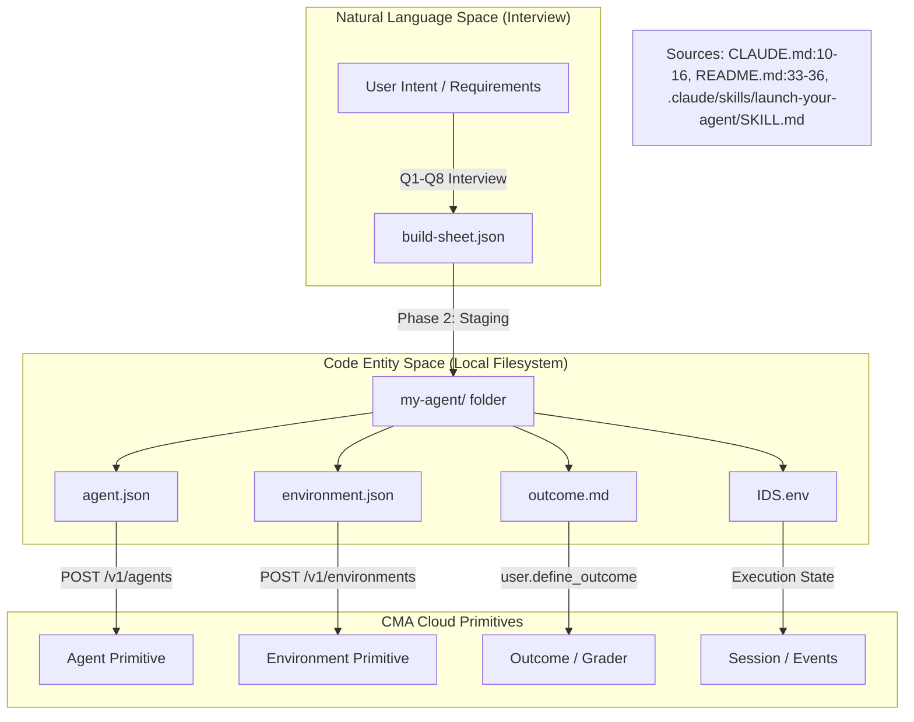
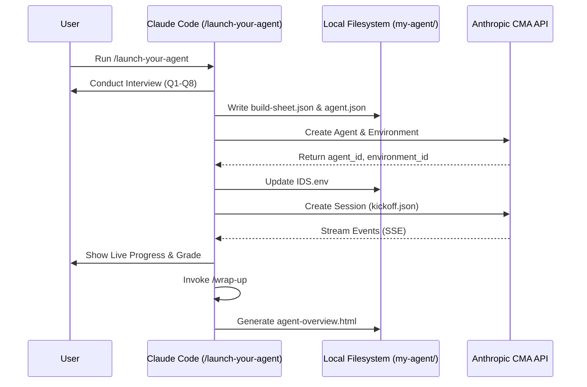

<!-- source: DeepWiki mcp.deepwiki.com · repo anthropics/launch-your-agent · page 1 Overview · fetched 2026-10-26 -->

# Overview

Relevant source files

The following files were used as context for generating this wiki page:

- [.gitignore](.gitignore)
- [CLAUDE.md](CLAUDE.md)
- [README.md](README.md)

The `launch-your-agent` repository is a reference implementation of a [Claude Code](https://code.claude.com) skill designed to help technical founders and developers build, deploy, and iterate on **Claude Managed Agents (CMA)**. 

Unlike a static tutorial, this repository provides an interactive, stateful workflow that moves from a conversational interview to a live, production-ready agent running in the user's own Anthropic account. The system is designed around an iterative "v0 to v1" philosophy: it helps you ship a functional core immediately while explicitly documenting more complex features (like real-world connectors or advanced memory) as planned upgrades in a `NEXT-DIRECTIONS.md` file [CLAUDE.md:20-20](), [CLAUDE.md:27-27]().

### What is a Managed Agent?
A Claude Managed Agent is a persistent, cloud-hosted worker capable of executing complex tasks in a sandboxed environment. It uses the `agent_toolset_20260401` to interact with files, run bash commands, and perform web searches [CLAUDE.md:12-12](). The skill orchestrates several CMA primitives—Agents, Environments, Sessions, and Outcomes—to create a closed-loop execution environment where the agent's work is automatically graded against your requirements.

## Core Capabilities

The repository provides two primary Claude Code skills:

1.  **`/launch-your-agent`**: An end-to-end orchestrator that handles the interview, stages a "build kit" in a local directory, launches the agent via the Anthropic API, and performs initial grading and iteration [CLAUDE.md:7-7](), [README.md:6-6]().
2.  **`/wrap-up`**: A companion skill that refreshes the state of your deployed agent, generates a visual overview dashboard, and provides a hygiene sweep of active sessions [CLAUDE.md:16-16](), [README.md:26-26]().

### System Workflow: From Interview to Deployment

The following diagram illustrates how the natural language requirements gathered during the interview are transformed into concrete code entities and CMA primitives.

**Natural Language to Code Entity Mapping**

Sources: [CLAUDE.md:10-16](), [README.md:33-36]().

## Getting Started

To use this repository, you must have **Claude Code** installed and an **Anthropic API key**. The skill is self-contained; cloning the repo and running `claude` inside the folder automatically enables the `/launch-your-agent` command [README.md:10-24]().

*   **Prerequisites**: Anthropic API key (stored in a local `.env`, never in chat) [README.md:31-31]().
*   **Outcome**: You walk away with a live managed agent in your Anthropic Console and a local `my-agent/` directory containing all configuration and execution logs [README.md:33-36]().

For a step-by-step guide, see [Getting Started](#1.1).

## Repository Organization

The repository is structured to separate the **source-of-truth skills** from the **generated artifacts** and **reference documentation**.

| Directory/File | Role |
| :--- | :--- |
| `.claude/skills/` | The core logic. Contains the `launch-your-agent` and `wrap-up` skill definitions [CLAUDE.md:15-16](). |
| `ui/` | Templates and examples for the `agent-overview.html` dashboard [CLAUDE.md:14-14](). |
| `cma-primitives.md` | A technical inventory of CMA limits and API shapes used as a reference by the skills [CLAUDE.md:12-12](). |
| `my-agent/` | **Gitignored.** This is the "Build Kit" generated for your specific agent [README.md:36-36](), [.gitignore:5-5](). |
| `test-runs/` | **Gitignored.** Scratch space for transcripts and temporary files [.gitignore:2-2](). |

For a detailed breakdown of the file structure, see [Repository Layout](#1.2).

## Architecture Overview

The following diagram shows how the internal components of the repository interact with the Anthropic API to manage the lifecycle of an agent.

**Component Interaction Diagram**

Sources: [CLAUDE.md:15-16](), [README.md:6-6](), [README.md:33-36]().

## Next Steps

Explore the child pages for deeper technical details:
*   [Getting Started](#1.1) — Quickstart and prerequisites.
*   [Repository Layout](#1.2) — Deep dive into the file system and skill references.

---

