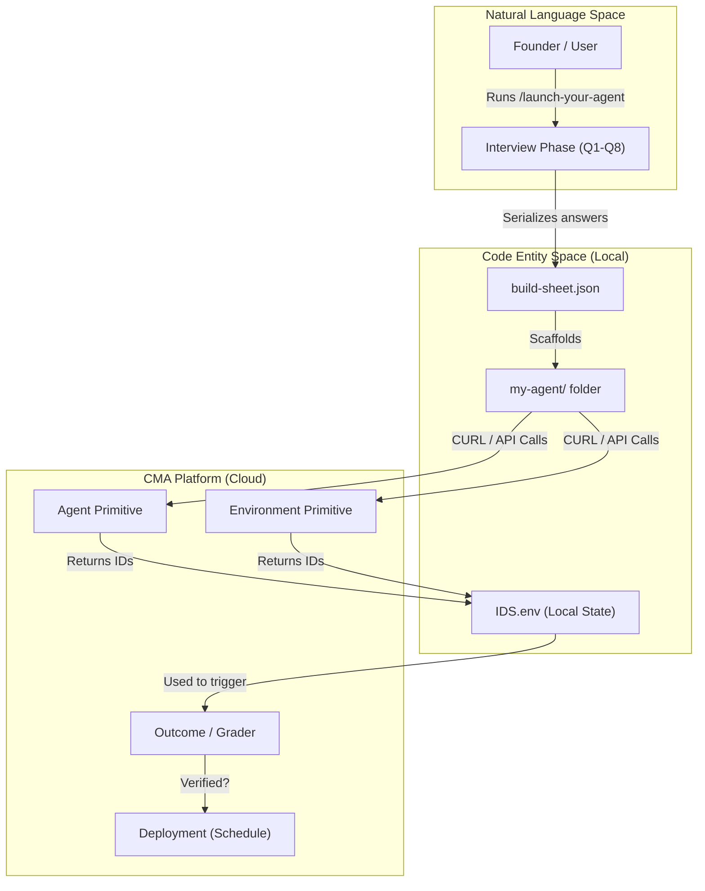

<!-- source: DeepWiki mcp.deepwiki.com · repo anthropics/launch-your-agent · page 1.1 Getting Started · fetched 2026-10-26 -->

# Getting Started

<details>
<summary>Relevant source files</summary>

The following files were used as context for generating this wiki page:

- [.gitignore](.gitignore)
- [CLAUDE.md](CLAUDE.md)
- [README.md](README.md)

</details>


The `launch-your-agent` repository is a specialized environment designed for **Claude Code**. It provides a custom skill that orchestrates the creation, testing, and deployment of **Claude Managed Agents (CMA)** directly from your terminal [README.md:4-7]().

This page guides you through the initial setup and the execution of the primary workflow.

## Prerequisites

Before starting, ensure you have the following:

1.  **Claude Code**: Installed and authenticated on your machine [README.md:30-30]().
2.  **Anthropic API Key**: A valid key from your Anthropic Console (platform.claude.com).
    *   **Security Note**: The skill is designed to never ingest your API key into the chat transcript. You will be prompted to place it in a local, gitignored `.env` file within the generated agent directory [CLAUDE.md:24-24]().
3.  **Permissions**: Ensure your account has access to the Claude Managed Agents (CMA) beta features [README.md:49-50]().

**Sources:** [README.md:28-32](), [CLAUDE.md:24-24]()

## Quickstart Sequence

To begin building your agent, follow these steps in your terminal:

### 1. Clone and Enter the Repository
```bash
git clone https://github.com/anthropics/launch-your-agent.git
cd launch-your-agent
```
[README.md:12-14]()

### 2. Start Claude Code
Launch the Claude Code environment within the repo root.
```bash
claude
```
[README.md:15-15]()

### 3. Invoke the Skill
Inside the Claude Code prompt, run the custom skill:
```text
/launch-your-agent
```
[README.md:21-21]()

The skill located at `.claude/skills/launch-your-agent/SKILL.md` is automatically discovered by Claude Code when running in this directory [README.md:24-24]().

**Sources:** [README.md:10-24](), [CLAUDE.md:15-15]()

## The Launch Workflow

The `/launch-your-agent` skill executes a four-phase state machine to move from a natural language concept to a deployed production agent.

### Data Flow: From Concept to Managed Agent

The following diagram illustrates how your natural language inputs are transformed into code entities and eventually live CMA primitives.


**Sources:** [CLAUDE.md:7-7](), [CLAUDE.md:26-26](), [README.md:42-42]()

### Workflow Phases

| Phase | Activity | Primary Artifacts |
| :--- | :--- | :--- |
| **1. Interview** | Claude asks ~8 targeted questions based on CMA primitives [CLAUDE.md:21-21](). | `build-sheet.json` |
| **2. Staging** | Scaffolding the local build kit while you fetch API keys [CLAUDE.md:24-24](). | `my-agent/` directory |
| **3. Launch & Grade** | Creating the Agent and Environment; running the first session with `user.define_outcome` [CLAUDE.md:20-20](). | `IDS.env`, Session logs |
| **4. Deployment** | Setting up a cron-based schedule if the task is recurring [CLAUDE.md:31-31](). | `Deployment` primitive |

**Sources:** [CLAUDE.md:7-7](), [CLAUDE.md:21-26](), [README.md:42-42]()

## Expected Artifacts

After successfully running the skill, you will have a new directory in your project root named `my-agent/` (this directory is gitignored by default) [.gitignore:5-5]().

### Local Build Kit (`my-agent/`)
*   **`agent.json` / `environment.json`**: The exact JSON payloads sent to the CMA API.
*   **`build-sheet.json`**: The source-of-truth configuration derived from your interview.
*   **`IDS.env`**: A mapping of local names to remote CMA UUIDs (e.g., `AGENT_ID`, `ENV_ID`), allowing the skill to be resumable.
*   **`agent-overview.html`**: A generated dashboard that visualizes your agent's architecture and recent run status [CLAUDE.md:30-30]().
*   **`NEXT-DIRECTIONS.md`**: A roadmap for v1/v2 features that were out-of-scope for the initial launch [CLAUDE.md:27-27]().

### Cloud Resources
*   **Managed Agent**: A versioned agent entity in the Anthropic Console.
*   **Managed Environment**: A secure, sandboxed runtime for your agent.
*   **Scheduled Deployment**: (Optional) A recurring trigger that executes your agent on a clock [CLAUDE.md:31-31]().

**Sources:** [README.md:33-36](), [CLAUDE.md:9-16](), [.gitignore:1-10]()

## Wrapping Up

Once the agent is live, you can use the companion skill:
```text
/wrap-up
```
This skill performs a hygiene sweep (archiving old sessions), refreshes the `agent-overview.html` with live status from the API, and provides tailored suggestions for your next iteration [CLAUDE.md:28-28]().

**Sources:** [CLAUDE.md:16-16](), [README.md:26-26]()

---

