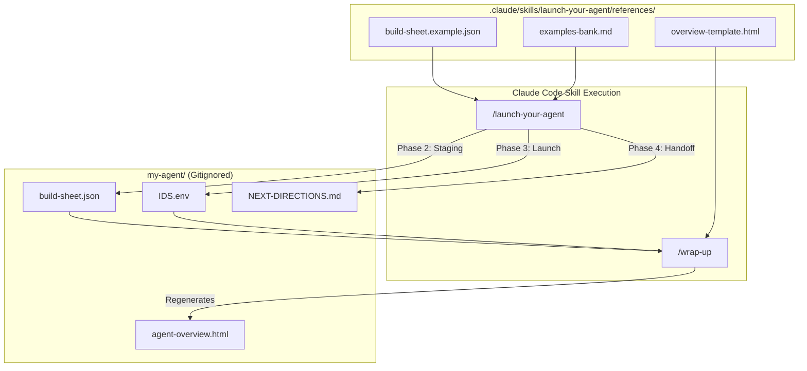
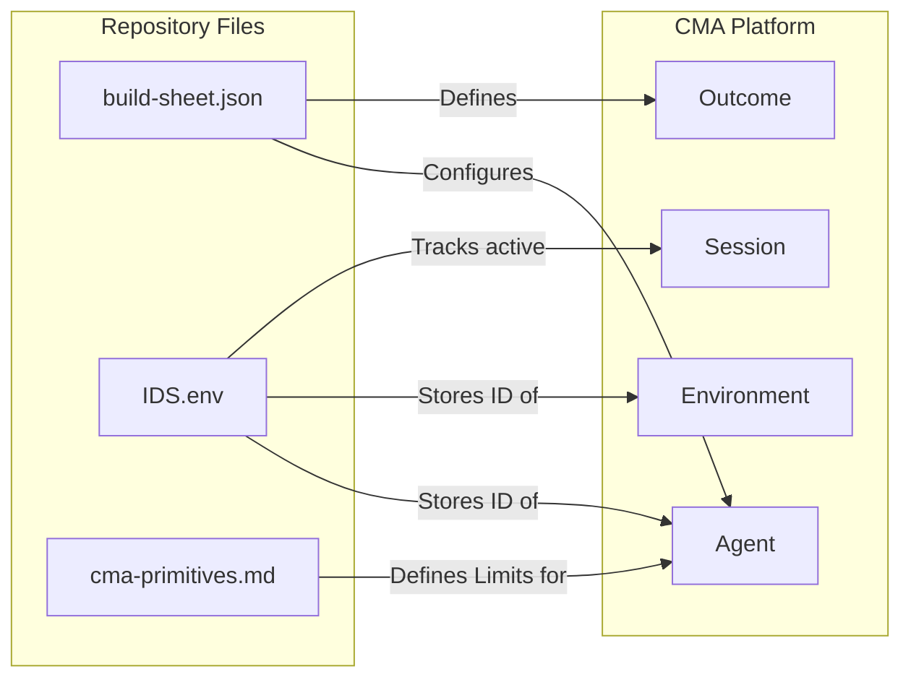

<!-- source: DeepWiki mcp.deepwiki.com · repo anthropics/launch-your-agent · page 1.2 Repository Layout · fetched 2026-10-26 -->

# Repository Layout

Relevant source files

The following files were used as context for generating this wiki page:

- [.gitignore](.gitignore)
- [CLAUDE.md](CLAUDE.md)
- [CONTRIBUTING.md](CONTRIBUTING.md)
- [LICENSE](LICENSE)
- [README.md](README.md)

This page provides a detailed map of the `launch-your-agent` repository. It distinguishes between the **Source of Truth** (the skills and reference documentation) and **Generated Artifacts** (the local scratch spaces and agent build kits created during execution).

## Directory Structure Overview

The repository is organized to facilitate the execution of Claude Code skills while providing a library of reference materials that ground the AI's generation of Claude Managed Agents (CMA) primitives.

### High-Level Map

| Path | Category | Purpose |
|---|---|---|
| `.claude/skills/` | **Source of Truth** | Executable Claude Code skills (`launch-your-agent` and `wrap-up`). |
| `ui/` | **Reference/UI** | Static HTML templates and example JSON configurations for the agent dashboard. |
| `my-agent/` | **Generated Artifact** | The local build kit for the agent currently being developed (Gitignored). |
| `test-runs/` | **Scratch Space** | Transcripts and temporary files from skill testing (Gitignored). |
| `cma-primitives.md` | **Documentation** | Technical inventory of CMA API primitives, limits, and endpoints. |

**Sources:** [`README.md:38-48`](), [`CLAUDE.md:9-16`]()

---

## The Skills Directory (`.claude/skills/`)

This directory contains the core logic of the repository. Claude Code automatically detects these skills when running in the repository root [`README.md:24-24`]().

### `launch-your-agent/`
The primary skill that orchestrates the four-phase workflow: Interview, Staging, Launch/Grade, and Deployment.
*   **`SKILL.md`**: The entry point defining the `launch-your-agent` command and its system prompts [`CLAUDE.md:15-15`]().
*   **`references/`**: A collection of grounding documents used by the skill to ensure technical accuracy:
    *   `examples-bank.md`: Sourced archetypes traced to official cookbooks [`CLAUDE.md:13-13`]().
    *   `mock-connectors.md`: Patterns for stubbing external integrations (Slack, Email) in v0 builds [`CLAUDE.md:25-25`]().
    *   `overview-template.html`: The base HTML structure for the agent dashboard [`CLAUDE.md:15-15`]().

### `wrap-up/`
A companion skill invoked at the end of the launch process or manually by the user.
*   **`SKILL.md`**: Defines the `/wrap-up` command [`CLAUDE.md:16-16`]().
*   **Logic**: Performs a "Hygiene Sweep" (archiving sessions, sanitizing dates) and regenerates the `agent-overview.html` with live status data from the CMA API [`CLAUDE.md:28-28`]().

**Sources:** [`CLAUDE.md:15-16`](), [`README.md:42-43`]()

---

## Data Flow: From Reference to Artifact

The repository operates by transforming static reference files into functional, environment-specific artifacts. The diagram below illustrates how system entities in the `references/` directory map to the generated files in `my-agent/`.

### Mapping Reference Space to Code Space
"This diagram shows how the Skill orchestrates Source files to produce Artifacts."

**Sources:** [`CLAUDE.md:15-16`](), [`CLAUDE.md:26-28`](), [`.gitignore:1-5`]()

---

## Key Files & Scratch Spaces

### Documentation Primitives
*   **`cma-primitives.md`**: Acts as the technical source of truth for the skill's knowledge of the CMA platform. It includes details on `/managed-agents/scheduled-deployments` and other API-specific limits [`CLAUDE.md:12-12`]().
*   **`CLAUDE.md`**: Contains project-specific "Key Decisions" and "Voice" guidelines that govern how the skill interacts with the user [`CLAUDE.md:18-31`]().

### UI and Examples (`ui/`)
*   **`ui/agent-overview-example.html`**: A static version of the dashboard for previewing the "warm-light schematic" layout [`CLAUDE.md:14-14`]().
*   **`ui/build-sheet.example.json`**: A reference for the JSON schema that stores the agent's configuration during the interview process [`CLAUDE.md:14-14`]().

### Gitignored Spaces
*   **`my-agent/`**: This directory is the local "Build Kit". It contains the specific configuration for the agent being built, including `agent.json`, `environment.json`, and the launch state [`CLAUDE.md:36-36`]().
*   **`test-runs/`**: Used for local development and debugging of the skills themselves. It often contains session transcripts [`gitignore:1-2`]().
*   **`.env` / `IDS.env`**: `.env` is used for local secrets (like `ANTHROPIC_API_KEY`) and is strictly ignored. `IDS.env` is specifically **not** ignored as it stores the non-secret IDs of created CMA primitives (e.g., `AGENT_ID`, `ENV_ID`) to allow for resumable launches [`.gitignore:7-10`]().

### Logic Entity Relationship
"This diagram maps the logical CMA Primitives to the files that define or track them within the repo."

**Sources:** [`CLAUDE.md:12-12`](), [`CLAUDE.md:26-26`](), [`.gitignore:10-10`](), [`README.md:33-36`]()

---

