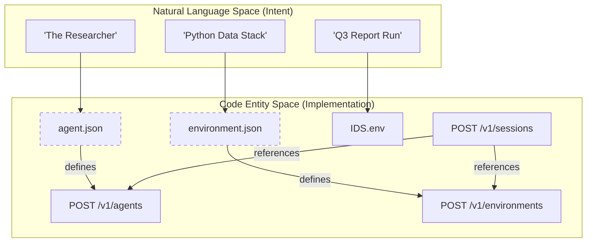
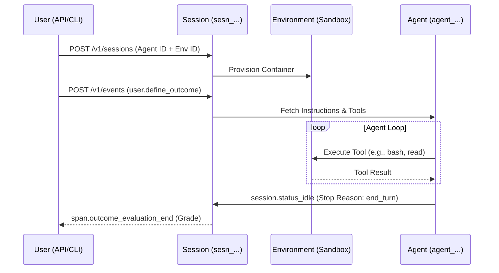

<!-- source: DeepWiki mcp.deepwiki.com · repo anthropics/launch-your-agent · page 2 Claude Managed Agents (CMA) Concepts · fetched 2026-10-26 -->

# Claude Managed Agents (CMA) Concepts

Relevant source files

The following files were used as context for generating this wiki page:

- [.claude/skills/launch-your-agent/references/cma-api.md](.claude/skills/launch-your-agent/references/cma-api.md)
- [cma-primitives.md](cma-primitives.md)

Claude Managed Agents (CMA) is a **hosted agent harness** platform. Unlike the standard Messages API where you must build your own execution loop and manage infrastructure, CMA provides a server-side **sandboxed Linux container** and an autonomous agent loop [cma-primitives.md:10-12]().

CMA is designed for **long-running, asynchronous, and stateful** workloads. It manages the lifecycle of the agent, the tool execution environment, and the persistence of the conversation and filesystem state [cma-primitives.md:12-13]().

## The Four Core Primitives

The platform is built on four foundational entities. A minimal launch involves creating an Agent, defining an Environment, instantiating a Session, and triggering work via an Event [cma-primitives.md:31-31]().

| Primitive | Purpose | Key Characteristic |
|---|---|---|
| **Agent** | Configuration | Reusable and **versioned** (model, prompt, tools) [.claude/skills/launch-your-agent/references/cma-api.md:35-45]() |
| **Environment** | Infrastructure | A sandboxed Linux runtime; **not versioned** [.claude/skills/launch-your-agent/references/cma-api.md:76-87]() |
| **Session** | Execution | A specific instance of an agent running in an environment [cma-primitives.md:62-64]() |
| **Events** | Communication | Bidirectional messages (`user.*`, `agent.*`, `session.*`) [.claude/skills/launch-your-agent/references/cma-api.md:109-115]() |

For a deep dive into these primitives, see [Core Primitives: Agent, Environment, Session & Events](#2.1).

### Conceptual Architecture: Code to Cloud

The following diagram bridges the high-level CMA concepts to the specific JSON configurations and API endpoints used in the codebase.

**CMA Entity Mapping**

Sources: [.claude/skills/launch-your-agent/references/cma-api.md:35-108](), [cma-primitives.md:22-31]()

## Outcomes and Grading

CMA introduces a native **Outcome** primitive. Instead of just sending a message, you can define a "Definition of Done" using `user.define_outcome`. This allows the platform to automatically provision a grader to evaluate the agent's work against a rubric [cma-primitives.md:100-108]().

The `launch-your-agent` skill uses this to create a **Grade-and-Improve loop**, where the agent's performance is measured and refined iteratively [.claude/skills/launch-your-agent/references/cma-api.md:111-123]().

For details, see [Outcomes, Evals & the Grade-and-Improve Loop](#2.2).

## Scheduled Deployments

Agents can be promoted from manual sessions to **Deployments**. A deployment allows for scheduled execution (cron-based) and automated lifecycle management. This is the primary way to move an agent from a development "sketch" into a production "worker" [.claude/skills/launch-your-agent/references/cma-api.md:144-160]().

For details, see [Scheduled Deployments](#2.3).

## Tools, Skills, and Connectivity

CMA provides a robust toolset and connectivity layer:
*   **Built-in Tools:** `agent_toolset_20260401` includes `bash`, `read`, `write`, `edit`, `web_search`, and more [.claude/skills/launch-your-agent/references/cma-api.md:58-75]().
*   **Anthropic Skills:** Specialized capabilities for processing complex file types like `xlsx`, `docx`, and `pdf` [cma-primitives.md:120-125]().
*   **MCP Servers:** Integration with the Model Context Protocol for connecting to external data sources [cma-primitives.md:135-141]().
*   **Vaults:** Secure storage for credentials (OAuth, API keys) required by tools [cma-primitives.md:127-133]().

For details, see [Tools, Skills, MCP Servers & Vaults](#2.4).

## Persistence and Multi-Agent Patterns

CMA supports advanced state management and orchestration:
*   **Memory Stores:** Persistent key-value storage that survives across different sessions, allowing agents to "remember" information over time [cma-primitives.md:143-152]().
*   **Multi-Agent Systems:** A coordinator/roster pattern where a primary agent can delegate tasks to sub-agents [cma-primitives.md:160-167]().

For details, see [Memory Stores, Multi-Agent Sessions & Dreams](#2.5).

### Runtime Flow: Session Lifecycle

This diagram illustrates how code-defined primitives interact during a live session execution.

**CMA Runtime Execution**

Sources: [.claude/skills/launch-your-agent/references/cma-api.md:89-123](), [cma-primitives.md:62-89]()

---

