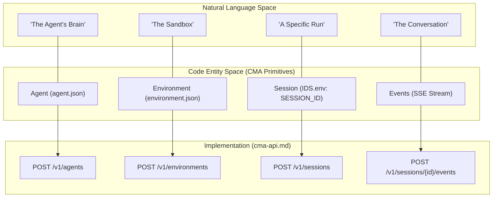
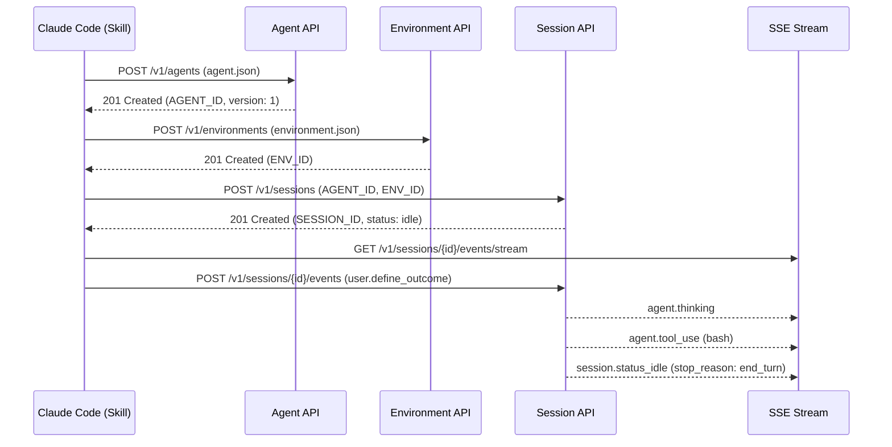

<!-- source: DeepWiki mcp.deepwiki.com · repo anthropics/launch-your-agent · page 2.1 Core Primitives: Agent, Environment, Session & Events · fetched 2026-10-26 -->

# Core Primitives: Agent, Environment, Session & Events

<details>
<summary>Relevant source files</summary>

The following files were used as context for generating this wiki page:

- [.claude/skills/launch-your-agent/references/cma-api.md](.claude/skills/launch-your-agent/references/cma-api.md)
- [cma-primitives.md](cma-primitives.md)

</details>


This page provides a deep dive into the four foundational primitives of the Claude Managed Agents (CMA) platform. These primitives form the "hosted agent harness" that allows for long-running, asynchronous, and stateful agent execution within a sandboxed Linux container.

## Architectural Overview

The CMA platform moves the agent loop from the client-side to the server-side. Instead of managing the iterative "thought-action-observation" loop via the Messages API, you define a configuration (Agent) and a runtime (Environment), and Anthropic orchestrates the execution (Session) driven by bidirectional messaging (Events).

### Natural Language to Code Entity Mapping

The following diagram bridges high-level system concepts to the specific code entities and API resources used in the `launch-your-agent` skill and the CMA platform.

**Diagram: System Concepts to Code Entities**

Sources: [cma-primitives.md:10-33](), [launch-your-agent/references/cma-api.md:35-120]()

---

## 1. Agent: The Versioned Configuration

The **Agent** primitive is a reusable, versioned configuration that defines the identity, capabilities, and constraints of the Claude instance.

### Key Characteristics
- **Immutable Versions:** Every update to an agent's configuration (e.g., changing the system prompt or adding a tool) increments its `version` (starting at 1). [cma-primitives.md:40-40]()
- **Concurrency Guard:** Updates require the current `version` number to prevent accidental overwrites in multi-user environments. [launch-your-agent/references/cma-api.md:47-52]()
- **Replacement Semantics:** While scalars like `system` can be updated individually, array fields such as `tools`, `mcp_servers`, and `skills` are **full replacements**. Omitting them preserves the current state, but passing an empty array `[]` clears them. [cma-primitives.md:41-41]()

### Core Configuration Fields
| Field | Description |
|---|---|
| `model` | Claude 4.5+ model ID (e.g., `claude-opus-4-8`). Supports speed objects: `{"id": "...", "speed": "fast"}`. [cma-primitives.md:39-39]() |
| `system` | The primary instructions for the agent. [cma-primitives.md:37-37]() |
| `tools` | Array of tool definitions (Built-in, MCP, or Custom). [launch-your-agent/references/cma-api.md:58-68]() |
| `mcp_servers` | External Model Context Protocol server configurations. [launch-your-agent/references/cma-api.md:69-69]() |

Sources: [cma-primitives.md:35-44](), [launch-your-agent/references/cma-api.md:35-54]()

---

## 2. Environment: The Sandboxed Runtime

The **Environment** defines the infrastructure where the agent executes. Unlike Agents, Environments are **not versioned**.

### Sandbox Isolation
Every **Session** created against an Environment receives its own fresh, isolated Linux container. There is no shared filesystem between sessions. [cma-primitives.md:49-49]()

### Networking Modes
- **`unrestricted`**: Default mode; full outbound access (minus safety blocklists). [cma-primitives.md:54-54]()
- **`limited`**: Restricted to specific `allowed_hosts`. This mode requires explicit booleans to allow package managers or MCP server connectivity. [cma-primitives.md:55-56]()

### Pre-provisioned Packages
Environments support pre-installing packages via `apt`, `pip`, `npm`, `gem`, `cargo`, and `go`. These are cached across sessions to speed up container provisioning. [cma-primitives.md:51-52]()

Sources: [cma-primitives.md:47-60](), [launch-your-agent/references/cma-api.md:76-88]()

---

## 3. Session: The Execution Instance

A **Session** is a single instance of an Agent running within an Environment. It tracks conversation history, sandbox state (checkpoints), and resource usage.

### Session Lifecycle & State Machine
Sessions follow a strict state machine. Work does not begin until the first event is received.

**Diagram: Session Status Transitions**
```mermaid
stateDiagram-v2
    [*] --> "idle": POST /v1/sessions
    "idle" --> "running": user.message / user.define_outcome
    "running" --> "idle": agent.message / session.status_idle
    "running" --> "rescheduling": transient error
    "rescheduling" --> "running": retry success
    "running" --> "terminated": unrecoverable error
    "idle" --> "terminated": DELETE /v1/sessions/{id}
```
Sources: [cma-primitives.md:68-68](), [launch-your-agent/references/cma-api.md:104-104]()

### Checkpointing and Persistence
- **Sandbox Checkpoints:** On reaching `idle` status, the sandbox (filesystem, installed packages) is checkpointed. [cma-primitives.md:70-70]()
- **TTL:** Checkpoints are preserved for 30 days after the last activity. Sending a new message resets this timer. [cma-primitives.md:70-70]()
- **Resources:** Memory stores, files, and repositories can be attached to sessions. Memory stores must be attached at creation time. [cma-primitives.md:67-67]()

Sources: [cma-primitives.md:62-74](), [launch-your-agent/references/cma-api.md:89-108]()

---

## 4. Events: Bidirectional Messaging

Communication with a session occurs via events. You send **User Events** to drive the agent and receive **Agent/Session/Span Events** to monitor progress.

### Event Streaming (SSE)
Events are typically consumed via a Server-Sent Events (SSE) stream.
- **Endpoint:** `GET /v1/sessions/{id}/events/stream` [launch-your-agent/references/cma-api.md:120-120]()
- **Processing:** Every event includes a `processed_at` timestamp; a null value indicates the event is still queued. [cma-primitives.md:79-79]()

### Key Event Types
| Category | Event Name | Purpose |
|---|---|---|
| **User** | `user.define_outcome` | Kickoff event combining task, rubric, and retry budget. [launch-your-agent/references/cma-api.md:111-115]() |
| **User** | `user.tool_confirmation` | Approve or deny a tool use gated by an `always_ask` policy. [cma-primitives.md:81-81]() |
| **Agent** | `agent.thinking` | Provides visibility into the model's internal reasoning. [cma-primitives.md:85-85]() |
| **Session** | `session.status_idle` | Signals the agent has finished its turn or requires input. [cma-primitives.md:87-87]() |
| **Span** | `span.outcome_evaluation_end` | Emitted when an outcome has been graded by the system. [cma-primitives.md:89-89]() |

Sources: [cma-primitives.md:77-90](), [launch-your-agent/references/cma-api.md:109-122]()

---

## Implementation Details: Data Flow

The following diagram illustrates the interaction between these primitives during a typical launch sequence orchestrated by the `launch-your-agent` skill.

**Diagram: Primitive Orchestration Flow**

Sources: [launch-your-agent/references/cma-api.md:22-26](), [launch-your-agent/references/cma-api.md:35-120]()

---

