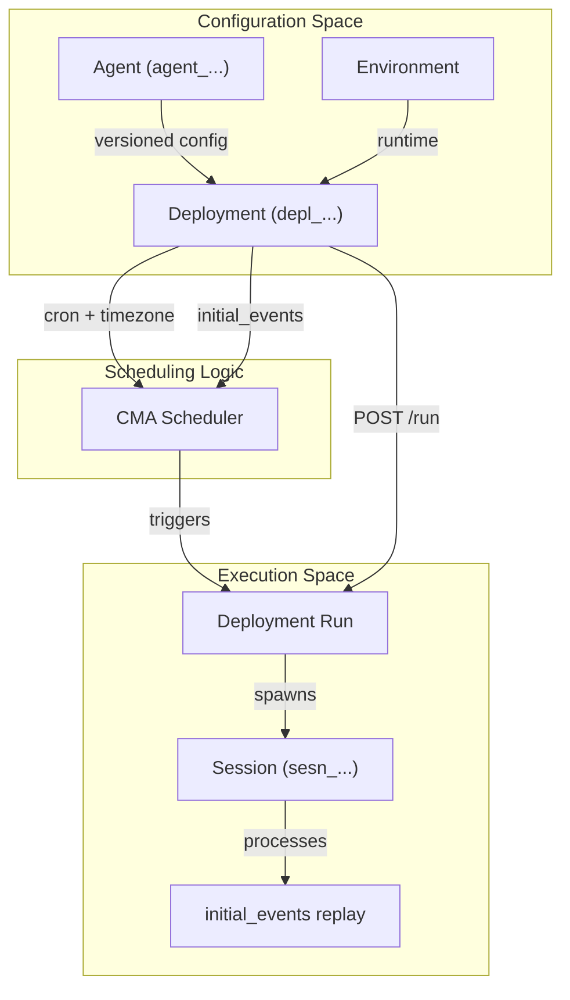
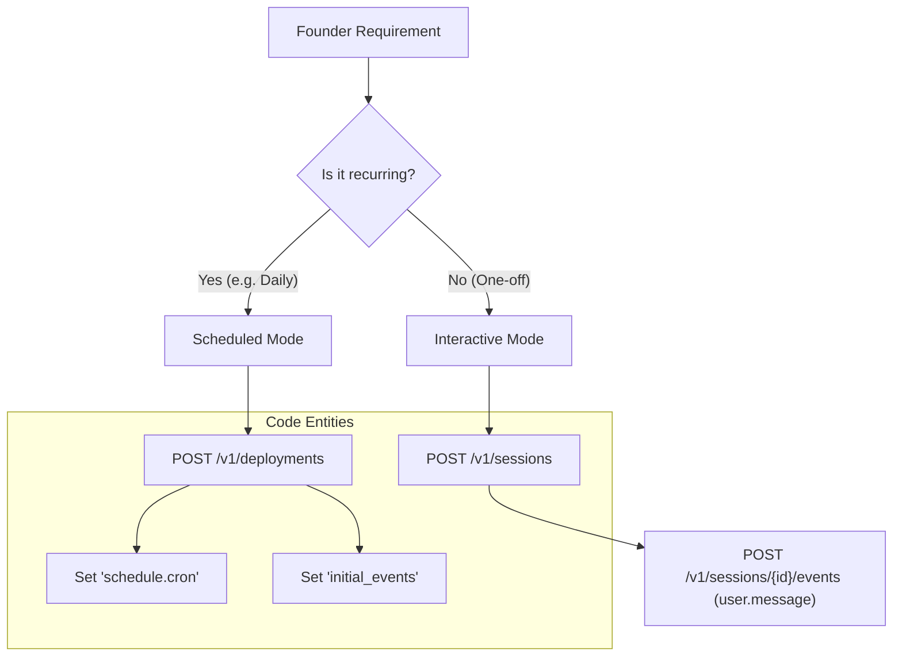

<!-- source: DeepWiki mcp.deepwiki.com · repo anthropics/launch-your-agent · page 2.3 Scheduled Deployments · fetched 2026-10-26 -->

# Scheduled Deployments

<details>
<summary>Relevant source files</summary>

The following files were used as context for generating this wiki page:

- [.claude/skills/launch-your-agent/SKILL.md](.claude/skills/launch-your-agent/SKILL.md)
- [.claude/skills/launch-your-agent/references/cma-api.md](.claude/skills/launch-your-agent/references/cma-api.md)
- [cma-primitives.md](cma-primitives.md)

</details>


Scheduled Deployments are a native Claude Managed Agents (CMA) primitive that allow agents to run autonomously on a recurring basis. While **Sessions** represent a single execution instance, a **Deployment** acts as a template and a clock that automatically spawns sessions according to a cron schedule.

## Deployment Lifecycle and Primitives

A Deployment ([cma-primitives.md:144-144]()) links an **Agent** and an **Environment** to a **Schedule**. When the schedule triggers, the CMA platform creates a new Session, replays a set of `initial_events` (the "kickoff"), and manages the execution until completion.

### Key Concepts

| Concept | Description |
| :--- | :--- |
| **Cron Schedule** | Standard 5-field cron string (e.g., `0 9 * * 1-5` for 9 AM weekdays) combined with a IANA timezone (e.g., `America/Los_Angeles`). |
| **Initial Events** | A list of events (usually `user.define_outcome`) that are injected into every session spawned by the deployment. |
| **Deployment Run** | An individual execution instance spawned by a deployment. You can track the status and outcome of each run. |
| **Manual Trigger** | The ability to trigger an immediate run via the `/run` endpoint without waiting for the next cron tick. |

### Deployment States
Deployments follow a simple state machine ([cma-api.md:145-146]()):
*   **Active**: The deployment is live and will spawn sessions according to its schedule.
*   **Paused**: The schedule is suspended. No new runs will be created until resumed.
*   **Archived**: The deployment is soft-deleted. It stops running and can no longer be modified.

### Entity Relationship: Deployment Orchestration
The following diagram shows how the `Deployment` entity bridges the static configuration of an `Agent` with the dynamic execution of `Sessions`.

**Deployment Data Flow**

Sources: [cma-primitives.md:144-156](), [cma-api.md:130-143]()

---

## Implementation Details

### Creating a Deployment
Deployments are created via `POST /v1/deployments`. The request must include the `agent_id` (or a pinned version), `environment_id`, and the `schedule` object.

```bash
# Example Deployment Creation
curl -sS "$BASE/deployments" "${H[@]}" -d '{
  "name": "Daily Compliance Audit",
  "agent": "'$AGENT_ID'",
  "environment_id": "'$ENV_ID'",
  "schedule": {
    "type": "cron",
    "cron": "0 9 * * *",
    "timezone": "UTC"
  },
  "initial_events": [
    {
      "type": "user.define_outcome",
      "description": "Audit last 24h of logs for PII leaks.",
      "rubric": {"type": "text", "content": "1. Scan logs... 2. Flag leaks..."},
      "max_iterations": 3
    }
  ]
}'
```
Sources: [cma-api.md:130-143]()

### Handling Relative Dates in Initial Events
Because deployments run in the future, hardcoded dates in `initial_events` are usually anti-patterns. The `launch-your-agent` skill encourages the use of relative instructions (e.g., "Analyze data from the last 24 hours") so the agent can use its internal `bash` tool to determine the current date at runtime [SKILL.md:29-29]().

### The /run Endpoint
The `/run` endpoint ([cma-api.md:154-154]()) is critical for testing. It allows a developer to trigger a deployment immediately. This creates a **Deployment Run** that inherits all the configuration (environment, initial events, agent version) of the deployment, providing a high-fidelity test of what the scheduled execution will look like.

---

## Execution Modes: When to use Deployments

The `launch-your-agent` skill helps founders choose the correct execution mode during Phase 1 (Interview) and Phase 4 (Wrap-up).

| Mode | Trigger | Use Case |
| :--- | :--- | :--- |
| **Interactive** | Manual `user.message` | Ad-hoc tasks, debugging, or complex reasoning requiring human-in-the-loop. |
| **Event-Driven** | Webhook / API Call | Reacting to external signals (e.g., a GitHub PR, a Slack message). |
| **Scheduled** | **Deployment (Cron)** | Recurring chores, daily reports, weekly cleanup, or monitoring. |

### Technical Decision Flow
This diagram maps the user's requirements to the specific CMA API actions taken by the skill.

**Decision to Code Mapping**

Sources: [SKILL.md:3-3](), [cma-api.md:130-143](), [cma-primitives.md:144-156]()

---

## Management and Maintenance

### Monitoring Runs
You can list the runs associated with a deployment to verify success or failure. Each run contains a reference to the `session_id` it created, allowing for deep-dive log inspection in the Anthropic Console.

*   **List Runs**: `GET /v1/deployments/{id}/runs` [cma-api.md:152-152]()
*   **Check Status**: Inspect the `status` of the resulting session (e.g., `terminated` vs `idle` with a successful outcome) [cma-api.md:105-105]().

### Updating Deployments
Deployments can be updated to change the schedule or the agent version they use.
*   **Update**: `POST /v1/deployments/{id}` [cma-api.md:145-146]()
*   **Pause/Unpause**: Use the update endpoint to set `status: "paused"` or `status: "active"` [cma-api.md:145-146]().

### Hygiene and Wrap-up
During the `/wrap-up` phase, the skill performs a "Hygiene Sweep" ([SKILL.md:3.4]()). For deployments, this involves:
1.  Verifying the `initial_events` do not contain literal dates that will become stale.
2.  Ensuring the deployment is in the `active` state if the user is ready to go live.
3.  Updating the `agent-overview.html` to display the `upcoming_runs_at` timestamp, providing visual confirmation of the next scheduled execution [SKILL.md:4.1]().

Sources: [SKILL.md:3.4](), [SKILL.md:4.1](), [cma-api.md:145-156]()

---

