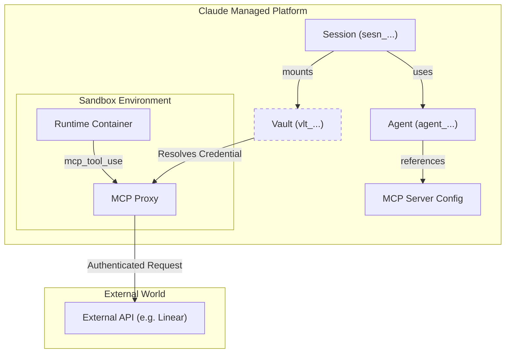
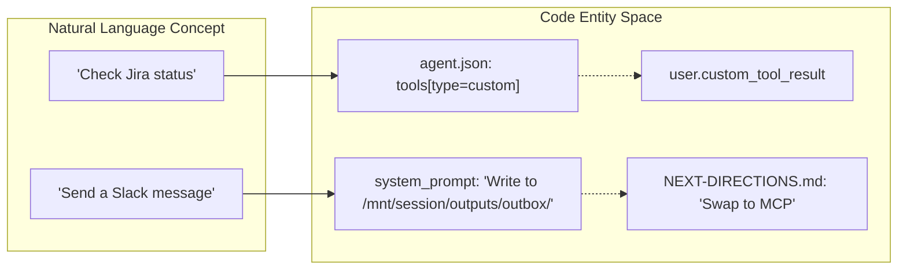

<!-- source: DeepWiki mcp.deepwiki.com · repo anthropics/launch-your-agent · page 2.4 Tools, Skills, MCP Servers & Vaults · fetched 2026-10-26 -->

# Tools, Skills, MCP Servers & Vaults

<details>
<summary>Relevant source files</summary>

The following files were used as context for generating this wiki page:

- [.claude/skills/launch-your-agent/references/cma-api.md](.claude/skills/launch-your-agent/references/cma-api.md)
- [.claude/skills/launch-your-agent/references/mock-connectors.md](.claude/skills/launch-your-agent/references/mock-connectors.md)
- [cma-primitives.md](cma-primitives.md)

</details>


This page provides a technical reference for the capabilities available to Claude Managed Agents (CMA). It covers the built-in toolset, specialized Anthropic Skills, Model Context Protocol (MCP) integration, and the Vault system for secure credential management.

## Built-in Toolset (`agent_toolset_20260401`)

The primary capability for most agents is the `agent_toolset_20260401`. This bundle provides eight core tools that allow the agent to interact with its sandboxed Linux environment and the web.

| Tool Name | Purpose | Implementation Detail |
| :--- | :--- | :--- |
| `bash` | Execute shell commands | Runs in the sandboxed container defined by the Environment. |
| `read` | Read file content | Optimized for large files with paging support. |
| `write` | Create/Overwrite files | Used to persist agent outputs to `/mnt/session/outputs/`. |
| `edit` | Patch existing files | Uses a search-and-replace block format to minimize token usage. |
| `glob` | Search for files | Uses pattern matching to explore the file system. |
| `grep` | Search inside files | Standard regex-based content searching. |
| `web_search` | Search the internet | External search capability; bypasses environment networking limits. |
| `web_fetch` | Retrieve URL content | Fetches raw page content for analysis. |

**Sources:** [.claude/skills/launch-your-agent/references/cma-api.md:58-63](), [.claude/skills/launch-your-agent/references/cma-api.md:74-74]()

### Permission Policies
Tools can be configured with specific `permission_policy` settings to control agent autonomy.
*   **`always_allow`**: The agent executes the tool without user intervention.
*   **`always_ask`**: The session pauses, and the agent emits a `session.status_idle` with a `stop_reason` of `requires_action`. The user must send a `user.tool_confirmation` event to proceed.

**Sources:** [.claude/skills/launch-your-agent/references/cma-api.md:58-68](), [cma-primitives.md:81-81]()

## Anthropic Skills

Skills are high-level, managed capabilities provided by Anthropic to handle complex file parsing and manipulation without requiring the agent to write custom scripts.

*   **`xlsx`**: Read, analyze, and manipulate Excel spreadsheets.
*   **`docx`**: Extract text and structure from Word documents.
*   **`pptx`**: Parse and edit PowerPoint presentations.
*   **`pdf`**: High-fidelity text and layout extraction from PDF files.

**Sources:** [.claude/skills/launch-your-agent/references/cma-api.md:70-71]()

## Model Context Protocol (MCP) & Vaults

MCP allows agents to connect to external data sources and services (e.g., Linear, Slack, Google Calendar) using a standardized protocol. Credentials for these services are never stored in the agent configuration; instead, they are stored in a **Vault** and referenced by the Session.

### Vault Credential Types
1.  **`mcp_oauth`**: Used for services requiring OAuth2 flows. The agent handles the redirect/consent via the user.
2.  **`static_bearer`**: For API keys or static tokens.
3.  **`environment_variable`**: Injects sensitive strings directly into the sandbox shell environment.

### Data Flow: Agent to External Service
The following diagram illustrates how an agent uses an MCP server and a Vault to perform an authenticated action.

**CMA Tool Execution & Vault Resolution**

**Sources:** [.claude/skills/launch-your-agent/references/cma-api.md:64-69](), [.claude/skills/launch-your-agent/references/cma-api.md:96-96](), [cma-primitives.md:66-66]()

## Mock Connectors: "Design Now, Wire Later"

To maintain development velocity when credentials are not yet available, the `launch-your-agent` skill implements a mocking strategy. This ensures the agent's logic is "CMA-shaped" before final integration.

### Implementation Strategies
*   **Outbox Mock**: The agent writes JSON payloads to `/mnt/session/outputs/outbox/`. This is the preferred method for unattended or scheduled agents.
*   **Custom Tool Mock**: Defines a `custom` tool type in `agent.json`. The agent calls the tool, which triggers a `requires_action` state in the session, allowing a human to provide a mock response via `user.custom_tool_result`.

**Natural Language to Code Entity: Mocking System**

**Sources:** [.claude/skills/launch-your-agent/references/mock-connectors.md:8-17](), [.claude/skills/launch-your-agent/references/cma-api.md:66-68]()

## Configuration Reference

### Agent Tool Configuration Example
This JSON snippet demonstrates how to combine built-in tools, MCP servers, and custom tools in an agent definition.

```json
{
  "tools": [
    {
      "type": "agent_toolset_20260401",
      "configs": [
        {"name": "bash", "permission_policy": {"type": "always_ask"}}
      ]
    },
    {
      "type": "mcp_toolset",
      "mcp_server_name": "linear_integration"
    }
  ],
  "mcp_servers": [
    {
      "type": "url",
      "name": "linear_integration",
      "url": "https://mcp.linear.app/sse"
    }
  ]
}
```
**Sources:** [.claude/skills/launch-your-agent/references/cma-api.md:58-73]()

---

