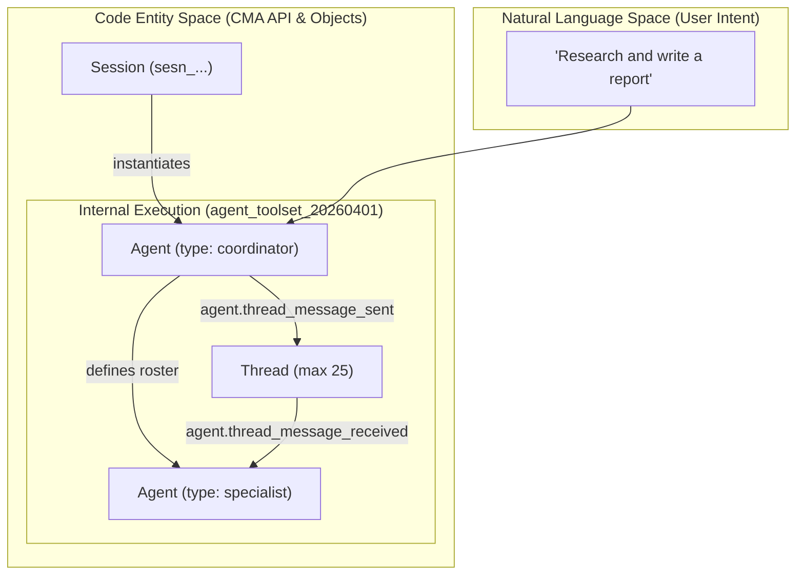
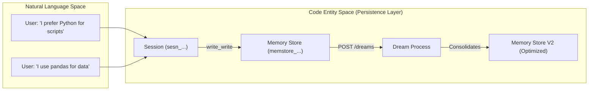

<!-- source: DeepWiki mcp.deepwiki.com · repo anthropics/launch-your-agent · page 2.5 Memory Stores, Multi-Agent Sessions & Dreams · fetched 2026-10-26 -->

# Memory Stores, Multi-Agent Sessions & Dreams

Relevant source files

The following files were used as context for generating this wiki page:

- [.claude/skills/launch-your-agent/references/cma-api.md](.claude/skills/launch-your-agent/references/cma-api.md)
- [.claude/skills/launch-your-agent/references/examples-bank.md](.claude/skills/launch-your-agent/references/examples-bank.md)
- [cma-primitives.md](cma-primitives.md)

This page covers the mechanisms for long-term persistence, complex multi-agent orchestration, and automated memory consolidation within the Claude Managed Agents (CMA) platform. These features allow agents to maintain state across disparate sessions, collaborate on complex tasks, and "dream" to optimize their long-term knowledge base.

## Memory Stores

Memory Stores provide a persistent, cross-session storage layer for agents. Unlike the session sandbox which is ephemeral and isolated, a Memory Store can be attached to multiple sessions (sequentially or in parallel) to allow an agent to remember user preferences, past actions, or evolving datasets.

### Implementation and Limits
Memory stores are mounted as a filesystem at `/mnt/memory/` within the agent's environment [cma-primitives.md:102-102]().

| Limit | Value |
| :--- | :--- |
| **Max size per store** | 100 kB [cma-primitives.md:131-131]() |
| **Max memories per store** | 2,000 individual memory items [cma-primitives.md:131-131]() |
| **Max stores per session** | 8 [cma-primitives.md:131-131]() |
| **Persistence** | Independent of session lifecycle; survives session deletion [cma-primitives.md:72-72]() |

### Data Flow: Attaching and Using Memory
Memory stores are attached to a session at **creation time** via the `resources` array [cma-primitives.md:102-102]().

1.  **Creation**: `POST /v1/memory_stores` to create a store.
2.  **Attachment**: Include the `memory_store_id` in the `resources` block of a `POST /v1/sessions` call [cma-primitives.md:92-98]().
3.  **Access Modes**:
    *   `read_write`: Agent can read from and write to the store (standard for learning agents) [cma-primitives.md:102-102]().
    *   `read_only`: Agent can only reference existing memories (useful for shared knowledge bases) [cma-primitives.md:102-102]().
4.  **Instructions**: You can provide specific `instructions` on how the agent should use that specific store [cma-primitives.md:102-102]().

### Security and Versioning
*   **Versions**: Memory stores are versioned. Every write creates a new version. You can pin a session to a specific memory version or use `latest` [cma-primitives.md:128-128]().
*   **Security Warning**: Memory stores are shared state. If multiple concurrent sessions write to the same store, the last write wins (LWW). They are not designed for high-concurrency transactional integrity [cma-primitives.md:128-131]().

**Sources:** [.claude/skills/launch-your-agent/references/cma-api.md:102-102](), [cma-primitives.md:128-133]()

---

## Multi-Agent Sessions

Multi-agent configurations allow a **Coordinator** agent to delegate tasks to **Specialist** agents. This pattern is used for complex workflows that exceed the context window or reasoning capability of a single agent.

### The Coordinator Pattern
The multi-agent system uses a "Depth-1" hub-and-spoke model.
*   **Coordinator**: The primary agent defined in the session. It has a `multiagent` roster [cma-api.md:72-72]().
*   **Specialists**: Agents listed in the coordinator's roster. They can be invoked to perform specific sub-tasks [cma-api.md:72-72]().

### Technical Architecture: Code to Entity Mapping

**Diagram: Multi-Agent Threading Architecture**

**Sources:** [.claude/skills/launch-your-agent/references/cma-api.md:72-72](), [cma-primitives.md:135-141]()

### Multi-Agent Limits
*   **Max Agents per Roster**: 20 [cma-primitives.md:141-141]().
*   **Max Concurrent Threads**: 25 [cma-primitives.md:141-141]().
*   **Topology**: Depth-1 only (Specialists cannot currently have their own rosters) [cma-primitives.md:135-135]().

### Events in Multi-Agent Flows
The system emits specific events to track cross-agent communication:
*   `agent.thread_message_sent`: Coordinator sends a message to a specialist [cma-primitives.md:85-85]().
*   `agent.thread_message_received`: Coordinator receives a response from a specialist [cma-primitives.md:85-85]().
*   `session.thread_created`: A new sub-context is spawned for a specialist [cma-primitives.md:87-87]().

**Sources:** [.claude/skills/launch-your-agent/references/cma-api.md:72-72](), [cma-primitives.md:135-141]()

---

## Dreams (Research Preview)

Dreams is a background consolidation feature designed to manage long-term memory. As an agent accumulates "memories" in a Memory Store, the volume of data can become noisy or redundant.

### The Consolidation Process
Dreams are asynchronous processes that run when the agent is "offline" (not in an active session) to process a Memory Store.

1.  **Trigger**: Triggered via `POST /v1/memory_stores/{id}/dreams` [cma-primitives.md:133-133]().
2.  **Input**: The raw, high-frequency memories written by the agent during sessions.
3.  **Action**: The system uses a model to:
    *   **Deduplicate**: Remove redundant information.
    *   **Synthesize**: Combine multiple related memories into a single, higher-level insight.
    *   **Prune**: Remove obsolete or low-utility information.
4.  **Output**: A new, optimized version of the Memory Store [cma-primitives.md:133-133]().

### Implementation Mapping

**Diagram: Memory Lifecycle with Dreams**

**Sources:** [cma-primitives.md:128-133](), [.claude/skills/launch-your-agent/references/examples-bank.md:40-40]()

### Key Functions for Developers
*   **`user.define_outcome`**: While not a "dream" function, it is the primary way to trigger the agent behavior that populates memory stores initially [cma-api.md:111-115]().
*   **`session.status_idle`**: The point at which the sandbox state is checkpointed and a memory store is safe to "dream" upon [cma-primitives.md:70-70]().

**Sources:** [.claude/skills/launch-your-agent/references/cma-api.md:111-115](), [cma-primitives.md:70-70](), [cma-primitives.md:133-133]()

---

