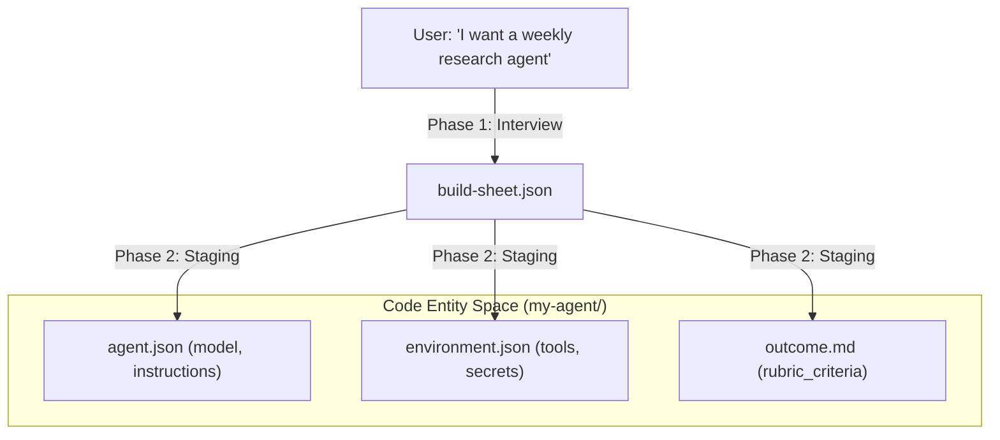
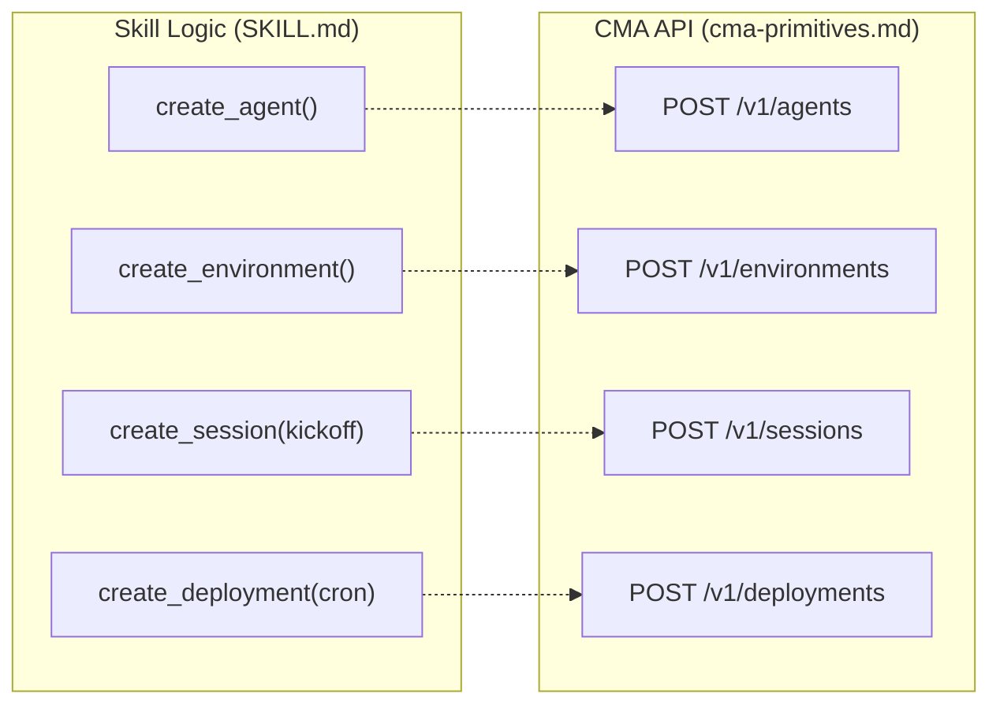

<!-- source: DeepWiki mcp.deepwiki.com · repo anthropics/launch-your-agent · page 3 The launch-your-agent Skill · fetched 2026-10-26 -->

# The launch-your-agent Skill

Relevant source files

The following files were used as context for generating this wiki page:

- [.claude/skills/launch-your-agent/SKILL.md](.claude/skills/launch-your-agent/SKILL.md)
- [CLAUDE.md](CLAUDE.md)

The `launch-your-agent` skill is the primary orchestration engine within this repository. It is designed as a "founder copilot" that guides a technical user through the lifecycle of creating a **Claude Managed Agent (CMA)**. The skill moves from initial discovery to a live, graded, and potentially scheduled deployment in the user's Anthropic account.

The skill is defined in [.claude/skills/launch-your-agent/SKILL.md:1-6]() and follows a structured four-phase workflow to ensure that agents are not just "coded," but properly provisioned as managed infrastructure.

### Design Philosophy

The skill adheres to several core principles to ensure a high-quality developer experience:
*   **Iterative Scoping (v0 vs. v1/v2):** Instead of building a complex system upfront, the skill focuses on a "v0" that solves the core problem, while documenting future enhancements in `NEXT-DIRECTIONS.md` [.claude/skills/launch-your-agent/SKILL.md:27-27]().
*   **Technical Transparency:** The skill "shows the machinery" by running `curl` or `ant` commands via Bash, ensuring the founder understands the underlying CMA API [.claude/skills/launch-your-agent/SKILL.md:23-23]().
*   **Parallel Credential Handling:** To avoid workflow blocks, the skill identifies needed credentials (API keys, Slack tokens) early and asks the user to gather them while it continues staging the build kit [.claude/skills/launch-your-agent/SKILL.md:28-28]().
*   **Mocking by Default:** For complex integrations like Slack or Email, the skill prefers a "mock-in-v0" approach using schema-true payloads, allowing the agent to be tested before full OAuth/Vault setup [.claude/skills/launch-your-agent/SKILL.md:29-29]().

### Workflow Orchestration

The skill orchestrates several reference files and generated artifacts to maintain state across the four phases.

| Phase | Goal | Key Artifacts |
| :--- | :--- | :--- |
| **1. Interview** | Define the agent's purpose and constraints. | `build-sheet.json` |
| **2. Briefing** | Confirm the technical plan and stage files. | `my-agent/` folder, `agent.json`, `environment.json` |
| **3. Launch** | Create the agent on CMA and run/grade it. | `IDS.env`, `kickoff.json`, `outcome.md` |
| **4. Deploy** | Set up recurring runs and hand off. | `NEXT-DIRECTIONS.md`, `agent-overview.html` |

**Sources:** [.claude/skills/launch-your-agent/SKILL.md:11-33](), [CLAUDE.md:18-31]()

---

### The Four-Phase Workflow

The skill executes the following phases in sequence, using `AskUserQuestion` to gate transitions between them.

#### Phase 1: Interview & Scoping
The skill uses a clustered interviewing technique to map user requirements to CMA primitives. It avoids overwhelming the user by asking one cluster of questions at a time (e.g., Identity, then Tools, then Outcome).
*   **For details, see [Phase 1 — Interview & Scoping](#3.1)**

#### Phase 2: Briefing & Staging
Once the scope is defined, the skill presents a "CMA-shaped brief." This includes a primitives table and a plan for what constitutes the v0 vs. future versions. It then generates the "Build Kit" in the `my-agent/` directory, which contains the exact JSON payloads required by the Anthropic API.
*   **For details, see [Phase 2 — Briefing & Staging](#3.2)**

#### Phase 3: Launch & Grade
The skill executes the launch sequence, creating the Agent and Environment via the API. It then initiates a Session using an Outcome-based kickoff. The skill polls for completion and presents the grading results (the "rubric verdict") to the user for iteration.
*   **For details, see [Phase 3 — Launch & Grade](#3.3)**

#### Phase 4: Scheduled Deployment & Wrap-Up
If the agent is meant to run on a clock, the skill configures a `Deployment` primitive with a cron schedule. Finally, it invokes the companion `/wrap-up` skill to perform a hygiene sweep and generate the final dashboard.
*   **For details, see [Phase 4 — Scheduled Deployment & Wrap-Up](#3.4)**

---

### Mapping Natural Language to Code Entities

The following diagrams illustrate how the skill bridges the user's conceptual intent into the concrete code entities and API structures used by the repository.

**Conceptual Mapping: From User Intent to Build Artifacts**

**Sources:** [.claude/skills/launch-your-agent/SKILL.md:27-29](), [CLAUDE.md:20-22]()

**Operational Mapping: From Skill Execution to CMA Primitives**

**Sources:** [cma-primitives.md:12-16](), [CLAUDE.md:12-16]()

### Reference Orchestration

The skill does not operate in isolation; it constantly references files in `.claude/skills/launch-your-agent/references/` to ensure consistency:
*   **`examples-bank.md`**: Used in the opening turn to provide "warm-light" archetypes [.claude/skills/launch-your-agent/SKILL.md:21-21]().
*   **`interview.md`**: Provides the structured question clusters for Phase 1 [.claude/skills/launch-your-agent/SKILL.md:25-25]().
*   **`mock-connectors.md`**: Provides the patterns for simulating SaaS integrations [.claude/skills/launch-your-agent/SKILL.md:29-29]().
*   **`overview-template.html`**: The blueprint for the final UI artifact generated at the end of the process [CLAUDE.md:30-30]().

**Sources:** [CLAUDE.md:10-16](), [.claude/skills/launch-your-agent/SKILL.md:21-32]()

---

