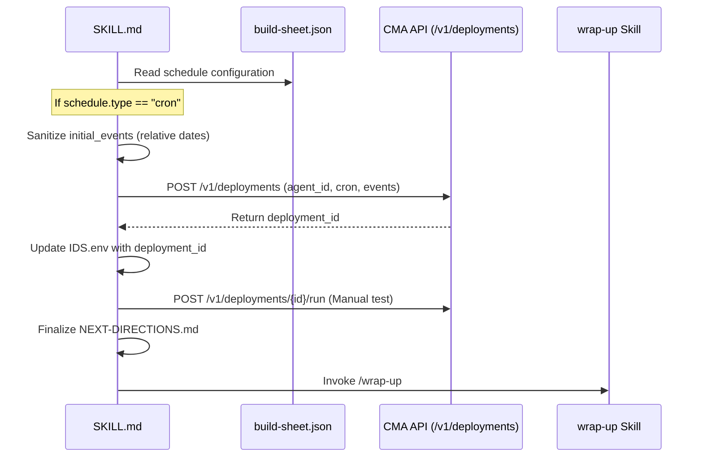
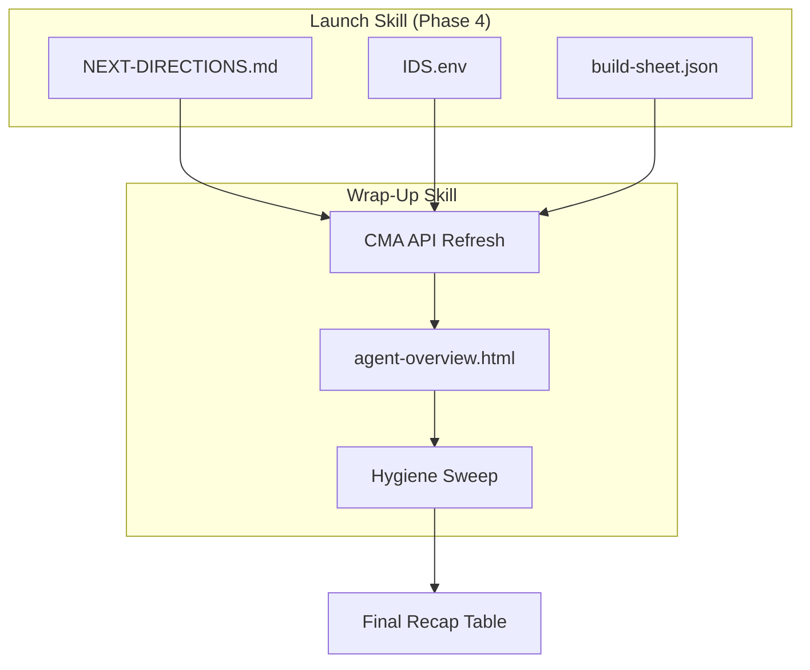

<!-- source: DeepWiki mcp.deepwiki.com · repo anthropics/launch-your-agent · page 3.4 Phase 4 — Scheduled Deployment & Wrap-Up · fetched 2026-10-26 -->

# Phase 4 — Scheduled Deployment & Wrap-Up

Relevant source files

The following files were used as context for generating this wiki page:

- [.claude/skills/launch-your-agent/SKILL.md](.claude/skills/launch-your-agent/SKILL.md)
- [.claude/skills/wrap-up/SKILL.md](.claude/skills/wrap-up/SKILL.md)
- [CLAUDE.md](CLAUDE.md)

Phase 4 represents the transition from an interactive, iterative development cycle to a persistent, automated state. This phase handles the configuration of the CMA **Deployment** primitive, the finalization of the agent's growth plan, and the transition to the `/wrap-up` skill for long-term maintenance and state visualization.

## Scheduled Deployments

A **Deployment** is the CMA primitive that allows an agent to run autonomously on a recurring schedule (`cron`) or via manual triggers (`/run`). In the `launch-your-agent` workflow, a deployment is typically created only after a session has been successfully graded and the founder is satisfied with the v0 performance.

### Implementation and Logic
The skill uses the `POST /v1/deployments` endpoint to create the resource. Key configuration fields include:
*   **`cron`**: A standard crontab string (e.g., `0 9 * * 1-5` for 9 AM on weekdays) accompanied by a `timezone` (e.g., `America/Los_Angeles`).
*   **`initial_events`**: A list of events replayed into the session at the start of every run. The skill ensures these events use **relative dates** (e.g., "today", "last 24 hours") rather than literal timestamps to ensure the deployment remains functional over time.
*   **`status`**: Can be `active`, `paused`, or `archived`.

### Deployment Creation Flow
The following diagram illustrates the transition from a successful test session to a live deployment.

**Deployment Orchestration Logic**

Sources: [CLAUDE.md:12-12](), [.claude/skills/launch-your-agent/SKILL.md:3-3](), [.claude/skills/wrap-up/SKILL.md:31-31]()

## Finalizing NEXT-DIRECTIONS.md

Throughout Phases 1-3, any feature or requirement that was deemed out-of-scope for the "v0" launch is captured in `NEXT-DIRECTIONS.md`. In Phase 4, the skill performs a final pass on this document to ensure it serves as a technical handoff.

The file is structured as a numbered sequence of planned increments (v1, v2, v3). Common entries include:
*   **Connector Wiring**: Transitioning from a mocked outbox to a real MCP server and Vault credential.
*   **Memory Stores**: Adding persistence for agents that need to remember state across scheduled runs.
*   **Hardening**: Adding `always_ask` gates to write-actions or expanding the outcome rubric.
*   **Generated Interfaces**: Planning a custom UI (built via Claude Code) to visualize agent outputs.

Sources: [.claude/skills/launch-your-agent/SKILL.md:31-31](), [CLAUDE.md:27-27]()

## The Handoff to /wrap-up

The `launch-your-agent` skill concludes by invoking the `/wrap-up` companion skill. This skill is responsible for the "celebratory close" and providing the founder with a long-term dashboard.

### Wrap-Up Pipeline
The `/wrap-up` skill executes a six-step pipeline to transition the project to a "maintenance" state:

| Step | Action | Description |
| :--- | :--- | :--- |
| **1** | **Read State** | Consumes `build-sheet.json`, `IDS.env`, and `NEXT-DIRECTIONS.md`. |
| **2** | **Refresh API** | Calls `session.status`, `outcome_evaluations`, and `deployment.status` to get live data. |
| **3** | **Regenerate UI** | Populates `agent-overview.html` using the `overview-template.html` and opens it in the browser. |
| **4** | **Recap Table** | Prints a table mapping CMA primitives (🤖 Agent, 📦 Env, 🎯 Outcome, etc.) to their live IDs. |
| **5** | **Hygiene Sweep** | Silently archives finished sessions and ensures API keys are isolated in `.env`. |
| **6** | **Next Steps** | Selects 1–2 high-impact suggestions from `NEXT-DIRECTIONS.md` to pitch to the founder. |

**Handoff Data Flow**

Sources: [.claude/skills/wrap-up/SKILL.md:17-32](), [CLAUDE.md:16-16](), [CLAUDE.md:28-28]()

## Hygiene and Maintenance

The final act of the workflow is the **Hygiene Sweep**, performed by the `/wrap-up` skill. This is a "quiet by default" process designed to keep the founder's CMA environment clean and secure.

*   **Session Archiving**: Finished sessions are moved to an archived state to declutter the Console.
*   **Golden Case Promotion**: If a run was successful and no "golden set" exists in `evals/`, the skill saves the output as `evals/case-01/expected.md` for future regression testing.
*   **Credential Check**: Verifies that the `ANTHROPIC_API_KEY` only exists in `my-agent/.env` and has not leaked into chat history or transcripts. If a leak is detected, it instructs the founder to rotate the key immediately.
*   **Deployment Patching**: Scans `initial_events` for any literal dates (e.g., "2026-06-15") and attempts to replace them with relative terms to prevent the deployment from becoming stale.

Sources: [.claude/skills/wrap-up/SKILL.md:31-31](), [CLAUDE.md:24-24](), [CLAUDE.md:29-29]()

---

