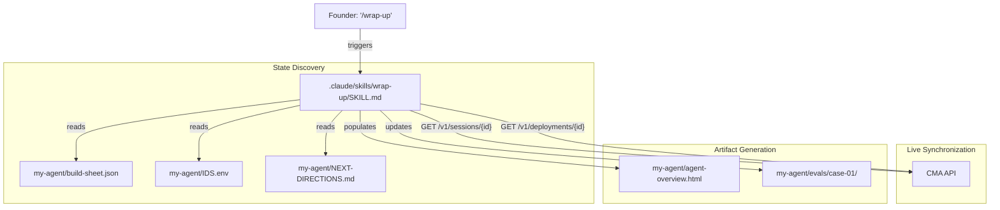
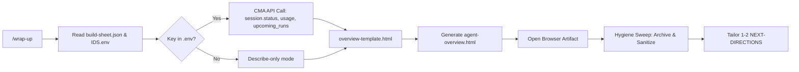

<!-- source: DeepWiki mcp.deepwiki.com · repo anthropics/launch-your-agent · page 4 The wrap-up Skill · fetched 2026-10-26 -->

# The wrap-up Skill

Relevant source files

The following files were used as context for generating this wiki page:

- [.claude/skills/wrap-up/SKILL.md](.claude/skills/wrap-up/SKILL.md)
- [CLAUDE.md](CLAUDE.md)

The `wrap-up` skill is a companion utility designed to finalize a Claude Managed Agent (CMA) build or check in on its current status. It transitions the founder from the "building" phase to the "operating" phase by refreshing live data, performing a hygiene sweep of the environment, and providing a celebratory, high-level overview of the shipped primitives.

The skill is triggered explicitly by the user via phrases like `/wrap-up`, "where do things stand with my agent", or automatically as the final step (Phase 4) of the `launch-your-agent` workflow.

### High-Level Workflow
The skill executes a six-step pipeline to synchronize the local state with the CMA platform and present a final artifact to the user.

| Step | Action | Description |
| :--- | :--- | :--- |
| **1** | **Read State** | Loads `build-sheet.json`, `IDS.env`, and `NEXT-DIRECTIONS.md` from the `./my-agent/` directory. |
| **2** | **Refresh Live Data** | (Optional) Uses the `ANTHROPIC_API_KEY` to poll session status, evaluations, and deployment schedules. |
| **3** | **Regenerate Overview** | Populates `agent-overview.html` with live IDs and latest run logs. |
| **4** | **Recap Primitives** | Displays a "Here's what you built" table mapping emojis to CMA primitives. |
| **5** | **Tailor Next Steps** | Picks 1–2 high-impact upgrades from the v1/v2 plan for immediate consideration. |
| **6** | **Hygiene Sweep** | Silently archives sessions, sanitizes dates, and promotes successful runs to Evals. |

Sources: [.claude/skills/wrap-up/SKILL.md:3-5](), [.claude/skills/wrap-up/SKILL.md:17-32](), [CLAUDE.md:16-16]()

---

### Natural Language to Code Entity Mapping

The `wrap-up` skill bridges the user's intent to "close out" a project with the specific file-based state and API entities managed by the system.

**Intent Mapping: "Wrap up the build"**

Sources: [.claude/skills/wrap-up/SKILL.md:19-21](), [.claude/skills/wrap-up/SKILL.md:28-31]()

---

### Core Components

#### Live State Refresh & Overview Regeneration
The skill attempts to `source` the `my-agent/.env` file to access the CMA API. If a key is present, it fetches real-time data for all primitives, including session `status`, `outcome_evaluations`, and `upcoming_runs_at` for deployments. This data is injected into the `overview-template.html` to create a live-styled dashboard.

For details on the API integration and template population, see [Live State Refresh & Overview Regeneration](#4.1).

Sources: [.claude/skills/wrap-up/SKILL.md:19-23](), [.claude/skills/wrap-up/SKILL.md:28-28]()

#### Hygiene Sweep & Next-Step Heuristics
The hygiene sweep is a "quiet-by-default" process that maintains the health of the agent's environment. It includes:
*   **Session Archival:** Cleaning up finished sessions to reduce clutter.
*   **Date Sanitization:** Ensuring `initial_events` in deployments use relative rather than literal dates.
*   **Eval Promotion:** Automatically saving the first successful run as a "golden case" in the `evals/` directory.

Additionally, the skill analyzes `NEXT-DIRECTIONS.md` to suggest specific extensions, such as a "Generated Interface" or moving from a "Mock Connector" to a live one.

For details on the sweep logic and heuristic selection, see [Hygiene Sweep & Next-Step Heuristics](#4.2).

Sources: [.claude/skills/wrap-up/SKILL.md:30-31](), [CLAUDE.md:29-30]()

---

### Execution Pipeline (Code Entity Space)

The following diagram illustrates how the skill moves from local file reading to browser-based output, interacting with the CMA platform primitives.

**Pipeline: Skill Execution Flow**

Sources: [.claude/skills/wrap-up/SKILL.md:17-32](), [CLAUDE.md:28-28]()

---

### Primitives Recap Table
As part of the chat output, the skill generates a table summarizing the agent's "ownership" of CMA primitives.

| Primitive | Emoji | Purpose | Status/ID |
| :--- | :--- | :--- | :--- |
| **Agent** | 🤖 | The core logic and model config | `agent_...` |
| **Environment** | 📦 | The sandboxed runtime | `env_...` |
| **Outcome** | 🎯 | The definition of success/rubric | Defined in `outcome.md` |
| **Session** | ▶️ | A specific execution instance | `sess_...` |
| **Deployment** | 🗓️ | The schedule and triggers | `dep_...` |
| **Vault** | 🔐 | Credential management | `vault_...` |

Sources: [.claude/skills/wrap-up/SKILL.md:15-15](), [.claude/skills/wrap-up/SKILL.md:29-29]()

---

