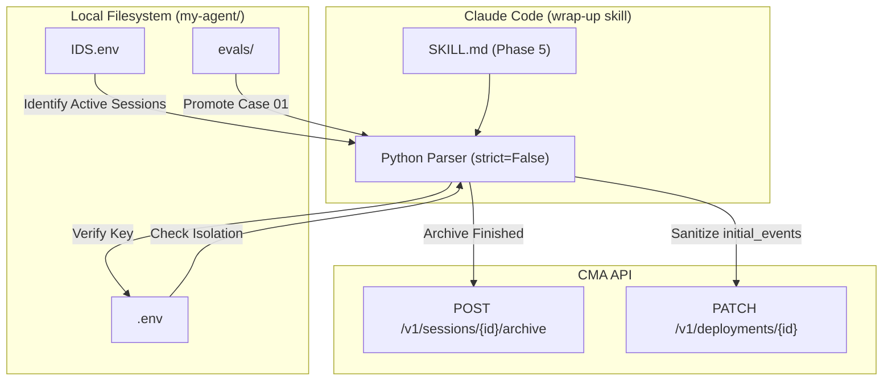
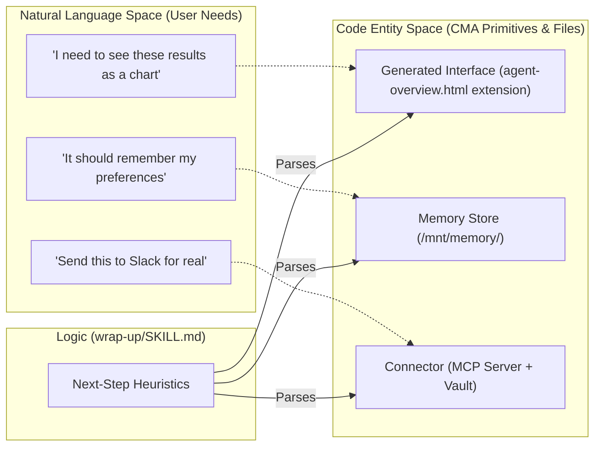

<!-- source: DeepWiki mcp.deepwiki.com · repo anthropics/launch-your-agent · page 4.2 Hygiene Sweep & Next-Step Heuristics · fetched 2026-10-26 -->

# Hygiene Sweep & Next-Step Heuristics

Relevant source files

The following files were used as context for generating this wiki page:

- [.claude/skills/wrap-up/SKILL.md](.claude/skills/wrap-up/SKILL.md)
- [CLAUDE.md](CLAUDE.md)

The **Hygiene Sweep** and **Next-Step Heuristics** represent the final automated quality-assurance and strategic planning layer of the agent-building lifecycle. Managed by the `/wrap-up` skill, these processes ensure the production environment is clean, secure, and ready for handoff, while providing the user with a concrete technical path forward.

## 1. The Silent Hygiene Sweep

The hygiene sweep is a non-interactive maintenance routine designed to enforce best practices for Claude Managed Agents (CMA) without burdening the user with checklist fatigue. It executes silently unless a critical manual intervention (like rotating a leaked API key) is required.

### 1.1 Implementation Logic
The sweep is defined in Phase 5 of the wrap-up pipeline [ .claude/skills/wrap-up/SKILL.md:31-31](). It focuses on four primary domains:

1.  **Session Archiving**: Identifies and archives finished `Session` primitives to declutter the workspace and finalize the run history [ .claude/skills/wrap-up/SKILL.md:31-31]().
2.  **Date Sanitization**: Scans `initial_events` within the `Deployment` primitive. It replaces literal date strings (e.g., "2026-06-15") with relative temporal markers or dynamic logic to ensure the deployment remains functional for future cron triggers [ .claude/skills/wrap-up/SKILL.md:31-31]().
3.  **Credential Isolation**: Verifies that the `ANTHROPIC_API_KEY` and other secrets exist only within the local `my-agent/.env` file or the environment. If a key is detected in the chat transcript or git-tracked files, the skill triggers a rotation warning [ .claude/skills/wrap-up/SKILL.md:31-31]().
4.  **Golden Case Promotion**: If a run has successfully passed the `Outcome` rubric and no "golden" evaluation cases exist yet, the sweep saves the current output as `evals/case-01/expected.md` to serve as a regression baseline [ .claude/skills/wrap-up/SKILL.md:31-31]().

### 1.2 Data Flow: Hygiene Execution
The following diagram illustrates how the wrap-up skill interacts with the file system and the CMA API to perform the sweep.

**Hygiene Sweep Data Flow**

Sources: [ .claude/skills/wrap-up/SKILL.md:20-20](), [ .claude/skills/wrap-up/SKILL.md:31-31]()

## 2. Next-Step Heuristics

Rather than presenting a generic roadmap, the system uses heuristics to select 1–2 "tailored extensions" from the `NEXT-DIRECTIONS.md` file. This transforms a backlog into an actionable v1/v2 release plan.

### 2.1 Selection Criteria
The skill evaluates the current state of `build-sheet.json` and `NEXT-DIRECTIONS.md` to prioritize upgrades [ .claude/skills/wrap-up/SKILL.md:30-30]():

| Heuristic | Trigger Condition | Recommended Extension |
| :--- | :--- | :--- |
| **Connectivity** | Agent currently uses "Mock" connectors or file-system outboxes. | **Real-world Wiring**: Swap mocks for real MCP servers + Vault credentials. |
| **Persistence** | Agent performs repetitive tasks or requires context across sessions. | **Memory Store**: Implement `/mnt/memory/` for cross-session state. |
| **Control** | Agent performs high-stakes write actions. | **Gated Actions**: Implement `always_ask` permission gates. |
| **Interface** | Agent results are complex (charts, large datasets, or multi-file). | **Generated Interface**: Build a tailored results viewer via the Files/Sessions API. |

### 2.2 The "Generated Interface" Pattern
A unique heuristic is the promotion of a **Generated Interface**. This is not a default v0 feature but is suggested when the user needs a custom way to steer the agent or visualize its `Outcome` [ .claude/skills/wrap-up/SKILL.md:30-30](). This interface is typically a small app or static page built by Claude Code in a follow-up session.

**Heuristic Mapping: Natural Language to Code Entities**

Sources: [ .claude/skills/wrap-up/SKILL.md:30-30](), [ .claude/skills/launch-your-agent/references/mock-connectors.md:1-20]()

## 3. Final State Handover

The culmination of the sweep and heuristics is the regeneration of the `agent-overview.html`.

1.  **Regeneration**: The skill reads `IDS.env` and `build-sheet.json` to populate the `overview-template.html` [ .claude/skills/wrap-up/SKILL.md:28-28]().
2.  **Live Status**: If an API key is present in `my-agent/.env`, the skill calls the CMA API to fetch `session.status`, `outcome_evaluations`, and `upcoming_runs_at` [ .claude/skills/wrap-up/SKILL.md:20-20]().
3.  **Artifact Opening**: The skill automatically opens the regenerated `agent-overview.html` in the user's browser, serving as the "closing artifact" [ .claude/skills/wrap-up/SKILL.md:28-28]().

### 3.1 Handover Table
The skill produces a final "Here's what you built" table in the chat, mapping primitives to their locations on the overview page [ .claude/skills/wrap-up/SKILL.md:29-29]():

| Emoji | Primitive | Description | Live ID | Card Location |
| :--- | :--- | :--- | :--- | :--- |
| 🤖 | Agent | The model and system instructions. | `agt_...` | Top Rail |
| 🎯 | Outcome | The grading rubric and success criteria. | `out_...` | Grading Node |
| 🗓️ | Deployment | The cron schedule and kickoff events. | `dep_...` | Trigger Node |
| 🧠 | Memory | Cross-session persistence store. | `mem_...` | Worker Node |

Sources: [ .claude/skills/wrap-up/SKILL.md:28-30](), [ .claude/skills/wrap-up/SKILL.md:15-15]()

---

