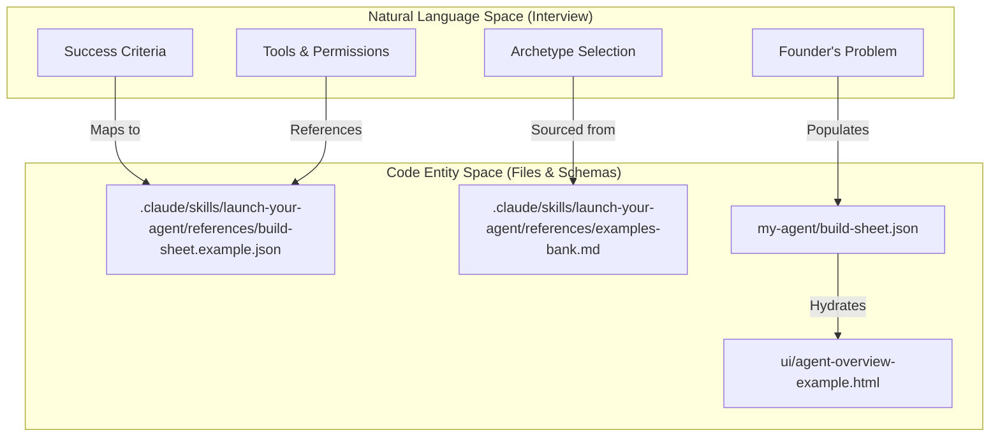
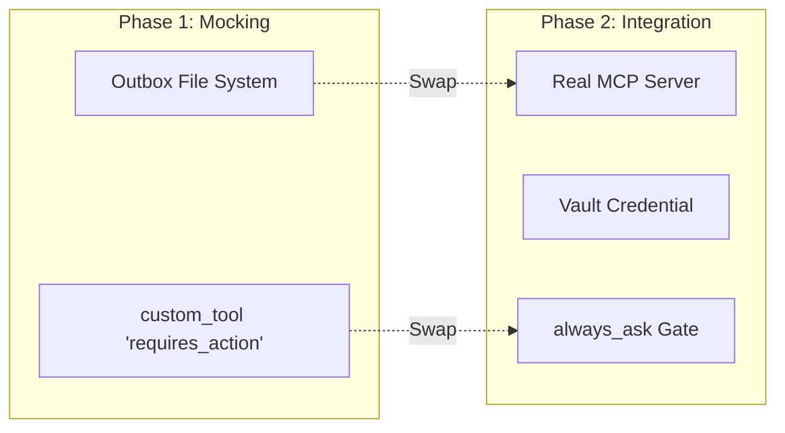

<!-- source: DeepWiki mcp.deepwiki.com · repo anthropics/launch-your-agent · page 5 Reference Material & Examples · fetched 2026-10-26 -->

# Reference Material & Examples

Relevant source files

The following files were used as context for generating this wiki page:

- [.claude/skills/launch-your-agent/references/build-sheet.example.json](.claude/skills/launch-your-agent/references/build-sheet.example.json)
- [.claude/skills/launch-your-agent/references/examples-bank.md](.claude/skills/launch-your-agent/references/examples-bank.md)
- [ui/agent-overview-example.html](ui/agent-overview-example.html)
- [ui/build-sheet.example.json](ui/build-sheet.example.json)

This page provides an overview of the reference files, example artifacts, and UI templates bundled with the `launch-your-agent` skill. These materials serve as the blueprint for generating new agents and provide high-quality examples of what "good" looks like for Claude Managed Agents (CMA).

The repository includes both structured data schemas and natural language inspiration banks to guide the transition from a founder's idea to a production-ready agent configuration.

### From Interview to Artifacts
The following diagram illustrates how natural language concepts captured during the interview phase are mapped to specific code entities and reference files.

**Concept to Code Mapping**

Sources: [.claude/skills/launch-your-agent/references/build-sheet.example.json:1-107](), [.claude/skills/launch-your-agent/references/examples-bank.md:1-15](), [ui/agent-overview-example.html:1-103]()

---

## 5.1 Build Sheet Schema
The `build-sheet.json` is the central source of truth for an agent's configuration. It captures the agent's identity, the environment it inhabits, the tools it wields, and the outcomes it is measured against.

The schema is designed to be human-readable but machine-parsable, allowing the skill to generate the final `agent.json` and `environment.json` payloads for the CMA API. It includes sections for:
*   **Agent Identity**: Name, model, and system summary [ui/build-sheet.example.json:9-19]().
*   **Outcome & Rubric**: Success criteria and iteration bounds [ui/build-sheet.example.json:20-30]().
*   **Environment**: Networking rules and package requirements [ui/build-sheet.example.json:54-60]().
*   **Schedule**: Cron triggers and kickoff event definitions [ui/build-sheet.example.json:61-67]().

For a detailed field-by-field breakdown, see [Build Sheet Schema](#5.1).

---

## 5.2 Agent Archetypes & Examples Bank
The `examples-bank.md` file contains a curated list of agent archetypes grounded in official Anthropic cookbooks and documentation. This ensures that any example offered to a user during the interview phase is technically feasible and has a known-good configuration pattern.

| Archetype | Description | Primary Primitive |
| :--- | :--- | :--- |
| **Data Analyst** | CSV in → Narrative HTML report with charts | Environment `packages` |
| **Ops Responder** | Alert → Investigate → Draft PR → Wait for approval | `requires_action` gate |
| **Document Producer** | Research task delivering a graded artifact (.xlsx) | Outcomes + Skills |
| **Compliance Scanner** | Scheduled scan of resources for policy violations | Scheduled Deployments |

For the full list of archetypes and sourcing rules, see [Agent Archetypes & Examples Bank](#5.2).

Sources: [.claude/skills/launch-your-agent/references/examples-bank.md:63-75]()

---

## 5.3 Mock Connectors
The "design now, wire later" philosophy is supported by mock connectors. These allow founders to build and test their agent's logic before integrating with real-world APIs or MCP servers.

**Mocking Lifecycle**

This approach standardizes payloads for common services like Slack, Email, and Issue Trackers within the `build-sheet.json` [ui/build-sheet.example.json:84-89](). For implementation details on the v0→v1 swap, see [Mock Connectors](#5.3).

---

## 5.4 Agent Overview Template
The `agent-overview-example.html` provides a visual representation of the agent's architecture. It is used as a template by the `/wrap-up` skill to generate a live, "warm-light" schematic for the founder.

Key visual components include:
*   **Trigger Node**: Shows how the agent starts (e.g., Cron or Webhook).
*   **Worker Node**: Displays the agent's model and environment details [ui/agent-overview-example.html:89-93]().
*   **Outcome Node**: Lists the rubric criteria and success metrics [ui/agent-overview-example.html:102-103]().
*   **Run Log**: A visual rail showing execution history and versioning.

For details on how the template is populated and how to extend the interface, see [Agent Overview Template](#5.4).

Sources: [ui/agent-overview-example.html:51-75]()

---

