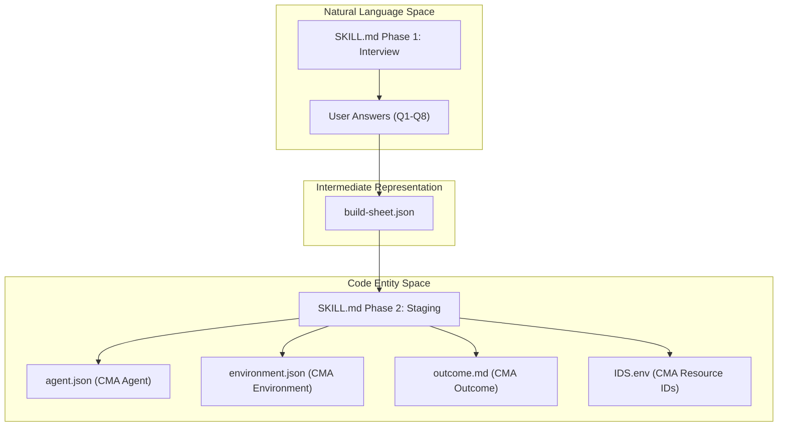
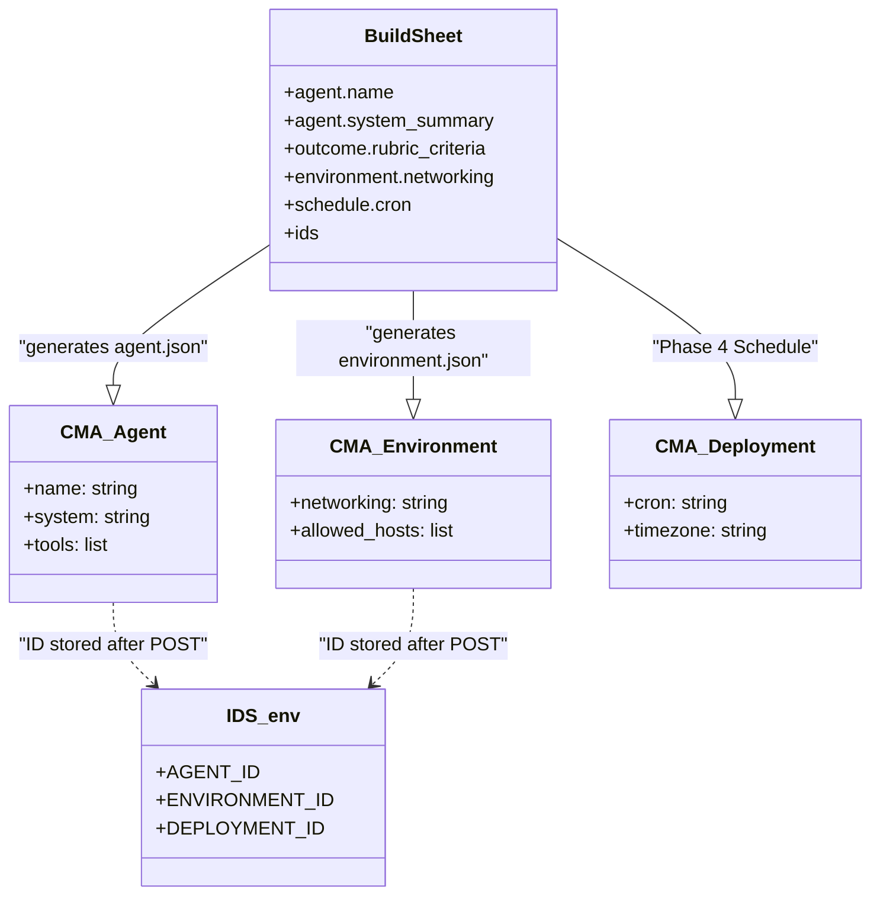

<!-- source: DeepWiki mcp.deepwiki.com · repo anthropics/launch-your-agent · page 5.1 Build Sheet Schema · fetched 2026-10-26 -->

# Build Sheet Schema

Relevant source files

The following files were used as context for generating this wiki page:

- [.claude/skills/launch-your-agent/references/build-sheet.example.json](.claude/skills/launch-your-agent/references/build-sheet.example.json)
- [ui/build-sheet.example.json](ui/build-sheet.example.json)

The `build-sheet.json` file serves as the central source of truth for the `launch-your-agent` skill. It acts as a bridge between the natural language requirements gathered during the Phase 1 interview and the technical configuration required to provision Claude Managed Agents (CMA) primitives in Phase 2.

### Purpose and Data Flow

The build sheet is initialized by the `/launch-your-agent` skill and iteratively populated as the user answers question clusters. Once complete, it is used to generate the `my-agent/` directory, including `agent.json`, `environment.json`, and the `outcome.md` files.

Title: Build Sheet Orchestration Flow

**Sources:** [.claude/skills/launch-your-agent/references/build-sheet.example.json:1-107](), [ui/build-sheet.example.json:1-107]()

---

### Schema Field Definitions

#### 1. Meta and Agent Configuration
The `meta` block captures the business context, while the `agent` block defines the identity and core logic of the Claude Managed Agent.

| Field | Type | Description |
| :--- | :--- | :--- |
| `meta.problem` | string | The core pain point the agent solves. |
| `agent.name` | string | The unique identifier for the CMA Agent resource. |
| `agent.model` | string | The Anthropic model version (e.g., `claude-opus-4-8`). |
| `agent.system_summary` | string | High-level instruction summarizing the agent's primary purpose. |
| `agent.never_dos` | string[] | Strict negative constraints to prevent hallucination or unauthorized actions. |

**Sources:** [.claude/skills/launch-your-agent/references/build-sheet.example.json:2-19](), [ui/build-sheet.example.json:2-19]()

#### 2. Outcome and Rubric
The `outcome` block defines the success criteria for the agent's task. This maps directly to the `user.define_outcome` primitive in CMA.

*   **`rubric_criteria`**: A list of objective, verifiable points used by the automated grader to evaluate the agent's work [ui/build-sheet.example.json:22-28]().
*   **`max_iterations`**: The maximum number of "grade-and-improve" cycles the agent will perform before halting [ui/build-sheet.example.json:29]().

#### 3. Tools and Environment
This section defines the capabilities and the sandbox constraints of the agent.

| Section | Key Fields | Implementation Details |
| :--- | :--- | :--- |
| **Tools** | `enabled`, `custom_tools` | Maps to `agent_toolset_20260401`. Includes `bash`, `web_search`, etc. [ui/build-sheet.example.json:31-37](). |
| **Environment** | `networking`, `allowed_hosts` | Defines if the agent has `unrestricted` or `limited` internet access [ui/build-sheet.example.json:54-60](). |

#### 4. Connections and Memory
Handles external integrations and cross-session persistence.

*   **`mcp_servers`**: List of Model Context Protocol servers for external data/actions [ui/build-sheet.example.json:39]().
*   **`memory.stores`**: Defines persistence volumes. `access: "read_write"` allows the agent to maintain state across scheduled runs [ui/build-sheet.example.json:45-53]().

---

### Implementation Mapping

The following diagram illustrates how specific `build-sheet.json` fields are transformed into CMA API objects and local tracking files during the Phase 2 staging process.

Title: Build Sheet to CMA Primitive Mapping

**Sources:** [.claude/skills/launch-your-agent/references/build-sheet.example.json:9-106](), [ui/build-sheet.example.json:9-106]()

---

### Execution and Iteration Fields

#### Schedule and Kickoff
*   **`mode`**: Can be `scheduled`, `event-driven`, or `interactive` [ui/build-sheet.example.json:62]().
*   **`kickoff`**: The initial event or instruction sent to the session. For scheduled agents, this often triggers the `user.define_outcome` flow [ui/build-sheet.example.json:66]().

#### Evals and Next Directions
*   **`evals.cases`**: A collection of "golden sets" (input/expected output pairs) used for regression testing before promoting an agent version [ui/build-sheet.example.json:68-75]().
*   **`next_directions`**: A backlog of deferred features (e.g., adding write-access tools) that were identified during the interview but excluded from the MVP (v0) for safety or simplicity [ui/build-sheet.example.json:84-105]().

#### IDs (The "Live" State)
The `ids` object [ui/build-sheet.example.json:106]() is initially empty. It is populated during Phase 3 (Launch) as the skill creates real resources on the CMA platform. These IDs are also mirrored in `my-agent/IDS.env` for use by the shell scripts (e.g., `run-evals.sh`).

**Sources:** [.claude/skills/launch-your-agent/references/build-sheet.example.json:61-106](), [ui/build-sheet.example.json:61-106]()

---

