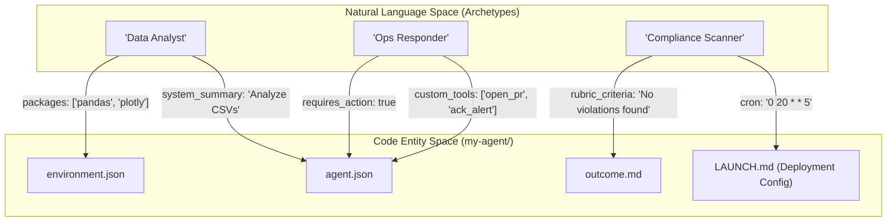
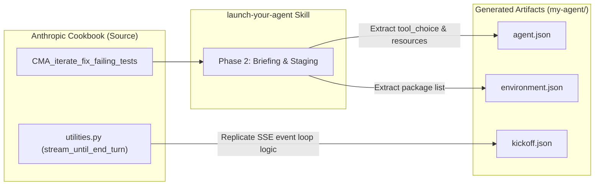

<!-- source: DeepWiki mcp.deepwiki.com · repo anthropics/launch-your-agent · page 5.2 Agent Archetypes & Examples Bank · fetched 2026-10-26 -->

# Agent Archetypes & Examples Bank

Relevant source files

The following files were used as context for generating this wiki page:

- [.claude/skills/launch-your-agent/references/examples-bank.md](.claude/skills/launch-your-agent/references/examples-bank.md)
- [CLAUDE.md](CLAUDE.md)

This page documents the officially-grounded agent archetypes used by the `launch-your-agent` skill to inspire and guide technical founders. Every archetype and example in the bank is traced to official Anthropic sources—including cookbooks, documentation, and engineering blogs—to ensure implementation patterns align with platform best practices.

## Sourcing Philosophy & The "Backlog" Rule
The skill adheres to a strict sourcing rule to maintain technical reliability:
1.  **Canonical Examples (§1-§3):** Only patterns traced to an official Anthropic source (e.g., `claude-cookbooks`, `platform.claude.com/docs`) are offered during the interview phase or used to shape the `my-agent/` build kit [[.claude/skills/launch-your-agent/references/examples-bank.md:7-8]]().
2.  **Backlog (§5):** Experimental or unvalidated ideas are relegated to the backlog section of the reference file and are not presented as primary options [[.claude/skills/launch-your-agent/references/examples-bank.md:7-8]]().

Sources: [[.claude/skills/launch-your-agent/references/examples-bank.md:1-15]]()

---

## Core Archetypes
These archetypes serve as the "menu" offered to users during **Phase 1: Interview & Scoping** (specifically during Cluster Q1) [[.claude/skills/launch-your-agent/references/examples-bank.md:12-12]]().

| # | Archetype | Description | Primary CMA Primitives | Official Source |
|---|---|---|---|---|
| 1 | **Data Analyst** | Processes CSV/exports to generate narrative HTML reports with charts. | Environment `packages`, File mounting, Artifact retrieval | `data_analyst_agent` cookbook |
| 2 | **Ops Responder** | Investigates alerts, drafts fixes/PRs, and waits for human approval. | Event-triggered sessions, `requires_action` gating, Custom tools | `sre_incident_responder` cookbook |
| 3 | **Document Producer** | Research/finance tasks resulting in graded artifacts (e.g., DCF models in `.xlsx`). | Outcomes, `xlsx` Skill, Rubric-grading | Outcomes & Skills Docs |
| 4 | **Engineering Agent** | Takes a GitHub issue, writes code, fixes tests, and opens a PR. | `fix_failing_tests` loop, Multi-turn steering | `CMA_orchestrate_issue_to_pr` cookbook |
| 5 | **Multi-Agent Coord.** | A lead agent coordinating specialized sub-agents for complex workflows. | Multi-agent sessions, Roster management | `CMA_coordinate_specialist_team` cookbook |
| 6 | **Compliance Scanner** | Runs on a schedule to scan systems and flag violations. | Scheduled Deployments, Cron triggers | Scheduled Deployments Docs |

### Archetype Implementation Mapping
The following diagram bridges the natural language "Archetype" to the specific CMA code entities and configurations defined in the build kit.

**Diagram: Archetype to Code Entity Mapping**

Sources: [[.claude/skills/launch-your-agent/references/examples-bank.md:63-75]](), [[.claude/skills/launch-your-agent/references/examples-bank.md:22-43]]()

---

## Technical Reference: Cookbook Tracing
When the skill identifies a user's problem as "rhyming" with a specific cookbook, it lifts the configuration shape (tools, resources, and event flow) directly into the generated `agent.json` and `environment.json` [[.claude/skills/launch-your-agent/references/examples-bank.md:13-13]]().

### Key Cookbook Mappings
*   **Verification & Grading:** Uses patterns from `CMA_verify_with_outcome_grader` to populate the `user.define_outcome` call in `kickoff.json` [[.claude/skills/launch-your-agent/references/examples-bank.md:42-44]]().
*   **Persistence:** Uses `CMA_remember_user_preferences` for configuring Memory Stores in `agent.json` [[.claude/skills/launch-your-agent/references/examples-bank.md:40-44]]().
*   **Human-in-the-Loop:** Implements the `requires_action` idle bounce and `decide()` tool patterns from `CMA_gate_human_in_the_loop` [[.claude/skills/launch-your-agent/references/examples-bank.md:37-37]]().
*   **Infrastructure:** References `CMA_operate_in_production` for MCP toolsets and Vault credential management [[.claude/skills/launch-your-agent/references/examples-bank.md:39-39]]().

**Diagram: Data Flow from Cookbook to Build Kit**

Sources: [[.claude/skills/launch-your-agent/references/examples-bank.md:18-44]](), [[.claude/skills/launch-your-agent/SKILL.md:65-90]]()

---

## Production Proof Points
To answer the common founder question, "Is anyone actually doing this?", the bank provides links to high-scale production stories:
*   **The Evolution of Agentic Surfaces:** Focuses on agents operating inside existing systems (codebases, wikis, ticketing) [[.claude/skills/launch-your-agent/references/examples-bank.md:57-57]]().
*   **Scaling Managed Agents:** Explains the "Brain vs. Hands" architecture—decoupling the model (brain) from the sandboxed environment (hands) [[.claude/skills/launch-your-agent/references/examples-bank.md:59-59]]().

Sources: [[.claude/skills/launch-your-agent/references/examples-bank.md:55-60]]()

---

