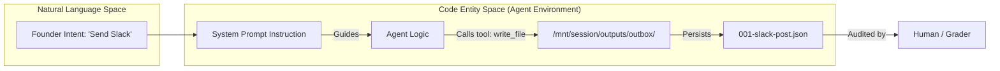
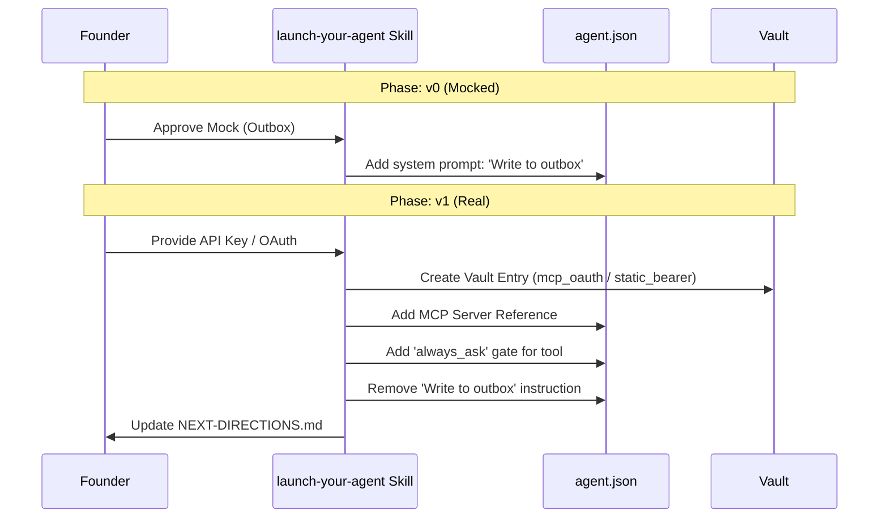

<!-- source: DeepWiki mcp.deepwiki.com · repo anthropics/launch-your-agent · page 5.3 Mock Connectors · fetched 2026-10-26 -->

# Mock Connectors

Relevant source files

The following files were used as context for generating this wiki page:

- [.claude/skills/launch-your-agent/references/mock-connectors.md](.claude/skills/launch-your-agent/references/mock-connectors.md)
- [CLAUDE.md](CLAUDE.md)

The "design now, wire later" philosophy allows for the rapid prototyping of agents that interact with external systems (Slack, Email, CRM, etc.) even when credentials or OAuth setups are not immediately available. Instead of omitting these capabilities, the `launch-your-agent` skill mocks them visibly in "v0" of the agent, ensuring the data flow and logic are established before the final "v1" wiring occurs.

## Mocking Philosophy

Mocking is used to keep the development momentum when:
- Credentials are not on hand.
- OAuth setup is too time-consuming for the current session.
- The founder wants to verify the agent's logic before authorizing live write-actions.

By using standardized schemas, the transition from a mock to a real connector is a **swap**, not a **redesign**. The agent's internal logic for generating payloads remains identical; only the delivery mechanism changes.

Sources: [.claude/skills/launch-your-agent/references/mock-connectors.md:4-7](), [CLAUDE.md:25-25]()

---

## Mocking Strategies

There are two primary strategies for mocking external connectors, chosen based on whether the agent needs to run unattended (scheduled) or interactively.

### 1. Outbox Mock (Default)
This strategy is preferred for unattended agents and deployments. The agent is instructed to write its intended actions as JSON files to a specific directory.

*   **Mechanism:** The agent writes to `/mnt/session/outputs/outbox/<sequence>-<action>.json`.
*   **System Prompt Instruction:** *"You cannot send/post X directly yet. For each action you would take, write the exact payload to the outbox instead."*
*   **Validation:** A rubric criterion is added to the `Outcome` to ensure outbox payloads match the required schema.
*   **Benefit:** The "outbox" acts as a queue that a human can audit to see exactly what the agent would have done.

### 2. Custom-Tool Mock
This strategy is used when the founder wants to see and respond to the agent's actions in real-time.

*   **Mechanism:** Define a `custom` tool in `agent.json` with a realistic `input_schema`.
*   **Interaction:** Tool calls surface as `requires_action`. The user (or the skill) provides a stubbed response (e.g., `{"ok": true, "id": "mock_123"}`).
*   **Limitation:** Not suitable for scheduled deployments as every call blocks until a manual response is provided.

### Mock Strategy Comparison

| Feature | Outbox Mock | Custom-Tool Mock |
| :--- | :--- | :--- |
| **Primary Use Case** | Scheduled/Unattended runs | Interactive/Live shaping |
| **Implementation** | File-system (`write_file`) | `requires_action` event |
| **Audit Trail** | Persistent JSON files | Session event log |
| **Transition to v1** | Remove prompt instruction | Replace custom tool with MCP |

Sources: [.claude/skills/launch-your-agent/references/mock-connectors.md:8-17]()

---

## Data Flow: Outbox Mocking

The following diagram illustrates the data flow for an Outbox Mock and how it bridges the Natural Language intent to the Code Entity space (file system).

**Outbox Mock Implementation Flow**

Sources: [.claude/skills/launch-your-agent/references/mock-connectors.md:10-12]()

---

## Standardized Payload Schemas

To ensure the "v0 → v1 swap" is seamless, mocks use the exact schemas expected by real MCP servers.

| Service | Key Fields | Purpose |
| :--- | :--- | :--- |
| **Slack** | `channel`, `text`, `thread_ts` | Posting messages/replies. |
| **Email** | `to`, `subject`, `body_markdown`, `attachments` | Drafts or sending via SMTP/API. |
| **Issue Tracker** | `title`, `description_markdown`, `priority` | Jira, GitHub, or Linear issues. |
| **Webhook** | `url`, `method`, `json_body` | Generic backend integration. |
| **Calendar** | `title`, `start_iso`, `end_iso` | Event scheduling. |
| **Brokerage** | `ticker`, `side`, `quantity`, `order_type` | Paper trading / Order execution. |

Sources: [.claude/skills/launch-your-agent/references/mock-connectors.md:23-74]()

---

## The v0 → v1 Swap Lifecycle

When the founder is ready to move from a mock to a live connector, the `launch-your-agent` skill facilitates the transition by updating the agent configuration.

**Connector Upgrade Lifecycle**

### Transition Steps
1.  **Vault Provisioning:** Add the credential to the agent's environment as a `vault` entry (e.g., `mcp_oauth` or `environment_variable`).
2.  **Tool Replacement:** Replace the mock instruction (for Outbox) or the `custom` tool definition (for Custom-Tool) with the actual MCP server toolset.
3.  **Permission Gating:** Implement an `always_ask` gate on the real tool to ensure the founder can approve live actions during the initial v1 testing.
4.  **Documentation:** Update `NEXT-DIRECTIONS.md` to reflect that the connector is now live and document any required environment variables.

Sources: [.claude/skills/launch-your-agent/references/mock-connectors.md:12-17](), [CLAUDE.md:25-27]()

---

