# Page: Overview

# Overview

<details>
<summary>Relevant source files</summary>

The following files were used as context for generating this wiki page:

- [.gitignore](.gitignore)
- [CLAUDE.md](CLAUDE.md)
- [README.md](README.md)

</details>


The `launch-your-agent` repository is a reference implementation of a [Claude Code](https://code.claude.com) skill designed to help technical founders and developers build, deploy, and iterate on **Claude Managed Agents (CMA)**. 

Unlike a static tutorial, this repository provides an interactive, stateful workflow that moves from a conversational interview to a live, production-ready agent running in the user's own Anthropic account. The system is designed around an iterative "v0 to v1" philosophy: it helps you ship a functional core immediately while explicitly documenting more complex features (like real-world connectors or advanced memory) as planned upgrades in a `NEXT-DIRECTIONS.md` file [CLAUDE.md:20-20](), [CLAUDE.md:27-27]().

### What is a Managed Agent?
A Claude Managed Agent is a persistent, cloud-hosted worker capable of executing complex tasks in a sandboxed environment. It uses the `agent_toolset_20260401` to interact with files, run bash commands, and perform web searches [CLAUDE.md:12-12](). The skill orchestrates several CMA primitives—Agents, Environments, Sessions, and Outcomes—to create a closed-loop execution environment where the agent's work is automatically graded against your requirements.

## Core Capabilities

The repository provides two primary Claude Code skills:

1.  **`/launch-your-agent`**: An end-to-end orchestrator that handles the interview, stages a "build kit" in a local directory, launches the agent via the Anthropic API, and performs initial grading and iteration [CLAUDE.md:7-7](), [README.md:6-6]().
2.  **`/wrap-up`**: A companion skill that refreshes the state of your deployed agent, generates a visual overview dashboard, and provides a hygiene sweep of active sessions [CLAUDE.md:16-16](), [README.md:26-26]().

### System Workflow: From Interview to Deployment

The following diagram illustrates how the natural language requirements gathered during the interview are transformed into concrete code entities and CMA primitives.

**Natural Language to Code Entity Mapping**
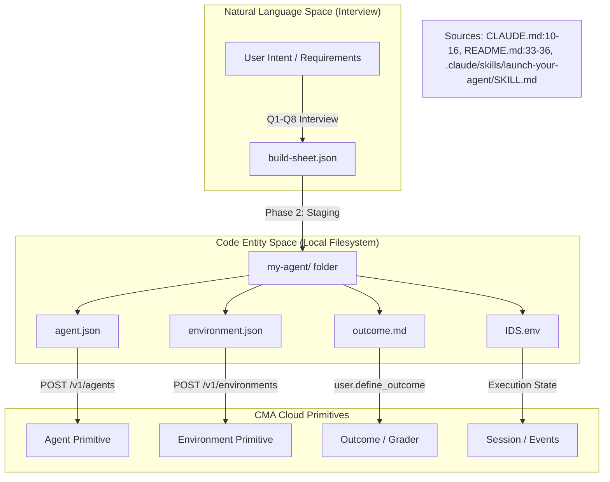
Sources: [CLAUDE.md:10-16](), [README.md:33-36]().

## Getting Started

To use this repository, you must have **Claude Code** installed and an **Anthropic API key**. The skill is self-contained; cloning the repo and running `claude` inside the folder automatically enables the `/launch-your-agent` command [README.md:10-24]().

*   **Prerequisites**: Anthropic API key (stored in a local `.env`, never in chat) [README.md:31-31]().
*   **Outcome**: You walk away with a live managed agent in your Anthropic Console and a local `my-agent/` directory containing all configuration and execution logs [README.md:33-36]().

For a step-by-step guide, see [Getting Started](#1.1).

## Repository Organization

The repository is structured to separate the **source-of-truth skills** from the **generated artifacts** and **reference documentation**.

| Directory/File | Role |
| :--- | :--- |
| `.claude/skills/` | The core logic. Contains the `launch-your-agent` and `wrap-up` skill definitions [CLAUDE.md:15-16](). |
| `ui/` | Templates and examples for the `agent-overview.html` dashboard [CLAUDE.md:14-14](). |
| `cma-primitives.md` | A technical inventory of CMA limits and API shapes used as a reference by the skills [CLAUDE.md:12-12](). |
| `my-agent/` | **Gitignored.** This is the "Build Kit" generated for your specific agent [README.md:36-36](), [.gitignore:5-5](). |
| `test-runs/` | **Gitignored.** Scratch space for transcripts and temporary files [.gitignore:2-2](). |

For a detailed breakdown of the file structure, see [Repository Layout](#1.2).

## Architecture Overview

The following diagram shows how the internal components of the repository interact with the Anthropic API to manage the lifecycle of an agent.

**Component Interaction Diagram**
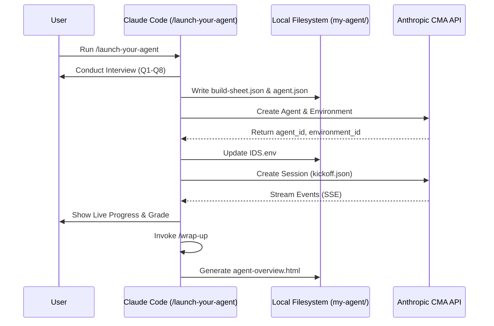
Sources: [CLAUDE.md:15-16](), [README.md:6-6](), [README.md:33-36]().

## Next Steps

Explore the child pages for deeper technical details:
*   [Getting Started](#1.1) — Quickstart and prerequisites.
*   [Repository Layout](#1.2) — Deep dive into the file system and skill references.

---

# Page: Getting Started

# Getting Started

<details>
<summary>Relevant source files</summary>

The following files were used as context for generating this wiki page:

- [.gitignore](.gitignore)
- [CLAUDE.md](CLAUDE.md)
- [README.md](README.md)

</details>


The `launch-your-agent` repository is a specialized environment designed for **Claude Code**. It provides a custom skill that orchestrates the creation, testing, and deployment of **Claude Managed Agents (CMA)** directly from your terminal [README.md:4-7]().

This page guides you through the initial setup and the execution of the primary workflow.

## Prerequisites

Before starting, ensure you have the following:

1.  **Claude Code**: Installed and authenticated on your machine [README.md:30-30]().
2.  **Anthropic API Key**: A valid key from your Anthropic Console (platform.claude.com).
    *   **Security Note**: The skill is designed to never ingest your API key into the chat transcript. You will be prompted to place it in a local, gitignored `.env` file within the generated agent directory [CLAUDE.md:24-24]().
3.  **Permissions**: Ensure your account has access to the Claude Managed Agents (CMA) beta features [README.md:49-50]().

**Sources:** [README.md:28-32](), [CLAUDE.md:24-24]()

## Quickstart Sequence

To begin building your agent, follow these steps in your terminal:

### 1. Clone and Enter the Repository
```bash
git clone https://github.com/anthropics/launch-your-agent.git
cd launch-your-agent
```
[README.md:12-14]()

### 2. Start Claude Code
Launch the Claude Code environment within the repo root.
```bash
claude
```
[README.md:15-15]()

### 3. Invoke the Skill
Inside the Claude Code prompt, run the custom skill:
```text
/launch-your-agent
```
[README.md:21-21]()

The skill located at `.claude/skills/launch-your-agent/SKILL.md` is automatically discovered by Claude Code when running in this directory [README.md:24-24]().

**Sources:** [README.md:10-24](), [CLAUDE.md:15-15]()

## The Launch Workflow

The `/launch-your-agent` skill executes a four-phase state machine to move from a natural language concept to a deployed production agent.

### Data Flow: From Concept to Managed Agent

The following diagram illustrates how your natural language inputs are transformed into code entities and eventually live CMA primitives.

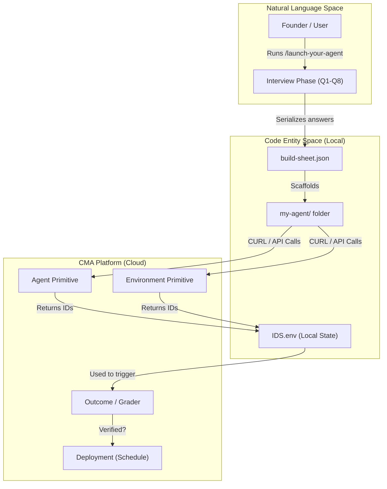
**Sources:** [CLAUDE.md:7-7](), [CLAUDE.md:26-26](), [README.md:42-42]()

### Workflow Phases

| Phase | Activity | Primary Artifacts |
| :--- | :--- | :--- |
| **1. Interview** | Claude asks ~8 targeted questions based on CMA primitives [CLAUDE.md:21-21](). | `build-sheet.json` |
| **2. Staging** | Scaffolding the local build kit while you fetch API keys [CLAUDE.md:24-24](). | `my-agent/` directory |
| **3. Launch & Grade** | Creating the Agent and Environment; running the first session with `user.define_outcome` [CLAUDE.md:20-20](). | `IDS.env`, Session logs |
| **4. Deployment** | Setting up a cron-based schedule if the task is recurring [CLAUDE.md:31-31](). | `Deployment` primitive |

**Sources:** [CLAUDE.md:7-7](), [CLAUDE.md:21-26](), [README.md:42-42]()

## Expected Artifacts

After successfully running the skill, you will have a new directory in your project root named `my-agent/` (this directory is gitignored by default) [.gitignore:5-5]().

### Local Build Kit (`my-agent/`)
*   **`agent.json` / `environment.json`**: The exact JSON payloads sent to the CMA API.
*   **`build-sheet.json`**: The source-of-truth configuration derived from your interview.
*   **`IDS.env`**: A mapping of local names to remote CMA UUIDs (e.g., `AGENT_ID`, `ENV_ID`), allowing the skill to be resumable.
*   **`agent-overview.html`**: A generated dashboard that visualizes your agent's architecture and recent run status [CLAUDE.md:30-30]().
*   **`NEXT-DIRECTIONS.md`**: A roadmap for v1/v2 features that were out-of-scope for the initial launch [CLAUDE.md:27-27]().

### Cloud Resources
*   **Managed Agent**: A versioned agent entity in the Anthropic Console.
*   **Managed Environment**: A secure, sandboxed runtime for your agent.
*   **Scheduled Deployment**: (Optional) A recurring trigger that executes your agent on a clock [CLAUDE.md:31-31]().

**Sources:** [README.md:33-36](), [CLAUDE.md:9-16](), [.gitignore:1-10]()

## Wrapping Up

Once the agent is live, you can use the companion skill:
```text
/wrap-up
```
This skill performs a hygiene sweep (archiving old sessions), refreshes the `agent-overview.html` with live status from the API, and provides tailored suggestions for your next iteration [CLAUDE.md:28-28]().

**Sources:** [CLAUDE.md:16-16](), [README.md:26-26]()

---

# Page: Repository Layout

# Repository Layout

<details>
<summary>Relevant source files</summary>

The following files were used as context for generating this wiki page:

- [.gitignore](.gitignore)
- [CLAUDE.md](CLAUDE.md)
- [CONTRIBUTING.md](CONTRIBUTING.md)
- [LICENSE](LICENSE)
- [README.md](README.md)

</details>


This page provides a detailed map of the `launch-your-agent` repository. It distinguishes between the **Source of Truth** (the skills and reference documentation) and **Generated Artifacts** (the local scratch spaces and agent build kits created during execution).

## Directory Structure Overview

The repository is organized to facilitate the execution of Claude Code skills while providing a library of reference materials that ground the AI's generation of Claude Managed Agents (CMA) primitives.

### High-Level Map

| Path | Category | Purpose |
|---|---|---|
| `.claude/skills/` | **Source of Truth** | Executable Claude Code skills (`launch-your-agent` and `wrap-up`). |
| `ui/` | **Reference/UI** | Static HTML templates and example JSON configurations for the agent dashboard. |
| `my-agent/` | **Generated Artifact** | The local build kit for the agent currently being developed (Gitignored). |
| `test-runs/` | **Scratch Space** | Transcripts and temporary files from skill testing (Gitignored). |
| `cma-primitives.md` | **Documentation** | Technical inventory of CMA API primitives, limits, and endpoints. |

**Sources:** [`README.md:38-48`](), [`CLAUDE.md:9-16`]()

---

## The Skills Directory (`.claude/skills/`)

This directory contains the core logic of the repository. Claude Code automatically detects these skills when running in the repository root [`README.md:24-24`]().

### `launch-your-agent/`
The primary skill that orchestrates the four-phase workflow: Interview, Staging, Launch/Grade, and Deployment.
*   **`SKILL.md`**: The entry point defining the `launch-your-agent` command and its system prompts [`CLAUDE.md:15-15`]().
*   **`references/`**: A collection of grounding documents used by the skill to ensure technical accuracy:
    *   `examples-bank.md`: Sourced archetypes traced to official cookbooks [`CLAUDE.md:13-13`]().
    *   `mock-connectors.md`: Patterns for stubbing external integrations (Slack, Email) in v0 builds [`CLAUDE.md:25-25`]().
    *   `overview-template.html`: The base HTML structure for the agent dashboard [`CLAUDE.md:15-15`]().

### `wrap-up/`
A companion skill invoked at the end of the launch process or manually by the user.
*   **`SKILL.md`**: Defines the `/wrap-up` command [`CLAUDE.md:16-16`]().
*   **Logic**: Performs a "Hygiene Sweep" (archiving sessions, sanitizing dates) and regenerates the `agent-overview.html` with live status data from the CMA API [`CLAUDE.md:28-28`]().

**Sources:** [`CLAUDE.md:15-16`](), [`README.md:42-43`]()

---

## Data Flow: From Reference to Artifact

The repository operates by transforming static reference files into functional, environment-specific artifacts. The diagram below illustrates how system entities in the `references/` directory map to the generated files in `my-agent/`.

### Mapping Reference Space to Code Space
"This diagram shows how the Skill orchestrates Source files to produce Artifacts."

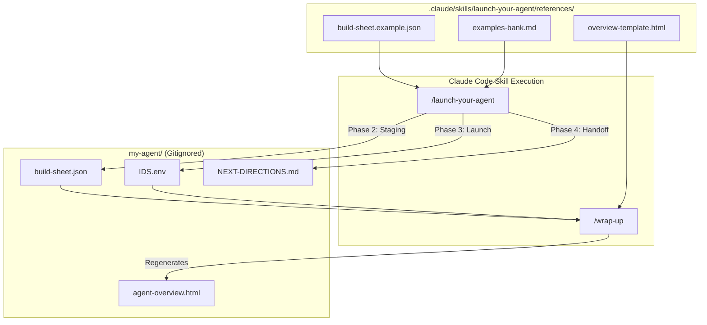

**Sources:** [`CLAUDE.md:15-16`](), [`CLAUDE.md:26-28`](), [`.gitignore:1-5`]()

---

## Key Files & Scratch Spaces

### Documentation Primitives
*   **`cma-primitives.md`**: Acts as the technical source of truth for the skill's knowledge of the CMA platform. It includes details on `/managed-agents/scheduled-deployments` and other API-specific limits [`CLAUDE.md:12-12`]().
*   **`CLAUDE.md`**: Contains project-specific "Key Decisions" and "Voice" guidelines that govern how the skill interacts with the user [`CLAUDE.md:18-31`]().

### UI and Examples (`ui/`)
*   **`ui/agent-overview-example.html`**: A static version of the dashboard for previewing the "warm-light schematic" layout [`CLAUDE.md:14-14`]().
*   **`ui/build-sheet.example.json`**: A reference for the JSON schema that stores the agent's configuration during the interview process [`CLAUDE.md:14-14`]().

### Gitignored Spaces
*   **`my-agent/`**: This directory is the local "Build Kit". It contains the specific configuration for the agent being built, including `agent.json`, `environment.json`, and the launch state [`CLAUDE.md:36-36`]().
*   **`test-runs/`**: Used for local development and debugging of the skills themselves. It often contains session transcripts [`gitignore:1-2`]().
*   **`.env` / `IDS.env`**: `.env` is used for local secrets (like `ANTHROPIC_API_KEY`) and is strictly ignored. `IDS.env` is specifically **not** ignored as it stores the non-secret IDs of created CMA primitives (e.g., `AGENT_ID`, `ENV_ID`) to allow for resumable launches [`.gitignore:7-10`]().

### Logic Entity Relationship
"This diagram maps the logical CMA Primitives to the files that define or track them within the repo."

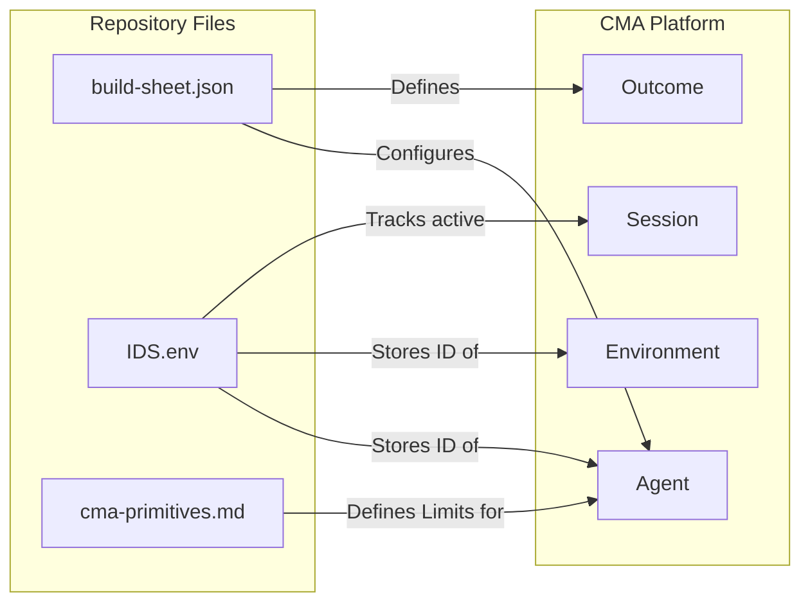

**Sources:** [`CLAUDE.md:12-12`](), [`CLAUDE.md:26-26`](), [`.gitignore:10-10`](), [`README.md:33-36`]()

---

# Page: Claude Managed Agents (CMA) Concepts

# Claude Managed Agents (CMA) Concepts

<details>
<summary>Relevant source files</summary>

The following files were used as context for generating this wiki page:

- [.claude/skills/launch-your-agent/references/cma-api.md](.claude/skills/launch-your-agent/references/cma-api.md)
- [cma-primitives.md](cma-primitives.md)

</details>


Claude Managed Agents (CMA) is a **hosted agent harness** platform. Unlike the standard Messages API where you must build your own execution loop and manage infrastructure, CMA provides a server-side **sandboxed Linux container** and an autonomous agent loop [cma-primitives.md:10-12]().

CMA is designed for **long-running, asynchronous, and stateful** workloads. It manages the lifecycle of the agent, the tool execution environment, and the persistence of the conversation and filesystem state [cma-primitives.md:12-13]().

## The Four Core Primitives

The platform is built on four foundational entities. A minimal launch involves creating an Agent, defining an Environment, instantiating a Session, and triggering work via an Event [cma-primitives.md:31-31]().

| Primitive | Purpose | Key Characteristic |
|---|---|---|
| **Agent** | Configuration | Reusable and **versioned** (model, prompt, tools) [.claude/skills/launch-your-agent/references/cma-api.md:35-45]() |
| **Environment** | Infrastructure | A sandboxed Linux runtime; **not versioned** [.claude/skills/launch-your-agent/references/cma-api.md:76-87]() |
| **Session** | Execution | A specific instance of an agent running in an environment [cma-primitives.md:62-64]() |
| **Events** | Communication | Bidirectional messages (`user.*`, `agent.*`, `session.*`) [.claude/skills/launch-your-agent/references/cma-api.md:109-115]() |

For a deep dive into these primitives, see [Core Primitives: Agent, Environment, Session & Events](#2.1).

### Conceptual Architecture: Code to Cloud

The following diagram bridges the high-level CMA concepts to the specific JSON configurations and API endpoints used in the codebase.

**CMA Entity Mapping**
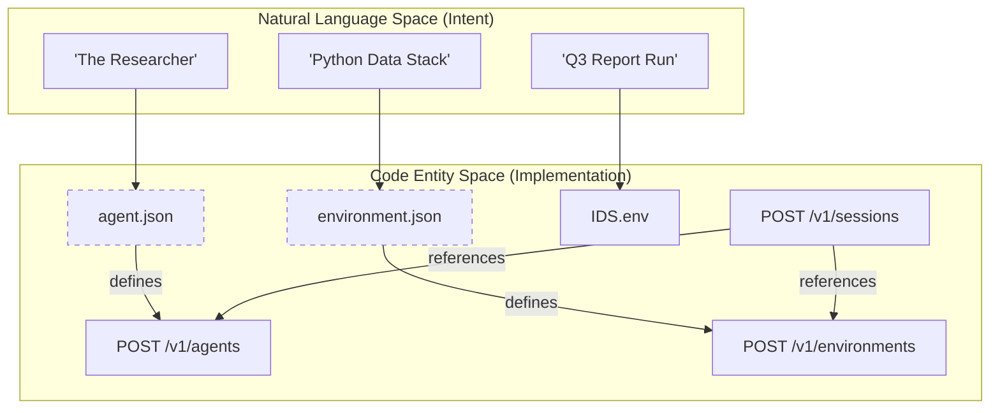
Sources: [.claude/skills/launch-your-agent/references/cma-api.md:35-108](), [cma-primitives.md:22-31]()

## Outcomes and Grading

CMA introduces a native **Outcome** primitive. Instead of just sending a message, you can define a "Definition of Done" using `user.define_outcome`. This allows the platform to automatically provision a grader to evaluate the agent's work against a rubric [cma-primitives.md:100-108]().

The `launch-your-agent` skill uses this to create a **Grade-and-Improve loop**, where the agent's performance is measured and refined iteratively [.claude/skills/launch-your-agent/references/cma-api.md:111-123]().

For details, see [Outcomes, Evals & the Grade-and-Improve Loop](#2.2).

## Scheduled Deployments

Agents can be promoted from manual sessions to **Deployments**. A deployment allows for scheduled execution (cron-based) and automated lifecycle management. This is the primary way to move an agent from a development "sketch" into a production "worker" [.claude/skills/launch-your-agent/references/cma-api.md:144-160]().

For details, see [Scheduled Deployments](#2.3).

## Tools, Skills, and Connectivity

CMA provides a robust toolset and connectivity layer:
*   **Built-in Tools:** `agent_toolset_20260401` includes `bash`, `read`, `write`, `edit`, `web_search`, and more [.claude/skills/launch-your-agent/references/cma-api.md:58-75]().
*   **Anthropic Skills:** Specialized capabilities for processing complex file types like `xlsx`, `docx`, and `pdf` [cma-primitives.md:120-125]().
*   **MCP Servers:** Integration with the Model Context Protocol for connecting to external data sources [cma-primitives.md:135-141]().
*   **Vaults:** Secure storage for credentials (OAuth, API keys) required by tools [cma-primitives.md:127-133]().

For details, see [Tools, Skills, MCP Servers & Vaults](#2.4).

## Persistence and Multi-Agent Patterns

CMA supports advanced state management and orchestration:
*   **Memory Stores:** Persistent key-value storage that survives across different sessions, allowing agents to "remember" information over time [cma-primitives.md:143-152]().
*   **Multi-Agent Systems:** A coordinator/roster pattern where a primary agent can delegate tasks to sub-agents [cma-primitives.md:160-167]().

For details, see [Memory Stores, Multi-Agent Sessions & Dreams](#2.5).

### Runtime Flow: Session Lifecycle

This diagram illustrates how code-defined primitives interact during a live session execution.

**CMA Runtime Execution**
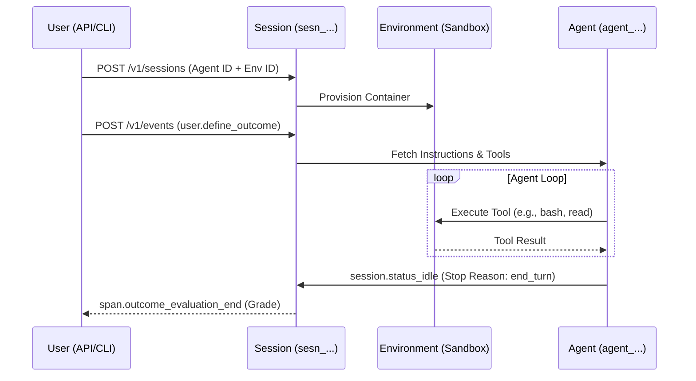
Sources: [.claude/skills/launch-your-agent/references/cma-api.md:89-123](), [cma-primitives.md:62-89]()

---

# Page: Core Primitives: Agent, Environment, Session & Events

# Core Primitives: Agent, Environment, Session & Events

<details>
<summary>Relevant source files</summary>

The following files were used as context for generating this wiki page:

- [.claude/skills/launch-your-agent/references/cma-api.md](.claude/skills/launch-your-agent/references/cma-api.md)
- [cma-primitives.md](cma-primitives.md)

</details>


This page provides a deep dive into the four foundational primitives of the Claude Managed Agents (CMA) platform. These primitives form the "hosted agent harness" that allows for long-running, asynchronous, and stateful agent execution within a sandboxed Linux container.

## Architectural Overview

The CMA platform moves the agent loop from the client-side to the server-side. Instead of managing the iterative "thought-action-observation" loop via the Messages API, you define a configuration (Agent) and a runtime (Environment), and Anthropic orchestrates the execution (Session) driven by bidirectional messaging (Events).

### Natural Language to Code Entity Mapping

The following diagram bridges high-level system concepts to the specific code entities and API resources used in the `launch-your-agent` skill and the CMA platform.

**Diagram: System Concepts to Code Entities**
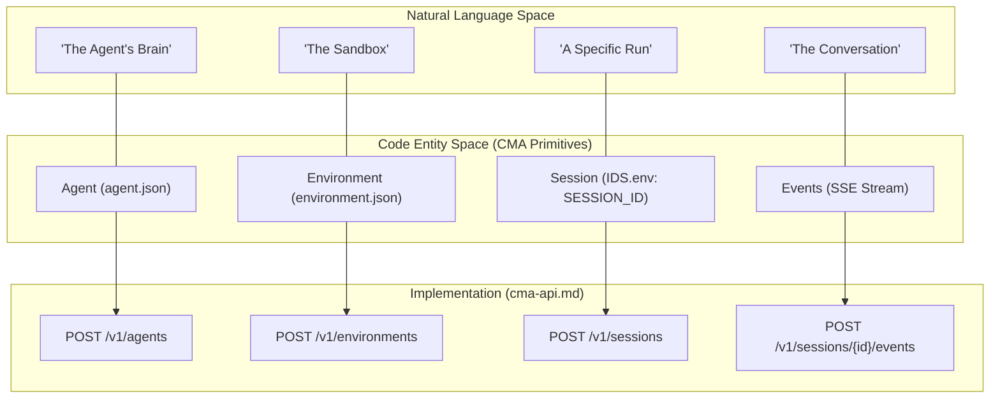
Sources: [cma-primitives.md:10-33](), [launch-your-agent/references/cma-api.md:35-120]()

---

## 1. Agent: The Versioned Configuration

The **Agent** primitive is a reusable, versioned configuration that defines the identity, capabilities, and constraints of the Claude instance.

### Key Characteristics
- **Immutable Versions:** Every update to an agent's configuration (e.g., changing the system prompt or adding a tool) increments its `version` (starting at 1). [cma-primitives.md:40-40]()
- **Concurrency Guard:** Updates require the current `version` number to prevent accidental overwrites in multi-user environments. [launch-your-agent/references/cma-api.md:47-52]()
- **Replacement Semantics:** While scalars like `system` can be updated individually, array fields such as `tools`, `mcp_servers`, and `skills` are **full replacements**. Omitting them preserves the current state, but passing an empty array `[]` clears them. [cma-primitives.md:41-41]()

### Core Configuration Fields
| Field | Description |
|---|---|
| `model` | Claude 4.5+ model ID (e.g., `claude-opus-4-8`). Supports speed objects: `{"id": "...", "speed": "fast"}`. [cma-primitives.md:39-39]() |
| `system` | The primary instructions for the agent. [cma-primitives.md:37-37]() |
| `tools` | Array of tool definitions (Built-in, MCP, or Custom). [launch-your-agent/references/cma-api.md:58-68]() |
| `mcp_servers` | External Model Context Protocol server configurations. [launch-your-agent/references/cma-api.md:69-69]() |

Sources: [cma-primitives.md:35-44](), [launch-your-agent/references/cma-api.md:35-54]()

---

## 2. Environment: The Sandboxed Runtime

The **Environment** defines the infrastructure where the agent executes. Unlike Agents, Environments are **not versioned**.

### Sandbox Isolation
Every **Session** created against an Environment receives its own fresh, isolated Linux container. There is no shared filesystem between sessions. [cma-primitives.md:49-49]()

### Networking Modes
- **`unrestricted`**: Default mode; full outbound access (minus safety blocklists). [cma-primitives.md:54-54]()
- **`limited`**: Restricted to specific `allowed_hosts`. This mode requires explicit booleans to allow package managers or MCP server connectivity. [cma-primitives.md:55-56]()

### Pre-provisioned Packages
Environments support pre-installing packages via `apt`, `pip`, `npm`, `gem`, `cargo`, and `go`. These are cached across sessions to speed up container provisioning. [cma-primitives.md:51-52]()

Sources: [cma-primitives.md:47-60](), [launch-your-agent/references/cma-api.md:76-88]()

---

## 3. Session: The Execution Instance

A **Session** is a single instance of an Agent running within an Environment. It tracks conversation history, sandbox state (checkpoints), and resource usage.

### Session Lifecycle & State Machine
Sessions follow a strict state machine. Work does not begin until the first event is received.

**Diagram: Session Status Transitions**
```mermaid
stateDiagram-v2
    [*] --> "idle": POST /v1/sessions
    "idle" --> "running": user.message / user.define_outcome
    "running" --> "idle": agent.message / session.status_idle
    "running" --> "rescheduling": transient error
    "rescheduling" --> "running": retry success
    "running" --> "terminated": unrecoverable error
    "idle" --> "terminated": DELETE /v1/sessions/{id}
```
Sources: [cma-primitives.md:68-68](), [launch-your-agent/references/cma-api.md:104-104]()

### Checkpointing and Persistence
- **Sandbox Checkpoints:** On reaching `idle` status, the sandbox (filesystem, installed packages) is checkpointed. [cma-primitives.md:70-70]()
- **TTL:** Checkpoints are preserved for 30 days after the last activity. Sending a new message resets this timer. [cma-primitives.md:70-70]()
- **Resources:** Memory stores, files, and repositories can be attached to sessions. Memory stores must be attached at creation time. [cma-primitives.md:67-67]()

Sources: [cma-primitives.md:62-74](), [launch-your-agent/references/cma-api.md:89-108]()

---

## 4. Events: Bidirectional Messaging

Communication with a session occurs via events. You send **User Events** to drive the agent and receive **Agent/Session/Span Events** to monitor progress.

### Event Streaming (SSE)
Events are typically consumed via a Server-Sent Events (SSE) stream.
- **Endpoint:** `GET /v1/sessions/{id}/events/stream` [launch-your-agent/references/cma-api.md:120-120]()
- **Processing:** Every event includes a `processed_at` timestamp; a null value indicates the event is still queued. [cma-primitives.md:79-79]()

### Key Event Types
| Category | Event Name | Purpose |
|---|---|---|
| **User** | `user.define_outcome` | Kickoff event combining task, rubric, and retry budget. [launch-your-agent/references/cma-api.md:111-115]() |
| **User** | `user.tool_confirmation` | Approve or deny a tool use gated by an `always_ask` policy. [cma-primitives.md:81-81]() |
| **Agent** | `agent.thinking` | Provides visibility into the model's internal reasoning. [cma-primitives.md:85-85]() |
| **Session** | `session.status_idle` | Signals the agent has finished its turn or requires input. [cma-primitives.md:87-87]() |
| **Span** | `span.outcome_evaluation_end` | Emitted when an outcome has been graded by the system. [cma-primitives.md:89-89]() |

Sources: [cma-primitives.md:77-90](), [launch-your-agent/references/cma-api.md:109-122]()

---

## Implementation Details: Data Flow

The following diagram illustrates the interaction between these primitives during a typical launch sequence orchestrated by the `launch-your-agent` skill.

**Diagram: Primitive Orchestration Flow**
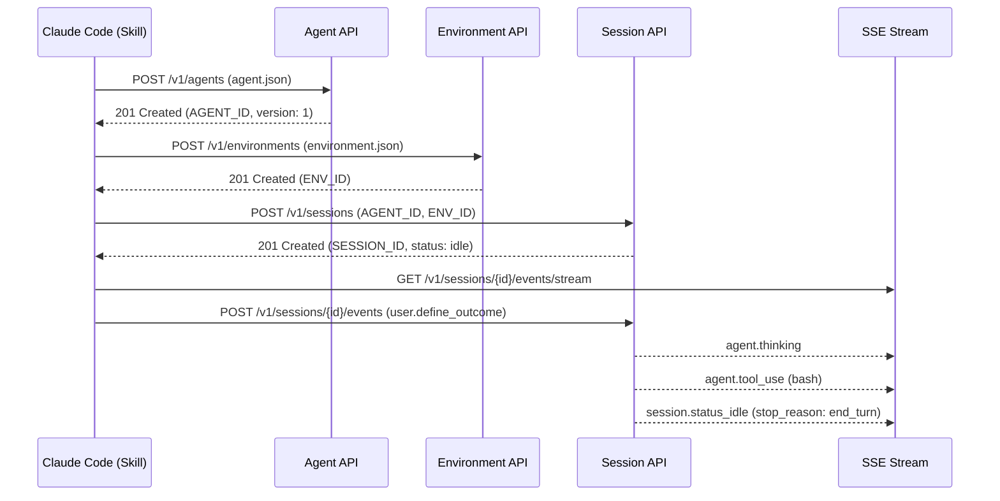
Sources: [launch-your-agent/references/cma-api.md:22-26](), [launch-your-agent/references/cma-api.md:35-120]()

---

# Page: Outcomes, Evals & the Grade-and-Improve Loop

# Outcomes, Evals & the Grade-and-Improve Loop

<details>
<summary>Relevant source files</summary>

The following files were used as context for generating this wiki page:

- [.claude/skills/launch-your-agent/references/build-sheet.example.json](.claude/skills/launch-your-agent/references/build-sheet.example.json)
- [.claude/skills/launch-your-agent/references/cma-api.md](.claude/skills/launch-your-agent/references/cma-api.md)
- [cma-primitives.md](cma-primitives.md)

</details>


This page details the mechanisms for defining success, automated grading, and systematic evaluation within the Claude Managed Agents (CMA) framework. It covers the `Outcome` primitive, the execution loop that drives an agent toward a defined rubric, and the regression testing infrastructure provided by the `launch-your-agent` skill.

## The Outcome Primitive

The `Outcome` is a high-level CMA primitive that transforms a standard session into an objective-driven execution loop. Instead of a single turn, the agent is given a task, a rubric, and a retry budget.

### user.define_outcome
To initiate an objective-driven run, a `user.define_outcome` event is sent to a session [[cma-primitives.md:81-81]()] [[.claude/skills/launch-your-agent/references/cma-api.md:111-115]()]. This event contains three key components:

1.  **Description**: The high-level task the agent must perform (e.g., "Produce this week's competitor digest") [[.claude/skills/launch-your-agent/references/build-sheet.example.json:21-21]()].
2.  **Rubric**: A structured set of criteria used by the auto-provisioned grader to evaluate the agent's work [[.claude/skills/launch-your-agent/references/build-sheet.example.json:22-28]()].
3.  **Max Iterations**: The number of "Grade-and-Improve" cycles allowed before the session terminates [[.claude/skills/launch-your-agent/references/build-sheet.example.json:29-29]()].

### The Auto-Provisioned Grader
When an outcome is defined, CMA automatically provisions a background grader (typically an Opus-class model) that is independent of the agent performing the task. This grader:
*   Monitors the agent's progress and tool outputs.
*   Evaluates the final state of the environment (e.g., checking files in `/mnt/session/outputs/`) against the rubric.
*   Issues a verdict: `passed` or `failed`.
*   Provides feedback to the agent if the verdict is `failed`, triggering a new iteration.

### Data Flow: Outcome Execution Loop

The following diagram illustrates the lifecycle of a session driven by the `user.define_outcome` primitive.

**Outcome Execution Lifecycle**
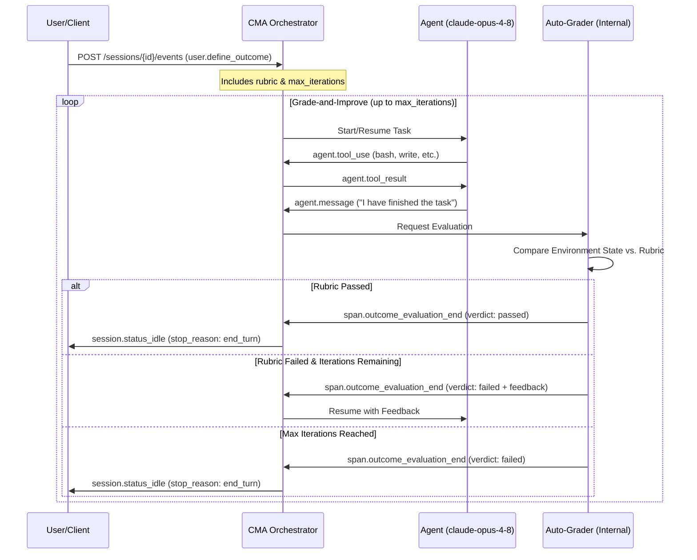
**Sources:** [[cma-primitives.md:81-81](), [.claude/skills/launch-your-agent/references/cma-api.md:111-120](), [.claude/skills/launch-your-agent/references/build-sheet.example.json:20-30]()]

---

## Evals Sub-system & Regression Testing

The `launch-your-agent` skill implements a systematic evaluation framework to ensure agent quality and prevent regressions during version promotion.

### Golden Sets and Eval Cases
Evaluation cases are defined in the `build-sheet.json` under the `evals` key [[.claude/skills/launch-your-agent/references/build-sheet.example.json:68-75]()].
*   **Input**: A directory or set of files representing the starting state for the test (e.g., `evals/week-of-may-25/`).
*   **Expected**: The "Golden" output (e.g., a hand-written digest) used to measure success [[.claude/skills/launch-your-agent/references/build-sheet.example.json:70-72]()].
*   **Verdict**: The result of the last evaluation run against a specific agent version.

### run-evals.sh
The repository provides a standard script, `run-evals.sh`, to automate the execution of these cases [[.claude/skills/launch-your-agent/references/build-sheet.example.json:103-103]()]. This script:
1.  Iterates through all defined cases in the `evals/` directory.
2.  Creates a fresh `Session` for each case.
3.  Injects the case-specific input files into the session sandbox.
4.  Sends a `user.define_outcome` event using the production rubric.
5.  Collects the `span.outcome_evaluation_end` results and reports a pass/fail summary.

### The Version Promotion Loop
The "Grade-and-Improve" loop occurs at two levels:
1.  **Inner Loop (Automatic)**: The CMA grader drives the agent through iterations within a single session based on the rubric [[.claude/skills/launch-your-agent/references/build-sheet.example.json:77-77]()].
2.  **Outer Loop (Manual/Dev)**: The developer modifies the `Agent` (system prompt, tools) or the `Rubric`, runs `run-evals.sh`, and only promotes the agent version to the production `Deployment` once all eval cases pass [[.claude/skills/launch-your-agent/references/build-sheet.example.json:101-104]()].

**Code Entity Mapping: Eval Sub-system**
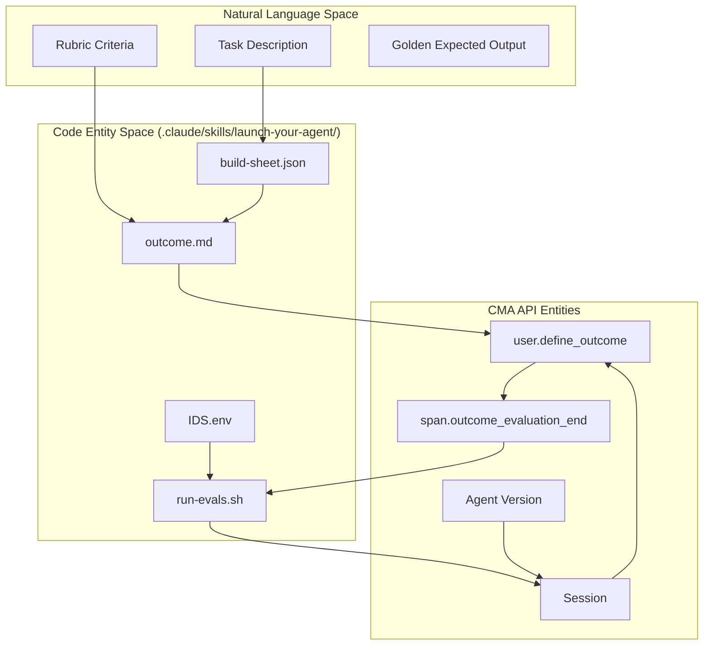
**Sources:** [[.claude/skills/launch-your-agent/references/build-sheet.example.json:20-30, 68-75, 101-104](), [.claude/skills/launch-your-agent/references/cma-api.md:22-26, 111-120]()]

---

## Technical Implementation Details

### Outcome Event Schema
When constructing the `user.define_outcome` event, the skill utilizes `jq` to safely embed the rubric text into the JSON payload:

```bash
# Example from cma-api.md
EVT=$(jq -n --rawfile task first_prompt.txt --rawfile rubric outcome.md \
  '{type:"user.define_outcome", description:$task, \
    rubric:{type:"text", content:$rubric}, max_iterations:3}')
```
**Sources:** [[.claude/skills/launch-your-agent/references/cma-api.md:113-115]()]

### Monitoring Results
To programmatically determine if an outcome was successful, the client must poll the session or listen to the SSE stream for the `span.outcome_evaluation_end` event.

| Field | Description |
| :--- | :--- |
| `verdict` | `passed` or `failed`. |
| `reasoning` | The grader's explanation for the verdict, citing specific rubric points. |
| `iteration` | The current iteration count (1 to `max_iterations`). |

**Sources:** [[cma-primitives.md:89-89](), [.claude/skills/launch-your-agent/references/cma-api.md:105-105]()]

### Regression Testing Workflow
1.  **Modify Agent**: Update the system prompt or tools via `POST /v1/agents/{id}` [[.claude/skills/launch-your-agent/references/cma-api.md:47-52]()].
2.  **Capture Version**: Note the new `AGENT_VERSION` returned by the API [[.claude/skills/launch-your-agent/references/cma-api.md:53-53]()].
3.  **Run Evals**: Execute `./evals/run-evals.sh`. This script creates sessions pinned to the new version [[.claude/skills/launch-your-agent/references/cma-api.md:101-101]()].
4.  **Analyze Verdicts**: If `span.outcome_evaluation_end` returns `passed` for all cases, the version is considered stable.
5.  **Promote**: Update the production `Deployment` to use the new `agent_version` [[.claude/skills/launch-your-agent/references/build-sheet.example.json:103-104]()].

**Sources:** [[.claude/skills/launch-your-agent/references/cma-api.md:47-53, 101-101](), [.claude/skills/launch-your-agent/references/build-sheet.example.json:101-104]()]

---

# Page: Scheduled Deployments

# Scheduled Deployments

<details>
<summary>Relevant source files</summary>

The following files were used as context for generating this wiki page:

- [.claude/skills/launch-your-agent/SKILL.md](.claude/skills/launch-your-agent/SKILL.md)
- [.claude/skills/launch-your-agent/references/cma-api.md](.claude/skills/launch-your-agent/references/cma-api.md)
- [cma-primitives.md](cma-primitives.md)

</details>


Scheduled Deployments are a native Claude Managed Agents (CMA) primitive that allow agents to run autonomously on a recurring basis. While **Sessions** represent a single execution instance, a **Deployment** acts as a template and a clock that automatically spawns sessions according to a cron schedule.

## Deployment Lifecycle and Primitives

A Deployment ([cma-primitives.md:144-144]()) links an **Agent** and an **Environment** to a **Schedule**. When the schedule triggers, the CMA platform creates a new Session, replays a set of `initial_events` (the "kickoff"), and manages the execution until completion.

### Key Concepts

| Concept | Description |
| :--- | :--- |
| **Cron Schedule** | Standard 5-field cron string (e.g., `0 9 * * 1-5` for 9 AM weekdays) combined with a IANA timezone (e.g., `America/Los_Angeles`). |
| **Initial Events** | A list of events (usually `user.define_outcome`) that are injected into every session spawned by the deployment. |
| **Deployment Run** | An individual execution instance spawned by a deployment. You can track the status and outcome of each run. |
| **Manual Trigger** | The ability to trigger an immediate run via the `/run` endpoint without waiting for the next cron tick. |

### Deployment States
Deployments follow a simple state machine ([cma-api.md:145-146]()):
*   **Active**: The deployment is live and will spawn sessions according to its schedule.
*   **Paused**: The schedule is suspended. No new runs will be created until resumed.
*   **Archived**: The deployment is soft-deleted. It stops running and can no longer be modified.

### Entity Relationship: Deployment Orchestration
The following diagram shows how the `Deployment` entity bridges the static configuration of an `Agent` with the dynamic execution of `Sessions`.

**Deployment Data Flow**
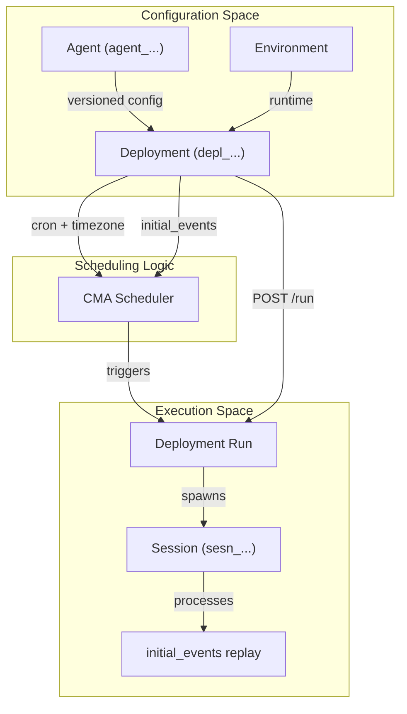
Sources: [cma-primitives.md:144-156](), [cma-api.md:130-143]()

---

## Implementation Details

### Creating a Deployment
Deployments are created via `POST /v1/deployments`. The request must include the `agent_id` (or a pinned version), `environment_id`, and the `schedule` object.

```bash
# Example Deployment Creation
curl -sS "$BASE/deployments" "${H[@]}" -d '{
  "name": "Daily Compliance Audit",
  "agent": "'$AGENT_ID'",
  "environment_id": "'$ENV_ID'",
  "schedule": {
    "type": "cron",
    "cron": "0 9 * * *",
    "timezone": "UTC"
  },
  "initial_events": [
    {
      "type": "user.define_outcome",
      "description": "Audit last 24h of logs for PII leaks.",
      "rubric": {"type": "text", "content": "1. Scan logs... 2. Flag leaks..."},
      "max_iterations": 3
    }
  ]
}'
```
Sources: [cma-api.md:130-143]()

### Handling Relative Dates in Initial Events
Because deployments run in the future, hardcoded dates in `initial_events` are usually anti-patterns. The `launch-your-agent` skill encourages the use of relative instructions (e.g., "Analyze data from the last 24 hours") so the agent can use its internal `bash` tool to determine the current date at runtime [SKILL.md:29-29]().

### The /run Endpoint
The `/run` endpoint ([cma-api.md:154-154]()) is critical for testing. It allows a developer to trigger a deployment immediately. This creates a **Deployment Run** that inherits all the configuration (environment, initial events, agent version) of the deployment, providing a high-fidelity test of what the scheduled execution will look like.

---

## Execution Modes: When to use Deployments

The `launch-your-agent` skill helps founders choose the correct execution mode during Phase 1 (Interview) and Phase 4 (Wrap-up).

| Mode | Trigger | Use Case |
| :--- | :--- | :--- |
| **Interactive** | Manual `user.message` | Ad-hoc tasks, debugging, or complex reasoning requiring human-in-the-loop. |
| **Event-Driven** | Webhook / API Call | Reacting to external signals (e.g., a GitHub PR, a Slack message). |
| **Scheduled** | **Deployment (Cron)** | Recurring chores, daily reports, weekly cleanup, or monitoring. |

### Technical Decision Flow
This diagram maps the user's requirements to the specific CMA API actions taken by the skill.

**Decision to Code Mapping**
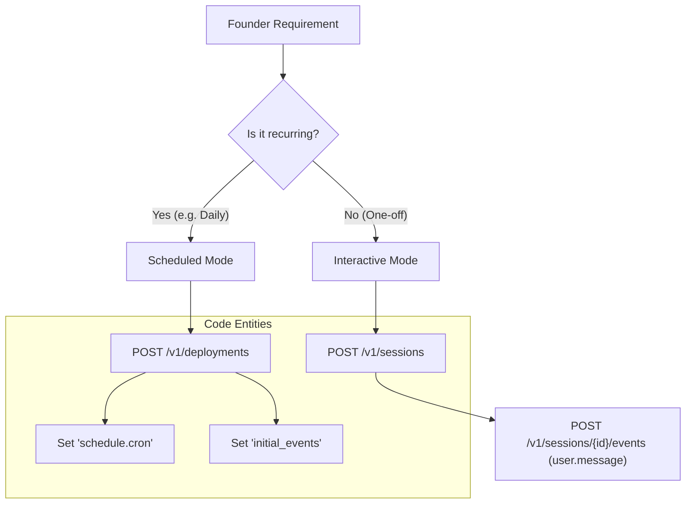
Sources: [SKILL.md:3-3](), [cma-api.md:130-143](), [cma-primitives.md:144-156]()

---

## Management and Maintenance

### Monitoring Runs
You can list the runs associated with a deployment to verify success or failure. Each run contains a reference to the `session_id` it created, allowing for deep-dive log inspection in the Anthropic Console.

*   **List Runs**: `GET /v1/deployments/{id}/runs` [cma-api.md:152-152]()
*   **Check Status**: Inspect the `status` of the resulting session (e.g., `terminated` vs `idle` with a successful outcome) [cma-api.md:105-105]().

### Updating Deployments
Deployments can be updated to change the schedule or the agent version they use.
*   **Update**: `POST /v1/deployments/{id}` [cma-api.md:145-146]()
*   **Pause/Unpause**: Use the update endpoint to set `status: "paused"` or `status: "active"` [cma-api.md:145-146]().

### Hygiene and Wrap-up
During the `/wrap-up` phase, the skill performs a "Hygiene Sweep" ([SKILL.md:3.4]()). For deployments, this involves:
1.  Verifying the `initial_events` do not contain literal dates that will become stale.
2.  Ensuring the deployment is in the `active` state if the user is ready to go live.
3.  Updating the `agent-overview.html` to display the `upcoming_runs_at` timestamp, providing visual confirmation of the next scheduled execution [SKILL.md:4.1]().

Sources: [SKILL.md:3.4](), [SKILL.md:4.1](), [cma-api.md:145-156]()

---

# Page: Tools, Skills, MCP Servers & Vaults

# Tools, Skills, MCP Servers & Vaults

<details>
<summary>Relevant source files</summary>

The following files were used as context for generating this wiki page:

- [.claude/skills/launch-your-agent/references/cma-api.md](.claude/skills/launch-your-agent/references/cma-api.md)
- [.claude/skills/launch-your-agent/references/mock-connectors.md](.claude/skills/launch-your-agent/references/mock-connectors.md)
- [cma-primitives.md](cma-primitives.md)

</details>


This page provides a technical reference for the capabilities available to Claude Managed Agents (CMA). It covers the built-in toolset, specialized Anthropic Skills, Model Context Protocol (MCP) integration, and the Vault system for secure credential management.

## Built-in Toolset (`agent_toolset_20260401`)

The primary capability for most agents is the `agent_toolset_20260401`. This bundle provides eight core tools that allow the agent to interact with its sandboxed Linux environment and the web.

| Tool Name | Purpose | Implementation Detail |
| :--- | :--- | :--- |
| `bash` | Execute shell commands | Runs in the sandboxed container defined by the Environment. |
| `read` | Read file content | Optimized for large files with paging support. |
| `write` | Create/Overwrite files | Used to persist agent outputs to `/mnt/session/outputs/`. |
| `edit` | Patch existing files | Uses a search-and-replace block format to minimize token usage. |
| `glob` | Search for files | Uses pattern matching to explore the file system. |
| `grep` | Search inside files | Standard regex-based content searching. |
| `web_search` | Search the internet | External search capability; bypasses environment networking limits. |
| `web_fetch` | Retrieve URL content | Fetches raw page content for analysis. |

**Sources:** [.claude/skills/launch-your-agent/references/cma-api.md:58-63](), [.claude/skills/launch-your-agent/references/cma-api.md:74-74]()

### Permission Policies
Tools can be configured with specific `permission_policy` settings to control agent autonomy.
*   **`always_allow`**: The agent executes the tool without user intervention.
*   **`always_ask`**: The session pauses, and the agent emits a `session.status_idle` with a `stop_reason` of `requires_action`. The user must send a `user.tool_confirmation` event to proceed.

**Sources:** [.claude/skills/launch-your-agent/references/cma-api.md:58-68](), [cma-primitives.md:81-81]()

## Anthropic Skills

Skills are high-level, managed capabilities provided by Anthropic to handle complex file parsing and manipulation without requiring the agent to write custom scripts.

*   **`xlsx`**: Read, analyze, and manipulate Excel spreadsheets.
*   **`docx`**: Extract text and structure from Word documents.
*   **`pptx`**: Parse and edit PowerPoint presentations.
*   **`pdf`**: High-fidelity text and layout extraction from PDF files.

**Sources:** [.claude/skills/launch-your-agent/references/cma-api.md:70-71]()

## Model Context Protocol (MCP) & Vaults

MCP allows agents to connect to external data sources and services (e.g., Linear, Slack, Google Calendar) using a standardized protocol. Credentials for these services are never stored in the agent configuration; instead, they are stored in a **Vault** and referenced by the Session.

### Vault Credential Types
1.  **`mcp_oauth`**: Used for services requiring OAuth2 flows. The agent handles the redirect/consent via the user.
2.  **`static_bearer`**: For API keys or static tokens.
3.  **`environment_variable`**: Injects sensitive strings directly into the sandbox shell environment.

### Data Flow: Agent to External Service
The following diagram illustrates how an agent uses an MCP server and a Vault to perform an authenticated action.

**CMA Tool Execution & Vault Resolution**
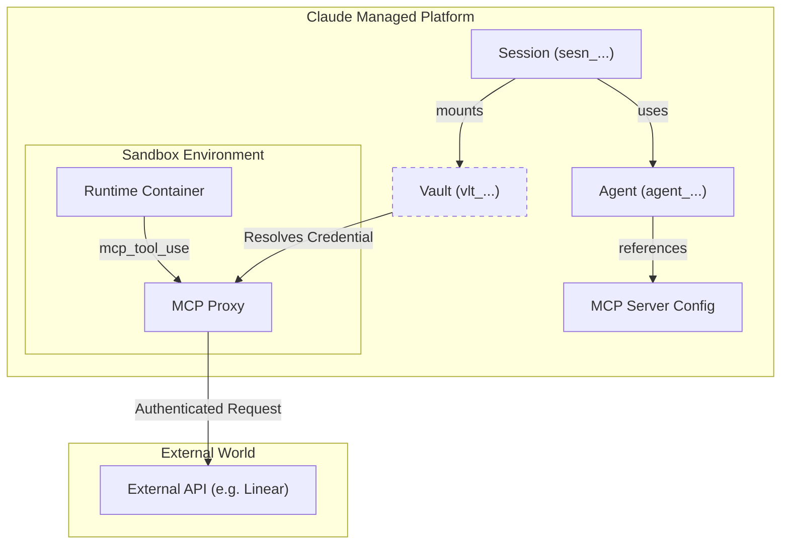
**Sources:** [.claude/skills/launch-your-agent/references/cma-api.md:64-69](), [.claude/skills/launch-your-agent/references/cma-api.md:96-96](), [cma-primitives.md:66-66]()

## Mock Connectors: "Design Now, Wire Later"

To maintain development velocity when credentials are not yet available, the `launch-your-agent` skill implements a mocking strategy. This ensures the agent's logic is "CMA-shaped" before final integration.

### Implementation Strategies
*   **Outbox Mock**: The agent writes JSON payloads to `/mnt/session/outputs/outbox/`. This is the preferred method for unattended or scheduled agents.
*   **Custom Tool Mock**: Defines a `custom` tool type in `agent.json`. The agent calls the tool, which triggers a `requires_action` state in the session, allowing a human to provide a mock response via `user.custom_tool_result`.

**Natural Language to Code Entity: Mocking System**
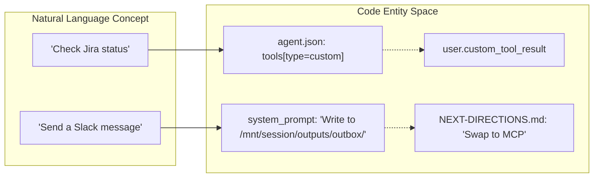
**Sources:** [.claude/skills/launch-your-agent/references/mock-connectors.md:8-17](), [.claude/skills/launch-your-agent/references/cma-api.md:66-68]()

## Configuration Reference

### Agent Tool Configuration Example
This JSON snippet demonstrates how to combine built-in tools, MCP servers, and custom tools in an agent definition.

```json
{
  "tools": [
    {
      "type": "agent_toolset_20260401",
      "configs": [
        {"name": "bash", "permission_policy": {"type": "always_ask"}}
      ]
    },
    {
      "type": "mcp_toolset",
      "mcp_server_name": "linear_integration"
    }
  ],
  "mcp_servers": [
    {
      "type": "url",
      "name": "linear_integration",
      "url": "https://mcp.linear.app/sse"
    }
  ]
}
```
**Sources:** [.claude/skills/launch-your-agent/references/cma-api.md:58-73]()

---

# Page: Memory Stores, Multi-Agent Sessions & Dreams

# Memory Stores, Multi-Agent Sessions & Dreams

<details>
<summary>Relevant source files</summary>

The following files were used as context for generating this wiki page:

- [.claude/skills/launch-your-agent/references/cma-api.md](.claude/skills/launch-your-agent/references/cma-api.md)
- [.claude/skills/launch-your-agent/references/examples-bank.md](.claude/skills/launch-your-agent/references/examples-bank.md)
- [cma-primitives.md](cma-primitives.md)

</details>


This page covers the mechanisms for long-term persistence, complex multi-agent orchestration, and automated memory consolidation within the Claude Managed Agents (CMA) platform. These features allow agents to maintain state across disparate sessions, collaborate on complex tasks, and "dream" to optimize their long-term knowledge base.

## Memory Stores

Memory Stores provide a persistent, cross-session storage layer for agents. Unlike the session sandbox which is ephemeral and isolated, a Memory Store can be attached to multiple sessions (sequentially or in parallel) to allow an agent to remember user preferences, past actions, or evolving datasets.

### Implementation and Limits
Memory stores are mounted as a filesystem at `/mnt/memory/` within the agent's environment [cma-primitives.md:102-102]().

| Limit | Value |
| :--- | :--- |
| **Max size per store** | 100 kB [cma-primitives.md:131-131]() |
| **Max memories per store** | 2,000 individual memory items [cma-primitives.md:131-131]() |
| **Max stores per session** | 8 [cma-primitives.md:131-131]() |
| **Persistence** | Independent of session lifecycle; survives session deletion [cma-primitives.md:72-72]() |

### Data Flow: Attaching and Using Memory
Memory stores are attached to a session at **creation time** via the `resources` array [cma-primitives.md:102-102]().

1.  **Creation**: `POST /v1/memory_stores` to create a store.
2.  **Attachment**: Include the `memory_store_id` in the `resources` block of a `POST /v1/sessions` call [cma-primitives.md:92-98]().
3.  **Access Modes**:
    *   `read_write`: Agent can read from and write to the store (standard for learning agents) [cma-primitives.md:102-102]().
    *   `read_only`: Agent can only reference existing memories (useful for shared knowledge bases) [cma-primitives.md:102-102]().
4.  **Instructions**: You can provide specific `instructions` on how the agent should use that specific store [cma-primitives.md:102-102]().

### Security and Versioning
*   **Versions**: Memory stores are versioned. Every write creates a new version. You can pin a session to a specific memory version or use `latest` [cma-primitives.md:128-128]().
*   **Security Warning**: Memory stores are shared state. If multiple concurrent sessions write to the same store, the last write wins (LWW). They are not designed for high-concurrency transactional integrity [cma-primitives.md:128-131]().

**Sources:** [.claude/skills/launch-your-agent/references/cma-api.md:102-102](), [cma-primitives.md:128-133]()

---

## Multi-Agent Sessions

Multi-agent configurations allow a **Coordinator** agent to delegate tasks to **Specialist** agents. This pattern is used for complex workflows that exceed the context window or reasoning capability of a single agent.

### The Coordinator Pattern
The multi-agent system uses a "Depth-1" hub-and-spoke model.
*   **Coordinator**: The primary agent defined in the session. It has a `multiagent` roster [cma-api.md:72-72]().
*   **Specialists**: Agents listed in the coordinator's roster. They can be invoked to perform specific sub-tasks [cma-api.md:72-72]().

### Technical Architecture: Code to Entity Mapping

**Diagram: Multi-Agent Threading Architecture**
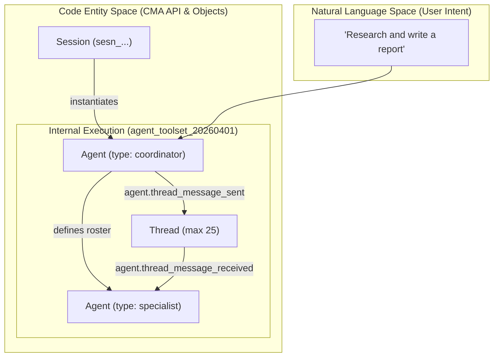
**Sources:** [.claude/skills/launch-your-agent/references/cma-api.md:72-72](), [cma-primitives.md:135-141]()

### Multi-Agent Limits
*   **Max Agents per Roster**: 20 [cma-primitives.md:141-141]().
*   **Max Concurrent Threads**: 25 [cma-primitives.md:141-141]().
*   **Topology**: Depth-1 only (Specialists cannot currently have their own rosters) [cma-primitives.md:135-135]().

### Events in Multi-Agent Flows
The system emits specific events to track cross-agent communication:
*   `agent.thread_message_sent`: Coordinator sends a message to a specialist [cma-primitives.md:85-85]().
*   `agent.thread_message_received`: Coordinator receives a response from a specialist [cma-primitives.md:85-85]().
*   `session.thread_created`: A new sub-context is spawned for a specialist [cma-primitives.md:87-87]().

**Sources:** [.claude/skills/launch-your-agent/references/cma-api.md:72-72](), [cma-primitives.md:135-141]()

---

## Dreams (Research Preview)

Dreams is a background consolidation feature designed to manage long-term memory. As an agent accumulates "memories" in a Memory Store, the volume of data can become noisy or redundant.

### The Consolidation Process
Dreams are asynchronous processes that run when the agent is "offline" (not in an active session) to process a Memory Store.

1.  **Trigger**: Triggered via `POST /v1/memory_stores/{id}/dreams` [cma-primitives.md:133-133]().
2.  **Input**: The raw, high-frequency memories written by the agent during sessions.
3.  **Action**: The system uses a model to:
    *   **Deduplicate**: Remove redundant information.
    *   **Synthesize**: Combine multiple related memories into a single, higher-level insight.
    *   **Prune**: Remove obsolete or low-utility information.
4.  **Output**: A new, optimized version of the Memory Store [cma-primitives.md:133-133]().

### Implementation Mapping

**Diagram: Memory Lifecycle with Dreams**
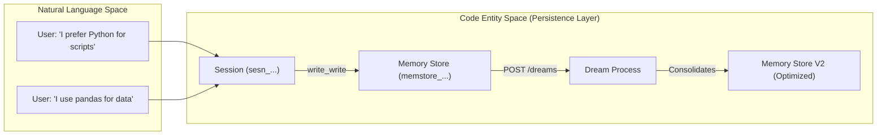
**Sources:** [cma-primitives.md:128-133](), [.claude/skills/launch-your-agent/references/examples-bank.md:40-40]()

### Key Functions for Developers
*   **`user.define_outcome`**: While not a "dream" function, it is the primary way to trigger the agent behavior that populates memory stores initially [cma-api.md:111-115]().
*   **`session.status_idle`**: The point at which the sandbox state is checkpointed and a memory store is safe to "dream" upon [cma-primitives.md:70-70]().

**Sources:** [.claude/skills/launch-your-agent/references/cma-api.md:111-115](), [cma-primitives.md:70-70](), [cma-primitives.md:133-133]()

---

# Page: The launch-your-agent Skill

# The launch-your-agent Skill

<details>
<summary>Relevant source files</summary>

The following files were used as context for generating this wiki page:

- [.claude/skills/launch-your-agent/SKILL.md](.claude/skills/launch-your-agent/SKILL.md)
- [CLAUDE.md](CLAUDE.md)

</details>


The `launch-your-agent` skill is the primary orchestration engine within this repository. It is designed as a "founder copilot" that guides a technical user through the lifecycle of creating a **Claude Managed Agent (CMA)**. The skill moves from initial discovery to a live, graded, and potentially scheduled deployment in the user's Anthropic account.

The skill is defined in [.claude/skills/launch-your-agent/SKILL.md:1-6]() and follows a structured four-phase workflow to ensure that agents are not just "coded," but properly provisioned as managed infrastructure.

### Design Philosophy

The skill adheres to several core principles to ensure a high-quality developer experience:
*   **Iterative Scoping (v0 vs. v1/v2):** Instead of building a complex system upfront, the skill focuses on a "v0" that solves the core problem, while documenting future enhancements in `NEXT-DIRECTIONS.md` [.claude/skills/launch-your-agent/SKILL.md:27-27]().
*   **Technical Transparency:** The skill "shows the machinery" by running `curl` or `ant` commands via Bash, ensuring the founder understands the underlying CMA API [.claude/skills/launch-your-agent/SKILL.md:23-23]().
*   **Parallel Credential Handling:** To avoid workflow blocks, the skill identifies needed credentials (API keys, Slack tokens) early and asks the user to gather them while it continues staging the build kit [.claude/skills/launch-your-agent/SKILL.md:28-28]().
*   **Mocking by Default:** For complex integrations like Slack or Email, the skill prefers a "mock-in-v0" approach using schema-true payloads, allowing the agent to be tested before full OAuth/Vault setup [.claude/skills/launch-your-agent/SKILL.md:29-29]().

### Workflow Orchestration

The skill orchestrates several reference files and generated artifacts to maintain state across the four phases.

| Phase | Goal | Key Artifacts |
| :--- | :--- | :--- |
| **1. Interview** | Define the agent's purpose and constraints. | `build-sheet.json` |
| **2. Briefing** | Confirm the technical plan and stage files. | `my-agent/` folder, `agent.json`, `environment.json` |
| **3. Launch** | Create the agent on CMA and run/grade it. | `IDS.env`, `kickoff.json`, `outcome.md` |
| **4. Deploy** | Set up recurring runs and hand off. | `NEXT-DIRECTIONS.md`, `agent-overview.html` |

**Sources:** [.claude/skills/launch-your-agent/SKILL.md:11-33](), [CLAUDE.md:18-31]()

---

### The Four-Phase Workflow

The skill executes the following phases in sequence, using `AskUserQuestion` to gate transitions between them.

#### Phase 1: Interview & Scoping
The skill uses a clustered interviewing technique to map user requirements to CMA primitives. It avoids overwhelming the user by asking one cluster of questions at a time (e.g., Identity, then Tools, then Outcome).
*   **For details, see [Phase 1 — Interview & Scoping](#3.1)**

#### Phase 2: Briefing & Staging
Once the scope is defined, the skill presents a "CMA-shaped brief." This includes a primitives table and a plan for what constitutes the v0 vs. future versions. It then generates the "Build Kit" in the `my-agent/` directory, which contains the exact JSON payloads required by the Anthropic API.
*   **For details, see [Phase 2 — Briefing & Staging](#3.2)**

#### Phase 3: Launch & Grade
The skill executes the launch sequence, creating the Agent and Environment via the API. It then initiates a Session using an Outcome-based kickoff. The skill polls for completion and presents the grading results (the "rubric verdict") to the user for iteration.
*   **For details, see [Phase 3 — Launch & Grade](#3.3)**

#### Phase 4: Scheduled Deployment & Wrap-Up
If the agent is meant to run on a clock, the skill configures a `Deployment` primitive with a cron schedule. Finally, it invokes the companion `/wrap-up` skill to perform a hygiene sweep and generate the final dashboard.
*   **For details, see [Phase 4 — Scheduled Deployment & Wrap-Up](#3.4)**

---

### Mapping Natural Language to Code Entities

The following diagrams illustrate how the skill bridges the user's conceptual intent into the concrete code entities and API structures used by the repository.

**Conceptual Mapping: From User Intent to Build Artifacts**
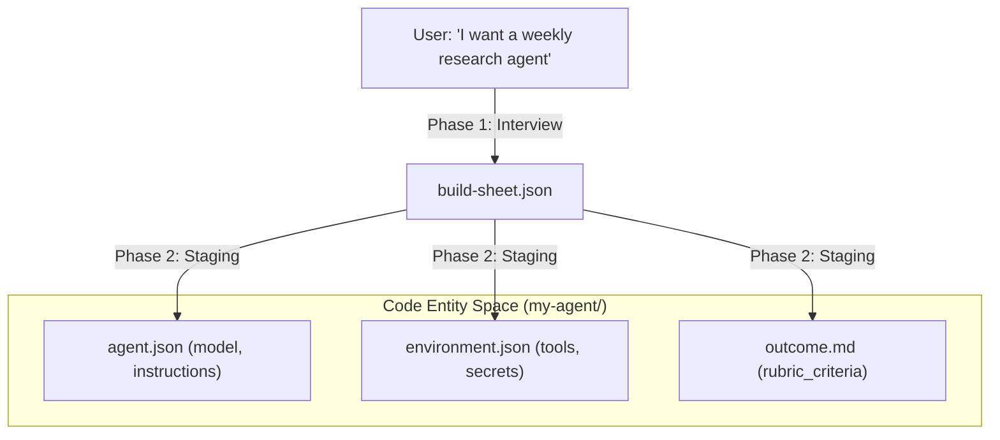
**Sources:** [.claude/skills/launch-your-agent/SKILL.md:27-29](), [CLAUDE.md:20-22]()

**Operational Mapping: From Skill Execution to CMA Primitives**
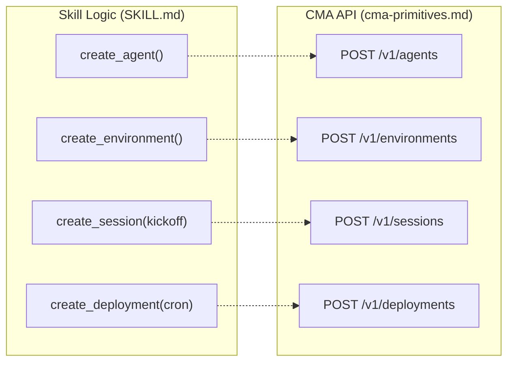
**Sources:** [cma-primitives.md:12-16](), [CLAUDE.md:12-16]()

### Reference Orchestration

The skill does not operate in isolation; it constantly references files in `.claude/skills/launch-your-agent/references/` to ensure consistency:
*   **`examples-bank.md`**: Used in the opening turn to provide "warm-light" archetypes [.claude/skills/launch-your-agent/SKILL.md:21-21]().
*   **`interview.md`**: Provides the structured question clusters for Phase 1 [.claude/skills/launch-your-agent/SKILL.md:25-25]().
*   **`mock-connectors.md`**: Provides the patterns for simulating SaaS integrations [.claude/skills/launch-your-agent/SKILL.md:29-29]().
*   **`overview-template.html`**: The blueprint for the final UI artifact generated at the end of the process [CLAUDE.md:30-30]().

**Sources:** [CLAUDE.md:10-16](), [.claude/skills/launch-your-agent/SKILL.md:21-32]()

---

# Page: Phase 1 — Interview & Scoping

# Phase 1 — Interview & Scoping

<details>
<summary>Relevant source files</summary>

The following files were used as context for generating this wiki page:

- [.claude/skills/launch-your-agent/SKILL.md](.claude/skills/launch-your-agent/SKILL.md)
- [.claude/skills/launch-your-agent/references/interview.md](.claude/skills/launch-your-agent/references/interview.md)
- [CLAUDE.md](CLAUDE.md)

</details>


Phase 1 is the discovery and configuration engine of the `launch-your-agent` skill. It facilitates an iterative, technical dialogue designed to map a founder's intent to specific **Claude Managed Agents (CMA)** primitives. Rather than using a static form, the process uses a series of "question clusters" that populate a `build-sheet.json` file, which serves as the source of truth for the subsequent building and launching phases.

## The Interview Logic

The interview follows the "Open light, boundaries in context" principle [ .claude/skills/launch-your-agent/SKILL.md:21-21](). It begins with a warm welcome and 2–3 concrete archetypes from the `examples-bank.md` to ground the conversation [ .claude/skills/launch-your-agent/SKILL.md:21-21]().

### Iterative Clustering
To avoid overwhelming the user, the skill never asks the entire questionnaire upfront. It uses `AskUserQuestion` to present enumerable choices (e.g., model selection, schedule times, or connector types) and limits itself to at most one open-ended question per turn [ .claude/skills/launch-your-agent/SKILL.md:25-25]().

### Data Flow: Natural Language to Build Sheet
As the user provides answers, the skill performs a mapping exercise [ .claude/skills/launch-your-agent/references/interview.md:11-11]().

| User Input Area | Targeted CMA Primitive | `build-sheet.json` Field |
| :--- | :--- | :--- |
| Who the agent is / Job description | **Agent** | `agent.name`, `agent.system_summary` |
| What "done" looks like | **Outcome** | `outcome.description`, `outcome.rubric_criteria` |
| Software dependencies | **Environment** | `environment.packages` |
| When it runs | **Session / Deployment** | `schedule.cron` |
| External data/logins | **Vault / MCP / Memory** | `connections.mcp_servers`, `memory` |

**Sources:** [ .claude/skills/launch-your-agent/references/interview.md:13-24](), [ .claude/skills/launch-your-agent/references/interview.md:32-35]()

---

## Question Clusters (Q1–Q8)

The interview is organized into eight logical clusters. The skill starts with defaults (e.g., Opus-class model, cloud environment) and only probes for deeper configuration if the job requires it [ .claude/skills/launch-your-agent/references/interview.md:26-26]().

1.  **Q1: The Job (Agent)** – Identifying the core persona and system instructions.
2.  **Q2: Definition of Done (Outcome)** – Defining the success criteria for the `user.define_outcome` event [ .claude/skills/launch-your-agent/references/interview.md:50-50]().
3.  **Q3: Inputs & Tools (Environment/MCP)** – Determining what the agent needs to read and what packages (Python/Node) must be in the container [ .claude/skills/launch-your-agent/references/interview.md:47-47]().
4.  **Q4: Outputs & Skills (Skills/Custom Tools)** – Deciding if the agent produces specialized files (xlsx, pdf) or needs to trigger external webhooks [ .claude/skills/launch-your-agent/references/interview.md:43-45]().
5.  **Q5: Trigger (Session/Deployment)** – Deciding between on-demand runs or a recurring cron schedule [ .claude/skills/launch-your-agent/references/interview.md:53-53]().
6.  **Q6: Boundaries (Permissions)** – Establishing "never-dos" and networking allowlists [ .claude/skills/launch-your-agent/references/interview.md:21-21]().
7.  **Q7: Memory (Memory Store)** – Determining if the agent needs to persist state across sessions [ .claude/skills/launch-your-agent/references/interview.md:52-52]().
8.  **Q8: Architecture (Multi-Agent/Model)** – Selecting the model (Opus vs Sonnet) or upgrading to a coordinator+roster pattern if the task is sufficiently complex [ .claude/skills/launch-your-agent/references/interview.md:46-46]().

**Sources:** [ .claude/skills/launch-your-agent/references/interview.md:41-57]()

---

## Technical Implementation: Mapping to Code Entities

The following diagrams illustrate how the interview process bridges the gap between the user's natural language descriptions and the underlying code structures and CMA primitives.

### Diagram 1: Scoping Logic & State Accumulation
This diagram shows how the `launch-your-agent` skill processes user input to populate the `build-sheet.json`.

```mermaid
graph TD
    subgraph "Natural Language Space"
        User["User Input (Technical Founder)"]
        Archetypes["examples-bank.md"]
    end

    subgraph "Skill Logic (.claude/skills/launch-your-agent/)"
        Skill["SKILL.md (Phase 1 Logic)"]
        InterviewRef["references/interview.md"]
        AskUser["AskUserQuestion (Tool)"]
    end

    subgraph "Code Entity Space (State)"
        BuildSheet["build-sheet.json"]
        NextDirs["NEXT-DIRECTIONS.md"]
    end

    User -->| "Describes Agent Job" | Skill
    Archetypes -->| "Grounds Conversation" | Skill
    Skill -->| "Iterative Probing" | AskUser
    AskUser -->| "Enumerable Choices" | User
    Skill -->| "Maps to Primitives" | InterviewRef
    InterviewRef -->| "Update Schema" | BuildSheet
    Skill -->| "Defer to v1/v2" | NextDirs
```
**Sources:** [ .claude/skills/launch-your-agent/SKILL.md:21-25](), [ .claude/skills/launch-your-agent/references/interview.md:11-11](), [ .claude/skills/launch-your-agent/references/interview.md:31-31]()

### Diagram 2: Primitive Mapping Table
This diagram maps the specific clusters and decisions to the CMA API entities that will be invoked in Phase 2.

```mermaid
graph LR
    subgraph "Interview Clusters"
        Q1["Q1: Job"]
        Q2["Q2: Done"]
        Q3["Q3: Inputs"]
        Q5["Q5: Timing"]
    end

    subgraph "Build Sheet Entities"
        AgentCfg["agent.json"]
        OutcomeCfg["outcome.md"]
        EnvCfg["environment.json"]
        DeployCfg["deployment.json"]
    end

    subgraph "CMA API Entities"
        CMA_Agent["POST /v1/agents"]
        CMA_Outcome["user.define_outcome"]
        CMA_Env["POST /v1/environments"]
        CMA_Deploy["POST /v1/deployments"]
    end

    Q1 --> AgentCfg --> CMA_Agent
    Q2 --> OutcomeCfg --> CMA_Outcome
    Q3 --> EnvCfg --> CMA_Env
    Q5 --> DeployCfg --> CMA_Deploy
```
**Sources:** [ .claude/skills/launch-your-agent/references/interview.md:39-57](), [ .claude/skills/launch-your-agent/SKILL.md:32-32]()

---

## Connector Strategy: Mocking vs. Wiring

A key decision in Phase 1 is whether to wire a real connector (e.g., Slack, Gmail) or mock it. Because delivery connectors require complex setup (OAuth, Vaults, Webhooks), the skill defaults to **Mock-in-v0** [ .claude/skills/launch-your-agent/SKILL.md:29-29]().

*   **Mocking:** The agent produces schema-true payloads in an "outbox" directory (`/mnt/session/outputs/outbox/`) or uses a custom tool that acts as a stub [ .claude/skills/launch-your-agent/references/interview.md:69-69]().
*   **Wiring:** If the founder has credentials ready, the skill pulls documentation for the specific MCP server and stages the `vault` configuration [ .claude/skills/launch-your-agent/SKILL.md:29-29]().

**Sources:** [ .claude/skills/launch-your-agent/SKILL.md:29-29](), [ .claude/skills/launch-your-agent/references/interview.md:69-69]()

## Output Artifacts of Phase 1

By the end of the interview, the skill has generated or updated:
1.  `build-sheet.json`: The machine-readable plan [ .claude/skills/launch-your-agent/references/interview.md:11-11]().
2.  `NEXT-DIRECTIONS.md`: A list of deferred features (v1, v2) to ensure the founder knows "not now" means "next" [ .claude/skills/launch-your-agent/SKILL.md:31-31]().
3.  **Credential Heads-up**: A notification of which API keys or tokens will be needed for Phase 2 [ .claude/skills/launch-your-agent/SKILL.md:28-28]().

**Sources:** [ .claude/skills/launch-your-agent/SKILL.md:28-31](), [ .claude/skills/launch-your-agent/references/interview.md:11-11]()

---

# Page: Phase 2 — Briefing & Staging

# Phase 2 — Briefing & Staging

<details>
<summary>Relevant source files</summary>

The following files were used as context for generating this wiki page:

- [.claude/skills/launch-your-agent/SKILL.md](.claude/skills/launch-your-agent/SKILL.md)
- [.claude/skills/launch-your-agent/references/build-sheet.example.json](.claude/skills/launch-your-agent/references/build-sheet.example.json)
- [.claude/skills/launch-your-agent/references/overview-template.html](.claude/skills/launch-your-agent/references/overview-template.html)
- [CLAUDE.md](CLAUDE.md)

</details>


The Briefing & Staging phase serves as the bridge between the conceptual interview and the technical execution. During this phase, the skill synthesizes the gathered requirements into a "CMA-shaped brief" and simultaneously prepares the local filesystem with a complete build kit. This phase is designed to be highly efficient, using parallel processing where the agent prepares the environment while the user performs credential-gathering tasks.

## The CMA-Shaped Brief

Before any code is executed or agents are provisioned, the skill presents a formal brief for user approval. This brief translates the natural language requirements into specific Claude Managed Agents (CMA) primitives.

### Primitives Table
The brief begins with a table mapping the agent's requirements to CMA technical entities:
*   **Agent (🤖):** Model selection (defaulting to Opus-class) and system instructions [CLAUDE.md:20-20]().
*   **Environment (📦):** Networking and package requirements [references/build-sheet.example.json:54-60]().
*   **Outcome (🎯):** The `user.define_outcome` definition, rubric, and iteration bounds [references/build-sheet.example.json:20-30]().
*   **Schedule (🗓️):** Cron expressions and timezones for the Deployment primitive [references/build-sheet.example.json:61-67]().
*   **Memory (🧠):** Persistence configuration and store names [references/build-sheet.example.json:45-53]().

### Versioning (v1/v2) Section
The skill maintains an iterative lens by scoping the smallest viable agent (v0) and explicitly deferring complex features to a numbered sequence (v1, v2, etc.) in the brief and the `NEXT-DIRECTIONS.md` file [.claude/skills/launch-your-agent/SKILL.md:27-27]().

### Eval Table
A golden set of evaluation cases is established. Case 1 is typically the build input, while subsequent cases are held back for regression testing [.claude/skills/launch-your-agent/SKILL.md:29-29]().

**Sources:** [.claude/skills/launch-your-agent/SKILL.md:27-32](), [CLAUDE.md:20-27](), [references/build-sheet.example.json:1-107]()

---

## Parallel Credential Handling

To minimize downtime, the skill uses a "grab these while I stage" pattern. As soon as a design choice makes a credential (like an API key or Slack webhook) inevitable, the skill provides a table with direct links to the provider's credential pages [.claude/skills/launch-your-agent/SKILL.md:28-28]().

### Implementation Logic
1.  **Check Environment:** The skill first checks the shell for an existing `ANTHROPIC_API_KEY` [.claude/skills/launch-your-agent/SKILL.md:30-30]().
2.  **Staging:** While the user fetches keys, the skill proceeds to create the `my-agent/` directory and populate it with non-sensitive configuration files [.claude/skills/launch-your-agent/SKILL.md:28-28]().
3.  **Isolation:** Credentials are never requested in the chat. They are placed in `my-agent/.env` (chmod 600) which is ignored by git [.claude/skills/launch-your-agent/SKILL.md:30-30]().

**Sources:** [.claude/skills/launch-your-agent/SKILL.md:28-30](), [CLAUDE.md:24-24]()

---

## The Build Kit Directory Structure

The skill generates a standardized directory, `my-agent/`, which contains all the artifacts necessary to launch, manage, and iterate on the agent.

### Generated Files
| File | Purpose |
| :--- | :--- |
| `agent.json` | The JSON payload for `POST /v1/agents`, containing `model` and `system_instructions`. |
| `environment.json` | Configuration for the sandboxed runtime (packages, networking). |
| `outcome.md` | The definition of done and rubric for the `user.define_outcome` tool call. |
| `LAUNCH.md` | Step-by-step instructions and raw `curl` commands for manual intervention. |
| `agent-overview.html` | A locally rendered dashboard showing the agent's "live schema". |
| `build-sheet.json` | The internal source of truth for the skill's state. |

**Sources:** [CLAUDE.md:9-16](), [references/build-sheet.example.json:1-107]()

---

## Technical Data Flow: From Brief to Staging

The following diagram illustrates how the natural language interview results are transformed into technical entities and local files.

### Mapping Interview to Code Entities
"Mapping Natural Language Space to Code Entity Space"

```mermaid
graph TD
    subgraph "Natural Language Space (Interview)"
        A["User Requirements"]
        B["'I want a weekly digest'"]
        C["'Check these 5 sites'"]
        D["'Post to Slack later'"]
    end

    subgraph "Code Entity Space (build-sheet.json)"
        E["agent.model_rationale"]
        F["schedule.cron"]
        G["outcome.rubric_criteria"]
        H["next_directions[v1]"]
    end

    subgraph "Filesystem (my-agent/)"
        I["agent.json"]
        J["environment.json"]
        K["LAUNCH.md"]
        L["agent-overview.html"]
    end

    A --> B & C & D
    B --> F
    C --> G
    D --> H
    
    F --> I
    G --> I
    F --> K
    E & F & G & H --> L
```
**Sources:** [.claude/skills/launch-your-agent/SKILL.md:25-32](), [references/build-sheet.example.json:1-107]()

---

## Generation of the Agent Overview

The `agent-overview.html` is a key artifact generated during Phase 2 and updated in later phases. It is created by populating the `overview-template.html` with data from `build-sheet.json` [CLAUDE.md:30-30]().

### Visualization Components
*   **Warm-Light Schematic:** The layout visualizes the flow from Trigger (Schedule/Kickoff) → Worker (Agent in Environment) → Output (Outcome & Grading) [references/overview-template.html:53-60]().
*   **Primitive Recap:** A table mapping every configured CMA primitive to its live ID and status [references/overview-template.html:102-110]().
*   **Version Rail:** Displays the current version and planned increments from `NEXT-DIRECTIONS.md` [references/overview-template.html:112-120]().

### Implementation: Overview Generation
The skill (and later the `/wrap-up` skill) reads the `build-sheet.json` and uses Bash to perform string replacements or DOM manipulations on `overview-template.html` to produce the final `agent-overview.html` [.claude/skills/wrap-up/SKILL.md:16-16]().

```mermaid
graph LR
    subgraph "Input Data"
        BS["build-sheet.json"]
        IDS["IDS.env"]
    end

    subgraph "Transformation"
        T["overview-template.html"]
        P["launch-your-agent (Phase 2)"]
    end

    subgraph "Output"
        HTML["agent-overview.html"]
    end

    BS & IDS --> P
    T --> P
    P --> HTML
```
**Sources:** [references/overview-template.html:1-125](), [CLAUDE.md:30-30](), [.claude/skills/launch-your-agent/SKILL.md:32-32]()

---

# Page: Phase 3 — Launch & Grade

# Phase 3 — Launch & Grade

<details>
<summary>Relevant source files</summary>

The following files were used as context for generating this wiki page:

- [.claude/skills/launch-your-agent/SKILL.md](.claude/skills/launch-your-agent/SKILL.md)
- [.claude/skills/launch-your-agent/references/cma-api.md](.claude/skills/launch-your-agent/references/cma-api.md)
- [CLAUDE.md](CLAUDE.md)

</details>


Phase 3 is the execution stage of the `launch-your-agent` skill. It transitions from static configuration files to live API orchestration, managing the sequence of object creation, session execution, and iterative grading. The phase focuses on idempotency to handle potential failures and a tight feedback loop using the CMA Outcome primitive to verify the agent's performance against the user's rubric.

## Resumable Launch Sequence

The launch process is designed to be resumable and idempotent. It relies on `IDS.env` to track created resources, ensuring that a failed step can be re-run without creating duplicate agents or environments [ .claude/skills/launch-your-agent/references/cma-api.md:22-26]().

### Idempotency Logic
1.  **Environment Check**: Before creation, the skill checks `IDS.env` for `ENV_ID`. If missing, it creates a cloud environment with the specified networking and package configuration [ .claude/skills/launch-your-agent/references/cma-api.md:79-84]().
2.  **Agent Creation**: Checks for `AGENT_ID`. If missing, it POSTs to `/v1/agents` using `agent.json`. The response `id` and `version` (initially 1) are persisted [ .claude/skills/launch-your-agent/references/cma-api.md:35-46]().
3.  **Session Provisioning**: Creates a session tied to the `AGENT_ID` and `ENV_ID`. Sessions start in an `idle` status [ .claude/skills/launch-your-agent/references/cma-api.md:92-104]().

### Launch Flow (Code Space)
The following diagram illustrates the transition from local files to CMA API entities.

**Diagram: File-to-API Mapping**
```mermaid
graph TD
    subgraph "Local Workspace (my-agent/)"
        A["agent.json"]
        B["environment.json"]
        C["IDS.env"]
        D[".env (API Key)"]
    end

    subgraph "CMA API Surface"
        E["POST /v1/agents"]
        F["POST /v1/environments"]
        G["POST /v1/sessions"]
    end

    D -->|"x-api-key"| E
    D -->|"x-api-key"| F
    
    A -->|"name, model, system"| E
    B -->|"packages, networking"| F
    
    E -->|"AGENT_ID"| C
    F -->|"ENV_ID"| C
    
    C -->|"agent_id, environment_id"| G
    G -->|"SESSION_ID"| C
```
Sources: [ .claude/skills/launch-your-agent/references/cma-api.md:13-26](), [ .claude/skills/launch-your-agent/references/cma-api.md:35-46](), [ .claude/skills/launch-your-agent/references/cma-api.md:79-84](), [ .claude/skills/launch-your-agent/references/cma-api.md:92-100]().

## The Execution Loop

Once a session is created, the skill initiates the work using an **Outcome Kickoff**. This combines the task description, the rubric, and the iteration budget into a single `user.define_outcome` event [ .claude/skills/launch-your-agent/references/cma-api.md:111-115]().

### Kickoff and Polling
-   **Kickoff**: The skill reads `kickoff.json` (or `first_prompt.txt` and `outcome.md`) and POSTs the event to the session [ .claude/skills/launch-your-agent/references/cma-api.md:113-116]().
-   **Polling**: The skill monitors session status via `GET /v1/sessions/$SESSION_ID`. It looks for status transitions from `running` to `idle` (waiting for user input/grading) or `terminated` [ .claude/skills/launch-your-agent/references/cma-api.md:104-105]().
-   **SSE Streaming**: For real-time feedback, the skill can consume the Server-Sent Events (SSE) stream at `/v1/sessions/$SESSION_ID/events`, filtering for `agent.message` and `agent.thought` [ .claude/skills/launch-your-agent/references/cma-api.md:120-125]().

### Implementation Details
| Step | Code/Action | Purpose |
| :--- | :--- | :--- |
| **Start** | `user.define_outcome` | Sets the goal and the `max_iterations` (default: 3) [ .claude/skills/launch-your-agent/SKILL.md:27](). |
| **Observe** | `GET /v1/sessions/$SESSION_ID` | Checks `.status` and `.usage` [ .claude/skills/launch-your-agent/references/cma-api.md:105](). |
| **Verify** | Python Parser | Used to extract IDs from JSON responses safely, avoiding `jq` issues with newlines in system prompts [ .claude/skills/launch-your-agent/references/cma-api.md:22-26](). |

Sources: [ .claude/skills/launch-your-agent/SKILL.md:27](), [ .claude/skills/launch-your-agent/references/cma-api.md:104-105](), [ .claude/skills/launch-your-agent/references/cma-api.md:111-125]().

## Grading and Iteration Logic

The "Grade" portion of Phase 3 uses the auto-provisioned grader within CMA. When the agent completes a run, the platform evaluates the output against the provided rubric [ .claude/skills/launch-your-agent/references/cma-api.md:111-114]().

### First-Iteration Verification
The skill must verify the first iteration's output before backgrounding long-running tasks [ .claude/skills/launch-your-agent/SKILL.md:26](). This ensures the agent understood the initial task and the environment is correctly configured (e.g., tools are accessible).

### Iteration Strategies
If the grade is insufficient, the skill guides the user through three potential fixes:
1.  **Rubric Tweaks**: Adjusting the `outcome.md` to be more specific about requirements.
2.  **Agent Version Bumps**: Updating `agent.json` (system prompt or tools) and POSTing an update to the agent. This increments the `AGENT_VERSION` in `IDS.env` [ .claude/skills/launch-your-agent/references/cma-api.md:47-53]().
3.  **Regression Testing**: Before promoting a new agent version to a production deployment, the user is encouraged to run `run-evals.sh` against a "golden set" of test cases [ CLAUDE.md:29]().

**Diagram: Grading & Improvement Loop**
```mermaid
graph TD
    subgraph "CMA Runtime"
        RUN["Session Execution"]
        GRADE["Auto-Grader (Rubric)"]
    end

    subgraph "Claude Code (Phase 3 Logic)"
        POLL["Poll session.status"]
        RESULT["Check outcome_evaluations"]
        DECIDE{"Pass Rubric?"}
    end

    RUN --> POLL
    POLL -->|"idle / terminated"| RESULT
    RESULT --> DECIDE
    
    DECIDE -->|"No"| IMPROVE["Improvement Choice"]
    DECIDE -->|"Yes"| DEPLOY["Proceed to Phase 4"]

    IMPROVE -->|"Update System Prompt"| UPDATE["POST /v1/agents/$ID (New Version)"]
    IMPROVE -->|"Refine Rubric"| REKICK["New user.define_outcome"]
    
    UPDATE --> RUN
    REKICK --> RUN
```
Sources: [ .claude/skills/launch-your-agent/SKILL.md:27](), [ .claude/skills/launch-your-agent/references/cma-api.md:47-53](), [ .claude/skills/launch-your-agent/references/cma-api.md:105](), [ .claude/skills/launch-your-agent/references/cma-api.md:111-116](), [ CLAUDE.md:29]().

## Regression Testing with `run-evals.sh`

For agents intended for production (Scheduled Deployments), Phase 3 introduces regression testing.
-   **Golden Sets**: The founder's real past cases are stored as a golden set. If no cases exist, the first successful run's output is saved as the first test case [ CLAUDE.md:29]().
-   **Evaluation Script**: `run-evals.sh` automates the process of running a new agent version against these cases to ensure no regressions occurred before the version is promoted to the deployment [ CLAUDE.md:29]().

Sources: [ CLAUDE.md:29]().

---

# Page: Phase 4 — Scheduled Deployment & Wrap-Up

# Phase 4 — Scheduled Deployment & Wrap-Up

<details>
<summary>Relevant source files</summary>

The following files were used as context for generating this wiki page:

- [.claude/skills/launch-your-agent/SKILL.md](.claude/skills/launch-your-agent/SKILL.md)
- [.claude/skills/wrap-up/SKILL.md](.claude/skills/wrap-up/SKILL.md)
- [CLAUDE.md](CLAUDE.md)

</details>


Phase 4 represents the transition from an interactive, iterative development cycle to a persistent, automated state. This phase handles the configuration of the CMA **Deployment** primitive, the finalization of the agent's growth plan, and the transition to the `/wrap-up` skill for long-term maintenance and state visualization.

## Scheduled Deployments

A **Deployment** is the CMA primitive that allows an agent to run autonomously on a recurring schedule (`cron`) or via manual triggers (`/run`). In the `launch-your-agent` workflow, a deployment is typically created only after a session has been successfully graded and the founder is satisfied with the v0 performance.

### Implementation and Logic
The skill uses the `POST /v1/deployments` endpoint to create the resource. Key configuration fields include:
*   **`cron`**: A standard crontab string (e.g., `0 9 * * 1-5` for 9 AM on weekdays) accompanied by a `timezone` (e.g., `America/Los_Angeles`).
*   **`initial_events`**: A list of events replayed into the session at the start of every run. The skill ensures these events use **relative dates** (e.g., "today", "last 24 hours") rather than literal timestamps to ensure the deployment remains functional over time.
*   **`status`**: Can be `active`, `paused`, or `archived`.

### Deployment Creation Flow
The following diagram illustrates the transition from a successful test session to a live deployment.

**Deployment Orchestration Logic**
```mermaid
sequenceDiagram
    participant S as SKILL.md
    participant B as build-sheet.json
    participant API as CMA API (/v1/deployments)
    participant W as wrap-up Skill

    S->>B: Read schedule configuration
    Note over S: If schedule.type == "cron"
    S->>S: Sanitize initial_events (relative dates)
    S->>API: POST /v1/deployments (agent_id, cron, events)
    API-->>S: Return deployment_id
    S->>S: Update IDS.env with deployment_id
    S->>API: POST /v1/deployments/{id}/run (Manual test)
    S->>S: Finalize NEXT-DIRECTIONS.md
    S->>W: Invoke /wrap-up
```
Sources: [CLAUDE.md:12-12](), [.claude/skills/launch-your-agent/SKILL.md:3-3](), [.claude/skills/wrap-up/SKILL.md:31-31]()

## Finalizing NEXT-DIRECTIONS.md

Throughout Phases 1-3, any feature or requirement that was deemed out-of-scope for the "v0" launch is captured in `NEXT-DIRECTIONS.md`. In Phase 4, the skill performs a final pass on this document to ensure it serves as a technical handoff.

The file is structured as a numbered sequence of planned increments (v1, v2, v3). Common entries include:
*   **Connector Wiring**: Transitioning from a mocked outbox to a real MCP server and Vault credential.
*   **Memory Stores**: Adding persistence for agents that need to remember state across scheduled runs.
*   **Hardening**: Adding `always_ask` gates to write-actions or expanding the outcome rubric.
*   **Generated Interfaces**: Planning a custom UI (built via Claude Code) to visualize agent outputs.

Sources: [.claude/skills/launch-your-agent/SKILL.md:31-31](), [CLAUDE.md:27-27]()

## The Handoff to /wrap-up

The `launch-your-agent` skill concludes by invoking the `/wrap-up` companion skill. This skill is responsible for the "celebratory close" and providing the founder with a long-term dashboard.

### Wrap-Up Pipeline
The `/wrap-up` skill executes a six-step pipeline to transition the project to a "maintenance" state:

| Step | Action | Description |
| :--- | :--- | :--- |
| **1** | **Read State** | Consumes `build-sheet.json`, `IDS.env`, and `NEXT-DIRECTIONS.md`. |
| **2** | **Refresh API** | Calls `session.status`, `outcome_evaluations`, and `deployment.status` to get live data. |
| **3** | **Regenerate UI** | Populates `agent-overview.html` using the `overview-template.html` and opens it in the browser. |
| **4** | **Recap Table** | Prints a table mapping CMA primitives (🤖 Agent, 📦 Env, 🎯 Outcome, etc.) to their live IDs. |
| **5** | **Hygiene Sweep** | Silently archives finished sessions and ensures API keys are isolated in `.env`. |
| **6** | **Next Steps** | Selects 1–2 high-impact suggestions from `NEXT-DIRECTIONS.md` to pitch to the founder. |

**Handoff Data Flow**
```mermaid
graph TD
    subgraph "Launch Skill (Phase 4)"
        ND["NEXT-DIRECTIONS.md"]
        IDS["IDS.env"]
        BS["build-sheet.json"]
    end

    subgraph "Wrap-Up Skill"
        API["CMA API Refresh"]
        HTML["agent-overview.html"]
        HY["Hygiene Sweep"]
    end

    ND --> API
    IDS --> API
    BS --> API
    API --> HTML
    HTML --> HY
    HY --> FINAL["Final Recap Table"]
```
Sources: [.claude/skills/wrap-up/SKILL.md:17-32](), [CLAUDE.md:16-16](), [CLAUDE.md:28-28]()

## Hygiene and Maintenance

The final act of the workflow is the **Hygiene Sweep**, performed by the `/wrap-up` skill. This is a "quiet by default" process designed to keep the founder's CMA environment clean and secure.

*   **Session Archiving**: Finished sessions are moved to an archived state to declutter the Console.
*   **Golden Case Promotion**: If a run was successful and no "golden set" exists in `evals/`, the skill saves the output as `evals/case-01/expected.md` for future regression testing.
*   **Credential Check**: Verifies that the `ANTHROPIC_API_KEY` only exists in `my-agent/.env` and has not leaked into chat history or transcripts. If a leak is detected, it instructs the founder to rotate the key immediately.
*   **Deployment Patching**: Scans `initial_events` for any literal dates (e.g., "2026-06-15") and attempts to replace them with relative terms to prevent the deployment from becoming stale.

Sources: [.claude/skills/wrap-up/SKILL.md:31-31](), [CLAUDE.md:24-24](), [CLAUDE.md:29-29]()

---

# Page: The wrap-up Skill

# The wrap-up Skill

<details>
<summary>Relevant source files</summary>

The following files were used as context for generating this wiki page:

- [.claude/skills/wrap-up/SKILL.md](.claude/skills/wrap-up/SKILL.md)
- [CLAUDE.md](CLAUDE.md)

</details>


The `wrap-up` skill is a companion utility designed to finalize a Claude Managed Agent (CMA) build or check in on its current status. It transitions the founder from the "building" phase to the "operating" phase by refreshing live data, performing a hygiene sweep of the environment, and providing a celebratory, high-level overview of the shipped primitives.

The skill is triggered explicitly by the user via phrases like `/wrap-up`, "where do things stand with my agent", or automatically as the final step (Phase 4) of the `launch-your-agent` workflow.

### High-Level Workflow
The skill executes a six-step pipeline to synchronize the local state with the CMA platform and present a final artifact to the user.

| Step | Action | Description |
| :--- | :--- | :--- |
| **1** | **Read State** | Loads `build-sheet.json`, `IDS.env`, and `NEXT-DIRECTIONS.md` from the `./my-agent/` directory. |
| **2** | **Refresh Live Data** | (Optional) Uses the `ANTHROPIC_API_KEY` to poll session status, evaluations, and deployment schedules. |
| **3** | **Regenerate Overview** | Populates `agent-overview.html` with live IDs and latest run logs. |
| **4** | **Recap Primitives** | Displays a "Here's what you built" table mapping emojis to CMA primitives. |
| **5** | **Tailor Next Steps** | Picks 1–2 high-impact upgrades from the v1/v2 plan for immediate consideration. |
| **6** | **Hygiene Sweep** | Silently archives sessions, sanitizes dates, and promotes successful runs to Evals. |

Sources: [.claude/skills/wrap-up/SKILL.md:3-5](), [.claude/skills/wrap-up/SKILL.md:17-32](), [CLAUDE.md:16-16]()

---

### Natural Language to Code Entity Mapping

The `wrap-up` skill bridges the user's intent to "close out" a project with the specific file-based state and API entities managed by the system.

**Intent Mapping: "Wrap up the build"**
```mermaid
graph TD
    User["Founder: '/wrap-up'"] -- triggers --> Skill[".claude/skills/wrap-up/SKILL.md"]
    
    subgraph "State Discovery"
        Skill -- reads --> BS["my-agent/build-sheet.json"]
        Skill -- reads --> IDS["my-agent/IDS.env"]
        Skill -- reads --> ND["my-agent/NEXT-DIRECTIONS.md"]
    end

    subgraph "Live Synchronization"
        Skill -- "GET /v1/sessions/{id}" --> CMA_API["CMA API"]
        Skill -- "GET /v1/deployments/{id}" --> CMA_API
    end

    subgraph "Artifact Generation"
        Skill -- populates --> HTML["my-agent/agent-overview.html"]
        Skill -- updates --> EVALS["my-agent/evals/case-01/"]
    end
```
Sources: [.claude/skills/wrap-up/SKILL.md:19-21](), [.claude/skills/wrap-up/SKILL.md:28-31]()

---

### Core Components

#### Live State Refresh & Overview Regeneration
The skill attempts to `source` the `my-agent/.env` file to access the CMA API. If a key is present, it fetches real-time data for all primitives, including session `status`, `outcome_evaluations`, and `upcoming_runs_at` for deployments. This data is injected into the `overview-template.html` to create a live-styled dashboard.

For details on the API integration and template population, see [Live State Refresh & Overview Regeneration](#4.1).

Sources: [.claude/skills/wrap-up/SKILL.md:19-23](), [.claude/skills/wrap-up/SKILL.md:28-28]()

#### Hygiene Sweep & Next-Step Heuristics
The hygiene sweep is a "quiet-by-default" process that maintains the health of the agent's environment. It includes:
*   **Session Archival:** Cleaning up finished sessions to reduce clutter.
*   **Date Sanitization:** Ensuring `initial_events` in deployments use relative rather than literal dates.
*   **Eval Promotion:** Automatically saving the first successful run as a "golden case" in the `evals/` directory.

Additionally, the skill analyzes `NEXT-DIRECTIONS.md` to suggest specific extensions, such as a "Generated Interface" or moving from a "Mock Connector" to a live one.

For details on the sweep logic and heuristic selection, see [Hygiene Sweep & Next-Step Heuristics](#4.2).

Sources: [.claude/skills/wrap-up/SKILL.md:30-31](), [CLAUDE.md:29-30]()

---

### Execution Pipeline (Code Entity Space)

The following diagram illustrates how the skill moves from local file reading to browser-based output, interacting with the CMA platform primitives.

**Pipeline: Skill Execution Flow**
```mermaid
flowchart LR
    Start["/wrap-up"] --> Read["Read build-sheet.json & IDS.env"]
    Read --> Auth{Key in .env?}
    
    Auth -- Yes --> API["CMA API Call: session.status, usage, upcoming_runs"]
    Auth -- No --> Describe["Describe-only mode"]
    
    API --> Template["overview-template.html"]
    Describe --> Template
    
    Template --> Render["Generate agent-overview.html"]
    Render --> Browser["Open Browser Artifact"]
    
    Browser --> Sweep["Hygiene Sweep: Archive & Sanitize"]
    Sweep --> Next["Tailor 1-2 NEXT-DIRECTIONS"]
```
Sources: [.claude/skills/wrap-up/SKILL.md:17-32](), [CLAUDE.md:28-28]()

---

### Primitives Recap Table
As part of the chat output, the skill generates a table summarizing the agent's "ownership" of CMA primitives.

| Primitive | Emoji | Purpose | Status/ID |
| :--- | :--- | :--- | :--- |
| **Agent** | 🤖 | The core logic and model config | `agent_...` |
| **Environment** | 📦 | The sandboxed runtime | `env_...` |
| **Outcome** | 🎯 | The definition of success/rubric | Defined in `outcome.md` |
| **Session** | ▶️ | A specific execution instance | `sess_...` |
| **Deployment** | 🗓️ | The schedule and triggers | `dep_...` |
| **Vault** | 🔐 | Credential management | `vault_...` |

Sources: [.claude/skills/wrap-up/SKILL.md:15-15](), [.claude/skills/wrap-up/SKILL.md:29-29]()

---

# Page: Live State Refresh & Overview Regeneration

# Live State Refresh & Overview Regeneration

<details>
<summary>Relevant source files</summary>

The following files were used as context for generating this wiki page:

- [.claude/skills/launch-your-agent/references/overview-template.html](.claude/skills/launch-your-agent/references/overview-template.html)
- [.claude/skills/wrap-up/SKILL.md](.claude/skills/wrap-up/SKILL.md)
- [ui/agent-overview-example.html](ui/agent-overview-example.html)

</details>


The `wrap-up` skill performs a final state synchronization between the local project files and the live Claude Managed Agents (CMA) platform. This process reconciles the intent captured in the `build-sheet.json` with the actual deployed infrastructure, generating a visual `agent-overview.html` artifact that serves as the primary handoff for the user.

## Implementation Overview

The regeneration process is triggered by the `/wrap-up` command or automatically at the conclusion of a `/launch-your-agent` session [.claude/skills/wrap-up/SKILL.md:3-3](). It follows a strict sequence of reading local state, querying the CMA API, and populating a pre-defined HTML template.

### Data Flow: From CMA API to Overview Artifact

The skill aggregates data from multiple sources to construct the final view:

1.  **Local Configuration**: Reads `build-sheet.json` for the original design intent and `IDS.env` for the resource identifiers (Agent ID, Environment ID, etc.) [.claude/skills/wrap-up/SKILL.md:19-19]().
2.  **Live State Query**: If an `ANTHROPIC_API_KEY` is present in `my-agent/.env`, the skill performs a series of API calls to fetch real-time statuses [.claude/skills/wrap-up/SKILL.md:20-20]().
3.  **Template Injection**: The gathered data is injected into `overview-template.html` to create a customized `agent-overview.html` [.claude/skills/wrap-up/SKILL.md:28-28]().

### CMA State Reconciliation Logic
| Data Point | Source | Code Entity / API Endpoint |
| :--- | :--- | :--- |
| **Session Status** | CMA API | `session.status` [.claude/skills/wrap-up/SKILL.md:20-20]() |
| **Evaluation Results** | CMA API | `outcome_evaluations[]` [.claude/skills/wrap-up/SKILL.md:20-20]() |
| **Deployment Health** | CMA API | `deployment.status` [.claude/skills/wrap-up/SKILL.md:20-20]() |
| **Upcoming Runs** | CMA API | `schedule.upcoming_runs_at` [.claude/skills/wrap-up/SKILL.md:20-20]() |
| **Resource Usage** | CMA API | `usage` [.claude/skills/wrap-up/SKILL.md:20-20]() |

**Sources:** [.claude/skills/wrap-up/SKILL.md:17-23](), [.claude/skills/launch-your-agent/references/overview-template.html:1-50]()

---

## Technical Process Diagram: Live Refresh

The following diagram illustrates how the `wrap-up` skill bridges the local filesystem and the remote CMA environment.

### Live State Refresh Sequence
```mermaid
sequenceDiagram
    participant W as "wrap-up skill"
    participant FS as "Local Filesystem (my-agent/)"
    participant API as "CMA API"
    participant T as "overview-template.html"

    W->>FS: Read "build-sheet.json" & "IDS.env"
    W->>FS: Source "my-agent/.env" (API Key)
    
    rect rgba(0, 0, 0, 0.05)
        Note over W, API: Live API Fetch
        W->>API: GET /v1/sessions/{id} (status)
        W->>API: GET /v1/deployments/{id} (schedule)
        W->>API: GET /v1/usage
    end

    W->>T: Map data to template variables
    T->>FS: Write "agent-overview.html"
    W->>W: Open "agent-overview.html" in browser
```
**Sources:** [.claude/skills/wrap-up/SKILL.md:17-28](), [.claude/skills/launch-your-agent/references/overview-template.html:52-70]()

---

## Overview Regeneration

The `agent-overview.html` is generated from a "warm paper" palette template designed to visualize the agent's pipeline [.claude/skills/launch-your-agent/references/overview-template.html:11-22]().

### Template Components
The template uses specific CSS classes and data attributes to represent CMA primitives:

*   **Top Bar (`.topbar`)**: Displays the agent name, a "Live" or "Planned" status pill, and usage statistics [.claude/skills/launch-your-agent/references/overview-template.html:27-47]().
*   **Pipeline Grid (`.pipeline`)**: A three-column grid (Trigger → Worker → Output) that visualizes the flow of data [.claude/skills/launch-your-agent/references/overview-template.html:53-53]().
*   **Environment Frame (`.env-frame`)**: A dashed container representing the sandboxed runtime, containing the agent and its attached tools/connections [.claude/skills/launch-your-agent/references/overview-template.html:89-90]().
*   **Run Log**: A table populated with the results of `outcome_evaluations`, showing the rubric version and the final verdict [.claude/skills/wrap-up/SKILL.md:29-29]().

### Code-to-UI Mapping
This diagram maps internal CMA primitives and file references to their visual representations in the generated HTML.

### Primitive-to-UI Association
```mermaid
graph TD
    subgraph "Local Code Entities"
        BS["build-sheet.json"]
        IDS["IDS.env"]
        NEXT["NEXT-DIRECTIONS.md"]
    end

    subgraph "UI Component (agent-overview.html)"
        H1[".topbar h1"]
        STAT[".statepill"]
        NODE[".node-meta"]
        NEXT_SEC["#v1-v2-upgrades"]
    end

    BS -- "agent.name" --> H1
    IDS -- "session_id" --> STAT
    IDS -- "agent_id / env_id" --> NODE
    NEXT -- "v1/v2 plan" --> NEXT_SEC
```
**Sources:** [.claude/skills/wrap-up/SKILL.md:19-30](), [.claude/skills/launch-your-agent/references/overview-template.html:27-70](), [ui/agent-overview-example.html:27-70]()

---

## Key Functions & Logic

### API Interaction
The skill uses Python scripts (parsed with `strict=False`) to interact with the CMA API endpoints [.claude/skills/wrap-up/SKILL.md:20-20](). This ensures that even if the API introduces new fields, the regeneration process does not break.

### Idempotency
The `wrap-up` skill is designed to be idempotent. Running the command multiple times simply refreshes the `agent-overview.html` with the latest live data from the CMA platform and any local changes to `NEXT-DIRECTIONS.md` [.claude/skills/wrap-up/SKILL.md:36-36]().

### Artifact Delivery
The final step of the process is the browser launch. The skill is instructed to **open the overview page in the browser** as the primary closing artifact [.claude/skills/wrap-up/SKILL.md:28-28](). This provides the user with a "Live Console" view that links directly to the Anthropic Console for deep-link management.

**Sources:** [.claude/skills/wrap-up/SKILL.md:20-36](), [ui/agent-overview-example.html:1-100]()

---

# Page: Hygiene Sweep & Next-Step Heuristics

# Hygiene Sweep & Next-Step Heuristics

<details>
<summary>Relevant source files</summary>

The following files were used as context for generating this wiki page:

- [.claude/skills/wrap-up/SKILL.md](.claude/skills/wrap-up/SKILL.md)
- [CLAUDE.md](CLAUDE.md)

</details>


The **Hygiene Sweep** and **Next-Step Heuristics** represent the final automated quality-assurance and strategic planning layer of the agent-building lifecycle. Managed by the `/wrap-up` skill, these processes ensure the production environment is clean, secure, and ready for handoff, while providing the user with a concrete technical path forward.

## 1. The Silent Hygiene Sweep

The hygiene sweep is a non-interactive maintenance routine designed to enforce best practices for Claude Managed Agents (CMA) without burdening the user with checklist fatigue. It executes silently unless a critical manual intervention (like rotating a leaked API key) is required.

### 1.1 Implementation Logic
The sweep is defined in Phase 5 of the wrap-up pipeline [ .claude/skills/wrap-up/SKILL.md:31-31](). It focuses on four primary domains:

1.  **Session Archiving**: Identifies and archives finished `Session` primitives to declutter the workspace and finalize the run history [ .claude/skills/wrap-up/SKILL.md:31-31]().
2.  **Date Sanitization**: Scans `initial_events` within the `Deployment` primitive. It replaces literal date strings (e.g., "2026-06-15") with relative temporal markers or dynamic logic to ensure the deployment remains functional for future cron triggers [ .claude/skills/wrap-up/SKILL.md:31-31]().
3.  **Credential Isolation**: Verifies that the `ANTHROPIC_API_KEY` and other secrets exist only within the local `my-agent/.env` file or the environment. If a key is detected in the chat transcript or git-tracked files, the skill triggers a rotation warning [ .claude/skills/wrap-up/SKILL.md:31-31]().
4.  **Golden Case Promotion**: If a run has successfully passed the `Outcome` rubric and no "golden" evaluation cases exist yet, the sweep saves the current output as `evals/case-01/expected.md` to serve as a regression baseline [ .claude/skills/wrap-up/SKILL.md:31-31]().

### 1.2 Data Flow: Hygiene Execution
The following diagram illustrates how the wrap-up skill interacts with the file system and the CMA API to perform the sweep.

**Hygiene Sweep Data Flow**
```mermaid
graph TD
    subgraph "Claude Code (wrap-up skill)"
        A["SKILL.md (Phase 5)"] --> B["Python Parser (strict=False)"]
    end

    subgraph "Local Filesystem (my-agent/)"
        C[".env"] -- "Check Isolation" --> B
        D["IDS.env"] -- "Identify Active Sessions" --> B
        E["evals/"] -- "Promote Case 01" --> B
    end

    subgraph "CMA API"
        F["POST /v1/sessions/{id}/archive"]
        G["PATCH /v1/deployments/{id}"]
    end

    B -- "Archive Finished" --> F
    B -- "Sanitize initial_events" --> G
    B -- "Verify Key" --> C
```
Sources: [ .claude/skills/wrap-up/SKILL.md:20-20](), [ .claude/skills/wrap-up/SKILL.md:31-31]()

## 2. Next-Step Heuristics

Rather than presenting a generic roadmap, the system uses heuristics to select 1–2 "tailored extensions" from the `NEXT-DIRECTIONS.md` file. This transforms a backlog into an actionable v1/v2 release plan.

### 2.1 Selection Criteria
The skill evaluates the current state of `build-sheet.json` and `NEXT-DIRECTIONS.md` to prioritize upgrades [ .claude/skills/wrap-up/SKILL.md:30-30]():

| Heuristic | Trigger Condition | Recommended Extension |
| :--- | :--- | :--- |
| **Connectivity** | Agent currently uses "Mock" connectors or file-system outboxes. | **Real-world Wiring**: Swap mocks for real MCP servers + Vault credentials. |
| **Persistence** | Agent performs repetitive tasks or requires context across sessions. | **Memory Store**: Implement `/mnt/memory/` for cross-session state. |
| **Control** | Agent performs high-stakes write actions. | **Gated Actions**: Implement `always_ask` permission gates. |
| **Interface** | Agent results are complex (charts, large datasets, or multi-file). | **Generated Interface**: Build a tailored results viewer via the Files/Sessions API. |

### 2.2 The "Generated Interface" Pattern
A unique heuristic is the promotion of a **Generated Interface**. This is not a default v0 feature but is suggested when the user needs a custom way to steer the agent or visualize its `Outcome` [ .claude/skills/wrap-up/SKILL.md:30-30](). This interface is typically a small app or static page built by Claude Code in a follow-up session.

**Heuristic Mapping: Natural Language to Code Entities**
```mermaid
graph LR
    subgraph "Natural Language Space (User Needs)"
        NL1["'I need to see these results as a chart'"]
        NL2["'It should remember my preferences'"]
        NL3["'Send this to Slack for real'"]
    end

    subgraph "Code Entity Space (CMA Primitives & Files)"
        CE1["Generated Interface (agent-overview.html extension)"]
        CE2["Memory Store (/mnt/memory/)"]
        CE3["Connector (MCP Server + Vault)"]
    end

    NL1 -.-> CE1
    NL2 -.-> CE2
    NL3 -.-> CE3

    subgraph "Logic (wrap-up/SKILL.md)"
        H["Next-Step Heuristics"]
    end

    H -- "Parses" --> CE1
    H -- "Parses" --> CE2
    H -- "Parses" --> CE3
```
Sources: [ .claude/skills/wrap-up/SKILL.md:30-30](), [ .claude/skills/launch-your-agent/references/mock-connectors.md:1-20]()

## 3. Final State Handover

The culmination of the sweep and heuristics is the regeneration of the `agent-overview.html`.

1.  **Regeneration**: The skill reads `IDS.env` and `build-sheet.json` to populate the `overview-template.html` [ .claude/skills/wrap-up/SKILL.md:28-28]().
2.  **Live Status**: If an API key is present in `my-agent/.env`, the skill calls the CMA API to fetch `session.status`, `outcome_evaluations`, and `upcoming_runs_at` [ .claude/skills/wrap-up/SKILL.md:20-20]().
3.  **Artifact Opening**: The skill automatically opens the regenerated `agent-overview.html` in the user's browser, serving as the "closing artifact" [ .claude/skills/wrap-up/SKILL.md:28-28]().

### 3.1 Handover Table
The skill produces a final "Here's what you built" table in the chat, mapping primitives to their locations on the overview page [ .claude/skills/wrap-up/SKILL.md:29-29]():

| Emoji | Primitive | Description | Live ID | Card Location |
| :--- | :--- | :--- | :--- | :--- |
| 🤖 | Agent | The model and system instructions. | `agt_...` | Top Rail |
| 🎯 | Outcome | The grading rubric and success criteria. | `out_...` | Grading Node |
| 🗓️ | Deployment | The cron schedule and kickoff events. | `dep_...` | Trigger Node |
| 🧠 | Memory | Cross-session persistence store. | `mem_...` | Worker Node |

Sources: [ .claude/skills/wrap-up/SKILL.md:28-30](), [ .claude/skills/wrap-up/SKILL.md:15-15]()

---

# Page: Reference Material & Examples

# Reference Material & Examples

<details>
<summary>Relevant source files</summary>

The following files were used as context for generating this wiki page:

- [.claude/skills/launch-your-agent/references/build-sheet.example.json](.claude/skills/launch-your-agent/references/build-sheet.example.json)
- [.claude/skills/launch-your-agent/references/examples-bank.md](.claude/skills/launch-your-agent/references/examples-bank.md)
- [ui/agent-overview-example.html](ui/agent-overview-example.html)
- [ui/build-sheet.example.json](ui/build-sheet.example.json)

</details>


This page provides an overview of the reference files, example artifacts, and UI templates bundled with the `launch-your-agent` skill. These materials serve as the blueprint for generating new agents and provide high-quality examples of what "good" looks like for Claude Managed Agents (CMA).

The repository includes both structured data schemas and natural language inspiration banks to guide the transition from a founder's idea to a production-ready agent configuration.

### From Interview to Artifacts
The following diagram illustrates how natural language concepts captured during the interview phase are mapped to specific code entities and reference files.

**Concept to Code Mapping**
```mermaid
graph TD
    subgraph "Natural Language Space (Interview)"
        A["Founder's Problem"]
        B["Success Criteria"]
        C["Tools & Permissions"]
        D["Archetype Selection"]
    end

    subgraph "Code Entity Space (Files & Schemas)"
        E[".claude/skills/launch-your-agent/references/build-sheet.example.json"]
        F["ui/agent-overview-example.html"]
        G[".claude/skills/launch-your-agent/references/examples-bank.md"]
        H["my-agent/build-sheet.json"]
    end

    A -->|Populates| H
    B -->|Maps to| E
    C -->|References| E
    D -->|Sourced from| G
    H -->|Hydrates| F
```
Sources: [.claude/skills/launch-your-agent/references/build-sheet.example.json:1-107](), [.claude/skills/launch-your-agent/references/examples-bank.md:1-15](), [ui/agent-overview-example.html:1-103]()

---

## 5.1 Build Sheet Schema
The `build-sheet.json` is the central source of truth for an agent's configuration. It captures the agent's identity, the environment it inhabits, the tools it wields, and the outcomes it is measured against.

The schema is designed to be human-readable but machine-parsable, allowing the skill to generate the final `agent.json` and `environment.json` payloads for the CMA API. It includes sections for:
*   **Agent Identity**: Name, model, and system summary [ui/build-sheet.example.json:9-19]().
*   **Outcome & Rubric**: Success criteria and iteration bounds [ui/build-sheet.example.json:20-30]().
*   **Environment**: Networking rules and package requirements [ui/build-sheet.example.json:54-60]().
*   **Schedule**: Cron triggers and kickoff event definitions [ui/build-sheet.example.json:61-67]().

For a detailed field-by-field breakdown, see [Build Sheet Schema](#5.1).

---

## 5.2 Agent Archetypes & Examples Bank
The `examples-bank.md` file contains a curated list of agent archetypes grounded in official Anthropic cookbooks and documentation. This ensures that any example offered to a user during the interview phase is technically feasible and has a known-good configuration pattern.

| Archetype | Description | Primary Primitive |
| :--- | :--- | :--- |
| **Data Analyst** | CSV in → Narrative HTML report with charts | Environment `packages` |
| **Ops Responder** | Alert → Investigate → Draft PR → Wait for approval | `requires_action` gate |
| **Document Producer** | Research task delivering a graded artifact (.xlsx) | Outcomes + Skills |
| **Compliance Scanner** | Scheduled scan of resources for policy violations | Scheduled Deployments |

For the full list of archetypes and sourcing rules, see [Agent Archetypes & Examples Bank](#5.2).

Sources: [.claude/skills/launch-your-agent/references/examples-bank.md:63-75]()

---

## 5.3 Mock Connectors
The "design now, wire later" philosophy is supported by mock connectors. These allow founders to build and test their agent's logic before integrating with real-world APIs or MCP servers.

**Mocking Lifecycle**
```mermaid
graph LR
    subgraph "Phase 1: Mocking"
        M1["Outbox File System"]
        M2["custom_tool 'requires_action'"]
    end

    subgraph "Phase 2: Integration"
        I1["Real MCP Server"]
        I2["Vault Credential"]
        I3["always_ask Gate"]
    end

    M1 -.->|Swap| I1
    M2 -.->|Swap| I3
```

This approach standardizes payloads for common services like Slack, Email, and Issue Trackers within the `build-sheet.json` [ui/build-sheet.example.json:84-89](). For implementation details on the v0→v1 swap, see [Mock Connectors](#5.3).

---

## 5.4 Agent Overview Template
The `agent-overview-example.html` provides a visual representation of the agent's architecture. It is used as a template by the `/wrap-up` skill to generate a live, "warm-light" schematic for the founder.

Key visual components include:
*   **Trigger Node**: Shows how the agent starts (e.g., Cron or Webhook).
*   **Worker Node**: Displays the agent's model and environment details [ui/agent-overview-example.html:89-93]().
*   **Outcome Node**: Lists the rubric criteria and success metrics [ui/agent-overview-example.html:102-103]().
*   **Run Log**: A visual rail showing execution history and versioning.

For details on how the template is populated and how to extend the interface, see [Agent Overview Template](#5.4).

Sources: [ui/agent-overview-example.html:51-75]()

---

# Page: Build Sheet Schema

# Build Sheet Schema

<details>
<summary>Relevant source files</summary>

The following files were used as context for generating this wiki page:

- [.claude/skills/launch-your-agent/references/build-sheet.example.json](.claude/skills/launch-your-agent/references/build-sheet.example.json)
- [ui/build-sheet.example.json](ui/build-sheet.example.json)

</details>


The `build-sheet.json` file serves as the central source of truth for the `launch-your-agent` skill. It acts as a bridge between the natural language requirements gathered during the Phase 1 interview and the technical configuration required to provision Claude Managed Agents (CMA) primitives in Phase 2.

### Purpose and Data Flow

The build sheet is initialized by the `/launch-your-agent` skill and iteratively populated as the user answers question clusters. Once complete, it is used to generate the `my-agent/` directory, including `agent.json`, `environment.json`, and the `outcome.md` files.

Title: Build Sheet Orchestration Flow
```mermaid
graph TD
    subgraph "Natural Language Space"
        Interview["SKILL.md Phase 1: Interview"]
        Answers["User Answers (Q1-Q8)"]
    end

    subgraph "Intermediate Representation"
        BuildSheet["build-sheet.json"]
    end

    subgraph "Code Entity Space"
        Gen["SKILL.md Phase 2: Staging"]
        Agent["agent.json (CMA Agent)"]
        Env["environment.json (CMA Environment)"]
        Outcome["outcome.md (CMA Outcome)"]
        IDS["IDS.env (CMA Resource IDs)"]
    end

    Interview --> Answers
    Answers --> BuildSheet
    BuildSheet --> Gen
    Gen --> Agent
    Gen --> Env
    Gen --> Outcome
    Gen --> IDS
```
**Sources:** [.claude/skills/launch-your-agent/references/build-sheet.example.json:1-107](), [ui/build-sheet.example.json:1-107]()

---

### Schema Field Definitions

#### 1. Meta and Agent Configuration
The `meta` block captures the business context, while the `agent` block defines the identity and core logic of the Claude Managed Agent.

| Field | Type | Description |
| :--- | :--- | :--- |
| `meta.problem` | string | The core pain point the agent solves. |
| `agent.name` | string | The unique identifier for the CMA Agent resource. |
| `agent.model` | string | The Anthropic model version (e.g., `claude-opus-4-8`). |
| `agent.system_summary` | string | High-level instruction summarizing the agent's primary purpose. |
| `agent.never_dos` | string[] | Strict negative constraints to prevent hallucination or unauthorized actions. |

**Sources:** [.claude/skills/launch-your-agent/references/build-sheet.example.json:2-19](), [ui/build-sheet.example.json:2-19]()

#### 2. Outcome and Rubric
The `outcome` block defines the success criteria for the agent's task. This maps directly to the `user.define_outcome` primitive in CMA.

*   **`rubric_criteria`**: A list of objective, verifiable points used by the automated grader to evaluate the agent's work [ui/build-sheet.example.json:22-28]().
*   **`max_iterations`**: The maximum number of "grade-and-improve" cycles the agent will perform before halting [ui/build-sheet.example.json:29]().

#### 3. Tools and Environment
This section defines the capabilities and the sandbox constraints of the agent.

| Section | Key Fields | Implementation Details |
| :--- | :--- | :--- |
| **Tools** | `enabled`, `custom_tools` | Maps to `agent_toolset_20260401`. Includes `bash`, `web_search`, etc. [ui/build-sheet.example.json:31-37](). |
| **Environment** | `networking`, `allowed_hosts` | Defines if the agent has `unrestricted` or `limited` internet access [ui/build-sheet.example.json:54-60](). |

#### 4. Connections and Memory
Handles external integrations and cross-session persistence.

*   **`mcp_servers`**: List of Model Context Protocol servers for external data/actions [ui/build-sheet.example.json:39]().
*   **`memory.stores`**: Defines persistence volumes. `access: "read_write"` allows the agent to maintain state across scheduled runs [ui/build-sheet.example.json:45-53]().

---

### Implementation Mapping

The following diagram illustrates how specific `build-sheet.json` fields are transformed into CMA API objects and local tracking files during the Phase 2 staging process.

Title: Build Sheet to CMA Primitive Mapping
```mermaid
classDiagram
    class BuildSheet {
        +agent.name
        +agent.system_summary
        +outcome.rubric_criteria
        +environment.networking
        +schedule.cron
        +ids
    }

    class CMA_Agent {
        +name: string
        +system: string
        +tools: list
    }

    class CMA_Environment {
        +networking: string
        +allowed_hosts: list
    }

    class CMA_Deployment {
        +cron: string
        +timezone: string
    }

    class IDS_env {
        +AGENT_ID
        +ENVIRONMENT_ID
        +DEPLOYMENT_ID
    }

    BuildSheet --|> CMA_Agent : "generates agent.json"
    BuildSheet --|> CMA_Environment : "generates environment.json"
    BuildSheet --|> CMA_Deployment : "Phase 4 Schedule"
    CMA_Agent ..> IDS_env : "ID stored after POST"
    CMA_Environment ..> IDS_env : "ID stored after POST"
```
**Sources:** [.claude/skills/launch-your-agent/references/build-sheet.example.json:9-106](), [ui/build-sheet.example.json:9-106]()

---

### Execution and Iteration Fields

#### Schedule and Kickoff
*   **`mode`**: Can be `scheduled`, `event-driven`, or `interactive` [ui/build-sheet.example.json:62]().
*   **`kickoff`**: The initial event or instruction sent to the session. For scheduled agents, this often triggers the `user.define_outcome` flow [ui/build-sheet.example.json:66]().

#### Evals and Next Directions
*   **`evals.cases`**: A collection of "golden sets" (input/expected output pairs) used for regression testing before promoting an agent version [ui/build-sheet.example.json:68-75]().
*   **`next_directions`**: A backlog of deferred features (e.g., adding write-access tools) that were identified during the interview but excluded from the MVP (v0) for safety or simplicity [ui/build-sheet.example.json:84-105]().

#### IDs (The "Live" State)
The `ids` object [ui/build-sheet.example.json:106]() is initially empty. It is populated during Phase 3 (Launch) as the skill creates real resources on the CMA platform. These IDs are also mirrored in `my-agent/IDS.env` for use by the shell scripts (e.g., `run-evals.sh`).

**Sources:** [.claude/skills/launch-your-agent/references/build-sheet.example.json:61-106](), [ui/build-sheet.example.json:61-106]()

---

# Page: Agent Archetypes & Examples Bank

# Agent Archetypes & Examples Bank

<details>
<summary>Relevant source files</summary>

The following files were used as context for generating this wiki page:

- [.claude/skills/launch-your-agent/references/examples-bank.md](.claude/skills/launch-your-agent/references/examples-bank.md)
- [CLAUDE.md](CLAUDE.md)

</details>


This page documents the officially-grounded agent archetypes used by the `launch-your-agent` skill to inspire and guide technical founders. Every archetype and example in the bank is traced to official Anthropic sources—including cookbooks, documentation, and engineering blogs—to ensure implementation patterns align with platform best practices.

## Sourcing Philosophy & The "Backlog" Rule
The skill adheres to a strict sourcing rule to maintain technical reliability:
1.  **Canonical Examples (§1-§3):** Only patterns traced to an official Anthropic source (e.g., `claude-cookbooks`, `platform.claude.com/docs`) are offered during the interview phase or used to shape the `my-agent/` build kit [[.claude/skills/launch-your-agent/references/examples-bank.md:7-8]]().
2.  **Backlog (§5):** Experimental or unvalidated ideas are relegated to the backlog section of the reference file and are not presented as primary options [[.claude/skills/launch-your-agent/references/examples-bank.md:7-8]]().

Sources: [[.claude/skills/launch-your-agent/references/examples-bank.md:1-15]]()

---

## Core Archetypes
These archetypes serve as the "menu" offered to users during **Phase 1: Interview & Scoping** (specifically during Cluster Q1) [[.claude/skills/launch-your-agent/references/examples-bank.md:12-12]]().

| # | Archetype | Description | Primary CMA Primitives | Official Source |
|---|---|---|---|---|
| 1 | **Data Analyst** | Processes CSV/exports to generate narrative HTML reports with charts. | Environment `packages`, File mounting, Artifact retrieval | `data_analyst_agent` cookbook |
| 2 | **Ops Responder** | Investigates alerts, drafts fixes/PRs, and waits for human approval. | Event-triggered sessions, `requires_action` gating, Custom tools | `sre_incident_responder` cookbook |
| 3 | **Document Producer** | Research/finance tasks resulting in graded artifacts (e.g., DCF models in `.xlsx`). | Outcomes, `xlsx` Skill, Rubric-grading | Outcomes & Skills Docs |
| 4 | **Engineering Agent** | Takes a GitHub issue, writes code, fixes tests, and opens a PR. | `fix_failing_tests` loop, Multi-turn steering | `CMA_orchestrate_issue_to_pr` cookbook |
| 5 | **Multi-Agent Coord.** | A lead agent coordinating specialized sub-agents for complex workflows. | Multi-agent sessions, Roster management | `CMA_coordinate_specialist_team` cookbook |
| 6 | **Compliance Scanner** | Runs on a schedule to scan systems and flag violations. | Scheduled Deployments, Cron triggers | Scheduled Deployments Docs |

### Archetype Implementation Mapping
The following diagram bridges the natural language "Archetype" to the specific CMA code entities and configurations defined in the build kit.

**Diagram: Archetype to Code Entity Mapping**
```mermaid
graph TD
    subgraph "Natural Language Space (Archetypes)"
        A["'Data Analyst'"]
        B["'Ops Responder'"]
        C["'Compliance Scanner'"]
    end

    subgraph "Code Entity Space (my-agent/)"
        direction LR
        ENV["environment.json"]
        AGT["agent.json"]
        OUT["outcome.md"]
        DEP["LAUNCH.md (Deployment Config)"]
    end

    A -->|"packages: ['pandas', 'plotly']"| ENV
    A -->|"system_summary: 'Analyze CSVs'"| AGT
    
    B -->|"requires_action: true"| AGT
    B -->|"custom_tools: ['open_pr', 'ack_alert']"| AGT
    
    C -->|"cron: '0 20 * * 5'"| DEP
    C -->|"rubric_criteria: 'No violations found'"| OUT
```
Sources: [[.claude/skills/launch-your-agent/references/examples-bank.md:63-75]](), [[.claude/skills/launch-your-agent/references/examples-bank.md:22-43]]()

---

## Technical Reference: Cookbook Tracing
When the skill identifies a user's problem as "rhyming" with a specific cookbook, it lifts the configuration shape (tools, resources, and event flow) directly into the generated `agent.json` and `environment.json` [[.claude/skills/launch-your-agent/references/examples-bank.md:13-13]]().

### Key Cookbook Mappings
*   **Verification & Grading:** Uses patterns from `CMA_verify_with_outcome_grader` to populate the `user.define_outcome` call in `kickoff.json` [[.claude/skills/launch-your-agent/references/examples-bank.md:42-44]]().
*   **Persistence:** Uses `CMA_remember_user_preferences` for configuring Memory Stores in `agent.json` [[.claude/skills/launch-your-agent/references/examples-bank.md:40-44]]().
*   **Human-in-the-Loop:** Implements the `requires_action` idle bounce and `decide()` tool patterns from `CMA_gate_human_in_the_loop` [[.claude/skills/launch-your-agent/references/examples-bank.md:37-37]]().
*   **Infrastructure:** References `CMA_operate_in_production` for MCP toolsets and Vault credential management [[.claude/skills/launch-your-agent/references/examples-bank.md:39-39]]().

**Diagram: Data Flow from Cookbook to Build Kit**
```mermaid
graph LR
    subgraph "Anthropic Cookbook (Source)"
        CB["CMA_iterate_fix_failing_tests"]
        UTIL["utilities.py (stream_until_end_turn)"]
    end

    subgraph "launch-your-agent Skill"
        PH2["Phase 2: Briefing & Staging"]
    end

    subgraph "Generated Artifacts (my-agent/)"
        AJ["agent.json"]
        EJ["environment.json"]
        KJ["kickoff.json"]
    end

    CB --> PH2
    PH2 -->|"Extract tool_choice & resources"| AJ
    PH2 -->|"Extract package list"| EJ
    UTIL -->|"Replicate SSE event loop logic"| KJ
```
Sources: [[.claude/skills/launch-your-agent/references/examples-bank.md:18-44]](), [[.claude/skills/launch-your-agent/SKILL.md:65-90]]()

---

## Production Proof Points
To answer the common founder question, "Is anyone actually doing this?", the bank provides links to high-scale production stories:
*   **The Evolution of Agentic Surfaces:** Focuses on agents operating inside existing systems (codebases, wikis, ticketing) [[.claude/skills/launch-your-agent/references/examples-bank.md:57-57]]().
*   **Scaling Managed Agents:** Explains the "Brain vs. Hands" architecture—decoupling the model (brain) from the sandboxed environment (hands) [[.claude/skills/launch-your-agent/references/examples-bank.md:59-59]]().

Sources: [[.claude/skills/launch-your-agent/references/examples-bank.md:55-60]]()

---

# Page: Mock Connectors

# Mock Connectors

<details>
<summary>Relevant source files</summary>

The following files were used as context for generating this wiki page:

- [.claude/skills/launch-your-agent/references/mock-connectors.md](.claude/skills/launch-your-agent/references/mock-connectors.md)
- [CLAUDE.md](CLAUDE.md)

</details>


The "design now, wire later" philosophy allows for the rapid prototyping of agents that interact with external systems (Slack, Email, CRM, etc.) even when credentials or OAuth setups are not immediately available. Instead of omitting these capabilities, the `launch-your-agent` skill mocks them visibly in "v0" of the agent, ensuring the data flow and logic are established before the final "v1" wiring occurs.

## Mocking Philosophy

Mocking is used to keep the development momentum when:
- Credentials are not on hand.
- OAuth setup is too time-consuming for the current session.
- The founder wants to verify the agent's logic before authorizing live write-actions.

By using standardized schemas, the transition from a mock to a real connector is a **swap**, not a **redesign**. The agent's internal logic for generating payloads remains identical; only the delivery mechanism changes.

Sources: [.claude/skills/launch-your-agent/references/mock-connectors.md:4-7](), [CLAUDE.md:25-25]()

---

## Mocking Strategies

There are two primary strategies for mocking external connectors, chosen based on whether the agent needs to run unattended (scheduled) or interactively.

### 1. Outbox Mock (Default)
This strategy is preferred for unattended agents and deployments. The agent is instructed to write its intended actions as JSON files to a specific directory.

*   **Mechanism:** The agent writes to `/mnt/session/outputs/outbox/<sequence>-<action>.json`.
*   **System Prompt Instruction:** *"You cannot send/post X directly yet. For each action you would take, write the exact payload to the outbox instead."*
*   **Validation:** A rubric criterion is added to the `Outcome` to ensure outbox payloads match the required schema.
*   **Benefit:** The "outbox" acts as a queue that a human can audit to see exactly what the agent would have done.

### 2. Custom-Tool Mock
This strategy is used when the founder wants to see and respond to the agent's actions in real-time.

*   **Mechanism:** Define a `custom` tool in `agent.json` with a realistic `input_schema`.
*   **Interaction:** Tool calls surface as `requires_action`. The user (or the skill) provides a stubbed response (e.g., `{"ok": true, "id": "mock_123"}`).
*   **Limitation:** Not suitable for scheduled deployments as every call blocks until a manual response is provided.

### Mock Strategy Comparison

| Feature | Outbox Mock | Custom-Tool Mock |
| :--- | :--- | :--- |
| **Primary Use Case** | Scheduled/Unattended runs | Interactive/Live shaping |
| **Implementation** | File-system (`write_file`) | `requires_action` event |
| **Audit Trail** | Persistent JSON files | Session event log |
| **Transition to v1** | Remove prompt instruction | Replace custom tool with MCP |

Sources: [.claude/skills/launch-your-agent/references/mock-connectors.md:8-17]()

---

## Data Flow: Outbox Mocking

The following diagram illustrates the data flow for an Outbox Mock and how it bridges the Natural Language intent to the Code Entity space (file system).

**Outbox Mock Implementation Flow**
```mermaid
graph LR
    subgraph "Natural Language Space"
        A["Founder Intent: 'Send Slack'"]
    end

    subgraph "Code Entity Space (Agent Environment)"
        B["System Prompt Instruction"] -- "Guides" --> C["Agent Logic"]
        C -- "Calls tool: write_file" --> D["/mnt/session/outputs/outbox/"]
        D -- "Persists" --> E["001-slack-post.json"]
    end

    A --> B
    E -- "Audited by" --> F["Human / Grader"]
```
Sources: [.claude/skills/launch-your-agent/references/mock-connectors.md:10-12]()

---

## Standardized Payload Schemas

To ensure the "v0 → v1 swap" is seamless, mocks use the exact schemas expected by real MCP servers.

| Service | Key Fields | Purpose |
| :--- | :--- | :--- |
| **Slack** | `channel`, `text`, `thread_ts` | Posting messages/replies. |
| **Email** | `to`, `subject`, `body_markdown`, `attachments` | Drafts or sending via SMTP/API. |
| **Issue Tracker** | `title`, `description_markdown`, `priority` | Jira, GitHub, or Linear issues. |
| **Webhook** | `url`, `method`, `json_body` | Generic backend integration. |
| **Calendar** | `title`, `start_iso`, `end_iso` | Event scheduling. |
| **Brokerage** | `ticker`, `side`, `quantity`, `order_type` | Paper trading / Order execution. |

Sources: [.claude/skills/launch-your-agent/references/mock-connectors.md:23-74]()

---

## The v0 → v1 Swap Lifecycle

When the founder is ready to move from a mock to a live connector, the `launch-your-agent` skill facilitates the transition by updating the agent configuration.

**Connector Upgrade Lifecycle**
```mermaid
sequenceDiagram
    participant F as Founder
    participant S as launch-your-agent Skill
    participant A as agent.json
    participant V as Vault

    Note over F,V: Phase: v0 (Mocked)
    F->>S: Approve Mock (Outbox)
    S->>A: Add system prompt: 'Write to outbox'
    
    Note over F,V: Phase: v1 (Real)
    F->>S: Provide API Key / OAuth
    S->>V: Create Vault Entry (mcp_oauth / static_bearer)
    S->>A: Add MCP Server Reference
    S->>A: Add 'always_ask' gate for tool
    S->>A: Remove 'Write to outbox' instruction
    S->>F: Update NEXT-DIRECTIONS.md
```

### Transition Steps
1.  **Vault Provisioning:** Add the credential to the agent's environment as a `vault` entry (e.g., `mcp_oauth` or `environment_variable`).
2.  **Tool Replacement:** Replace the mock instruction (for Outbox) or the `custom` tool definition (for Custom-Tool) with the actual MCP server toolset.
3.  **Permission Gating:** Implement an `always_ask` gate on the real tool to ensure the founder can approve live actions during the initial v1 testing.
4.  **Documentation:** Update `NEXT-DIRECTIONS.md` to reflect that the connector is now live and document any required environment variables.

Sources: [.claude/skills/launch-your-agent/references/mock-connectors.md:12-17](), [CLAUDE.md:25-27]()

---

# Page: Agent Overview Template

# Agent Overview Template

<details>
<summary>Relevant source files</summary>

The following files were used as context for generating this wiki page:

- [.claude/skills/launch-your-agent/references/overview-template.html](.claude/skills/launch-your-agent/references/overview-template.html)
- [.claude/skills/wrap-up/SKILL.md](.claude/skills/wrap-up/SKILL.md)
- [ui/agent-overview-example.html](ui/agent-overview-example.html)

</details>


The Agent Overview Template (`overview-template.html`) is a "warm-light" schematic layout used to visualize a Claude Managed Agent (CMA) architecture, its live execution status, and its historical performance. It serves as the primary closing artifact for the `/wrap-up` skill, providing a browser-based dashboard that bridges the gap between local configuration files and live cloud primitives.

## Visual Schematic Layout

The template utilizes a structured grid to represent the flow of data and control within a CMA instance. The layout is divided into three primary vertical lanes:

1.  **Trigger Lane**: Displays the `Deployment` schedule (cron) or manual `Session` kickoff events.
2.  **Worker Lane**: Visualizes the `Agent` (logic) nested within its `Environment` (runtime), including attached `Vaults`, `Connectors`, and `Memory Stores`.
3.  **Output & Grading Lane**: Shows the `Outcome` definition, rubric criteria, and the results of the auto-provisioned grader.

### Logical Data Flow
The following diagram illustrates how system entities map to the visual components of the template.

**Diagram: UI Component to Code Entity Mapping**
```mermaid
graph LR
    subgraph "Trigger Lane"
        ["🗓️ Deployment"] -- "schedule" --> ["Upcoming Run"]
        ["▶️ Session"] -- "initial_events" --> ["Input Node"]
    end

    subgraph "Worker Lane (Environment Frame)"
        ["📦 Environment"] -- "contains" --> ["🤖 Agent"]
        ["🤖 Agent"] -- "uses" --> ["🔌 Connectors"]
        ["🤖 Agent"] -- "reads/writes" --> ["🧠 Memory"]
        ["🤖 Agent"] -- "authenticates via" --> ["🔐 Vault"]
    end

    subgraph "Output Lane"
        ["🤖 Agent"] -- "produces" --> ["🎯 Outcome"]
        ["🎯 Outcome"] -- "evaluated by" --> ["🧪 Evals/Grader"]
    end

    style ["📦 Environment"] stroke-dasharray: 5 5
```
**Sources:**
- [.claude/skills/launch-your-agent/references/overview-template.html:51-103]()
- [ui/agent-overview-example.html:51-103]()

## Population by the wrap-up Skill

The `agent-overview.html` file is not a static asset but a generated artifact. The `wrap-up` skill performs a "Live State Refresh" to populate the template with real-time data from the CMA API.

### Population Workflow
1.  **Read Local State**: The skill reads `build-sheet.json` and `IDS.env` to identify the relevant CMA primitives [ .claude/skills/wrap-up/SKILL.md:17-19]().
2.  **Fetch Live Data**: If an `ANTHROPIC_API_KEY` is present, it calls the CMA API to retrieve:
    *   Session `status` and `outcome_evaluations` [ .claude/skills/wrap-up/SKILL.md:20-20]().
    *   Deployment `status` and `upcoming_runs_at` [ .claude/skills/wrap-up/SKILL.md:20-20]().
    *   Workspace-level `usage` metrics [ .claude/skills/wrap-up/SKILL.md:20-20]().
3.  **Template Injection**: The skill injects this data into the HTML template, updating status pills (e.g., `Live` vs `Planned`) and populating the "Run Log" lane [ .claude/skills/wrap-up/SKILL.md:28-29]().

**Diagram: wrap-up Data Orchestration**
```mermaid
sequenceDiagram
    participant S as SKILL.md (wrap-up)
    participant FS as File System (my-agent/)
    participant API as CMA API
    participant TPL as overview-template.html
    participant HTML as agent-overview.html

    S->>FS: Read build-sheet.json & IDS.env
    S->>API: GET /v1/sessions & /v1/deployments
    API-->>S: Return Live Status & Eval Results
    S->>TPL: Load Template
    S->>S: Map API JSON to HTML Fragments
    S->>HTML: Write Final Rendered Page
    S->>FS: Open agent-overview.html in Browser
```
**Sources:**
- [.claude/skills/wrap-up/SKILL.md:17-32]()

## Key UI Components

### The Version Rail and Run Log
The template includes a historical view of agent performance. This is represented as a "Run Log" table that displays:
*   **Run ID**: Deep-linked to the Anthropic Console [ .claude/skills/wrap-up/SKILL.md:28-28]().
*   **Rubric Version**: Which version of the `Outcome` rubric was used.
*   **Verdict**: The grade assigned by the auto-grader (e.g., "Pass", "Fail").
*   **Notes**: A one-line summary of the run outcome [ .claude/skills/wrap-up/SKILL.md:29-29]().

### Console Deep-Link Generation
The template generates direct links to the Claude Managed Agents Console (`platform.claude.com`). These links are constructed using the IDs stored in `IDS.env`, allowing users to jump from the local overview directly to the live execution logs or configuration page in the Anthropic dashboard [ .claude/skills/wrap-up/SKILL.md:32-32]().

### Generated-Interface Extension
A unique feature of the template is the "Generated Interface" suggestion. If the agent produces complex data (e.g., charts, large datasets), the `wrap-up` skill may suggest building a tailored UI extension [ .claude/skills/wrap-up/SKILL.md:30-30](). This extension is a separate page or small app that pulls outputs and verdicts via the CMA Files/Sessions API, effectively turning the agent into a full-stack internal tool.

## Implementation Details

### CSS Architecture
The template uses a "warm paper" palette designed for readability and a "technical schematic" feel.
*   **Root Variables**: Defines a specific palette (`--bg`, `--panel`, `--live`, `--clay`) [ .claude/skills/launch-your-agent/references/overview-template.html:10-16]().
*   **LED Pulse**: An animation (`@keyframes ledPulse`) is used for the `live` status pill to indicate an active deployment [ .claude/skills/launch-your-agent/references/overview-template.html:24-24]().
*   **Environment Frame**: Uses a dashed border (`.env-frame`) to visually encapsulate the `Agent` within its `Environment` [ .claude/skills/launch-your-agent/references/overview-template.html:89-93]().

### Component Classes
| Class | Description |
| :--- | :--- |
| `.statepill` | Displays the current lifecycle state (Planned, Live, Running) [ .claude/skills/launch-your-agent/references/overview-template.html:34-37](). |
| `.node` | The base container for a CMA primitive (Agent, Outcome, etc.) [ .claude/skills/launch-your-agent/references/overview-template.html:62-62](). |
| `.joint` | A CSS-based arrow connector between pipeline nodes [ .claude/skills/launch-your-agent/references/overview-template.html:58-60](). |
| `.attach` | A small card for auxiliary primitives like Vaults or Connectors [ .claude/skills/launch-your-agent/references/overview-template.html:95-95](). |

**Sources:**
- [.claude/skills/launch-your-agent/references/overview-template.html:9-103]()
- [ui/agent-overview-example.html:9-103]()

---

# Page: Glossary

# Glossary

<details>
<summary>Relevant source files</summary>

The following files were used as context for generating this wiki page:

- [.claude/skills/launch-your-agent/SKILL.md](.claude/skills/launch-your-agent/SKILL.md)
- [.claude/skills/launch-your-agent/references/cma-api.md](.claude/skills/launch-your-agent/references/cma-api.md)
- [.claude/skills/launch-your-agent/references/examples-bank.md](.claude/skills/launch-your-agent/references/examples-bank.md)
- [.claude/skills/launch-your-agent/references/interview.md](.claude/skills/launch-your-agent/references/interview.md)
- [.claude/skills/launch-your-agent/references/mock-connectors.md](.claude/skills/launch-your-agent/references/mock-connectors.md)
- [.claude/skills/wrap-up/SKILL.md](.claude/skills/wrap-up/SKILL.md)
- [CLAUDE.md](CLAUDE.md)
- [cma-primitives.md](cma-primitives.md)

</details>


This glossary defines the core primitives, codebase-specific terms, and abbreviations used in the `launch-your-agent` repository. It serves as a technical reference for engineers onboarding to the Claude Managed Agents (CMA) ecosystem.

## 1. CMA Primitives (Core)

These are the foundational building blocks of the Claude Managed Agents platform.

| Term | Definition | Code Pointers |
|:---|:---|:---|
| **Agent** | A versioned configuration defining the "brain": model, system instructions, tools, and multi-agent rosters. | `agent.json`, `IDS.env` (`AGENT_ID`), `POST /v1/agents` |
| **Environment** | A reusable definition of the "hands": a sandboxed Linux container with specific packages and networking rules. | `environment.json`, `IDS.env` (`ENV_ID`), `POST /v1/environments` |
| **Session** | A single execution instance of an Agent in an Environment. It maintains state, history, and a checkpointed filesystem. | `IDS.env` (`SESSION_ID`), `POST /v1/sessions`, `GET /v1/sessions/:id` |
| **Event** | The bidirectional messaging unit of CMA. Includes `user.*` (inputs), `agent.*` (outputs/thinking), and `span.*` (telemetry). | `kickoff.json`, `POST /v1/sessions/:id/events`, `SSE` streaming |
| **Outcome** | A specialized kickoff event (`user.define_outcome`) that provides a task, a rubric, and an iteration budget for self-grading. | `outcome.md`, `user.define_outcome` in `kickoff.json` |
| **Deployment** | A managed schedule (cron) that automatically creates and runs sessions based on a template. | `deployment.json`, `POST /v1/deployments` |
| **Vault** | A secure storage for credentials (OAuth, API keys) used by MCP servers or environment variables. | `LAUNCH.md` (setup steps), `POST /v1/vaults` |

**Sources:** [cma-primitives.md:22-31](), [cma-primitives.md:35-45](), [cma-primitives.md:47-58](), [cma-primitives.md:62-74](), [cma-primitives.md:77-89](), [cma-primitives.md:104-118](), [cma-primitives.md:144-158]().

## 2. Codebase Concepts

Specific terms used within the `launch-your-agent` skill and its generated artifacts.

### Build Kit
The collection of files generated in the `my-agent/` directory during Phase 2. It represents the "source of truth" for the agent's configuration before it is pushed to the CMA API.
*   **Key Files:** `agent.json`, `environment.json`, `outcome.md`, `LAUNCH.md`, `build-sheet.json`.
*   **Sources:** [.claude/skills/launch-your-agent/SKILL.md:26-27](), [CLAUDE.md:9-16]().

### Build Sheet
The `build-sheet.json` file. It acts as the internal state for the skill, aggregating all interview answers into a single schema-validated object.
*   **Sources:** [.claude/skills/launch-your-agent/references/interview.md:11-25](), [CLAUDE.md:14-14]().

### Next Directions
The `NEXT-DIRECTIONS.md` file. A living document where the skill records features or hardening steps deferred from the current version (v0) to future versions (v1, v2).
*   **Sources:** [.claude/skills/launch-your-agent/SKILL.md:31-31](), [CLAUDE.md:27-27]().

### Mock Connector
A design pattern where an agent simulates external integration (e.g., Slack, Email) using an "outbox" filesystem queue or a custom tool stub, allowing for development without immediate credentials.
*   **Sources:** [.claude/skills/launch-your-agent/references/mock-connectors.md:4-18]().

## 3. System Architecture Diagrams

### From Natural Language to Code Entities (Phase 1 & 2)
This diagram maps the founder's intent during the interview to the specific files and API calls managed by the skill.

```mermaid
graph TD
    subgraph "Natural Language Space"
        A["Founder Intent (Q1-Q8)"]
    end

    subgraph "Skill Logic (.claude/skills/launch-your-agent/)"
        B["Interview Mapping"]
        C["Build Sheet Generation"]
    end

    subgraph "Code Entity Space (my-agent/)"
        D["build-sheet.json"]
        E["agent.json"]
        F["environment.json"]
        G["outcome.md"]
        H["IDS.env"]
    end

    subgraph "CMA API Space"
        I["POST /v1/agents"]
        J["POST /v1/environments"]
    end

    A --> B
    B --> C
    C --> D
    D --> E
    D --> F
    D --> G
    E -- "launch.sh / curl" --> I
    F -- "launch.sh / curl" --> J
    I -- "Capture ID" --> H
    J -- "Capture ID" --> H
```
**Sources:** [.claude/skills/launch-your-agent/references/interview.md:11-25](), [.claude/skills/launch-your-agent/references/cma-api.md:22-26](), [.claude/skills/launch-your-agent/references/cma-api.md:35-45]().

### Execution & Lifecycle (Phase 3 & 4)
This diagram shows how code entities interact with the CMA runtime during a launch.

```mermaid
graph LR
    subgraph "Local Execution (Claude Code)"
        K["launch.sh"]
        L["kickoff.json"]
        M["IDS.env"]
    end

    subgraph "CMA Runtime"
        N["Session (sesn_...)"]
        O["Outcome Grader"]
        P["Sandbox (/mnt/session/)"]
    end

    subgraph "Persistence"
        Q["Memory Store (mem_...)"]
    end

    K -- "POST /v1/sessions" --> N
    M -- "Read AGENT_ID/ENV_ID" --> K
    K -- "POST /events (user.define_outcome)" --> N
    L -- "Payload Source" --> K
    N --> O
    O -- "Grade Iteration" --> N
    N -- "Read/Write" --> P
    N -- "Attach Resource" --> Q
```
**Sources:** [.claude/skills/launch-your-agent/references/cma-api.md:91-102](), [.claude/skills/launch-your-agent/references/cma-api.md:111-125](), [cma-primitives.md:62-74]().

## 4. Technical Terms Reference

| Term | Implementation Detail | Source |
|:---|:---|:---|
| **Always Ask** | A `permission_policy` in `agent.json` that forces a session to `idle` with `requires_action` until a human approves a tool call. | [cma-primitives.md:131-135]() |
| **Dream** | A background process that consolidates and optimizes memories in a **Memory Store**. | [cma-primitives.md:158-158]() |
| **Golden Set** | A collection of verified successful runs stored in `evals/` used for regression testing. | [CLAUDE.md:29-29]() |
| **IDS.env** | A shell script file used to persist resource IDs (e.g., `AGENT_ID`, `SESSION_ID`) across command executions. | [.claude/skills/launch-your-agent/references/cma-api.md:22-26]() |
| **Outbox** | A directory (`/mnt/session/outputs/outbox/`) where a mocked agent writes JSON payloads instead of calling real APIs. | [.claude/skills/launch-your-agent/references/mock-connectors.md:10-13]() |
| **Skill (CMA)** | A pre-built capability (e.g., `xlsx`, `pdf`) or a custom-defined set of functions that an agent can invoke. | [cma-primitives.md:37-45]() |
| **Wrap-up** | The final phase of the workflow, triggered by `/wrap-up`, which generates the `agent-overview.html` dashboard. | [.claude/skills/wrap-up/SKILL.md:1-6]() |

**Sources:** Cited in table rows.