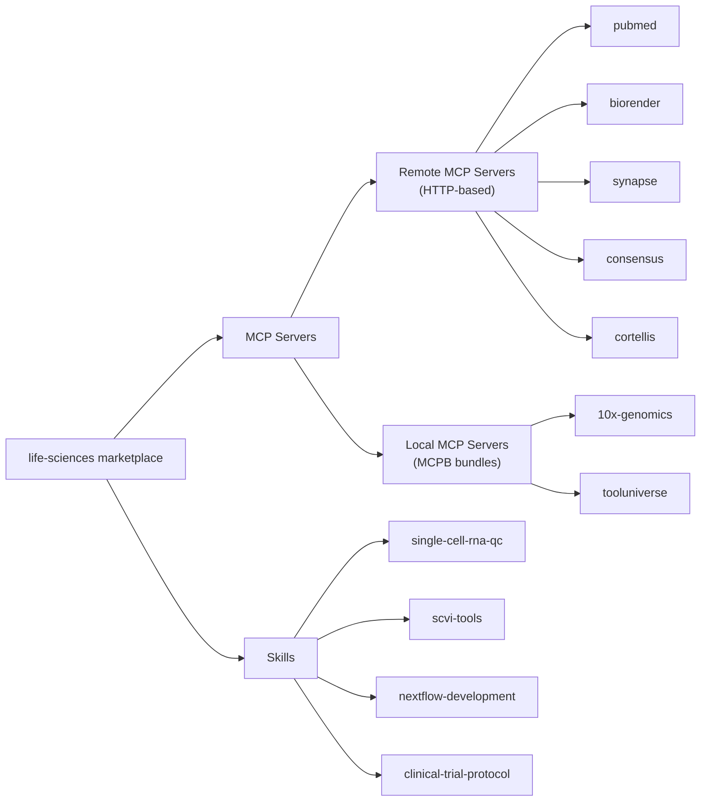
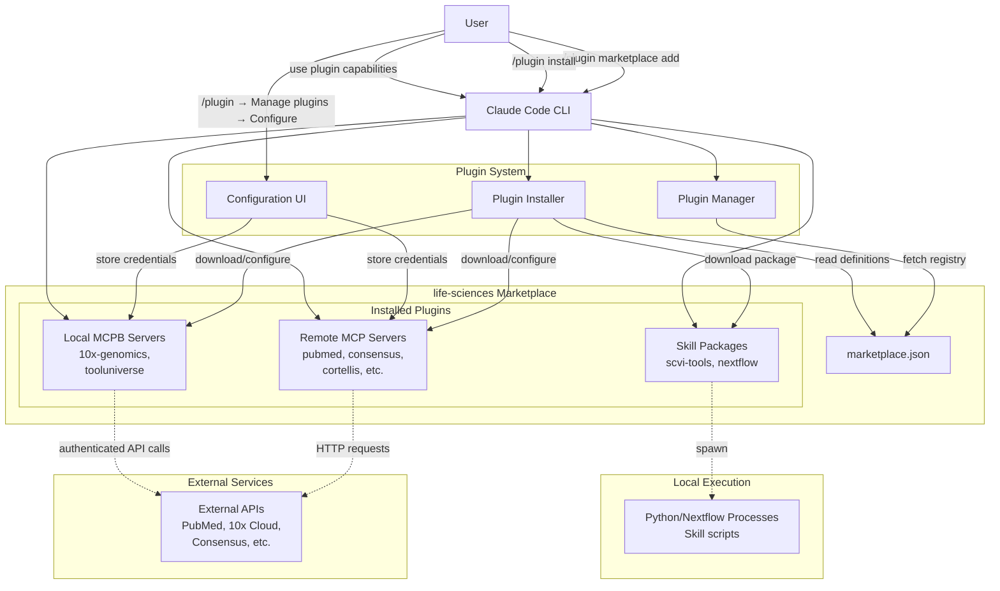

<!-- source: DeepWiki mcp.deepwiki.com · repo anthropics/life-sciences · page 1 Overview · fetched 2026-10-26 -->

# Overview

Relevant source files

The following files were used as context for generating this wiki page:

- [.claude-plugin/marketplace.json](.claude-plugin/marketplace.json)
- [README.md](README.md)

This document introduces the life-sciences marketplace, a plugin distribution system for Claude Code that provides access to specialized research tools and analytical workflows. It covers the marketplace architecture, plugin taxonomy, and available integrations. For installation instructions, see [Getting Started](). For detailed documentation of individual plugins, see [MCP Servers]() and [Skills]().

## Purpose

The life-sciences marketplace serves as a centralized registry of MCP (Model Context Protocol) servers and skills designed for life sciences research workflows. Users add this marketplace to Claude Code to discover and install plugins that extend Claude's capabilities with domain-specific tools, ranging from literature search to deep learning single-cell analysis.

**Sources:** [README.md:1-8]()

## Marketplace Architecture

The marketplace is defined by a Git repository containing plugin definitions and metadata. Claude Code reads the marketplace registry to display available plugins and their installation sources.

### Repository Structure

```mermaid
graph TB
    REPO["life-sciences<br/>Git Repository"]
    
    REPO --> REGISTRY[".claude-plugin/marketplace.json"]
    REPO --> PLUGIN_DIRS["Plugin Definition Directories"]
    
    PLUGIN_DIRS --> TENX["10x-genomics/"]
    PLUGIN_DIRS --> PUBMED["pubmed/"]
    PLUGIN_DIRS --> BIORENDER["biorender/"]
    PLUGIN_DIRS --> SYNAPSE["synapse/"]
    PLUGIN_DIRS --> WILEY["wiley-scholar-gateway/"]
    PLUGIN_DIRS --> BIORXIV["biorxiv/"]
    PLUGIN_DIRS --> CLINICAL["clinical-trials/"]
    PLUGIN_DIRS --> CHEMBL["chembl/"]
    PLUGIN_DIRS --> OWKIN["owkin/"]
    PLUGIN_DIRS --> OPENTARGETS["open-targets/"]
    PLUGIN_DIRS --> TOOLUNIVERSE["tooluniverse/"]
    PLUGIN_DIRS --> MEDIDATA["medidata/"]
    PLUGIN_DIRS --> CONSENSUS["consensus/"]
    PLUGIN_DIRS --> CORTELLIS["cortellis/"]
    PLUGIN_DIRS --> ADIS["adisinsight/"]
    
    PLUGIN_DIRS --> SKILL_SC["single-cell-rna-qc/"]
    PLUGIN_DIRS --> SKILL_ALLO["instrument-data-to-allotrope/"]
    PLUGIN_DIRS --> SKILL_NF["nextflow-development/"]
    PLUGIN_DIRS --> SKILL_SCVI["scvi-tools/"]
    PLUGIN_DIRS --> SKILL_PROTO["clinical-trial-protocol-skill/"]
    PLUGIN_DIRS --> SKILL_PROB["scientific-problem-selection/"]
    
    REGISTRY -.->|"references via source"| PLUGIN_DIRS
```

The `marketplace.json` file at [.claude-plugin/marketplace.json:1-184]() defines the registry structure with the following schema:

| Field | Type | Description |
|-------|------|-------------|
| `name` | string | Marketplace identifier (`"life-sciences"`) |
| `owner` | object | Contact information for marketplace maintainers |
| `metadata.version` | string | Semantic version of the marketplace |
| `plugins[]` | array | List of available plugin definitions |

Each plugin entry in the `plugins` array specifies:

| Field | Type | Description |
|-------|------|-------------|
| `name` | string | Plugin identifier (used as Plugin ID with `@life-sciences` suffix) |
| `source` | string | Relative path to plugin definition directory |
| `description` | string | Short description of plugin functionality |
| `category` | string | Classification category (e.g., `"life-sciences"`) |
| `tags` | string[] | Searchable keywords |
| `skills` | string[] | (Optional) Paths to skill definitions for skill-type plugins |

**Sources:** [.claude-plugin/marketplace.json:1-184](), [README.md:1-8]()

## Plugin Taxonomy

The marketplace contains two fundamental plugin types: **MCP Servers** and **Skills**. These differ architecturally in how they extend Claude Code's capabilities.

### MCP Servers

MCP Servers act as adapter layers between Claude Code and external services. They translate natural language requests into API calls and format responses.

*   **Remote MCP Servers**: Lightweight integrations that proxy requests to web APIs (e.g., PubMed, BioRender). Configuration typically requires API credentials or OAuth tokens.
*   **Local MCP Servers (MCPB)**: Binary bundles that run locally to provide complex integrations or access local data (e.g., 10x Genomics Cloud analysis data).

### Skills

Skills are self-contained analytical workflows that execute computational pipelines locally. Unlike MCP Servers, they do not integrate with external services but instead provide domain-specific data processing capabilities (e.g., single-cell QC or Nextflow pipeline management).

**Sources:** [README.md:5-8](), [.claude-plugin/marketplace.json:11-184]()

## Available Plugins

### MCP Server Catalog

| Plugin ID | Type | Service | Authentication |
|-----------|------|---------|----------------|
| `pubmed@life-sciences` | Remote | PubMed Literature | None |
| `biorender@life-sciences` | Remote | Scientific Illustrations | Free account |
| `synapse@life-sciences` | Remote | Data Management | Free account |
| `wiley-scholar-gateway@life-sciences` | Remote | Academic Publications | Free account |
| `consensus@life-sciences` | Remote | AI Evidence Synthesis | Free account |
| `cortellis@life-sciences` | Remote | Regulatory Intelligence | Paid subscription |
| `adisinsight@life-sciences` | Remote | Drug Pipeline/Trials | Paid subscription |
| `10x-genomics@life-sciences` | Local | 10x Cloud Analysis | Paid account + Token |
| `tooluniverse@life-sciences` | Local | AI Scientist Tools | Varies |

### Skill Catalog

| Plugin ID | Purpose | Key Technologies |
|-----------|---------|------------------|
| `single-cell-rna-qc@life-sciences` | scRNA-seq Quality Control | scanpy, scverse |
| `scvi-tools@life-sciences` | Deep learning for single-cell | scvi-tools, PyTorch |
| `nextflow-development@life-sciences` | Bioinformatics pipeline execution | Nextflow, Docker, nf-core |
| `instrument-data-to-allotrope@life-sciences` | Lab data standardization | Allotrope Simple Model (ASM) |
| `clinical-trial-protocol@life-sciences` | Regulatory document generation | FDA/NIH Templates |
| `scientific-problem-selection@life-sciences` | Research strategy framework | Fischbach & Walsh (2024) |

**Sources:** [README.md:38-148](), [.claude-plugin/marketplace.json:11-184]()

## Integration with Claude Code

The following diagram illustrates how plugins from this marketplace integrate into Claude Code's execution environment:

**Installation Workflow:**

1. User adds marketplace via `/plugin marketplace add anthropics/life-sciences` [README.md:12-13]()
2. Claude Code fetches [.claude-plugin/marketplace.json:1-184]()
3. User installs plugin via `/plugin install <name>@life-sciences` [README.md:15-28]()
4. For servers requiring authentication, configuration is performed via `/plugin → Manage plugins → Configure` [README.md:30-35]()
5. Claude Code restart activates the environment [README.md:36]()

**Sources:** [README.md:9-37](), [README.md:149-191](), [.claude-plugin/marketplace.json:1-184]()

## Authentication Model

The marketplace implements a tiered authentication model:

| Authentication Tier | Plugins | Setup Process |
|---------------------|---------|---------------|
| **None** | `pubmed`, `biorxiv`, `chembl` | Install and use immediately |
| **Free Account** | `biorender`, `synapse`, `consensus` | Create account, enter credentials in Claude UI |
| **Paid/Institutional** | `10x-genomics`, `cortellis`, `adisinsight` | Obtain API tokens/subscriptions, configure via UI |

**Sources:** [README.md:30-36](), [README.md:192-197]()

## Next Steps

For detailed installation procedures, see [Getting Started](). For comprehensive documentation of individual plugins:
- MCP Server details: [MCP Servers]()
- Skill documentation: [Skills]()
- Developer information: [For Developers]()

---

