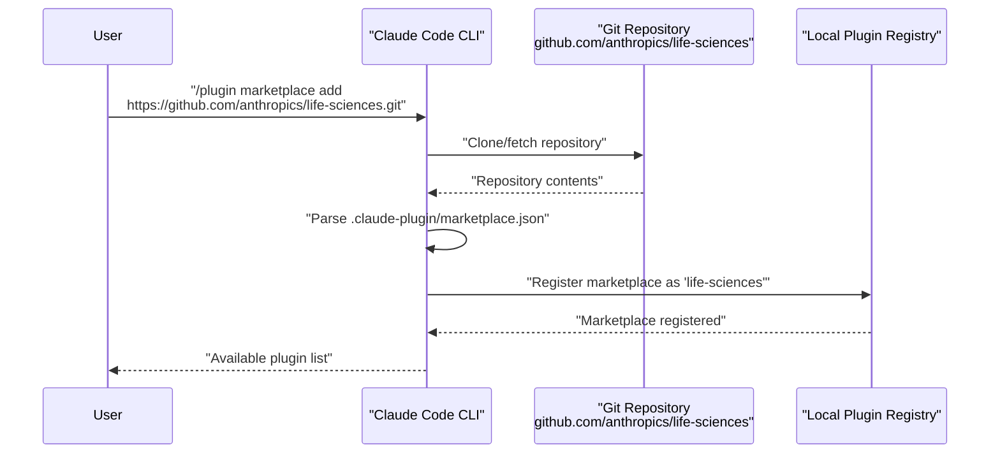
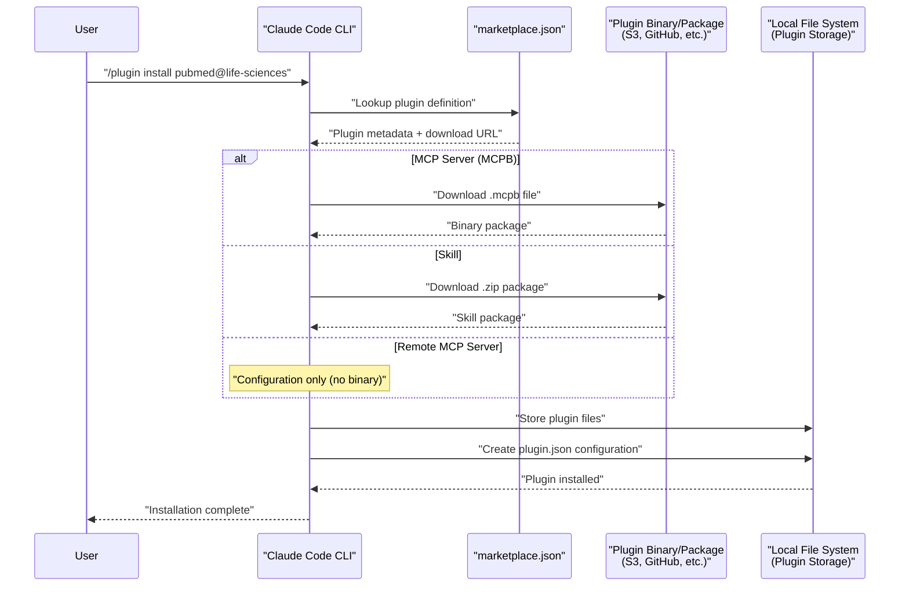
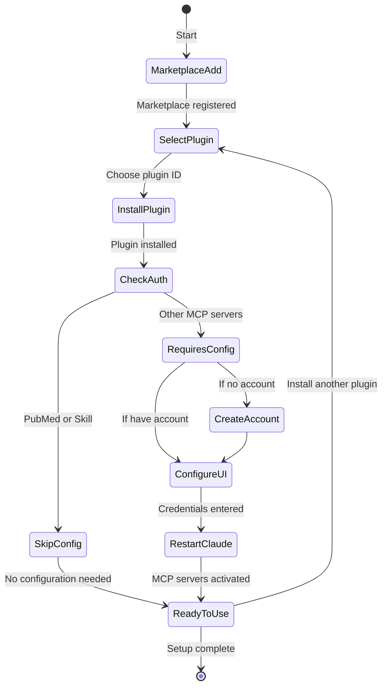

<!-- source: DeepWiki mcp.deepwiki.com · repo anthropics/life-sciences · page 2 Getting Started · fetched 2026-10-26 -->

# Getting Started

<details>
<summary>Relevant source files</summary>

The following files were used as context for generating this wiki page:

- [.claude-plugin/marketplace.json](.claude-plugin/marketplace.json)
- [README.md](README.md)

</details>


## Purpose and Scope

This guide walks through the initial setup and installation process for the Life Sciences Marketplace in Claude Code. It covers marketplace registration, plugin installation, authentication configuration, and the restart process required to activate MCP servers. 

For detailed information about specific plugins, see the following sections:
- **MCP Servers**: [Understanding MCP Servers](#3.1)
- **Individual MCP server documentation**: [Literature and Research Servers](#3.2) (PubMed, BioRxiv, Wiley, Consensus), [Research Platform Servers](#3.3) (BioRender, Synapse, Open Targets), [Drug Discovery and Clinical Servers](#3.4) (ChEMBL, Owkin, Cortellis, AdisInsight, ClinicalTrials, Medidata), [10x Genomics Cloud](#3.5), and [ToolUniverse](#3.6).
- **Skills**: [Skills](#4), [Single-Cell RNA-seq Quality Control](#4.1), [scvi-tools Deep Learning Skill](#4.2), [Nextflow Development Skill](#4.3), [Instrument Data to Allotrope Skill](#4.4), [Clinical Trial Protocol Skill](#4.5), and [Scientific Problem Selection Skill](#4.6).

For developers interested in the release process or contributing, see [For Developers](#5).

Sources: [README.md:1-28](), [.claude-plugin/marketplace.json:11-183]()

---

## Prerequisites

Before beginning, ensure you have:
- **Claude Code** installed and running.
- **Command-line access** to Claude Code's CLI interface.
- **Network connectivity** for fetching marketplace definitions and plugin binaries.
- **Account credentials** (if installing MCP servers requiring authentication).
- **Docker and Nextflow** (required specifically for the `nextflow-development` skill).

Sources: [README.md:131-131]()

---

## Marketplace Registration

### Overview

The Life Sciences Marketplace is distributed as a Git repository that must be registered with Claude Code before individual plugins can be installed. This registration process is performed once per Claude Code installation.

### Command

```bash
/plugin marketplace add https://github.com/anthropics/life-sciences.git
```

### What Happens During Registration



**Diagram: Marketplace Registration Flow**

When the marketplace is added, Claude Code:
1. Clones or fetches the Git repository from the specified URL [README.md:151-155]().
2. Locates the marketplace manifest at `.claude-plugin/marketplace.json` [.claude-plugin/marketplace.json:1-184]().
3. Registers the marketplace with the identifier `life-sciences` (defined as the `name` in the manifest) [.claude-plugin/marketplace.json:2-2]().
4. Makes all plugin definitions in the manifest available for installation.

Sources: [README.md:151-155](), [.claude-plugin/marketplace.json:1-184]()

---

## Plugin Identification System

### Plugin ID Format

All plugins in the marketplace are installed using the format:

```
<plugin-id>@<marketplace-name>
```

Where:
- `<plugin-id>`: The unique identifier for the specific plugin (e.g., `pubmed`, `10x-genomics`).
- `<marketplace-name>`: The marketplace identifier (in this case, `life-sciences`).

### Available Plugin IDs

```mermaid
graph TB
    subgraph "marketplace.json"
        Registry["Marketplace Registry<br/>.claude-plugin/marketplace.json"]
    end
    
    subgraph "Remote MCP Servers"
        PubMed["pubmed@life-sciences"]
        BioRender["biorender@life-sciences"]
        Synapse["synapse@life-sciences"]
        Wiley["wiley-scholar-gateway@life-sciences"]
        Consensus["consensus@life-sciences"]
        Cortellis["cortellis@life-sciences"]
        Adis["adisinsight@life-sciences"]
    end
    
    subgraph "Local MCP Servers (MCPB)"
        TenX["10x-genomics@life-sciences"]
        ToolU["tooluniverse@life-sciences"]
    end
    
    subgraph "Skills"
        SCQC["single-cell-rna-qc@life-sciences"]
        Nextflow["nextflow-development@life-sciences"]
        Allotrope["instrument-data-to-allotrope@life-sciences"]
        scvi["scvi-tools@life-sciences"]
        Protocol["clinical-trial-protocol@life-sciences"]
        Strategy["scientific-problem-selection@life-sciences"]
    end
    
    Registry --> PubMed
    Registry --> BioRender
    Registry --> Synapse
    Registry --> Wiley
    Registry --> Consensus
    Registry --> Cortellis
    Registry --> Adis
    Registry --> TenX
    Registry --> ToolU
    Registry --> SCQC
    Registry --> Nextflow
    Registry --> Allotrope
    Registry --> scvi
    Registry --> Protocol
    Registry --> Strategy
```



**Diagram: Plugin ID Namespace Structure**

Sources: [README.md:38-147](), [.claude-plugin/marketplace.json:11-183]()

### Plugin Categories and Authentication

| Plugin ID | Category | Authentication Required |
|-----------|----------|------------------------|
| `pubmed@life-sciences` | Remote MCP Server | No |
| `biorender@life-sciences` | Remote MCP Server | Yes (Free Account) |
| `synapse@life-sciences` | Remote MCP Server | Yes (Free Account) |
| `wiley-scholar-gateway@life-sciences` | Remote MCP Server | Yes (Free Account) |
| `consensus@life-sciences` | Remote MCP Server | Yes (Free Account) |
| `cortellis@life-sciences` | Remote MCP Server | Yes (Paid Subscription) |
| `adisinsight@life-sciences` | Remote MCP Server | Yes (Paid Subscription) |
| `10x-genomics@life-sciences` | Local MCP Server (MCPB) | Yes (Paid/Token) |
| `tooluniverse@life-sciences` | Local MCP Server (MCPB) | Varies |
| `single-cell-rna-qc@life-sciences` | Skill | No |
| `nextflow-development@life-sciences` | Skill | No (requires Docker/Nextflow) |
| `scvi-tools@life-sciences` | Skill | No |
| `instrument-data-to-allotrope@life-sciences` | Skill | No |
| `clinical-trial-protocol@life-sciences` | Skill | No |
| `scientific-problem-selection@life-sciences` | Skill | No |

Sources: [README.md:38-147](), [README.md:192-197]()

---

## Installing Plugins

### Installation Commands

Individual plugins are installed after marketplace registration using the `/plugin install` command [README.md:15-28]().

```bash
# Example installations
/plugin install pubmed@life-sciences
/plugin install 10x-genomics@life-sciences
/plugin install single-cell-rna-qc@life-sciences
```

### Installation Process Flow



**Diagram: Plugin Installation Flow**

Sources: [README.md:157-175](), [.claude-plugin/marketplace.json:1-184]()

---

## Authentication and Configuration

### Configuration Requirements

After installing plugins, authentication must be configured for all MCP servers except PubMed. Skills do not require configuration but may have local environment requirements (e.g., Nextflow) [README.md:30-36]().

### Configuration Interface Access

1. Type `/plugin` in Claude Code.
2. Select **"Manage plugins"**.
3. Locate the installed plugin in the list.
4. Select **"Configure"**.
5. Enter required credentials (API keys, tokens, or usernames).

Sources: [README.md:177-186]()

### Credential Requirements by Plugin

#### PubMed
No configuration required. Ready to use immediately after installation [README.md:47-47]().

#### 10x Genomics Cloud
**Required Credentials:**
- **Access Token**: Generate from account security settings [README.md:100-100]().
- **Account Setup**: Generate token at https://cloud.10xgenomics.com/account/security [README.md:100-100]().

#### BioRender / Synapse / Wiley / Consensus
**Required Credentials:**
- Account credentials for the respective platform [README.md:195-195]().
- Free account registration is required on their respective websites [README.md:54-75]().

#### Cortellis / AdisInsight
**Required Credentials:**
- Paid subscription credentials/API access provided by Clarivate or Springer Nature [README.md:82-89]().

Sources: [README.md:42-101](), [README.md:192-197]()

---

## Restart Requirement

### Why Restart is Required

MCP servers operate as persistent background processes that must be initialized when Claude Code starts. Installing or configuring an MCP server does not automatically activate it in the current session [README.md:36-36]().

**No restart required for:**
- Installing Skills (they are local scripts/modules).
- Using already-configured and active MCP servers.

Sources: [README.md:36-36](), [README.md:188-190]()

---

## Verification and First Use

### Verifying MCP Server Installation

After restarting Claude Code, verify MCP servers are active by testing basic functionality:

**PubMed Example:**
`Search PubMed for recent articles about "single-cell RNA-seq quality control"`

**10x Genomics Example:**
`List my available analysis projects in 10x Genomics Cloud`

### Verifying Skill Installation

Skills are available immediately. You can test them by asking Claude to perform the specific workflow:

**Nextflow Example:**
`Check if my environment is ready to run Nextflow pipelines`

**Scientific Problem Selection Example:**
`Help me evaluate a new research idea using the Fischbach methodology`

Sources: [README.md:115-147]()

---

## Complete Installation Workflow



**Diagram: Complete Setup State Machine**

Sources: [README.md:9-36](), [README.md:151-190]()

---

