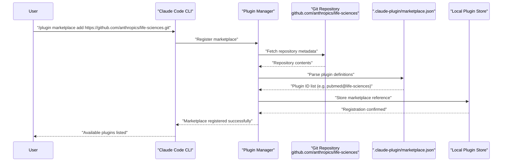
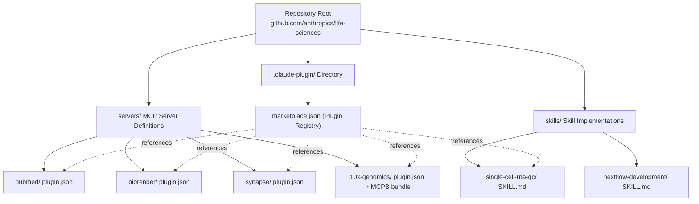
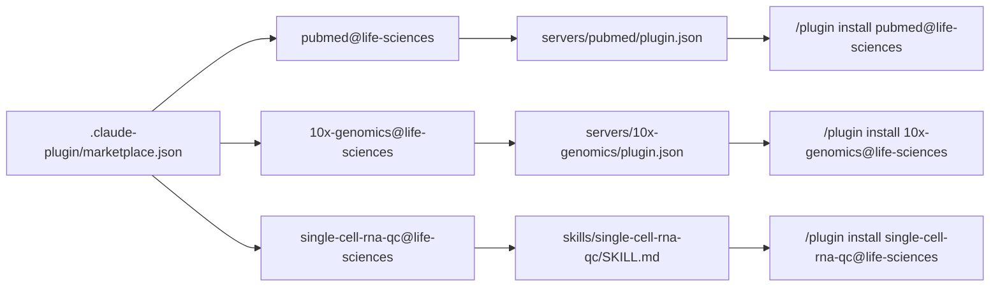

<!-- source: DeepWiki mcp.deepwiki.com · repo anthropics/life-sciences · page 2.1 Adding the Marketplace · fetched 2026-10-26 -->

# Adding the Marketplace

<details>
<summary>Relevant source files</summary>

The following files were used as context for generating this wiki page:

- [README.md](README.md)

</details>


## Purpose and Scope

This document explains how to register the life-sciences marketplace in Claude Code, making its plugins available for installation. This is a one-time setup step that must be completed before installing any MCP servers or skills from this repository [README.md:151-155]().

For information about installing individual plugins after marketplace registration, see **2.2 Installing Plugins**. For configuring credentials after plugin installation, see **2.3 Authentication and Configuration**.

---

## The Marketplace Registration Command

To register the life-sciences marketplace, execute the following command in Claude Code:

```bash
/plugin marketplace add https://github.com/anthropics/life-sciences.git
```

### Command Syntax

| Component | Description |
|-----------|-------------|
| `/plugin marketplace add` | Claude Code CLI command for registering a new marketplace |
| `https://github.com/anthropics/life-sciences.git` | Git repository URL containing the marketplace registry [README.md:154-154]() |

This command is executed **once per Claude Code installation**. The marketplace registration persists across Claude Code restarts [README.md:151-155]().

**Sources:** [README.md:11-13](), [README.md:151-155]()

---

## Registration Process

When you execute the marketplace add command, Claude Code performs the following sequence to map the repository to available tools.

### Marketplace Registration Flow



**Sources:** [README.md:11-13](), [README.md:151-155]()

---

## Marketplace Repository Structure

The marketplace is defined by a specific file structure within the Git repository. Understanding this structure helps clarify what Claude Code accesses during registration:

### Repository Layout



**Sources:** [README.md:38-148]()

---

## The Marketplace Registry File

The core of the marketplace is `.claude-plugin/marketplace.json`, which contains an array of plugin definitions. Each definition specifies the `pluginId`, `type`, and paths to configuration files like `plugin.json` (for MCP servers) or `SKILL.md` (for skills).

### Marketplace Registration Data Flow



**Sources:** [README.md:11-28](), [README.md:38-148]()

---

## Verification

After executing the marketplace add command, verify successful registration using these methods:

### Method 1: List Installed Marketplaces
Execute `/plugin marketplace list` to see if `life-sciences` is present in the output.

### Method 2: Attempt Plugin Installation
Try to install a lightweight plugin:
```bash
/plugin install pubmed@life-sciences
```
If the marketplace is registered correctly, Claude Code will locate the plugin definition [README.md:42-47]().

### Method 3: Plugin Management UI
1. Type `/plugin` in Claude Code [README.md:31]().
2. Select **Manage plugins** [README.md:32]().
3. The life-sciences marketplace should appear as an available source.

**Sources:** [README.md:30-36](), [README.md:177-186]()

---

## Plugin ID Format

After marketplace registration, plugins are identified using the format `<plugin-name>@<marketplace-name>`. For this marketplace, the suffix is `@life-sciences`.

| Plugin ID | Plugin Type | Auth Requirement |
|-----------|-------------|------------------|
| `pubmed@life-sciences` | Remote MCP Server | None [README.md:47]() |
| `biorender@life-sciences` | Remote MCP Server | Free account [README.md:54]() |
| `synapse@life-sciences` | Remote MCP Server | Free account [README.md:61]() |
| `10x-genomics@life-sciences` | Local MCP Server | Paid/Institutional [README.md:98-101]() |
| `single-cell-rna-qc@life-sciences` | Skill | None [README.md:170]() |
| `nextflow-development@life-sciences` | Skill | Local Docker/Nextflow [README.md:131]() |

**Sources:** [README.md:40-148](), [README.md:192-197]()

---

## Troubleshooting

### Marketplace Add Command Fails

| Issue | Possible Cause | Solution |
|-------|---------------|----------|
| "Repository not found" | Invalid Git URL | Verify URL: `https://github.com/anthropics/life-sciences.git` [README.md:154]() |
| "Network error" | No internet connection | Check network connectivity and retry |
| "Invalid marketplace" | Missing `marketplace.json` | Ensure the `.claude-plugin/` folder exists in the repo |

### Plugins Not Appearing
If plugins don't appear in the `/plugin install` interface:
1. **Refresh cache**: Restart Claude Code [README.md:188-190]().
2. **Re-add marketplace**: 
   ```bash
   /plugin marketplace remove life-sciences
   /plugin marketplace add https://github.com/anthropics/life-sciences.git
   ```

**Sources:** [README.md:151-155](), [README.md:188-190]()

---

## Next Steps

After successfully adding the marketplace:
1. **Install plugins**: See **2.2 Installing Plugins** [README.md:157-175]().
2. **Configure authentication**: See **2.3 Authentication and Configuration** for servers like BioRender or Synapse [README.md:30-36]().
3. **Restart**: Always restart Claude Code after installing new MCP servers to activate them [README.md:190]().

**Sources:** [README.md:30-37](), [README.md:157-175](), [README.md:188-190]()

---

