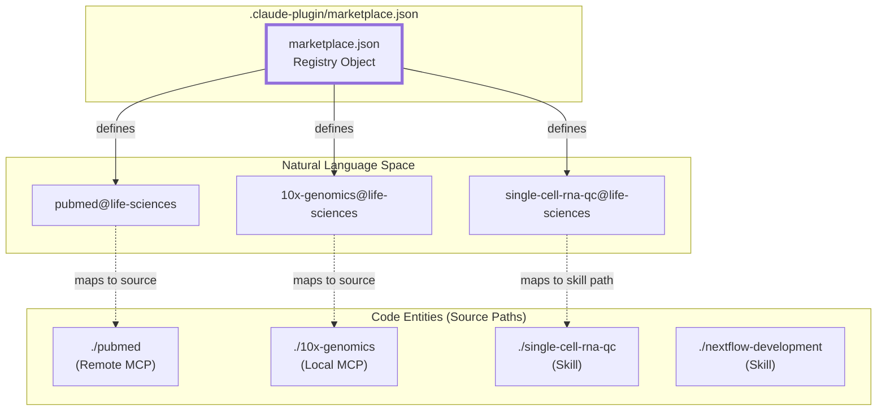
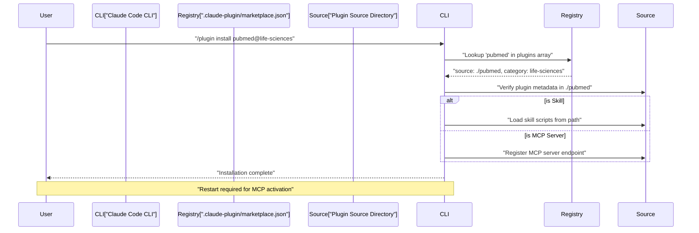

<!-- source: DeepWiki mcp.deepwiki.com · repo anthropics/life-sciences · page 2.2 Installing Plugins · fetched 2026-10-26 -->

# Installing Plugins

<details>
<summary>Relevant source files</summary>

The following files were used as context for generating this wiki page:

- [.claude-plugin/marketplace.json](.claude-plugin/marketplace.json)
- [README.md](README.md)

</details>


## Purpose and Scope

This page documents the process of installing individual plugins from the life-sciences marketplace using the `/plugin install` command. It covers Plugin ID syntax, available plugins by type, and the installation workflow that Claude Code executes to fetch and register plugins based on the marketplace registry defined in `.claude-plugin/marketplace.json`.

**Prerequisites**: The marketplace must be registered first (see [2.1 Adding the Marketplace]()).

**Post-installation**: Authentication and configuration for plugins requiring credentials are covered in [2.3 Authentication and Configuration]().

---

## Plugin ID Format

Plugin IDs follow the format `<plugin-name>@<marketplace-name>`, where:
- `<plugin-name>`: The unique identifier for the plugin as defined in the `name` field within the `plugins` array of the marketplace registry [.claude-plugin/marketplace.json:12-182]().
- `<marketplace-name>`: The marketplace identifier, which is `life-sciences` for this repository [.claude-plugin/marketplace.json:2]().

**Examples**:
- `pubmed@life-sciences` [.claude-plugin/marketplace.json:20]()
- `10x-genomics@life-sciences` [.claude-plugin/marketplace.json:13]()
- `single-cell-rna-qc@life-sciences` [.claude-plugin/marketplace.json:83]()

The marketplace name is derived from the repository name during marketplace registration via `/plugin marketplace add` [README.md:153-155]().

**Sources**: [README.md:40-108](), [.claude-plugin/marketplace.json:1-184]()

---

## Installation Command

The basic installation syntax is:

```bash
/plugin install <plugin-id>
```

### Examples

```bash
# Install a remote MCP server
/plugin install pubmed@life-sciences

# Install a local MCP server (MCPB)
/plugin install 10x-genomics@life-sciences

# Install a skill
/plugin install single-cell-rna-qc@life-sciences
```

Multiple plugins can be installed sequentially to build a comprehensive life sciences environment [README.md:11-28]().

**Sources**: [README.md:11-28](), [README.md:157-175]()

---

## Available Plugins

### Plugin Inventory Table

| Plugin ID | Type | Description | Auth Required |
|-----------|------|-------------|---------------|
| `pubmed@life-sciences` | Remote MCP | Biomedical literature search | No [README.md:47]() |
| `biorender@life-sciences` | Remote MCP | Scientific illustration creation | Free account [README.md:54]() |
| `synapse@life-sciences` | Remote MCP | Research data management | Free account [README.md:61]() |
| `wiley-scholar-gateway@life-sciences` | Remote MCP | Academic publications access | Free account [README.md:68]() |
| `10x-genomics@life-sciences` | Local MCP (MCPB) | Genomics analysis data access | Access token [README.md:100]() |
| `single-cell-rna-qc@life-sciences` | Skill | scRNA-seq quality control pipeline | No [README.md:169-170]() |
| `nextflow-development@life-sciences` | Skill | nf-core pipeline runner | No [README.md:131]() |
| `scvi-tools@life-sciences` | Skill | Deep learning for single-cell | No [README.md:133-137]() |
| `consensus@life-sciences` | Remote MCP | AI-powered research search | Free account [README.md:75]() |
| `cortellis@life-sciences` | Remote MCP | Regulatory intelligence | Paid account [README.md:82]() |

**Sources**: [README.md:38-148](), [.claude-plugin/marketplace.json:11-183]()

### Installation by Plugin Type

#### Remote MCP Servers

Remote MCP servers connect to web-based APIs. Most require account credentials to be configured after installation [README.md:30-36]().

```bash
/plugin install pubmed@life-sciences
/plugin install consensus@life-sciences
/plugin install adisinsight@life-sciences
```

#### Local MCP Servers (MCPB)

Local MCP servers are bundled as binaries and run locally on the user's machine [README.md:91-94]().

```bash
/plugin install 10x-genomics@life-sciences
/plugin install tooluniverse@life-sciences
```

#### Skills

Skills are self-contained workflows packaged within the repository [README.md:103-106](). They do not require external service authentication but may have local system requirements (e.g., Nextflow requires Docker) [README.md:131]().

```bash
/plugin install scientific-problem-selection@life-sciences
/plugin install clinical-trial-protocol@life-sciences
```

**Sources**: [README.md:38-148](), [.claude-plugin/marketplace.json:83-147]()

---

## Plugin-to-Definition Mapping

This diagram associates the Natural Language Plugin IDs with the internal code entities and source paths defined in the marketplace registry.



**Sources**: [.claude-plugin/marketplace.json:11-183]()

---

## Installation Workflow

The following diagram illustrates the technical flow when executing `/plugin install`, showing the relationship between the CLI and the marketplace metadata.



**Sources**: [README.md:157-190](), [.claude-plugin/marketplace.json:1-184]()

---

## Post-Installation Steps

### Restart Requirement

MCP servers (both remote and local) require a Claude Code restart to become active [README.md:188-190](). The restart loads the MCP server processes and establishes communication channels.

### Configuration

For servers requiring authentication (all except PubMed), credentials must be configured through the UI [README.md:30-36]():

1. Type `/plugin` in Claude Code.
2. Select **Manage plugins**.
3. Find the installed plugin.
4. Select **Configure**.
5. Enter required API keys or tokens.
6. Restart Claude Code.

**Sources**: [README.md:29-37](), [README.md:177-186]()

---

## Multiple Plugin Installation

Plugins can be installed in any order. Each installation is independent, and a single restart will activate all newly installed MCP servers [README.md:11-28]().

**Sources**: [README.md:157-175]()

---

