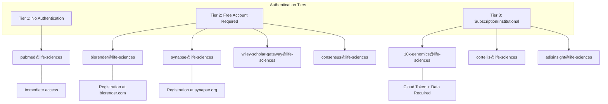
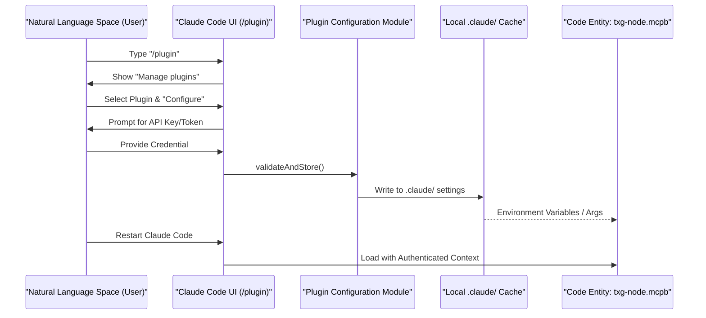
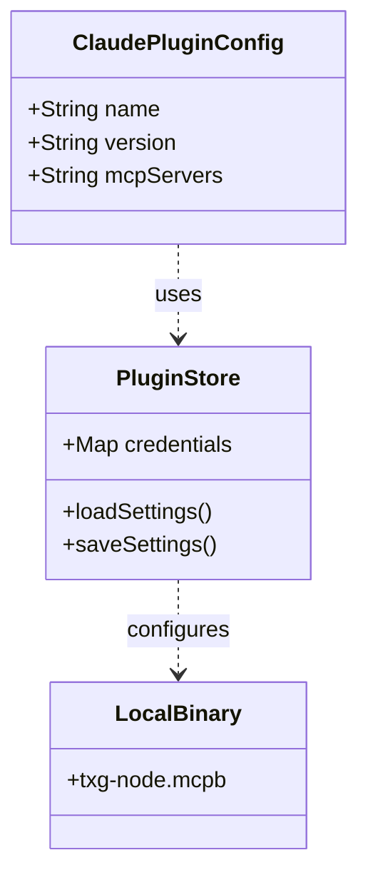

<!-- source: DeepWiki mcp.deepwiki.com · repo anthropics/life-sciences · page 2.3 Authentication and Configuration · fetched 2026-10-26 -->

# Authentication and Configuration

Relevant source files

The following files were used as context for generating this wiki page:

- [.gitignore](.gitignore)
- [10x-genomics/.claude-plugin/plugin.json](10x-genomics/.claude-plugin/plugin.json)
- [10x-genomics/txg-node.mcpb](10x-genomics/txg-node.mcpb)
- [README.md](README.md)

This page explains the authentication requirements and configuration process for plugins in the Life Sciences Marketplace. After installing a plugin (see [2.2 Installing Plugins]()), most plugins require credential setup before they can connect to external services.

For information about individual MCP server capabilities and features, see [3. MCP Servers]().

## Authentication Tiers

The marketplace organizes plugins into three authentication tiers based on their credential and account requirements.

**Plugin Authentication Hierarchy**

Sources: [README.md:38-103](), [README.md:192-197]()

### Tier 1: No Authentication
**Plugins**: `pubmed@life-sciences`

These plugins are publicly accessible and require no credentials or account setup. They are immediately usable upon installation [README.md:42-47]().

### Tier 2: Free Account Required
**Plugins**: `biorender@life-sciences`, `synapse@life-sciences`, `wiley-scholar-gateway@life-sciences`, `consensus@life-sciences`

These plugins require a free account from the respective provider. Users must register on the provider's website before configuring the plugin in Claude Code [README.md:49-75]().

### Tier 3: Paid/Institutional Account
**Plugins**: `10x-genomics@life-sciences`, `cortellis@life-sciences`, `adisinsight@life-sciences`

These plugins require active subscriptions or specific institutional access.
*   **10x Genomics Cloud**: Requires an access token generated from the security settings of a 10x Genomics Cloud account [README.md:93-101]().
*   **Cortellis/AdisInsight**: Require professional subscriptions from Clarivate or Springer Nature respectively [README.md:77-90]().

## Configuration Workflow

The configuration process uses the Claude Code UI to securely store credentials. For local MCP servers like 10x Genomics, this involves the Model Context Protocol Binary (MCPB) format [10x-genomics/.claude-plugin/plugin.json:9]().

**Authentication Data Flow**

Sources: [README.md:30-36](), [README.md:179-190](), [.gitignore:1-3]()

### Step-by-Step Setup
1.  **Access Menu**: Type `/plugin` in Claude Code [README.md:31]().
2.  **Select Management**: Choose "Manage plugins" [README.md:32]().
3.  **Identify Plugin**: Find the installed server (e.g., `10x-genomics`) [README.md:33]().
4.  **Configure**: Select "Configure" and enter the required API keys or tokens [README.md:34-35]().
5.  **Restart**: Restart Claude Code to initialize the MCP server with the new credentials [README.md:36]().

## Plugin-Specific Credential Details

| Plugin ID | Credential Type | Source |
| :--- | :--- | :--- |
| `10x-genomics` | Access Token | [cloud.10xgenomics.com/account/security](https://cloud.10xgenomics.com/account/security) |
| `biorender` | Account Login | [biorender.com](https://www.biorender.com) |
| `synapse` | Account Login | [synapse.org](https://www.synapse.org) |
| `consensus` | Account Login | [consensus.app](https://consensus.app) |
| `cortellis` | Subscription Key | [clarivate.com/cortellis](https://clarivate.com/cortellis) |

Sources: [README.md:49-101]()

## Implementation Detail: Local Storage

Claude Code maintains configuration state in local cache directories. These directories are excluded from version control to prevent credential leakage.

*   **Cache Path**: `.mcpb-cache/` stores downloaded MCP binaries [10x-genomics/txg-node.mcpb:1](), [.gitignore:2]().
*   **Settings Path**: `.claude/` stores plugin-specific configurations and tokens [.gitignore:3]().

**Configuration Entities**

Sources: [10x-genomics/.claude-plugin/plugin.json:1-10](), [.gitignore:1-3]()

---

