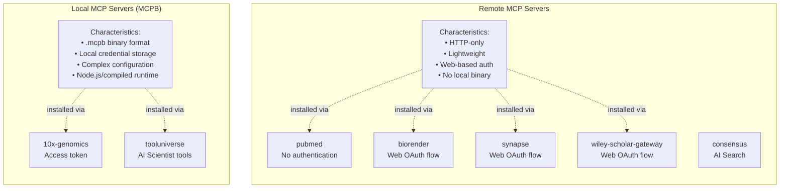
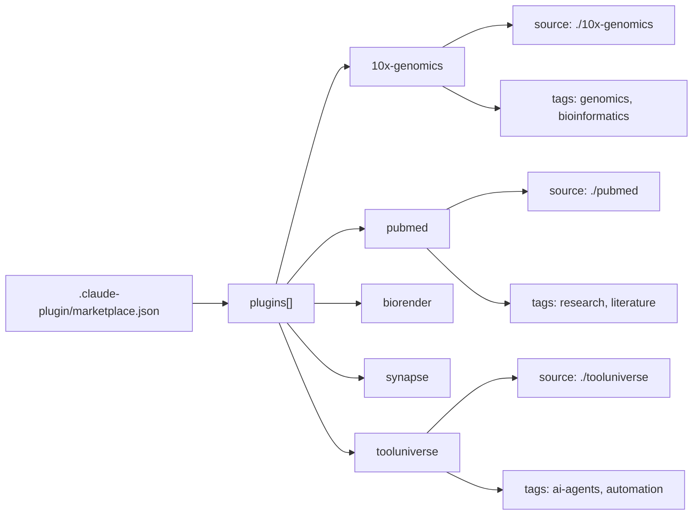

<!-- source: DeepWiki mcp.deepwiki.com · repo anthropics/life-sciences · page 3 MCP Servers · fetched 2026-10-26 -->

# MCP Servers

<details>
<summary>Relevant source files</summary>

The following files were used as context for generating this wiki page:

- [.claude-plugin/marketplace.json](.claude-plugin/marketplace.json)
- [README.md](README.md)

</details>


## Purpose and Scope

This page introduces MCP (Model Context Protocol) servers as the primary mechanism for integrating external life sciences services into Claude Code. MCP servers act as standardized adapters that translate Claude Code requests into service-specific API calls, enabling seamless access to platforms like PubMed, 10x Genomics, ChEMBL, and others.

This page provides an architectural overview of how MCP servers function, the distinction between Remote and Local (MCPB) server types, authentication requirements, and a catalog of available servers. For detailed documentation of individual servers, see pages [Understanding MCP Servers](#3.1) through [ToolUniverse](#3.6). For self-contained analytical workflows that do not require external service integration, see [Skills](#4).

## MCP Server Architecture

MCP servers function as stateless proxy layers between Claude Code and external life sciences platforms. When a user invokes a capability, the request flows through the installed MCP server, which handles authentication, translates the request into the appropriate API format, and formats the response for Claude Code consumption.

### Request Flow Architecture

```mermaid
sequenceDiagram
    participant User
    participant CC["Claude Code"]
    participant PM["Plugin Manager"]
    participant MCP["MCP Server Instance<br/>(e.g., pubmed)"]
    participant Auth["Credential Store"]
    participant API["External Service API<br/>(e.g., PubMed API)"]
    
    User->>CC: "Invoke capability"
    CC->>PM: "Route request to server"
    PM->>MCP: "Forward request"
    MCP->>Auth: "Retrieve credentials"
    Auth-->>MCP: "API key or token"
    MCP->>API: "HTTP/REST API call"
    API-->>MCP: "JSON response"
    MCP->>MCP: "Format response"
    MCP-->>PM: "Structured data"
    PM-->>CC: "Display result"
    CC-->>User: "Show formatted output"
```

**Sources:** [README.md:1-151](), [.claude-plugin/marketplace.json:1-184]()

### Remote vs Local MCP Servers

The marketplace distinguishes between two server deployment models based on complexity and authentication requirements:



**Sources:** [README.md:40-102](), [.claude-plugin/marketplace.json:11-184]()

## Plugin Registry Structure

The marketplace registry is defined in `.claude-plugin/marketplace.json`, which serves as the central catalog of available MCP servers. Each plugin entry specifies its installation source, metadata, and categorization.



**Sources:** [.claude-plugin/marketplace.json:1-184]()

## Available MCP Servers

The marketplace provides a wide range of MCP servers categorized by domain. For details, see the linked child pages.

### Literature and Research Servers
Access scientific literature, preprints, and evidence synthesis.
*   **Servers**: PubMed, BioRxiv/MedRxiv, Wiley Scholar Gateway, Consensus.
*   **For details, see [Literature and Research Servers](#3.2)**.

### Research Platform Servers
Collaborative data management and scientific visualization.
*   **Servers**: BioRender, Synapse.org, Open Targets.
*   **For details, see [Research Platform Servers](#3.3)**.

### Drug Discovery and Clinical Servers
Intelligence for drug pipelines, bioactive molecules, and clinical trials.
*   **Servers**: ChEMBL, Owkin, Cortellis, AdisInsight, ClinicalTrials.gov, Medidata.
*   **For details, see [Drug Discovery and Clinical Servers](#3.4)**.

### Specialized Local Servers (MCPB)
Deep integration for genomics data and AI-powered scientific automation.
*   **10x Genomics Cloud**: Access analysis data and workflows. **For details, see [10x Genomics Cloud](#3.5)**.
*   **ToolUniverse**: AI agents for scientific discovery from MIMS Harvard. **For details, see [ToolUniverse](#3.6)**.

**Sources:** [README.md:40-102](), [.claude-plugin/marketplace.json:11-184]()

## Authentication Architecture

MCP servers implement a tiered authentication model. For details on how these work, see [Understanding MCP Servers](#3.1).

| Tier | Requirement | Servers |
|------|-------------|---------|
| **Tier 1** | No authentication | `pubmed` |
| **Tier 2** | Free account | `biorender`, `synapse`, `wiley-scholar-gateway`, `consensus` |
| **Tier 3** | Paid/Institutional | `10x-genomics`, `cortellis`, `adisinsight`, `medidata` |

**Sources:** [README.md:192-197]()

## Installation and Configuration Workflow

The installation lifecycle for MCP servers follows a standard pattern in Claude Code:

1.  **Add Marketplace**: `/plugin marketplace add anthropics/life-sciences` [README.md:13]()
2.  **Install Plugin**: `/plugin install <plugin-id>@life-sciences` [README.md:16-20]()
3.  **Configure**: For Tier 2/3 servers, use `/plugin` -> "Manage plugins" -> "Configure" [README.md:30-36]()
4.  **Restart**: Restart Claude Code to activate the server [README.md:188-190]()

## MCP Server vs Skill

It is important to distinguish MCP servers from skills, as they serve fundamentally different architectural purposes:

| Aspect | MCP Server | Skill |
|--------|-----------|-------|
| **Purpose** | Proxy/adapter to external service | Self-contained computational workflow |
| **Execution** | External API calls | Local in-process execution |
| **Authentication** | Required (usually) | None (operates on local data) |
| **Example** | `pubmed` queries external database | `single-cell-rna-qc` processes local files |

**Sources:** [README.md:5-7](), [.claude-plugin/marketplace.json:11-184]()

## Next Steps

- [Understanding MCP Servers](#3.1) — Deep dive into the MCP protocol and Local vs Remote servers.
- [Literature and Research Servers](#3.2) — PubMed, BioRxiv, Wiley, and Consensus.
- [Research Platform Servers](#3.3) — BioRender, Synapse, and Open Targets.
- [Drug Discovery and Clinical Servers](#3.4) — ChEMBL, Owkin, Cortellis, AdisInsight, and Medidata.
- [10x Genomics Cloud](#3.5) — 10x Genomics local MCP server.
- [ToolUniverse](#3.6) — MIMS Harvard AI scientist tools.

---

