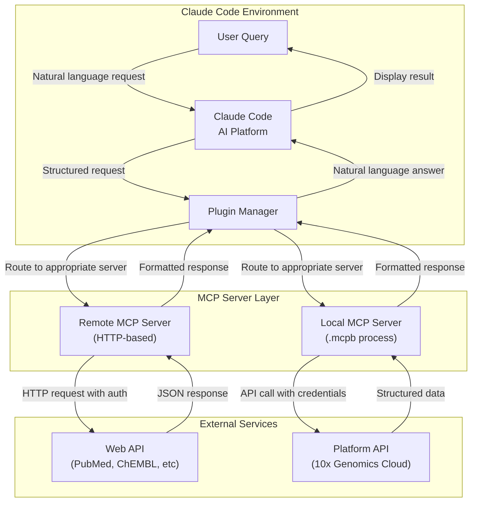
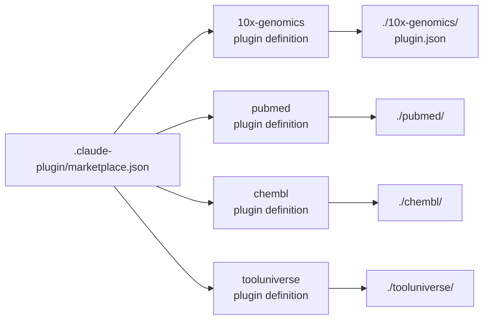
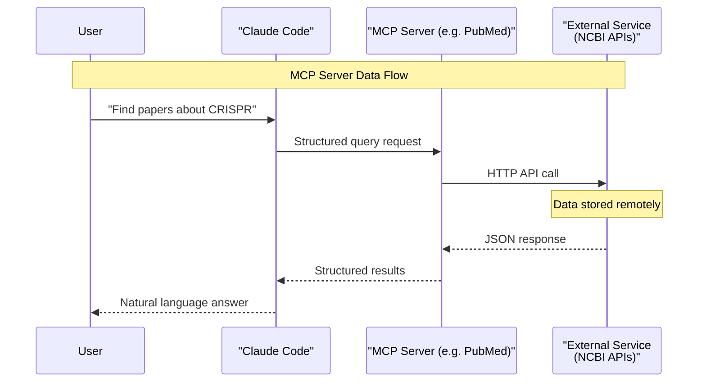

<!-- source: DeepWiki mcp.deepwiki.com · repo anthropics/life-sciences · page 3.1 Understanding MCP Servers · fetched 2026-10-26 -->

# Understanding MCP Servers

<details>
<summary>Relevant source files</summary>

The following files were used as context for generating this wiki page:

- [.claude-plugin/marketplace.json](.claude-plugin/marketplace.json)
- [.gitignore](.gitignore)
- [10x-genomics/.claude-plugin/plugin.json](10x-genomics/.claude-plugin/plugin.json)
- [10x-genomics/txg-node.mcpb](10x-genomics/txg-node.mcpb)

</details>


## Purpose and Scope

This page explains the architecture and operation of MCP (Model Context Protocol) servers within the life sciences marketplace. It covers the fundamental concepts of MCP servers, how they differ from Skills, the distinction between Remote and Local (MCPB) MCP server types, and their technical implementation details.

For information about installing and configuring MCP servers, see [Authentication and Configuration](#2.3). For documentation of individual MCP servers, see sections [Literature and Research Servers](#3.2) through [3.7](#3.7). For information about Skills (self-contained analytical workflows), see [Skills](#4).

## What are MCP Servers?

MCP servers are **external service integrations** that act as proxy or adapter layers between Claude Code and life sciences platforms. Unlike Skills, which execute computational workflows locally, MCP servers translate user requests into API calls to remote services and format the responses for Claude Code.

**Key characteristics:**

| Aspect | Description |
|--------|-------------|
| **Primary Function** | Translate Claude Code requests into external API calls |
| **Data Location** | All data resides in external services (PubMed, ChEMBL, 10x Genomics Cloud, etc.) |
| **Execution Model** | Network-based request/response pattern |
| **Purpose** | Enable data access and retrieval from external platforms |
| **Local Processing** | Minimal - primarily formatting and protocol translation |

MCP servers enable Claude Code to interact with services like:
- PubMed databases for literature search [.claude-plugin/marketplace.json:20-25]()
- 10x Genomics Cloud analysis data [.claude-plugin/marketplace.json:13-18]()
- BioRender scientific illustrations [.claude-plugin/marketplace.json:27-32]()
- Synapse.org research data repositories [.claude-plugin/marketplace.json:34-39]()
- Wiley Scholar Gateway publications [.claude-plugin/marketplace.json:41-46]()
- ChEMBL bioactivity database [.claude-plugin/marketplace.json:62-67]()

**Sources:** [.claude-plugin/marketplace.json:1-182]()

## MCP Server Types: Remote vs Local (MCPB)

The marketplace distinguishes between two architectural categories of MCP servers:

### Remote MCP Servers

**Definition:** Lightweight HTTP-based integrations that communicate directly with web APIs without requiring local binary execution.

**Characteristics:**
- Simpler authentication (none to free accounts)
- Immediate availability after installation
- Web-based API endpoints
- Minimal configuration requirements

**Available Remote MCP Servers (Examples):**

| Plugin ID | Service | Authentication Requirement |
|-----------|---------|---------------------------|
| `pubmed@life-sciences` | PubMed | None [.claude-plugin/marketplace.json:20-25]() |
| `biorender@life-sciences` | BioRender | Free account [.claude-plugin/marketplace.json:27-32]() |
| `chembl@life-sciences` | ChEMBL Database | None [.claude-plugin/marketplace.json:62-67]() |
| `biorxiv@life-sciences` | bioRxiv/medRxiv | None [.claude-plugin/marketplace.json:48-53]() |

### Local MCP Servers (MCPB)

**Definition:** Local binary executables (`.mcpb` files) that run as persistent processes on the user's machine, handling more complex integration patterns and authentication schemes. These are often cached in `.mcpb-cache/` [.gitignore:2-2]().

**Characteristics:**
- Require local binary installation
- More complex authentication (API keys, access tokens)
- Stateful connections to external services
- Institutional/paid account requirements

**Available Local MCP Servers:**

| Plugin ID | Service | Binary Source |
|-----------|---------|---------------|
| `10x-genomics@life-sciences` | 10x Genomics Cloud | `txg-node.mcpb` [10x-genomics/txg-node.mcpb:1-1]() |
| `tooluniverse@life-sciences` | ToolUniverse | MIMS Harvard agents [.claude-plugin/marketplace.json:149-154]() |

**Sources:** [.claude-plugin/marketplace.json:11-182](), [10x-genomics/plugin.json:9-9](), [.gitignore:1-3]()

## MCP Server Architecture



**MCP Server Request-Response Flow**

This diagram illustrates how MCP servers translate user queries into external API calls. The Plugin Manager routes requests to either Remote MCP Servers (lightweight HTTP wrappers) or Local MCP Servers (persistent `.mcpb` processes like `txg-node.mcpb` [10x-genomics/txg-node.mcpb:1-1]()), which then communicate with their respective external services.

**Sources:** [.claude-plugin/marketplace.json:1-182](), [10x-genomics/plugin.json:1-10]()

## Plugin Definition Structure

Each MCP server is defined through a hierarchical configuration structure:

### Marketplace Registry

The `marketplace.json` file serves as the central registry, listing all available plugins:



**Marketplace Plugin Registry Structure**

This diagram shows how the central `.claude-plugin/marketplace.json` registry points to individual plugin definitions. Each plugin has its own metadata and source directory [.claude-plugin/marketplace.json:11-183]().

**Key fields in marketplace.json:**

| Field | Purpose | Example |
|-------|---------|---------|
| `name` | Plugin identifier used in install commands | `"10x-genomics"` [.claude-plugin/marketplace.json:13-13]() |
| `source` | Path to plugin directory | `"./10x-genomics"` [.claude-plugin/marketplace.json:14-14]() |
| `description` | Human-readable plugin description | `"Access to the ChEMBL Database"` [.claude-plugin/marketplace.json:64-64]() |
| `tags` | Searchable metadata tags | `["drug-discovery", "chemistry"]` [.claude-plugin/marketplace.json:66-66]() |

**Sources:** [.claude-plugin/marketplace.json:1-183]()

### Individual Plugin Configuration

Each MCP server directory contains a `plugin.json` file that defines the specific server requirements. For example, the `10x-genomics` plugin defines its binary source via `mcpServers` [10x-genomics/plugin.json:9-9]().

**For Local MCP Servers (MCPB):**
- **mcpServers**: URL to the binary executable [10x-genomics/plugin.json:9-9]()
- **name/version**: Identification metadata [10x-genomics/plugin.json:2-3]()

### Directory Structure

```
life-sciences/
├── .claude-plugin/
│   └── marketplace.json          # Central plugin registry
├── 10x-genomics/
│   ├── plugin.json                # 10x Genomics MCPB configuration
│   └── txg-node.mcpb              # Local binary executable
├── pubmed/
│   └── (Remote configuration)
├── chembl/
│   └── (Remote configuration)
└── tooluniverse/
    └── (Local MCPB configuration)
```

**Sources:** [.claude-plugin/marketplace.json:1-182](), [10x-genomics/plugin.json:1-10]()

## Data Flow Comparison: MCP Servers vs Skills



**MCP Server Data Flow Pattern**

This sequence diagram illustrates the network-based request/response pattern. All data processing occurs on external services, with the MCP server acting as a translation layer.

**Contrast with Skills:**

| Aspect | MCP Servers | Skills |
|--------|-------------|--------|
| **Data Flow** | Network requests to external APIs | Local in-process execution |
| **Data Storage** | Remote (PubMed, 10x Cloud, etc.) | Local files (e.g., `.h5ad`, `.fastq`) |
| **Execution** | External service infrastructure | User's local Python/CLI environment |
| **Definition** | Listed in `plugins` [.claude-plugin/marketplace.json:11-11]() | Listed in `skills` array [.claude-plugin/marketplace.json:89-91]() |

**Sources:** [.claude-plugin/marketplace.json:11-182]()

## Technical Implementation: The MCPB Bundle

Local MCP servers are distributed as `.mcpb` files. These are compressed bundles containing the executable logic for the server.

**Example: 10x Genomics MCPB**
The `txg-node.mcpb` file is a binary bundle [10x-genomics/txg-node.mcpb:1-34]() that Claude Code downloads from a specified release URL [10x-genomics/plugin.json:9-9](). 

- **Caching**: These binaries are stored locally in the `.mcpb-cache/` directory to avoid repeated downloads [.gitignore:2-2]().
- **Execution**: When a tool is called, Claude Code executes the binary, which then manages the connection to the 10x Genomics Cloud API.

**Sources:** [10x-genomics/plugin.json:1-10](), [10x-genomics/txg-node.mcpb:1-34](), [.gitignore:1-3]()

---

