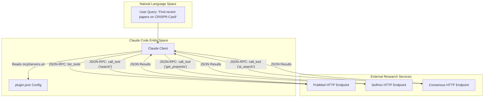
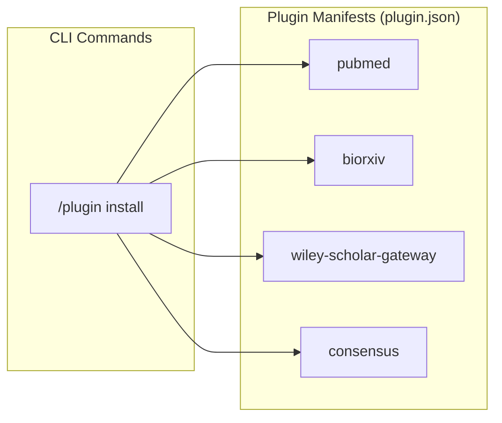

<!-- source: DeepWiki mcp.deepwiki.com · repo anthropics/life-sciences · page 3.2 Literature and Research Servers · fetched 2026-10-26 -->

# Literature and Research Servers

<details>
<summary>Relevant source files</summary>

The following files were used as context for generating this wiki page:

- [adisinsight/.claude-plugin/plugin.json](adisinsight/.claude-plugin/plugin.json)
- [biorender/.claude-plugin/plugin.json](biorender/.claude-plugin/plugin.json)
- [biorxiv/.claude-plugin/plugin.json](biorxiv/.claude-plugin/plugin.json)
- [chembl/.claude-plugin/plugin.json](chembl/.claude-plugin/plugin.json)
- [clinical-trials/.claude-plugin/plugin.json](clinical-trials/.claude-plugin/plugin.json)
- [consensus/.claude-plugin/plugin.json](consensus/.claude-plugin/plugin.json)
- [cortellis/.claude-plugin/plugin.json](cortellis/.claude-plugin/plugin.json)
- [open-targets/.claude-plugin/plugin.json](open-targets/.claude-plugin/plugin.json)
- [owkin/.claude-plugin/plugin.json](owkin/.claude-plugin/plugin.json)
- [pubmed/.claude-plugin/plugin.json](pubmed/.claude-plugin/plugin.json)
- [synapse/.claude-plugin/plugin.json](synapse/.claude-plugin/plugin.json)
- [wiley-scholar-gateway/.claude-plugin/plugin.json](wiley-scholar-gateway/.claude-plugin/plugin.json)

</details>


The Literature and Research MCP (Model Context Protocol) servers provide Claude Code with direct access to vast repositories of scientific knowledge. These integrations enable researchers to perform literature reviews, track preprints, and query AI-synthesized research findings directly from their development environment.

## Overview of Research Connectors

These servers are implemented as remote HTTP MCP servers, allowing Claude to interface with external APIs through a standardized protocol.

| Server Name | Provider | Primary Use Case | Authentication |
| :--- | :--- | :--- | :--- |
| **PubMed** | U.S. National Library of Medicine | Searching peer-reviewed biomedical literature. | None (Public) |
| **bioRxiv/medRxiv** | deepsense.ai | Accessing biological and medical preprints. | None (Public) |
| **Scholar Gateway** | John Wiley & Sons, Inc. | Accessing Wiley academic publications. | Required |
| **Consensus** | Consensus | AI-powered search across peer-reviewed papers. | Required |

**Sources:**
- [pubmed/.claude-plugin/plugin.json:1-15]()
- [biorxiv/.claude-plugin/plugin.json:1-15]()
- [wiley-scholar-gateway/.claude-plugin/plugin.json:1-15]()
- [consensus/.claude-plugin/plugin.json:1-15]()

## Data Flow and Architecture

The literature servers follow a remote MCP architecture where Claude Code acts as the client, sending JSON-RPC requests to the designated service URLs defined in each plugin's configuration.

### Research Request Data Flow

The following diagram illustrates how a natural language query for literature is translated into a technical MCP request to a research provider.

**Literature Query Data Flow**


**Sources:**
- [pubmed/.claude-plugin/plugin.json:9-14]()
- [biorxiv/.claude-plugin/plugin.json:9-14]()
- [consensus/.claude-plugin/plugin.json:9-14]()

## Implementation Details

### PubMed
The PubMed MCP server connects to the U.S. National Library of Medicine. It is a public resource that does not require individual API keys for basic search functionality through the MCP interface.

*   **Plugin ID:** `pubmed`
*   **Endpoint:** `https://pubmed.mcp.claude.com/mcp` [pubmed/.claude-plugin/plugin.json:12-12]()
*   **Capabilities:** Searching biomedical literature and retrieving article metadata/abstracts [pubmed/.claude-plugin/plugin.json:4-4]().

### bioRxiv & medRxiv
Maintained by deepsense.ai, this connector bridges Claude to the Cold Spring Harbor Laboratory preprint servers. It allows researchers to access the latest findings before they complete the peer-review cycle.

*   **Plugin ID:** `biorxiv`
*   **Endpoint:** `https://mcp.deepsense.ai/biorxiv/mcp` [biorxiv/.claude-plugin/plugin.json:12-12]()
*   **Capabilities:** Accessing research papers in biological and medical sciences posted before peer review [biorxiv/.claude-plugin/plugin.json:4-4]().

### Consensus
Consensus provides an AI-powered search layer. Unlike standard keyword search, it uses LLMs to synthesize answers based on the consensus of peer-reviewed literature.

*   **Plugin ID:** `consensus`
*   **Endpoint:** `https://mcp.consensus.app/mcp` [consensus/.claude-plugin/plugin.json:12-12]()
*   **Capabilities:** AI-powered search across peer-reviewed scientific research papers [consensus/.claude-plugin/plugin.json:4-4]().

### Wiley Scholar Gateway
This server provides a gateway to John Wiley & Sons' extensive academic catalog.

*   **Plugin ID:** `wiley-scholar-gateway`
*   **Endpoint:** `https://connector.scholargateway.ai/mcp` [wiley-scholar-gateway/.claude-plugin/plugin.json:12-12]()
*   **Capabilities:** Accessing academic research and publications hosted by Wiley [wiley-scholar-gateway/.claude-plugin/plugin.json:4-4]().

## Installation and Configuration

To install these servers, use the Claude Code CLI. While PubMed and bioRxiv are generally open, Wiley and Consensus may require authentication headers configured via the Claude environment.

### Command Reference

**Code Entity Mapping: Installation Commands**


1.  **PubMed:**
    ```bash
    /plugin install pubmed
    ```
2.  **bioRxiv:**
    ```bash
    /plugin install biorxiv
    ```
3.  **Consensus:**
    ```bash
    /plugin install consensus
    ```
4.  **Wiley Scholar Gateway:**
    ```bash
    /plugin install wiley-scholar-gateway
    ```

**Sources:**
- [pubmed/.claude-plugin/plugin.json:2-2]()
- [biorxiv/.claude-plugin/plugin.json:2-2]()
- [wiley-scholar-gateway/.claude-plugin/plugin.json:2-2]()
- [consensus/.claude-plugin/plugin.json:2-2]()

---

