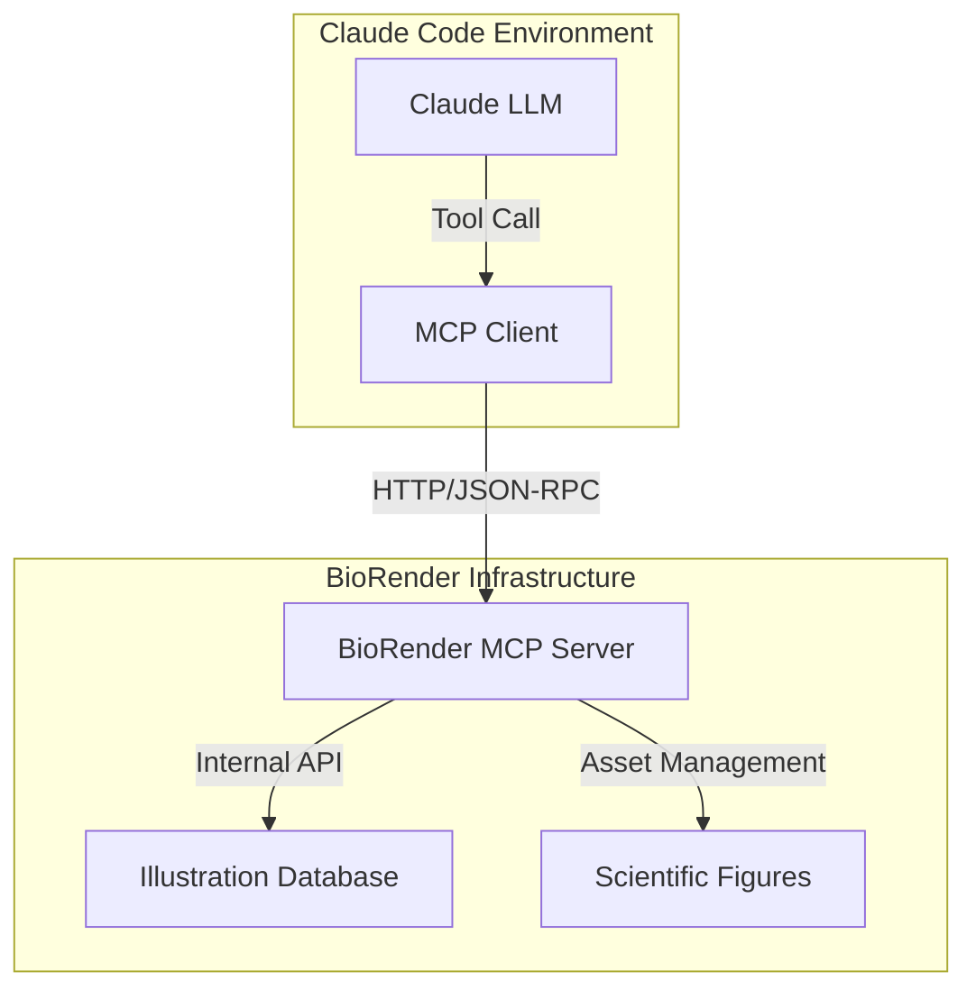
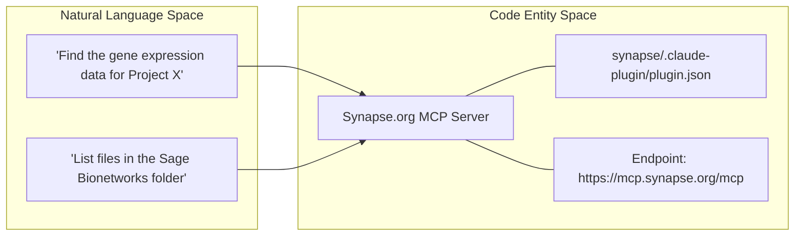
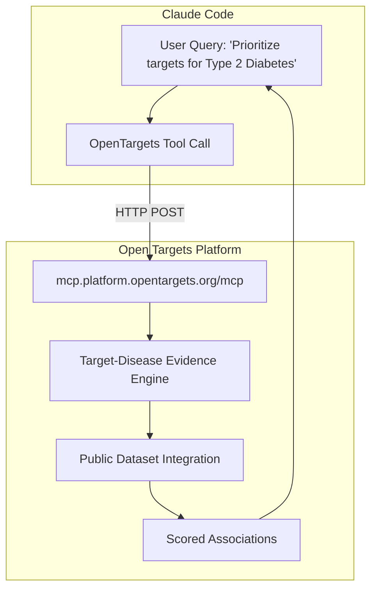

<!-- source: DeepWiki mcp.deepwiki.com · repo anthropics/life-sciences · page 3.3 Research Platform Servers · fetched 2026-10-26 -->

# Research Platform Servers

Relevant source files

The following files were used as context for generating this wiki page:

- [biorender/.claude-plugin/plugin.json](biorender/.claude-plugin/plugin.json)
- [biorxiv/.claude-plugin/plugin.json](biorxiv/.claude-plugin/plugin.json)
- [chembl/.claude-plugin/plugin.json](chembl/.claude-plugin/plugin.json)
- [clinical-trials/.claude-plugin/plugin.json](clinical-trials/.claude-plugin/plugin.json)
- [open-targets/.claude-plugin/plugin.json](open-targets/.claude-plugin/plugin.json)
- [owkin/.claude-plugin/plugin.json](owkin/.claude-plugin/plugin.json)
- [pubmed/.claude-plugin/plugin.json](pubmed/.claude-plugin/plugin.json)
- [synapse/.claude-plugin/plugin.json](synapse/.claude-plugin/plugin.json)
- [wiley-scholar-gateway/.claude-plugin/plugin.json](wiley-scholar-gateway/.claude-plugin/plugin.json)

This page documents the Model Context Protocol (MCP) servers for collaborative research platforms integrated into the Life Sciences marketplace. These servers enable Claude to interact with platforms for scientific illustration (BioRender), data management (Synapse.org), and drug target discovery (Open Targets).

## Overview of Research Platforms

The Research Platform servers are implemented as remote HTTP MCP servers. Unlike local skills, these servers provide a bridge between Claude and specialized web-based scientific ecosystems, allowing for the retrieval, organization, and visualization of research data.

### Platform Summary

| Platform | Provider | Purpose | Connection Type |
| :--- | :--- | :--- | :--- |
| **BioRender** | BioRender | Scientific illustrations and figures | Remote HTTP |
| **Synapse.org** | Sage Bionetworks | Collaborative data management | Remote HTTP |
| **Open Targets** | Open Targets | Drug target discovery and prioritization | Remote HTTP |

---

## BioRender

The BioRender MCP server allows Claude to interface with the BioRender platform, a tool specifically designed for creating high-quality scientific illustrations and journal figures.

### Capabilities
The server enables Claude to:
*   Search for and access scientific illustrations.
*   Assist in the creation and organization of visual research assets.

### Implementation Details
The BioRender integration is defined as a remote HTTP MCP server [biorender/.claude-plugin/plugin.json:9-13]().

**Data Flow: BioRender Integration**

**Sources:**
* [biorender/.claude-plugin/plugin.json:1-15]()

---

## Synapse.org (Sage Bionetworks)

Synapse is a collaborative research platform managed by Sage Bionetworks. It is used extensively for hosting large-scale genomics, proteomics, and clinical datasets.

### Capabilities
The Synapse MCP server provides Claude with the ability to:
*   Manage collaborative research data.
*   Query datasets hosted on Synapse.org.
*   Navigate project structures and metadata.

### Implementation Details
The server is hosted by Sage Bionetworks and integrated via a standard HTTP MCP endpoint [synapse/.claude-plugin/plugin.json:9-13]().

**Entity Mapping: Synapse Research Data**

**Sources:**
* [synapse/.claude-plugin/plugin.json:1-15]()

---

## Open Targets

The Open Targets Platform is a comprehensive tool for the systematic identification and prioritization of potential therapeutic drug targets. It integrates publicly available datasets to score target-disease associations.

### Capabilities
*   **Target-Disease Associations:** Identify targets linked to specific diseases based on genetic evidence, somatic mutations, and known drugs.
*   **Target Prioritization:** Score potential targets based on multiple evidence streams.
*   **Data Integration:** Access harmonized data from multiple biological and clinical sources.

### Implementation Details
The Open Targets MCP server connects Claude directly to the platform's drug discovery engine [open-targets/.claude-plugin/plugin.json:9-13]().

**Data Flow: Drug Target Discovery**

**Sources:**
* [open-targets/.claude-plugin/plugin.json:1-15]()

---

## Configuration and Requirements

All three servers described on this page are remote HTTP-based MCP servers. 

### Connection Configuration
The configuration for these servers follows a standard structure within the `.claude-plugin/plugin.json` file for each directory:

| Plugin Path | Server Name | URL |
| :--- | :--- | :--- |
| `biorender/` | `BioRender` | `https://mcp.services.biorender.com/mcp` |
| `synapse/` | `Synapse.org` | `https://mcp.synapse.org/mcp` |
| `open-targets/` | `OpenTargets` | `https://mcp.platform.opentargets.org/mcp` |

### Account Requirements
*   **BioRender:** Requires a BioRender account for accessing and saving illustrations.
*   **Synapse.org:** Requires a Synapse account and appropriate permissions for specific projects/datasets.
*   **Open Targets:** Generally provides access to public data, though specific enterprise instances may require authentication.

**Sources:**
* [biorender/.claude-plugin/plugin.json:11-12]()
* [synapse/.claude-plugin/plugin.json:11-12]()
* [open-targets/.claude-plugin/plugin.json:11-12]()

---

