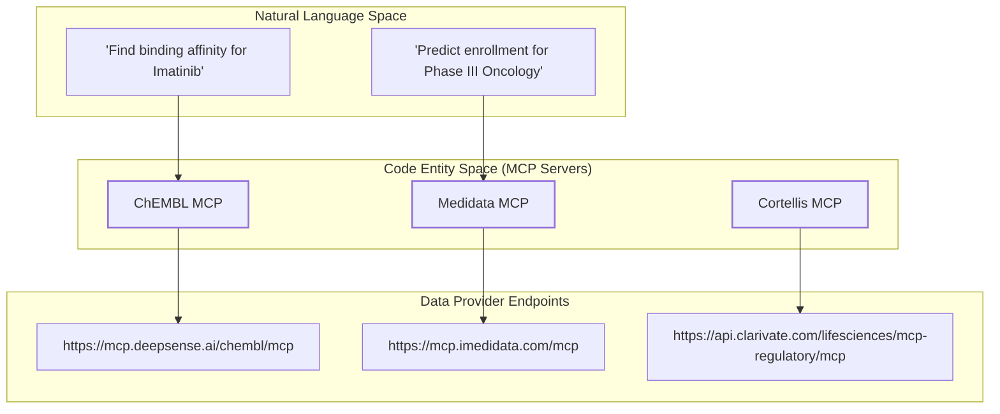
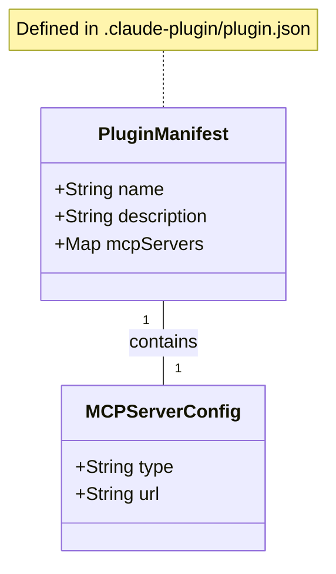

<!-- source: DeepWiki mcp.deepwiki.com · repo anthropics/life-sciences · page 3.4 Drug Discovery and Clinical Servers · fetched 2026-10-26 -->

# Drug Discovery and Clinical Servers

Relevant source files

The following files were used as context for generating this wiki page:

- [adisinsight/.claude-plugin/plugin.json](adisinsight/.claude-plugin/plugin.json)
- [biorxiv/.claude-plugin/plugin.json](biorxiv/.claude-plugin/plugin.json)
- [chembl/.claude-plugin/plugin.json](chembl/.claude-plugin/plugin.json)
- [clinical-trials/.claude-plugin/plugin.json](clinical-trials/.claude-plugin/plugin.json)
- [consensus/.claude-plugin/plugin.json](consensus/.claude-plugin/plugin.json)
- [cortellis/.claude-plugin/plugin.json](cortellis/.claude-plugin/plugin.json)
- [medidata/.claude-plugin/plugin.json](medidata/.claude-plugin/plugin.json)
- [open-targets/.claude-plugin/plugin.json](open-targets/.claude-plugin/plugin.json)
- [owkin/.claude-plugin/plugin.json](owkin/.claude-plugin/plugin.json)
- [tooluniverse/.claude-plugin/plugin.json](tooluniverse/.claude-plugin/plugin.json)
- [tooluniverse/tooluniverse.mcpb](tooluniverse/tooluniverse.mcpb)

This page documents the Model Context Protocol (MCP) servers integrated into the life-sciences marketplace that specialize in drug discovery, bioactive molecules, regulatory intelligence, and clinical trial analytics. These servers enable Claude to interface with industry-standard databases and AI agents to accelerate research from early-stage molecule discovery to late-stage clinical trial planning.

## Overview of Drug Discovery & Clinical MCPs

The marketplace provides a suite of HTTP-based and local (MCPB) servers. While some connectors provide access to public databases (like ChEMBL and ClinicalTrials.gov), others require enterprise subscriptions to Clarivate, Springer Nature, or Medidata.

### Technical Architecture: NL to Code Entity Mapping

The following diagram illustrates how natural language queries are routed through the MCP architecture to specific life-science data providers.

**Figure 1: MCP Data Flow for Drug Discovery**

**Sources:**
- `chembl/.claude-plugin/plugin.json:10-13`
- `medidata/.claude-plugin/plugin.json:10-13`
- `cortellis/.claude-plugin/plugin.json:10-13`

---

## Bioactive Molecules and Target Discovery

### ChEMBL (deepsense.ai)
The ChEMBL connector provides access to a manually curated database of bioactive drug-like compounds. It is primarily used for retrieving quantitative binding and functional data against biological targets.

*   **Type:** HTTP Remote MCP
*   **Endpoint:** `https://mcp.deepsense.ai/chembl/mcp`
*   **Capabilities:** Querying quantitative SAR (Structure-Activity Relationship) data and target-molecule interactions.

**Sources:**
- `chembl/.claude-plugin/plugin.json:2-15`

### Owkin AI Agents
The Owkin server integrates AI agents designed for biology, specifically the **HistoPLUS** agent. This allows for the analysis of H&E slides from the TCGA (The Cancer Genome Atlas) database.

*   **Capabilities:**
    *   Quantifying distinct cell types in histological images.
    *   Analyzing spatial tumor microenvironments.
    *   Performing cohort-level survival analysis.
*   **Endpoint:** `https://mcp.k.owkin.com/mcp`

**Sources:**
- `owkin/.claude-plugin/plugin.json:4-13`

---

## Regulatory and Pipeline Intelligence

These servers typically require professional subscriptions to the respective providers (Clarivate, Springer Nature).

### Cortellis Regulatory Intelligence
Provides global drug regulatory data to navigate compliance and approval pathways.

*   **Provider:** Clarivate
*   **Endpoint:** `https://api.clarivate.com/lifesciences/mcp-regulatory/mcp`

**Sources:**
- `cortellis/.claude-plugin/plugin.json:2-13`

### AdisInsight
Focuses on the drug development pipeline, providing intelligence on clinical trials and pharmaceutical deals.

*   **Provider:** Springer Nature
*   **Endpoint:** `https://adisinsight-mcp.springer.com/mcp`

**Sources:**
- `adisinsight/.claude-plugin/plugin.json:4-13`

---

## Clinical Trial Analytics

### ClinicalTrials.gov (deepsense.ai)
A connector for the NIH/NLM registry of FDA-regulated clinical studies. It allows Claude to search for trial statuses, eligibility criteria, and study results across global clinical research.

*   **Type:** HTTP Remote MCP
*   **Endpoint:** `https://mcp.deepsense.ai/clinical_trials/mcp`

**Sources:**
- `clinical-trials/.claude-plugin/plugin.json:4-13`

### Medidata Predictive Site Ranking
Medidata's MCP offers advanced tools for Intelligent Trials customers, moving beyond simple data retrieval into predictive analytics.

*   **Key Functions:**
    *   **Platform Help:** Querying Medidata product documentation (Rave EDC, Clinical Data Studio).
    *   **Predictive Site Ranking:** Ranking clinical trial sites based on past performance, indication, and enrollment goals.
*   **Endpoint:** `https://mcp.imedidata.com/mcp`

**Sources:**
- `medidata/.claude-plugin/plugin.json:4-13`

---

## Implementation Details

The servers are defined in the repository using the `plugin.json` schema, which specifies the `mcpServers` configuration. For remote servers, the `type` is set to `http` and points to a hosted manifest URL.

**Figure 2: Plugin Configuration to Server Mapping**

### Summary of Requirements

| Server | Data Source | Auth/Subscription |
| :--- | :--- | :--- |
| **ChEMBL** | EMBL-EBI ChEMBL | Public (via deepsense.ai) |
| **ClinicalTrials** | ClinicalTrials.gov | Public (via deepsense.ai) |
| **Owkin** | TCGA / Owkin AI | Owkin Credentials |
| **Cortellis** | Clarivate Regulatory | Clarivate API Key |
| **AdisInsight** | Springer Nature Pipeline | AdisInsight Subscription |
| **Medidata** | Medidata Platform | Medidata Customer Auth |

**Sources:**
- `chembl/.claude-plugin/plugin.json:4-12`
- `clinical-trials/.claude-plugin/plugin.json:4-12`
- `cortellis/.claude-plugin/plugin.json:4-12`
- `adisinsight/.claude-plugin/plugin.json:4-12`
- `medidata/.claude-plugin/plugin.json:4-12`
- `owkin/.claude-plugin/plugin.json:4-12`

---

