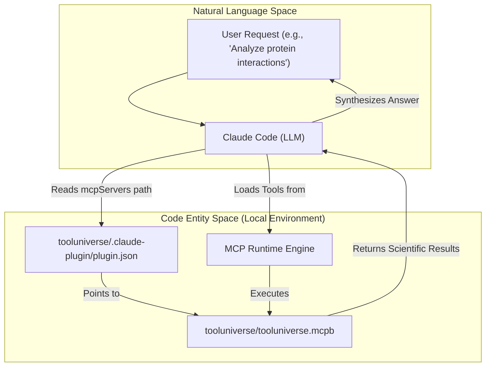
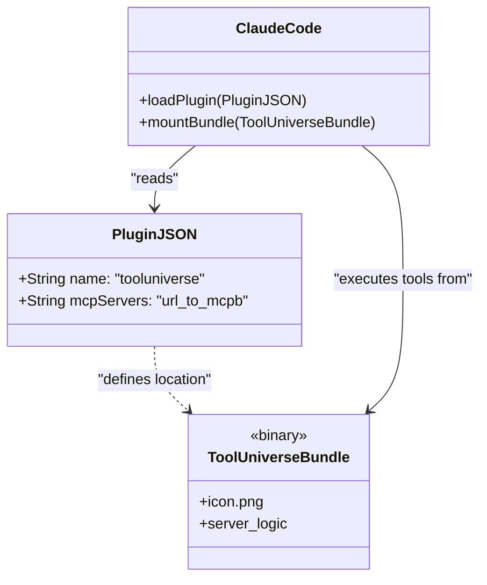

<!-- source: DeepWiki mcp.deepwiki.com · repo anthropics/life-sciences · page 3.6 ToolUniverse · fetched 2026-10-26 -->

# ToolUniverse

Relevant source files

The following files were used as context for generating this wiki page:

- [medidata/.claude-plugin/plugin.json](medidata/.claude-plugin/plugin.json)
- [tooluniverse/.claude-plugin/plugin.json](tooluniverse/.claude-plugin/plugin.json)
- [tooluniverse/tooluniverse.mcpb](tooluniverse/tooluniverse.mcpb)

ToolUniverse is an MCP server developed by **MIMS Harvard** designed to democratize AI-powered scientific discovery. It provides a suite of specialized tools that allow AI agents (like Claude) to perform complex scientific automation, data analysis, and research tasks within a structured framework.

## Overview

The ToolUniverse implementation in the life-sciences marketplace follows the **Local MCP Server (MCPB)** architecture. Unlike HTTP-based remote servers, ToolUniverse is distributed as a bundled package containing the necessary logic and metadata to execute scientific tools directly through the Claude Code environment.

### Key Specifications
| Attribute | Value |
| :--- | :--- |
| **Provider** | MIMS Harvard [tooluniverse/.claude-plugin/plugin.json:6-7]() |
| **Version** | 1.0.0 [tooluniverse/.claude-plugin/plugin.json:3]() |
| **Type** | Local MCP Bundle (MCPB) [tooluniverse/.claude-plugin/plugin.json:9]() |
| **Website** | [https://aiscientist.tools](https://aiscientist.tools) [tooluniverse/.claude-plugin/plugin.json:7]() |

**Sources:**
- [tooluniverse/.claude-plugin/plugin.json:1-10]()

---

## MCPB Bundle Architecture

ToolUniverse utilizes the `.mcpb` format, which is a compressed bundle containing the server's executable logic and resource definitions. This allows for offline-capable, high-performance tool execution without the latency of external API calls for the core logic.

### Data Flow: Natural Language to Scientific Execution

The following diagram illustrates how a user's natural language request is translated into a ToolUniverse action via the MCPB bundle.

**ToolUniverse Execution Flow**

**Sources:**
- [tooluniverse/.claude-plugin/plugin.json:1-10]()
- [tooluniverse/tooluniverse.mcpb:1-28]()

---

## Tool Capabilities

The ToolUniverse server exposes a variety of "AI Scientist" tools. While the internal logic is encapsulated within the binary bundle [tooluniverse/tooluniverse.mcpb:1-28](), the server is designed to support the following categories of scientific automation:

1.  **Hypothesis Generation**: Assisting in the formulation of testable scientific hypotheses based on existing literature.
2.  **Experimental Design**: Automating the creation of protocols and workflows for biological or chemical experiments.
3.  **Data Synthesis**: Integrating disparate datasets from multiple life-science domains to find hidden correlations.
4.  **Literature Synthesis**: Deep analysis of scientific papers to extract entities, relationships, and evidence levels.

### Comparison: ToolUniverse vs. Standard MCP

Unlike the `medidata` MCP server, which uses a standard HTTP endpoint [medidata/.claude-plugin/plugin.json:10-13](), ToolUniverse is registered as a direct file reference to a release asset [tooluniverse/.claude-plugin/plugin.json:9]().

| Feature | Medidata MCP | ToolUniverse MCP |
| :--- | :--- | :--- |
| **Communication** | HTTP/JSON-RPC [medidata/.claude-plugin/plugin.json:11]() | Local Bundle (MCPB) [tooluniverse/.claude-plugin/plugin.json:9]() |
| **Endpoint** | `https://mcp.imedidata.com/mcp` [medidata/.claude-plugin/plugin.json:12]() | `tooluniverse.mcpb` [tooluniverse/.claude-plugin/plugin.json:9]() |
| **Primary Use** | Trial Site Ranking & Help [medidata/.claude-plugin/plugin.json:4]() | AI Scientific Discovery [tooluniverse/.claude-plugin/plugin.json:4]() |

**Sources:**
- [tooluniverse/.claude-plugin/plugin.json:1-10]()
- [medidata/.claude-plugin/plugin.json:1-15]()

---

## Integration Details

To use ToolUniverse within Claude Code, the system parses the `plugin.json` file. The `mcpServers` field provides the URI to the bundle [tooluniverse/.claude-plugin/plugin.json:9]().

### System Architecture Diagram

This diagram maps the file-based configuration to the runtime entities.

**Configuration to Runtime Mapping**

**Sources:**
- [tooluniverse/.claude-plugin/plugin.json:1-10]()
- [tooluniverse/tooluniverse.mcpb:1]() (Header showing `icon.png` in bundle)

---

## Installation and Usage

1.  **Registration**: When the `life-sciences` marketplace is added, Claude Code identifies the `tooluniverse` directory.
2.  **Loading**: The environment fetches the `tooluniverse.mcpb` bundle from the location specified in the `plugin.json` [tooluniverse/.claude-plugin/plugin.json:9]().
3.  **Discovery**: Claude discovers the tools defined within the bundle (e.g., tools for MIMS Harvard's scientific discovery framework).
4.  **Execution**: Users can invoke these tools by asking Claude to perform scientific tasks, such as "Use ToolUniverse to propose a mechanism for drug resistance in the provided dataset."

**Sources:**
- [tooluniverse/.claude-plugin/plugin.json:1-10]()
- [tooluniverse/tooluniverse.mcpb:1-28]()

---

