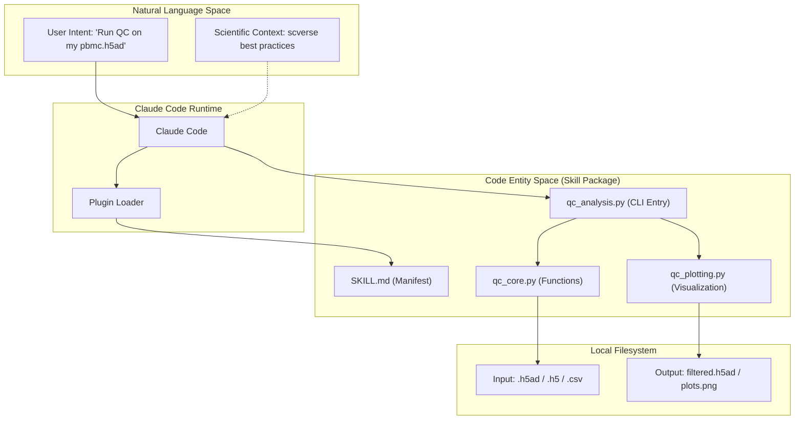
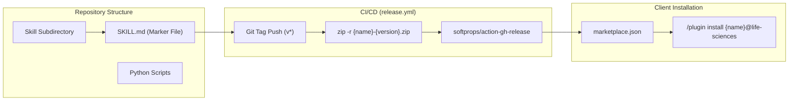

<!-- source: DeepWiki mcp.deepwiki.com · repo anthropics/life-sciences · page 4 Skills · fetched 2026-10-26 -->

# Skills

Relevant source files

The following files were used as context for generating this wiki page:

- [.claude-plugin/marketplace.json](.claude-plugin/marketplace.json)
- [.github/workflows/release.yml](.github/workflows/release.yml)
- [README.md](README.md)

## Purpose and Scope

This document introduces **skills** as self-contained analytical workflows that extend Claude Code's capabilities for life sciences research. Unlike MCP servers, which act as proxies to external APIs, skills provide domain-specific computational pipelines that execute locally within the Claude Code environment. They bundle implementation logic, analytical algorithms, and reference documentation into reusable packages without requiring external service integration.

For detailed documentation on specific skills, see the following child pages:
*   [Single-Cell RNA-seq Quality Control](#4.1)
*   [scvi-tools Deep Learning Skill](#4.2)
*   [Nextflow Development Skill](#4.3)
*   [Instrument Data to Allotrope Skill](#4.4)
*   [Clinical Trial Protocol Skill](#4.5)
*   [Scientific Problem Selection Skill](#4.6)

**Sources:** [README.md:5-7](), [README.md:103-148](), [.claude-plugin/marketplace.json:83-147]()

---

## Architectural Model: Natural Language to Code Execution

Skills bridge the gap between high-level scientific intent and low-level code execution. The following diagram illustrates how natural language requests are mapped to specific code entities within a skill package.

### Skill Execution Architecture

**Key architectural characteristics:**
1.  **Local Execution**: The Python executor runs within the Claude Code process. No data is transmitted to external services.
2.  **File-Based I/O**: Skills consume local files and generate standardized outputs (e.g., AnnData objects or Allotrope Simple Model files).
3.  **Standardized Entry Points**: Skills typically use a primary script (e.g., `qc_analysis.py` or `convert_to_asm.py`) as the interface for Claude Code.

**Sources:** [README.md:105-148](), [.claude-plugin/marketplace.json:83-147]()

---

## Packaging and Release Workflow

Skills are distributed as versioned zip archives via GitHub. The release process is managed by automated CI/CD pipelines to ensure consistency.

### Skill Distribution Pipeline

**Packaging logic:**
*   **Marker Convention**: The release workflow specifically looks for a `SKILL.md` file in subdirectories to identify valid skill packages [.github/workflows/release.yml:20-22]().
*   **Archive Naming**: Zip files are automatically named using the directory name and the GitHub reference name (tag) [.github/workflows/release.yml:23-26]().
*   **Marketplace Registration**: The `.claude-plugin/marketplace.json` file serves as the registry, mapping skill names to their source locations and metadata [.claude-plugin/marketplace.json:1-184]().

**Sources:** [.github/workflows/release.yml:1-42](), [.claude-plugin/marketplace.json:83-147]()

---

## Summary of Available Skills

The marketplace currently provides six primary skills, each targeting a different stage of the life sciences research lifecycle.

| Skill | Plugin ID | Primary Function |
| :--- | :--- | :--- |
| **Single-Cell QC** | `single-cell-rna-qc@life-sciences` | MAD-based filtering and visualization for scRNA-seq. |
| **scvi-tools** | `scvi-tools@life-sciences` | Deep learning for single-cell integration and embedding. |
| **Nextflow Dev** | `nextflow-development@life-sciences` | Running nf-core pipelines (RNA-seq, Sarek) locally. |
| **Allotrope Conversion** | `instrument-data-to-allotrope@life-sciences` | Standardizing lab instrument data to ASM format. |
| **Clinical Protocol** | `clinical-trial-protocol@life-sciences` | Generating FDA/NIH-compliant trial documentation. |
| **Problem Selection** | `scientific-problem-selection@life-sciences` | Strategic research planning and risk assessment. |

### Skill Details and Child Links

*   **[Single-Cell RNA-seq Quality Control](#4.1)**: Implements scverse best practices for data cleaning. For details, see [Single-Cell RNA-seq Quality Control](#4.1).
*   **[scvi-tools Deep Learning Skill](#4.2)**: Provides workflows for scVI, scANVI, and totalVI models. For details, see [scvi-tools Deep Learning Skill](#4.2).
*   **[Nextflow Development Skill](#4.3)**: Simplifies the execution of complex bioinformatics pipelines for bench scientists. For details, see [Nextflow Development Skill](#4.3).
*   **[Instrument Data to Allotrope Skill](#4.4)**: Standardizes output from plate readers, spectrophotometers, and qPCR. For details, see [Instrument Data to Allotrope Skill](#4.4).
*   **[Clinical Trial Protocol Skill](#4.5)**: Automates the generation of regulatory-grade protocols for drugs and devices. For details, see [Clinical Trial Protocol Skill](#4.5).
*   **[Scientific Problem Selection Skill](#4.6)**: Applies the Fischbach & Walsh (2024) framework for project ideation. For details, see [Scientific Problem Selection Skill](#4.6).

**Sources:** [README.md:105-148](), [.claude-plugin/marketplace.json:83-147]()

---

