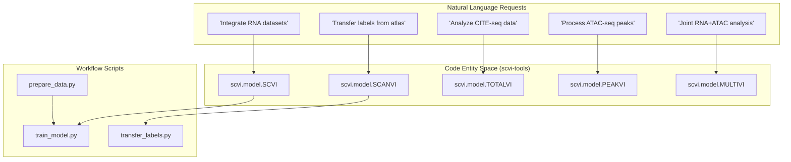
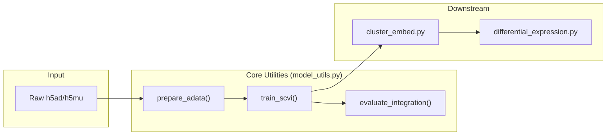

<!-- source: DeepWiki mcp.deepwiki.com · repo anthropics/life-sciences · page 4.2 scvi-tools Deep Learning Skill · fetched 2026-10-26 -->

# scvi-tools Deep Learning Skill

Relevant source files

The following files were used as context for generating this wiki page:

- [scvi-tools/SKILL.md](scvi-tools/SKILL.md)
- [scvi-tools/references/atac_peakvi.md](scvi-tools/references/atac_peakvi.md)
- [scvi-tools/references/batch_correction_sysvi.md](scvi-tools/references/batch_correction_sysvi.md)
- [scvi-tools/references/environment_setup.md](scvi-tools/references/environment_setup.md)
- [scvi-tools/references/label_transfer.md](scvi-tools/references/label_transfer.md)
- [scvi-tools/references/multiome_multivi.md](scvi-tools/references/multiome_multivi.md)
- [scvi-tools/scripts/model_utils.py](scvi-tools/scripts/model_utils.py)
- [scvi-tools/scripts/prepare_data.py](scvi-tools/scripts/prepare_data.py)

The `scvi-tools` skill provides a comprehensive framework for deep learning-based single-cell omics analysis. It leverages the `scvi-tools` library to provide probabilistic models for data integration, batch correction, and multi-modal analysis across various single-cell technologies.

### Purpose and Scope
This skill is designed for technical users who need to perform complex single-cell analytical workflows using Variational Autoencoders (VAEs). It covers the transition from raw count data to integrated latent representations, supporting modalities including scRNA-seq, scATAC-seq, CITE-seq, and Spatial Transcriptomics.

The skill is organized into modular CLI scripts in the `scripts/` directory and detailed methodology guides in the `references/` directory.

### Natural Language to Code Mapping

The following diagram illustrates how natural language analysis requests map to specific code entities and model classes within the skill.

**Model Mapping Architecture**

**Sources:** [scvi-tools/SKILL.md:27-39](), [scvi-tools/SKILL.md:63-71]()

---

### 4.2.1 Model Selection and Data Preparation
Selecting the correct model is critical for capturing the underlying biology of specific omics modalities. The skill supports a wide range of models including `scVI` for unsupervised integration, `scANVI` for label transfer, and specialized models like `totalVI` (RNA+Protein) or `MultiVI` (RNA+ATAC) [scvi-tools/SKILL.md:27-39]().

Data preparation is handled by the `prepare_data.py` script, which enforces critical requirements such as:
*   **Raw Integer Counts**: Models require raw counts, typically stored in `adata.layers["counts"]` [scvi-tools/SKILL.md:108-112]().
*   **HVG Selection**: Highly Variable Gene selection, often batch-aware using `seurat_v3` flavor [scvi-tools/scripts/prepare_data.py:81-89]().
*   **QC Filtering**: Cell and gene filtering based on mitochondrial content and count depth [scvi-tools/scripts/model_utils.py:73-83]().

For details, see [Model Selection and Data Preparation](#4.2.1).

**Sources:** [scvi-tools/scripts/model_utils.py:34-112](), [scvi-tools/scripts/prepare_data.py:17-106]()

---

### 4.2.2 Training and Integration Workflows
The skill provides an end-to-end pipeline for model training and data integration. The workflow typically follows a sequence of CLI commands:
1.  `prepare_data.py`: Prepares the `AnnData` object.
2.  `train_model.py`: Executes the training loop for the selected VAE model.
3.  `cluster_embed.py`: Generates UMAP visualizations and Leiden clusters from the latent space.
4.  `differential_expression.py`: Performs library-aware DE analysis.

Integration quality can be evaluated using the `evaluate_integration` function in `model_utils.py`, which calculates metrics like Silhouette scores and batch mixing [scvi-tools/scripts/model_utils.py:200-259]().

For details, see [Training and Integration Workflows](#4.2.2).

**Sources:** [scvi-tools/SKILL.md:73-90](), [scvi-tools/scripts/model_utils.py:115-197]()

---

### 4.2.3 Specialized Analysis References
Beyond standard scRNA-seq, the skill includes specialized references for advanced omics workflows:
*   **Multi-modal**: `totalVI` for CITE-seq [scvi-tools/references/citeseq_totalvi.md]() and `MultiVI` for Multiome [scvi-tools/references/multiome_multivi.md]().
*   **Chromatin**: `PeakVI` for scATAC-seq binary accessibility modeling [scvi-tools/references/atac_peakvi.md:7-11]().
*   **Reference Mapping**: `scArches` for mapping query datasets to pre-trained atlases without full retraining [scvi-tools/references/label_transfer.md:183-203]().
*   **Dynamics**: `veloVI` for transcriptional dynamics and RNA velocity [scvi-tools/SKILL.md:37-37]().

**Workflow Execution Logic**

**Sources:** [scvi-tools/scripts/model_utils.py:94-104](), [scvi-tools/SKILL.md:42-55]()

For details, see [Specialized Analysis References](#4.2.3).

---

