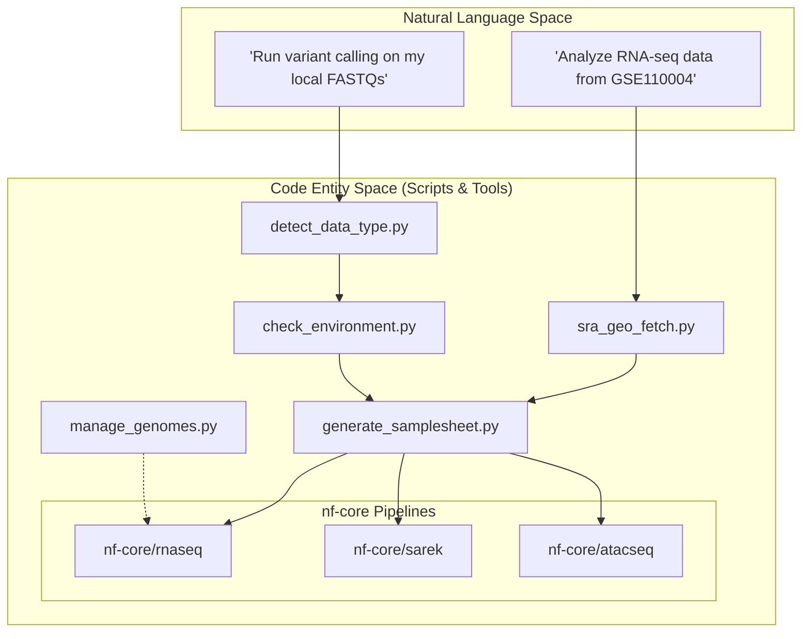
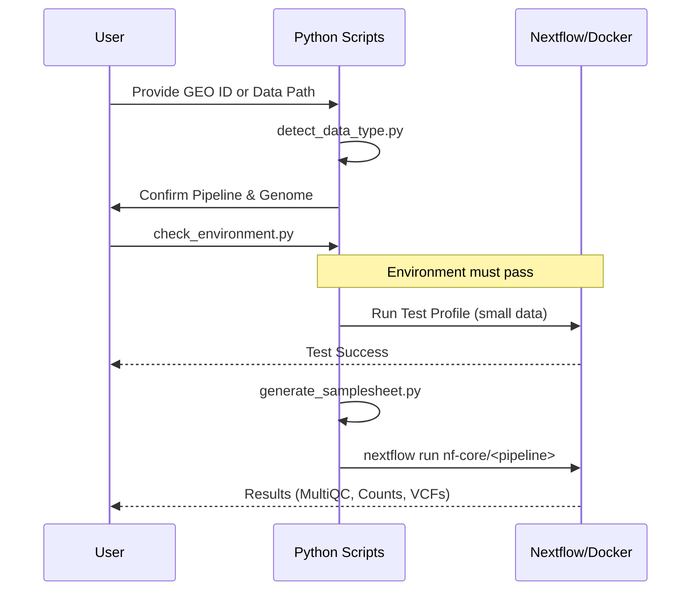

<!-- source: DeepWiki mcp.deepwiki.com · repo anthropics/life-sciences · page 4.3 Nextflow Development Skill · fetched 2026-10-26 -->

# Nextflow Development Skill

Relevant source files

The following files were used as context for generating this wiki page:

- [clinical-trial-protocol-skill/LICENSE.txt](clinical-trial-protocol-skill/LICENSE.txt)
- [instrument-data-to-allotrope/LICENSE.txt](instrument-data-to-allotrope/LICENSE.txt)
- [nextflow-development/LICENSE.txt](nextflow-development/LICENSE.txt)
- [nextflow-development/SKILL.md](nextflow-development/SKILL.md)
- [nextflow-development/references/geo-sra-acquisition.md](nextflow-development/references/geo-sra-acquisition.md)

The Nextflow Development skill enables researchers to run standardized **nf-core** bioinformatics pipelines on sequencing data. It supports end-to-end analysis—from raw data acquisition to final reporting—for RNA-seq, variant calling (WGS/WES), and chromatin accessibility (ATAC-seq). This skill bridges the gap between raw sequencing files and biological insights by automating environment validation, samplesheet generation, and pipeline execution.

### System Architecture Overview

The following diagram illustrates the relationship between the natural language intent (analyzing sequencing data) and the underlying Python scripts and Nextflow components that execute the workflow.

**Nextflow Skill Entity Map**

**Sources:** [nextflow-development/SKILL.md:1-22](), [nextflow-development/references/geo-sra-acquisition.md:22-93]()

---

## 1. Environment Setup and Data Acquisition
Before running any analysis, the system must ensure the local environment meets the strict requirements for Nextflow and Docker. Additionally, the skill provides tools to fetch public datasets directly from NCBI GEO or SRA.

*   **Environment Validation:** The `check_environment.py` script verifies the installation of Docker, Nextflow (version >= 23.04), and Java (version >= 11) [nextflow-development/SKILL.md:53-84]().
*   **Public Data Fetching:** The `sra_geo_fetch.py` script allows users to query study metadata, select specific sample subsets, and download FASTQ files from ENA/SRA [nextflow-development/references/geo-sra-acquisition.md:117-193]().

For details, see **[Environment Setup and Data Acquisition](#4.3.1)**.

**Sources:** [nextflow-development/SKILL.md:53-84](), [nextflow-development/references/geo-sra-acquisition.md:1-193]()

---

## 2. Pipeline Reference: RNA-seq, Sarek, and ATAC-seq
The skill supports three primary nf-core pipelines, each pinned to a specific version to ensure reproducibility.

| Data Type | nf-core Pipeline | Version | Primary Goal |
| :--- | :--- | :--- | :--- |
| **RNA-seq** | `rnaseq` | 3.22.2 | Gene expression quantification |
| **WGS/WES** | `sarek` | 3.7.1 | Germline/Somatic variant calling |
| **ATAC-seq** | `atacseq` | 2.1.2 | Chromatin accessibility/Peak calling |

For details, see **[Pipeline Reference: RNA-seq, Sarek, and ATAC-seq](#4.3.2)**.

**Sources:** [nextflow-development/SKILL.md:88-107]()

---

## 3. Samplesheet Generation and Genome Management
Nextflow pipelines require structured CSV samplesheets and reference genomes to function. The skill automates these configuration steps.

*   **Samplesheet Automation:** The `generate_samplesheet.py` script discovers local FASTQ/BAM files, pairs R1/R2 reads, and formats them specifically for the chosen pipeline (e.g., adding `strandedness` for RNA-seq or `status` for Sarek) [nextflow-development/SKILL.md:134-176]().
*   **Genome Management:** The `manage_genomes.py` script checks for the availability of iGenomes keys (e.g., GRCh38, GRCm39) and handles the downloading of required reference files [nextflow-development/SKILL.md:181-190]().

For details, see **[Samplesheet Generation and Genome Management](#4.3.3)**.

**Sources:** [nextflow-development/SKILL.md:134-190]()

---

## Workflow Summary

The standard execution flow follows a strict sequence to minimize failures during long-running bioinformatics jobs.

**Operational Workflow**

**Sources:** [nextflow-development/SKILL.md:12-22](), [nextflow-development/SKILL.md:110-132](), [nextflow-development/SKILL.md:226-249]()

---

