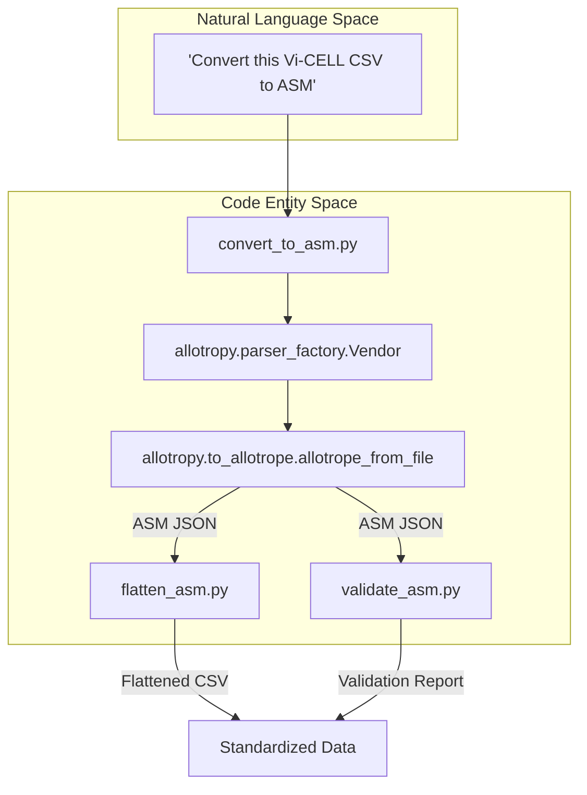
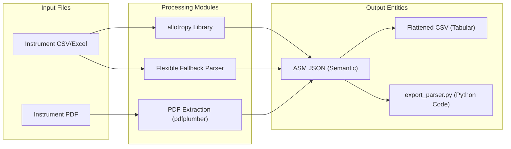

<!-- source: DeepWiki mcp.deepwiki.com · repo anthropics/life-sciences · page 4.4 Instrument Data to Allotrope Skill · fetched 2026-10-26 -->

# Instrument Data to Allotrope Skill

Relevant source files

The following files were used as context for generating this wiki page:

- [clinical-trial-protocol-skill/LICENSE.txt](clinical-trial-protocol-skill/LICENSE.txt)
- [instrument-data-to-allotrope/LICENSE.txt](instrument-data-to-allotrope/LICENSE.txt)
- [instrument-data-to-allotrope/SKILL.md](instrument-data-to-allotrope/SKILL.md)
- [nextflow-development/LICENSE.txt](nextflow-development/LICENSE.txt)

The **Instrument Data to Allotrope Skill** provides a standardized workflow for converting diverse laboratory instrument output files (e.g., CSV, Excel, TXT, PDF) into the **Allotrope Simple Model (ASM)** format. This skill is designed to support data engineering tasks such as automating schema transformations, standardizing lab data for LIMS/ELN integration, and ensuring long-term data archival through semantic modeling [instrument-data-to-allotrope/SKILL.md:1-19]().

## Workflow Overview

The conversion process follows a structured sequence to ensure data integrity and traceability:

1.  **Instrument Detection**: Identifying the source instrument and vendor from file contents [instrument-data-to-allotrope/SKILL.md:23-23]().
2.  **Parsing**: Utilizing a three-tier strategy starting with the `allotropy` library, followed by flexible fallbacks for unsupported formats [instrument-data-to-allotrope/SKILL.md:24-24]().
3.  **Standardization**: Mapping raw readings and calculated results into the ASM JSON schema [instrument-data-to-allotrope/SKILL.md:26-26]().
4.  **Validation**: Verifying the output against Allotrope specifications [instrument-data-to-allotrope/SKILL.md:95-97]().

### Data Transformation Architecture

The following diagram illustrates the relationship between the high-level conversion request and the underlying code entities responsible for processing.

**Conversion Logic Flow**

Sources: [instrument-data-to-allotrope/SKILL.md:21-29](), [instrument-data-to-allotrope/SKILL.md:35-45](), [instrument-data-to-allotrope/SKILL.md:99-103]()

## Key Components

### ASM Format and Conversion Workflow
The skill prioritizes the **Allotrope Simple Model (ASM)**, a JSON-based semantic structure that uses ontology URIs for unambiguous data representation [instrument-data-to-allotrope/SKILL.md:49-51](). The workflow supports both full semantic JSON and flattened 2D CSV formats for downstream analysis in tools like Excel [instrument-data-to-allotrope/SKILL.md:53-57]().

For details on the schema structure, parsing tiers, and the conversion scripts, see **[ASM Format and Conversion Workflow](#4.4.1)**.

### Supported Instruments and Field Classification
A critical requirement of ASM is the strict separation of **raw measurements** (found in the `measurement-document`) from **calculated/derived values** (found in the `calculated-data-aggregate-document`) [instrument-data-to-allotrope/SKILL.md:61-64](). The skill supports a wide range of instruments, including cell counters, spectrophotometers, and plate readers [instrument-data-to-allotrope/SKILL.md:121-132]().

For the list of supported vendors and guidance on classifying raw vs. calculated fields, see **[Supported Instruments and Field Classification](#4.4.2)**.

## System Integration Map

This diagram maps the system's internal modules to the data entities they produce and consume.

**System Component Map**

Sources: [instrument-data-to-allotrope/SKILL.md:23-28](), [instrument-data-to-allotrope/SKILL.md:136-170]()

## Validation and Compliance
Every conversion is validated against the Allotrope ASM specification (as of December 2024) [instrument-data-to-allotrope/SKILL.md:105-108](). The `validate_asm.py` tool checks for required metadata, unique identifiers, and traceability for calculated data (`data-source-aggregate-document`) [instrument-data-to-allotrope/SKILL.md:113-120]().

| Feature | Description |
| :--- | :--- |
| **Traceability** | Calculated values must link to their source measurements via identifiers [instrument-data-to-allotrope/SKILL.md:66-81](). |
| **Soft Validation** | Unknown units or roles generate warnings rather than errors to allow for forward compatibility [instrument-data-to-allotrope/SKILL.md:110-112](). |
| **Strict Mode** | Optional flag to treat all warnings as errors for production pipelines [instrument-data-to-allotrope/SKILL.md:102-102](). |

Sources: [instrument-data-to-allotrope/SKILL.md:66-81](), [instrument-data-to-allotrope/SKILL.md:99-103](), [instrument-data-to-allotrope/SKILL.md:110-120]()

---

