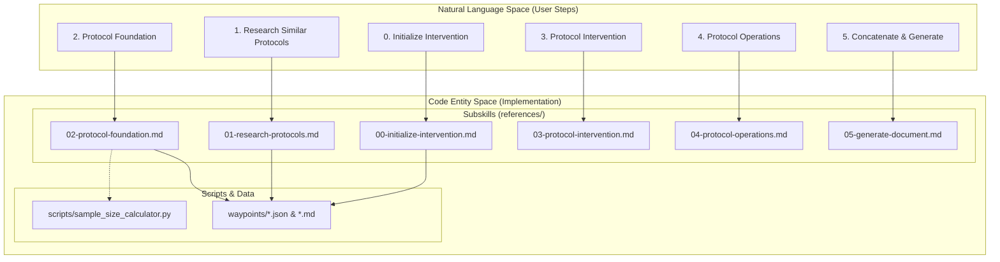

<!-- source: DeepWiki mcp.deepwiki.com · repo anthropics/life-sciences · page 4.5 Clinical Trial Protocol Skill · fetched 2026-10-26 -->

# Clinical Trial Protocol Skill

Relevant source files

The following files were used as context for generating this wiki page:

- [clinical-trial-protocol-skill/LICENSE.txt](clinical-trial-protocol-skill/LICENSE.txt)
- [clinical-trial-protocol-skill/README.md](clinical-trial-protocol-skill/README.md)
- [clinical-trial-protocol-skill/SKILL.md](clinical-trial-protocol-skill/SKILL.md)
- [instrument-data-to-allotrope/LICENSE.txt](instrument-data-to-allotrope/LICENSE.txt)
- [nextflow-development/LICENSE.txt](nextflow-development/LICENSE.txt)

The **Clinical Trial Protocol Skill** is a modular, waypoint-based analytical workflow designed to generate FDA/NIH-compliant clinical trial protocols for medical devices and drugs [clinical-trial-protocol-skill/README.md:1-8](). It streamlines the complex process of protocol development by integrating clinical research, regulatory guidance, and statistical power analysis into a structured sequence of steps [clinical-trial-protocol-skill/README.md:11-17]().

This skill is intended for clinical researchers, regulatory affairs professionals, and protocol writers [clinical-trial-protocol-skill/README.md:9](). It supports both medical devices via the **Investigational Device Exemption (IDE)** pathway and drugs via the **Investigational New Drug (IND)** pathway [clinical-trial-protocol-skill/README.md:13]().

### System Architecture and Data Flow

The skill utilizes a "waypoint-based" architecture, where progress and data are persisted in the `waypoints/` directory [clinical-trial-protocol-skill/SKILL.md:45-47](). This allows the system to remain token-efficient and enables users to resume interrupted workflows from any step [clinical-trial-protocol-skill/README.md:14-15]().

#### Natural Language to Code Entity Mapping

The following diagram illustrates how user-facing workflow steps map to specific markdown-based subskills and Python scripts within the codebase.

**Workflow Mapping Diagram**

**Sources:** [clinical-trial-protocol-skill/README.md:35-45](), [clinical-trial-protocol-skill/SKILL.md:64-84]()

### Core Capabilities

The skill offers two primary modes of operation to accommodate different stages of study design [clinical-trial-protocol-skill/SKILL.md:28-41]():

1.  **Research Only Mode (Steps 0-1):** Focuses on collecting intervention metadata and performing competitive/regulatory research using ClinicalTrials.gov and FDA databases [clinical-trial-protocol-skill/SKILL.md:30-33]().
2.  **Full Protocol Mode (Steps 0-5):** An end-to-end workflow that generates a complete protocol draft, including statistical justifications and operational procedures [clinical-trial-protocol-skill/SKILL.md:35-41]().

#### Technical Prerequisites
*   **ClinicalTrials.gov MCP Server:** Required for searching similar trials and retrieving trial details (NCT IDs) [clinical-trial-protocol-skill/SKILL.md:87-107]().
*   **Python Dependencies:** `scipy` and `numpy` are required for the `sample_size_calculator.py` script used during the Foundation step [clinical-trial-protocol-skill/SKILL.md:123-134]().
*   **WebSearch:** Used for locating specific FDA guidance documents [clinical-trial-protocol-skill/README.md:50]().

### Data Persistence (Waypoints)

As the workflow progresses, data is stored in structured files to ensure state management and context retention.

| File | Role |
| :--- | :--- |
| `intervention_metadata.json` | Stores initial device/drug info and status [clinical-trial-protocol-skill/SKILL.md:51]() |
| `01_clinical_research_summary.json` | Summary of similar trials and FDA guidance [clinical-trial-protocol-skill/SKILL.md:52]() |
| `02_sample_size_calculation.json` | Results from statistical power analysis [clinical-trial-protocol-skill/SKILL.md:58]() |
| `protocol_complete.md` | The final concatenated document [clinical-trial-protocol-skill/README.md:44]() |

**Sources:** [clinical-trial-protocol-skill/README.md:37-45](), [clinical-trial-protocol-skill/SKILL.md:49-59]()

### Child Pages

For detailed information on specific components of the Clinical Trial Protocol Skill, refer to the following child pages:

*   **[4.5.1 Protocol Generation Workflow](#)**
    Detailed breakdown of the six sequential steps, resume capability, and the interactive `sample_size_calculator.py` logic.
*   **[4.5.2 FDA Protocol Template and Regulatory Guidance](#)**
    Overview of the structural templates based on NIH/FDA guidelines and the specific regulatory pathways (510(k), PMA, IND, etc.) supported by the skill.

***

**Sources:**
- [clinical-trial-protocol-skill/README.md:1-54]()
- [clinical-trial-protocol-skill/SKILL.md:1-180]()

---

