<!-- source: DeepWiki mcp.deepwiki.com · repo anthropics/life-sciences · page 5 For Developers · fetched 2026-10-26 -->

# For Developers

<details>
<summary>Relevant source files</summary>

The following files were used as context for generating this wiki page:

- [.github/workflows/claude-code-review.yml](.github/workflows/claude-code-review.yml)
- [.github/workflows/claude-skill-review.yml](.github/workflows/claude-skill-review.yml)
- [.github/workflows/claude.yml](.github/workflows/claude.yml)
- [.github/workflows/release.yml](.github/workflows/release.yml)

</details>


## Purpose and Scope

This document provides technical information for developers who want to contribute to the life-sciences marketplace, add new plugins, or understand the internal architecture of the plugin distribution system. It covers the repository structure, plugin definition formats, contribution workflows, and the distinction between different plugin types.

For details on automated workflows, see:
- [Release Process](#5.1) — Covers packaging skills via GitHub Actions and the `SKILL.md` convention.
- [CI/CD and Code Review Workflows](#5.2) — Covers automated skill and code reviews using Claude-powered actions.

---

## Repository Structure

The life-sciences marketplace is a Git repository that functions as both a plugin registry and a source code repository. The structure follows a federated architecture where different components are stored in different locations.

### Directory Layout

```mermaid
graph TB
    ROOT["life-sciences/<br/>(repository root)"]
    
    ROOT --> CLAUDE[".claude-plugin/"]
    ROOT --> PLUGINS["plugins/"]
    ROOT --> SKILLS_DIR["single-cell-rna-qc/"]
    ROOT --> WORKFLOWS[".github/workflows/"]
    ROOT --> IGNORE[".gitignore"]
    
    CLAUDE --> MARKET["marketplace.json"]
    
    PLUGINS --> PUBMED["pubmed/"]
    PLUGINS --> BIORENDER["biorender/"]
    PLUGINS --> SYNAPSE["synapse/"]
    PLUGINS --> WILEY["wiley-scholar-gateway/"]
    PLUGINS --> BENCHLING["benchling/"]
    PLUGINS --> TENX["10x-genomics/"]
    
    PUBMED --> P1["plugin.json"]
    BIORENDER --> P2["plugin.json"]
    SYNAPSE --> P3["plugin.json"]
    WILEY --> P4["plugin.json"]
    BENCHLING --> P5["plugin.json"]
    TENX --> P6["plugin.json"]
    
    SKILLS_DIR --> SCRIPTS["scripts/"]
    SKILLS_DIR --> SKILL_MD["SKILL.md"]
    SKILLS_DIR --> README_S["README.md"]
    
    SCRIPTS --> QC_CORE["qc_core.py"]
    SCRIPTS --> QC_PLOT["qc_plotting.py"]
    SCRIPTS --> QC_ANALYSIS["qc_analysis.py"]
    SCRIPTS --> QC_GUIDE["scverse_qc_guidelines.md"]
    
    WORKFLOWS --> RELEASE["release.yml"]
    WORKFLOWS --> CLAUDE_REVIEW["claude-code-review.yml"]
    WORKFLOWS --> SKILL_REVIEW["claude-skill-review.yml"]
    
    style ROOT fill:#f9f9f9
    style CLAUDE fill:#e1f5ff
    style PLUGINS fill:#fff3e0
    style SKILLS_DIR fill:#e8f5e9
    style WORKFLOWS fill:#f3e5f5
```



**Sources:** [.gitignore:1-12](), [.github/workflows/release.yml:1-31](), [.github/workflows/claude-code-review.yml:1-11](), [.github/workflows/claude-skill-review.yml:1-5]()

### Component Locations

| Component Type | Location in Repo | External Storage |
|---------------|------------------|------------------|
| Marketplace Registry | `.claude-plugin/marketplace.json` | None |
| Plugin Definitions | `plugins/{plugin-id}/plugin.json` | None |
| Remote MCP Server Binaries | None | Hosted on respective service providers |
| Local MCP Server Binaries (MCPB) | None | S3 (Benchling), GitHub Releases (10x) |
| Skills Source Code | `{skill-name}/scripts/` | None |
| Skills Packaged Releases | None | GitHub Releases |

---

## Plugin Types and Architecture

The marketplace supports three distinct plugin types, each with different architectural characteristics and contribution requirements.

```mermaid
graph TB
    subgraph "Remote MCP Servers"
        REMOTE["Remote MCP<br/>HTTP-based"]
        REMOTE --> R_DEF["plugin.json<br/>defines mcpServers"]
        R_DEF --> R_CONFIG["npx command<br/>points to npm package"]
        R_CONFIG --> R_EXTERNAL["External npm registry"]
    end
    
    subgraph "Local MCP Servers MCPB"
        LOCAL["Local MCP (MCPB)<br/>Binary distribution"]
        LOCAL --> L_DEF["plugin.json<br/>defines mcpServers"]
        L_DEF --> L_CONFIG["command path<br/>points to .mcpb file"]
        L_CONFIG --> L_BINARY["Pre-built binary<br/>S3 or GitHub Releases"]
    end
    
    subgraph "Skills"
        SKILL["Skills<br/>Self-contained workflows"]
        SKILL --> S_DEF["SKILL.md<br/>Claude-readable spec"]
        SKILL --> S_SRC["scripts/<br/>Python source code"]
        S_SRC --> S_RELEASE["release.yml<br/>packages to .zip"]
        S_RELEASE --> S_ASSET["GitHub Release asset"]
    end
    
    REMOTE -.->|"No binary packaging"| R_EXTERNAL
    LOCAL -.->|"Pre-built binary"| L_BINARY
    SKILL -.->|"Automated packaging"| S_ASSET
    
    style REMOTE fill:#e8f5e9
    style LOCAL fill:#fff3e0
    style SKILL fill:#e1f5ff
```



**Sources:** [.github/workflows/release.yml:18-26]()

---

## Automated Workflows and CI/CD

The repository utilizes several GitHub Actions workflows to maintain code quality and automate the release process.

### Automated Code and Skill Review
The marketplace employs Claude-powered review systems to ensure contributions meet technical and domain-specific standards:
- **`claude-code-review.yml`**: Triggers on pull requests to perform automated code reviews using the `claude-code-action@v1` and the `code-review@claude-code-plugins` plugin [[.github/workflows/claude-code-review.yml:1-41]()].
- **`claude-skill-review.yml`**: A specialized workflow for reviewing Skill contributions, inheriting logic from a centralized healthcare repository [[.github/workflows/claude-skill-review.yml:1-9]()].
- **`claude.yml`**: Allows developers to interact with Claude directly within issues and PRs by tagging `@claude` [[.github/workflows/claude.yml:1-19]()].

For details, see [CI/CD and Code Review Workflows](#5.2).

### Automated Release Process
When a developer pushes a tag starting with `v*`, the `release.yml` workflow is triggered [[.github/workflows/release.yml:1-6]()].
1. **Scanning**: It searches for directories containing a `SKILL.md` file [[.github/workflows/release.yml:21-22]()].
2. **Packaging**: It creates a ZIP archive for each skill, naming it `{skill_name}-{GITHUB_REF_NAME}.zip` [[.github/workflows/release.yml:23-26]()].
3. **Distribution**: The workflow creates a draft GitHub Release and attaches the ZIP files as assets [[.github/workflows/release.yml:35-42]()].

For details, see [Release Process](#5.1).

---

## Marketplace Registry Format

The marketplace registry is defined in `.claude-plugin/marketplace.json`. This file serves as the authoritative index of all available plugins.

### Registry Schema

```json
{
  "schemaVersion": "1.0",
  "marketplace": {
    "name": "Life Sciences",
    "description": "Tools and workflows for life sciences research",
    "plugins": [
      {
        "id": "plugin-identifier",
        "name": "Human-readable Name",
        "description": "Brief description",
        "publisher": "Organization/Individual",
        "version": "semantic version",
        "icon": "emoji",
        "pluginPath": "relative/path/to/plugin.json"
      }
    ]
  }
}
```

### Key Fields

| Field | Type | Required | Description |
|-------|------|----------|-------------|
| `id` | string | Yes | Unique identifier for the plugin (used in `/plugin install` command) |
| `name` | string | Yes | Display name shown in Claude Code UI |
| `description` | string | Yes | Brief summary of plugin functionality |
| `publisher` | string | Yes | Organization or individual maintaining the plugin |
| `version` | string | Yes | Semantic version (e.g., "1.0.0") |
| `icon` | string | No | Emoji icon for visual identification |
| `pluginPath` | string | Yes | Relative path to the plugin's `plugin.json` or `SKILL.md` |

---

## Testing and Validation

Before submitting a plugin, ensure it meets these validation criteria:

### CI/CD Integration Testing
Ensure your PR triggers the automated review workflows. The `claude-review` job will provide feedback directly on the PR using the `claude_code_oauth_token` secret [[.github/workflows/claude-code-review.yml:34-38]()].

### Skill Packaging Validation
Before pushing a release tag, verify that your skill directory contains the `SKILL.md` marker file, as the release script uses this to identify packageable units [[.github/workflows/release.yml:22-23]()].

**Sources:** [.github/workflows/release.yml:21-26](), [.github/workflows/claude-code-review.yml:3-5](), [.github/workflows/claude-skill-review.yml:3-5]()

---

