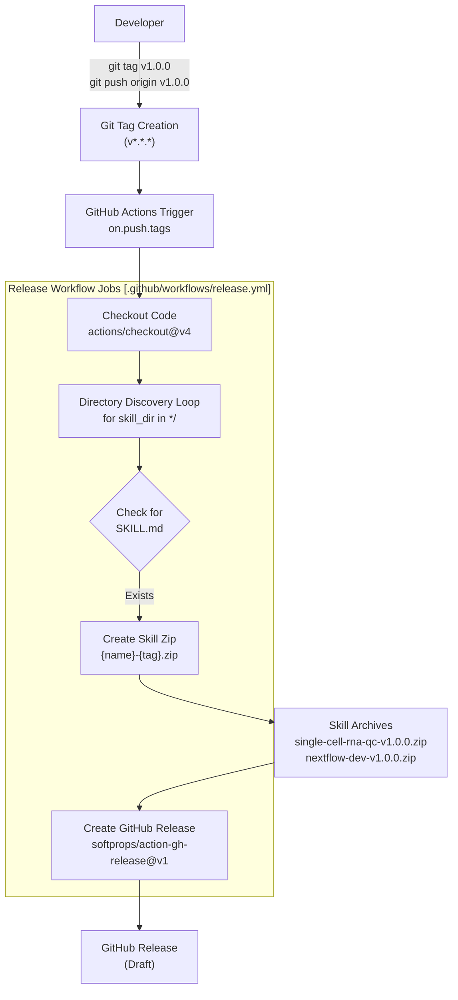
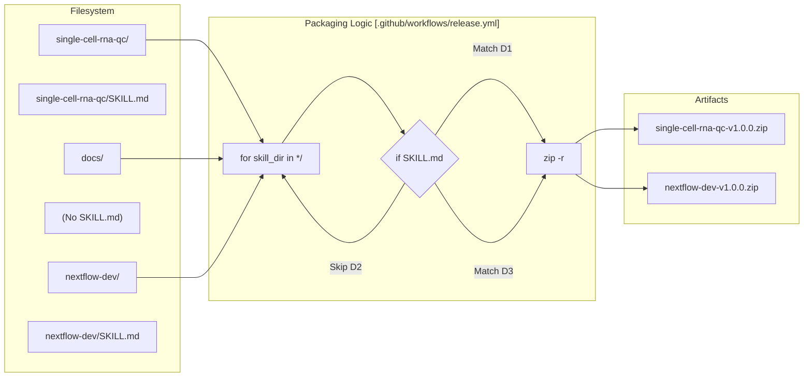

<!-- source: DeepWiki mcp.deepwiki.com · repo anthropics/life-sciences · page 5.1 Release Process · fetched 2026-10-26 -->

# Release Process

<details>
<summary>Relevant source files</summary>

The following files were used as context for generating this wiki page:

- [.github/workflows/release.yml](.github/workflows/release.yml)

</details>


## Purpose and Scope

This document describes the automated release workflow for packaging and distributing skills in the life-sciences marketplace. The release process uses GitHub Actions to dynamically discover skill directories, create versioned zip archives, and publish them as GitHub Releases. These archives are the primary distribution format for Claude Code plugins.

This page covers the technical implementation of the CI/CD pipeline for skills. For information about the overall marketplace distribution architecture, see [Overview](#1). For details on how skills are structured, see [Skills](#4).

---

## Overview

The release process is implemented as a GitHub Actions workflow that automatically packages skills when a version tag is pushed to the repository. Unlike static workflows, this implementation uses a marker convention (`SKILL.md`) to identify directories that should be packaged as independent skills.

**Key Characteristics:**
- **Trigger:** Git tags matching pattern `v*` (e.g., `v1.0.0`, `v2.1.3`) [.github/workflows/release.yml:3-6]()
- **Discovery Mechanism:** Detection of `SKILL.md` file within top-level directories [.github/workflows/release.yml:22-22]()
- **Output:** Versioned zip files (one per skill) attached to a GitHub Release [.github/workflows/release.yml:38-39]()
- **State:** Draft release requiring manual publishing [.github/workflows/release.yml:41-41]()

### Release Workflow Architecture



**Sources:** [.github/workflows/release.yml:1-42]()

---

## Workflow Configuration

The release workflow is defined in `.github/workflows/release.yml` and consists of a single job running on `ubuntu-latest`.

### Trigger Configuration

The workflow activates on tag pushes matching the version pattern:

[.github/workflows/release.yml:3-6]()

```yaml
on:
  push:
    tags:
      - 'v*'
```

### Permissions

The workflow requires write access to repository contents to create the release and upload binary assets:

[.github/workflows/release.yml:8-9]()

```yaml
permissions:
  contents: write
```

**Sources:** [.github/workflows/release.yml:1-13]()

---

## Packaging Process

The workflow uses a dynamic packaging strategy to support a growing marketplace without requiring manual workflow updates for every new skill.

### Skill Discovery and ZIP Creation

The workflow iterates through all top-level directories and identifies skills by the presence of a `SKILL.md` marker file [.github/workflows/release.yml:21-22]().

```bash
for skill_dir in */; do
  if [ -d "$skill_dir" ] && [ -f "${skill_dir}SKILL.md" ]; then
    skill_name="${skill_dir%/}"
    cd "$skill_name"
    zip -r "../${skill_name}-${GITHUB_REF_NAME}.zip" .
    cd ..
  fi
done
```

**Key Implementation Details:**
1. **Marker Convention:** The `SKILL.md` file serves as the indicator that a directory is a distributable skill [.github/workflows/release.yml:22-22]().
2. **Naming Convention:** The resulting zip file follows the pattern `{directory-name}-{tag}.zip` [.github/workflows/release.yml:26-26]().
3. **Internal Structure:** The `zip -r` command is executed *inside* the skill directory to ensure the archive root contains the skill files directly, rather than a nested folder [.github/workflows/release.yml:25-27]().

### Code Entity to Packaging Mapping



**Sources:** [.github/workflows/release.yml:18-33]()

---

## Release Creation

The final step uses the `softprops/action-gh-release` action to publish the artifacts.

### Release Action Configuration

[.github/workflows/release.yml:35-42]()

```yaml
- name: Create Release
  uses: softprops/action-gh-release@v1
  with:
    files: |
      *-*.zip
    generate_release_notes: true
    draft: true
    prerelease: false
```

### Release Parameters

| Parameter | Value | Purpose |
|-----------|-------|---------|
| `files` | `*-*.zip` | Captures all versioned zip files generated in the packaging step [.github/workflows/release.yml:39-39](). |
| `generate_release_notes` | `true` | Automatically summarizes commits since the last tag [.github/workflows/release.yml:40-40](). |
| `draft` | `true` | Creates the release in a "Draft" state for manual verification before public availability [.github/workflows/release.yml:41-41](). |
| `prerelease` | `false` | Marks the release as a full production release [.github/workflows/release.yml:42-42](). |

**Sources:** [.github/workflows/release.yml:35-42]()

---

## Triggering a Release

### Step-by-Step Process

1. **Verify SKILL.md:** Ensure every skill directory you wish to release contains a `SKILL.md` file.
2. **Tag the Commit:**
   ```bash
   git tag -a v1.2.0 -m "Release version 1.2.0"
   git push origin v1.2.0
   ```
3. **Monitor Actions:** The "Release" workflow will start automatically [.github/workflows/release.yml:3-6]().
4. **Finalize Draft:**
   - Go to the GitHub "Releases" page.
   - Edit the new draft release.
   - Verify all expected skill ZIP files are attached (e.g., `single-cell-rna-qc-v1.2.0.zip`).
   - Click **Publish Release**.

### Versioning Conventions
The workflow uses `GITHUB_REF_NAME` to name archives [.github/workflows/release.yml:26-26](). It is recommended to follow Semantic Versioning (e.g., `v1.0.0`) to maintain compatibility with plugin management systems.

**Sources:** [.github/workflows/release.yml:1-42]()

---

