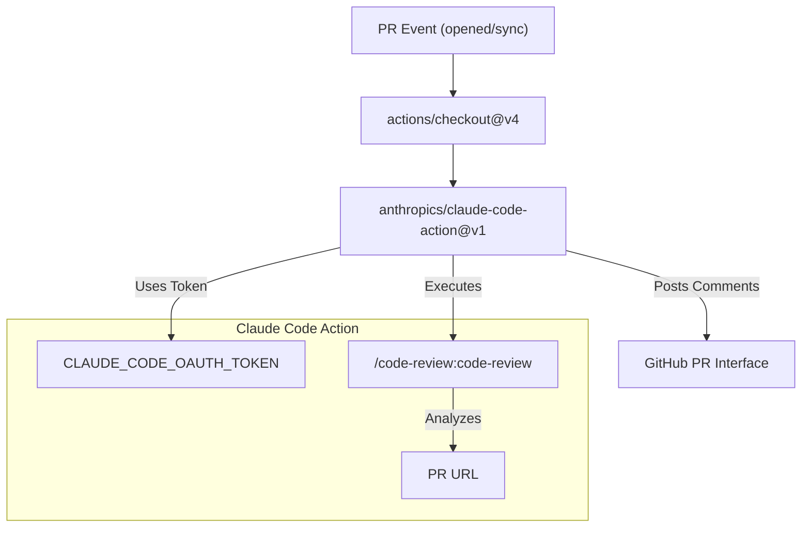
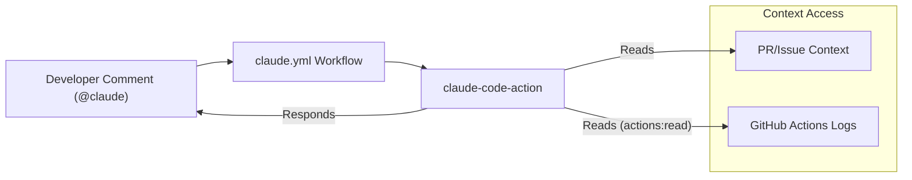

<!-- source: DeepWiki mcp.deepwiki.com · repo anthropics/life-sciences · page 5.2 CI/CD and Code Review Workflows · fetched 2026-10-26 -->

# CI/CD and Code Review Workflows

Relevant source files

The following files were used as context for generating this wiki page:

- [.github/workflows/claude-code-review.yml](.github/workflows/claude-code-review.yml)
- [.github/workflows/claude-skill-review.yml](.github/workflows/claude-skill-review.yml)
- [.github/workflows/claude.yml](.github/workflows/claude.yml)

The `life-sciences` repository utilizes GitHub Actions to automate quality assurance, skill validation, and interactive code assistance. These workflows integrate Claude Code directly into the development lifecycle, ensuring that new skills and code changes meet the repository's technical standards.

## Automated Code Review Workflow

The `claude-code-review.yml` workflow provides automated feedback on Pull Requests (PRs). It leverages the `code-review` plugin to analyze changes and provide insights directly within the GitHub PR interface.

### Implementation Details
The workflow triggers on PR events, including opening, synchronizing, and marking as ready for review [`.github/workflows/claude-code-review.yml`:4-5](). It utilizes the `anthropics/claude-code-action@v1` to execute the review logic [`.github/workflows/claude-code-review.yml`:36]().

Key configuration parameters include:
*   **Marketplace**: Connects to the official Claude Code plugin repository [`.github/workflows/claude-code-review.yml`:39]().
*   **Plugin**: Specifically invokes the `code-review@claude-code-plugins` [`.github/workflows/claude-code-review.yml`:40]().
*   **Command**: Executes the `/code-review:code-review` command targeting the specific PR URL [`.github/workflows/claude-code-review.yml`:41]().

### Data Flow: Code Review
The following diagram illustrates how the `claude-review` job interacts with the PR and the external action.

**Workflow: Code Review Execution**

**Sources:** [`.github/workflows/claude-code-review.yml`:1-45]()

---

## Skill Review Workflow

The `claude-skill-review.yml` workflow is specialized for the life-sciences marketplace. It ensures that new analytical workflows (skills) follow the required directory structures and metadata conventions (such as the presence of `SKILL.md`).

### Reusable Workflow
Unlike the general code review, this workflow calls a centralized definition hosted in the `anthropics/healthcare` repository [`.github/workflows/claude-skill-review.yml`:9](). This ensures consistency across different healthcare and life-sciences plugin repositories.

### Permissions
The job requires elevated permissions to interact with the PR environment:
*   `pull-requests: write`: To post validation results [`.github/workflows/claude-skill-review.yml`:12]().
*   `issues: write`: To log issues found during skill analysis [`.github/workflows/claude-skill-review.yml`:13]().
*   `id-token: write`: For OIDC authentication [`.github/workflows/claude-skill-review.yml`:14]().

**Sources:** [`.github/workflows/claude-skill-review.yml`:1-17]()

---

## Interactive Claude Automation

The `claude.yml` workflow enables interactive automation by allowing developers to trigger Claude Code via GitHub comments. This supports "ChatOps" style interactions where Claude can perform tasks like updating PR descriptions or reading CI results.

### Trigger Mechanisms
The workflow monitors several event types [`.github/workflows/claude.yml`:4-11]():
*   `issue_comment`: Comments on issues or PRs.
*   `pull_request_review_comment`: Comments on specific code lines.
*   `issues`: When an issue is opened or assigned.
*   `pull_request_review`: General PR reviews.

### Activation Logic
Claude only responds if specifically mentioned using the `@claude` handle in the body or title of the event [`.github/workflows/claude.yml`:16-19]().

### Integration with CI Results
A critical feature of this workflow is the `actions: read` permission [`.github/workflows/claude.yml`:26](). This allows Claude to inspect the status and logs of other CI jobs (such as unit tests or skill builds) to help developers debug failures [`.github/workflows/claude.yml`:39-41]().

**Workflow: Interactive Claude Logic**

### Configuration Summary

| Workflow | File | Primary Purpose |
| :--- | :--- | :--- |
| **Claude Code Review** | `claude-code-review.yml` | Automated static analysis and PR feedback. |
| **Claude Skill Review** | `claude-skill-review.yml` | Validation of skill-specific metadata and structure. |
| **Claude Code** | `claude.yml` | Interactive ChatOps and CI log debugging via `@claude`. |

**Sources:** [`.github/workflows/claude.yml`:1-51](), [`.github/workflows/claude-code-review.yml`:1-45](), [`.github/workflows/claude-skill-review.yml`:1-17]()

---

