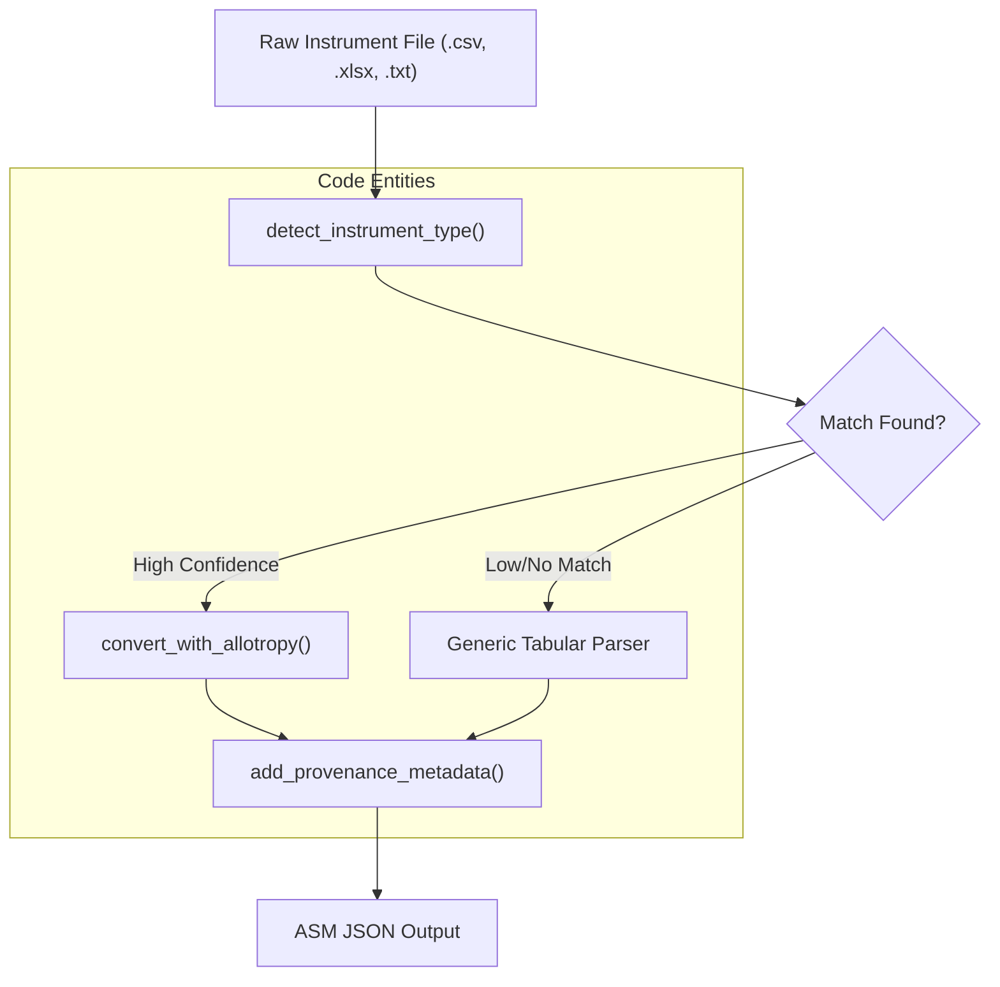
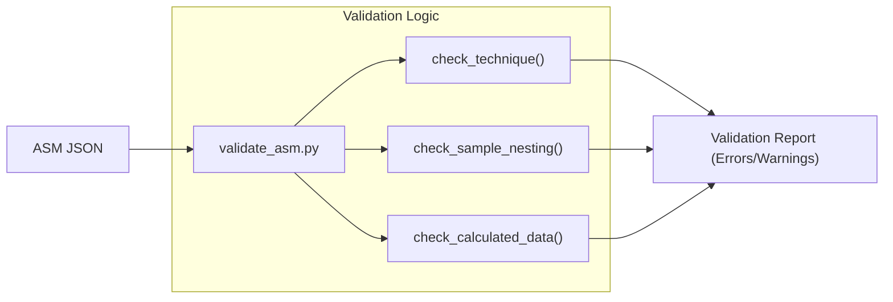

<!-- source: DeepWiki mcp.deepwiki.com · repo anthropics/life-sciences · extra page ASM Format and Conversion Workflow · fetched 2026-10-26 -->

# ASM Format and Conversion Workflow

Relevant source files

The following files were used as context for generating this wiki page:

- [instrument-data-to-allotrope/references/asm_schema_overview.md](instrument-data-to-allotrope/references/asm_schema_overview.md)
- [instrument-data-to-allotrope/references/flattening_guide.md](instrument-data-to-allotrope/references/flattening_guide.md)
- [instrument-data-to-allotrope/scripts/convert_to_asm.py](instrument-data-to-allotrope/scripts/convert_to_asm.py)
- [instrument-data-to-allotrope/scripts/flatten_asm.py](instrument-data-to-allotrope/scripts/flatten_asm.py)
- [instrument-data-to-allotrope/scripts/validate_asm.py](instrument-data-to-allotrope/scripts/validate_asm.py)

The Allotrope Simple Model (ASM) is a JSON-based standard designed to represent laboratory instrument data with semantic consistency across different vendors and techniques [instrument-data-to-allotrope/references/asm_schema_overview.md:3-5](). This page documents the schema structure, the multi-tier parsing strategy, and the utility scripts for conversion, flattening, and validation.

## 1. ASM Schema Structure

ASM uses a hierarchical document structure to separate metadata from experimental results. The root level typically contains a manifest linking to ontologies, followed by an aggregate document specific to the analytical technique [instrument-data-to-allotrope/references/asm_schema_overview.md:7-31]().

### Core Components
| Component | Description |
| :--- | :--- |
| **Manifest** | Links to Allotrope Foundation Ontologies (AFO) and JSON-LD contexts [instrument-data-to-allotrope/references/asm_schema_overview.md:16-19](). |
| **Data System Document** | Metadata about the conversion process, including the source filename, converter name, and version [instrument-data-to-allotrope/references/asm_schema_overview.md:35-43](). |
| **Device System Document** | Hardware metadata, including instrument serial numbers, manufacturers, and sub-components like probes [instrument-data-to-allotrope/references/asm_schema_overview.md:45-53](). |
| **Technique Aggregate** | The container for measurement data (e.g., `cell-counting-aggregate-document`) [instrument-data-to-allotrope/references/asm_schema_overview.md:20-29](). |

### Data Representation Patterns
*   **Value Datum:** A simple object containing a `value` and a `unit` [instrument-data-to-allotrope/references/asm_schema_overview.md:132-139]().
*   **Data Cube:** Multi-dimensional arrays for time-series or spectral data, defining `dimensions` (e.g., elapsed time) and `measures` (e.g., absorbance) [instrument-data-to-allotrope/references/asm_schema_overview.md:154-167]().

**Sources:** [instrument-data-to-allotrope/references/asm_schema_overview.md:7-53](), [instrument-data-to-allotrope/references/asm_schema_overview.md:132-167]()

---

## 2. Conversion Workflow

The `convert_to_asm.py` script manages the lifecycle of transforming raw instrument exports into validated ASM JSON. It employs a three-tier strategy to maximize compatibility.

### Tiered Parsing Strategy
1.  **Allotropy Native:** Attempts to use the `allotropy` library for high-fidelity conversion using official vendor parsers [instrument-data-to-allotrope/scripts/convert_to_asm.py:167-192]().
2.  **Flexible Fallback:** If native parsing fails, the system uses `DETECTION_PATTERNS` to identify the instrument via column headers and keywords, then applies generic tabular parsing [instrument-data-to-allotrope/scripts/convert_to_asm.py:43-98]().
3.  **PDF/OCR Extraction:** (Conceptual) Extraction of data from unstructured reports when structured exports are unavailable.

### Data Flow: Raw to ASM

**Sources:** [instrument-data-to-allotrope/scripts/convert_to_asm.py:101-164](), [instrument-data-to-allotrope/scripts/convert_to_asm.py:167-192](), [instrument-data-to-allotrope/scripts/convert_to_asm.py:228-230]()

---

## 3. Flattening for Downstream Systems

While ASM is semantically rich, many LIMS and ELN systems require flat 2D tables. The `flatten_asm.py` script transforms hierarchical JSON into CSV format [instrument-data-to-allotrope/scripts/flatten_asm.py:2-9]().

### Flattening Logic
*   **One Row Per Measurement:** Each entry in the `measurement-document` array becomes a unique row [instrument-data-to-allotrope/references/flattening_guide.md:15-16]().
*   **Metadata Propagation:** Device and sample metadata are repeated across all rows associated with that measurement set [instrument-data-to-allotrope/scripts/flatten_asm.py:95-97]().
*   **Column Normalization:** Hyphenated ASM keys are converted to `snake_case`. Value datum units are appended as `_unit` columns [instrument-data-to-allotrope/scripts/flatten_asm.py:115-121]().

### Hierarchy Mapping
| ASM Path | Flat Column Name |
| :--- | :--- |
| `device-system-document.device-identifier` | `instrument_serial_number` |
| `measurement-document[].viable-cell-density.value` | `viable_cell_density` |
| `measurement-document[].viable-cell-density.unit` | `viable_cell_density_unit` |

**Sources:** [instrument-data-to-allotrope/references/flattening_guide.md:15-42](), [instrument-data-to-allotrope/scripts/flatten_asm.py:86-135]()

---

## 4. Validation and Quality Control

The `validate_asm.py` tool ensures that generated files adhere to the Allotrope specification and internal data integrity rules [instrument-data-to-allotrope/scripts/validate_asm.py:2-12]().

### Key Validation Rules
1.  **Technique Verification:** Checks if the aggregate document key matches one of the 65+ official Allotrope techniques (e.g., `cell-counting`, `pcr`, `spectrophotometry`) [instrument-data-to-allotrope/scripts/validate_asm.py:42-108]().
2.  **Field Nesting:** Ensures specific fields are correctly placed within nested objects. For example, `sample identifier` must reside within the `sample document` [instrument-data-to-allotrope/scripts/validate_asm.py:212-243]().
3.  **Calculated Data Traceability:** Identifies fields that should be in the `calculated-data-document` (like `viability` or `260/280` ratios) rather than the raw `measurement-document` [instrument-data-to-allotrope/scripts/validate_asm.py:189-205]().

### Validation Architecture

**Sources:** [instrument-data-to-allotrope/scripts/validate_asm.py:42-108](), [instrument-data-to-allotrope/scripts/validate_asm.py:212-243](), [instrument-data-to-allotrope/scripts/validate_asm.py:189-205]()

---

## 5. Implementation Reference

### Key Functions
*   `detect_instrument_type(filepath)`: Scans the first 10KB of a file for vendor-specific signatures [instrument-data-to-allotrope/scripts/convert_to_asm.py:101-132]().
*   `flatten_value(value, prefix)`: A recursive function that handles nested dictionaries and "Value Datum" patterns during flattening [instrument-data-to-allotrope/scripts/flatten_asm.py:35-67]().
*   `add_provenance_metadata(asm, source_path)`: Injects SHA256 hashes and conversion timestamps into the ASM output for audit trails [instrument-data-to-allotrope/scripts/convert_to_asm.py:228-260]().

**Sources:** [instrument-data-to-allotrope/scripts/convert_to_asm.py:101-132](), [instrument-data-to-allotrope/scripts/convert_to_asm.py:228-260](), [instrument-data-to-allotrope/scripts/flatten_asm.py:35-67]()

---

