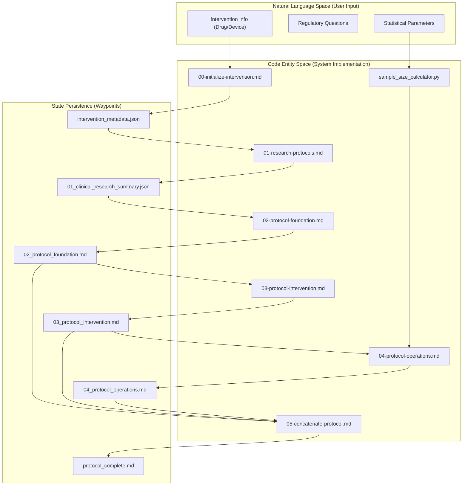
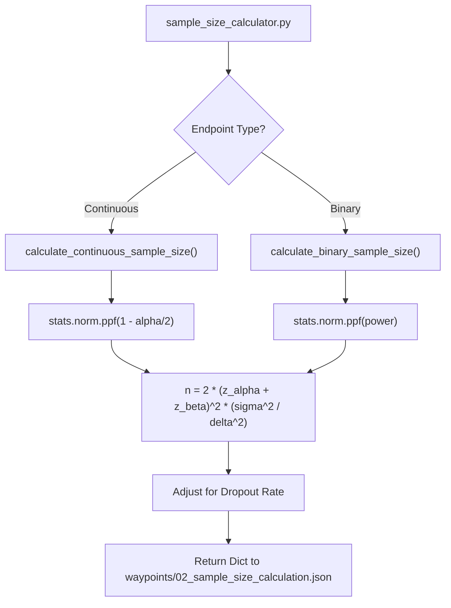

<!-- source: DeepWiki mcp.deepwiki.com · repo anthropics/life-sciences · extra page Protocol Generation Workflow · fetched 2026-10-26 -->

# Protocol Generation Workflow

Relevant source files

The following files were used as context for generating this wiki page:

- [clinical-trial-protocol-skill/references/00-initialize-intervention.md](clinical-trial-protocol-skill/references/00-initialize-intervention.md)
- [clinical-trial-protocol-skill/references/01-research-protocols.md](clinical-trial-protocol-skill/references/01-research-protocols.md)
- [clinical-trial-protocol-skill/references/02-protocol-foundation.md](clinical-trial-protocol-skill/references/02-protocol-foundation.md)
- [clinical-trial-protocol-skill/references/03-protocol-intervention.md](clinical-trial-protocol-skill/references/03-protocol-intervention.md)
- [clinical-trial-protocol-skill/references/04-protocol-operations.md](clinical-trial-protocol-skill/references/04-protocol-operations.md)
- [clinical-trial-protocol-skill/references/05-concatenate-protocol.md](clinical-trial-protocol-skill/references/05-concatenate-protocol.md)
- [clinical-trial-protocol-skill/scripts/sample_size_calculator.py](clinical-trial-protocol-skill/scripts/sample_size_calculator.py)

The **Clinical Trial Protocol Skill** implements a structured, waypoint-based workflow to generate FDA/NIH-compliant clinical trial protocols. The system uses a sequential pipeline that preserves context across multiple LLM interactions, allowing for the generation of massive documents (5,000+ lines) that maintain internal consistency.

## 1. Workflow Overview

The workflow is divided into two primary modes: **Research Only** and **Full Protocol**. The generation process follows six sequential waypoints, each producing specific JSON metadata or Markdown content stored in the `waypoints/` directory.

### Core Architecture
- **Waypoint-based State:** Each step reads from previous JSON waypoints and writes its own, ensuring the model doesn't "forget" earlier decisions [clinical-trial-protocol-skill/references/00-initialize-intervention.md:124-153]().
- **Resume Capability:** Because state is persisted in `waypoints/`, the workflow can be resumed at any step if interrupted.
- **Template-Driven:** The system uses standardized NIH/FDA templates found in the `assets/` folder or accepts user-provided custom templates [clinical-trial-protocol-skill/references/02-protocol-foundation.md:33-61]().

### Data Flow Diagram (NL Space to Code Space)

This diagram illustrates how Natural Language inputs are transformed into Code Entities (files and scripts) through the generation steps.

**Sources:** [clinical-trial-protocol-skill/references/00-initialize-intervention.md:12-153](), [clinical-trial-protocol-skill/references/02-protocol-foundation.md:23-55](), [clinical-trial-protocol-skill/references/04-protocol-operations.md:27-200](), [clinical-trial-protocol-skill/references/05-concatenate-protocol.md:23-68]().

---

## 2. Sequential Generation Steps

### 2.1 Initialize (Step 0)
Collects high-level details about the intervention (Device vs. Drug), target population, and intended use.
- **Key Action:** Creates `waypoints/intervention_metadata.json`.
- **Custom Templates:** Users can provide a `.md` template at this stage, which is stored in the `user_provided_template` field [clinical-trial-protocol-skill/references/00-initialize-intervention.md:54-78]().

### 2.2 Research (Step 1)
Performs regulatory research using the **ClinicalTrials.gov MCP Server**.
- **Device Track:** Queries FDA Product Classification, 510(k), De Novo, and PMA databases [clinical-trial-protocol-skill/references/01-research-protocols.md:42-130]().
- **Drug Track:** Researches IND requirements and 21 CFR 312 [clinical-trial-protocol-skill/references/01-research-protocols.md:150-161]().
- **Output:** `waypoints/01_clinical_research_summary.json`.

### 2.3 Foundation (Step 2)
Generates the **Title Page** and **Sections 1-6** (Summary, Introduction, Objectives, Design, Population).
- **Template Selection:** Prioritizes user-provided templates, then `assets/` directory templates [clinical-trial-protocol-skill/references/02-protocol-foundation.md:31-61]().
- **Output:** `waypoints/02_protocol_foundation.md`.

### 2.4 Intervention (Step 3)
Generates **Sections 6-7** (Study Intervention details and Discontinuation).
- **Detail Level:** Includes technical descriptions (materials for devices, formulation for drugs) and instructions for use (IFU) [clinical-trial-protocol-skill/references/03-protocol-intervention.md:80-184]().
- **Output:** `waypoints/03_protocol_intervention.md`.

### 2.5 Operations & Statistics (Step 4)
Generates **Sections 8-11** (Assessments, Statistics, Operational Considerations).
- **Statistical Calculation:** Invokes the `sample_size_calculator.py` script [clinical-trial-protocol-skill/references/04-protocol-operations.md:160-186]().
- **Output:** `waypoints/04_protocol_operations.md`.

### 2.6 Concatenate (Step 5)
Final assembly step using system commands to merge all Markdown waypoints into a single document.
- **Command:** `cat waypoints/02_protocol_foundation.md waypoints/03_protocol_intervention.md waypoints/04_protocol_operations.md > waypoints/protocol_complete.md` [clinical-trial-protocol-skill/references/05-concatenate-protocol.md:62-65]().

---

## 3. Sample Size Calculator

The `sample_size_calculator.py` script is a standalone utility used in Step 4 to provide statistically sound enrollment targets.

### Implementation Details
- **Location:** `clinical-trial-protocol-skill/scripts/sample_size_calculator.py`
- **Supported Endpoints:**
    - **Continuous:** Uses two-sample t-test power calculation [clinical-trial-protocol-skill/scripts/sample_size_calculator.py:16-41]().
    - **Binary:** Uses two-proportion z-test power calculation [clinical-trial-protocol-skill/scripts/sample_size_calculator.py:164-189]().
- **Dependencies:** Requires `scipy` and `statsmodels` for Z-score and Normal distribution functions [clinical-trial-protocol-skill/scripts/sample_size_calculator.py:42-47]().

### Statistical Logic Flow

**Sources:** [clinical-trial-protocol-skill/scripts/sample_size_calculator.py:16-161](), [clinical-trial-protocol-skill/references/04-protocol-operations.md:171-186]().

---

## 4. Metadata and State Management

The workflow relies on two primary JSON files to maintain state:

| File | Purpose | Key Fields |
| :--- | :--- | :--- |
| `intervention_metadata.json` | Global trial state | `intervention_type`, `protocol_status`, `completed_steps`, `user_provided_template` |
| `02_protocol_metadata.json` | Protocol generation progress | `step_2_status`, `step_3_status`, `step_4_status`, `enrollment_target` |

**Sources:** [clinical-trial-protocol-skill/references/00-initialize-intervention.md:124-153](), [clinical-trial-protocol-skill/references/05-concatenate-protocol.md:102-138]().

---

